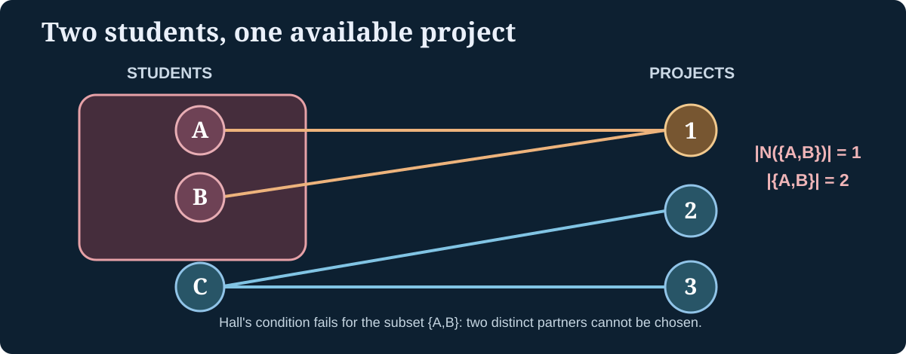

> [!abstract] Prerequisites & where this leads
> **Builds on:** [Graph Theory](./graph-theory), [posets and reachability](./order-theory), [state-transition invariants](./state-machines-invariants), and [counting arguments](./combinatorial-reasoning).
> **Leads to:** algorithms, scheduling, matching, flow networks, and [Optimization](./optimization).

The foundational [Graph Theory](./graph-theory) chapter introduces paths, cycles, trees, traversals, weighted paths, and spanning trees. Here we develop deeper questions: what directed cycles mean for dependencies, when distinct items can be matched without collisions, and how much can move through a network with capacity limits. Each proof connects a graph algorithm to a mathematical invariant or counting obstruction.

## Directed reachability and strongly connected components

For vertices $u,v$ of a directed graph, write $u\leadsto v$ when there is a directed path from $u$ to $v$, including a zero-length path when $u=v$.

This reachability relation is **reflexive** and **transitive**, hence a [preorder](./order-theory#from-relations-to-preorders-and-partial-orders). It need not be antisymmetric: a directed cycle allows $u\leadsto v$ and $v\leadsto u$ for distinct vertices.

Define

$$
u\sim v\quad\Longleftrightarrow\quad u\leadsto v\ \text{and}\ v\leadsto u.
$$

The equivalence classes are called **strongly connected components** (SCCs). Collapse each component to a single vertex; draw an edge between components whenever an original edge connects them. This is the **condensation graph**.

> [!theorem] The condensation graph is a DAG
> Contracting every strongly connected component of a directed graph produces a **directed acyclic graph** (DAG).

> [!proof] Why no directed cycle survives
> Suppose distinct components $C_1,C_2,\ldots,C_k$ formed a directed cycle in the condensation graph. Following its edges would make every component reachable from every other component. Their vertices would then be mutually reachable, meaning they belong to **one** SCC, contradicting that the components were distinct. Hence the condensation graph has no directed cycle.

This theorem is the graph version of [quotienting a preorder into a poset](./order-theory#turning-a-preorder-into-a-poset).

## Topological ordering of dependencies

A **topological ordering** of a directed graph is a list of all vertices such that every directed edge $u\to v$ goes from an earlier vertex to a later one.

> [!theorem] A finite directed graph has a topological ordering exactly when it is acyclic.

> [!proof] Both directions
> **Ordering implies no cycles:** if $v_1\to v_2\to\cdots\to v_k\to v_1$ were a directed cycle, the order would require $v_1$ to occur before $v_2$, before every subsequent vertex, and ultimately before itself—a contradiction.
>
> **Acyclic implies an ordering:** a finite nonempty DAG has a vertex of indegree zero. Otherwise, starting from any vertex and repeatedly following an incoming edge must revisit a vertex (the graph is finite), creating a cycle. Remove a zero-indegree vertex and all its outgoing edges; the remaining graph is still acyclic. Repeat, appending each removed vertex to a list. Every removed edge goes from a vertex already listed to one listed later, producing a topological ordering.

### Kahn's algorithm and its invariant

Kahn's algorithm keeps the set of all remaining vertices with **zero incoming edges**. It repeatedly removes one such vertex, records it, and deletes its outgoing edges.

The **invariant** is that the output list respects every edge whose destination has already been output: when $v$ is appended, no unprocessed predecessor of $v$ remains. If all vertices are removed, the result is a topological order. If vertices remain but none has indegree zero, the remaining graph contains a directed cycle.

**Worked example:** let edges be $A\to C$, $B\to C$, $C\to D$. Initially $A$ and $B$ both have indegree zero, so either may come first. One valid ordering is $A,B,C,D$; another is $B,A,C,D$. Topological orders need not be unique.

## Bipartite matching: avoiding collisions

A **bipartite graph** has vertices split into a left set $L$ and right set $R$, with edges only between the two sets. A **matching** is a set of edges that do not share endpoints. A matching **saturates** $L$ if every left vertex has a distinct matched partner.

For a set $X\subseteq L$, write $N(X)$ (read "the neighborhood of X") for all right vertices adjacent to at least one element of $X$.

> [!theorem] Hall's marriage theorem
> A finite bipartite graph has a matching saturating $L$ **if and only if**
> $$
> |N(X)|\geq|X|\quad\text{for every }X\subseteq L.
> $$
> Read this as "every collection of left vertices collectively has at least as many possible right neighbors as it has members."

The **necessity** is immediate: if a matching assigns distinct partners to all vertices of $X$, those $|X|$ partners must lie in $N(X)$.

### Worked failure: a bottleneck subset

Suppose three students $\{A,B,C\}$ are to receive distinct projects. Student $A$ accepts only project 1, student $B$ accepts only project 1, and student $C$ accepts projects 2 or 3.

Take $X=\{A,B\}$. Its neighborhood is $N(X)=\{1\}$, so $|N(X)|=1<2=|X|$. A matching assigning a distinct project to every student is **impossible**, regardless of how student $C$ is assigned.

*Figure: A deficient neighborhood is a concrete obstruction to a complete matching.*

> [!proof] Why Hall's condition is sufficient (induction sketch)
> Induct on $|L|$. If some nonempty proper subset $X\subsetneq L$ satisfies **equality** $|N(X)|=|X|$, apply induction to the subgraph on $X,N(X)$ and separately to $L\setminus X,R\setminus N(X)$. Hall's condition holds for the latter: any subset $Y$ of the remaining left vertices would otherwise make $X\cup Y$ violate Hall in the original graph.
>
> Otherwise every nonempty proper $X$ has the **strict** inequality $|N(X)|\geq|X|+1$. Choose an edge $uv$ with $u\in L$. Remove $u$ and $v$. For any remaining nonempty $X$, removing $v$ destroys at most one neighbor, so $|N_{\mathrm{new}}(X)|\geq|N(X)|-1\geq|X|$. Apply induction to match the remaining left vertices, then add $uv$. The empty graph is the base case.
>
> Either way a matching saturating $L$ exists.

This proof demonstrates how a **global matching** can be characterized by a collection of local **counting inequalities**.

## Augmenting paths improve a matching

An **augmenting path** begins and ends at unmatched vertices and alternates between edges outside a matching and edges inside it. Flipping membership along this path (adding previously unmatched edges and removing previously matched ones) increases matching size by **one**.

> [!theorem] Berge's augmenting-path criterion
> A matching is maximum if and only if it has no augmenting path.

> [!proof] The nontrivial direction
> If a larger matching $M'$ exists, inspect the symmetric difference $M\triangle M'$ (edges in exactly one matching). Each vertex has degree at most two there, so the components are alternating paths or alternating cycles. Because $|M'|>|M|$, at least one path component has **more** edges from $M'$ than from $M$. Its endpoints are unmatched under $M$, and the path alternates, so it is an augmenting path. Contradiction.

This criterion turns matching into a search problem, much as a decreasing ranking function turns termination into an order-theoretic proof.

## Flow networks: capacities and conservation

A **flow network** is a directed graph with a source $s$, sink $t$, and nonnegative capacities $c(u,v)$ on directed edges.

A feasible **flow** $f$ satisfies:

1. **Capacity:** $0\leq f(u,v)\leq c(u,v)$ for each edge.
2. **Conservation:** at every vertex other than $s,t$, incoming flow equals outgoing flow.

The **flow value** is the total flow leaving the source minus any flow entering the source. Conservation ensures the same value enters the sink (net of any outgoing sink flow).

A cut $(S,V\setminus S)$ has $s\in S$, $t\notin S$. Its capacity is the sum of capacities of edges going **from S to its complement**.

> [!theorem] Every flow is bounded by every cut
> For every feasible flow $f$ and source-sink cut $S$,
> $$
> |f|\leq \sum_{u\in S,\ v\notin S}c(u,v).
> $$

> [!proof] Sum conservation over all vertices of S
> Internal edges cancel when we sum net outflow of vertices of $S$. Only edges crossing from $S$ to outside and edges returning from outside to $S$ remain. Therefore
> $$
> |f|=\sum_{u\in S,v\notin S}f(u,v)
> -\sum_{u\notin S,v\in S}f(u,v)
> \leq\sum_{u\in S,v\notin S}c(u,v).
> $$
> The final inequality follows from nonnegative flows and capacity bounds.

### Worked example: matching the upper bound of a cut

Take four vertices $s,a,b,t$ with edges and capacities:

| Edge | Capacity |
|---|---:|
| $s\to a$ | 3 |
| $s\to b$ | 2 |
| $a\to t$ | 2 |
| $a\to b$ | 1 |
| $b\to t$ | 3 |

Send two units on $s\to a\to t$, two on $s\to b\to t$, and one on $s\to a\to b\to t$.

The resulting edge flows are $f(s,a)=3$, $f(s,b)=2$, $f(a,t)=2$, $f(a,b)=1$, $f(b,t)=3$. All capacities are respected. At $a$, input 3 equals output $2+1$; at $b$, input $2+1$ equals output 3. The total flow is **5**.

Now choose the cut $S=\{s\}$. The only outgoing edges are $s\to a$ and $s\to b$, with total capacity $3+2=5$. The cut bound proves **no flow can exceed five**. Because our feasible flow reaches five, it is maximum.

> [!theorem] Max-flow min-cut theorem
> In a finite flow network, the maximum feasible flow value equals the minimum capacity of any source-sink cut.

### Why augmenting paths establish the theorem

A **residual graph** describes how we may change a current flow: unused forward capacity permits adding flow; positive flow permits a backward residual edge that cancels some previous flow.

If the residual graph has an $s$-to-$t$ path with positive residual capacities, augmenting flow along it strictly increases the flow value. If **no** residual path exists, let $S$ contain precisely vertices reachable from $s$ by residual edges. Then $t\notin S$. Every original edge leaving $S$ is saturated, and every original edge entering $S$ has zero flow—otherwise a residual edge would reconnect to $S$. Therefore the flow equals the capacity of this cut. The cut upper bound proves optimality.

With **integral capacities**, each augmenting step can send an integral positive amount, so Ford–Fulkerson terminates after finitely many steps. Arbitrary irrational capacities require care: naive augmenting-path choices need not terminate.

## Graph isomorphism and structural invariants

Two graphs are **isomorphic** when a bijection between their vertex sets preserves adjacency in both directions. An isomorphism is a *relabeling without structural change*.

Isomorphic graphs have the same numbers of vertices and edges, degree multiset, number of connected components, and cycle structure. Such invariants can **disprove** isomorphism, but sharing them does not automatically **prove** it.

For example, the triangle with three vertices and the path with three vertices have different degree multisets: $(2,2,2)$ and $(1,2,1)$. Therefore they cannot be isomorphic.

The same idea appears in [Order Theory](./order-theory#order-preserving-maps-and-order-isomorphisms): structure-preserving bijections identify what mathematical information survives a change of labels.

## Planarity and further directions

The foundational [Graph Theory](./graph-theory#graph-coloring) chapter already treats planar embeddings, Euler's formula, and the obstructions $K_5$ and $K_{3,3}$. This chapter does not duplicate that proof.

Further discrete graph topics worth separate treatments include the proof of Kuratowski's theorem, graph minors, Menger's theorem, spectral graph theory, and Ramsey theory. The matching/flow and reachability results above are the reusable foundation for those directions.
