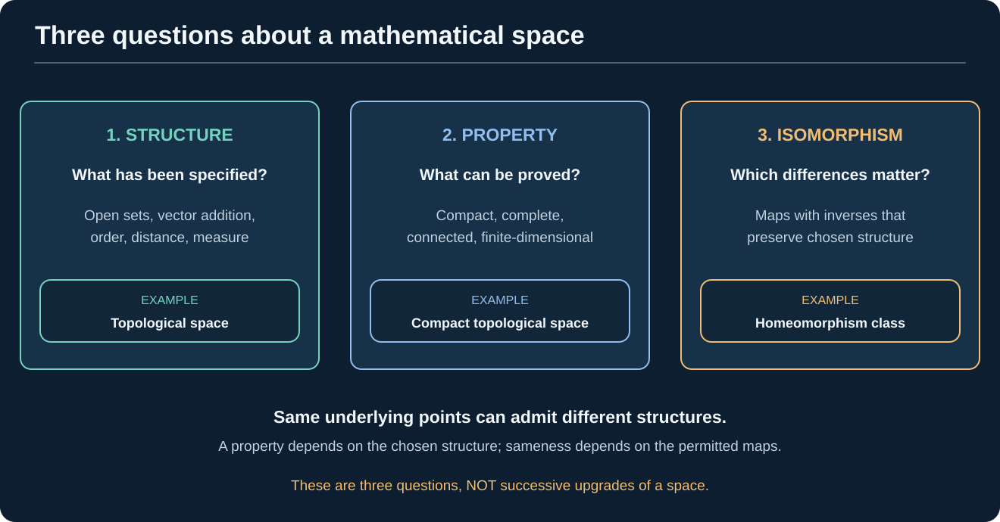
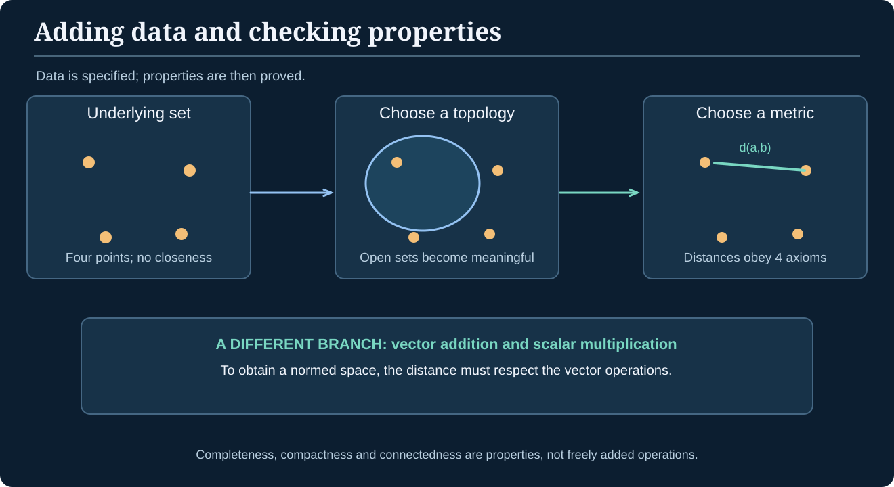
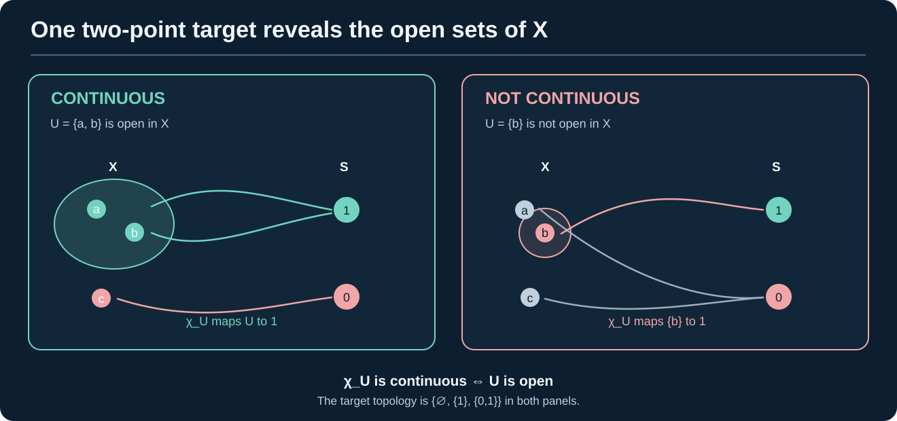
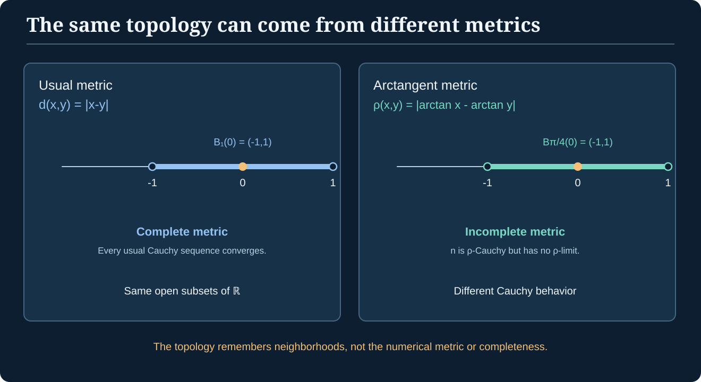
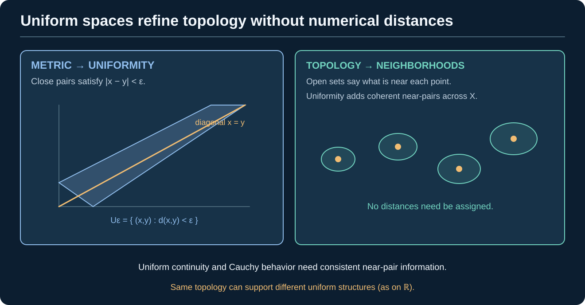
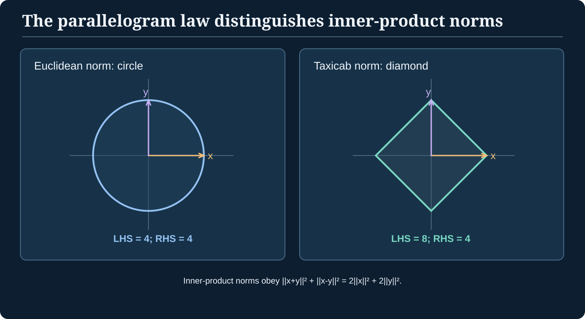
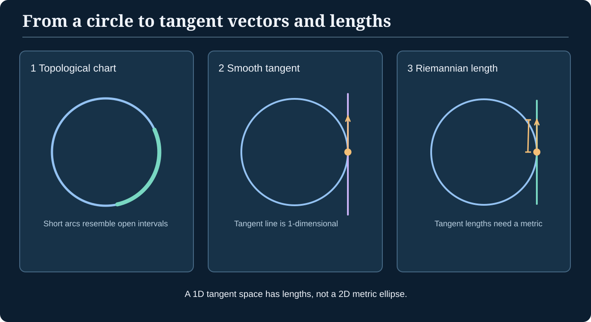
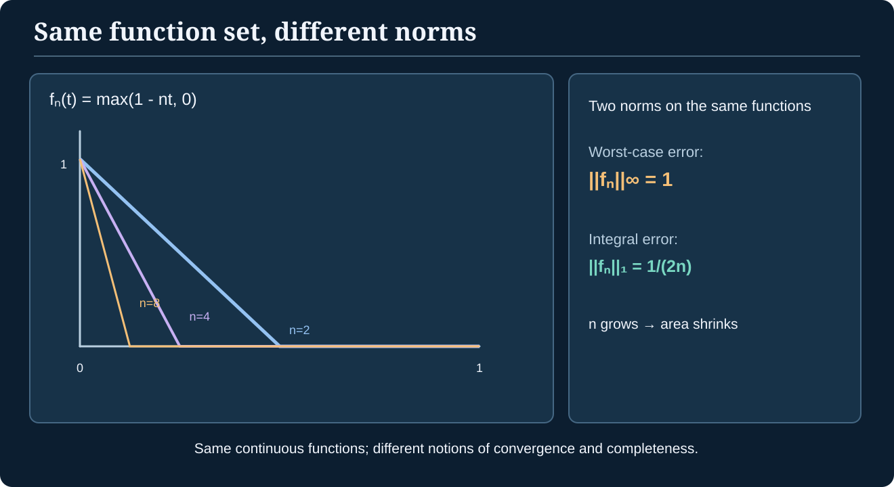

> [!abstract] A conceptual map of mathematical structure
> **Begin with:** [Sets](./set-theory), [Functions and Relations](./functions-relations).
> **Use alongside:** [Path Through Topology](./path-to-topology), [Path Through Algebra](./path-through-algebra), and [Path Through Analysis](./path-through-analysis).
> **Advanced destinations:** [Functional Analysis](./functional-analysis), [Measure Theory](./measure-theory), [Information Geometry](./information-geometry), [Algebraic Geometry](./algebraic-geometry), [Category Theory](./category-theory-foundations).
>
> This is an **atlas**, not an assertion that all mathematical spaces sit in one chain. We will repeatedly distinguish **added structure**, **a property of an existing structure**, and **a map that preserves it**.

A **space** is usually a set of objects equipped with specified mathematical structure: perhaps a way to compare elements, a notion of nearby points, addition and scalar multiplication, measurable subsets, or differentiable coordinates. A definition matters because it licenses **particular questions and theorems**. Asking whether points are close is different from asking whether they can be added; knowing one rarely answers the other.

The goal of this guide is to learn to look at an unfamiliar space and ask:

1. **Objects:** What are its points (or more general elements)?
2. **Data:** What additional operations, relations, subsets, or functions are specified?
3. **Axioms:** Which rules must that data obey?
4. **Morphisms:** Which maps preserve the data?
5. **Properties:** Which further conditions, such as completeness or compactness, happen to hold?
6. **Limits:** Which familiar implications fail if a hypothesis is removed?
7. **Categories:** What if we consider all such spaces at once, together with the maps we permit between them?

These questions let you navigate from elementary sets to the spaces of modern analysis and geometry without confusing one kind of structure with another.

## 1. Read the map correctly: a network, not a ladder

*Figure: The upper branches show independent kinds of structure; the lower subgraph makes the **Banach and inner-product branches distinct** and joins them at Hilbert spaces. Downward arrows indicate additional compatible data or a stricter condition, not canonical enrichments or generally reversible implications.*

The most important distinction is between **data** and **properties**.

| Kind | Example | What it means |
| --- | --- | --- |
| Underlying collection | Set $X$ | Objects are available, without further structure |
| Additional data | A topology $\tau\subseteq\mathcal P(X)$ | Certain subsets are designated **open** |
| Additional data | A metric $d:X\times X\to[0,\infty)$ | A numerical distance obeys metric axioms |
| Additional data | Vector addition and scalar multiplication | Elements can be combined linearly |
| Condition/property | A metric is **complete** | Every metric Cauchy sequence converges *in that space* |
| Condition/property | A topological space is **compact** | Every open cover has a finite subcover |
| Compatible combination | Normed vector space | Vector operations and a norm satisfy specified compatibility rules |
| Structure-preserving map | Continuous function | Inverse images of open sets are open |

### Three classification questions, not three ranks of sophistication

One useful way to organize the immense variety of spaces is to keep three **different questions** separate:

*Figure: Structure, properties and classification up to isomorphism are complementary ways to study spaces. They are **not** three levels through which a space progresses.*

| Question | What varies | Example |
| --- | --- | --- |
| **Which structure?** | The specified operations, topology, relation, metric, or measure | Is the underlying set $\mathbb R$ being treated as a field, ordered set, vector space, metric space, or measurable space? |
| **Which properties?** | Additional conditions **within** a kind of structure | Is this topology compact? Is this metric complete? Is this vector space finite-dimensional? |
| **Same up to which maps?** | An explicitly chosen notion of structure-preserving isomorphism | Are two spaces bijective, homeomorphic, isometric, or linearly isomorphic? |

For example, the open interval $(0,1)$ and the real line $\mathbb R$ are **homeomorphic**: the function $f(t)=\tan(\pi(t-\tfrac12))$ is a continuous bijection with continuous inverse. Yet they are **not isometric with their ordinary Euclidean metrics**, because $(0,1)$ has bounded diameter, whereas $\mathbb R$ has infinite diameter. Changing the kind of morphism changes what counts as the “same space.”

By contrast, completeness, connectedness, compactness, and dimension are **conditions or invariants**, not further operations introduced automatically. A single underlying set can be given different structures and therefore satisfy different properties.

> [!distinction] A taxonomy is not a proof
> Classifying a space as “compact” or “Hilbert” makes claims requiring hypotheses. Calling two spaces “isomorphic” is incomplete until the allowed morphisms have been stated. A chart with arrows is helpful only insofar as every arrow has a mathematically valid interpretation.

Saying “Banach space” adds **no new operation** beyond the normed vector-space operations: it demands the extra **property of norm completeness**. Saying “inner-product space,” by contrast, asks for extra **data**—an inner product generating a norm. The Hilbert condition combines these features.

> [!distinction] Two meanings of an arrow
> Some arrows **forget data**: every metric induces a topology, but retaining just its open sets discards specific distance values. Others **relax a condition**: every Banach space is a normed space after simply ceasing to insist on completeness. An arrow is not a claim that the converse is true or that every object on the general side has a preferred enrichment.

*Figure: Different questions demand different data. A norm is more than an arbitrary metric glued to a vector space; it must respect translation and scalar multiplication.*

## 2. Start with a set—and notice how little it says

A [set](./set-theory) $X$ is a collection of elements; saying $x\in X$ asserts membership. A **function** $f:X\to Y$ assigns each element of $X$ exactly one element of $Y$. Neither concept provides distance, addition, or probability.

Let $X=\{a,b,c\}$. We can give this **same underlying set** many structures:

- The **discrete topology**: every subset is open.
- The **indiscrete topology**: only $\varnothing$ and $X$ are open.
- A **total order**: $a<b<c$.
- The **uniform probability distribution**: all three singleton probabilities are $1/3$ (after specifying the power-set sigma-algebra).

None is uniquely forced by the underlying elements. Different choices make different statements meaningful.

### Relations, quotients, and orders

An [equivalence relation](./equivalence-relations) declares when elements count as *the same for a chosen purpose*. For each $x\in X$, its **equivalence class** is $[x]=\{y\in X:y\sim x\}$: all elements considered equivalent to $x$. The **[quotient set](./equivalence-relations#quotient-sets-classes-become-objects)** $X/{\sim}=\{[x]:x\in X\}$ takes those **classes, rather than the original elements, as its points**. The quotient map $q:X\to X/{\sim}$ sends $x$ to $[x]$.

> [!example] What actually changes in a quotient?
> On $X=\{1,2,3,4\}$, define $a\sim b$ when $a$ and $b$ have the same parity. The quotient is $X/{\sim}=\{\{1,3\},\{2,4\}\}$: **two elements**, each itself a set of original elements. For instance, $q(1)=q(3)=\{1,3\}$. We have replaced individual numbers with their equivalence classes—not merely renamed the numbers.

The construction and its [well-defined mapping property](./equivalence-relations#when-does-a-function-descend-to-classes) are developed in **Equivalence Relations and Quotients**.

A [partial order](./order-theory) $\,\leq\,$ is reflexive, antisymmetric, and transitive. It makes “at most” or “precedes” meaningful without assigning a distance. A **lattice** is a poset in which every pair has a greatest lower bound (meet) and least upper bound (join). A **complete lattice** has meets and joins of **all subsets**, including the empty subset.

> [!proof] Complete lattices have a top and bottom element
> By definition the join $\bigvee\varnothing$ exists. The universal property of this join means it lies below every element, since every element is (vacuously) an upper bound for the empty set; hence it is the least element $\bot$. Dually $\bigwedge\varnothing$ is the greatest element $\top$.

A lattice need not be complete: $\mathbb Z$ with its usual order has pairwise minima and maxima, but **the whole** $\mathbb Z$ has neither a least nor a greatest element. Hence it is not a complete lattice.

*What this branch buys us:* fixed points, order-theoretic bounds and monotone functions. It does not supply a notion of numerical proximity.

## 3. Topological spaces: closeness without measuring it

> [!definition] Topological space
> A topology on $X$ is a family $\tau$ of subsets, called **open sets**, with $\varnothing,X\in\tau$, closed under **arbitrary unions**, and closed under **finite intersections**. The space is $(X,\tau)$.

Here **continuous** means: for every open $V\subseteq Y$, the inverse image $f^{-1}(V)$ is open in $X$. A **homeomorphism** is a continuous bijection whose inverse is continuous. See [Topological Foundations](./general-topology-foundations) for constructions and [the Topology path](./path-to-topology) for intuition.

A topology can describe proximity without coordinates or distance. It enables continuity, closure, connectedness, compactness and separation axioms. But it need not tell you **how far** apart two points are.

### Counterexample: some topological spaces are not metric spaces

On $X=\{0,1\}$, let $\tau=\{\varnothing,\{1\},X\}$, the **Sierpiński topology**. It is topological but **not Hausdorff**: no disjoint open neighborhoods separate $0$ and $1$. Every metric topology is Hausdorff (disjoint balls of radius $d(x,y)/3$ separate distinct points). Therefore **no metric generates this topology**.

This proves that the branch from **metric** to **topological** is strictly one-way: not all topologies can be metrized.

### A remarkable two-point space: open sets are continuous maps

The Sierpiński space $S=\{0,1\}$ above is not metrizable. Yet its **lack of symmetry** makes it useful: its single proper nonempty open set, $\{1\}$, can be used to **detect exactly which subsets of another space are open**.

Given any subset $A\subseteq X$, define its *characteristic function*

$
\chi_A:X\longrightarrow S,\qquad
\chi_A(x)=
\begin{cases}
1,&x\in A,\\
0,&x\notin A.
\end{cases}
$

> [!theorem] Open subsets are exactly continuous characteristic maps into Sierpiński space
> For any topological space $X$ and any $A\subseteq X$,
> $
> \boxed{A\text{ is open in }X\quad\Longleftrightarrow\quad\chi_A:X\to S\text{ is continuous}.}
> $

> [!proof] Test the preimages of every open set in the target
> The **only** open subsets of $S$ are $\varnothing$, $\{1\}$, and $S$. Their inverse images are
> $
> \chi_A^{-1}(\varnothing)=\varnothing,\quad
> \chi_A^{-1}(\{1\})=A,\quad
> \chi_A^{-1}(S)=X.
> $
> The first and last are always open in $X$. Thus the middle preimage is open exactly when $A$ is open, which is precisely the definition of continuity. $\square$

*Figure: The same two-point target detects a meaningful distinction in the source. Characteristic maps of **open** subsets are continuous; characteristic maps of other subsets are not.*

**Worked finite example.** On $X=\{a,b,c\}$ with topology $\tau=\{\varnothing,\{a\},\{a,b\},X\}$, the function mapping $a,b$ to $1$ and $c$ to $0$ is continuous: the inverse image of $\{1\}$ is the open set $\{a,b\}$. The function mapping **only** $b$ to $1$ is **not** continuous, because $\{b\}\notin\tau$.

Consequently, writing $\mathcal O(X)$ for the **set of open subsets**, we have a bijection

$
\mathcal O(X)\;\cong\;\operatorname{Hom}_{\mathbf{Top}}(X,S).
$

This is a **categorical description of part of the internal structure of $X$ using only the maps from $X$ into one fixed object**. It is natural in $X$: for a continuous $f:X\to Y$ and an open $B\subseteq Y$,

$
\chi_{f^{-1}(B)}=\chi_B\circ f.
$

In other words, pulling back an open subset is the same as composing its characteristic map. This connects topology directly to [contravariant functors](./category-functors-naturality#contravariant-functors) and [representable functors](./category-functors-naturality#representable-functors-describing-objects-by-their-arrows).

> [!distinction] Classifying opens is not classifying all subsets
> The Sierpiński space recognizes **open** subsets through continuity. Arbitrary subsets have characteristic *functions* into $S$, but not necessarily **continuous** ones. Nor should this property be mistaken for saying that $S$ is a general subobject classifier for all embeddings in $\mathbf{Top}$.

## 4. Metric spaces: a number for the separation

> [!definition] Metric space
> A metric $d$ on $X$ satisfies, for all $x,y,z\in X$,
> $$
> d(x,y)\geq0,\quad d(x,y)=0\iff x=y,\quad d(x,y)=d(y,x),
> $$
> $$
> d(x,z)\leq d(x,y)+d(y,z).
> $$
> A metric space is the pair $(X,d)$.

Open balls $B_r(x)=\{y:d(x,y)<r\}$ generate a topology. The metric also makes **Cauchy sequences**, numerical error bounds, Lipschitz maps and completeness meaningful.

*Figure: Open neighborhoods forget numerical distances. Different metrics can agree on every open set yet disagree on which sequences are Cauchy.*

### Proof: the metric-open sets form a topology

The empty and whole space are metric-open. Any union of open sets is open, because a point in the union lies in some open member with a ball still inside it. For a **finite** intersection $U_1\cap\cdots\cap U_n$, choose at each point positive ball radii $r_i$ contained in $U_i$; the minimum of finitely many positive radii is positive and gives a ball inside the intersection. Thus the metric-open sets obey all three topology axioms.

**Converse?** False, as the Sierpiński example shows.

### Subtle counterexample: completeness is not purely topological

On $\mathbb R$, compare

$$
d(x,y)=|x-y|,\qquad
\rho(x,y)=|\arctan x-\arctan y|.
$$

Because $\arctan:\mathbb R\to(-\pi/2,\pi/2)$ is a homeomorphism (with usual Euclidean topologies), $d$ and $\rho$ generate **the same open sets**. But the sequence $x_n=n$ is $\rho$-Cauchy: $\arctan n$ converges to $\pi/2$. It does **not** converge in $(\mathbb R,\rho)$, since no real $x$ has $\arctan x=\pi/2$. Thus $(\mathbb R,\rho)$ is incomplete, whereas $(\mathbb R,d)$ is complete.

**Lesson:** even among metrizable spaces, changing the **specific compatible metric** can change metric completeness without changing topology. (The property *admitting at least one compatible complete metric* is a separate topological question.)

### Uniform spaces: Cauchy behavior without numbers for distance

**First intuition.** A topology says which sets surround each *individual* point. But ordinary continuous functions and **uniformly** continuous functions behave differently: to control a uniformly continuous map, we need one notion of “sufficiently close” that works **throughout** the space, not a separate tolerance at each point.

A metric gives this through comparisons $d(x,y)<\varepsilon$. What if we want the pattern of **uniform nearness** without ever measuring a numerical distance?

> [!definition] Uniform space (entourage formulation)
> A **uniformity** $\mathcal U$ on a set $X$ is a family of subsets of $X\times X$ called **entourages**—permitted sets of pairs regarded as uniformly close. It satisfies:
> 1. Every entourage contains the diagonal $\Delta=\{(x,x):x\in X\}$.
> 2. If $U\in\mathcal U$ and $U\subseteq W\subseteq X\times X$, then $W\in\mathcal U$; and the intersection of finitely many entourages is an entourage.
> 3. If $U$ is an entourage, then $U^{-1}=\{(y,x):(x,y)\in U\}$ is an entourage.
> 4. For every entourage $U$, some entourage $V$ obeys $V\circ V\subseteq U$, where $(x,z)\in V\circ V$ means that for some $y$, both $(x,y)\in V$ and $(y,z)\in V$.
>
> The pair $(X,\mathcal U)$ is a **uniform space**. No distance function is part of this definition.

*Figure: A metric supplies entourages $U_\varepsilon=\{(x,y):d(x,y)<\varepsilon\}$. A uniformity abstracts the **coherent family of near-pair relations** behind these bands. The induced topology remembers local neighborhoods but may forget which uniformity generated them.*

### Why the axioms are chosen

For a metric space $(X,d)$, let $\mathcal U_d$ consist of all supersets of some $U_\varepsilon$. The diagonal and symmetry conditions follow from metric definiteness and symmetry. The **composition axiom** comes from the triangle inequality: two pairs each within $\varepsilon/2$ of one another yield an outer pair within $\varepsilon$. Thus **every metric generates a uniformity**, and **every uniformity generates a topology** using neighborhoods $U[x]=\{y:(x,y)\in U\}$.

This yields a genuine structure-forgetting chain

$
\text{metric space}\longrightarrow\text{uniform space}
\longrightarrow\text{topological space}.
$

The arrows retain less information; they do **not** say that every topology is uniformizable, nor that every uniformity comes from one metric. A uniformity induces a **completely regular** topology if the uniformity is separated (Hausdorff); even non-Hausdorff uniformizable topologies have restrictions, so an arbitrary topology need not arise this way.

> [!theorem] Metric entourages satisfy the composition requirement
> Fix $\varepsilon>0$ and choose $V=U_{\varepsilon/3}$, not merely an arbitrary near-pair relation. If $(x,y),(y,z)\in V$, then
> $
> d(x,z)\le d(x,y)+d(y,z)<\varepsilon/3+\varepsilon/3<\varepsilon.
> $
> Thus $V\circ V\subseteq U_\varepsilon$. Intersecting entourages and taking supersets extends the claim to the uniformity generated by the metric balls.

**What becomes possible:** uniform continuity asks for each entourage $W$ in the *codomain* to have an entourage $U$ in the domain such that $(x,y)\in U$ implies $(f(x),f(y))\in W$. A sequence is uniformly **Cauchy** when, for every entourage, all sufficiently late pairs of terms belong to it. For arbitrary uniform spaces, the general notion of completeness is formulated using **Cauchy filters or nets**, not merely sequences; this distinction becomes important beyond metrizable spaces.

**Worked counterexample: a topology doesn't determine its uniformity.** Recall the two metrics on $\mathbb R$:

$
d(x,y)=|x-y|,\qquad
\rho(x,y)=|\arctan x-\arctan y|.
$

They induce the **same open sets** but different uniformities. The sequence $x_n=n$ is $\rho$-Cauchy yet not $d$-Cauchy (its tail contains points arbitrarily far apart in ordinary distance). If the induced uniformities were equal, their Cauchy sequences would coincide. They do not.

> [!example] Coordinatewise nearness versus a uniform error bound
> On the vector space of all real sequences $\mathbb R^{\mathbb N}$, the **product uniformity** allows us to compare sequences on a chosen finite set of coordinates to prescribed tolerances. The vectors $e_n$, each with a single $1$ in the $n$-th position and zeros elsewhere, converge to the zero sequence **coordinatewise** and are Cauchy for that product uniformity: every finite set of coordinates is eventually zero. Yet $\|e_n\|_\infty=1$ for every $n$, so they do **not** converge in the supremum norm on bounded sequences. This illustrates why “close” must be attached to a *specified structure*.

**Where the intuition stops:** “every point has a neighborhood” describes topology, whereas “all pairs can be compared at a uniform scale” is extra information. A uniform space is not the same as a *uniform probability distribution*; the identical English word refers to unrelated mathematical notions.

## 5. Vector spaces: addition and scaling, independently of distance

> [!definition] Vector space
> A real vector space $V$ carries addition $+:V\times V\to V$ and scalar multiplication $\mathbb R\times V\to V$, satisfying the familiar associativity, commutativity, distributivity, zero and inverse axioms. A complex vector space uses scalar field $\mathbb C$ instead.

The **elements need not be arrows**. They may be polynomials, continuous functions, infinite sequences or random variables. Linear combinations $ax+by$ make sense, but **neither length nor convergence** is defined by the vector-space axioms.

A map $T:V\to W$ is **linear** when $T(ax+by)=aT(x)+bT(y)$. Linear maps preserve the specified operations; continuity is a **separate** requirement until a topology is introduced. [Linear Algebra Foundations](./linear-algebra-foundations) develops subspaces, bases, dimension and linear maps.

> [!counterexample] Linear need not mean continuous in infinite-dimensional normed spaces
> Let $P$ be the space of real polynomials on $[0,1]$ with the sup norm. Differentiation $D:P\to P$ is linear. But for $f_n(t)=t^n$, $\|f_n\|_\infty=1$, while $\|Df_n\|_\infty=n$. Thus $D$ is **unbounded**, and consequently not continuous in that norm. Every linear map between finite-dimensional normed spaces is continuous; this counterexample is genuinely infinite-dimensional.

### Affine spaces: geometry with no distinguished origin

**First intuition.** On a sheet of paper, choosing the point labeled $(0,0)$ is a **convention**. Moving the paper does not change which points lie on a straight line, which points are midpoints, or the displacement between two marked positions. We should be able to study these facts without first choosing an origin.

A vector space has a distinguished zero vector $0$; an **affine space** keeps points and displacements but no **preferred zero point**.

> [!definition] Affine space modeled on a vector space
> An affine space $A$ over a field such as $\mathbb R$ is a nonempty set of **points** equipped with an action $A\times V\to A$, written $p+v$, of a vector space $V$, satisfying
> $
> p+0=p,\qquad(p+u)+v=p+(u+v),
> $
> and, for every $p,q\in A$, there is a **unique** $v\in V$ such that $p+v=q$. This is a *free and transitive* action of the additive vector group.
>
> We write that unique displacement as $q-p\in V$. **Points cannot in general be added to points**, but a point can be translated by a vector.

If we temporarily choose an origin $o\in A$, the map $p\mapsto p-o$ identifies $A$ with $V$. Choosing a **different** origin changes these coordinates but not the affine geometry. A vector space itself can be regarded as an affine space, but this viewpoint deliberately **forgets** which point was originally called zero.

**A worked example.** In the familiar coordinate model of the plane, let $p=(1,2)$ and $q=(3,5)$. Their displacement is $q-p=(2,3)$. The midpoint is

$
m=p+\tfrac12(q-p)=(2,\tfrac72).
$

Under the translation $T(x,y)=(x+10,y-4)$, we have $T(p)=(11,-2)$ and $T(q)=(13,1)$. Their midpoint is $(12,-\tfrac12)=T(m)$ and their displacement is **still** $(2,3)$. No privileged origin was needed to establish this relationship.

More generally, **affine combinations** of points have coefficients summing to $1$:

$
p=a_1p_1+\cdots+a_kp_k,\qquad \sum_i a_i=1.
$

This expression is well-defined independent of the coordinate origin: when the origin changes by $t$, the terms change collectively by $(\sum_i a_i)t=t$, exactly the same shift as the resulting point. A linear combination with coefficients summing to $0$ instead describes a **displacement vector**, not a point.

**An affine subspace** of a vector space has the form $p+W$ for a linear subspace $W$. It need not contain the origin: for example, $\{(x,y):y=1\}$ is an affine line but not a linear subspace of $\mathbb R^2$.

> [!distinction] Affine is not Euclidean
> Affine structure retains straight lines, parallelism, affine ratios and midpoints. It does **not** choose angles, lengths or an inner product. A shear $(x,y)\mapsto(x+y,y)$ preserves affine geometry but does not preserve Euclidean lengths. Calling affine space “vector space with its origin forgotten” is a helpful intuition, but the precise definition uses a free, transitive action.

### Projective spaces: directions become points

**Problem left by affine geometry:** distinct parallel lines in an affine plane never intersect there. But perspective drawings make parallel lines appear to converge toward a common direction. Could directions themselves become legitimate objects?

> [!definition] Projective space constructed from a vector space
> Given a real vector space $V$ of dimension $n+1$, define an equivalence relation on its **nonzero** vectors:
> $
> v\sim w\quad\Longleftrightarrow\quad
> w=\lambda v\text{ for some nonzero }\lambda\in\mathbb R.
> $
> The **real projective space** is
> $
> \mathbb P(V)=(V\setminus\{0\})/{\sim}.
> $
> Its elements are **one-dimensional linear subspaces of $V$**, or, equivalently, equivalence classes of nonzero vectors under nonzero scaling.

The real projective plane $\mathbb{RP}^2$ arises from $V=\mathbb R^3$. Write a projective point in **homogeneous coordinates** as

$
[x:y:z]=[\lambda x:\lambda y:\lambda z]\qquad(\lambda\ne0).
$

Here $[1:2:1]=[2:4:2]$: both coordinate triples represent the **same projective point**. The all-zero triple is forbidden.

*Figure: Affine geometry forgets the privileged origin, while projectivization creates **new points** by quotienting nonzero vectors under scaling. These are different constructions, not simply two successive amounts of structure on the same underlying set.*

### A projective point at infinity, computed rather than assumed

There is a natural affine chart in $\mathbb{RP}^2$ consisting of points with $z\ne0$. Divide homogeneous coordinates by $z$ to write every such point uniquely as $[x:y:1]$; this identifies that chart with the ordinary affine plane $\mathbb R^2$. The projective points with $z=0$ form the **line at infinity**.

Consider two parallel affine lines

$
L_0:y=0,\qquad L_1:y=1.
$

Under the affine-chart embedding, their projective closures obey the homogeneous linear equations

$
\overline{L_0}:Y=0,\qquad
\overline{L_1}:Y-Z=0.
$

A common projective point therefore has $Y=0$ and $Z=0$. Since projective coordinates cannot all vanish, it is **precisely** the point $[1:0:0]$. So the two projective lines intersect at a common point at infinity even though their affine portions are disjoint.

> [!distinction] Projective intersection is not an ordinary Euclidean intersection
> We have **enlarged the point set and changed the geometry**. There is no newly discovered Euclidean point where $y=0$ and $y=1$ cross. Their *projective closures* intersect because each contains the same direction-class $[1:0:0]$.

**What projective geometry buys us:** a coordinate-independent treatment of incidence (which points lie on which lines), perspective and homogeneous polynomial equations. It does **not** carry a preferred Euclidean distance or angle, and a projective plane is not naturally a vector space. It connects the [Linear Algebra Foundations](./linear-algebra-foundations) chapter's one-dimensional subspaces to [Algebraic Geometry](./algebraic-geometry), where homogeneous equations and projective varieties matter.

These two geometric constructions illustrate a general warning: **an affine space can be modeled on a vector space, and a projective space can be *built from* a vector space, but neither description means that affine or projective spaces are simply successive stages in one nested hierarchy.**

## 6. Normed spaces, Banach spaces, and inner products

A **norm** $\|\cdot\|$ obeys definiteness, absolute homogeneity $\|ax\|=|a|\|x\|$, and the triangle inequality. It induces $d(x,y)=\|x-y\|$. The induced metric is **translation invariant** and **homogeneous**; an arbitrary metric on a vector space may lack these compatibilities.

A normed vector space is therefore simultaneously a **vector space, a metric space, and a topological space** in a compatible way.

> [!theorem] Norm-induced distances really are metrics
> Set $d(x,y)=\|x-y\|$. Norm positivity and definiteness give metric positivity and definiteness; homogeneity with scalar $-1$ gives symmetry; and
> $$
> \|x-z\|=\|(x-y)+(y-z)\|\leq\|x-y\|+\|y-z\|.
> $$
> All metric axioms follow directly.

> [!definition] Banach space
> A **Banach space** is a normed vector space **complete in its norm metric**. Completeness is a condition on the chosen norm, not another operation.

> [!definition] Inner-product and Hilbert spaces
> An **inner product** $\langle x,y\rangle$ is linear in one input, conjugate symmetric (over $\mathbb C$), and positive definite. It produces the norm $\|x\|=\sqrt{\langle x,x\rangle}$. An **inner-product space** need not be complete. A **Hilbert space** is a complete inner-product space.

The branches meet at Hilbert spaces: every Hilbert space is a Banach space via its induced norm, and every Hilbert space is an inner-product space. An incomplete inner-product space is not Hilbert. A Banach space need not support its **given** norm as one induced by an inner product.

### A decisive test: the parallelogram law

> [!theorem] Inner-product norms obey the parallelogram identity
> $$
> \|x+y\|^2+\|x-y\|^2=2\|x\|^2+2\|y\|^2.
> $$

> [!proof] Expand both squared norms
> In a real inner-product space,
> $$
> \|x+y\|^2=\|x\|^2+2\langle x,y\rangle+\|y\|^2,
> $$
> $$
> \|x-y\|^2=\|x\|^2-2\langle x,y\rangle+\|y\|^2.
> $$
> Adding cancels the cross terms. For complex spaces replace each cross term with $2\operatorname{Re}\langle x,y\rangle$ and the cancellation is unchanged.

*Figure: An inner product constrains the geometry of a norm. The unit ball of $\ell^1$ in $\mathbb R^2$ is a diamond and violates the parallelogram identity.*

**Worked counterexample.** In $(\mathbb R^2,\|\cdot\|_1)$, take $x=(1,0)$ and $y=(0,1)$. The left-hand side equals $2^2+2^2=8$, while the right-hand side equals $2(1^2)+2(1^2)=4$. The norm cannot come from an inner product. Yet the space is finite-dimensional and hence **Banach**.

The converse—that a norm satisfying the parallelogram law arises from an inner product—is the **Jordan–von Neumann theorem**; we do not substitute this one calculation for its general proof.

### What these spaces enable

| Structure | New capability |
| --- | --- |
| Normed | Size, norm convergence, bounded/continuous linear operators |
| Banach | Norm Cauchy sequences converge; completeness tools for operator equations |
| Inner product | Orthogonality, angles, Cauchy–Schwarz and geometric projections |
| Hilbert | Inner-product geometry **plus** completeness; closed-subspace projections, Riesz representation |

See [Functional Analysis](./functional-analysis) for the details and proofs of several foundational implications. **Closed-subspace projection** needs an appropriate Hilbert setting: orthogonality by itself is not a guarantee that nearest points exist.

## 7. Topological vector spaces: compatibility without a single norm

A **topological vector space** (TVS) over $\mathbb R$ or $\mathbb C$ is both a vector space and a topological space, with **continuous addition** $V\times V\to V$ and **continuous scalar multiplication** $\mathbb F\times V\to V$ (where the scalar field has its usual topology).

Every normed vector space is a TVS: triangle inequality makes addition continuous, and homogeneity controls scalar multiplication. But a TVS need not admit any norm that generates its topology.

> [!counterexample] A metrizable TVS that has no compatible norm
> Consider the set of **all real sequences** $\mathbb R^{\mathbb N}$ with coordinatewise vector operations and the **product topology**. A basic neighborhood of zero restricts only **finitely many coordinates**; the other coordinates are unrestricted. Coordinatewise addition and scaling are continuous, so this is a TVS.
>
> Suppose a norm generated the product topology. Its open unit ball $\{x:\|x\|<1\}$ would contain some basic product-neighborhood $U$ of zero. Choose a coordinate $j$ which $U$ does **not** constrain. Then for **every real** $t$, the vector $te_j$ lies in $U$, hence has norm less than one. But $\|te_j\|=|t|\|e_j\|$, which grows without bound as $|t|\to\infty$ since $\|e_j\|>0$. Contradiction.
>
> Therefore this TVS is **not normable**, even though its product topology is metrizable (as a countable product of metrizable spaces).

This one example distinguishes three concepts often wrongly collapsed into one: **having a topology, having a metric, and having a compatible norm**.

## 8. Measurable, measure, and probability spaces: sizes of subsets

These spaces branch from sets in a **different direction** than metrics or vector operations.

> [!definition] Measurable space
> A **sigma-algebra** $\Sigma\subseteq\mathcal P(X)$ contains $\varnothing$, is closed under complements in $X$, and is closed under **countable unions**. A measurable space is $(X,\Sigma)$.

A topology is closed under **arbitrary unions** and **finite intersections**; a sigma-algebra is closed under **complements** and **countable unions**. Neither set of axioms is a replacement for the other.

> [!definition] Measure and probability spaces
> A measure $\mu:\Sigma\to[0,\infty]$ satisfies $\mu(\varnothing)=0$ and **countable additivity** for pairwise disjoint measurable sets. A measure space is $(X,\Sigma,\mu)$.
>
> A **probability space** has $\mu(X)=1$, conventionally denoted $(\Omega,\mathcal F,P)$.

*Figure: A sigma-algebra decides **what can be measured**; a measure decides **how much**. A topology independently decides which sets are open. The Borel construction connects them without making them identical.*

### One exact finite example

Let $\Omega=\{a,b,c\}$ and $\mathcal F=\mathcal P(\Omega)$. Assign $P(\{a\})=1/2$, $P(\{b\})=1/3$, and $P(\{c\})=1/6$. For any $A\subseteq\Omega$, define $P(A)$ as the sum of the weights of its members. Then $P(\Omega)=1/2+1/3+1/6=1$, and finite disjoint additivity gives countable additivity because only finitely many disjoint subsets can be nonempty.

If $\Omega$ also has a topology $\tau$, the **Borel sigma-algebra** $\sigma(\tau)$ is the smallest sigma-algebra containing all its open sets. It is constructed *from* the topology, but the topology alone does not specify a measure. Even on the real line, **Borel sets** and **Lebesgue-measurable sets** differ: Lebesgue measurability includes completions by subsets of null sets.

[Measure Theory](./measure-theory) constructs integrals from this structure. [Probability](./probability) uses the same objects with total mass one. [Information Geometry](./information-geometry) adds further statistical structure to families of probability distributions.

> [!distinction] Functions versus equivalence classes of functions
> $C([0,1])$ consists of actual continuous functions. By contrast, $L^2([0,1])$ identifies measurable functions that agree **almost everywhere**. An element of $L^2$ is an *equivalence class*, not a uniquely specified pointwise function. The inner product $\langle f,g\rangle=\int f\overline g$ is well-defined on those classes. This is an important meeting point of **measure, quotient, and Hilbert** structure.

## 9. Manifolds: spaces that are locally Euclidean

A **topological $n$-manifold** is, under the usual convention, a Hausdorff, second-countable space in which every point has a neighborhood homeomorphic to an open subset of $\mathbb R^n$. A **chart** supplies such a local coordinate map.

**Being locally Euclidean does not mean being globally $\mathbb R^n$.** The circle $S^1$ is locally like an open interval, but globally its loop cannot be straightened into the entire real line by a homeomorphism.

A **smooth manifold** carries a compatible collection of smooth coordinate charts (an *atlas*), so differentiability makes sense independently of one particular chart. A **Riemannian manifold** further assigns smoothly varying inner products on tangent spaces. Their inner products define curve lengths, and for connected manifolds the infimum of lengths of piecewise smooth curves induces a distance compatible with the manifold topology.

*Figure: The local-chart step gives Euclidean coordinates near each point, smooth transitions let us differentiate, and a Riemannian metric measures tangent vectors and curve length. These are additional structures, not automatic consequences of an arbitrary topology.*

| Space | What is chosen or demanded | Example consequence |
| --- | --- | --- |
| Topological manifold | Locally Euclidean charts; Hausdorff and second-countable | Locally like $\mathbb R^n$ |
| Smooth manifold | Compatible smooth charts | Differentiable functions and tangent vectors |
| Riemannian manifold | Smooth positive-definite inner product at each tangent space | Angles, lengths, geodesics, induced distance |

**Precise limitation:** Our existing [Topology](./general-topology-foundations), [Multivariable Calculus](./multivariable-calculus), and [Euclidean Geometry](./euclidean-geometry) chapters supply background, but the site does **not yet contain a full standalone manifold theory** (coordinate transition proofs, tangent bundles, differential forms, etc.). The definitions here are a structured orientation, not a claim that those results have already been covered.

## 10. Intersections of branches: the spaces mathematicians actually use

Advanced mathematics often works exactly where two branches meet.

| Combined structure | What must be compatible | A canonical example |
| --- | --- | --- |
| **Topological group** | Multiplication and inversion continuous | $(\mathbb R,+)$; $S^1$ under multiplication |
| **Topological vector space** | Addition and scalar multiplication continuous | $C([0,1])$ with sup-norm topology |
| **Banach space** | Vector-space operations, norm, completeness | $(C([0,1]),\|\cdot\|_\infty)$ |
| **Hilbert space** | Inner product, induced norm, completeness | $\ell^2$; $L^2$ of a measure space |
| **Borel measure space** | Sigma-algebra derived from opens, plus measure | Real line with Borel measure |
| **Lie group** | Smooth manifold and group with smooth operations | The rotation group $SO(2)$ |
| **Riemannian manifold** | Smooth manifold and smoothly varying inner products | The circle with its standard metric |
| **Affine algebraic variety** | Polynomial zero-set structure, Zariski topology | Complex affine line $\mathbb A^1_\mathbb C$ |

**A surprising example:** the complex affine line with the **Zariski topology** has the same underlying set $\mathbb C$ as the ordinary complex plane, but its nonempty proper opens are complements of **finite** sets. Any nonempty open has finite complement, so every open cover already has a finite subcover: choose one nonempty open, then finitely many cover-members for the finitely many omitted points. Thus it is **compact** in the open-cover sense. But it is **not Hausdorff**, because any two nonempty opens intersect. The ordinary Euclidean topology on $\mathbb C$ is Hausdorff and **not compact**. The two spaces have identical points but very different topology.

This is why [Algebraic Geometry](./algebraic-geometry) must be understood as changing *the structure*, not merely changing the notation for complex numbers.

## 11. Same functions, different spaces: the recurring experiment

Let

$$
V=C([0,1],\mathbb R),
$$

the set of continuous real-valued functions on the unit interval. We can now revisit it through the entire atlas.

*Figure: A function is one mathematical object, but its **notion of closeness** depends on which norm we choose. Small total error is not the same as small worst-case error.*

**As a set:** its elements are functions $f:[0,1]\to\mathbb R$ that happen to be continuous.

**As a vector space:** define $(f+g)(t)=f(t)+g(t)$ and $(af)(t)=af(t)$. Closure follows from the elementary rules for continuous functions.

**As a normed space:** use $\|f\|_\infty=\max_{t\in[0,1]}|f(t)|$, which induces the uniform metric. [Functional Analysis](./functional-analysis) proves this space is **Banach**: a sup-norm Cauchy sequence converges uniformly, and uniform limits of continuous functions are continuous.

**With a different norm on the same set:** use $\|f\|_1=\int_0^1|f(t)|\,dt$. For continuous functions this is a genuine norm, because a continuous nonzero function stays nonzero on some interval of positive length. But $(V,\|\cdot\|_1)$ is **not complete**.

> [!proof] Why the integral-norm version is incomplete
> Let $h$ be the step function taking value $0$ on $[0,1/2)$ and $1$ on $(1/2,1]$ (its value at $1/2$ is irrelevant to integral-norm convergence). Choose continuous $f_n$ that equal $0$ up to $1/2-1/n$, rise linearly to $1$ across an interval of width $2/n$, and equal $1$ thereafter, for $n\geq3$.
>
> The functions differ from $h$ only on an interval of length $2/n$, and by at most $1$ there. Thus $\|f_n-h\|_1\leq2/n\to0$. Consequently $(f_n)$ is **Cauchy in $\|\cdot\|_1$**.
>
> If it converged in the normed space $V$ to some *continuous* $g$, then $\|g-h\|_1=0$ by the triangle inequality (computed in the larger integrable function space). This forces $g=h$ almost everywhere. Continuity then forces $g=0$ on the left open half and $g=1$ on the right open half, impossible at the midpoint. Therefore the Cauchy sequence has **no limit in $V$**.

**Is $(V,\|\cdot\|_\infty)$ a Hilbert space?** Not with that norm. Take continuous functions $f$ and $g$ each peaking at $1$ but with **disjoint supports**. Then $\|f\|_\infty=\|g\|_\infty=1$ and $\|f+g\|_\infty=\|f-g\|_\infty=1$. The parallelogram identity would require $1^2+1^2=2(1^2)+2(1^2)$, i.e. $2=4$. Impossible.

**Could we construct a Hilbert space from functions on the same interval?** Yes. Passing to square-integrable functions **modulo equality almost everywhere** gives $L^2([0,1])$ with its integral inner product. But $L^2$ is **not the same underlying set** as $C([0,1])$; it both adds equivalence classes and includes many functions with no continuous representative.

The point is not to rank one of these as "better." Each chooses an error notion and a theorem toolkit appropriate to its questions.

## 12. Structure-preserving maps: different notions of sameness

The correct maps depend on the structure. Two spaces are "the same" only **relative to a specified category of structure**.

*Figure: There is no universal kind of “structure-preserving function.” A homeomorphism preserves the topology, an isometry preserves distance, and a linear map preserves vector operations; additional conditions may be needed at intersections.*

| Kind of map | Must preserve | Concrete example or limitation |
| --- | --- | --- |
| Arbitrary function | Assigned elements | No structure beyond well-defined output |
| Monotone map | Partial order | $x\leq y\Rightarrow f(x)\leq f(y)$ |
| Continuous map | Open-set topology by inverse images | $x\mapsto x^2$ on $\mathbb R$ |
| Homeomorphism | Topology in **both** directions | $x\mapsto x^3$ on $\mathbb R$ |
| Isometry (metric embedding) | Exact distances $d(fx,fy)=d(x,y)$ | Translation $x\mapsto x+5$ on $\mathbb R$ |
| Linear map | Addition and scaling | $T(x,y)=(x+y,y)$ |
| Bounded linear map | Linearity **and** norm-continuity | Evaluation $f\mapsto f(0)$ on $C([0,1])$ in sup norm |
| Measurable map | Preimages of measurable sets | Every continuous map between Borel spaces is Borel-measurable |
| Measure-preserving map | Pullback measure condition | Rotation of the circle with normalized arc-length probability |

### What implies what?

> [!theorem] Isometries are continuous
> If $f$ satisfies $d_Y(fx,fy)=d_X(x,y)$, then $f$ is $1$-Lipschitz and therefore continuous. In fact, for every $\varepsilon>0$ choose $\delta=\varepsilon$; $d_X(x,y)<\delta$ implies $d_Y(fx,fy)<\varepsilon$.

**Converse?** No. The homeomorphism $f(x)=2x$ on $\mathbb R$ is continuous with continuous inverse, but doubles Euclidean distances.

A continuous bijection is **not** necessarily a homeomorphism. The quotient-circle construction in [Topology](./general-topology-constructions) explains why the compact-source/Hausdorff-target theorem supplies an additional necessary proof step in that setting.

A linear map in infinite dimensions need **not** be continuous (see differentiation on the polynomial space above). Between finite-dimensional normed spaces it always is. A continuous map need not be linear: $f(x)=x^2$ is continuous but not additive.

**Never write "isomorphic" without specifying what is preserved.** Two sets may be bijective, two topological spaces homeomorphic, two metric spaces isometric, or two vector spaces linearly isomorphic, and these are different claims.

### Fixed points: when structure guarantees stability

A **fixed point** of a self-map $f:X\to X$ is an element that the map leaves unchanged:

$
f(x)=x.
$

Think of repeatedly applying a rule to a state. A fixed point is a state where **one more application changes nothing**. But three questions must be kept separate: **Does a fixed point exist? Is it unique? Will repeated application reach it?** Different theorems answer different combinations of these questions.

> [!example] A fixed point that iteration does not approach
> On $[0,1]$, let $f(x)=1-x$. The unique fixed point is $x=1/2$, since $x=1-x$ implies $2x=1$. But starting at $0$ gives $0\to1\to0\to1\to\cdots$. **Existence and uniqueness do not imply convergence of iteration.**

Here is what additional structure can guarantee:

| Theorem | Space and hypotheses | What is guaranteed |
| --- | --- | --- |
| **Banach contraction principle** | A **nonempty complete metric space** and a self-map satisfying $d(f(x),f(y))\leq q\,d(x,y)$ for some fixed $0\leq q<1$ | **Exactly one** fixed point; iteration from **any** starting point converges to it |
| **Brouwer fixed-point theorem** | A **continuous** self-map of a closed ball in $\mathbb R^n$ (more generally, a nonempty compact convex subset of $\mathbb R^n$) | **At least one** fixed point, not necessarily unique or reached by iteration |
| **Schauder fixed-point theorem** | A **continuous** self-map of a nonempty **compact convex** subset of a normed vector space, including suitable infinite-dimensional settings | **At least one** fixed point; no general uniqueness or iteration guarantee |
| **Knaster–Tarski theorem** | A **monotone** self-map of a **complete lattice** | Its fixed points form a complete lattice; in particular there is a **least** and a **greatest** fixed point |

These are not four names for the same proof. They draw on **different resources**: numerical distances and completeness for Banach; continuity, compactness and convexity for Brouwer and Schauder; order and arbitrary meets/joins for Knaster–Tarski. The order-theoretic result needs **no metric at all**.

> [!example] Two concrete routes to a stable state
> **Metric route:** On $[0,1]$, $f(x)=(x+1)/2$ is a contraction with factor $1/2$. Its sole fixed point is $1$, and $f^n(x)\to1$ from every starting point.
>
> **Order route:** Take the complete lattice $\mathcal P(\{a,b\})$, ordered by inclusion, and $F(S)=S\cup\{a\}$. The map is monotone. Its fixed points are $\{a\}$ and $\{a,b\}$; the first is least, the second greatest. We obtained fixed points by **order**, not by measuring distance.

> [!warning] Hypotheses are doing the work
> Continuity by itself does **not** guarantee a fixed point: $f(x)=x+1$ is continuous on $\mathbb R$ and has none. Nor can we drop completeness from Banach's theorem: $f(x)=(x+1)/2$ is a contraction on the *incomplete* space $(0,1)$, but its only candidate fixed point, $1$, lies outside the space. And although $f(x)=1-x$ on $[0,1]$ satisfies Brouwer's hypotheses, its iterates usually oscillate.

**The organizing insight:** A fixed point is defined using only a **set and a self-map**. To *guarantee* one, we need additional hypotheses about the map and its space. To *compute one by iteration*, we often need stronger hypotheses still. That is exactly why the distinctions among [Order Theory](./order-theory), [Topology](./general-topology-foundations), [Real Analysis](./real-analysis) and [Functional Analysis](./functional-analysis) matter.

## 13. Categories: the structure of mathematical structures

The previous sections studied **structure inside an object**: openness, a norm, an order, a measure. Category theory asks a second question: **Which structured objects may be related by which maps—and what patterns persist when maps are composed?**

A category is **not an extra rung above Hilbert or Riemannian spaces**. It is a different level of description. Some categories have mathematical spaces as objects; other categories have objects that need not be sets at all.

> [!definition] A category
> A category $\mathcal C$ has a collection of **objects**, a collection of morphisms $\operatorname{Hom}_{\mathcal C}(A,B)$ for each pair of objects, associative composition $g\circ f$, and identity morphisms $1_A$ satisfying $1_B\circ f=f=f\circ1_A$. The choice of *which morphisms count* is part of the definition.
>
> In common concrete examples, objects are structured sets and morphisms are functions preserving particular structure. This is a useful starting intuition, **not** a restriction on the abstract definition of category.

### A category is determined by objects **and** arrows

| Category | Objects | Morphisms | An isomorphism means |
| --- | --- | --- | --- |
| $\mathbf{Set}$ | Sets | All functions | Bijection |
| $\mathbf{Top}$ | Topological spaces | Continuous maps | Homeomorphism |
| $\mathbf{Vect}_{\mathbb R}$ | Real vector spaces | Linear maps | Linear isomorphism |
| $\mathbf{Ban}$ | Banach spaces | Bounded linear maps | Invertible bounded linear map with bounded inverse |
| $\mathbf{Hilb}$ | Hilbert spaces | Bounded linear maps | Invertible bounded linear map with bounded inverse |

**Crucial distinction:** An isomorphism in this chosen $\mathbf{Hilb}$ is **not necessarily an isometry** or a unitary operator. For example, $T:\mathbb R\to\mathbb R$, $T(x)=2x$, is a bounded linear isomorphism with bounded inverse, but doubles lengths. A different category with the *same Hilbert-space objects* and **unitary morphisms** has a different notion of isomorphism. This is why diagrams must **name the arrows**, not just the objects.

*Figure: These are **functors between categories**, not inclusion arrows within one category. Each functor maps objects **and** morphisms. The chosen bounded-linear-map categories let the displayed $\mathbf{Hilb}\to\mathbf{Ban}\to\mathbf{Top}\to\mathbf{Set}$ sequence retain valid morphisms.*

### Functors: systematically forget information

> [!definition] Functor
> A functor $F:\mathcal C\to\mathcal D$ assigns objects to objects and morphisms to morphisms, preserving identities and composition:
> $
> F(1_A)=1_{F(A)},\qquad F(g\circ f)=F(g)\circ F(f).
> $

The functor $U:\mathbf{Vect}_{\mathbb R}\to\mathbf{Set}$ retains the **underlying set** of each vector space and treats every linear map as its underlying function. It forgets addition and scalar multiplication. The functor $\mathbf{Ban}\to\mathbf{Top}$ retains the norm-induced topology and regards a bounded linear map as continuous. The functor $\mathbf{Hilb}\to\mathbf{Ban}$ retains the Hilbert norm and forgets which inner product produced it.

> [!proof] Why forgetting the vector operations is a functor
> The identity linear map $1_V$ is the identity function on the underlying set, so $U(1_V)=1_{U(V)}$. If $T:V\to W$ and $S:W\to Z$ are linear, the underlying function of $S\circ T$ is literally the composite of the underlying functions $U(S)\circ U(T)$. Both functor equations follow.

> [!distinction] Forgetting structure is not declaring objects identical
> Two different structures can sit on the same underlying set. Forgetful functors generally lose information and need not be invertible or give equivalences of categories. Even the word **subcategory** must be used carefully: preserving fewer operations on objects is not the same as retaining the same allowable morphisms.

### Topology has two canonical extremes: an adjunction on each side

**First intuition.** If a [forgetful functor](#functors-systematically-forget-information) removes the open sets from a topological space, can we put topology back on an arbitrary set **without making an arbitrary middle-of-the-road choice**? There are two extreme, perfectly systematic answers.

For a set $S$, let $D(S)$ denote $S$ with the **discrete topology** (every subset open) and $I(S)$ denote $S$ with the **indiscrete topology** (only $\varnothing$ and $S$ open). Keep the forgetful functor $U:\mathbf{Top}\to\mathbf{Set}$.

> [!theorem] Discrete and indiscrete spaces are adjoint to forgetting
> There are natural bijections
> $
> \operatorname{Hom}_{\mathbf{Top}}(D(S),X)
> \cong\operatorname{Hom}_{\mathbf{Set}}(S,U(X))
> $
> and
> $
> \operatorname{Hom}_{\mathbf{Set}}(U(X),S)
> \cong\operatorname{Hom}_{\mathbf{Top}}(X,I(S)).
> $
> Equivalently, **$D\dashv U\dashv I$**.

> [!proof] Every bare function works at the respective extreme
> Any set function $g:S\to U(X)$ is continuous when viewed as $g:D(S)\to X$: the preimage of **every** open subset of $X$ is a subset of the discrete domain, hence open. Conversely, every continuous map is in particular a set function, and neither construction changes the underlying assignment of points. This gives the first bijection.
>
> For the second, any function $h:U(X)\to S$ is continuous as a map $h:X\to I(S)$, because the only target opens to check are $\varnothing$ and $S$, whose preimages are always open. Again the correspondence is the identity on underlying functions. Since composition leaves the same pointwise maps on both sides, these bijections are **natural** in their arguments. $\square$

**What this means:** $D$ is the **left adjoint** and $I$ the **right adjoint** of the same forgetful functor. The two constructions preserve the *set of points* but give it opposite extremes of open-set structure. They are not inverse functors recovering the topology that was forgotten.

This is a different form of generalization from “remove another axiom.” We characterize the **most permissive domain** and **least demanding codomain** for continuity by what *all possible maps* do. Compare the free vector-space construction below and the treatment of [adjunctions](./category-adjunctions-monads).

### Quotient spaces are determined by the maps they permit

The earlier [quotient-set construction](./equivalence-relations#quotient-sets-classes-become-objects) grouped equivalent points. Topology adds a crucial extra condition: for a quotient map $q:X\to Q=X/{\sim}$ with the **quotient topology**, a function $\bar f:Q\to Y$ is continuous **exactly when** $\bar f\circ q$ is continuous.

Therefore, whenever $f:X\to Y$ is continuous and **constant on equivalence classes**, there is a **unique continuous** $\bar f:Q\to Y$ with $f=\bar f\circ q$.

> [!proof] Why continuity and uniqueness both follow
> Define $\bar f([x])=f(x)$. This is well-defined because equivalent representatives have the same $f$-value, and it is the **only** possible factorization because every element of $Q$ is some $[x]$. For any open $V\subseteq Y$,
> $
> q^{-1}(\bar f^{-1}(V))=f^{-1}(V),
> $
> which is open by continuity of $f$. The quotient topology then makes $\bar f^{-1}(V)$ open in $Q$. Thus $\bar f$ is continuous. $\square$

This is a **universal property**: the quotient is not described only by which points it contains, but by **every** continuous map out of it. Categorically, it is a **coequalizer** of the two projections from the equivalence-relation subspace $R=\{(x,y):x\sim y\}\subseteq X\times X$ into $X$. The complete [quotient construction and circle-gluing example](./general-topology-constructions#quotient-topology-identify-points) prove the same continuity criterion directly.

### Topology without starting from points: frames and locales

We can ask an even stronger question: perhaps the **algebra of open sets** deserves to be studied in its own right.

For any topological space $X$, its open sets $\mathcal O(X)$ form a **frame**: they admit arbitrary joins (unions), finite meets (intersections), and satisfy

$
U\cap\bigcup_{i\in I}V_i
=\bigcup_{i\in I}(U\cap V_i).
$

The identity follows directly from elementwise set membership. For any continuous $f:X\to Y$, inverse image restricts to

$
f^{-1}:\mathcal O(Y)\longrightarrow\mathcal O(X)
$

and preserves **arbitrary joins** and **finite meets**. Notice that the arrow points **backward**: continuous maps of spaces yield homomorphisms in the **opposite direction** between their frames of opens.

A **locale** can be described entirely by a frame, without supplying a point set in advance. A locale morphism $L\to M$ is defined by a frame homomorphism $\mathcal O(M)\to\mathcal O(L)$. This is the basis of **point-free topology**. It is not simply a topology with one axiom deleted: it **changes which objects are primitive**. Some locales cannot be represented by the open sets of an ordinary topological space. Conversely, recovering a given space faithfully from its open-set frame requires an appropriate separation/point-recovery condition, such as **sobriety**.

> [!distinction] What was really generalized?
> Going from metric spaces to topological spaces **forgets numerical distance**. Passing from a space to the frame of its open sets **changes perspective to relationships between opens**, and then locale theory extends which frames count as generalized spaces. The Sierpiński-space calculation above shows how these two viewpoints meet: **open sets can themselves be encoded as continuous maps.**

**Further reading:** [Functors, Naturality and Yoneda](./category-functors-naturality), [Limits and Colimits](./category-limits-colimits), and [Locales (Encyclopedia of Mathematics)](https://encyclopediaofmath.org/wiki/Locale).

### Free constructions: add structure without arbitrary choices

Going from a vector space to its underlying set is easy: **forget** the operations. Going from a set $S$ to *the* vector space containing $S$ appears impossible, because many different vector-space structures could be added. Category theory identifies a canonical answer to a **specific universal mapping question**.

> [!definition] Free real vector space on a set
> $F(S)$ consists of **formal finite linear combinations** $\sum_{s\in S}a_s e_s$, where all but finitely many real coefficients $a_s$ are zero. Equivalently it is the vector space of finitely supported functions $S\to\mathbb R$.
>
> Each $s\in S$ corresponds to a basis vector $e_s$. The generator function $\eta_S:S\to U(F(S))$ sends $s$ to $e_s$. Here $U$ is the underlying-set functor.

*Figure: The function $g:S\to U(V)$ determines **exactly one linear map** $\widehat g:F(S)\to V$ satisfying $\widehat g(e_s)=g(s)$. The diagram distinguishes the set-level generator map from the vector-level linear extension.*

> [!theorem] Universal property of the free vector space
> Given **any** real vector space $V$ and function $g:S\to U(V)$, there is a **unique** real-linear map $\widehat g:F(S)\to V$ for which $\widehat g\circ\eta_S=g$ (interpreting the composite as a function to the underlying set $U(V)$).
>
> Equivalently, $\operatorname{Hom}_{\mathbf{Vect}_{\mathbb R}}(F(S),V)\cong\operatorname{Hom}_{\mathbf{Set}}(S,U(V))$, naturally in both $S$ and $V$.

> [!proof] Build the extension and show that no other choice is possible
> Define
> $
> \widehat g\!\left(\sum_{s\in S}a_s e_s\right)
> :=\sum_{s\in S}a_s g(s).
> $
> The sums are **finite**, so the right side always exists in $V$. Every element of $F(S)$ has unique coefficients relative to its formal basis, so the formula is well-defined. Distributivity makes it linear. On one basis vector $e_s$, the formula gives exactly $g(s)$.
>
> Conversely, any linear map $h:F(S)\to V$ satisfying $h(e_s)=g(s)$ must take a finite sum to $\sum_s a_s h(e_s)=\sum_s a_s g(s)$, by linearity. Therefore $h=\widehat g$ and the extension is unique. $\square$

**Numerical example.** Take $S=\{a,b\}$, $V=\mathbb R$, with $g(a)=2$ and $g(b)=-1$. Then

$
\widehat g(3e_a+4e_b)=3g(a)+4g(b)=6-4=2.
$

That is not simply a clever representation: the universal property specifies how **every** assignment of values to the generators extends, with **no extra equations or accidental identifications**. It is the vector-space counterpart of the free-monoid construction in [Adjunctions and Monads](./category-adjunctions-monads).

### Adjunctions: how free and forgetful fit together

The natural correspondence above is written

$
F\dashv U,\qquad
F:\mathbf{Set}\to\mathbf{Vect}_{\mathbb R},
\quad U:\mathbf{Vect}_{\mathbb R}\to\mathbf{Set}.
$

Read $F\dashv U$ as “$F$ is **left adjoint** to $U$.” A left adjoint is **not** an inverse. It adds freely generated structure, whereas a forgetful functor discards structure. The naturality requirement says the hom-set correspondence respects functions between generating sets and linear maps between destination vector spaces.

> [!example] A concrete naturality check
> Let $h:S\to T$ be a function. It induces a linear map $F(h):F(S)\to F(T)$ by the rule $F(h)(e_s)=e_{h(s)}$. If two elements of $S$ map to the same element of $T$, the coefficients of those basis vectors simply **add** under $F(h)$.
>
> For any linear $\ell:F(T)\to V$, the two routes from a generator $s\in S$ give the same answer:
> $
> (\ell\circ F(h))(e_s)=\ell(e_{h(s)}).
> $
> For naturality in the **destination**, let $k:V\to W$ be linear. On each generator,
$
(k\circ\widehat g)(e_s)=k(g(s)).
$
By the uniqueness just proved, $k\circ\widehat g$ is exactly the linear extension of $k\circ g:S\to U(W)$. Thus the correspondence is compatible with maps in **both** arguments, not merely with one worked input.

> [!example] The empty generating set
> When $S=\varnothing$, the free vector space $F(S)$ is the zero vector space: its only finite sum is the empty sum, equal to $0$. There is exactly one function from $\varnothing$ to any underlying set and exactly one linear map from the zero vector space to any vector space. So the universal property also holds at this boundary case.

This is why the extension is **natural**, not merely a bijection invented separately for each pair $(S,V)$.

**From here:** [Category Theory Foundations](./category-theory-foundations) proves the categorical axioms, [Functors and Naturality](./category-functors-naturality) develops maps between categories, [Limits and Colimits](./category-limits-colimits) explains universal products and quotients, and [Adjunctions and Monads](./category-adjunctions-monads) develops the general free–forgetful pattern.

## 14. Four objects, several possible structures

A single object should be examined through **multiple structural lenses** rather than assigned one permanent rank in a hierarchy. These four profiles deliberately name the structure and the relevant maps instead of saying merely “this object is a space.”

| Underlying object | Structures available | What becomes true | Important distinction |
| --- | --- | --- | --- |
| $\mathbb R$ | Total order, field, usual topology, Euclidean metric, one-dimensional real vector space, Lebesgue measure | Metric complete; Banach/Hilbert with usual inner product; locally Euclidean smooth manifold | The **same set** with the arctangent metric has the usual topology but is **not** complete in that metric |
| $C([0,1],\mathbb R)$ | Pointwise vector operations, sup norm, induced topology; separately an integral norm | **Banach** under sup norm, with bounded evaluation maps | Under integral norm, it is **incomplete**; with sup norm, its norm does **not** come from an inner product |
| $\ell^2$ | Sequence vector operations, square-summable inner product, induced norm and topology | Infinite-dimensional **Hilbert** space, thus Banach; unit vectors converge weakly to zero | Its closed unit ball is **not norm compact**, even though it is closed and bounded |
| $S^1$ | Subspace topology from $\mathbb R^2$, circle metric, smooth one-manifold, standard Riemannian metric, circle-group multiplication | Compact and connected; smooth **Lie group**; Riemannian arc length | Topologically a circle, but not homeomorphic to the real line; no preferred global single Euclidean chart |

### The real line is not just “a complete metric space”

When you see $\mathbb R$, **name which structure matters**. As an ordered field it supports inequalities and multiplication. As a metric space with $|x-y|$ it supports Cauchy sequences and completeness. As a probability sample space it needs **a sigma-algebra and a particular probability measure**, not just the fact that it is a set of real numbers. As an object of $\mathbf{Top}$, its morphisms are continuous functions, most of which are not linear. As an object of $\mathbf{Vect}_{\mathbb R}$, the morphisms $\mathbb R\to\mathbb R$ are exactly functions $x\mapsto cx$.

### Continuous function spaces and the choice of morphisms

The same $C([0,1])$ supports many maps. Evaluation at $0$, $E(f)=f(0)$, is **linear and bounded in sup norm**:

$
|E(f)|=|f(0)|\leq\|f\|_\infty.
$

In the category of normed spaces with bounded linear maps it is a morphism. With the integral norm $\|f\|_1$, it is still algebraically **linear** but is no longer **bounded**, as the spike example above shows. Changing the **norm** changes which arrows belong to the relevant bounded-operator category, not merely which sets are considered open.

### Same set, different categories

For the unit circle, any homeomorphism $S^1\to S^1$ is an isomorphism in $\mathbf{Top}$. An arbitrary homeomorphism need not preserve the circle-group multiplication, nor must it preserve the Riemannian distance. In a category of topological groups its inverse must also be a group homomorphism; in a metric category with isometries as arrows it must preserve lengths exactly.

The four examples show that asking “What sort of space is it?” is only the first half of the question. The second is **“Which maps, invariants, and theorems matter for the problem?”**

## 15. A working catalog of spaces and their theorems

The matrix below is a compact reference. “Learn here” points to **developed** treatments; an atlas-only entry signals that the full subject needs its own chapter.

| Space or property | Additional structure or requirement | Key payoff | Learn here |
| --- | --- | --- | --- |
| Set | Elements and membership | Functions, subsets, relations | [Set Theory](./set-theory) |
| Equivalence/quotient | Reflexive, symmetric, transitive relation | Classes and well-defined factorization | [Equivalence Relations](./equivalence-relations) |
| Poset / lattice | Order; pairwise meets and joins | Bounds and order-preserving maps | [Order Theory](./order-theory) |
| Complete lattice | Meets and joins of every subset | Least and greatest fixed points of monotone self-maps (Knaster–Tarski) | [Order Theory](./order-theory) |
| Topological space | Open-set axioms | Continuity, compactness, connectedness | [Topology](./general-topology-foundations) |
| Uniform space | Compatible entourages of near-pairs, no distance required | Uniform continuity, Cauchy filters, completeness | **Atlas introduction** |
| Metric space | Numerical distance satisfying four axioms | Cauchy sequences, Lipschitz bounds | [Real Analysis](./real-analysis) |
| Complete metric space | Every metric Cauchy sequence converges | Banach contraction theorem: unique fixed points and convergent iteration | [Real Analysis](./real-analysis) |
| Vector space | Addition, scalar multiplication | Linear combinations and maps | [Linear Algebra](./linear-algebra-foundations) |
| Affine space | Points acted on freely and transitively by vectors | Displacements, affine combinations without an origin | **Atlas introduction**; [Linear Algebra](./linear-algebra-foundations) |
| Projective space | Nonzero vectors modulo nonzero scaling | Directions as points, projective incidence | **Atlas introduction**; [Algebraic Geometry](./algebraic-geometry) |
| Normed space | Compatible norm | Quantitative convergence, bounded maps | [Functional Analysis](./functional-analysis) |
| Banach space | Norm completeness | Complete function-space setting | [Functional Analysis](./functional-analysis) |
| Inner-product space | Positive inner product | Orthogonality and angles | [Functional Analysis](./functional-analysis) |
| Hilbert space | Complete inner-product space | Projection and representation theorems | [Functional Analysis](./functional-analysis) |
| Topological vector space | Continuity of vector operations | Convergence without necessarily a norm | **Atlas introduction** |
| Measurable space | Sigma-algebra | Measurable sets and functions | [Measure Theory](./measure-theory) |
| Measure space | Countably additive size of measurable sets | Integration, almost-everywhere claims | [Measure Theory](./measure-theory) |
| Probability space | Measure with total mass one | Random variables and expectations | [Probability](./probability) |
| Topological manifold | Hausdorff, second-countable, locally Euclidean | Local coordinates | **Atlas introduction** |
| Smooth manifold | Compatible smooth charts | Differentiation on spaces | **Atlas introduction** |
| Riemannian manifold | Smooth inner product on tangent spaces | Angles, geodesic lengths | **Atlas introduction** |
| Algebraic variety | Polynomial constraints, algebraic topology | Geometry of solution sets | [Algebraic Geometry](./algebraic-geometry) |
| Category of spaces | Objects **and** chosen morphisms | Functors, universal properties and adjunctions | [Category Theory](./category-theory-foundations) |

## 16. Choose the branch from the question, not from an imaginary rank

- **Can this limit escape?** Ask for a topology, metric, and a **specific completeness or compactness hypothesis**. [Topology](./path-to-topology) and [Analysis](./path-through-analysis) give different entry routes.
- **Must an update rule have a stable state? Will iteration reach it?** Ask whether you have a contraction on a complete metric space, a continuous map on a compact convex set, or a monotone map on a complete lattice; these yield different fixed-point guarantees.
- **Can we add or differentiate these functions?** Ask for a vector space and an appropriate compatible norm, topology, or smooth structure. [Functional Analysis](./functional-analysis) describes many infinite-dimensional examples.
- **Can we integrate or assign probabilities?** Ask which sets are measurable, what measure is present, and which convergence theorem licenses an exchange of limits. Read [Measure Theory](./measure-theory).
- **Can we compare elements or identify duplicates?** Ask for an order or an equivalence relation. Read [Order Theory](./order-theory) and [Equivalence Relations](./equivalence-relations).
- **Are points geometric positions, or vectors?** Use an **affine space** if differences are meaningful but no point is distinguished as the origin; use a **projective space** if you want to study lines and directions up to scaling.
- **Do Cauchy sequences or uniform continuity matter without a particular distance formula?** Look for a **uniformity**; do not try to derive a unique one from the topology alone.
- **Does the space curve or have local coordinates?** Ask whether it is a topological, smooth, or Riemannian manifold. Use [Topology](./general-topology-foundations) and [Multivariable Calculus](./multivariable-calculus) as foundations.
- **Does a statistical model have degenerate local directions?** Ask about the parameter-to-distribution map, Fisher information and the vanishing order of KL divergence. The [Information Geometry](./information-geometry) chapter distinguishes these.

## 17. Self-check: have you learned the relationships?

Try to answer *before* expanding the linked definitions:

1. **Could a space be topological but not metrizable?** Yes: the Sierpiński space, because metric spaces are Hausdorff.
2. **Could two metrics give the same topology but different completeness behavior?** Yes: $|x-y|$ and $|\arctan x-\arctan y|$ on $\mathbb R$.
3. **Could a space be Banach but not Hilbert with its specified norm?** Yes: $(\mathbb R^2,\|\cdot\|_1)$ fails the parallelogram identity.
4. **Could a vector space have a useful topology not arising from a norm?** Yes: $\mathbb R^{\mathbb N}$ with the product topology, as proved above.
5. **Does a probability space come equipped with a distance?** No. A probability measure assigns sizes to **events**, not automatically distances between outcomes.
6. **Does smoothness of a manifold mean a metric has been selected?** No. Riemannian geometry adds that further inner-product structure.
7. **Does a continuous bijection preserve every structural distinction?** No. It need not be a homeomorphism, isometry or linear map.
8. **Does an infinite-dimensional closed bounded set have to be compact?** No. The closed unit ball of $\ell^2$ is a counterexample; see the [metric compactness proof](./general-topology-compactness).
9. **Can identical underlying points produce compact and noncompact spaces?** Yes: $\mathbb C$ with Zariski versus Euclidean topology.
10. **Could a topology alone tell us which sequences are uniformly Cauchy?** No. The usual real topology comes from both $|x-y|$ and $|\arctan x-\arctan y|$, but the sequence $n$ is Cauchy only in the second metric's uniformity.
11. **Is an affine midpoint just an average of vectors from an agreed origin?** You *may compute* it that way after choosing coordinates, but it is defined intrinsically using displacements and affine combinations whose coefficients sum to $1$.
12. **What exactly is a point of $\mathbb{RP}^2$?** A one-dimensional linear subspace of $\mathbb R^3$, or an equivalence class $[x:y:z]$ of nonzero triples under common nonzero scaling.
13. **What is the new projective intersection of the affine lines $y=0$ and $y=1$?** Their projective closures meet at $[1:0:0]$, a point at infinity representing their common horizontal direction.
14. **How can a two-point space recognize every open set of $X$?** The Sierpiński classifier sends an open subset $A$ to the continuous characteristic map $\chi_A:X\to S$; its only nontrivial open preimage is $A$.
15. **Can the forgetful functor $\mathbf{Top}\to\mathbf{Set}$ have adjoints on both sides?** Yes: $D\dashv U\dashv I$; functions out of discrete spaces and into indiscrete spaces are automatically continuous.
16. **Why does a continuous function produce a backwards arrow between open-set frames?** Inverse image $f^{-1}:\mathcal O(Y)\to\mathcal O(X)$ preserves unions and finite intersections, so its direction is opposite that of $f:X\to Y$.
17. **What changed when we replaced continuous functions by $L^2$ elements?** We enlarged the class of integrable representatives and **identified functions equal almost everywhere**; the underlying elements are equivalence classes.
18. **Is an invertible bounded linear map of Hilbert spaces automatically an isometry?** No: scalar multiplication by $2$ on $\mathbb R$ is an isomorphism in the category with bounded linear maps, but not an isometry.
19. **Why does a function $S\to U(V)$ extend uniquely to a linear map $F(S)\to V$?** The image of each formal basis vector is fixed, and linearity determines every finite linear combination.
20. **Does every continuous self-map have a fixed point?** No: $f(x)=x+1$ on $\mathbb R$ has none. Brouwer requires a suitable domain, such as a closed ball.
21. **Does a unique fixed point mean simple iteration converges to it?** No: $f(x)=1-x$ on $[0,1]$ has only $1/2$ as a fixed point, yet starting at $0$ alternates between $0$ and $1$.

### Why different abstractions appeared

The arrows in our diagrams are *logical* relationships, not a claim about the **chronological order** in which mathematicians discovered ideas. Still, one powerful historical question is: **what problem becomes easier to express when we change structure?**

| What was difficult to say in the earlier language? | Structural response | New kind of question |
| --- | --- | --- |
| Geometric constructions seemed tied to one choice of coordinate axes and origin | **Affine geometry** separates points from displacement vectors | Which statements survive translations and shear transformations? |
| Parallel affine lines have no common point, although they share a direction | **Projective geometry** treats direction classes as points | Can incidence and perspective be stated uniformly using homogeneous coordinates? |
| Different coordinate models describe seemingly different geometric worlds | **Structure-preserving maps and categories** specify a relevant notion of sameness | Which properties survive homeomorphism, isometry or linear isomorphism? |
| Internal descriptions of openness look unrelated to maps between spaces | **Sierpiński characteristic maps and open-set frames** represent openness categorically | Can the topology of $X$ be studied through continuous maps from $X$ into one two-point space? |
| Limits and continuity must make sense for more than real-number distances | **Topological spaces** axiomatize open neighborhoods | What remains continuous without numerical lengths? |
| Topology alone cannot express uniform continuity or Cauchy behavior | **Uniform spaces** organize coherent near-pair relations | Can we discuss uniform approximation without fixing a metric? |
| A function or sequence is itself a useful mathematical point | **Normed, Banach and Hilbert spaces** support size, limits and orthogonality of functions | Which infinite-dimensional arguments require completeness? |
| A stable solution to an update rule may or may not exist or be approachable | **Fixed-point theorems** turn completeness, compactness, convexity or order structure into existence and convergence guarantees | Which assumptions guarantee a fixed point, and which guarantee that iteration finds it? |
| Assigning sizes to arbitrary events requires more than open neighborhoods | **Sigma-algebras and measures** organize measurable sets and countably additive size | Which integrals and probabilities are well-defined? |

This table is a set of **mathematical motivations**, not a sequence of historical priority claims or an assertion that one field replaced another. A fuller historical survey and alternative taxonomies appear in [*Space (mathematics)*](https://en.wikipedia.org/wiki/Space_%28mathematics%29); the proofs, examples and distinctions here are developed independently for this atlas.

### Coverage audit: what is developed and what is only introduced

| Branch or construction | Coverage here | Next meaningful extension |
| --- | --- | --- |
| Sets, relations, orders and lattices | Linked to developed chapters with proofs | More general order-enriched categories |
| Topology, metrics, compactness | Definitions and key proofs, linked to full chapters | Complete metrization and dimension theories |
| **Uniform spaces** | Entourage axioms, metric construction, Cauchy counterexample | Filters, nets, completion, product-uniformity proof |
| **Affine spaces** | Precise action, midpoint, affine combinations and subspaces | Affine transformations, torsors and affine duality |
| **Projective spaces** | Quotient construction, homogeneous coordinates and projective-line intersection | Projective transformations, incidence axioms and varieties |
| Normed, Banach, Hilbert and function spaces | Multiple definitions and proofs; specialist chapter linked | Operator algebras, Sobolev and Fréchet spaces |
| Fixed-point principles | Comparative statements and explicit examples; full theorem proofs linked to broader subjects | Proofs of Brouwer, Schauder and Knaster–Tarski; constructive fixed-point methods |
| Measures and probability | Measurable-space versus measure-space distinctions | Regular measures, stochastic processes |
| Manifolds | Definitions and relationship diagram | Transition-map proofs, tangent bundles and differential forms |
| Categories, functors and free constructions | Concrete functors, quotient factorization and adjunction proofs | Higher categories, sheaves, topoi and schemes |
| **Categorical topology and locales** | Sierpiński classifier proof, $D\dashv U\dashv I$, frame-of-opens construction | Sober spaces, locale duality, sheaves and Grothendieck topoi |

The audit intentionally separates **topics introduced to orient the reader** from subjects comprehensively developed elsewhere on the site. A new row does not mean an entire field has been covered.

## 18. Where the atlas stops

This atlas makes many fundamental relationships explicit, including a categorical perspective on **spaces and their permitted maps**, and proves selected implications and counterexamples. It does **not** claim to be a complete graduate treatment of all mathematical space theories. Important further families include locally convex spaces and Fréchet spaces, Sobolev spaces, distributions, symplectic manifolds, fiber bundles, sheaves, schemes and derived or higher-categorical structures. Uniform, affine and projective spaces receive **substantial introductions** above but do not yet have complete standalone chapters.

That limitation is intentional: the objective is a **correct reusable framework**, one in which every new kind of space can be understood by the questions “What objects? What structure? What axioms? What maps? What properties? Which theorems?” Follow the linked full chapters whenever a named theorem needs a proof beyond what appears here.

**The central insight:** Mathematical spaces are not a succession of more sophisticated sets. They are **different, often compatible ways of organizing objects so that precisely specified reasoning becomes possible**.
