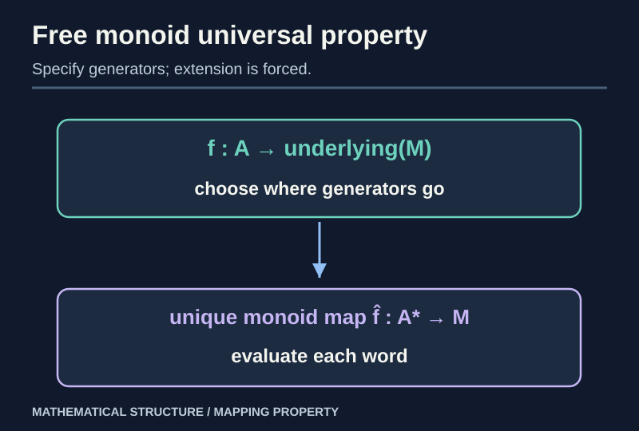
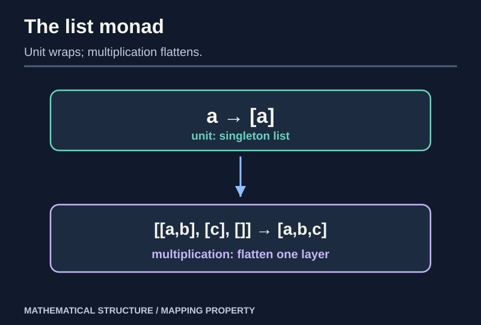

> [!abstract] Prerequisites & where this leads
> **Builds on:** [Categories](./category-theory-foundations), [functors and natural transformations](./category-functors-naturality), [universal properties](./category-limits-colimits).
> **Leads to:** functorial algebraic constructions, monadic composition and categorical interpretations of [topological quotients](./general-topology-constructions).

A forgetful functor removes structure. A **free construction** adds exactly enough structure to support a universal mapping rule. An **adjunction** states that this correspondence is natural in both inputs. A **monad** records the reusable operation of adding, then flattening, such structure.

Alongside the free monoid here, the [Mathematical Spaces Atlas](./atlas-of-mathematical-spaces#13-categories-the-structure-of-mathematical-structures) proves the analogous **free vector-space** construction and displays its universal mapping diagram.

## A free monoid you can build by hand

For a set $A$, let $A^*$ be the set of all **finite lists** (words) of elements of $A$, including the empty list $[]$. Define multiplication by concatenation and identity by the empty list.

> [!theorem] Words form the free monoid on A
> For every monoid $M$ and every function $f:A\to U(M)$, there is a **unique monoid homomorphism**
>
> $$
> \widehat f:A^*\longrightarrow M
> $$
>
> with $\widehat f([a])=f(a)$ for each generator $a$. Here $U$ forgets the monoid structure.

**Construction.** Define $\widehat f([])=1_M$ and

$$
\widehat f([a_1,\ldots,a_n])=f(a_1)\cdots f(a_n).
$$

Associativity makes the product unambiguous; concatenating words concatenates their product expressions, so $\widehat f(uv)=\widehat f(u)\widehat f(v)$. Therefore it is a homomorphism.

**Uniqueness.** Any homomorphism $h:A^*\to M$ with $h([a])=f(a)$ must satisfy $h([])=1_M$. Every word is the concatenation $[a_1]\cdots[a_n]$, so $h$ must take it to $f(a_1)\cdots f(a_n)$, exactly $\widehat f$. $\square$

> [!example] Evaluate words into addition
> With $A=\{a,b\}$ and monoid $(\mathbb N,+,0)$, choose $f(a)=2$, $f(b)=5$. The extension sends the word $[a,b,a]$ to $2+5+2=9$, and the empty word to $0$.

## An adjunction is a natural family of bijections

> [!definition] Left/right adjoint
> Functors $F:\mathcal C\to\mathcal D$ and $U:\mathcal D\to\mathcal C$ form an adjunction $F\dashv U$ if there are bijections
>
> $$
> \operatorname{Hom}_{\mathcal D}(F(A),B)
> \;\cong\;
> \operatorname{Hom}_{\mathcal C}(A,U(B))
> $$
>
> **natural in both** $A$ and $B$.

For the free-monoid construction, set $F(A)=A^*$, and let $U:\mathbf{Mon}\to\mathbf{Set}$ forget the monoid operation. The preceding construction exhibits the bijection.

*Figure: To define a homomorphism out of the free object, specify only the images of generators.*

### Check that the bijection is natural

If $u:A'\to A$ is a function and $h:F(A)\to M$ is a homomorphism, restricting the composite $h\circ F(u)$ to single-letter words gives the function $U(h)\circ u:A'\to U(M)$. If $k:M\to N$ is a homomorphism, the restriction of $k\circ h$ is $U(k)\circ U(h)\circ\eta_A$. These are the two naturality conditions.

> [!distinction] Left adjoint is not the inverse of right adjoint
> In general $F$ and $U$ are **not equivalences**. A set $A$ and the underlying set of the free monoid $A^*$ are usually not even the same set. An adjunction relates maps by a universal property, not objects by equality.

## Unit and counit from the hom-set correspondence

The adjunction produces two natural transformations:

$$
\eta:1_{\mathcal C}\Rightarrow UF,
\qquad
\varepsilon:FU\Rightarrow1_{\mathcal D}.
$$

For the free-monoid adjunction, $\eta_A(a)=[a]$ includes each generator as a singleton list. For a monoid $M$, the counit $\varepsilon_M:(U M)^*\to M$ **evaluates** a list by multiplying its entries in $M$.

> [!theorem] Triangle identities (worked for words)
> The two composites $F(A)\xrightarrow{F\eta_A}FUF(A)\xrightarrow{\varepsilon_{F(A)}}F(A)$ and $U(M)\xrightarrow{\eta_{U(M)}}UFU(M)\xrightarrow{U\varepsilon_M}U(M)$ are identities.

**First proof.** A word $[a_1,\ldots,a_n]$ is mapped by $F\eta_A$ to $[[a_1],\ldots,[a_n]]$, a list of singleton lists. Evaluating by concatenation yields the original word.

**Second proof.** An element $m\in M$ first becomes the singleton list $[m]$; evaluating that one-element list returns $m$. These are precisely the two triangle identities for the free-monoid example. $\square$

The abstract triangle identities follow from the adjunction bijection in exactly the same fashion: transpose an identity, then transpose back.

## The list monad

> [!definition] Monad
> A monad on $\mathcal C$ consists of an endofunctor $T:\mathcal C\to\mathcal C$, a **unit** $\eta:1\Rightarrow T$, and **multiplication** $\mu:T^2\Rightarrow T$, satisfying
> $\mu\circ T\eta=1_T=\mu\circ\eta_T$ and $\mu\circ T\mu=\mu\circ\mu_T$.

From $F\dashv U$, obtain a monad $T=UF$, with unit the adjunction unit and multiplication $\mu=U\varepsilon F$.

For free monoids, $T(A)$ is the set of finite lists of elements of $A$; $\eta_A(a)=[a]$; and

$$
\mu_A:[[a,b],[c],[]]\longmapsto[a,b,c].
$$

*Figure: The monad multiplication removes one layer of list nesting, while the unit inserts one layer.*

### The monad laws by explicit list computations

Take a list $w=[a,b,c]$. Applying $\eta_{T(A)}$ gives $[w]$, so flattening gives $w$. Applying $T\eta_A$ gives $[[a],[b],[c]]$, which also flattens to $w$. This proves both unit laws.

For a list of lists of lists, e.g.

$$
[[[a],[b,c]],\ [[d]]],
$$

one route flattens the **inner** layer first to $[[a,b,c],[d]]$, then to $[a,b,c,d]$. The other route concatenates the two **outer** groups first to $[[a],[b,c],[d]]$, then to the same flat list. Arbitrary nested lists behave identically because list concatenation is associative. This proves the associativity law.

## Kleisli composition: composing computations that return lists

A Kleisli arrow $f:A\to T(B)$ assigns **zero or more outputs** to each input. Given $f:A\to T(B)$ and $g:B\to T(C)$, define

$$
(g\star f)(a)=\mu_C(T(g)(f(a))).
$$

For the list monad: apply $f$, apply $g$ to each resulting element, then flatten. The identity Kleisli arrow is $\eta_A:a\mapsto[a]$.

**Worked example.** Set $f(n)=[n,n+1]$ and $g(m)=[m,2m]$ for integers. Then

$$
(g\star f)(3)=[3,6,4,8].
$$

The result order follows the **outer list order**, then the **inner list order**. Reversing those steps changes the computation.

The unit and associativity laws proved above guarantee Kleisli identities and associative Kleisli composition. No hidden execution or scheduling semantics are assumed: this is a mathematical construction on finite lists.

## Two more adjunctions worth recognizing

- The free-group functor $\mathbf{Set}\to\mathbf{Grp}$ is left adjoint to the underlying-set functor: functions sending generators to group elements uniquely extend to homomorphisms. Constructing free groups explicitly requires reduced words with formal inverses; we established the analogous monoid construction in full above.
- The product–exponential adjunction in Set has $\operatorname{Hom}(X\times A,B)\cong\operatorname{Hom}(X,B^A)$, where $B^A$ denotes functions $A\to B$. The correspondence is **currying**: $h(x,a)\leftrightarrow(x\mapsto(a\mapsto h(x,a)))$. Its naturality is checked by substitution.

> [!distinction] Not all categories admit exponential objects
> Cartesian products do not by themselves guarantee the right-hand object $B^A$ with this universal property. Set does; arbitrary categories need not. This distinction motivates **cartesian closed categories**.

## Dependency audit

| Claim | Source |
| --- | --- |
| Free monoid | explicit word evaluation and uniqueness |
| Adjunction | bijection of hom-sets natural in both arguments |
| Unit / counit | transpose of identities |
| Triangle identities | evaluation of singleton and nested words |
| List monad | free/forgetful adjunction |
| Monad axioms | flattening is unital and associative |
| Kleisli composition | apply, map, flatten |

This completes the first category-theory branch. Its universal perspective reappears immediately in [General Topology Foundations](./general-topology-foundations), where continuity is defined through inverse images of open sets.
