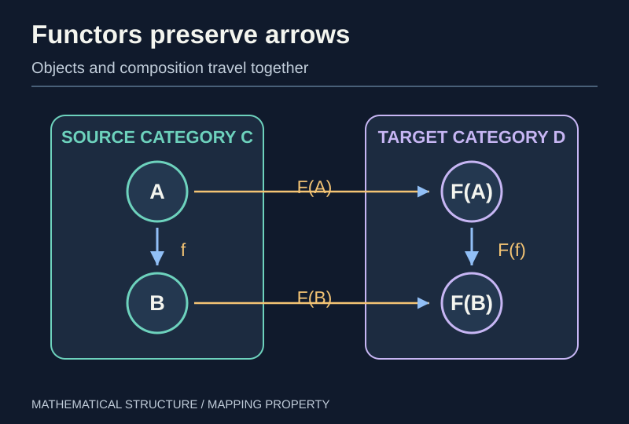
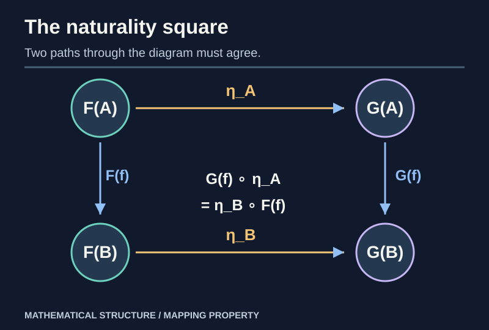
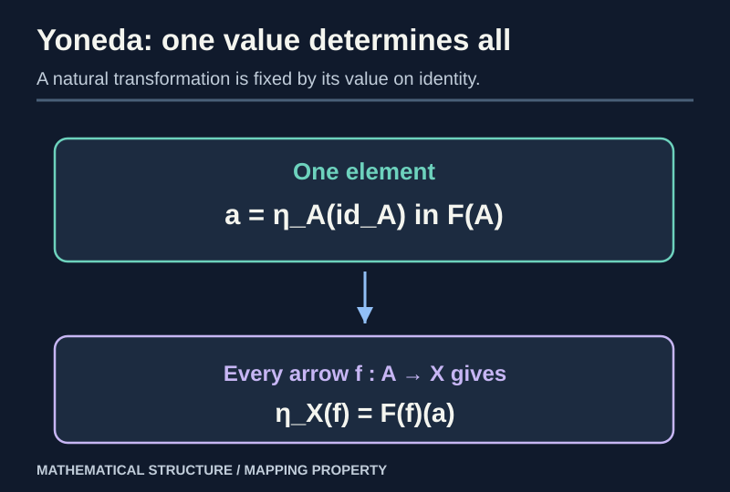

> [!abstract] Prerequisites & where this leads
> **Builds on:** [Categories and Morphisms](./category-theory-foundations), [functions and composition](./functions-relations).
> **Leads to:** [Universal Properties](./category-limits-colimits) and [Adjunctions and Monads](./category-adjunctions-monads).

A category records objects and composable morphisms in one mathematical world. A **functor** translates that world—objects **and** arrows—into another without destroying composition. The [Mathematical Spaces Atlas](./atlas-of-mathematical-spaces#13-categories-the-structure-of-mathematical-structures) illustrates concrete forgetful functors from Hilbert and Banach spaces through topology to underlying sets.

## Functors preserve the laws of mapping

> [!definition] Covariant functor
> A functor $F:\mathcal C\to\mathcal D$ sends each object $A$ to $F(A)$ and each arrow $f:A\to B$ to $F(f):F(A)\to F(B)$, preserving $F(1_A)=1_{F(A)}$ and $F(g\circ f)=F(g)\circ F(f)$.

*Figure: A functor transports composable arrows to composable arrows and preserves their order and composites.*

### A concrete functor: forget the group operation

The functor $U:\mathbf{Grp}\to\mathbf{Set}$ sends a group to its underlying set and a homomorphism to its underlying function. The identity function and composition remain unchanged, so the functor axioms are immediate. What the functor **forgets** is the multiplication structure, not the underlying arrows.

Likewise $U:\mathbf{Vect}_K\to\mathbf{Set}$ forgets addition and scalar multiplication. A forgetful functor need not be an equivalence: knowing only the set does not recover the vector-space operations.

### Contravariant functors

> [!definition] Contravariant functor
> A contravariant functor $F:\mathcal C\to\mathcal D$ is a covariant functor $\mathcal C^{op}\to\mathcal D$. On arrows it reverses direction and obeys $F(g\circ f)=F(f)\circ F(g)$.

For a function $f:A\to B$, inverse image maps subsets **backwards**:

$$
f^{-1}:\mathcal P(B)\longrightarrow\mathcal P(A).
$$

The identities $(g\circ f)^{-1}=f^{-1}\circ g^{-1}$ and $1_A^{-1}=1_{\mathcal P(A)}$ verify a contravariant functor $\mathcal P:\mathbf{Set}^{op}\to\mathbf{Set}$.

> [!distinction] Direct image and inverse image behave differently
> Direct image $f[S]$ transports subsets **forward**; inverse image $f^{-1}[T]$ transports them **backward**. The latter is always compatible with finite intersections and complements, a property topology exploits in defining continuity.

### A topological example: inverse images of opens as a functor

For a topological space $X$, let $\mathcal O(X)$ be its set of open subsets. A continuous $f:X\to Y$ induces

$
\mathcal O(f):\mathcal O(Y)\to\mathcal O(X),\qquad V\mapsto f^{-1}(V).
$

Composition gives $\mathcal O(g\circ f)=\mathcal O(f)\circ\mathcal O(g)$ and the identity map induces the identity on open sets. Thus $\mathcal O:\mathbf{Top}^{op}\to\mathbf{Set}$ is a **contravariant functor**.

There is an unexpectedly concrete representation of this functor: if $S=\{0,1\}$ has the [Sierpiński topology](./atlas-of-mathematical-spaces#a-remarkable-two-point-space-open-sets-are-continuous-maps), then

$
\mathcal O(X)\cong\operatorname{Hom}_{\mathbf{Top}}(X,S)
$

*naturally in $X$*. The complete proof and a finite counterexample are in the [mathematical spaces atlas](./atlas-of-mathematical-spaces#a-remarkable-two-point-space-open-sets-are-continuous-maps). This prepares the representable-functor viewpoint that follows.

## Natural transformations: a compatible family of maps

> [!definition] Natural transformation
> For functors $F,G:\mathcal C\to\mathcal D$, a natural transformation $\eta:F\Rightarrow G$ assigns each $A$ an arrow $\eta_A:F(A)\to G(A)$ such that for every $f:A\to B$,
>
> $$
> G(f)\circ\eta_A=\eta_B\circ F(f).
> $$

*Figure: Whichever route you follow around a naturality square, you get the same composite.*

### Worked example: lists of a fixed length

Let $L_2(A)=A\times A$ and $L_2(f)(a_1,a_2)=(f(a_1),f(a_2))$. Define $\Delta_A:A\to A\times A$ by $\Delta_A(a)=(a,a)$. Then

$$
L_2(f)(\Delta_A(a))=(f(a),f(a))=\Delta_B(f(a)).
$$

Thus the diagonal maps $\Delta_A$ form a natural transformation $\operatorname{Id}_{\mathbf{Set}}\Rightarrow L_2$. The proof **checks the square**, rather than assuming that a formula at each object is enough.

A **natural isomorphism** is a natural transformation all of whose components are isomorphisms. In that case their inverses form a natural transformation in the opposite direction: multiply the naturality equation on the appropriate sides by inverse components.

## Representable functors: describing objects by their arrows

Fix an object $A$ of a **locally small** category $\mathcal C$. Define

$$
h^A(X)=\operatorname{Hom}_{\mathcal C}(A,X).
$$

For $f:X\to Y$, define $h^A(f):h^A(X)\to h^A(Y)$ by **postcomposition**, $g\mapsto f\circ g$. Associativity ensures $h^A$ is a functor $\mathcal C\to\mathbf{Set}$.

In Set, when $A$ is a one-element set, $h^A(X)$ corresponds exactly to elements of $X$. In a general category, looking at all maps *from* $A$ is a substitute for looking inside an object.

## Yoneda lemma, with the proof exposed

> [!theorem] Covariant Yoneda lemma
> For a locally small category $\mathcal C$, a functor $F:\mathcal C\to\mathbf{Set}$, and $A\in\mathcal C$, there is a **natural bijection**
>
> $$
> \operatorname{Nat}(\operatorname{Hom}(A,-),F)\ \cong\ F(A).
> $$

**Forward map.** If $\eta:h^A\Rightarrow F$, evaluate its component at the identity:

$$
\Phi(\eta)=\eta_A(1_A)\in F(A).
$$

**Reverse map.** Given $a\in F(A)$, define a component for each object $X$:

$$
\eta^a_X:\operatorname{Hom}(A,X)\to F(X),\qquad
\eta^a_X(f)=F(f)(a).
$$

**Naturality check.** For $u:X\to Y$, compute

$$
F(u)(\eta^a_X(f))=F(u)(F(f)(a))
=F(u\circ f)(a)=\eta^a_Y(u\circ f).
$$

So $\eta^a$ is natural.

**The two maps are inverses.** First, $\Phi(\eta^a)=F(1_A)(a)=a$. Conversely, use the naturality of an arbitrary $\eta$ along $f:A\to X$:

$$
\eta_X(f)=\eta_X(h^A(f)(1_A))=F(f)(\eta_A(1_A)).
$$

Therefore $\eta=\eta^{\Phi(\eta)}$. Both directions have been checked. $\square$

**Naturality of the bijection in both arguments.** If $u:A\to B$, precomposition with $u$ gives a transformation $h^B\Rightarrow h^A$, so composing $\eta:h^A\Rightarrow F$ with it produces a transformation $h^B\Rightarrow F$. Evaluating this new transformation at $1_B$ gives $\eta_B(u)=F(u)(\eta_A(1_A))$, exactly the action of $F(u)$ on the right side. If $\theta:F\Rightarrow G$ is a natural transformation, postcomposing $\eta$ with $\theta$ evaluates to $\theta_A(\eta_A(1_A))$. Thus the constructed bijection commutes with **changes in $A$ and changes in $F$**, proving the remaining naturality assertion.

*Figure: Knowing one value $\eta_A(1_A)$ determines every component $\eta_X(f)$ through $F(f)$.*

### Worked example: one input determines every natural element

Take $\mathcal C=\mathbf{Set}$ and $A=\{*\}$. Let $F(X)=X\times X$. Choosing an element of $F(A)$ gives only one possibility, $(*,*)$. Yoneda says there is exactly **one** natural transformation $\operatorname{Hom}(A,-)\Rightarrow(-)\times(-)$, corresponding under $\operatorname{Hom}(A,X)\cong X$ to $x\mapsto(x,x)$.

It explains why the diagonal construction is canonical: a family of maps cannot naturally choose some unrelated second element of an arbitrary set.

> [!distinction] Yoneda is not a claim that arbitrary objects are sets
> The right side is the **set assigned by a Set-valued functor**. The statement says that natural maps from a representable functor are controlled by one element of $F(A)$, not that every category has native set-theoretic elements.

## The Yoneda embedding and equivalences

Define the contravariant representable $y(A)=\operatorname{Hom}_{\mathcal C}(-,A)$, a functor $\mathcal C^{op}\to\mathbf{Set}$. Each $f:A\to B$ gives a natural transformation $y(A)\Rightarrow y(B)$ by postcomposition with $f$. This defines the **Yoneda embedding**

$$
y:\mathcal C\longrightarrow[\mathcal C^{op},\mathbf{Set}].
$$

For locally small categories, the contravariant form of the lemma gives

$$
\operatorname{Nat}(y(A),y(B))\cong\operatorname{Hom}_{\mathcal C}(A,B).
$$

Thus $y$ is **fully faithful**: maps between objects can be recovered from natural transformations between their representable presheaves.

> [!definition] Equivalence of categories
> Categories $\mathcal C,\mathcal D$ are equivalent when there are functors $F:\mathcal C\to\mathcal D$ and $G:\mathcal D\to\mathcal C$ with natural isomorphisms $GF\cong1_{\mathcal C}$ and $FG\cong1_{\mathcal D}$. This is weaker than strict equality or isomorphism of the categories.

An equivalence preserves the structural features that can be expressed categorically. It does not require its functors to preserve literal underlying sets or names of objects.

## Dependency audit

| Theorem or example | Justification |
| --- | --- |
| Functor laws | preservation of identities and composite maps |
| Inverse-image functor | preimage of a composite reverses order |
| Diagonal naturality | both routes give $(f(a),f(a))$ |
| Yoneda lemma | evaluation at $1_A$ and a two-sided inverse construction |
| Fully faithful Yoneda embedding | contravariant Yoneda applied to representables |

**Further reading:** [Yoneda lemma (nLab)](https://ncatlab.org/nlab/show/Yoneda+lemma). Next: [Limits and Colimits](./category-limits-colimits).
