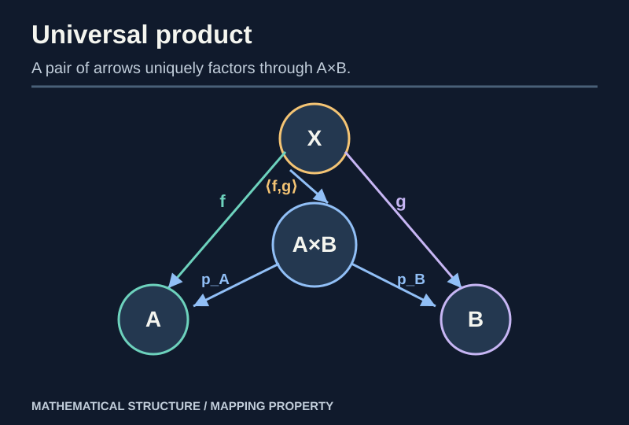
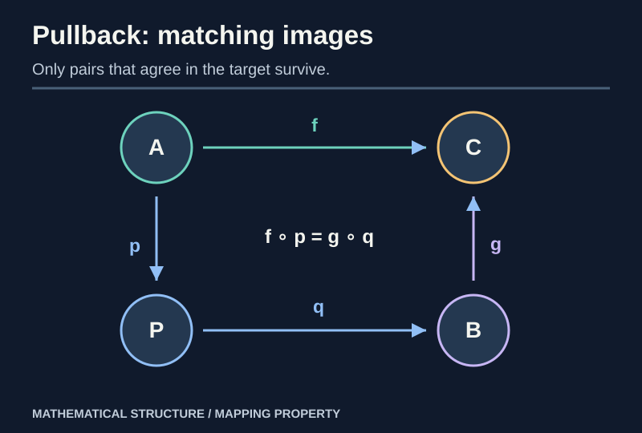
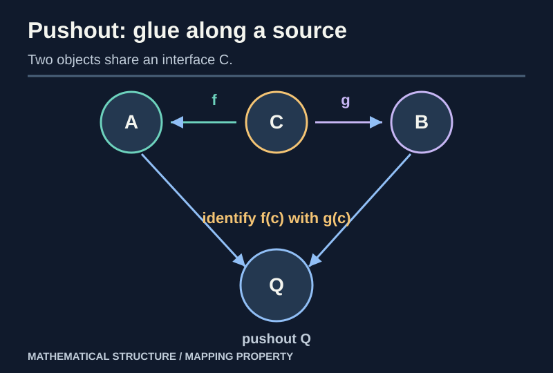

> [!abstract] Prerequisites & where this leads
> **Builds on:** [Categories](./category-theory-foundations), [functors and naturality](./category-functors-naturality), [set quotients](./functions-relations), [group quotients](./group-homomorphisms-quotients).
> **Leads to:** [Adjunctions](./category-adjunctions-monads), [Subspaces, Products and Quotients](./general-topology-constructions).

The idea of a universal property is to define an object by **all the maps into or out of it**. The resulting object is unique *up to unique compatible isomorphism*, independently of how it was implemented. This is why sets of ordered pairs, direct products of groups, and products of topological spaces can be understood through one common theorem.

## Terminal and initial objects

> [!definition] Terminal / initial
> A **terminal** object $1$ has exactly one arrow $X\to1$ from every object $X$. An **initial** object $0$ has exactly one arrow $0\to X$ to every $X$.

In Set, a singleton is terminal and the empty set is initial. In Grp, the trivial group is both initial and terminal. That dual role makes Grp a **pointed category**.

> [!theorem] Terminal objects are unique up to unique isomorphism
> If $T$ and $T'$ are both terminal, the universal properties give unique maps $u:T\to T'$ and $v:T'\to T$. Their composites are endomorphisms of terminal objects, which must be the identities because those are the unique endomorphisms. Therefore $u,v$ are inverse isomorphisms. Uniqueness follows from uniqueness of the universal arrows. $\square$

Reversing all arrows proves the analogous result for initial objects.

## Products from projections, not tuples

> [!definition] Categorical product
> A product of $A,B$ is an object $P$ with projection arrows $p_A:P\to A$ and $p_B:P\to B$ such that for any $X$ and arrows $f:X\to A$, $g:X\to B$, there exists a **unique** $\langle f,g\rangle:X\to P$ satisfying
> $p_A\circ\langle f,g\rangle=f$ and $p_B\circ\langle f,g\rangle=g$.

*Figure: Two arrows with the same source uniquely combine into one arrow into a product.*

### Constructing and verifying a product in Set

Choose $P=A\times B$, with $p_A(a,b)=a$, $p_B(a,b)=b$. Given $f,g$, define $h(x)=(f(x),g(x))$. Then $p_Ah=f$ and $p_Bh=g$. If $k:X\to A\times B$ also satisfies the equations, the first and second coordinates of $k(x)$ are respectively $f(x)$ and $g(x)$; hence $k(x)=h(x)$ for every $x$. This proves **existence and uniqueness**, the complete universal property.

For groups, let $P=G\times H$ with componentwise multiplication. If $f:X\to G$ and $g:X\to H$ are homomorphisms, their pairing is again a homomorphism; the same coordinate argument proves universality.

> [!theorem] Products are unique up to unique projection-preserving isomorphism
> Let $(P,p_A,p_B)$ and $(Q,q_A,q_B)$ each satisfy the product property. Apply universality to $q_A,q_B$ to get $u:Q\to P$ and to $p_A,p_B$ to get $v:P\to Q$. The composites $uv$ and $vu$ have the same projections as the appropriate identities. **Uniqueness** in the universal property forces them to be identities. Thus $u,v$ are inverse and unique among maps preserving projections. $\square$

## Coproducts: dualizing the product

> [!definition] Coproduct
> A coproduct $A\amalg B$ has injections $i_A:A\to A\amalg B$, $i_B:B\to A\amalg B$ such that for arrows $f:A\to X$, $g:B\to X$, a unique $[f,g]:A\amalg B\to X$ extends both.

In Set, it is the **disjoint union**: remember which input set each element came from. If the original sets overlap, ordinary union loses that tag and generally is **not** a coproduct with the specified injections.

In Grp, coproduct is the **free product**, not the direct product: the groups are combined without imposing commutation between an element from $G$ and one from $H$.

## Equalizers and coequalizers

For parallel arrows $f,g:A\to B$, an **equalizer** $e:E\to A$ satisfies $fe=ge$, universally: any $u:X\to A$ for which $fu=gu$ factors **uniquely** through $e$.

In Set,

$$
E=\{a\in A:f(a)=g(a)\},\qquad e:E\hookrightarrow A.
$$

**Proof.** Any $u$ with $fu=gu$ has image in $E$. Corestrict $u$ to a map $X\to E$; inclusion back into $A$ recovers $u$. Inclusion is injective, so this factorization is unique. $\square$

A **coequalizer** reverses the arrows: it is a map $q:B\to Q$ such that $qf=qg$, through which every map $h:B\to Y$ satisfying $hf=hg$ factors uniquely. In Set, take the quotient of $B$ by the **smallest equivalence relation** containing pairs $(f(a),g(a))$. A mere quotient by the raw pair relation may fail transitivity.

> [!example] Kernel as an equalizer
> In Grp, $\ker f$ for $f:G\to H$ is the equalizer of $f$ and the constant homomorphism $G\to H$ sending everything to the identity. The inclusion has exactly the equalizer universal property.

## Pullbacks: matching two maps into one target

> [!definition] Pullback
> For $f:A\to C$ and $g:B\to C$, a pullback has an object $P$ and maps $p:P\to A$, $q:P\to B$ satisfying $fp=gq$, universal among all commuting squares over $f$ and $g$.

*Figure: A pullback stores compatible pairs, not arbitrary pairs.*

In Set, a model is

$$
P=\{(a,b)\in A\times B:f(a)=g(b)\}.
$$

The projections commute. If $u:X\to A$ and $v:X\to B$ satisfy $fu=gv$, the map $x\mapsto(u(x),v(x))$ lands in $P$. Projection equations make it the **only** possible factorization. This verifies universality.

### Worked finite example

Let $A=\{a_1,a_2,a_3\}$, $B=\{b_0,b_1\}$, $C=\{0,1\}$, with

$$
f(a_1)=0,\quad f(a_2)=f(a_3)=1,\qquad
g(b_0)=0,\quad g(b_1)=1.
$$

Then exactly three pairs have matching images:

$$
P=\{(a_1,b_0),(a_2,b_1),(a_3,b_1)\}.
$$

The full Cartesian product has six pairs. The **pullback has three**, because compatibility removes half of them. This illustrates why the adjective *fiber* appears in the term **fiber product**.

## Pushouts: glue along a common source

Reverse the pullback arrows. Given $f:C\to A$ and $g:C\to B$, a pushout has arrows $i:A\to Q$, $j:B\to Q$ with $if=jg$ and is universal among such commuting squares.

In Set, start with the disjoint union $A\amalg B$ and identify $f(c)$ with $g(c)$ for **every** $c\in C$; take the equivalence relation generated by those identifications. Any pair of maps out of $A,B$ agreeing on $C$ is constant on each equivalence class, so it factors uniquely through the quotient. This proves the pushout universal property.

*Figure: A pushout creates a shared object by gluing two objects along a common interface.*

## Limits, colimits, and shape diagrams

A **diagram** of shape $J$ in $\mathcal C$ is a functor $D:J\to\mathcal C$. A **cone** from $X$ to $D$ supplies compatible arrows $X\to D(j)$ for all $j$; a limit is a universal cone. A **cocone** supplies arrows $D(j)\to X$; a colimit is a universal cocone.

Terminal objects and products are limits of empty and discrete-shaped diagrams. Equalizers and pullbacks are other shapes. Initial objects, coproducts, coequalizers and pushouts are corresponding colimits.

> [!distinction] Universal does not mean every category has the object
> Some categories have certain limits or colimits and lack others. A universal property tells us **what a construction must satisfy if it exists**, not that the existence is automatic.

## Connection to topology

Products of topological spaces are not given an arbitrary topology: the **product topology** makes coordinate projections continuous and is characterized by the same universal mapping property as a product in Top. Likewise quotient topologies formalize what it means for a function that identifies points to induce continuous maps from the quotient.

We prove those details in [Subspaces, Products and Quotients](./general-topology-constructions).

## Dependency audit

| Universal construction | Core uniqueness equation |
| --- | --- |
| Product | one map into $P$ per compatible pair $X\to A,B$ |
| Coproduct | one map out per pair $A,B\to X$ |
| Equalizer | universal map equalizing two parallel arrows |
| Coequalizer | universal quotient coequalizing two parallel arrows |
| Pullback | universal pair with matching images in a target |
| Pushout | universal gluing along a shared source |

Next: [Adjunctions and Monads](./category-adjunctions-monads), which package an entire **family of universal mappings** into a natural correspondence.
