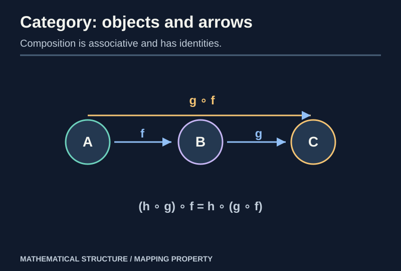
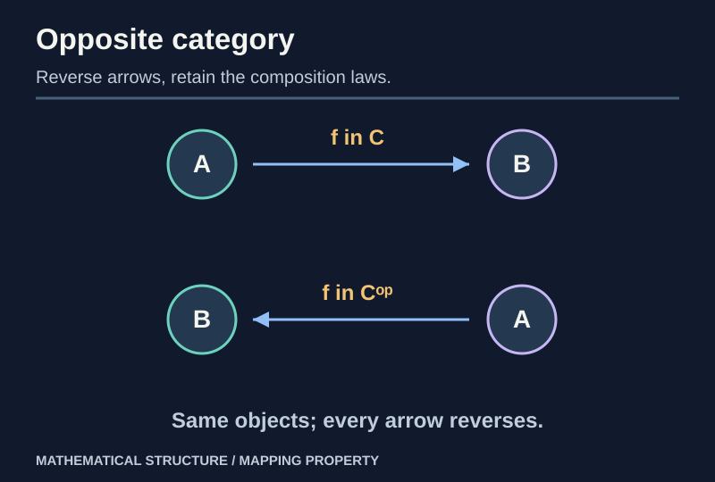

> [!abstract] Prerequisites & where this leads
> **Builds on:** [Sets](./set-theory), [functions and composition](./functions-relations), [groups and homomorphisms](./group-theory-foundations), [rings](./ring-theory-foundations).
> **Leads to:** [Functors and Naturality](./category-functors-naturality), [Universal Properties](./category-limits-colimits), [Adjunctions and Monads](./category-adjunctions-monads).

The same pattern keeps appearing: sets have functions, groups have group homomorphisms, rings have ring homomorphisms, and topological spaces have continuous maps. In each case a map can be followed by another map, and there is an identity map that changes nothing. **Category theory isolates exactly this reusable structure.**

The [Atlas of Mathematical Spaces](./atlas-of-mathematical-spaces#13-categories-the-structure-of-mathematical-structures) gives a concrete cross-subject example: categories of spaces, their selected morphisms, forgetful functors, and a free vector-space universal property.

## Objects, morphisms and the axioms

> [!definition] Category
> A category $\mathcal C$ has a collection of **objects**; for each ordered pair $(A,B)$, a collection $\operatorname{Hom}_{\mathcal C}(A,B)$ of **morphisms** $f:A\to B$; a composite $g\circ f:A\to C$ whenever $f:A\to B$ and $g:B\to C$; and an identity $1_A:A\to A$ for each object. It satisfies **associativity**
> $(h\circ g)\circ f=h\circ(g\circ f)$ and the **identity laws** $f\circ1_A=f=1_B\circ f$.

No assumption says that a morphism is literally a function. It may be a matrix, order relation, path, or abstract arrow.

*Figure: Composing $f:A\to B$ and $g:B\to C$ gives $g\circ f:A\to C$. Associativity says that regrouping a longer chain does not change its composite.*

> [!distinction] Objects versus elements
> An object need not be a set; a morphism need not act element by element. Elements appear in examples such as **Set**, but **a category is defined through arrows and composition**, not a universal notion of membership.

A category is **locally small** if each hom-collection is a set. We use locally small categories whenever we speak of a set of morphisms or use the Yoneda lemma. A category is **small** if its objects and all morphisms together form sets. These are distinct size conditions.

### Uniqueness of identities

> [!theorem] Identity morphisms are unique
> An object cannot have two different arrows satisfying the two-sided identity law.

**Proof.** Suppose $e$ and $e'$ are both identities at $A$. Because $e$ is a left identity for $e'$, $e\circ e'=e'$. Because $e'$ is a right identity for $e$, $e\circ e'=e$. Therefore $e=e'$. $\square$

### Isomorphism: the reversible arrow

> [!definition] Isomorphism
> A morphism $f:A\to B$ is an **isomorphism** if there is $g:B\to A$ with $g\circ f=1_A$ and $f\circ g=1_B$. The objects are then **isomorphic**, written $A\cong B$.

**Proof of inverse uniqueness.** If $g$ and $h$ are both two-sided inverses of $f$, then

$$
g=g\circ1_B=g\circ(f\circ h)=(g\circ f)\circ h=1_A\circ h=h.
$$

Isomorphism is therefore an equivalence relation on objects: identities witness reflexivity, inverses give symmetry, and composition of isomorphisms gives transitivity.

> [!counterexample] A bijection of underlying sets need not be an isomorphism
> The map $f:\mathbb R\to\mathbb R$, $f(x)=x^3$, is an isomorphism in **Set** (a bijection). More generally, an underlying bijection between topological spaces need not be a homeomorphism, because its inverse may fail to be continuous. A category decides which maps count as structure-preserving.

## Categories already hiding in these notes

| Category | Objects | Morphisms | What counts as an isomorphism? |
| --- | --- | --- | --- |
| $\mathbf{Set}$ | sets | functions | bijections |
| $\mathbf{Grp}$ | groups | homomorphisms | group isomorphisms |
| $\mathbf{Ring}$ | unital rings | unital ring homomorphisms | ring isomorphisms |
| $\mathbf{Vect}_K$ | vector spaces over $K$ | $K$-linear maps | invertible linear maps |
| $\mathbf{Top}$ | topological spaces | continuous maps | homeomorphisms |

For **Grp**, compose the underlying functions. If $f:G\to H$ and $g:H\to J$ preserve products, then

$$
(g\circ f)(ab)=g(f(a)f(b))=g(f(a))g(f(b)).
$$

So their composite is again a homomorphism. The identity function also preserves products. Associativity and identities follow from functions. This verifies the **category axioms** for Grp rather than merely giving it a name.

### A partial order is a category

The proofs for posets, preorders, and quotient orders are given in [Order Theory](./order-theory).

For a partially ordered set $(P,\le)$, create one object per element and **exactly one morphism** $a\to b$ when $a\le b$, with no morphism otherwise. Reflexivity supplies identities. Transitivity supplies composition. Because there is at most one arrow between any two objects, associativity is automatic.

This example is useful because an isomorphism $a\cong b$ requires both $a\le b$ and $b\le a$; antisymmetry then gives $a=b$. In a poset category, **isomorphic objects are equal**.

### A monoid is a one-object category

Take a monoid $M$, such as strings under concatenation. Use one object $\ast$, with $\operatorname{Hom}(\ast,\ast)=M$. Composition is monoid multiplication and the identity is its neutral element. The categorical associative/identity laws are exactly the monoid laws.

> [!distinction] Monoids versus groups
> The one-object category is a **groupoid** if every arrow is invertible, equivalently if the monoid is a group. Most one-object categories are not groupoids.

## Monomorphisms and epimorphisms

> [!definition] Mono and epi
> A morphism $m:A\to B$ is a **monomorphism** if $m\circ u=m\circ v$ implies $u=v$ for all parallel $u,v:X\to A$ (left-cancellability). A morphism $e:A\to B$ is an **epimorphism** if $u\circ e=v\circ e$ implies $u=v$ for all parallel $u,v:B\to Y$ (right-cancellability).

In **Set**, monomorphisms are exactly injective functions. The proof uses a one-element set to detect whether two domain elements are identified. Epimorphisms in Set are exactly surjective functions: if a value is omitted, two distinct functions out of $B$ can disagree only there and still have equal composites with $e$.

> [!distinction] Do not export Set's characterization to every category
> In **Ring**, the inclusion $\mathbb Z\hookrightarrow\mathbb Q$ is an **epimorphism** but not surjective: any two unital ring homomorphisms out of $\mathbb Q$ agreeing on integers agree on every rational $a/b$, because a homomorphism must preserve inverses. Categorical epi means **cancellation against arrows**, not automatically surjectivity of an underlying function.

## Opposite categories: reverse every arrow

> [!definition] Opposite category
> $\mathcal C^{op}$ has the same objects as $\mathcal C$, but
> $\operatorname{Hom}_{\mathcal C^{op}}(A,B)=\operatorname{Hom}_{\mathcal C}(B,A)$.
> Composition is reversed in order so that it remains well-defined.

Any theorem expressed entirely through categorical composition has a **dual statement** obtained by reversing the arrows. This is not a trick about notation; it explains why products and coproducts, or monomorphisms and epimorphisms, appear in paired forms.

*Figure: Passing to the opposite category reverses arrow direction without changing the underlying objects.*

## A preview of universal properties

A direct product of sets $A\times B$ is familiar as ordered pairs. Category theory instead recognizes it from the **unique map into it** determined by any pair of maps into $A$ and $B$. The property describes **what the object does**, not the implementation chosen for its elements.

That viewpoint will be proved in [Limits, Colimits and Universal Properties](./category-limits-colimits). To communicate the construction between different categories, we next need [Functors and Natural Transformations](./category-functors-naturality).

## Dependency audit

| Concept | What has been established |
| --- | --- |
| Category | associative composition and identities |
| Isomorphism | two-sided inverse, unique when it exists |
| Concrete examples | composition preserves the relevant structure |
| Poset category | reflexivity and transitivity make categorical laws |
| Mono / epi | cancellation of arrows, not assumed elementwise |
| Duality | reversing all arrows defines an opposite category |

**Further reading:** [Category theory](https://ncatlab.org/nlab/show/category) (nLab) and the following three chapters in this reference.
