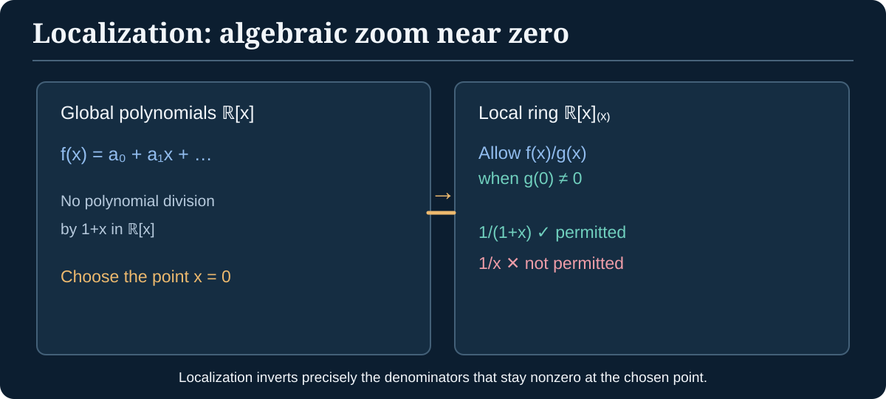

> [!abstract] Foundations & where to go
> **Builds on:** [Ring axioms](./ring-theory-foundations), [ideals and quotients](./ring-ideals-quotients), and [field extensions](./field-theory-foundations).
> **Leads to:** [Algebraic Geometry](./algebraic-geometry), algebraic singularities, local dimension and resolution methods. See the [Path Through Algebra](./path-through-algebra).

Algebraic geometry describes shapes by polynomial equations. To study what happens **near one point** of such a shape, we need more than global polynomial calculations. Commutative algebra supplies the algebraic operations that zoom into a point, measure constraints, and identify which equations produce the same geometric set.

All rings in this chapter are **commutative with identity** and homomorphisms preserve identity, unless explicitly noted.

## Ideals encode simultaneous polynomial constraints

An **ideal** $I\subseteq R$ is an additive subgroup closed under multiplication by arbitrary elements of $R$. The quotient $R/I$ identifies expressions that differ by an element of $I$. Read $R/I$ as "R modulo I."

**Worked example.** In $\mathbb Q[x]$, let $I=(x^2+1)$, the set of polynomial multiples of $x^2+1$. In the quotient $\mathbb Q[x]/I$, we have $[x]^2=-[1]$. Every polynomial reduces by division to exactly one expression $a+b[x]$ with $a,b\in\mathbb Q$.

The map

$$
\Phi:\mathbb Q[x]\to\mathbb Q(i),\qquad f(x)\mapsto f(i)
$$

is a ring homomorphism with kernel $(x^2+1)$ because $x^2+1$ is the minimal polynomial of $i$ over $\mathbb Q$. Hence the first isomorphism theorem gives

$$
\mathbb Q[x]/(x^2+1)\cong\mathbb Q(i).
$$

Since $x^2+1$ is irreducible over $\mathbb Q$, the quotient is a **field**. This example unifies *polynomial remainder*, *quotient ring*, and *adjoining a root*.

## Prime and maximal ideals answer different questions

> [!definition] Prime ideal and maximal ideal
> A proper ideal $\mathfrak p\subsetneq R$ is **prime** if $ab\in\mathfrak p$ implies $a\in\mathfrak p$ or $b\in\mathfrak p$. An ideal $\mathfrak m\subsetneq R$ is **maximal** if no ideal lies strictly between $\mathfrak m$ and $R$.

> [!theorem] Detect prime and maximal ideals using quotients
> For a commutative unital ring, $\mathfrak p$ is prime **if and only if** $R/\mathfrak p$ is an integral domain. The ideal $\mathfrak m$ is maximal **if and only if** $R/\mathfrak m$ is a field.

> [!proof] The prime/domain direction
> In $R/\mathfrak p$ we have $[a][b]=[0]$ precisely when $ab\in\mathfrak p$. If $\mathfrak p$ is prime, one factor belongs to $\mathfrak p$ and hence one of $[a],[b]$ is zero. Conversely, if the quotient has no nonzero zero divisors, then $ab\in\mathfrak p$ forces $[a]=0$ or $[b]=0$, giving primality.
>
> **Maximal/field direction:** if $\mathfrak m$ is maximal and $[a]\neq0$ in $R/\mathfrak m$, then $a\notin\mathfrak m$, so the ideal $\mathfrak m+(a)$ strictly contains $\mathfrak m$, hence equals $R$. Thus $1=m+ra$ for some $m\in\mathfrak m,r\in R$, giving $[r][a]=[1]$. Every nonzero class has an inverse. Conversely, ideals of a field are just $\{0\}$ and the field, so any intermediate ideal between $\mathfrak m$ and $R$ would descend to a nontrivial ideal of $R/\mathfrak m$.

Every maximal ideal is prime, but not conversely. For instance, $(0)\subset\mathbb Z$ is prime because $\mathbb Z$ is a domain, but not maximal because $\mathbb Z$ is not a field.

## Localization: make selected denominators invertible

Ordinary fractions turn nonzero integers into invertible rational denominators. **Localization** applies the same strategy to only a chosen collection of ring elements.

Let $S\subseteq R$ contain $1$, not contain $0$ in the usual nontrivial examples, and be closed under multiplication. For pairs $(r,s)$ with $r\in R,s\in S$, define

$$
(r,s)\sim(r',s')\quad\Longleftrightarrow\quad
\exists t\in S:\ t(rs'-r's)=0.
$$

The factor $t$ matters when $R$ has zero divisors. When $R$ is an **integral domain** and $0\notin S$, this simplifies to $rs'=r's$. The equivalence classes are written $r/s$, and form the localization $S^{-1}R$.

Addition and multiplication take the familiar forms

$$
\frac r s+\frac{r'}{s'}=\frac{rs'+r's}{ss'},\qquad
\frac r s\cdot\frac{r'}{s'}=\frac{rr'}{ss'}.
$$

The construction identifies equivalent representatives, exactly as with the [rational-number construction](./construction-of-the-rationals); the full proof checks that these operations are independent of representatives.

> [!theorem] Universal property of localization
> Let $f:R\to T$ be a ring homomorphism carrying **every** $s\in S$ to a unit of $T$. Then there exists a **unique** ring homomorphism $\widetilde f:S^{-1}R\to T$ such that $\widetilde f(r/1)=f(r)$.

> [!proof] Define the only possible map and check it
> An extension must satisfy $\widetilde f(r/s)=f(r)f(s)^{-1}$, since $r/s=(r/1)(s/1)^{-1}$. Suppose $(r,s)\sim(r',s')$. Then for some $t\in S$, $t(rs'-r's)=0$. Apply $f$ and multiply by the inverses of the **units** $f(t),f(s),f(s')$: we obtain $f(r)f(s)^{-1}=f(r')f(s')^{-1}$. So the formula is well-defined. It respects sums and products by their fraction formulas, and uniqueness follows because every fraction has the displayed form.

*Figure: Localization keeps only the denominators that are nonzero at the chosen point. This is algebraic zooming, not restricting a graph's visible axes.*

### Worked localization: rational functions near zero

Take $R=\mathbb R[x]$ and the ideal $\mathfrak m=(x)$. Set $S=R\setminus\mathfrak m$: the polynomials with **nonzero constant term**. Then

$$
R_{\mathfrak m}=S^{-1}R
=\left\{\frac{f(x)}{g(x)}:g(0)\neq0\right\}.
$$

The fraction $1/(1+x)$ belongs to this ring, because its denominator does not vanish at zero. The fraction $1/x$ does **not**: $x$ vanishes at zero. This distinction captures rational functions that are **regular near the point** $x=0$, rather than arbitrary rational functions of $x$.

## Local rings: focus on one point

> [!definition] Local ring
> A ring is **local** if it has exactly one maximal ideal.

The ring $\mathbb R[x]_{(x)}$ above is local: its unique maximal ideal consists of fractions $f/g$ whose numerator vanishes at zero. A fraction $f/g$ with $f(0)\neq0$ has inverse $g/f$ in the same localization, so it is a **unit**. A fraction with $f(0)=0$ is a nonunit and belongs to the unique maximal ideal.

> [!theorem] Localization at a prime ideal is local
> For any prime ideal $\mathfrak p$, the ring $R_{\mathfrak p}=(R\setminus\mathfrak p)^{-1}R$ has unique maximal ideal $\mathfrak pR_{\mathfrak p}$.

> [!proof] Identify units by their numerators
> If $r\notin\mathfrak p$, then $r$ is in the denominator set, so $r/1$ is a unit in the localization. If $r\in\mathfrak p$, the fraction $r/s$ cannot be a unit: otherwise an equation $(r/s)(a/t)=1$ would imply some $u\notin\mathfrak p$ annihilates $ra-st$, contradicting primality and the fact $ust\notin\mathfrak p$. The nonunits are exactly the fractions in $\mathfrak pR_{\mathfrak p}$. Every proper ideal contains only nonunits, so every proper ideal lies in $\mathfrak pR_{\mathfrak p}$; this ideal is uniquely maximal.

This is the ring-theoretic version of examining a geometric object through increasingly small neighborhoods of one point.

## Modules generalize vector spaces

A vector space is a module over a **field**. A module over a ring $R$ has an abelian group structure and scalar multiplication by elements of $R$, obeying the analogues of vector-space distributivity and associativity.

Examples include $\mathbb Z^n$ as a $\mathbb Z$-module, ideals of $R$ as $R$-modules, and the quotient $\mathbb Z/6\mathbb Z$ as a $\mathbb Z$-module. Unlike vector spaces, modules need not possess bases.

> [!counterexample] A module need not be free
> $\mathbb Z/2\mathbb Z$ is a nonzero $\mathbb Z$-module in which $2m=0$ for every element. In a free $\mathbb Z$-module with a basis, no nonzero element is killed by the nonzero integer $2$. Therefore $\mathbb Z/2\mathbb Z$ cannot be a free $\mathbb Z$-module.

This is why naive "dimension = number of basis elements" reasoning cannot simply be transferred from vector spaces to modules.

## Noetherian rings and finite descriptions

A ring is **Noetherian** if every ideal is finitely generated (equivalently, every ascending sequence of ideals stabilizes). The equivalence is itself a useful theorem: if an ascending chain did not stabilize, the ideal formed by their union could not be generated by finitely many elements, since those generators would all appear in one stage. Conversely an ideal can be built from an increasing chain of finitely generated subideals; stabilization yields a finite generating set.

> [!theorem] Hilbert basis theorem
> If $R$ is Noetherian, then $R[x]$ is Noetherian. Consequently a polynomial ring in **finitely many** variables over a field is Noetherian.

The nontrivial proof uses leading coefficients of polynomials to show every ideal admits finitely many generators. We **state** the theorem here; a full constructive proof belongs in a longer commutative-algebra chapter. The significance for algebraic geometry is concrete: polynomial constraints on affine space can be represented by finitely many defining equations.

## The algebra–geometry dictionary, with a caveat

For an ideal $I\subseteq k[x_1,\ldots,x_n]$, the zero set $V(I)$ consists of common zeros of all polynomials in $I$. Different ideals can have the **same** zero set: over $\mathbb C$,

$$
V((x))=V((x^2))=\{0\}.
$$

The ideals differ, but their vanishing points coincide. The operation $\sqrt I=\{f:f^m\in I\text{ for some }m\geq1\}$ is the **radical** of an ideal.

Over an algebraically closed field, the Nullstellensatz identifies the ideal of polynomials vanishing on $V(I)$ with $\sqrt I$ (with the usual affine algebraic-geometric setup). Over an arbitrary field, especially $\mathbb R$, that statement needs adjustment; one cannot simply transplant it unchanged.

The difference between $(x)$ and $(x^2)$ illustrates **scheme-theoretic multiplicity**: although the underlying points agree, the quotient rings carry different nilpotent information. Fully developing schemes, sheaves, local dimension and tangent spaces is **beyond this chapter**, but local rings and ideals now make the motivation intelligible.

## Connection to singular statistical models

Polynomial parameterizations can create zero sets with multiple components or degeneracies. [Algebraic Geometry](./algebraic-geometry) investigates how those sets behave near their singularities. A local ring collects algebraic functions regular near one point; an ideal expresses which equations vanish there. This machinery motivates, but **does not alone prove**, the resolution-of-singularities theorems or RLCT asymptotics used in [Singular Learning Theory](./singular-learning-theory).

The lesson: **rings describe equations; ideals encode constraints; quotients encode imposed equations; localizations retain only what can be seen near a specified point**.
