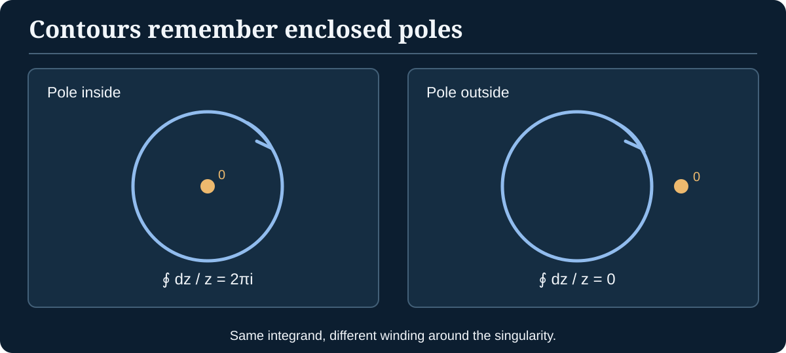

> [!abstract] Prerequisites & what this unlocks
> **Builds on:** [Complex Numbers](./complex-numbers), [Calculus](./calculus), and the convergence ideas in [Real Analysis](./real-analysis).
> **Leads to:** contour integrals, Laurent series, residues and meromorphic continuation. See the [Path Through Analysis](./path-through-analysis) for the surrounding route.

Complex analysis begins with a stronger kind of differentiability than ordinary real differentiability. That extra strength is surprising: requiring one complex derivative forces local power-series expansions, gives exact integral formulas and provides tools for counting zeros and poles.

## Complex differentiability is a two-dimensional constraint

For $f:\mathbb C\to\mathbb C$, define

$$
f'(z_0)=\lim_{h\to0,\ h\in\mathbb C}\frac{f(z_0+h)-f(z_0)}{h}.
$$

The increment $h$ approaches zero from **every direction in the complex plane**, not only along the real axis.

A function is **holomorphic** on an open set if it is complex differentiable at every point of that set. Write $z=x+iy$ and $f(z)=u(x,y)+iv(x,y)$. Under standard sufficient smoothness assumptions (continuous first partial derivatives), holomorphicity is equivalent to the **Cauchy–Riemann equations**:

$$
u_x=v_y,\qquad u_y=-v_x.
$$

> [!proof] Derive the necessary equations from two approaches
> Along real increments $h=t$, the complex difference quotient tends to $u_x+iv_x$.
>
> Along imaginary increments $h=it$, it tends to $(u_y+iv_y)/i=v_y-iu_y$.
>
> A complex derivative must have the **same** limit along both paths, hence $u_x=v_y$ and $v_x=-u_y$. This proves necessity. For sufficiency, continuous partial derivatives give a first-order real linear approximation; the equations make that real linear map equal to multiplication by one complex number, so the complex derivative exists.

### Worked counterexample: conjugation

For $f(z)=\overline z$, at $z=0$ the difference quotient is $\overline h/h$. Along real $h$ it is $1$; along purely imaginary $h$ it is $-1$. The limit does not exist. Hence complex conjugation is **nowhere holomorphic**, despite being continuous and infinitely differentiable as a real-valued coordinate map.

By contrast, $f(z)=z^2$ is holomorphic with $f'(z)=2z$, as the algebraic quotient shows.

## Contour integrals: integrating along a path

A contour $\gamma:[a,b]\to\mathbb C$ is a piecewise continuously differentiable path. Define

$$
\int_\gamma f(z)\,dz=\int_a^b f(\gamma(t))\gamma'(t)\,dt.
$$

**Worked example.** Traverse the unit circle counterclockwise once: $\gamma(t)=e^{it}$, $0\leq t\leq2\pi$. Then

$$
\int_{|z|=1}\frac{dz}{z}
=\int_0^{2\pi}\frac1{e^{it}}\,ie^{it}\,dt
=2\pi i.
$$

The integrand $1/z$ is holomorphic everywhere **except** $0$, and the origin lies inside the curve. The value cannot be dismissed by saying "integrals around closed loops are zero": the missing point matters.

*Figure: Contour integrals can detect enclosed singularities. The position of the pole relative to the oriented loop changes the answer.*

## Cauchy's theorem and integral formula

> [!theorem] Cauchy's integral theorem (one standard form)
> If $D$ is a simply connected open region, $f$ is holomorphic on $D$, and $\gamma$ is a closed piecewise-smooth curve in $D$, then $\int_\gamma f(z)\,dz=0$.

This is a major theorem, **not** an immediate algebraic identity. Its proof requires analytical work (a standard route uses local primitives or Goursat's theorem and deformation); the contour computation above is consistent because $1/z$ is **not** holomorphic on the disc containing the origin.

> [!theorem] Cauchy's integral formula
> If $f$ is holomorphic on a neighborhood of a closed disc and $a$ lies strictly inside its positively oriented boundary circle $\gamma$, then
> $$
> f(a)=\frac1{2\pi i}\int_\gamma\frac{f(z)}{z-a}\,dz.
> $$

**Worked example.** Evaluate $\int_{|z|=2}\frac{z^2+1}{z-1}\,dz$ counterclockwise. The numerator $f(z)=z^2+1$ is entire, and $a=1$ lies within radius two. Therefore

$$
\int_{|z|=2}\frac{z^2+1}{z-1}\,dz
=2\pi i f(1)=2\pi i(2)=4\pi i.
$$

We did not integrate the rational expression term by term. We recognized the **structure of the integrand**, verified the pole's location, and invoked a theorem with matching hypotheses.

## Power series, Laurent series, and singularities

A holomorphic function locally has a convergent **Taylor series**:

$$
f(z)=\sum_{n=0}^{\infty}\frac{f^{(n)}(a)}{n!}(z-a)^n
$$

inside an appropriate disc about $a$. The existence of this expansion is a deep consequence of Cauchy's integral formula.

Around an *isolated singularity*, a holomorphic function on a punctured annulus instead has a **Laurent series**, possibly containing negative powers:

$$
f(z)=\sum_{n=-\infty}^\infty c_n(z-a)^n.
$$

The coefficient $c_{-1}$ is the **residue** $\operatorname{Res}(f,a)$.

For $f(z)=e^z/z^2$ near zero, expand $e^z=1+z+z^2/2+\cdots$ to obtain

$$
\frac{e^z}{z^2}=\frac1{z^2}+\frac1z+\frac12+\frac z6+\cdots.
$$

The residue at zero is therefore **one**, even though the pole has order two.

A singularity is **removable** if all negative Laurent coefficients vanish, a **pole** if only finitely many negative coefficients are nonzero, or **essential** if infinitely many are nonzero. This classification requires an *isolated* singularity; it does not classify arbitrary branch points.

## Residue theorem: poles become finite data

> [!theorem] Residue theorem (simple contour form)
> Let $f$ be holomorphic on an open set containing a positively oriented simple closed contour and its interior, except for finitely many isolated singularities $a_1,\dots,a_m$ inside. Then
> $$
> \int_\gamma f(z)\,dz=2\pi i\sum_{j=1}^m\operatorname{Res}(f,a_j).
> $$

**Worked example with two poles.** Evaluate on the counterclockwise circle $|z|=3$:

$$
I=\int_{|z|=3}\frac{1}{(z-1)(z+2)}\,dz.
$$

The enclosed poles are $z=1$ and $z=-2$. For simple poles, take the coefficient of the corresponding $1/(z-a)$ term:

$$
\operatorname{Res}(f,1)=\frac1{1+2}=\frac13,\quad
\operatorname{Res}(f,-2)=\frac1{-2-1}=-\frac13.
$$

Their sum is zero, and the residue theorem gives $I=0$. Two enclosed poles do **not** force a nonzero integral; residues can cancel.

> [!distinction] A contour pole is not an SLT zeta pole by itself
> An RLCT can be characterized through poles of a **meromorphically continued zeta integral**, but this does not mean one may simply apply a one-variable residue theorem to the original real Bayesian integral. The zeta integral's analytic continuation and the asymptotic correspondence require additional hypotheses. [Algebraic Geometry](./algebraic-geometry#the-real-log-canonical-threshold-rlct) develops the threshold construction in its statistical setting.

## Counting zeros: the argument principle

Suppose $f$ is meromorphic in a neighborhood of a simple positively oriented closed contour and its interior, with **no zeros or poles on the contour**. Counting multiplicities, the number of zeros minus poles inside is

$$
N-P=\frac{1}{2\pi i}\int_\gamma\frac{f'(z)}{f(z)}\,dz.
$$

**Worked check:** $f(z)=z^3(z-2)$ has three zeros at zero (with multiplicity three) and one at two. Inside $|z|=1$, there are three zeros and no poles. Therefore the integral of $f'/f$ around that circle is $6\pi i$.

This result turns a continuous contour integral into a discrete count, one reason complex analysis connects so fruitfully to geometry and algebra.

## What lies beyond this chapter

Conformal mapping, analytic continuation along paths, the maximum-modulus principle, normal families, the Riemann mapping theorem, and several-variable complex analysis each merit deeper treatments. The Cauchy and residue theorems above are **stated with conditions and worked applications**, not passed off as proved from a few examples. Standard references include Priestley's *Introduction to Complex Analysis* and Ablowitz–Fokas's *Introduction to Complex Variables and Applications*.
