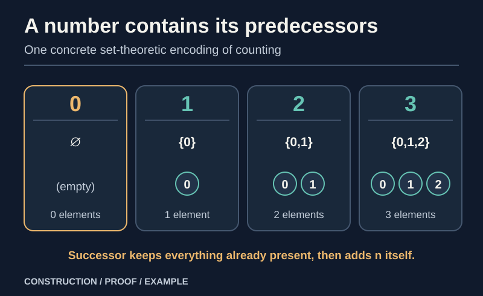

> [!abstract] Prerequisites & where this leads
> **Builds on:** [Set Theory](./set-theory) (empty set, union, subsets, functions, and the axiom of infinity)
> **Leads to:** [Peano Arithmetic](./peano-arithmetic) (recursive arithmetic and its laws) · [Construction of the Integers](./construction-of-the-integers) (building negative numbers from natural pairs) · [Number Systems](./number-systems) (the complete construction chain)

> [!tip] The core idea
> **A number can be represented by the collection of all natural numbers before it.** Start with the empty set for zero. To make the next number, take the current set and add the current number itself. The result is the **von Neumann model** of the natural numbers.
>
> But writing $0,1,2,\ldots$ is not enough to *construct the entire infinite set*. We must explain what guarantees that this collection exists, why successor behaves correctly, and why these are **all** the natural numbers.

This chapter builds a particular mathematical object, $\mathbb N$, inside set theory. It is a **construction**, whereas [Peano Arithmetic](./peano-arithmetic) begins with an **axiomatic description** of what any natural-number system must satisfy. Neither viewpoint makes the other redundant: one supplies a model; the other identifies the properties that matter independently of the representation.

## Why make numbers out of sets?

Counting seems to require no explanation until we ask what a number *is*. We could simply say that the numbers are $0,1,2,\ldots$, but the dots already assume we know what comes next and that the list never runs out. The goal is to replace that informal picture with a rule using objects introduced earlier: **sets**.

A set contains elements. The empty set, written $\varnothing$ and read "the empty set," contains none. The braces $\{x\}$ mean "the set whose only element is $x$." Crucially, $\varnothing$ and $\{\varnothing\}$ are different objects: one is empty; the other contains an element, namely the empty set.

Define **zero** by

$$
\boxed{0:=\varnothing.}
$$

Define the **successor operation** (read "$S$ of $n$") by

$$
\boxed{S(n):=n\cup\{n\}.}
$$

The symbol $\cup$ means "union": take every element already in $n$, and add $n$ as a new element. The symbol $:=$ means "is defined to be"; it is not a claim we have proved about a preexisting arithmetic operation.

### Build the first few numbers

Apply successor repeatedly, giving names to the resulting sets:

$$
\begin{aligned}
0&:=\varnothing,\\
1&:=S(0)=\{0\},\\
2&:=S(1)=\{0,1\},\\
3&:=S(2)=\{0,1,2\},\\
4&:=S(3)=\{0,1,2,3\}.
\end{aligned}
$$

*Figure: Each successor keeps all previous elements and inserts the number we just reached. In this representation, the number $3$ really is the set $\{0,1,2\}$.*

**Worked example: construct three without addition.** Begin with $0=\varnothing$. The first application gives $1=0\cup\{0\}=\{0\}$. The next gives $2=1\cup\{1\}=\{0,1\}$. The third gives $3=2\cup\{2\}=\{0,1,2\}$. No step has used $+$, subtraction, or an already-defined counting operation.

> [!distinction] Membership is not the same as equality
> In this model, $0\in 1$ ("zero is an element of one"), but $0\ne1$. Also $1=\{0\}$, not $1=0$. The symbols $\in$, $=$, and $\subseteq$ ("is a subset of") express different relationships. The construction makes those distinctions impossible to ignore.

## The problem with the dots: where does the infinite set come from?

We have constructed each *individual* displayed number. That does not yet show that there is a **set containing every natural number**. A rule for making another object whenever one is given is not, by itself, a proof that an infinite collection of all those objects exists.

Set theory supplies the missing existence assumption through the **axiom of infinity**. In a standard ZF-style formulation, it guarantees a set $I$ such that

$$
\varnothing\in I,\qquad
\forall x\in I:\ x\cup\{x\}\in I.
$$

Read $\forall$ as "for every." Such a set is called **inductive**: it contains zero and is closed under successor. Closure means that whenever an element belongs to the set, its successor belongs too. The axiom tells us *at least one* inductive set exists. It does not say that the set contains **only** the numbers produced from zero.

### Select the smallest inductive set

Start with an inductive set $I$ whose existence the axiom of infinity supplies. Form the family

$$
\mathcal F:=
\{A\subseteq I \mid
0\in A\ \text{and}\ 
\forall a\in A:\ S(a)\in A\}.
$$

Read $\mathcal F$ as "the family of inductive subsets of $I$." It is nonempty because $I$ itself belongs to it. All its members are subsets of the already-existing set $I$, so the axiom schema of separation allows us to collect them.

Now define

$$
\boxed{\omega:=\bigcap_{A\in\mathcal F}A,
\qquad \mathbb N:=\omega.}
$$

The symbol $\bigcap$ means "intersection": keep precisely those elements that lie in *every* set in the family. The Greek letter $\omega$ (read "omega") is the conventional name for the first infinite ordinal; here it names our constructed natural-number set. This site includes zero in $\mathbb N$.

We have not defined $\omega$ as "whatever looks like the counting numbers." We defined it using existing set operations and a set whose existence is justified.

### Prove it really is the smallest

**Zero belongs to $\omega$.** Every $A\in\mathcal F$ contains zero, so their intersection contains zero.

**Successor stays in $\omega$.** If $n\in\omega$, then $n$ belongs to *every* $A\in\mathcal F$. Each such $A$ is successor-closed, so $S(n)$ belongs to each $A$. Therefore $S(n)\in\omega$.

**Nothing unnecessary survives.** Take any other inductive set $J$, whether or not it is a subset of $I$. The intersection $I\cap J$ is an inductive subset of $I$, hence it is in $\mathcal F$. Because $\omega$ is contained in every member of $\mathcal F$,

$$
\omega\subseteq I\cap J\subseteq J.
$$

Thus $\omega$ is contained in **every inductive set**. This proves the claimed minimality, and also shows that choosing a different initial inductive set $I$ cannot change the resulting $\omega$.

> [!tip] What did "smallest" accomplish?
> Infinity gave us **a large enough home** for an endless successor process. Taking the intersection removed any elements that were not forced to appear by starting at zero and repeatedly applying successor. This is exactly the issue behind the **full induction** condition on the Peano Arithmetic page.

## Verify the Peano conditions, one at a time

The Peano conditions are not automatic just because we chose familiar names. Here we verify them for the concrete object $(\omega,0,S)$.

**1. There is a zero.** By construction, $0=\varnothing\in\omega$.

**2. Every natural has a successor in $\omega$.** We proved $\omega$ is successor-closed. Thus $S:\omega\to\omega$ is a **total function**: it assigns one specified output to every natural input.

**3. Zero is not a successor.** For any set $n$, the definition of successor puts $n$ inside $S(n)$:

$$
n\in n\cup\{n\}=S(n).
$$

But the empty set has no elements. Therefore $S(n)\ne\varnothing=0$.

**4. Successor is injective.** This means distinct inputs cannot share an output. Suppose $S(m)=S(n)$. Since $m\in S(m)=S(n)=n\cup\{n\}$, either $m\in n$ or $m=n$. Similarly, either $n\in m$ or $n=m$.

If $m\ne n$, both $m\in n$ and $n\in m$ would hold. That two-way membership cycle is impossible under the standard set-theoretic **axiom of foundation**. Hence $m=n$:

$$
\boxed{S(m)=S(n)\ \Longrightarrow\ m=n.}
$$

**5. Full induction holds.** Let $P\subseteq\omega$ contain zero and be closed under successor. Then $P$ is an inductive set. Since $\omega$ is contained in *every* inductive set, $\omega\subseteq P$. We already know $P\subseteq\omega$, so $P=\omega$.

That last result is the important bridge: **the induction condition that Peano Arithmetic starts with as an axiom is now a theorem about our constructed set $\omega$**.

### Why full induction is not just checking a long list

Suppose we were allowed to put an extra disconnected successor chain into our number domain. We could still keep zero, make successor total and injective, and prevent any successor from returning to zero. But the set generated by zero would not contain those extra elements. It would be a proper subset, despite containing zero and remaining closed under successor.

The intersection construction rules this out. Any subset of $\omega$ that includes zero and survives every successor step must be the entire $\omega$. For the contrasting diagram and a countermodel, see [Why do we need full induction?](./peano-arithmetic#the-peano-conditions-and-what-each-excludes).

## Why each natural contains all the earlier ones

The first examples suggest

$$
n=\{0,1,\ldots,n-1\}.
$$

This is a **description**, not the definition used to construct $\omega$. The ellipsis is a convenient shorthand once finite successor chains have been justified.

A set $x$ is called **transitive** when every element $y\in x$ is also a subset of $x$. We can prove by induction that every von Neumann natural is transitive.

**Base.** Zero is empty, so there is no element violating transitivity.

**Step.** Suppose $n$ is transitive. An element $y$ of $S(n)=n\cup\{n\}$ is either $n$ itself, in which case $y\subseteq S(n)$, or belongs to $n$, in which case $y\subseteq n\subseteq S(n)$. Thus $S(n)$ is transitive.

The ordinal comparison laws then identify the usual order with membership for these particular sets:

$$
\boxed{m<n\ \Longleftrightarrow\ m\in n,
\qquad
m\le n\ \Longleftrightarrow\ m\subseteq n.}
$$

Here the order symbols $<$ and $\le$ express the **natural-number order**, not a numerical ordering on arbitrary sets. Establishing that these relations form the familiar total order uses the fact that the members of $\omega$ are finite ordinals; see the order proofs in [Peano Arithmetic](./peano-arithmetic) for the arithmetic presentation.

**Worked example.** Since $2=\{0,1\}$ and $3=\{0,1,2\}$, we have $2\in3$ and $2\subseteq3$. Both agree with $2<3$, but **membership and subset inclusion are not interchangeable for arbitrary sets**.

## From sets to addition and multiplication

A set-theoretic representation alone does not give us the usual arithmetic operators. We now define them rather than assume them.

### Why recursion is allowed

The **recursion theorem** for $\omega$ says that, given a set $X$, a starting element $x_0\in X$, and a function $f:X\to X$, there exists a unique function $h:\omega\to X$ satisfying

$$
h(0)=x_0,\qquad h(S(n))=f(h(n)).
$$

Read "unique" as "exactly one." The set-theoretic existence proof constructs compatible **finite initial segments** of $h$, extends each by one successor step, and takes their union. Uniqueness follows from induction. The full proof is in [Peano Arithmetic](./peano-arithmetic#the-recursion-theorem-why-operations-can-be-defined).

This is what licenses recursive **definitions** of addition and multiplication on every natural number. Merely writing equations would not establish that the required functions exist.

### Define addition

Fix $a\in\omega$. Recursively define addition in its second argument by

$$
\boxed{a+0:=a,\qquad a+S(b):=S(a+b).}
$$

To compute $2+2$ without assuming any preexisting addition law:

$$
\begin{aligned}
2+2
 &=2+S(1)\\
 &=S(2+1)\\
 &=S(2+S(0))\\
 &=S(S(2+0))\\
 &=S(S(2))=4.
\end{aligned}
$$

**The other zero law is a theorem.** The definition gives $a+0=a$, but not directly $0+a=a$. For the latter, induct on $a$: the base case is $0+0=0$; if $0+a=a$, then

$$
0+S(a)=S(0+a)=S(a).
$$

So $0+a=a$ for all naturals.

**Associativity is also a theorem.** Induct on $c$, using the recursive successor rule. If $(a+b)+c=a+(b+c)$, then

$$
\begin{aligned}
(a+b)+S(c)
 &=S((a+b)+c)\\
 &=S(a+(b+c))\\
 &=a+S(b+c)\\
 &=a+(b+S(c)).
\end{aligned}
$$

The base case $c=0$ follows from $a+0=a$.

To prove **commutativity**, first establish $S(a)+b=S(a+b)$ by induction on $b$; then induct on $b$ again to obtain $a+b=b+a$. The intermediate lemma matters because the recursive definition initially controls only the second argument. The [full proof](./peano-arithmetic#proving-the-laws-of-addition) does not assume commutativity to prove itself.

Finally, because $1:=S(0)$,

$$
a+1=a+S(0)=S(a+0)=S(a).
$$

The familiar "$n+1$" is therefore **exactly the successor $S(n)$**, once addition has been constructed. This is why the Peano induction step $P(n)\Rightarrow P(S(n))$ is the usual $P(n)\Rightarrow P(n+1)$.

### Define multiplication

With addition established, fix $a\in\omega$ and recursively define

$$
\boxed{a\cdot0:=0,\qquad a\cdot S(b):=a\cdot b+a.}
$$

This means multiplication is built from **repeated addition**, with the recursion theorem ensuring an actual function exists.

**Worked example.** Using $1=S(0)$ and $2=S(1)$:

$$
\begin{aligned}
2\cdot2
 &=2\cdot S(1)\\
 &=2\cdot1+2\\
 &=(2\cdot0+2)+2\\
 &=(0+2)+2=4.
\end{aligned}
$$

The recursive equations immediately give $a\cdot0=0$ and $a\cdot1=a$. The corresponding left-sided laws and the distributive, associative, and commutative laws of multiplication need proofs. For example, **distributivity** follows by induction on $c$:

$$
\begin{aligned}
a(b+S(c))
 &=aS(b+c)\\
 &=a(b+c)+a\\
 &=(ab+ac)+a\\
 &=ab+aS(c),
\end{aligned}
$$

where the third equality uses the inductive hypothesis and the fourth uses associativity of addition. The base case is $c=0$. All multiplicative laws are developed with their dependency order on [Peano Arithmetic](./peano-arithmetic).

> [!distinction] We constructed operations, not just notation
> The sequence is **set theory → $\omega$ → recursion → addition → multiplication → proven arithmetic laws**. That order matters. Defining a number as a set does *not* automatically make it possible to add or multiply that set in the usual arithmetic sense.

## Is this the only possible construction?

No. We chose the von Neumann encoding because it makes the order relationship remarkably transparent: each number is the set of predecessors. Other set-theoretic encodings are possible. For instance, one may represent the successive numbers by iterated singletons $0:=\varnothing$, $1:=\{0\}$, $2:=\{1\}$, and so on. Such a model has different underlying sets but can support the **same abstract arithmetic structure** once its operations are defined.

The distinction is between an **object** and a **representation of that object**. Set theory provides a concrete model; Peano axioms specify the structural properties of the natural numbers. A result about addition should not depend on whether we chose the von Neumann representation, the singleton representation, or another isomorphic model.

There is also a logical distinction. **Full induction over every subset** is part of the second-order successor structure discussed here. First-order Peano arithmetic has an induction *schema* over formulas, which need not characterize the standard natural numbers up to isomorphism. See [Peano Arithmetic: first-order versus full second-order induction](./peano-arithmetic#first-order-arithmetic-versus-full-second-order-induction).

## Where the construction goes next

| What we built | Why it matters |
| --- | --- |
| $0:=\varnothing$ | A starting object needing no prior number |
| $S(n):=n\cup\{n\}$ | A concrete rule for producing successors |
| $\omega$, the least inductive set | An infinite domain with no extra successor chains |
| Peano properties of $(\omega,0,S)$ | The abstract natural-number axioms hold in this model |
| Addition and multiplication by recursion | Arithmetic operations are defined rather than assumed |

The natural numbers are closed under addition and multiplication, but **not under arbitrary subtraction**: $3-5$ is not a natural number. That is the next construction problem. [Construction of the Integers](./construction-of-the-integers) solves it using equivalence classes of **pairs of naturals**, without assuming that negative numbers already exist.
