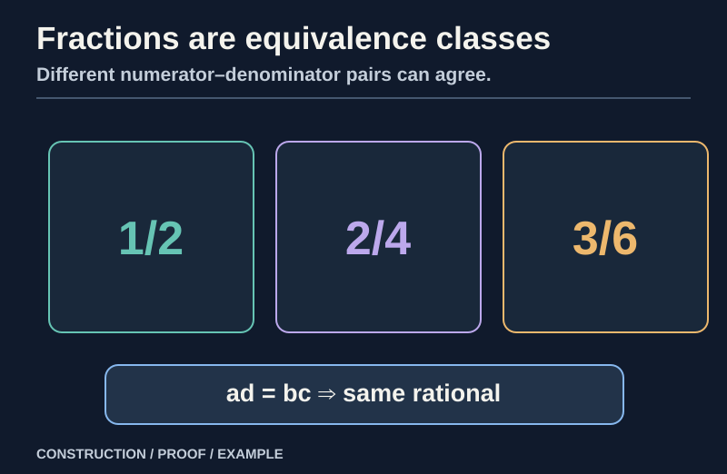
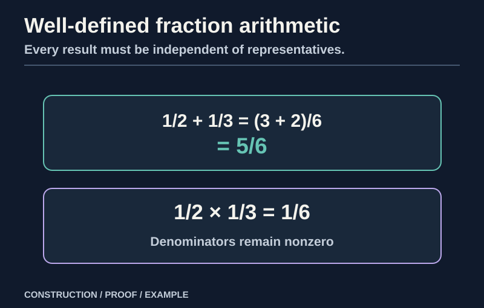
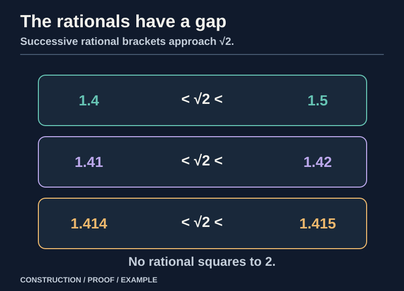

> [!abstract] Prerequisites & where this leads
> **Builds on:** [Construction of the Integers](./construction-of-the-integers), especially the integral-domain, order, and cancellation theorems
> **Leads to:** [Construction of the Reals](./construction-of-the-reals) · [Number Systems](./number-systems) · [Algebraic Structures](./algebraic-structures) · [Field Theory Foundations](./field-theory-foundations)

We proved that integers have addition, subtraction, multiplication, and a compatible total order. What integers lack is division by an arbitrary **nonzero** integer. For example, $2x=1$ cannot be solved inside $\mathbb Z$.

This chapter constructs a number system in which every nonzero integer, and ultimately every nonzero *rational*, has a multiplicative inverse. We will not assume familiar fraction arithmetic before proving that fractions are legitimate objects and operations on them are independent of how they are written.

## The input: an integral domain

We use facts already proved in [Construction of the Integers](./construction-of-the-integers):

- $\mathbb Z$ is a commutative ring with distinct $0$ and $1$.
- If $ab=0$ then $a=0$ or $b=0$; in particular, nonzero integer factors have nonzero product.
- If $c\ne0$ and $ac=bc$, then $a=b$.
- Integer order is total and compatible with addition and multiplication by nonnegative elements.
- There is an additive inverse $-a$ for every integer $a$.

The phrase **integral domain** means a commutative ring with identity $1\ne0$ and no zero divisors. The generalization from rational fractions of integers to fractions of *any* domain is proved in [Field Theory Foundations](./field-theory-foundations). That no-zero-divisor fact is essential: it keeps denominators nonzero when fractions are combined and licenses cancellation during equivalence proofs.

## A fraction begins as a pair

*Figure: Rationals are equivalence classes of pairs, not particular textual fraction forms.*

> [!definition] Rational fractions as classes of pairs
> Start with integer pairs $(a,b)$ where $b\ne0$. Define $(a,b)\sim(c,d)$ by $ad=bc$. A rational number is an **equivalence class**, not the literal pair chosen to represent it.

Let

$$
F=\mathbb Z\times(\mathbb Z\setminus\{0\}).
$$

Read the backslash in $\mathbb Z\setminus\{0\}$ as "excluding zero." A pair $(p,q)$ in $F$ has an integer numerator $p$ and a **nonzero** integer denominator $q$.

We *intend* $(p,q)$ to denote "$p$ divided by $q$," but division is what we are constructing. Define an equivalence relation directly through multiplication:

$$
\boxed{(p,q)\sim(r,s)\quad\Longleftrightarrow\quad ps=rq.}\tag{Q1}
$$

This is the cross-multiplication test, but it is valid here because all products are ordinary **integer** products. There is no rational division on the right-hand side.

**Worked example.** The pairs $(1,2)$ and $(2,4)$ are equivalent because $1\cdot4=2\cdot2$. In contrast, $(1,2)$ and $(1,3)$ are not equivalent because $1\cdot3\ne1\cdot2$. Denominators $2$, $4$, and $3$ are nonzero, as required.

## Proving the fraction equivalence relation

**Reflexivity:** $pq=pq$, so $(p,q)\sim(p,q)$.

**Symmetry:** if $ps=rq$, equality can be reversed, so $(r,s)\sim(p,q)$.

**Transitivity:** suppose $(p,q)\sim(r,s)$ and $(r,s)\sim(u,v)$. Then

$$
ps=rq,\qquad rv=us.
$$

Multiply the first equation by $v$ and the second by $q$:

$$
psv=rqv,\qquad rvq=usq.
$$

Thus $psv=usq$. Rearranging gives

$$
s(pv)=s(uq).
$$

Since $s\ne0$, **integer multiplication cancellation** gives $pv=uq$. That is $(p,q)\sim(u,v)$.

Without the cancellation law, this argument could fail. Constructing fractions over a ring with zero divisors requires more care; the familiar field-of-fractions construction works for an integral domain.

## Rational numbers are equivalence classes

Define

$$
\boxed{\mathbb Q:=F/{\sim},\qquad \frac pq:=[(p,q)].}\tag{Q2}
$$

Read $\frac pq$ as "p over q"; it denotes the equivalence class containing $(p,q)$, **not** an integer division operation that was available previously.

Equality of fractions is now a theorem of the definition:

$$
\frac pq=\frac rs\quad\Longleftrightarrow\quad ps=rq,
\qquad q,s\ne0.
$$

We name

$$
0_{\mathbb Q}:=\frac01,\qquad 1_{\mathbb Q}:=\frac11.
$$

These are different: $0/1=1/1$ would require $0\cdot1=1\cdot1$, contradicting $0\ne1$ in $\mathbb Z$.

**Sign normalization.** If $q<0$, then $(p,q)\sim(-p,-q)$ because $p(-q)=(-p)q$. Therefore every rational has a representative with **positive denominator**. This convention is convenient for proving order laws, but it is not an additional identity rule.

## Fraction addition, including well-definedness

*Figure: Fraction operations must produce the same rational class regardless of the chosen representatives.*

> [!distinction] Different fractions can name one rational
> The representatives $(1,2)$ and $(2,4)$ denote the same rational. Any formula for **addition** must give an equivalent result no matter which representative is used. The following proof discharges that obligation.

Define addition by the rule

$$
\boxed{\frac pq+\frac rs:=\frac{ps+rq}{qs}.}\tag{Q+}
$$

Because $q,s\ne0$ and integers have no zero divisors, $qs\ne0$, so the right side is a valid fraction. This proves closure. **Well-definedness** is the more important obligation.

Suppose $p/q=p'/q'$ and $r/s=r'/s'$. From Q1,

$$
pq'=p'q,\qquad rs'=r's.
$$

We need to compare the proposed sums:

$$
\frac{ps+rq}{qs}
\quad\text{and}\quad
\frac{p's'+r'q'}{q's'}.
$$

Apply Q1, expanding the cross-products:

$$
\begin{aligned}
(ps+rq)q's'
 &=psq's'+rqq's'\\
 &=p'qss'+r'qq's\\
 &=(p's'+r'q')qs.
\end{aligned}
$$

In the second line we substituted $pq'=p'q$ in the first term and $rs'=r's$ in the second, then used integer commutativity. Thus the resulting classes are identical regardless of representatives.

**Worked example: adding unequal denominators, then changing representatives.**

$$
\frac12+\frac13=\frac{1\cdot3+1\cdot2}{2\cdot3}=\frac56.
$$

Now use $2/4$ instead of $1/2$, and $3/9$ instead of $1/3$:

$$
\frac24+\frac39=\frac{2\cdot9+3\cdot4}{4\cdot9}=\frac{30}{36}.
$$

The answers represent the same rational because $5\cdot36=6\cdot30=180$. This is not a coincidence of these numbers; the preceding well-definedness argument covers **every** replacement.

## Fraction multiplication, including well-definedness

Define

$$
\boxed{\frac pq\cdot\frac rs:=\frac{pr}{qs}.}\tag{Q×}
$$

Again $qs\ne0$ supplies closure.

For well-definedness, assume the same equalities $pq'=p'q$ and $rs'=r's$. Then

$$
(pr)(q's')=(pq')(rs')=(p'q)(r's)=(p'r')(qs).
$$

By Q1, $pr/qs=p'r'/q's'$. Multiplication is therefore independent of representatives.

## The field laws, proved from integer laws

### Addition forms an abelian group

**Identity:**

$$
\frac pq+\frac01=\frac{p\cdot1+0\cdot q}{q\cdot1}=\frac pq.
$$

**Additive inverse:** define

$$
-\frac pq:=\frac{-p}{q}.
$$

This is a legitimate class-level definition because $p/q=r/s$ implies $ps=rq$, and multiplying both sides by $-1$ shows $(-p)s=(-r)q$. Moreover,

$$
\frac pq+\frac{-p}{q}
 =\frac{pq+(-p)q}{q^2}
 =\frac0{q^2}
 =\frac01.
$$

The last equality follows by Q1, since both numerators are zero and both denominators are nonzero.

**Commutativity:** $ps+rq=rq+ps$ and $qs=sq$ by integer laws.

**Associativity:** the two groupings of three fractions reduce, using Q+, to

$$
\left(\frac pq+\frac rs\right)+\frac ut
 =\frac{pst+rqt+uqs}{qst}
 =\frac pq+\left(\frac rs+\frac ut\right).
$$

The two expanded numerators agree by associativity and commutativity of **integer** addition and multiplication. The denominator $qst$ is nonzero because the integers have no zero divisors.

Thus $(\mathbb Q,+)$ is an abelian group.

### Multiplication is associative and commutative

For any three fractions,

$$
\left(\frac pq\cdot\frac rs\right)\cdot\frac ut
=\frac{pru}{qst}
=\frac pq\cdot\left(\frac rs\cdot\frac ut\right).
$$

The rearrangement uses integer associativity. Commutativity is equally direct:

$$
\frac pq\cdot\frac rs=\frac{pr}{qs}
=\frac{rp}{sq}=\frac rs\cdot\frac pq.
$$

The multiplicative identity is $1/1$, because $(p/q)(1/1)=p/q$.

### Every nonzero rational has a reciprocal

> [!theorem] Reciprocal for each nonzero rational
> If a rational is represented by $(a,b)$ with **both** $a\ne0$ and $b\ne0$, its reciprocal is represented by $(b,a)$. The construction must prove this is independent of representatives and multiplies to the identity.

First identify which fraction represents zero:

$$
\frac pq=0
\quad\Longleftrightarrow\quad p\cdot1=0\cdot q
\quad\Longleftrightarrow\quad p=0.
$$

Hence a **nonzero** rational $p/q$ has both $p\ne0$ and $q\ne0$. We may therefore define

$$
\boxed{\left(\frac pq\right)^{-1}:=\frac qp.}\tag{Qinv}
$$

Read the exponent $-1$ as "multiplicative inverse," not as an integer power whose definition must already be known.

The reciprocal is well-defined: $p/q=p'/q'$ means $pq'=p'q$, which is exactly the cross-product identity needed for $q/p=q'/p'$. Finally,

$$
\frac pq\cdot\frac qp=\frac{pq}{qp}=\frac11.
$$

The **zero** fraction has no multiplicative inverse, and Qinv never tries to assign it one. If an inverse of zero existed, multiplying $0x=1$ would contradict the distinctness of $0$ and $1$.

### Distributivity

We need to show that the two operations interact correctly:

$$
\frac pq\left(\frac rs+\frac ut\right)
=\frac pq\cdot\frac rs+\frac pq\cdot\frac ut.
$$

The left side, by Q+ and Q×, is

$$
\frac{p(rt+us)}{qst}=\frac{prt+pus}{qst}.
$$

The right side is

$$
\frac{pr}{qs}+\frac{pu}{qt}
=\frac{(pr)(qt)+(pu)(qs)}{(qs)(qt)}
=\frac{q(prt+pus)}{q(qst)}.
$$

These are equal by Q1: multiplying their numerators against the opposing denominators gives the same integer product. Alternatively, cancel the nonzero common factor $q$ in the fraction representation.

We have proved that $\mathbb Q$ is a **field**: addition is an abelian group, multiplication on the nonzero elements is an abelian group, and multiplication distributes over addition.

The ordinary division notation is now earned:

$$
x/y:=x\cdot y^{-1}\qquad (y\ne0).
$$

It is not a primitive operation in the construction.

## Embedding the integers

Define

$$
\jmath:\mathbb Z\to\mathbb Q,\qquad
\boxed{\jmath(n):=\frac n1.}
$$

Read $\jmath$ as "jmath," a name for this embedding. It preserves addition and multiplication:

$$
\frac a1+\frac b1=\frac{a+b}{1},\qquad
\frac a1\cdot\frac b1=\frac{ab}{1}.
$$

It preserves zero, one, and additive inverses. It is injective because $a/1=b/1$ implies $a\cdot1=b\cdot1$, hence $a=b$.

Thus the familiar statement $\mathbb Z\subseteq\mathbb Q$ is an identification of $\mathbb Z$ with an isomorphic subring of $\mathbb Q$, not literal equality between pairs-of-naturals classes and pairs-of-integers classes.

## Constructing a total order on the rationals

We previously proved every fraction has a representative with positive denominator. For $q,s>0$, define

$$
\boxed{\frac pq\leq\frac rs\quad\Longleftrightarrow\quad ps\leq rq.}\tag{Q≤}
$$

The direction of the inequality is justified by the positivity of the denominators.

### The ordering is independent of representatives

Suppose $p/q=p'/q'$ and $r/s=r'/s'$, with all four denominators positive. We know

$$
pq'=p'q,\qquad rs'=r's.
$$

Starting from $ps\leq rq$, multiply both sides by the positive integer $q's'$:

$$
psq's'\leq rqq's'.
$$

Use the equality relations to rewrite the result:

$$
p' q s s'\leq r' s q q'.
$$

Factor out the positive common factor $qs$ on both sides:

$$
(qs)(p's')\leq(qs)(r'q').
$$

Cancel the **positive** factor $qs$, using the integer order laws. The result is $p's'\leq r'q'$, exactly the same comparison using the new representatives. Reversing the argument gives equivalence in both directions.

### Why this is an ordered field

**Totality, reflexivity, and transitivity** follow from corresponding integer order properties after multiplying by positive denominators. For example, if $p/q\leq r/s$ and $r/s\leq u/t$ with positive denominators, then $ps\leq rq$ and $rt\leq us$. Multiply the first inequality by $t$ and the second by $q$, combine, and cancel positive $s$ to obtain $pt\leq uq$, hence $p/q\leq u/t$.

**Translation preserves order.** If $p/q\leq r/s$ and $u/t$ is any rational with $t>0$, then the proposed sums have common positive denominator $qst$ after equivalent rewriting. Adding the same integer numerator $uqs$ to both sides preserves the order, so

$$
x\leq y\Longrightarrow x+z\leq y+z.
$$

**Positive multiplication preserves order.** If $x\leq y$ and $0\leq z$, multiply the defining cross-product inequality by a nonnegative numerator representing $z$ and the positive denominators. This yields $xz\leq yz$.

The usual sign reversal when multiplying by a negative number is derived by combining these laws with additive inverses; it is not separately assumed.

### Between any two rationals lies another

If $x<y$ in $\mathbb Q$, define their midpoint

$$
m:=\frac{x+y}{2}.
$$

Division by $2$ is legitimate because $\mathbb Q$ is already a field and $2\ne0$. From $x<y$ we have $2x<x+y<2y$, so multiplying by the positive rational $1/2$ gives

$$
x<m<y.
$$

Thus **rational order is dense**: there is no immediate next rational after any given rational. This is entirely unlike the successor order on $\mathbb N$.

**Worked example: three distinct rationals between $1/2$ and $2/3$.** The midpoint is

$$
\frac{\frac12+\frac23}{2}=\frac{\frac36+\frac46}{2}=\frac7{12}.
$$

Taking further midpoints yields $13/24$ between $1/2$ and $7/12$, and $5/8$ between $7/12$ and $2/3$. Comparing by Q≤ confirms

$$
\frac12<\frac{13}{24}<\frac7{12}<\frac58<\frac23.
$$

All the comparisons are now consequences of an explicitly constructed order.

## The Archimedean property

The rationals are **Archimedean**: for every $x\in\mathbb Q$ there is a natural $n$ with $x<n$.

For a positive-denominator representation $x=p/q$, $q\geq1$, choose a natural number $n$ larger than the nonnegative part of $p$ (for example $n=|p|+1$). Then $nq\geq n>p$, so Q≤ gives $p/q<n$. Negative rationals are even easier.

The Archimedean property says that ordinary natural numbers eventually exceed any given rational. It is not the same as completeness: the next section shows $\mathbb Q$ has the first property but lacks the second.

## The fundamental limitation: rationals have gaps

*Figure: Arbitrarily accurate rational approximations do not put the irrational limit in the rational field.*

> [!counterexample] Being an ordered field is not being complete
> The rationals support exact arithmetic and order, yet no rational has square $2$. Rational approximations to $\sqrt{2}$ can be Cauchy without converging **inside $\mathbb Q$**. This motivates real completion.

To prove that $\mathbb Q$ is not complete, we need a rigorous rational Cauchy sequence that does **not** converge to a rational. A **Cauchy sequence** is one whose terms become arbitrarily close to each other: for every rational $\varepsilon>0$, there is $N$ such that $|x_m-x_n|<\varepsilon$ whenever $m,n\geq N$. Read $\varepsilon$ as "epsilon," a positive tolerance.

### No rational squares to two

Suppose $(p/q)^2=2$ for integers $p,q$ with $q\ne0$. Among all representations of a hypothetical rational solution with **positive** denominator, choose one with the *smallest* denominator $q$, possible by the well-ordering of positive integers. Then

$$
p^2=2q^2.
$$

Thus $p^2$ is even. The square of an odd integer is odd (expand $(2k+1)^2=4k(k+1)+1$), so $p$ must be even. Write $p=2k$. Substitute:

$$
4k^2=2q^2
\quad\Longrightarrow\quad
q^2=2k^2.
$$

The same argument shows $q$ is even, so $p=2k$ and $q=2m$ for some positive integer $m$. But then $(k/m)^2=2$ is a solution with the **smaller positive denominator** $m=q/2<q$. This contradicts the minimality of $q$. Therefore

$$
\boxed{\nexists x\in\mathbb Q:\ x^2=2.}
$$

The symbol $\nexists$ is read "there does not exist."

### Rational approximations that are Cauchy

Start with the rational interval $[1,2]$. Its left endpoint has square less than $2$, and its right endpoint has square greater than $2$. Bisect it repeatedly. At each stage retain the half whose endpoints $L_n,U_n$ satisfy

$$
L_n^2<2<U_n^2.
$$

Because no rational has square exactly $2$, one of the two halves always qualifies. Each new interval has half the previous width, so

$$
U_n-L_n=2^{-n},
$$

when the initial interval is indexed by $n=0$. Both sequences of endpoints are Cauchy: for $m\geq n$, the later endpoints remain inside $[L_n,U_n]$, so their distance is at most $2^{-n}$.

If $L_n$ converged to a rational $r$, then $U_n$ would converge to the same $r$ because $U_n-L_n\to0$. Both endpoint sequences lie in $[1,2]$, so any rational limit $r$ must also lie in $[1,2]$. For each $n$,

$$
|L_n^2-r^2|=|L_n-r|\,|L_n+r|\leq4|L_n-r|.
$$

and likewise $|U_n^2-r^2|\leq4|U_n-r|$. If both endpoints converged to $r$, both squares would converge to $r^2$. Since $L_n^2<2<U_n^2$ at every stage, the squeeze property for rational limits would give $r^2=2$. One can justify that squeeze step directly: if $r^2<2$, eventually $U_n^2<2$, and if $r^2>2$, eventually $L_n^2>2$. Both contradict the maintained inequalities. No such rational $r$ exists.

Hence these rational Cauchy sequences have **no limit in $\mathbb Q$**. We have constructed a field where every allowed arithmetic operation works, but some Cauchy sequences still have no number to converge to.

This is the precise gap that the next construction repairs.

## A more general result: fractions of any integral domain

Nothing essential in the equivalence-relation and field proofs used a special property of integers beyond being a commutative integral domain. For any such domain $D$, pairs $(a,b)$ with $b\ne0$, modulo $ad=bc$, produce its **field of fractions**, commonly denoted $\operatorname{Frac}(D)$ (read "the fraction field of D").

For $D=\mathbb Z$ this field is $\mathbb Q$. This is the structural connection to [Algebraic Structures](./algebraic-structures): a concrete construction solves division once, and abstract algebra identifies the conditions under which the same construction works elsewhere.

## Dependency audit

| Fact about $\mathbb Q$ | Justification |
| --- | --- |
| Rational objects exist | equivalence classes of integer pairs with nonzero denominators |
| Equality does not depend on notation | equivalence relation Q1 |
| Sum and product are meaningful | independent well-definedness proofs |
| Additive inverses exist | numerator negation |
| Nonzero multiplicative inverses exist | reciprocal Qinv |
| Field associativity, commutativity, distributivity | formulas reduced to integer laws |
| Integers embed faithfully | $\jmath(n)=n/1$ |
| Compatible total order exists | Q≤ and positive-denominator arguments |
| The order is dense | midpoint construction |
| The field is not Cauchy complete | bisection sequence targeting $x^2=2$ |

The property we have *not* earned is completeness. We cannot conjure it by adding more fraction formulas. [Construction of the Reals](./construction-of-the-reals) changes the kind of objects we admit: a real number will be an equivalence class of **entire rational Cauchy sequences**, rather than a single rational pair.
