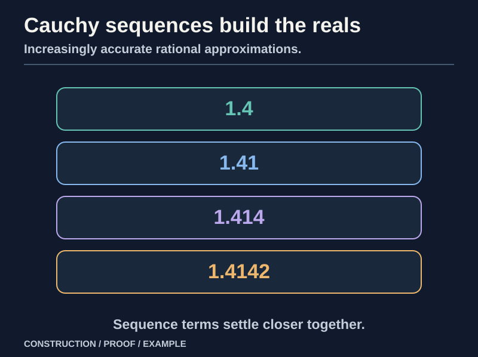
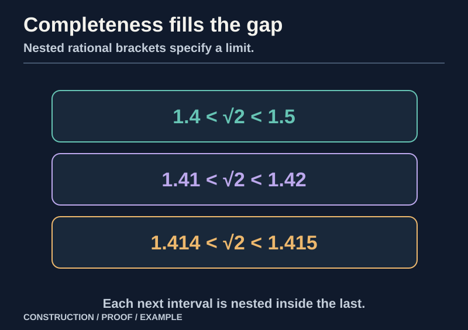
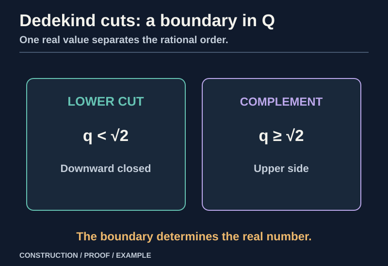

> [!abstract] Prerequisites & where this leads
> **Builds on:** [Construction of the Rationals](./construction-of-the-rationals), the ordered-field laws and the rational Cauchy criterion
> **Leads to:** [Construction of the Complex Numbers](./construction-of-the-complex-numbers) · [Real Analysis](./real-analysis) · [Number Systems](./number-systems)

The rationals form an ordered field: addition, subtraction, multiplication, and nonzero division work correctly. But being able to calculate every **finite fraction** does not guarantee that a sequence of improving approximations converges to a number in the same system. The rational bisections around a hypothetical square root of two are Cauchy, yet no rational number can be their limit.

Our next goal is to construct a field in which every Cauchy sequence converges. We will use *only rationals* to build it. Then we will prove that this new field has the order, completeness, and familiar real-number properties needed for analysis.

> [!distinction] Avoid a circular construction
> **Completeness is what we are building, not a premise we may borrow.** Before the reals exist, statements about limits must use only rational inequalities and rational tolerances. Every later completeness claim must be derived from that construction.

The essential warning is that **completeness cannot be presumed halfway through its own construction**. Every appearance of a limit before the real numbers exist must be a definition involving rational tolerances, not a hidden invocation of real analysis.

## The input: rational Cauchy sequences

*Figure: The completed real system represents the limit using an equivalence class of rational Cauchy sequences.*

A **sequence of rationals** is a function $x:\mathbb N\to\mathbb Q$. We write $x_n$ for its value at index $n$, read "x sub n." Starting the index at zero or one does not affect the construction.

> [!definition] Rational Cauchy sequence
> A rational sequence is **Cauchy** when its sufficiently late terms become arbitrarily close **to one another**. This definition does *not* require us to name a limit in $\mathbb R$.

A rational sequence $(x_n)$ is **Cauchy** if

$$
\boxed{
\forall\varepsilon\in\mathbb Q_{>0}\ \exists N\in\mathbb N\
\forall m,n\geq N:\ |x_m-x_n|<\varepsilon .
}\tag{R1}
$$

Read $\forall$ as "for every," $\exists$ as "there exists," $\varepsilon$ as "epsilon," and $|u|$ as "the absolute value of u." All inequalities in R1 are **rational** inequalities already justified in the preceding chapter.

Intuitively, late terms become arbitrarily close to each other, whether or not their putative limit is rational. We do not require any limit to exist yet.

**Every rational Cauchy sequence is bounded.** Choose tolerance $\varepsilon=1$ and a corresponding index $N$. All later terms lie between $x_N-1$ and $x_N+1$. The finitely many earlier terms also have a rational upper bound on their absolute values. Taking the largest of those finitely many bounds and $|x_N|+1$ yields $M\in\mathbb Q$ with $|x_n|\leq M$ for all $n$.

This boundedness fact will justify multiplication of Cauchy sequences.

## When do two sequences represent the same number?

Different approximation procedures ought to give the same real number when their differences become arbitrarily small. For rational Cauchy sequences $x=(x_n)$ and $y=(y_n)$ define

$$
\boxed{x\sim y\quad\Longleftrightarrow\quad
\forall\varepsilon\in\mathbb Q_{>0}\ \exists N\
\forall n\geq N:\ |x_n-y_n|<\varepsilon.}\tag{R2}
$$

Read $x\sim y$ as "x is equivalent to y." The condition says "$x_n-y_n$ tends to zero" **in the rational epsilon sense**; it does not claim the sequence has a pre-existing real limit.

This is an equivalence relation:

- **Reflexive:** $|x_n-x_n|=0<\varepsilon$ for any positive $\varepsilon$.
- **Symmetric:** $|x_n-y_n|=|y_n-x_n|$.
- **Transitive:** if $x\sim y$ and $y\sim z$, apply the two conditions with tolerance $\varepsilon/2$. For large $n$, the triangle inequality in $\mathbb Q$ gives

$$
|x_n-z_n|
\leq|x_n-y_n|+|y_n-z_n|
<\varepsilon/2+\varepsilon/2=\varepsilon.
$$

Therefore $x\sim z$.

Let $C$ be the set of all rational Cauchy sequences. Define the new number system

$$
\boxed{\mathbb R:=C/{\sim}.}\tag{R3}
$$

A real number $X$ is an **equivalence class** $[x]$ of rational Cauchy sequences. We distinguish the class $X=[x]$ from its particular rational representative sequence $x=(x_n)$.

**Worked example: distinct sequences, one real.** Consider the rational sequences

$$
x_n=1,\qquad y_n=1+\frac1{n+1},\qquad
z_n=1-\frac1{n+1}.
$$

They are Cauchy. Moreover $|x_n-y_n|=1/(n+1)$ and $|x_n-z_n|=1/(n+1)$, which eventually fall below every positive rational tolerance. Consequently $[x]=[y]=[z]$. The construction does not create three different real numbers for three different ways of approaching one.

## Defining addition, negation, and multiplication

For two classes $X=[x]$ and $Y=[y]$, propose termwise operations:

$$
\boxed{
X+Y:=[(x_n+y_n)],\qquad
XY:=[(x_ny_n)],\qquad
-X:=[(-x_n)].
}\tag{R4}
$$

Two distinct obligations must be proved:

1. **Closure:** the new sequences must themselves be Cauchy.
2. **Well-definedness:** replacing $x$ or $y$ by an equivalent sequence must not change the resulting class.

### Addition closure and well-definedness

For any $m,n$,

$$
|(x_m+y_m)-(x_n+y_n)|
\leq|x_m-x_n|+|y_m-y_n|.
$$

If $x$ and $y$ are Cauchy, make each term on the right smaller than $\varepsilon/2$. Then the sum sequence is Cauchy. If $x\sim x'$ and $y\sim y'$, the same estimate applied at each index shows

$$
|(x_n+y_n)-(x'_n+y'_n)|<\varepsilon
$$

eventually, so the class of the sum does not depend on representatives.

Negation preserves the Cauchy property because $|-x_m-(-x_n)|=|x_m-x_n|$. It preserves equivalence by the identical absolute-value identity.

### Multiplication closure and well-definedness

Cauchy sequences are bounded. Choose rational bounds $|x_n|\leq M$ and $|y_n|\leq K$ for all indices. Then

$$
\begin{aligned}
|x_my_m-x_ny_n|
&=|x_m(y_m-y_n)+y_n(x_m-x_n)|\\
&\leq M|y_m-y_n|+K|x_m-x_n|.
\end{aligned}
$$

For a given $\varepsilon>0$, choose $m,n$ late enough that each difference is smaller than $\varepsilon/[2(M+K+1)]$. The right-hand side is then smaller than $\varepsilon$, proving the product sequence is Cauchy.

For well-definedness, let $x\sim x'$ and $y\sim y'$, and bound $|x_n|\leq M$, $|y'_n|\leq K$. Then

$$
|x_ny_n-x'_ny'_n|
\leq |x_n|\,|y_n-y'_n|+|y'_n|\,|x_n-x'_n|.
$$

Both differences tend to zero in the rational epsilon sense and the multipliers are bounded. Hence the whole expression tends to zero. Therefore multiplication is well-defined.

The boundedness requirement is substantive: the product of an arbitrary sequence approaching zero with an **unbounded** sequence need not approach zero. The Cauchy condition prevents that problem here.

## The field laws that are inherited

Define the real zero and one as classes of constant rational sequences:

$$
0_{\mathbb R}=[(0,0,0,\ldots)],\qquad
1_{\mathbb R}=[(1,1,1,\ldots)].
$$

Every term of a representative calculation obeys rational addition and multiplication laws. Since the class operations are well-defined, those laws pass to classes.

For example, if $X=[x]$, $Y=[y]$, and $Z=[z]$, then

$$
\begin{aligned}
(X+Y)+Z
 &= [((x_n+y_n)+z_n)]\\
 &= [(x_n+(y_n+z_n))]\\
 &= X+(Y+Z).
\end{aligned}
$$

The middle equality holds **at every rational index** by rational associativity. The same argument gives addition commutativity, multiplication associativity and commutativity, identities, and distributivity:

$$
[(x_n(y_n+z_n))]=[(x_ny_n+x_nz_n)].
$$

The additive inverse $-X=[(-x_n)]$ satisfies $X+(-X)=0$ term by term.

But a **field** also requires reciprocals for every nonzero element, and that is not automatic from taking termwise operations: a representative can occasionally equal zero even when its class does not. We must solve that separately.

## The reciprocal theorem: nonzero classes stay away from zero

First prove a key fact.

**Lemma.** If a rational Cauchy sequence $x$ does not represent the real zero, then there are rational $\delta>0$ and an index $N$ such that

$$
|x_n|\geq\delta\qquad\text{for all }n\geq N.
$$

**Proof.** The negation of $x\sim0$ says that for some rational $\varepsilon>0$, arbitrarily late terms satisfy $|x_n|\geq\varepsilon$. By the Cauchy property choose $N$ so that $|x_m-x_n|<\varepsilon/2$ for all $m,n\geq N$. Choose one $m\geq N$ with $|x_m|\geq\varepsilon$. Then, for every $n\geq N$,

$$
|x_n|\geq|x_m|-|x_m-x_n|
>\varepsilon/2.
$$

Take $\delta=\varepsilon/2$. This proves the claim.

For a nonzero $X=[x]$, choose such an $N$ and define a new rational sequence $u$:

$$
u_n=\begin{cases}
1,&n<N,\\
1/x_n,&n\geq N.
\end{cases}
$$

The finite prefix is harmless; later terms are defined because $|x_n|\geq\delta>0$. The reciprocal sequence is Cauchy since, for $m,n\geq N$,

$$
\left|\frac1{x_m}-\frac1{x_n}\right|
=\frac{|x_m-x_n|}{|x_mx_n|}
\leq\frac{|x_m-x_n|}{\delta^2}.
$$

It also depends only on $X$, not on the chosen representative: equivalent nonzero Cauchy sequences are eventually separated from zero by a common positive lower bound, and the same quotient estimate proves their reciprocal sequences equivalent.

For every $n\geq N$, $x_nu_n=1$, so the product sequence is equivalent to the constant-one sequence. Hence

$$
X[u]=1_{\mathbb R}.
$$

We have now proved that every nonzero real class has a multiplicative inverse.

Finally $0_{\mathbb R}\ne1_{\mathbb R}$: the difference of the constant-zero and constant-one sequences has absolute value $1$ at every index and cannot approach zero. Thus **$\mathbb R$ is a field**, constructed from the rational field and Cauchy sequences.

## Embedding the rationals faithfully

Define

$$
\eta:\mathbb Q\to\mathbb R,\qquad
\boxed{\eta(q):=[(q,q,q,\ldots)].}\tag{R5}
$$

Read $\eta$ as "eta." This map preserves sum, product, zero, one, and inverses by constant-sequence calculations. It is injective: if constant sequences $q$ and $r$ are equivalent, then $|q-r|<\varepsilon$ for **every** positive rational $\varepsilon$. If $q\ne r$, choosing $\varepsilon=|q-r|/2$ gives a contradiction. Therefore $q=r$.

When we now write $\mathbb Q\subseteq\mathbb R$, we are identifying each rational with its embedded constant-sequence class.

## Constructing order on the real classes

We cannot simply say $[x]<[y]$ whenever $x_n<y_n$ for some index: an early approximation can be misleading, and equivalent sequences can fluctuate above and below one another.

Instead define **strict positivity**:

$$
\boxed{
X=[x]>0\quad\Longleftrightarrow\quad
\exists\delta\in\mathbb Q_{>0}\ \exists N\
\forall n\geq N:\ x_n\geq\delta.
}\tag{R+}
$$

Then define $X<Y$ if $Y-X>0$, and $X\leq Y$ if $X<Y$ or $X=Y$.

### Positivity is independent of representatives

Suppose $x\sim x'$ and $x_n\geq\delta$ for all $n\geq N$. For sufficiently late indices, $|x_n-x'_n|<\delta/2$. Therefore

$$
x'_n>x_n-\delta/2\geq\delta/2>0.
$$

Thus the positive property does not depend on the representative.

### Trichotomy

For every real class $X$, exactly one of these holds:

$$
X=0,\qquad X>0,\qquad -X>0.
$$

If $X\ne0$, the reciprocal lemma says its representative is eventually bounded away from zero by some positive $\delta$. Cauchy closeness prevents late terms from switching signs: if one late term is at least $\delta$, every sufficiently late term is positive; similarly if one is at most $-\delta$, all sufficiently late terms are negative. Hence $X$ or $-X$ is positive.

Both cannot be positive because their eventual representatives would have contradictory signs; and neither can be positive when $X=0$ because a sequence eventually bounded away from zero cannot be equivalent to the zero sequence.

### Ordered-field compatibility

If $X,Y>0$, choose eventual positive lower bounds $\delta_X,\delta_Y$. Then late representatives of $X+Y$ exceed $\delta_X+\delta_Y>0$, and those of $XY$ exceed $\delta_X\delta_Y>0$. Therefore the positive elements are closed under addition and multiplication.

These facts, together with trichotomy and the field laws, prove the usual ordered-field axioms. In particular:

$$
X<Y\Longrightarrow X+Z<Y+Z,
$$

and

$$
X<Y,\quad Z>0\Longrightarrow XZ<YZ.
$$

The order extends the rational order: a constant rational $q$ is positive under R+ exactly when $q>0$ in $\mathbb Q$.

**What was earned:** we did not merely impose an order on an arbitrary quotient. We derived an order from eventual, *uniformly separated* rational positivity and showed that it respects equivalence classes and field operations.

## The rationals are dense in the reals

**Theorem.** For every real $X$ and positive rational $\varepsilon$, there is a rational $q$ with

$$
|X-\eta(q)|<\varepsilon.
$$

**Proof.** Choose a rational Cauchy representative $x$ of $X$. By R1, there exists $N$ such that for all $n\geq N$,

$$
|x_n-x_N|<\varepsilon/2.
$$

Compare the class $X$ with the constant-sequence class $\eta(x_N)$. Their difference has representatives with absolute value eventually below $\varepsilon/2$. By the constructed real order, this means $|X-\eta(x_N)|<\varepsilon$. Choose $q=x_N$.

Thus every real can be approximated arbitrarily closely by a rational. We did not assume density to construct $\mathbb R$; it follows from how its elements were built.

**Archimedean property.** Every representative rational Cauchy sequence is bounded by a rational $M$, so $|X|<n$ for some natural $n>M+1$ embedded as a real. Hence $\mathbb R$ is Archimedean. In particular, $1/n$ approaches zero in the real order.

## Proving completeness: the central result

> [!theorem] Completeness of the constructed real field
> Every Cauchy sequence of **real equivalence classes** converges to a real equivalence class. This is proved from our rational-sequence construction rather than assumed as an axiom.

Up to this point we have proved that $\mathbb R$ is an Archimedean ordered field. Now we justify the defining reason for constructing it: **every real Cauchy sequence converges to a real**.

A sequence $(X_k)$ of reals is called Cauchy if, for every positive rational $\varepsilon$, there is $K$ such that $|X_m-X_n|<\varepsilon$ for all $m,n\geq K$. Rational tolerances suffice because positive rationals can be found smaller than any positive real, using rational density.

**Theorem (Cauchy completeness).** Every Cauchy sequence in $\mathbb R$ has a limit in $\mathbb R$.

**Proof, step by step.**

1. Fix an explicit enumeration $r_0,r_1,r_2,\ldots$ of the rationals, available from their countability. For each $k\geq1$, use rational density and let $q_k$ be the **first rational in that enumeration** satisfying the inequality below. This defines the sequence without silently requiring a separate countable-choice axiom.

   $$
   |X_k-\eta(q_k)|<\frac1k.
   $$

   This choice uses only the density already proved, not completeness.

2. The **rational sequence** $(q_k)$ is Cauchy. Given rational $\varepsilon>0$, take $m,n$ large enough that $1/m<\varepsilon/3$, $1/n<\varepsilon/3$, and $|X_m-X_n|<\varepsilon/3$. The triangle inequality gives

   $$
   |q_m-q_n|
   \leq|q_m-X_m|+|X_m-X_n|+|X_n-q_n|
   <\varepsilon.
   $$

   Here the rationals are identified with their constant-sequence embeddings, whose order we proved compatible.

3. Since $(q_k)$ is a rational Cauchy sequence, its equivalence class $Y:=[(q_k)]$ **already is an element of our constructed $\mathbb R$**.

4. The constant-sequence rationals $\eta(q_k)$ converge to $Y$. To see why, fix rational $\varepsilon>0$. Because $(q_k)$ is Cauchy, for sufficiently large $k$ and all sufficiently large $n$,

   $$
   |q_n-q_k|<\varepsilon/2.
   $$

   By the construction of real order, this says $|\eta(q_k)-Y|<\varepsilon$ for sufficiently large $k$.

5. Finally,

   $$
   |X_k-Y|
   \leq|X_k-\eta(q_k)|+|\eta(q_k)-Y|
   <1/k+\varepsilon
   $$

   for sufficiently large $k$. Given any requested tolerance, first choose the preceding bounds with half that tolerance; then the right side is smaller than the requested tolerance. Therefore $X_k\to Y$.

This completes the proof.

**There is no infinite regress.** The limit $Y$ was explicitly built from the rational Cauchy sequence $(q_k)$, and the construction of $Y$ used no prior assumption that the sequence had a limit.

## From Cauchy completeness to least-upper-bound completeness

Real analysis often defines completeness differently: every nonempty bounded-above set has a **least upper bound** (supremum).

For an ordered field that is Archimedean, Cauchy completeness implies this least-upper-bound property. We can prove it by **bisection**, now within our constructed $\mathbb R$.

Let $A\subseteq\mathbb R$ be nonempty and bounded above. If $A$ has a greatest element, it is immediately the supremum. Otherwise choose $a\in A$ and an upper bound $u$ with $a<u$, and choose $\ell=a-1$. Then $\ell$ is **not** an upper bound of $A$, while $u$ is an upper bound.

Bisect the interval $[\ell,u]$ repeatedly. At each midpoint $m$:

- If $m$ is an upper bound for $A$, replace the upper endpoint with $m$.
- If $m$ is not an upper bound, replace the lower endpoint with $m$.

After $n$ steps we have an interval $[\ell_n,u_n]$ with:

$$
\ell_n\ \text{not an upper bound},\qquad
u_n\ \text{an upper bound},\qquad
u_n-\ell_n=\frac{u-\ell}{2^n}.
$$

The intervals are nested, and their widths approach zero by the Archimedean property. Both endpoint sequences are Cauchy: all later endpoints remain inside any earlier interval. By the just-proved Cauchy completeness, they converge in $\mathbb R$. Their difference tends to zero, so they share a common limit $L$.

**Why $L$ is an upper bound.** If some $x\in A$ satisfied $x>L$, then for sufficiently large $n$, $u_n<x$. That contradicts the fact that every $u_n$ is an upper bound.

**Why $L$ is the least upper bound.** If $v<L$, then for sufficiently large $n$, $v<\ell_n$. But $\ell_n$ is not an upper bound, so some $x\in A$ exceeds $\ell_n>v$. Thus $v$ is not an upper bound.

Therefore $L=\sup A$.

We have now constructed an **ordered field satisfying the least-upper-bound property**, rather than writing a completeness axiom and leaving its justification at an intuitive "number line without gaps."

## Building the square root of two inside the new field

*Figure: Rational intervals can bracket the newly constructed real with increasing precision.*

> [!example] Where completion adds something
> Rational approximations to $\sqrt{2}$ get arbitrarily close to one another, but there is **no rational** whose square is $2$. Their new Cauchy equivalence class has a real limit; the construction supplies the missing object.

Let

$$
A=\{q\in\mathbb Q:q\geq0,\ q^2<2\},
$$

where $\mathbb Q$ is viewed inside $\mathbb R$ through $\eta$. This set is nonempty, since $1\in A$, and bounded above, since $2$ is an upper bound. By the completeness theorem just proved, it has a real supremum $s$.

We will show

$$
\boxed{s^2=2.}
$$

We know $1\leq s\leq2$.

**Suppose $s^2<2$.** Choose a small rational $h>0$ such that

$$
2sh+h^2<2-s^2.
$$

This is possible because real quantities are bounded by rationals and rationals can be arbitrarily small and positive. Then $(s+h)^2<2$. By rational density choose a rational $q$ with $s<q<s+h$. Since $q>0$ and $q^2<(s+h)^2<2$, we have $q\in A$, contradicting that $s$ is an upper bound.

**Suppose $s^2>2$.** Choose a small rational $h>0$ with $h<s$ and

$$
2sh< s^2-2.
$$

Then $(s-h)^2=s^2-2sh+h^2>2$. Because every $q\in A$ is nonnegative, $q\geq s-h$ would imply $q^2\geq(s-h)^2>2$, impossible. Thus $s-h$ is itself an upper bound of $A$, smaller than $s$, contradicting the least-upper-bound property.

Neither strict inequality is possible. Therefore $s^2=2$. We call the nonnegative solution $s=\sqrt2$ (read "square root of two"). It exists because **we proved completeness**.

**Worked comparison:** the rational bisection chapter gave intervals $[1,2]$, $[1.25,1.5]$, $[1.375,1.5]$, and successively narrower rational intervals surrounding a hypothetical square root. Here their Cauchy class is an actual real object, and its square is proven to be two. Approximation and exact existence have different logical jobs.

## Every nonnegative real has a unique nonnegative square root

The square-root-of-two argument is a special case of a more useful result. **Theorem:** for every real $t\geq0$ there exists a **unique** $s\geq0$ with $s^2=t$.

**Existence when $t=0$.** Take $s=0$. For the remaining proof assume $t>0$.

Define the set of **rational** lower approximations

$$
A_t=\{q\in\mathbb Q:q\geq0,\ q^2<t\}.
$$

This set is nonempty because $0\in A_t$. It is bounded above: $t+1$ is an upper bound, since for any $q\geq t+1>1$,

$$
q^2\geq q\geq t+1>t.
$$

Here we use the established embedding of $\mathbb Q$ into $\mathbb R$ and the real order. By the least-upper-bound theorem we proved above, let $s=\sup A_t$. Since all its members are nonnegative, $s\geq0$.

**First rule out $s^2<t$.** Write $d=t-s^2>0$. Choose a positive rational $h$ sufficiently small that

$$
2sh+h^2<d.
$$

Such an $h$ exists: the Archimedean property supplies arbitrarily small positive rationals, while $s$ is bounded above by a rational. Thus $(s+h)^2<t$. By rational density pick a rational $q$ with $s<q<s+h$. Then $q\geq0$ and

$$
q^2<(s+h)^2<t,
$$

so $q\in A_t$, contradicting that $s$ is an upper bound.

**Now rule out $s^2>t$.** Since $t>0$, this would imply $s>0$. Choose a positive rational $h<s$ so small that

$$
2sh<s^2-t.
$$

Then

$$
(s-h)^2=s^2-2sh+h^2>t.
$$

For any $q\in A_t$, if $q\geq s-h>0$, the order laws would give $q^2\geq(s-h)^2>t$, contradicting membership of $A_t$. Therefore $s-h$ is another upper bound of $A_t$, but $s-h<s$, contradicting the least-upper-bound property.

Neither strict case is possible, so $s^2=t$.

**Uniqueness:** if $u,v\geq0$ and $u^2=v^2=t$, then

$$
0=u^2-v^2=(u-v)(u+v).
$$

Because $\mathbb R$ is a field it has no zero divisors. Either $u=v$ or $u+v=0$. In the latter case the nonnegative-sum law forces $u=v=0$ too. Thus $u=v$ in every case.

We may now **define** $\sqrt t$ (read "the nonnegative square root of t") for *every* $t\geq0$, not only $t=2$. This theorem justifies the later modulus formula $\sqrt{a^2+b^2}$ in [Construction of the Complex Numbers](./construction-of-the-complex-numbers). It also identifies the exact dependency: arbitrary real square roots are consequences of completeness and ordered-field laws, not independent arithmetic axioms.

## Dedekind cuts as a second representation

*Figure: A cut determines a real boundary, even though that boundary need not be rational.*

> [!proof] Keep the dependency visible
> We prove that the cuts represent the same complete ordered field using the **Cauchy-constructed reals**. The cut order also has an intrinsic union-based completeness proof. This section is an alternative **representation**, not a second logically independent field-existence proof.

The Cauchy quotient is our **independent** construction of $\mathbb R$. Dedekind cuts offer a different set of objects. We will specify their arithmetic and prove that it yields the **same ordered field** by comparison with the reals already constructed. This comparison is rigorous, but it is **not an independent existence proof** of the real numbers.

A **Dedekind cut** $A\subseteq\mathbb Q$ is nonempty, proper ($A\ne\mathbb Q$), downward closed, and has no greatest member. Let $D$ be the set of all cuts. A rational $q$ is represented by

$$
\widehat q=\{r\in\mathbb Q:r<q\}.
$$

The expression $\widehat q$ is read "q-hat." Every such set is a cut, and rational density ensures that different rationals produce different cuts.

### Every cut has a unique real boundary

View $\mathbb Q$ inside the complete field $\mathbb R$ we constructed above. Every cut $A$ has an upper bound: if $t\notin A$, downward closure forces every $a\in A$ to satisfy $a<t$. Thus $A$ has a supremum $x$ in $\mathbb R$.

We claim

$$
\boxed{A=C_x:=\{q\in\mathbb Q:q<x\}.}\tag{DC}
$$

Every $a\in A$ satisfies $a\leq x$; equality would make it the greatest member, so $a<x$. Conversely if $q<x$ but $q\notin A$, downward closure forces every element of $A$ to be smaller than $q$. Then $q$ would be an upper bound strictly smaller than $x$, a contradiction. This proves DC.

For every real $x$, the set $C_x$ is a cut: it is nonempty and proper by rational density, downward closed, and has no greatest rational member because another rational lies between any $q<x$ and $x$. Its supremum is $x$, again by density. Therefore

$$
\Phi:D\to\mathbb R,\qquad \Phi(A):=\sup_{\mathbb R}A
$$

is a **bijection**, with inverse $x\mapsto C_x$. Read $\Phi$ as "Phi." This identifies all cut objects precisely, not merely by a picture of the number line.

### Cut order and addition

Define $A\leq_D B$ exactly when $A\subseteq B$. By DC, this holds if and only if $\Phi(A)\leq\Phi(B)$: if the latter fails, choose a rational strictly between the two boundaries to disprove the inclusion. Thus the cut order is total and agrees with real order.

Define cut addition by a formula involving only **rational** operations:

$$
\boxed{
A\oplus B
=\{q\in\mathbb Q:\exists a\in A,\exists b\in B,\ q<a+b\}.
}\tag{DA}
$$

Let $x=\Phi(A)$, $y=\Phi(B)$. If $q<a+b$ with $a<x$ and $b<y$, then $q<x+y$. Conversely, if $q<x+y$, choose a small positive rational $\varepsilon$ with $2\varepsilon<x+y-q$, and rationals $x-\varepsilon<a<x$ and $y-\varepsilon<b<y$. Then $a\in A$, $b\in B$, and $q<a+b$. Hence

$$
\boxed{A\oplus B=C_{x+y},\qquad
\Phi(A\oplus B)=\Phi(A)+\Phi(B).}
$$

In particular $A\oplus B$ is itself a cut. The additive identity is $\widehat0=C_0$.

For negation define

$$
\boxed{
\ominus A
=\{q\in\mathbb Q:\exists t\in\mathbb Q\setminus A,\ q<-t\}.
}\tag{DN}
$$

A rational $t\notin C_x$ satisfies $t\geq x$, so $q<-t$ implies $q<-x$. Conversely if $q<-x$, density gives a rational $t$ with $x\leq t<-q$; then $t\notin A$ and $q<-t$. Therefore $\ominus A=C_{-x}$, establishing inverses without guessing sign rules.

### Cut multiplication and field laws

For **positive** cuts $A=C_x$, $B=C_y$ with $x,y>0$, define

$$
\boxed{
A\odot B=
\{q\in\mathbb Q:q<0\ \text{or}\
\exists a\in A,\exists b\in B,\ a,b>0,\ q<ab\}.
}\tag{DM}
$$

If $q$ satisfies this definition, then $q<xy$, since $0<a<x$ and $0<b<y$. Conversely, if $0\leq q<xy$, choose a sufficiently small rational $\varepsilon>0$ so that

$$
0<\varepsilon<\min(x,y),\qquad
(x-\varepsilon)(y-\varepsilon)>q.
$$

Such a choice exists by the Archimedean property and the identity $(x-\varepsilon)(y-\varepsilon)=xy-\varepsilon(x+y)+\varepsilon^2$. Take positive rationals $a,b$ with $x-\varepsilon<a<x$ and $y-\varepsilon<b<y$. Then $a\in A$, $b\in B$, and $q<ab$. Negative $q$ are included by definition. Thus

$$
\boxed{A\odot B=C_{xy}\qquad(x,y>0).}
$$

Extend multiplication to arbitrary signs by requiring the zero cut to annihilate products, negating exactly one product when exactly one factor is negative, and using the positive opposites when both are negative. Every cut has exactly one of the three signs because its boundary is a real number. The preceding product identity and the proved negation formula establish, for **every** pair of cuts,

$$
\boxed{\Phi(A\odot B)=\Phi(A)\Phi(B).}
$$

Since $\Phi$ is injective, cut associativity, commutativity, and distributivity now follow from those established real-field laws. For example,

$$
\begin{aligned}
\Phi(A\odot(B\oplus C))
&=\Phi(A)(\Phi(B)+\Phi(C))\\
&=\Phi(A)\Phi(B)+\Phi(A)\Phi(C)\\
&=\Phi((A\odot B)\oplus(A\odot C)).
\end{aligned}
$$

Hence $A\odot(B\oplus C)=(A\odot B)\oplus(A\odot C)$. Multiplicative identity is $\widehat1=C_1$. For nonzero $A$, define $A^{-1}:=C_{1/\Phi(A)}$; the already proved multiplication identity gives $A\odot A^{-1}=\widehat1$. This reciprocal formula is **explicitly defined through the boundary bijection**, so it should not be mistaken for an independent cut-only existence argument.

Thus $D$ is a field and $\Phi$ is an ordered-field isomorphism. All its operations are well-defined because every output equals the uniquely determined cut at the real result.

### Least-upper-bound completeness is intrinsic to cuts

There is a direct proof of completeness using no real boundary map. Let $\mathcal S\subseteq D$ be nonempty and have an upper bound cut $B$. Set

$$
U:=\bigcup_{A\in\mathcal S}A.
$$

The union is nonempty; it is proper because $U\subseteq B\ne\mathbb Q$; it is downward closed; and it has no greatest element because each member belongs to a constituent cut with no greatest element. Thus $U$ is a cut.

Every $A\in\mathcal S$ is contained in $U$, so $U$ is an upper bound. Any other upper bound contains every constituent $A$ and therefore contains their union. Consequently

$$
\boxed{\sup_D\mathcal S=U.}
$$

The cut order is **complete directly by set union**. We have supplied the full field and order structure for this **alternative representation**, while clearly exposing the one dependency on our earlier Cauchy completion: the field-law and inverse proofs use $\Phi$.

## Why the complete Archimedean ordered field is unique

**Theorem.** If $F$ and $G$ are any two **Cauchy-complete Archimedean ordered fields**, there is a unique order-preserving field isomorphism $T:F\to G$ which sends their distinguished $1$ to each other. Read $T$ as "the structure-preserving correspondence." A field homomorphism already preserves $1$ by our convention; the statement makes that requirement explicit.

This strengthens the construction result: different encodings of the real numbers have precisely the same field, order, and limit structure, even when the underlying sets are not literally equal.

### Step 1: identify the rational subfields

In any ordered field, repeated addition of $1$ gives distinct embedded naturals, taking additive inverses gives integers, and taking nonzero multiplicative inverses gives rationals. All arithmetic in this subfield is forced by the field laws, and the order on it agrees with the usual order on $\mathbb Q$. So $F$ and $G$ each contain an identifiable copy of the **same ordered rational field**.

### Step 2: rational density in any Archimedean ordered field

Fix $x<y$ in an Archimedean ordered field $F$. By the Archimedean property, choose a positive natural $n$ with

$$
n(y-x)>1.
$$

The embedded integers are unbounded above and below in $F$. Choose the **smallest integer** $m$ satisfying $m>nx$: such an integer exists because all sufficiently large integers work and every nonempty set of integers bounded below has a least member, inherited from natural well-ordering after translation. Its predecessor $m-1$ does not exceed $nx$, so

$$
m-1\leq nx<m.
$$

Consequently $m<nx+1<ny$, and dividing by positive $n$ yields

$$
\boxed{x<\frac mn<y.}
$$

Thus the rational subfield is **dense** in every Archimedean ordered field. This did not assume the result about uniqueness that we are proving.

### Step 3: define the map by rational approximation

Enumerate $\mathbb Q$ once as $r_0,r_1,\ldots$. For each $x\in F$ and positive integer $n$, select the **first** rational $q_n$ in this enumeration satisfying

$$
|x-q_n|<\frac1n.
$$

Such a rational exists by density; selecting the first makes the approximation deterministic.

The rational sequence $(q_n)$ is Cauchy, because for large $m,n$,

$$
|q_m-q_n|
\leq|q_m-x|+|x-q_n|
<\frac1m+\frac1n.
$$

This inequality involves only rational quantities on the left and rational bounds on the right, so it also holds in the rational subfield of $G$. By **Cauchy completeness in $G$**, $(q_n)$ has a limit there. Define

$$
\boxed{T(x):=\lim_{n\to\infty}^{G}q_n.}\tag{RU}
$$

The superscript $G$ indicates that the limit is taken **inside $G$**. It is important that no map from $F$ to $G$ was presumed before this definition.

**Independence of approximation choices.** If $(p_n)$ is another rational sequence with $|x-p_n|<1/n$, then $|p_n-q_n|<2/n$. This bound is rational, so the sequences have equal limits in $G$. Thus the definition of $T(x)$ does not depend on the chosen approximating sequence or enumeration.

The same bound also proves that $(q_n)\to x$ in $F$.

### Step 4: prove the map preserves arithmetic

Let $q_n\to x$ and $r_n\to y$ be rational approximations in $F$. By the triangle inequality,

$$
(q_n+r_n)\to x+y
$$

in $F$. Their rational sums also converge in $G$ to $T(x)+T(y)$, since addition is continuous in every ordered field:

$$
|(q_n+r_n)-(T(x)+T(y))|
\leq|q_n-T(x)|+|r_n-T(y)|.
$$

By independence of approximations in RU, this identifies $T(x+y)$ with that same limit. Therefore

$$
\boxed{T(x+y)=T(x)+T(y).}
$$

For multiplication, first note that every convergent sequence is bounded: once its terms are within $1$ of its limit, all later terms are bounded, and the finitely many earlier ones have a common bound. With bounds $|q_n|\leq M$ and $|r_n|\leq K$, the identity

$$
q_nr_n-xy=q_n(r_n-y)+y(q_n-x)
$$

and its analogue in $G$ show continuity of multiplication. Hence $q_nr_n$ converges to $xy$ in $F$, and to $T(x)T(y)$ in $G$. As before, RU then yields

$$
\boxed{T(xy)=T(x)T(y).}
$$

Constant rational sequences show $T(0)=0$, $T(1)=1$, and $T(q)=q$ for every rational $q$ under the canonical identification. Consequently $T$ preserves additive inverses and, for nonzero arguments, multiplicative inverses as well.

### Step 5: prove the map preserves strict order

Suppose $x<y$ in $F$. By rational density choose rationals $r,s$ with

$$
x<r<s<y.
$$

Because any rational sequence approaching $x$ eventually lies strictly below $r$, its limit $T(x)$ in $G$ satisfies $T(x)\leq r$: if $T(x)>r$, convergence would force sufficiently late rational terms above $r$, a contradiction. Similarly, $T(y)\geq s$. Therefore

$$
T(x)\leq r<s\leq T(y),
$$

so $T(x)<T(y)$. Thus $T$ is **strictly order-preserving**, hence injective.

### Step 6: prove surjectivity

Take any $y\in G$. Use rational density in $G$ to choose a rational sequence $(q_n)$ with $|y-q_n|<1/n$. Because the Cauchy inequalities between its rational terms are identical in $F$ and $G$, the sequence is Cauchy in $F$. Completeness in $F$ gives $x=\lim^F q_n$. The definition of RU, including its independence of representatives, implies

$$
T(x)=\lim^G q_n=y.
$$

Thus $T$ is surjective and therefore an **ordered-field isomorphism**.

### Step 7: prove uniqueness

Let $U:F\to G$ be any other order-preserving field homomorphism taking $1$ to $1$. It fixes each rational by the field operations. If rational numbers $r<x<s$ in $F$, then order preservation gives

$$
r=U(r)<U(x)<U(s)=s.
$$

Using arbitrarily close rational upper and lower bounds for $x$ shows that $U(x)$ and $T(x)$ lie between the same rational bounds of arbitrarily small width. If $U(x)\neq T(x)$, rational density in $G$ would place a rational **strictly between** them, impossible because their defining rational cuts are identical. Hence $U(x)=T(x)$ for all $x$.

This proves existence, field-law preservation, order preservation, bijectivity, and uniqueness of the correspondence. **Cauchy completeness plus the Archimedean property** is essential here: without Archimedeanness, the rational approximation step need not approximate arbitrary field elements.

## What we can now assume in real analysis

| Property of $\mathbb R$ | How it was obtained |
| --- | --- |
| Real numbers exist | quotient of rational Cauchy sequences |
| Equality is well-defined | equivalence relation R2 |
| Addition and multiplication are valid | closure and representative-independence proofs |
| The structure is a field | rational laws plus the reciprocal theorem |
| The order is total and compatible | eventual, uniformly separated rational positivity |
| Rational numbers embed faithfully | constant-sequence map $\eta$ |
| Rational numbers are dense | approximations from any representative sequence |
| The field is Archimedean | boundedness of rational Cauchy representatives |
| Every real Cauchy sequence converges | rational-approximation diagonal construction |
| Every nonempty bounded-above subset has a supremum | bisection and Cauchy completeness |
| $\sqrt2$ exists | supremum construction and continuity of squaring |

The next step is [Construction of the Complex Numbers](./construction-of-the-complex-numbers). There we gain solutions to $x^2+1=0$ and, eventually, every nonconstant complex polynomial. But that final **algebraic closure** statement is a deep theorem requiring more than the field axioms alone.

For continued study of limits, compactness, continuity, derivatives, and integration, proceed to [Real Analysis](./real-analysis). That chapter may now cite a constructed complete ordered field rather than simply assuming one.
