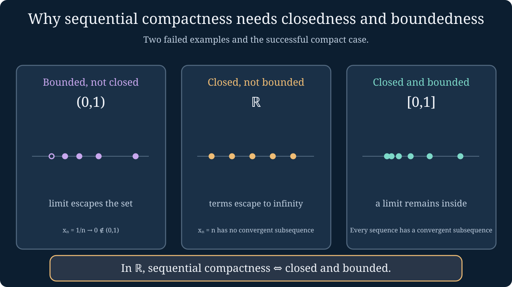
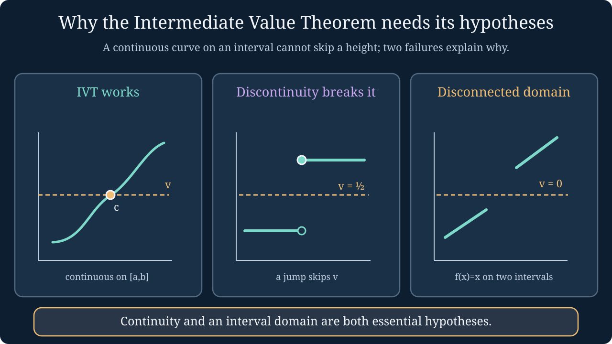
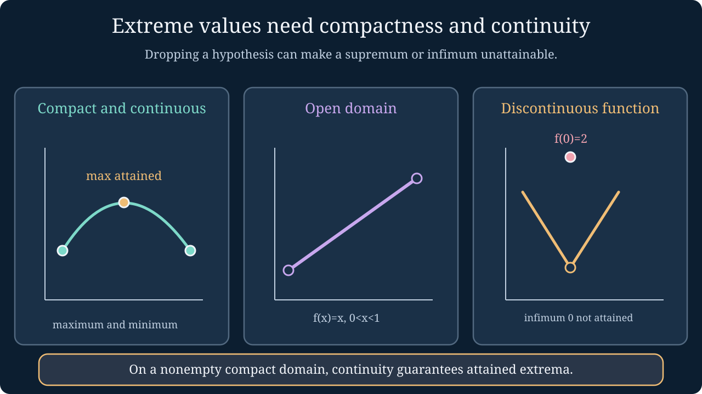
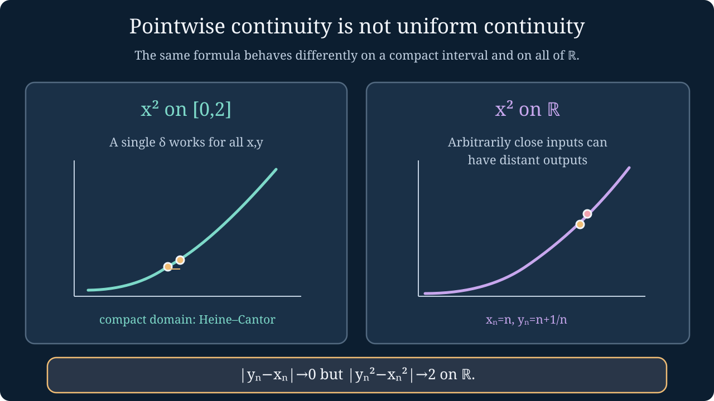

> [!abstract] Prerequisites and destination
> **Start with:** [Completeness and Convergence](./completeness-and-convergence) for epsilon-N limits, Bolzano-Weierstrass, and the least-upper-bound property. [Calculus](./calculus) supplies the computational intuition.
> **Continue to:** [Rigorous Differentiation](./rigorous-differentiation) and [Rigorous Integration](./rigorous-integration). The [General Topology compactness chapter](./general-topology-compactness) proves open-cover theorems in more general spaces.

A continuous curve seems unable to jump over a height; a continuous function on a closed interval seems to reach its highest value. Neither claim follows from drawing a smooth line. **Completeness and compactness turn the pictures into theorems.** This chapter proves the results for subsets of the real line, and states exactly what can go wrong when a hypothesis is removed.

**For review:** See the [Chapter Reference](#chapter-reference) for definitions, key concepts, and theorem statements in tables.

## 1. From sequence limits to function limits

> [!definition] Limit at a point
> Let $D\subseteq\mathbb R$, let $c$ be an accumulation point of $D$, and let $f:D\to\mathbb R$. We say $\lim_{x\to c}f(x)=L$ when
>
> $$
> \forall\varepsilon>0\ \exists\delta>0\
> \forall x\in D:\quad 0<|x-c|<\delta\implies |f(x)-L|<\varepsilon.
> $$

The condition $0<|x-c|$ matters: a limit examines values **near** $c$, not necessarily the value at $c$. An accumulation point guarantees that there actually are domain points arbitrarily near $c$ other than $c$.

> [!definition] Continuity, including endpoints
> A function $f:D\to\mathbb R$ is **continuous at $c\in D$** when for every $\varepsilon>0$ some $\delta>0$ satisfies
>
> $$
> x\in D,\quad |x-c|<\delta\implies |f(x)-f(c)|<\varepsilon.
> $$
>
> This is **relative to the domain**. At the left endpoint of $[a,b]$, $x$ approaches only from inside the interval.

**Worked example.** For $f(x)=x^2$ at $c=2$, factor rather than guessing a delta:

$$
|x^2-4|=|x-2||x+2|.
$$

If $\delta\le1$, then $|x-2|<\delta$ implies $1<x<3$, so $|x+2|<5$. For a given $\varepsilon>0$, choose $\delta:=\min\{1,\varepsilon/5\}$. Then $|x-2|<\delta$ forces $|x^2-4|<5\delta\le\varepsilon$. This is an actual epsilon-delta proof: the second factor was controlled **before** choosing a tolerance for the first.

### Sequences give an equivalent continuity test

> [!theorem] Sequential characterization
> $f:D\to\mathbb R$ is continuous at $c\in D$ if and only if for **every** sequence $(x_n)$ in $D$ with $x_n\to c$, we have $f(x_n)\to f(c)$.

**Proof, forward direction.** Given $\varepsilon>0$, continuity provides a $\delta>0$. Convergence of $x_n$ to $c$ provides $N$ such that $|x_n-c|<\delta$ for every $n\ge N$, hence $|f(x_n)-f(c)|<\varepsilon$.

**Proof, reverse direction.** Suppose continuity fails. Then some $\varepsilon_0>0$ has the property that **every** $\delta>0$ admits $x\in D$ with $|x-c|<\delta$ but $|f(x)-f(c)|\ge\varepsilon_0$. Choose such an $x_n$ with $\delta=1/n$. Then $x_n\to c$, while $f(x_n)$ does not approach $f(c)$. This contradicts the sequential property. $\square$

We can now transport statements about sequences into statements about functions. In particular, polynomials and the elementary operations on continuous functions are continuous wherever defined: combine the [algebra of limits](./completeness-and-convergence#algebra-of-limits-why-multiplication-works) with the sequential test.

## 2. Closed and bounded sets do the heavy lifting

A set $K\subseteq\mathbb R$ is **bounded** if $K\subseteq[-M,M]$ for some $M$. It is **closed** when it contains the limit of every convergent sequence of its points. This sequential description agrees with the open-complement definition for subsets of $\mathbb R$.

> [!theorem] Sequential compactness on the line
> A nonempty set $K\subseteq\mathbb R$ is closed and bounded if and only if every sequence in $K$ has a subsequence converging to a point **in $K$**.

**Proof, closed and bounded implies sequential compactness.** A sequence in $K$ is bounded. The [Bolzano-Weierstrass theorem](./completeness-and-convergence#5-bolzano-weierstrass-bounded-sequences-contain-convergence) gives a subsequence converging to some real $c$. Because $K$ is closed, $c\in K$.

**Proof, converse.** Suppose every sequence in $K$ has a subsequence converging in $K$. If $K$ were unbounded, we could choose $x_n\in K$ with $|x_n|>n$, and no subsequence could converge. Thus $K$ is bounded. If $K$ were not closed, there would be a sequence $x_n\in K$ converging to a real $c\notin K$. Every subsequence still converges to $c$, contradicting the assumption that a subsequence converges to a point of $K$. Thus $K$ is closed. $\square$

*Figure: The sequence $1/n$ can converge outside $(0,1)$, while $n$ escapes to infinity in $\mathbb R$. A closed bounded interval avoids both failures by Bolzano–Weierstrass and closedness.*

For subsets of $\mathbb R$, the [open-cover definition of compactness](./general-topology-compactness#compactness-every-open-cover-admits-a-finite-subcover) agrees with sequential compactness. The topology chapter proves this link rather than assuming the two definitions agree in every topological space.

**What fails if a condition is removed?** The bounded but nonclosed interval $(0,1)$ contains $x_n:=1/n$ for $n\ge2$; all its convergent subsequences have limit $0$ outside $(0,1)$. The closed but unbounded set $\mathbb R$ contains $x_n:=n$, which has no convergent subsequence.

## 3. Intermediate Value Theorem: why a continuous path cannot skip a height

> [!theorem] Intermediate Value Theorem (IVT)
> If $f:[a,b]\to\mathbb R$ is continuous, $a<b$, and $f(a)<v<f(b)$, then there is a $c\in(a,b)$ with $f(c)=v$. The reversed inequality case is symmetric.

**Proof from completeness.** Define

$$
S:=\{x\in[a,b]: f(x)<v\}.
$$

The set is nonempty because $a\in S$, and it is bounded above by $b$. By completeness, $c:=\sup S$ exists. We show $f(c)=v$.

First, $c\in(a,b)$. Continuity at $a$ and the inequality $f(a)<v$ imply $f(x)<v$ for some $x>a$ close to $a$, so $c>a$. Similarly, continuity at $b$ and $f(b)>v$ imply $f(x)>v$ for all $x$ sufficiently close to $b$ from the left, so $c<b$.

If $f(c)<v$, continuity at $c$ would give an interval around $c$ on which $f(x)<v$. Some $x>c$ in that interval would belong to $S$, contradicting that $c$ is an upper bound of $S$.

If $f(c)>v$, continuity would give an interval around $c$ on which $f(x)>v$. But since $c=\sup S$, there is an $x\in S$ arbitrarily close to $c$ from below. That gives both $f(x)<v$ and $f(x)>v$, impossible.

Neither strict inequality is possible, so $f(c)=v$. $\square$

*Figure: Continuity on an interval forces intermediate values. A jump discontinuity or a disconnected domain can invalidate the conclusion.*

**Worked example: an existence proof, not a root formula.** Let $f(x):=x^3-x-1$. We have $f(1)=-1$ and $f(2)=5$. Polynomials are continuous, so some $c\in(1,2)$ satisfies $c^3-c-1=0$. The theorem does **not** supply a closed form or a unique root.

**Failure without continuity.** The function $g(x):=0$ for $x<0$, $g(x):=1$ for $x\ge0$ has $g(-1)=0$ and $g(1)=1$, but never takes the intermediate value $1/2$. The missing hypothesis is continuity.

**Failure without interval connectedness.** The continuous function $f(x)=x$ on the disconnected domain $[-2,-1]\cup[1,2]$ takes negative and positive values but never $0$. Continuity alone on an arbitrary domain is not enough.

## 4. Extreme Value Theorem: when an optimum exists

> [!theorem] Extreme Value Theorem (EVT)
> If $K\subseteq\mathbb R$ is nonempty, closed and bounded, and $f:K\to\mathbb R$ is continuous, then there exist $x_{\min},x_{\max}\in K$ with
>
> $$
> f(x_{\min})\le f(x)\le f(x_{\max})\qquad(x\in K).
> $$

**Proof.** First show $f(K)$ is bounded. Otherwise choose $x_n\in K$ with $|f(x_n)|>n$. Sequential compactness yields a subsequence $x_{n_j}\to c\in K$. Continuity implies $f(x_{n_j})\to f(c)$, contradicting unboundedness.

Let $M:=\sup f(K)$. For each $n\ge1$, the supremum approximation property supplies $x_n\in K$ with $f(x_n)>M-1/n$. Sequential compactness gives a subsequence $x_{n_j}\to x_{\max}\in K$. Continuity gives $f(x_{n_j})\to f(x_{\max})$, while

$$
M-\frac1{n_j}<f(x_{n_j})\le M
$$

forces the same sequence to converge to $M$. Uniqueness of limits yields $f(x_{\max})=M$. Applying the same argument to $-f$ gives a minimum. $\square$

**Example.** On $[0,2]$, the function $f(x):=-(x-1)^2+3$ has maximum $3$ at $1$ and minimum $2$ at both endpoints. EVT guaranteed these extrema **before** we differentiated anything.

*Figure: The Extreme Value Theorem guarantees actual extrema under compactness and continuity. An open domain or a discontinuity can make an extremum unattainable.*

**Why the hypotheses matter.** On $(0,1)$, $f(x)=x$ has neither a maximum nor a minimum despite being continuous and bounded. On the compact interval $[-1,1]$, define $f(0):=2$ and $f(x):=|x|$ for $x\ne0$. This $f$ is **bounded but discontinuous**, and it has **no minimum**: every value is positive, but $f(x)$ approaches $0$ along nonzero $x\to0$. Thus even boundedness of $f$ on a compact domain cannot replace continuity in EVT. A discontinuous function may still attain both extrema (for example, set $g(0):=2$ and $g(x):=1$ for $x\ne0$), so continuity is a sufficient hypothesis, not a necessary one for an individual function.

## 5. Pointwise continuity versus one delta for the whole set

At every point $c$, ordinary continuity allows the chosen $\delta$ to depend on **both** $\varepsilon$ and $c$. Uniform continuity requires one $\delta$ that works simultaneously for all points in the domain.

> [!definition] Uniform continuity
> A function $f:D\to\mathbb R$ is uniformly continuous on $D$ when
>
> $$
> \forall\varepsilon>0\ \exists\delta>0\
> \forall x,y\in D:\quad |x-y|<\delta\implies |f(x)-f(y)|<\varepsilon.
> $$

> [!theorem] Heine-Cantor theorem
> Every continuous real-valued function on a nonempty closed and bounded set $K\subseteq\mathbb R$ is uniformly continuous.

**Proof by contradiction.** Suppose $f$ is continuous but not uniformly continuous. Then some $\varepsilon_0>0$ allows us, for every integer $n\ge1$, to choose $x_n,y_n\in K$ with

$$
|x_n-y_n|<\frac1n,
\qquad |f(x_n)-f(y_n)|\ge\varepsilon_0.
$$

By sequential compactness, choose a subsequence $x_{n_j}\to c\in K$. The triangle inequality gives $|y_{n_j}-c|\le|y_{n_j}-x_{n_j}|+|x_{n_j}-c|\to0$, so both selected sequences approach the **same point** $c$. Continuity at $c$ implies both $f(x_{n_j})$ and $f(y_{n_j})$ approach $f(c)$. Their difference therefore tends to zero, contradicting its fixed lower bound $\varepsilon_0$. $\square$

*Figure: $x^2$ is uniformly continuous on each closed bounded interval but not on all of $\mathbb R$. The paired inputs $n$ and $n+1/n$ approach one another while their outputs stay separated.*

**Worked contrast.** The function $f(x)=x^2$ is continuous on $\mathbb R$ but **not** uniformly continuous there. Set $x_n=n$, $y_n=n+1/n$. Their distance is $1/n\to0$, but

$$
|y_n^2-x_n^2|=2+\frac1{n^2}\ge2.
$$

On any closed bounded interval, the same function is uniformly continuous by Heine-Cantor. The domain matters just as much as the formula.

## 6. A boundary between theorems

The dependency chain is:

**Completeness** $\longrightarrow$ **Bolzano-Weierstrass** $\longrightarrow$ **sequential compactness** $\longrightarrow$ **EVT and Heine-Cantor**.

IVT follows from completeness by a different route: taking a supremum of points where $f$ lies below a target. Its more general topological explanation is that [continuous images preserve connectedness](./general-topology-compactness#intermediate-value-theorem-from-connectedness).

These results solve *existence* questions but do not give explicit formulas. They are exactly the input for Fermat's, Rolle's, and the Mean Value Theorems in [Rigorous Differentiation](./rigorous-differentiation).

> [!distinction] What has been proved, and what has been reused
> The epsilon-delta sequential criterion, the real sequential compactness criterion, IVT, EVT, and Heine-Cantor are proved here. The equivalence with **open-cover** compactness is proved in the linked topology chapter, not silently assumed for arbitrary spaces.

---

## Chapter Reference

A quick reference to the chapter's definitions and results, with links to their original treatment. This table does not replace the full explanations, hypotheses, diagrams, or proofs.

### Definitions

| Definition | Statement / meaning |
| :--- | :--- |
| **[Limit at a point](#1-from-sequence-limits-to-function-limits)** | Let $D\subseteq\mathbb R$, let $c$ be an accumulation point of $D$, and let $f:D\to\mathbb R$. We say $\lim_{x\to c}f(x)=L$ when |
| **[Continuity, including endpoints](#1-from-sequence-limits-to-function-limits)** | A function $f:D\to\mathbb R$ is continuous at $c\in D$ when for every $\varepsilon>0$ some $\delta>0$ satisfies This is relative to the domain. At the left endpoint of $[a,b]$, $x$ approaches only from inside the interval. |
| **[Uniform continuity](#5-pointwise-continuity-versus-one-delta-for-the-whole-set)** | A function $f:D\to\mathbb R$ is uniformly continuous on $D$ when $\forall\varepsilon>0\ \exists\delta>0\ \forall x,y\in D:\quad \vert x-y\vert <\delta\implies \vert f(x)-f(y)\vert <\varepsilon.$ |

### Key Concepts

| Concept | Statement / meaning |
| :--- | :--- |
| **[1. From sequence limits to function limits](#1-from-sequence-limits-to-function-limits)** | The condition $0<\vert x-c\vert $ matters: a limit examines values near $c$, not necessarily the value at $c$. An accumulation point guarantees that there actually are domain points arbitrarily near $c$ other than $c$. |
| **[Sequences give an equivalent continuity test](#sequences-give-an-equivalent-continuity-test)** | Proof, forward direction. Given $\varepsilon>0$, continuity provides a $\delta>0$. Convergence of $x_n$ to $c$ provides $N$ such that $\vert x_n-c\vert <\delta$ for every $n\ge N$, hence $\vert f(x_n)-f(c)\vert <\varepsilon$. |
| **[2. Closed and bounded sets do the heavy lifting](#2-closed-and-bounded-sets-do-the-heavy-lifting)** | A set $K\subseteq\mathbb R$ is bounded if $K\subseteq[-M,M]$ for some $M$. It is closed when it contains the limit of every convergent sequence of its points. |
| **[3. Intermediate Value Theorem: why a continuous path cannot skip a height](#3-intermediate-value-theorem-why-a-continuous-path-cannot-skip-a-height)** | Proof from completeness. Define $S:=\{x\in[a,b]: f(x)<v\}.$ |
| **[4. Extreme Value Theorem: when an optimum exists](#4-extreme-value-theorem-when-an-optimum-exists)** | Proof. First show $f(K)$ is bounded. Otherwise choose $x_n\in K$ with $\vert f(x_n)\vert >n$. Sequential compactness yields a subsequence $x_{n_j}\to c\in K$. Continuity implies $f(x_{n_j})\to f(c)$, contradicting unboundedness. |
| **[5. Pointwise continuity versus one delta for the whole set](#5-pointwise-continuity-versus-one-delta-for-the-whole-set)** | At every point $c$, ordinary continuity allows the chosen $\delta$ to depend on both $\varepsilon$ and $c$. Uniform continuity requires one $\delta$ that works simultaneously for all points in the domain. |
| **[6. A boundary between theorems](#6-a-boundary-between-theorems)** | The dependency chain is: Completeness $\longrightarrow$ Bolzano-Weierstrass $\longrightarrow$ sequential compactness $\longrightarrow$ EVT and Heine-Cantor. |

### Theorems and Key Results

Some results have full proofs here; others are introduced and discussed. Check the linked section for each result's assumptions.

| Theorem / result | Statement / meaning |
| :--- | :--- |
| **[Sequential characterization](#sequences-give-an-equivalent-continuity-test)** | $f:D\to\mathbb R$ is continuous at $c\in D$ if and only if for every sequence $(x_n)$ in $D$ with $x_n\to c$, we have $f(x_n)\to f(c)$. |
| **[Sequential compactness on the line](#2-closed-and-bounded-sets-do-the-heavy-lifting)** | A nonempty set $K\subseteq\mathbb R$ is closed and bounded if and only if every sequence in $K$ has a subsequence converging to a point in $K$. |
| **[Intermediate Value Theorem (IVT)](#3-intermediate-value-theorem-why-a-continuous-path-cannot-skip-a-height)** | If $f:[a,b]\to\mathbb R$ is continuous, $a<b$, and $f(a)<v<f(b)$, then there is a $c\in(a,b)$ with $f(c)=v$. The reversed inequality case is symmetric. |
| **[Extreme Value Theorem (EVT)](#4-extreme-value-theorem-when-an-optimum-exists)** | If $K\subseteq\mathbb R$ is nonempty, closed and bounded, and $f:K\to\mathbb R$ is continuous, then there exist $x_{\min},x_{\max}\in K$ with |
| **[Heine-Cantor theorem](#5-pointwise-continuity-versus-one-delta-for-the-whole-set)** | Every continuous real-valued function on a nonempty closed and bounded set $K\subseteq\mathbb R$ is uniformly continuous. |
| **[6. A boundary between theorems](#6-a-boundary-between-theorems)** | The dependency chain is: Completeness $\longrightarrow$ Bolzano-Weierstrass $\longrightarrow$ sequential compactness $\longrightarrow$ EVT and Heine-Cantor. |
