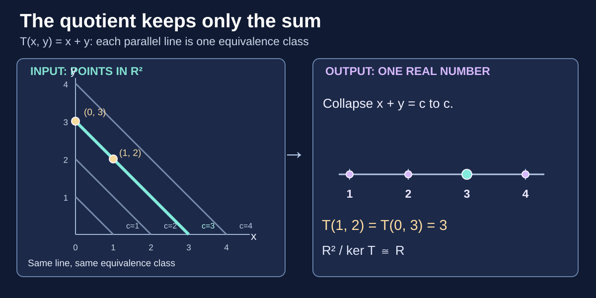
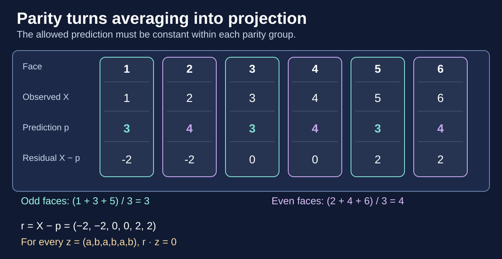

> [!abstract] How to use this page
> **Start anywhere.** Each bridge begins with an idea taught in one chapter, works through a concrete example, and shows what becomes possible in another subject. Read the source chapter for its full definitions. Use the [Atlas of Mathematical Spaces](./atlas-of-mathematical-spaces) when you want to compare the *types of structure* being added to sets. This page instead focuses on **reusing a proof pattern or construction**.

The most useful mathematical connections are not merely that two chapters use similar words. They are the cases where a construction, invariant, or argument from one field can be transported to another—and where we can say exactly **which hypotheses make that transfer legitimate**.

## How to recognize a transferable idea

| Seed idea | First appears clearly in | Reappears as | Transfer question |
| --- | --- | --- | --- |
| **Identify indistinguishable objects** | [Equivalence relations](./equivalence-relations) | [Linear kernels](./linear-algebra-foundations#the-first-isomorphism-theorem-what-survives-information-loss), [quotient spaces](./general-topology-constructions) | What distinctions can a map no longer observe? |
| **Preserve a property while moving** | [State-machine invariants](./state-machines-invariants) | [Conserved quantities and stability](./differential-equations#stability) | What remains true along every permitted trajectory? |
| **Prove progress cannot continue forever** | [Well-founded orders](./order-theory#well-foundedness-and-well-ordering), [ranking functions](./state-machines-invariants#ranking-functions-measuring-finite-progress) | [Lyapunov functions](./differential-equations#stability) | Is progress finite, or does it merely approach a limit? |
| **Local constraints must agree globally** | [Graph cycles](./graph-theory), [equations over sets](./functions-relations) | [Cohomology](./algebraic-topology), [sheaf gluing](./sheaf-theory#6-local-solutions-do-not-imply-a-global-solution) | Can every local equation hold while no global assignment exists? |
| **Turn products into sums using logarithms** | [Logarithms](./logarithms) | [Likelihood](./statistical-learning), [cross-entropy and KL](./information-theory) | Which optimization problems are really the same objective? |
| **Replace a sum by a weighted integral** | [Expected value](./probability#expected-value) | [Measure-theoretic integration](./measure-theory), [linear functionals](./functional-analysis) | Which properties of expectation survive beyond finite outcomes? |
| **Find the best approximation given limited information** | [Vector projections](./vector#projection), [least squares](./linear-algebra-foundations#projection-onto-a-subspace) | [Conditional expectation](./measure-theory#conditional-expectation-is-an-orthogonal-projection), [regression](./statistical-learning#ordinary-least-squares-ols) | Why is averaging a geometric operation? |

The table is a map, **not a prerequisite list**. The worked bridges below make the translations explicit through concrete calculations and the conditions under which they hold.

**How to read a bridge:** first identify the familiar object, then ask what the new subject *adds*. The decisive moment is not recognizing a shared word but proving that an operation, equation, or invariant survives the translation. Each bridge also identifies a boundary where the analogy would otherwise lead to an incorrect conclusion. You do not need to master the destination subject before starting the calculation.

## Bridge 1. Equivalence classes become kernels and quotient spaces

**Seed:** [Equivalence Relations and Quotients](./equivalence-relations#quotient-sets-classes-become-objects) teaches that an equivalence relation groups elements that we deliberately treat as indistinguishable.

Consider the linear map

$$
T:\mathbb R^2\to\mathbb R,\qquad T(x,y)=x+y.
$$

It cannot distinguish $(1,2)$ from $(0,3)$: both map to $3$. The geometric question is therefore not which *point* we started with, but which entire **line of points with the same sum** it belongs to. Define

$$
(x,y)\sim(u,v)\quad\Longleftrightarrow\quad x+y=u+v.
$$

This is an equivalence relation, because it is equality of the map's outputs. Each class is a line of constant sum. The class of $(1,2)$ is

$$
[(1,2)]=\{(t,3-t):t\in\mathbb R\}.
$$

Two inputs are equivalent exactly when their difference lies in the kernel:

$$
(x,y)\sim(u,v)\quad\Longleftrightarrow\quad
(x-u,y-v)\in\ker T,
\qquad
\ker T=\{(t,-t):t\in\mathbb R\}.
$$

Now define a map **from the classes themselves**:

$$
\widetilde T:\mathbb R^2/{\sim}\ \to\mathbb R,\qquad
\widetilde T([(x,y)])=x+y.
$$

It is **well-defined**: choosing a different representative in the same class cannot change the sum. It is injective because equal sums mean equal classes; it is surjective because $T(r,0)=r$. Thus the quotient set is in bijection with $\mathbb R$. Giving it the quotient vector-space structure makes this the **first isomorphism theorem**:

$$
\boxed{\mathbb R^2/\ker T\cong\mathbb R.}
$$

*Figure: Each parallel line is one equivalence class. The map $T$ sends all points on that line to the same real number $c$, making the quotient by $\ker T$ concrete.*

**Transfer:** A quotient is not necessarily a mysterious new construction. It may simply be what remains after a map forgets some information. This same question drives [quotient groups](./group-homomorphisms-quotients), [quotient rings](./ring-ideals-quotients), and [quotient topological spaces](./general-topology-constructions).

> [!distinction] Same pattern; different obligations
> A **set quotient** needs only an equivalence relation. An **algebraic quotient** must show the operations are well-defined on classes. A **topological quotient** specifies which subsets of the quotient are open and requires the appropriate continuity claims. The common pattern is identification—not automatic preservation of every kind of structure.

## Bridge 2. Finite termination is not the same as asymptotic decrease

**Seed:** [State Machines and Invariants](./state-machines-invariants#ranking-functions-measuring-finite-progress) distinguishes **invariants**, which stay true, from **ranking functions**, which strictly decrease on active transitions.

Both ranking functions and Lyapunov functions attach numbers to states, but neither is *universally stronger* than the other: their hypotheses, codomains, and conclusions differ. In particular, reaching a state in finitely many transitions is not the same claim as approaching it arbitrarily closely.

Take a machine whose states are $S:=\{0,1,2,3\}$ and whose transition is

$$
F(n):=\max(n-1,0).
$$

The property $n\geq0$ is invariant. More significantly, $\rho(n)=n$ is a natural-number ranking function on **active** states $n>0$:

$$
n>0\quad\Longrightarrow\quad \rho(F(n))=\rho(n)-1.
$$

No run can keep taking active transitions forever; it reaches $0$ after at most $n$ such steps. The self-loop at $0$ is a settled state, **not** another transition required to decrease the ranking.

Now replace this discrete evolution with the differential equation

$$
\dot x=-x,\qquad x(0)=x_0.
$$

The solution is $x(t)=x_0e^{-t}$. Define the potential

$$
V(x):=x^2.
$$

Along a trajectory,

$$
\frac{d}{dt}V(x(t))
=2x(t)\dot x(t)
=-2x(t)^2\leq0,
$$

with strict decrease whenever $x(t)\ne0$. The value approaches $0$, and $x(t)\to0$, but for $x_0\ne0$ the trajectory does **not** reach $0$ at any finite time.

**Transfer:** Both proofs organize trajectories using a quantity that decreases. Their **conclusions differ**:

| Discrete ranking into a well-founded order | Continuous Lyapunov-style decrease |
| --- | --- |
| Can rule out infinite active transition sequences | May establish stability or asymptotic convergence given suitable hypotheses |
| Uses impossibility of infinite strict descent | Uses properties of the dynamics and a potential |
| Finite arrival is a natural conclusion | Finite arrival is **not** automatic |

> [!counterexample] Strict descent alone is not termination
> Iterating $x\mapsto x/2$ on positive real numbers strictly reduces $x$ forever. It never produces zero from a positive start. The target of a ranking function must be **well-founded** (or satisfy another argument strong enough to force finite progress).

**Further payoff:** [Optimization](./optimization) uses descent of objective functions; [Differential Equations](./differential-equations#stability) studies stability of trajectories. An objective that decreases is useful evidence, but by itself is not a universal proof of termination, unique equilibrium, or global convergence.

## Bridge 3. An inconsistent cycle is a cohomological obstruction

**Seed:** [Graph Theory](./graph-theory) teaches paths, trees, and cycles. [Equivalence Relations](./equivalence-relations) teaches when local equalities identify objects. Put those ideas together in a tiny constraint system.

**Why this bridge matters:** testing each equation separately cannot establish that *all* equations are satisfiable together. Before invoking cohomology, we can detect the problem with ordinary parity arithmetic. Cohomology then gives the same obstruction a reusable algebraic name.

Place a binary variable $x_v\in\{0,1\}$ at every vertex. On each undirected edge $e=\{u,v\}$ impose

$$
x_u\oplus x_v=b_e,
$$

where $\oplus$ is XOR (addition modulo $2$) and $b_e\in\{0,1\}$ is an edge label. Label $0$ demands **agreement**; label $1$ demands **disagreement**.

On a triangle $a-b-c-a$, choose

$$
b_{ab}=0,\qquad b_{bc}=0,\qquad b_{ca}=1.
$$

Every individual edge constraint can be satisfied. But all three together cannot: the first two force $x_a=x_b=x_c$, while the last demands $x_c\ne x_a$.

XOR the three edge equations. Every vertex variable appears exactly twice and cancels:

$$
(x_a\oplus x_b)\oplus(x_b\oplus x_c)\oplus(x_c\oplus x_a)=0,
$$

whereas the required right side is $0\oplus0\oplus1=1$. Contradiction.

*Figure: The tree edges determine a candidate assignment. The remaining edge closes the triangle and contradicts it; the cycle XOR is $0\oplus0\oplus1=1$, not the required $0$.*

**Exact graph theorem:** On a connected graph, a global assignment exists **if and only if the XOR of edge labels around every cycle is zero**.

*Why the converse holds:* choose a spanning tree and any value at its root. Each tree edge determines the next vertex value, so all tree constraints are satisfied. Each edge outside the tree closes one cycle with the unique tree path; the zero-XOR condition ensures that additional edge constraint is satisfied too. Thus all edges are satisfied.

**How many checks are needed?** For a finite connected graph with $V$ vertices and $E$ edges, a spanning tree has $V-1$ edges. Therefore exactly

$$
E-(V-1)=E-V+1
$$

edges lie outside the tree. Each such edge defines a **fundamental cycle** with the unique tree path joining its endpoints. These $E-V+1$ cycle conditions are independent as constraints on the edge labels over $\mathbb Z_2$, and checking them suffices: every other cycle is a combination of fundamental cycles. The triangle has $E=V=3$, hence exactly **one** independent cycle condition. This is the dimension of its cycle space (its first Betti number). It also explains why a spanning-tree traversal followed by an edge-consistency check gives a linear-time algorithm, $O(V+E)$, for deciding whether an assignment exists.

There is an algebraic-topological language for exactly this obstruction. Regard the graph as a one-dimensional topological complex. Vertex assignments are $0$-cochains, edge labels are $1$-cochains over $\mathbb Z_2$, and the coboundary operation is

$$
(\delta x)(\{u,v\})=x_u\oplus x_v.
$$

The constraints ask whether $b=\delta x$. If not, the class of $b$ in

$$
H^1(G;\mathbb Z_2)=C^1(G;\mathbb Z_2)/\operatorname{im}\delta
$$

is nonzero. For a graph treated as a **one-dimensional complex**, there are no $2$-cells, so every $1$-cochain is a cocycle; the displayed quotient is the first cohomology group.

**Transfer:** Graph propagation provides a direct **algorithm** (spanning tree plus chord checks); algebraic topology identifies the obstruction as a class that does not disappear merely by choosing different vertex values. This is one route into [Algebraic Topology](./algebraic-topology) and the local-to-global perspective in [Sheaf Theory](./sheaf-theory#6-local-solutions-do-not-imply-a-global-solution).

> [!distinction] Three different things called a cycle
> This is a cycle of the **underlying undirected constraint graph**. It is not necessarily a directed dependency cycle, nor a periodic orbit of a state-transition system. The example diagnoses *existence of a consistent assignment*, **not** whether an asynchronous repair process will converge to one.

## Bridge 4. Likelihood, cross-entropy, and KL divergence are one calculation

**Seeds:** [Probability](./probability) defines Bernoulli events, [Logarithms](./logarithms) shows how products become sums, and [Optimization](./optimization) studies minima and maxima.

Suppose ten independent Bernoulli observations contain seven $1$s and three $0$s. A model assigns probability $p$ to a $1$ ($0<p<1$). For the observed ordered sequence, its likelihood is

$$
L(p)=p^7(1-p)^3.
$$

This is the probability of the **particular ordered sequence** we observed. If we instead ask for the probability of obtaining *any* arrangement with seven successes in ten trials, the binomial coefficient counts those arrangements:

$$
\binom{10}{7}p^7(1-p)^3=120L(p).
$$

The factor $120$ does not depend on $p$, so either likelihood has the same maximizer. The distinction concerns what event the likelihood represents, not which fitted value we obtain.

Taking a logarithm preserves which $p$ maximizes likelihood:

$$
\log L(p)=7\log p+3\log(1-p).
$$

Differentiate:

$$
\frac{d}{dp}\log L(p)=\frac7p-\frac3{1-p}=0
\quad\Longleftrightarrow\quad p=\frac7{10}.
$$

The log-likelihood tends to $-\infty$ at both endpoints, and its second derivative is negative on $(0,1)$, so this is the **unique maximum**.

Now let the empirical distribution be $\widehat P:=(0.3,0.7)$ and the model distribution be $Q_p:=(1-p,p)$. Their cross-entropy is

$$
H(\widehat P,Q_p)
=-0.7\log p-0.3\log(1-p)
=-\frac1{10}\log L(p).
$$

So **maximizing likelihood** equals **minimizing empirical cross-entropy**. And the identity

$$
H(\widehat P,Q_p)
=H(\widehat P)+D_{\mathrm{KL}}(\widehat P\Vert Q_p)
$$

shows that, because $H(\widehat P)$ is constant in $p$, this also equals minimizing the KL divergence from the **empirical** distribution to the model.

**Transfer:** A concrete statistical fitting problem becomes an information-theoretic discrepancy minimization problem and an optimization problem, without changing the minimizer. Continue with [Statistical Learning](./statistical-learning), [Information Theory](./information-theory#cross-entropy), and [Bayesian Inference](./bayesian-inference).

> [!distinction] What the identity does not say
> The empirical distribution is not necessarily the true data-generating distribution. Nor is *every* training loss a likelihood. The equivalence here depends on a specified probabilistic model and the particular log-loss objective.

## Bridge 5. Expectation is integration

For a finite sample space, if $P(x)$ is a probability assigned to each outcome and $f(x)$ is a quantity of interest, expectation is

$$
\mathbb E_P[f]=\sum_{x}f(x)P(x).
$$

Measure theory writes **the same operation** in a form that also handles continuous and more general distributions:

$$
\mathbb E_P[f]=\int f\,dP
$$

when the integral exists. It is not necessary that every probability distribution have a density $p(x)$ with respect to ordinary length; a sum of point masses is already a valid probability measure.

### Worked example: one distribution, discrete and continuous at once

Suppose $X$ equals zero with probability $1/4$. Otherwise, with probability $3/4$, it is sampled uniformly from the interval $[0,2]$. The probability law is the mixture

$$
P=\frac14\delta_0+\frac34\operatorname{Unif}[0,2].
$$

Read $\delta_0$ as "delta at zero": it assigns probability one to the single outcome $0$. The mixture gives the exact point $0$ probability $1/4$, *and* spreads the remaining probability continuously across the interval. No single ordinary density with respect to length can describe the whole law, because such a density would assign the singleton $\{0\}$ probability zero.

For an integrable function $f$, the defining integral separates into its discrete and continuous contributions:

$$
\mathbb E[f(X)]
=\int f\,dP
=\frac14 f(0)+\frac34\int_0^2 f(x)\,\frac{dx}{2}.
$$

Set $f(x)=x$. Since the continuous component has constant density $1/2$ on $[0,2]$,

$$
\begin{aligned}
\mathbb E[X]
&=\frac14(0)+\frac34\int_0^2 x\,\frac{dx}{2}\\
&=\frac34\left[\frac{x^2}{4}\right]_0^2\\
&=\boxed{\frac34}.
\end{aligned}
$$

We can also compute a second moment:

$$
\mathbb E[X^2]
=\frac34\int_0^2 x^2\,\frac{dx}{2}
=\frac34\cdot\frac43=1.
$$

Consequently,

$$
\operatorname{Var}(X)
=\mathbb E[X^2]-\mathbb E[X]^2
=1-\left(\frac34\right)^2
=\frac7{16}.
$$

**What transfers:** the same integral handles an atomic mass, a continuous component, and their mixture. Moving from a finite weighted sum to $\int f\,dP$ is not merely changing notation; it is moving to a construction that works even without a density for the full law.

The same linearity becomes a general property of integration:

$$
\mathbb E_P[af+bg]=a\mathbb E_P[f]+b\mathbb E_P[g]
$$

for integrable $f,g$. This creates a bridge from [Probability](./probability#expected-value) to [Measure Theory](./measure-theory) and, with the right normed function space and boundedness hypotheses, to [Functional Analysis](./functional-analysis).

## Bridge 6. Conditional expectation is orthogonal projection

**Seeds:** A [vector projection](./vector#projection) keeps the part of a vector lying in a chosen direction. [Linear Algebra Foundations](./linear-algebra-foundations#projection-onto-a-subspace) generalizes this to the nearest vector in a subspace. [Probability](./probability#expected-value) describes expectation as an average.

**First surprise: an average is a projection.** Consider the five observations

$$
y=(2,4,4,6,9).
$$

Imagine choosing a *constant* prediction: one number $c$ used for all five observations. The possible prediction vectors form a line,

$$
M_0=\{(c,c,c,c,c):c\in\mathbb R\}.
$$

Which point on that line is closest to $y$? Minimize the sum of squared errors:

$$
S(c)=(2-c)^2+(4-c)^2+(4-c)^2+(6-c)^2+(9-c)^2.
$$

Differentiating, $S'(c)=10c-50$. Thus $c=5$ is the unique minimum, and

$$
\boxed{\operatorname{proj}_{M_0}y=(5,5,5,5,5).}
$$

The familiar **arithmetic mean** is the coordinate of the orthogonal projection onto the constant-vector subspace.

**Second surprise: conditional expectation is projection onto a bigger subspace.** Roll a fair die, with $X$ equal to the face value. Imagine you are told *only whether it is odd or even*. Your predictions can now have **two** values: $a$ on odd rolls and $b$ on even rolls.

The possible prediction vectors are exactly

$$
M=\{(a,b,a,b,a,b):a,b\in\mathbb R\}.
$$

The closest such prediction to $X=(1,2,3,4,5,6)$ is

$$
p=(3,4,3,4,3,4),
$$

because the odd outcomes average to $3$ and the even outcomes average to $4$. This is the conditional expectation $\mathbb E[X\mid\text{parity}]$.

*Figure: Conditioning on parity restricts predictions to the two-dimensional subspace $M=\{(a,b,a,b,a,b)\}$. Its orthogonal projection gives the odd and even means, with a residual perpendicular to that subspace.*

**Why is it really an orthogonal projection?** The residual is

$$
r=X-p=(-2,-2,0,0,2,2).
$$

For *any* parity-based prediction $z=(a,b,a,b,a,b)$, its dot product with the residual is

$$
r\cdot z=-2a-2b+2a+2b=0.
$$

Thus $r$ is perpendicular to the entire subspace $M$. With the probability-weighted inner product, the same statement is $\mathbb E[rz]=0$.

The error decreases when we use the extra information:

| Allowed information | Best prediction | Mean squared error |
| --- | --- | --- |
| No information beyond a constant | $(3.5,3.5,3.5,3.5,3.5,3.5)$ | $35/12$ |
| Parity of the outcome | $(3,4,3,4,3,4)$ | $8/3$ |
| Full observed outcome | $(1,2,3,4,5,6)$ | $0$ |

Enlarging the set of admissible predictions cannot make the *best attainable* squared error worse. Here, each enlargement corresponds to a larger linear subspace.

**The general theorem:** For $Y\in L^2$, conditional expectation $\mathbb E[Y\mid\mathcal G]$ is the **orthogonal projection** of $Y$ onto the closed subspace of $\mathcal G$-measurable square-integrable random variables. The [Measure Theory chapter](./measure-theory#conditional-expectation-is-an-orthogonal-projection) derives the exact orthogonality and Pythagorean squared-error identities.

**Transfer to regression:** Least squares projects observed outcomes onto the span of the chosen feature columns. Conditional expectation projects onto **all** square-integrable predictions measurable from the available information. Same Hilbert-space geometry; different choices of allowed subspace.

> [!distinction] An exact theorem with a scope
> The geometric formulation assumes **square integrability** and **squared-error loss**. Conditional expectation itself is defined for integrable $L^1$ random variables too, but without square integrability the orthogonal-projection argument need not apply. A linear regression fit generally does **not** equal $\mathbb E[Y\mid X]$: its model class can be much smaller than the space of all functions of $X$.

## How to explore another bridge yourself

When you notice familiar language in a new subject, try this sequence:

1. **Name the common object.** Is it a quotient, map, order, invariant, optimization problem, or constraint?
2. **List the additional structure.** What axioms does each field assume?
3. **Translate one small example exactly.** Define the maps and verify the claims, rather than relying on visual analogy.
4. **Find a boundary case.** What breaks when the target order is not well-founded, when a quotient operation is not well-defined, or when local constraints form a nontrivial cycle?
5. **Find the theorem payoff.** What can now be proved or computed that was not obvious in the original description?

### Worked transfer audit: revisit the inconsistent cycle

The five questions are not merely a reading checklist. Apply them to Bridge 3:

| Question | Answer for the XOR graph |
| --- | --- |
| **Common object?** | A system of edge equations $x_u\oplus x_v=b_e$. |
| **Additional structure?** | A graph interpreted as a one-dimensional complex, with vertex $0$-cochains and edge $1$-cochains over $\mathbb Z_2$. |
| **What makes the transfer exact?** | The coboundary identity $b=\delta x$; equivalently, every cycle has XOR sum zero. A spanning tree proves the converse constructively. |
| **Boundary case?** | The triangle labelled $0,0,1$ passes every individual edge check but fails the global cycle condition. This criterion addresses existence, not the convergence of a repair algorithm. |
| **Theorem or computation gained?** | One spanning-tree traversal and $E-V+1$ fundamental cycle checks decide consistency in a finite connected graph. The cohomology class $[b]$ identifies the obstruction. |

This method also tells you **when not to transfer** an idea. A decreasing real-valued potential is not automatically a terminating rank, and a linear least-squares projection is not automatically the full conditional expectation. The hypotheses are part of the mathematics, not footnotes to it.

**Related maps:** the [Atlas](./atlas-of-mathematical-spaces) organizes *structures*; [Path Through Algebra](./path-through-algebra), [Path Through Analysis](./path-through-analysis), [Path Through Topology](./path-to-topology), and [Discrete Mathematics](./discrete-mathematics) organize *reading routes*. These cross-disciplinary bridges organize **reusable ideas and proof techniques**.
