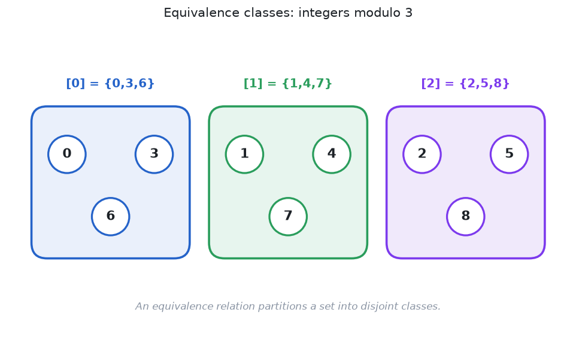

> [!abstract] Prerequisites & where this leads
> **Builds on:** [Set Theory](./set-theory), [binary relations](./functions-relations#relation), and [relation properties](./functions-relations#properties-of-relations).
> **Leads to:** [Order Theory](./order-theory), [quotient groups](./group-homomorphisms-quotients), [quotient rings](./ring-ideals-quotients), and [well-defined functions](./functions-relations#well-defined-functions).

An equivalence relation lets us treat **different objects as the same for a stated purpose** without asserting that they are literally equal. The central result is stronger than a definition: every equivalence relation divides its set into disjoint groups, and every such division gives an equivalence relation. Those groups are called **equivalence classes**. We will prove both directions and then explain why operations on classes require an extra well-definedness check.

## From relations to equivalence

A binary relation $R$ on a set $A$ is a subset of $A\times A$ (read "A cross A"). We write $aRb$ (read "a is R-related to b") when $(a,b)\in R$. In this chapter, the elements belong to the **same underlying set** $A$.

> [!definition] Equivalence relation
> A relation $\sim$ (read "is equivalent to") on $A$ is an **equivalence relation** if, for all $a,b,c\in A$:
> 1. **Reflexivity:** $a\sim a$.
> 2. **Symmetry:** $a\sim b\Rightarrow b\sim a$.
> 3. **Transitivity:** $a\sim b$ and $b\sim c\Rightarrow a\sim c$.

Here $\Rightarrow$ is read "implies." The three properties say: each element is related to itself; either direction of equivalence is permitted; and two successive equivalences can be chained. They do **not** imply that equivalent objects are literally identical.

Consider "has the same remainder upon division by three." The integers $1$ and $4$ are not equal, but they are equivalent under this relation. In contrast, "is less than or equal to" is not generally symmetric: $2\leq3$ does not imply $3\leq2$. It is an [order relation](./order-theory), not an equivalence relation.

> [!distinction] Symmetric versus antisymmetric
> **Symmetric** means every related pair can be reversed. **Antisymmetric** means relations in both directions force the two elements to be identical. These properties are not negations of each other. Equality satisfies **both**.

## Worked proof: congruence modulo n

For integers $a,b$ and a fixed positive integer $n$, write $a\equiv b\pmod n$ (read "a is congruent to b modulo n") when $n$ divides $a-b$. That is, there exists an integer $k$ such that $a-b=nk$.

> [!theorem] Congruence modulo n is an equivalence relation
> For every positive integer $n$, the relation $a\equiv b\pmod n$ on $\mathbb Z$ is reflexive, symmetric, and transitive.

> [!proof] Verify all three requirements
> **Reflexive.** For every integer $a$, $a-a=0=n\cdot0$, so $n\mid(a-a)$. Hence $a\equiv a\pmod n$.
>
> **Symmetric.** If $a-b=nk$ for some integer $k$, then $b-a=n(-k)$. Since $-k$ is an integer, $b\equiv a\pmod n$.
>
> **Transitive.** If $a-b=nk$ and $b-c=nm$, then
> $$
> a-c=(a-b)+(b-c)=n(k+m).
> $$
> Since $k+m$ is an integer, $n\mid(a-c)$. Thus $a\equiv c\pmod n$. All three properties hold.

The proof used arbitrary integers, not a finite survey of cases; it covers infinitely many pairs at once.

## Equivalence classes: what gets identified

For $a\in A$, its equivalence class is

$$
[a]=\{x\in A:x\sim a\}.
$$

Read: "the class of a is the set of all x in A such that x is equivalent to a." The square brackets denote an entire **set**, not simply the object $a$. We sometimes write $[a]_\sim$ when multiple relations are in use.

*Figure: A finite window onto the three infinite classes of congruence modulo three.*

With congruence modulo three,

$$
\begin{aligned}
[0]&=\{\ldots,-6,-3,0,3,6,\ldots\},\\
[1]&=\{\ldots,-5,-2,1,4,7,\ldots\},\\
[2]&=\{\ldots,-4,-1,2,5,8,\ldots\}.
\end{aligned}
$$

For example, $[4]=[1]$: the representatives $1$ and $4$ name the **same class** even though $1\ne4$.

### When are two classes the same?

> [!theorem] Class equality criterion
> For an equivalence relation $\sim$,
> $$
> [a]=[b]\quad\Longleftrightarrow\quad a\sim b.
> $$
> Read $\Longleftrightarrow$ as "if and only if."

> [!proof] Prove both directions
> If $a\sim b$, let $x\in[a]$, so $x\sim a$. Transitivity with $a\sim b$ yields $x\sim b$, hence $x\in[b]$. Thus $[a]\subseteq[b]$. By symmetry $b\sim a$, and the same argument gives $[b]\subseteq[a]$. The classes are equal.
>
> Conversely, if $[a]=[b]$, reflexivity gives $a\in[a]$, so $a\in[b]$. By the definition of $[b]$, $a\sim b$.

> [!proof] Why distinct classes do not overlap
> Suppose $x\in[a]\cap[b]$. Then $x\sim a$ and $x\sim b$. By symmetry $a\sim x$, and by transitivity $a\sim b$. The class equality criterion gives $[a]=[b]$. Therefore two classes are either equal or disjoint; partial overlap is impossible.

## Equivalence relations correspond to partitions

A **partition** of $A$ is a collection of **nonempty**, **pairwise disjoint** subsets (called blocks) whose union is $A$. Each element belongs to exactly one block.

> [!theorem] Equivalence-partition correspondence
> Every equivalence relation on $A$ determines a partition into its distinct equivalence classes. Conversely, every partition determines exactly one equivalence relation having those blocks as its classes.

> [!proof] From equivalence to partition
> **Nonempty:** each $[a]$ contains $a$ by reflexivity.
>
> **Coverage:** every $a\in A$ belongs to $[a]$, so the union of all classes is $A$.
>
> **Disjointness:** we just proved that intersecting classes are equal. Thus the distinct classes are pairwise disjoint. These are precisely the partition axioms.

> [!proof] From partition to equivalence
> Let $\mathcal B$ be a partition of $A$. Define $a\sim b$ when $a,b$ belong to the same block.
>
> **Reflexive:** each element shares a block with itself.
>
> **Symmetric:** sharing a block works in either direction.
>
> **Transitive:** if $a$ and $b$ share one block, and $b$ and $c$ share another, those blocks intersect at $b$. Pairwise disjointness forces them to be the **same** block, so $a$ and $c$ share a block.
>
> Finally, if two relations have the same partition, each relates exactly the pairs that lie in a common block. They therefore coincide. This proves uniqueness.

This theorem gives two equivalent ways to describe the same structure: specify related pairs, or specify blocks of objects that should count as equivalent.

## Quotient sets: classes become objects

The **quotient set** (read "A modulo equivalence") is

$$
A/{\sim}=\{[a]:a\in A\}.
$$

Its elements are the classes, not the original representatives. The **quotient map** is

$$
q:A\longrightarrow A/{\sim},\qquad q(a)=[a].
$$

It is **surjective** (read "onto"): every class has a representative. It is generally not **injective** (read "one-to-one"), because distinct equivalent objects map to the same class.

For congruence modulo three, $\mathbb Z/{\equiv_3}=\{[0],[1],[2]\}$ has only **three elements**, even though $\mathbb Z$ is infinite.

### Every function defines a partition by its outputs

Let $f:A\to B$ be any function. Define

$$
a\sim_f b\quad\Longleftrightarrow\quad f(a)=f(b).
$$

> [!theorem] Function fibers are equivalence classes
> The relation $\sim_f$ is an equivalence relation. Its classes are the fibers of $f$.

> [!proof] Equality of outputs supplies the axioms
> $f(a)=f(a)$ gives reflexivity. If $f(a)=f(b)$, then $f(b)=f(a)$ gives symmetry. If $f(a)=f(b)$ and $f(b)=f(c)$, then $f(a)=f(c)$ gives transitivity. By definition $[a]$ is exactly the set of inputs with output $f(a)$.

**Worked example.** Set $f:\mathbb R\to\mathbb R$ by $f(x)=x^2$ (read "f of x equals x squared"). Then $[3]=\{-3,3\}$ because both inputs have output nine, and $[0]=\{0\}$. The set of classes is naturally in bijection with the nonnegative reals via the squared output.

### When does a function descend to classes?

Suppose $f:A\to B$ and we want to define an output $\bar f([a])$ from the class alone. It cannot depend on which representative we write.

> [!theorem] Unique factorization through the quotient
> A function $\bar f:A/{\sim}\to B$ with $\bar f([a])=f(a)$ exists exactly when
> $$
> a\sim b\quad\Longrightarrow\quad f(a)=f(b).
> $$
> When it exists it is unique.

> [!proof] Necessity, sufficiency, uniqueness
> **Necessity:** if $a\sim b$, then $[a]=[b]$. Since $\bar f$ is a function, $f(a)=\bar f([a])=\bar f([b])=f(b)$.
>
> **Sufficiency:** define $\bar f([a]):=f(a)$. If $[a]=[b]$, then $a\sim b$, so the stated condition forces $f(a)=f(b)$. The value is independent of representative.
>
> **Uniqueness:** every class is some $[a]$, and the required equality specifies the function at every such input.

**Example:** Sending the congruence class $[a]$ modulo three to $a^2\bmod3$ is well-defined, because $a\equiv b\pmod3$ implies $a^2\equiv b^2\pmod3$: factor $a^2-b^2=(a-b)(a+b)$. Sending $[a]$ to the ordinary integer $a$ is **not** well-defined: $[1]=[4]$ but $1\ne4$.

> [!distinction] Forming a quotient is not the same as defining arithmetic on it
> Classes exist for **any** equivalence relation, but an operation $[a]\star[b]:=[a\star b]$ needs its own representative-independence proof. Relations compatible with an operation in this way are called **congruences** for that operation. The distinction matters for [fractions](./construction-of-the-rationals), [quotient groups](./group-homomorphisms-quotients), and [quotient rings](./ring-ideals-quotients).

## Counterexamples: what fails the equivalence axioms?

> [!counterexample] Close to is not transitive
> On real numbers, define $aRb$ if $|a-b|<1$ (read "the absolute difference is less than one"). The relation is reflexive and symmetric. But $0R0.6$ and $0.6R1.2$ hold while $0R1.2$ does not, since $1.2$ is not less than one. It is therefore **not** an equivalence relation.

> [!counterexample] Having overlapping sets is not transitive
> On nonempty finite sets, let $A\,R\,B$ mean $A\cap B\ne\varnothing$. This relation is reflexive and symmetric, but $\{1\}$ intersects $\{1,2\}$, which intersects $\{2\}$, while $\{1\}$ does not intersect $\{2\}$. Transitivity fails.

Both counterexamples show why the three axioms matter. "Similar enough" is not automatically a mathematically valid equivalence.

## Where to go next

- **[Order Theory](./order-theory):** a preorder's mutually comparable elements can be identified and quotient into a genuine poset.
- **[Set Theory](./set-theory#partition-of-a-set):** partitions as collections of disjoint sets.
- **[Functions](./functions-relations):** fibers, quotient maps, and well-definedness.
- **[Quotient groups](./group-homomorphisms-quotients) and [quotient rings](./ring-ideals-quotients):** algebraic operations on classes.

The governing intuition: **equivalence deliberately forgets distinctions**. Order theory retains distinctions and organizes them.
