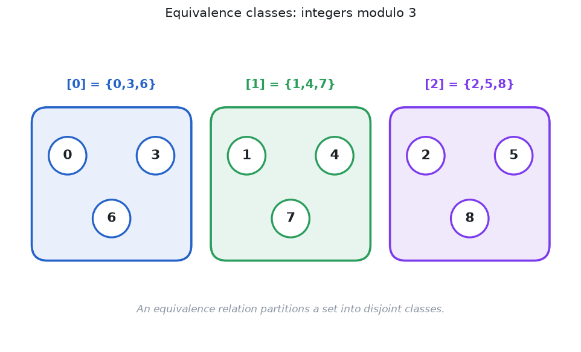
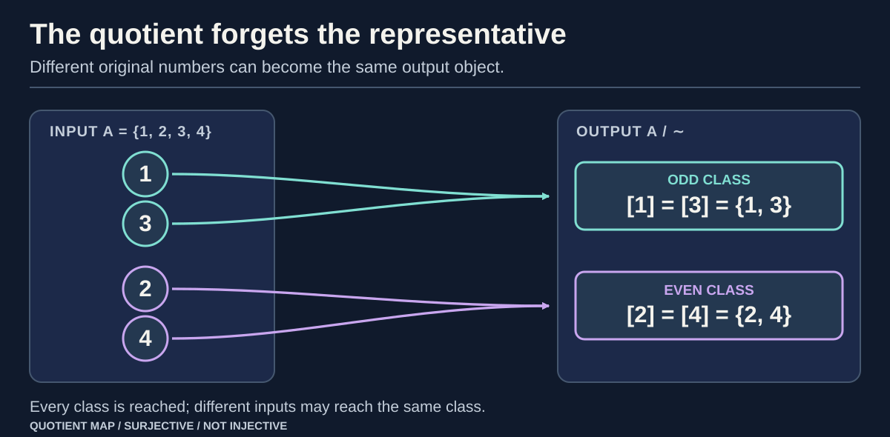

> [!abstract] Prerequisites & where this leads
> **Builds on:** [Set Theory](./set-theory), [binary relations](./functions-relations#relation), and [relation properties](./functions-relations#properties-of-relations).
> **Leads to:** [Order Theory](./order-theory), [quotient groups](./group-homomorphisms-quotients), [quotient rings](./ring-ideals-quotients), and [well-defined functions](./functions-relations#well-defined-functions).

An equivalence relation lets us treat **different objects as the same for a stated purpose** without asserting that they are literally equal. The central result is stronger than a definition: every equivalence relation divides its set into disjoint groups, and every such division gives an equivalence relation. Those groups are called **equivalence classes**. We will prove both directions and then explain why operations on classes require an extra well-definedness check.

## From relations to equivalence

### First intuition: dividing a set into groups

The word **quotient** may suggest division, and that is useful. Imagine the set $A=\{1,2,3,4\}$. If our only concern is whether a number is odd or even, we can group its elements into

$
\{1,3\}\qquad\text{and}\qquad\{2,4\}.
$

Instead of treating each number as a separate answer, we can treat each **group as one new object**. The resulting [quotient set](#quotient-sets-classes-become-objects) will have **two elements**, namely those two groups.

**What this gets right:** a quotient *divides the original collection into groups* by forgetting distinctions we have deliberately chosen not to track. The original numbers do not become equal; they belong to the same group for this purpose.

**Where the picture breaks:** this is **not arithmetic division** like $12\div3=4$. Nor can groups overlap arbitrarily. An equivalence relation guarantees that every original element belongs to **exactly one** class: the groups form a *partition*. We will establish the rules and prove this rather than take the grouping picture on faith.

> [!example] The odd-even relation as actual pairs
> Keep $A=\{1,2,3,4\}$ and define $a\sim b$ exactly when $a$ and $b$ have the same parity. The relation is the following **set of eight ordered pairs**:
>
> $
> \begin{aligned}
> R:=\{&(1,1),(1,3),(3,1),(3,3),\\
> &(2,2),(2,4),(4,2),(4,4)\}.
> \end{aligned}
> $
>
> Thus $1\sim3$ and $2\sim4$, but $1\not\sim2$. The pair $(1,3)$ records that $1$ is related to $3$; it does **not** mean $1=3$.
>
> The full list lets us check all three properties rather than simply assert them. **Reflexivity:** each $(a,a)$ appears. **Symmetry:** whenever $(a,b)$ appears, $(b,a)$ also appears. **Transitivity:** whenever $(a,b)$ and $(b,c)$ appear, $(a,c)$ appears too, because both pairs put $a,b,c$ in the same parity group. For instance, $1\sim3$ and $3\sim1$ imply $1\sim1$. The finite check illustrates the general definitions; later we prove the corresponding facts for all integers modulo $n$.

A binary relation $R$ on a set $A$ is a subset of $A\times A$ (read "A cross A"). We write $aRb$ (read "a is R-related to b") when $(a,b)\in R$. In this chapter, the elements belong to the **same underlying set** $A$.

> [!definition] Equivalence relation
> A relation $\sim$ (read "is equivalent to") on $A$ is an **equivalence relation** if, for all $a,b,c\in A$:
> 1. **Reflexivity:** $a\sim a$.
> 2. **Symmetry:** $a\sim b\Rightarrow b\sim a$.
> 3. **Transitivity:** $a\sim b$ and $b\sim c\Rightarrow a\sim c$.

Here $\Rightarrow$ is read "implies." The three properties say: each element is related to itself; either direction of equivalence is permitted; and two successive equivalences can be chained. They do **not** imply that equivalent objects are literally identical.

Consider "has the same remainder upon division by three." The integers $1$ and $4$ are not equal, but they are equivalent under this relation. In contrast, "is less than or equal to" is not generally symmetric: $2\leq3$ does not imply $3\leq2$. It is an [order relation](./order-theory), not an equivalence relation.

> [!distinction] Symmetric versus antisymmetric
> **Symmetric** means every related pair can be reversed. **Antisymmetric** means relations in both directions force the two elements to be identical. These properties are not negations of each other. Equality satisfies **both**.
>
> **Example:** $1\equiv4\pmod 3$ and $4\equiv1\pmod 3$, so congruence modulo $3$ is symmetric but **not** antisymmetric: $1\neq4$. In contrast, $2\leq3$ but $3\nleq2$; this is compatible with antisymmetry, because $a\leq b$ and $b\leq a$ together force $a=b$.

## Worked proof: congruence modulo n

For integers $a,b$ and a fixed positive integer $n$, write $a\equiv b\pmod n$ (read "a is congruent to b modulo n") when $n$ divides $a-b$. That is, there exists an integer $k$ such that $a-b=nk$.

> [!theorem] Congruence modulo n is an equivalence relation
> For every positive integer $n$, the relation $a\equiv b\pmod n$ on $\mathbb Z$ is reflexive, symmetric, and transitive.

> [!proof] Verify all three requirements
> **Reflexive.** For every integer $a$, $a-a=0=n\cdot0$, so $n\mid(a-a)$. Hence $a\equiv a\pmod n$.
>
> **Symmetric.** If $a-b=nk$ for some integer $k$, then $b-a=n(-k)$. Since $-k$ is an integer, $b\equiv a\pmod n$.
>
> **Transitive.** If $a-b=nk$ and $b-c=nm$, then
> $$
> a-c=(a-b)+(b-c)=n(k+m).
> $$
> Since $k+m$ is an integer, $n\mid(a-c)$. Thus $a\equiv c\pmod n$. All three properties hold.

The proof used arbitrary integers, not a finite survey of cases; it covers infinitely many pairs at once.

## Equivalence classes: what gets identified

For $a\in A$, its equivalence class is

$$
[a]=\{x\in A:x\sim a\}.
$$

Read: "the class of a is the set of all x in A such that x is equivalent to a." The square brackets denote an entire **set**, not simply the object $a$. We sometimes write $[a]_\sim$ when multiple relations are in use.

*Figure: A finite window onto the three infinite classes of congruence modulo three.*

With congruence modulo three,

$$
\begin{aligned}
[0]&=\{\ldots,-6,-3,0,3,6,\ldots\},\\
[1]&=\{\ldots,-5,-2,1,4,7,\ldots\},\\
[2]&=\{\ldots,-4,-1,2,5,8,\ldots\}.
\end{aligned}
$$

For example, $[4]=[1]$: the representatives $1$ and $4$ name the **same class** even though $1\ne4$.

> [!example] A member is not the same thing as its class
> In the four-element parity example, the classes are $[1]=[3]=\{1,3\}$ and $[2]=[4]=\{2,4\}$. The number $1$ is an **element** of its class: $1\in[1]$. It is not equal to the set $[1]$. And although $1\ne3$, the classes **are** equal: $[1]=[3]$.
>
> This is the difference between asking whether two **representatives** are equal and asking whether they name the **same equivalence class**.

### When are two classes the same?

> [!theorem] Class equality criterion
> For an equivalence relation $\sim$,
> $$
> [a]=[b]\quad\Longleftrightarrow\quad a\sim b.
> $$
> Read $\Longleftrightarrow$ as "if and only if."

> [!proof] Prove both directions
> If $a\sim b$, let $x\in[a]$, so $x\sim a$. Transitivity with $a\sim b$ yields $x\sim b$, hence $x\in[b]$. Thus $[a]\subseteq[b]$. By symmetry $b\sim a$, and the same argument gives $[b]\subseteq[a]$. The classes are equal.
>
> Conversely, if $[a]=[b]$, reflexivity gives $a\in[a]$, so $a\in[b]$. By the definition of $[b]$, $a\sim b$.

> [!proof] Why distinct classes do not overlap
> Suppose $x\in[a]\cap[b]$. Then $x\sim a$ and $x\sim b$. By symmetry $a\sim x$, and by transitivity $a\sim b$. The class equality criterion gives $[a]=[b]$. Therefore two classes are either equal or disjoint; partial overlap is impossible.

## Equivalence relations correspond to partitions

A **partition** of $A$ is a collection of **nonempty**, **pairwise disjoint** subsets (called blocks) whose union is $A$. Each element belongs to exactly one block.

> [!theorem] Equivalence-partition correspondence
> Every equivalence relation on $A$ determines a partition into its distinct equivalence classes. Conversely, every partition determines exactly one equivalence relation having those blocks as its classes.

> [!proof] From equivalence to partition
> **Nonempty:** each $[a]$ contains $a$ by reflexivity.
>
> **Coverage:** every $a\in A$ belongs to $[a]$, so the union of all classes is $A$.
>
> **Disjointness:** we just proved that intersecting classes are equal. Thus the distinct classes are pairwise disjoint. These are precisely the partition axioms.

> [!proof] From partition to equivalence
> Let $\mathcal B$ be a partition of $A$. Define $a\sim b$ when $a,b$ belong to the same block.
>
> **Reflexive:** each element shares a block with itself.
>
> **Symmetric:** sharing a block works in either direction.
>
> **Transitive:** if $a$ and $b$ share one block, and $b$ and $c$ share another, those blocks intersect at $b$. Pairwise disjointness forces them to be the **same** block, so $a$ and $c$ share a block.
>
> Finally, if two relations have the same partition, each relates exactly the pairs that lie in a common block. They therefore coincide. This proves uniqueness.

This theorem gives two equivalent ways to describe the same structure: specify related pairs, or specify blocks of objects that should count as equivalent.

> [!example] Read a partition in both directions
> For $A=\{1,2,3,4\}$, the parity blocks are $\{1,3\}$ and $\{2,4\}$. Going from the **relation to the partition**, collect each element together with everything related to it; the four possible names $[1],[2],[3],[4]$ describe just two distinct blocks. Going from the **partition back to the relation**, relate two numbers precisely when they are in the same block. This recreates the eight ordered pairs listed above, including pairs of each number with itself.
>
> A collection such as $\{\{1,2\},\{2,3,4\}\}$ is **not** a partition of $A$: the blocks overlap at $2$ (and $A=\{1,2,3,4\}$ is still covered). A partition cannot place one element in two distinct blocks.

## Quotient sets: classes become objects

Return to the odd/even intuition above: with $A=\{1,2,3,4\}$ and $a\sim b$ when $a,b$ have the same parity, the quotient is

$
A/{\sim}=\big\{\{1,3\},\{2,4\}\big\}.
$

It has **two elements**, each of which is itself a set. This is why a quotient is not just an ordinary division result or a relabeling of the four original numbers.

In general, the **quotient set** (read "A modulo equivalence") is

$$
A/{\sim}=\{[a]:a\in A\}.
$$

Its elements are the classes, not the original representatives. The **quotient map** is

$$
q:A\longrightarrow A/{\sim},\qquad q(a)=[a].
$$

It is **surjective** (read "onto"): every class has a representative. It is generally not **injective** (read "one-to-one"), because distinct equivalent objects map to the same class.

For congruence modulo three, $\mathbb Z/{\equiv_3}=\{[0],[1],[2]\}$ has only **three elements**, even though $\mathbb Z$ is infinite.

*Figure: The quotient map keeps every input but sends equivalent inputs to the same class. Its outputs are sets, not numbers.*

In this finite example, $q(1)=q(3)=\{1,3\}$ and $q(2)=q(4)=\{2,4\}$. Every class is reached, which makes $q$ surjective. But $q(1)=q(3)$ despite $1\ne3$, which makes it non-injective. No original element was deleted: **we changed what counts as one output object**.

### Every function defines a partition by its outputs

Let $f:A\to B$ be any function. Define

$
a\sim_f b\quad\Longleftrightarrow\quad f(a)=f(b).
$

Two inputs are equivalent when the function **cannot distinguish them by their outputs**.

A **fiber** is simply the collection of *all inputs that produce one chosen output*. For an output $y\in B$, the fiber over $y$ is

$
f^{-1}(\{y\})=\{a\in A:f(a)=y\}.
$

**A fiber is a special case of a preimage.** The [preimage](./functions-relations#preimage) $f^{-1}(C)$ of any subset $C\subseteq B$ collects every input whose output lies in $C$. A **fiber** takes the preimage of just one output, the singleton set $\{y\}$. The notation $f^{-1}$ does **not** require $f$ to have an inverse function. For a diagram, see [Fibers and the Kernel of a Function](./functions-relations#fibers-and-the-kernel-of-a-function).

> [!theorem] Function fibers are equivalence classes
> The relation $\sim_f$ is an equivalence relation. The equivalence class containing $a$ is exactly the fiber over its output:
> $
> [a]=\{b\in A:f(b)=f(a)\}=f^{-1}(\{f(a)\}).
> $
> The **nonempty** fibers partition $A$. Values in $B$ that the function never produces have empty fibers, so they do not contribute blocks to the partition.

> [!proof] Equality of outputs supplies the axioms
> $f(a)=f(a)$ gives reflexivity. If $f(a)=f(b)$, then $f(b)=f(a)$ gives symmetry. If $f(a)=f(b)$ and $f(b)=f(c)$, then $f(a)=f(c)$ gives transitivity. By definition, $[a]$ consists of exactly those inputs with output $f(a)$.

**Worked example.** Set $f:\mathbb R\to\mathbb R$ by $f(x)=x^2$ (read "f of x equals x squared"). The fiber over $9$ is $f^{-1}(\{9\})=\{-3,3\}$: both inputs square to $9$, so $[3]=[-3]=\{-3,3\}$. By comparison, the **preimage of $\{4,9\}$** is $f^{-1}(\{4,9\})=\{-3,-2,2,3\}$: this combines the fibers over $4$ and $9$, so it is not a single fiber. The fiber over $0$ is $\{0\}$, while the fiber over $-1$ is empty because no real number squares to $-1$. Thus the equivalence classes correspond exactly to the **nonnegative** outputs.

For $f(x)=x^2$, the equivalence classes on $\mathbb R$ take the form $\{0\}$ and $\{-t,t\}$ for each $t>0$. These classes partition the entire real line: every nonzero real lies in exactly one pair with its negative. The empty fiber over $-1$ is not a class, because no input has that output.

### When does a function descend to classes?

Suppose $f:A\to B$ and we want to define an output $\bar f([a])$ from the class alone. It cannot depend on which representative we write.

> [!theorem] Unique factorization through the quotient
> A function $\bar f:A/{\sim}\to B$ with $\bar f([a])=f(a)$ exists exactly when
> $$
> a\sim b\quad\Longrightarrow\quad f(a)=f(b).
> $$
> When it exists it is unique.

> [!proof] Necessity, sufficiency, uniqueness
> **Necessity:** if $a\sim b$, then $[a]=[b]$. Since $\bar f$ is a function, $f(a)=\bar f([a])=\bar f([b])=f(b)$.
>
> **Sufficiency:** define $\bar f([a]):=f(a)$. If $[a]=[b]$, then $a\sim b$, so the stated condition forces $f(a)=f(b)$. The value is independent of representative.
>
> **Uniqueness:** every class is some $[a]$, and the required equality specifies the function at every such input.

**Example:** Sending the congruence class $[a]$ modulo three to $a^2\bmod3$ is well-defined, because $a\equiv b\pmod3$ implies $a^2\equiv b^2\pmod3$: factor $a^2-b^2=(a-b)(a+b)$. Sending $[a]$ to the ordinary integer $a$ is **not** well-defined: $[1]=[4]$ but $1\ne4$.

> [!example] A proposed function that gives two answers to one input
> Work with integer classes modulo $3$, where $[1]=[4]$. Suppose someone proposes $F([a]):=a+1$ with values in the **ordinary integers**. Choosing representative $1$ gives $F([1])=2$; choosing representative $4$ gives $F([4])=5$. But $[1]$ and $[4]$ are the **same input**, so this rule fails to define a function on classes.
>
> Instead, define $G([a]):=[a+1]$, now with values **also in classes modulo $3**. The two representatives give $[1+1]=[2]$ and $[4+1]=[5]=[2]$. More importantly, this works for *every* pair of representatives: if $a\equiv b\pmod 3$, then $(a+1)-(b+1)=a-b$ is divisible by $3$. The output class is independent of the chosen representative.
>
> **The test is always the same:** if two expressions name the same input class, do they necessarily produce the same output?

> [!distinction] Forming a quotient is not the same as defining arithmetic on it
> Classes exist for **any** equivalence relation, but an operation $[a]\star[b]:=[a\star b]$ needs its own representative-independence proof. Relations compatible with an operation in this way are called **congruences** for that operation. The distinction matters for [fractions](./construction-of-the-rationals), [quotient groups](./group-homomorphisms-quotients), and [quotient rings](./ring-ideals-quotients).

## Counterexamples: what fails the equivalence axioms?

> [!counterexample] Close to is not transitive
> On real numbers, define $aRb$ if $|a-b|<1$ (read "the absolute difference is less than one"). The relation is reflexive and symmetric. But $0R0.6$ and $0.6R1.2$ hold while $0R1.2$ does not, since $1.2$ is not less than one. It is therefore **not** an equivalence relation.

> [!counterexample] Having overlapping sets is not transitive
> On nonempty finite sets, let $A\,R\,B$ mean $A\cap B\ne\varnothing$. This relation is reflexive and symmetric, but $\{1\}$ intersects $\{1,2\}$, which intersects $\{2\}$, while $\{1\}$ does not intersect $\{2\}$. Transitivity fails.

> [!example] Diagnose which axiom fails
>
> | Relation on $\{1,2,3\}$ | Reflexive? | Symmetric? | Transitive? | Why it fails |
> | --- | --- | --- | --- | --- |
> | $aRb$ iff $a<b$ | No | No | Yes | $1\not<1$; $1<2$ but not $2<1$ |
> | $aRb$ iff $a\le b$ | Yes | No | Yes | $1\le2$ but not $2\le1$ |
> | $aRb$ iff $\lvert a-b\rvert\le1$ | Yes | Yes | No | $1R2$ and $2R3$, but not $1R3$ |
> | $aRb$ iff $a$ and $b$ have the same parity | Yes | Yes | Yes | All three requirements hold |
>
> A transitive relation need not be reflexive or symmetric. A symmetric, reflexive relation need not be transitive. An equivalence relation requires **all three**.

Both counterexamples show why the three axioms matter. "Similar enough" is not automatically a mathematically valid equivalence.

> [!bridge] One construction, several fields
> Once you can form equivalence classes, you can ask what a function *forgets*. The [worked linear-map bridge](./cross-disciplinary-bridges#bridge-1-equivalence-classes-become-kernels-and-quotient-spaces) starts with $(x,y)\sim(u,v)$ iff $x+y=u+v$, then derives a kernel and the corresponding quotient vector space. It also explains why algebraic and topological quotients need additional checks.

## Where to go next

- **[Order Theory](./order-theory):** a preorder's mutually comparable elements can be identified and quotient into a genuine poset.
- **[Set Theory](./set-theory#partition-of-a-set):** partitions as collections of disjoint sets.
- **[Functions](./functions-relations):** fibers, quotient maps, and well-definedness.
- **[Quotient groups](./group-homomorphisms-quotients) and [quotient rings](./ring-ideals-quotients):** algebraic operations on classes.

The governing intuition: **equivalence deliberately forgets distinctions**. Order theory retains distinctions and organizes them.
