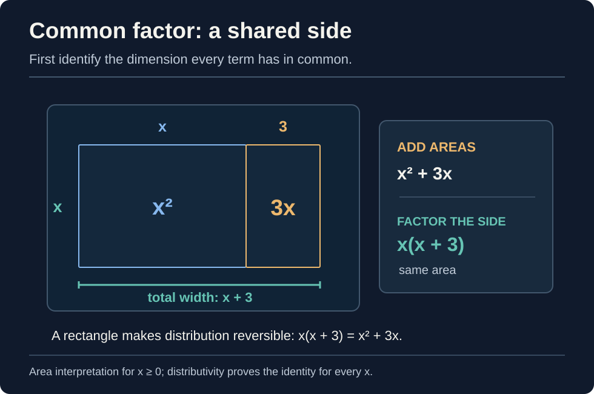
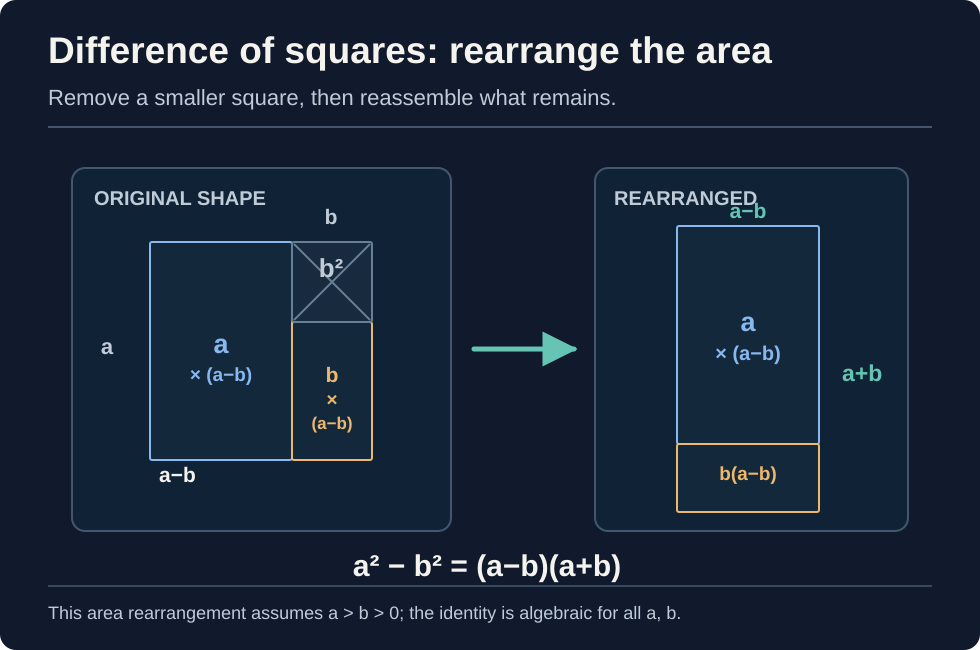
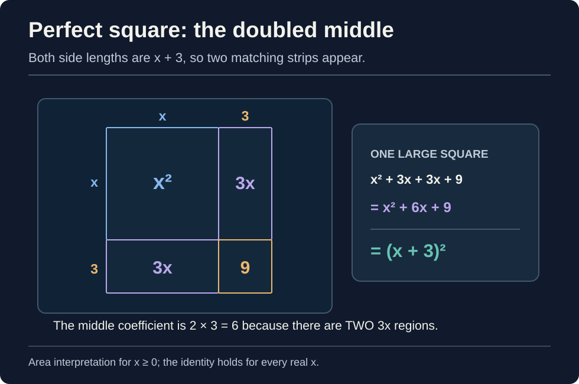
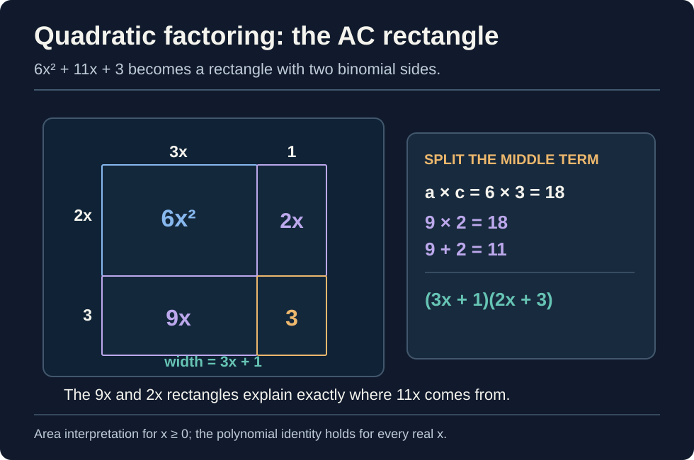
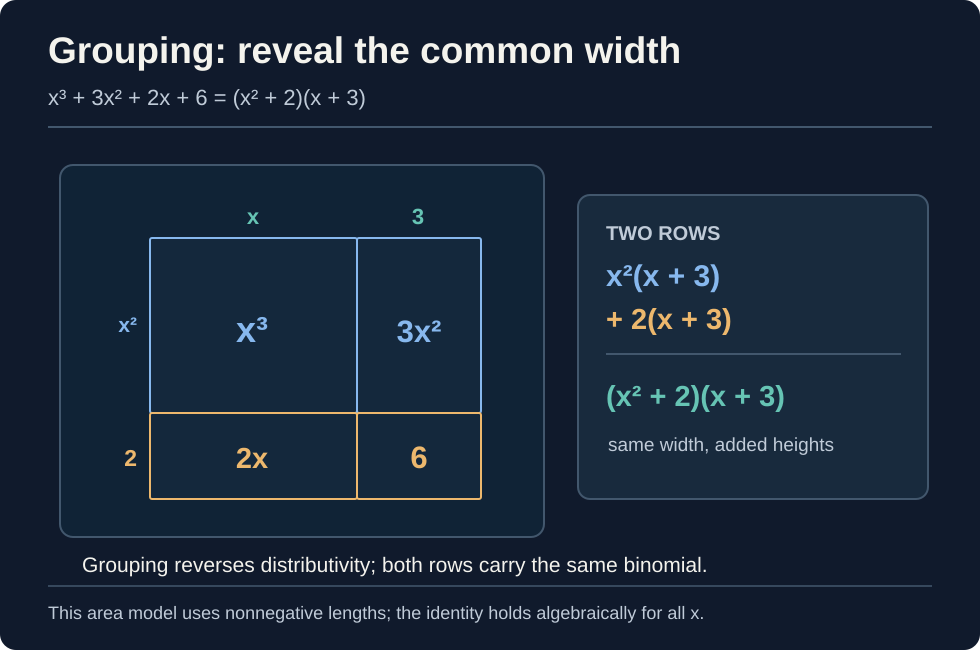
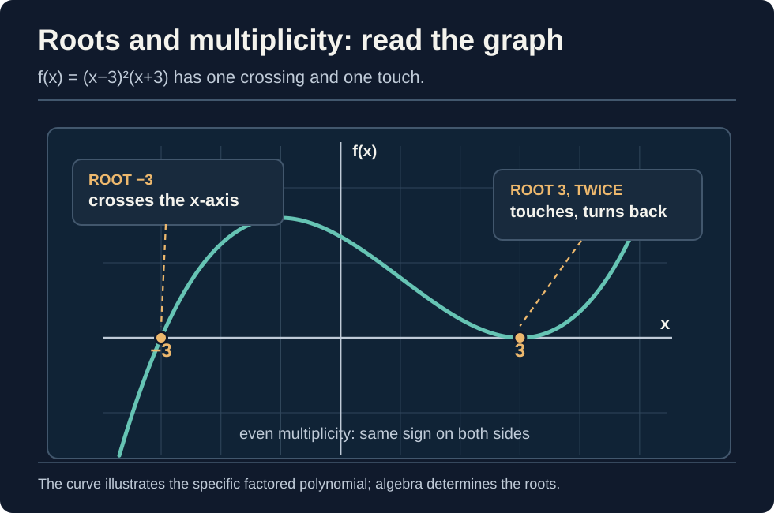

> [!abstract] Prerequisites & where this leads
> **Builds on:** [Polynomial Functions](./polynomial-functions) · [Prime Factorization](./prime-factorization)
> **Leads to:** [Rational Functions](./rational-functions) · [Partial Fraction Decomposition](./partial-fraction-decomposition)

**Factoring** means rewriting an expression as a **product** of simpler expressions that multiply back to the original. It changes the *form*, not the value.

An integer example comes first: $12=3\cdot4=2\cdot2\cdot3$. In algebra, the same question applies to polynomials:

$$
x^2+5x+6=(x+2)(x+3).
$$

The left side is a **sum of terms**; the right side is a **product of factors**. Read $(x+2)(x+3)$ as "the quantity x plus two multiplied by the quantity x plus three." Both expressions give the same value for every $x$. Nothing has been solved or approximated.

> [!definition] Polynomial factor
> A polynomial $g(x)$ is a **factor** of a polynomial $f(x)$ when there is another polynomial $h(x)$ with $f(x)=g(x)h(x)$. Equivalently, division of $f$ by $g$ leaves **remainder zero**. The allowable coefficients matter: a polynomial may factor over the real numbers but not over the rational numbers.

## Why factoring works: multiplication in reverse

The distributive law says

$$
a(b+c)=ab+ac.
$$

**Expanding** follows this equality from left to right. **Factoring** follows it from right to left. For instance,

$$
3x(x+2)=3x^2+6x
\quad\Longleftrightarrow\quad
3x^2+6x=3x(x+2).
$$

For two binomials, distribute twice:

$$
\begin{aligned}
(x+2)(x+3)
&=x(x+3)+2(x+3)\\
&=x^2+3x+2x+6\\
&=x^2+5x+6.
\end{aligned}
$$

This is also the **verification method**: multiply the proposed factors back out. A correct factorization reproduces *every coefficient*, including signs.

### A factorization does not solve an equation

Factoring $x^2+5x+6$ describes the expression for **all** inputs. Solving

$$
x^2+5x+6=0
$$

asks for the *particular inputs* where its value is zero. Only after factoring an equation equal to zero can we apply the zero-product property (over the real or complex numbers):

$$
(x+2)(x+3)=0
\quad\Longrightarrow\quad
x=-2\ \text{or}\ x=-3.
$$

An identity, an equation, and its solutions are different objects. [Polynomial Functions](./polynomial-functions#zero-product-property) develops the equation-solving step.

## The first move: factor out what every term shares

Before looking for patterns, collect like terms, put a polynomial in descending powers if helpful, and extract its **greatest common factor (GCF)**. For coefficients that are integers, find their greatest common divisor; for variables, take the smallest exponent shared by all terms.

**Geometric first example.** The area $x^2+3x$ can be divided into an $x$-by-$x$ square and an $x$-by-$3$ strip. Both share height $x$, so joining them forms one rectangle of height $x$ and width $x+3$. Thus $x^2+3x=x(x+3)$.

*Figure: A shared rectangular dimension is a geometric version of extracting the greatest common factor. Areas illustrate the identity for nonnegative lengths; distributivity proves it for all real x.*

**Worked example.** Factor $12x^4y-8x^2y^2$.

1. The integers $12$ and $8$ share the greatest positive factor $4$.
2. Both terms contain at least $x^2$ and at least $y$.
3. The common monomial is therefore $4x^2y$.
4. Divide each term by that monomial:

$$
12x^4y-8x^2y^2
=4x^2y(3x^2-2y).
$$

Check by distributing: $4x^2y\cdot3x^2=12x^4y$ and $4x^2y\cdot(-2y)=-8x^2y^2$.

A negative common factor can make what remains easier to read. For example, $-2x^2+8x=-2x(x-4)$. Factoring out $-2x$ rather than $2x$ is a choice of presentation, not a different polynomial.

## How to choose a factoring method

Use the following sequence instead of guessing from a memorized list.

| What you see after taking out the GCF | What to look for | First technique |
| --- | --- | --- |
| **Two terms** | Two squares with a minus sign | [Difference of squares](#two-terms-difference-of-squares) |
| **Two terms** | Two cubes with a plus or minus sign | [Sum or difference of cubes](#two-terms-cubes) |
| **Three terms** | First and last terms are squares, middle is twice their product | [Perfect-square trinomial](#three-terms-perfect-squares) |
| **Three terms, degree two** | A quadratic of the form $ax^2+bx+c$ | [Quadratic factoring](#three-terms-general-quadratics) |
| **Four or more terms** | Several terms share a common binomial | [Grouping](#four-or-more-terms-grouping) |
| **Higher degree** | A likely root makes $f(r)=0$ | [Factor Theorem and division](#higher-degree-polynomials-find-one-factor-first) |
| **None applies** | No factor in the number system you are using | [Irreducibility and alternatives](#when-factoring-stops) |

A method can expose a **new** pattern. Factor again until every remaining nonconstant factor is irreducible over the chosen coefficients.

## Two terms: difference of squares

The product $(a-b)(a+b)$ has opposite middle terms, so they cancel:

$$
(a-b)(a+b)=a^2-b^2.
$$

Reverse the equality to factor a difference of squares. Here $a$ and $b$ may themselves be expressions.

*Figure: A geometric proof for positive lengths a greater than b. The remaining L-shape splits into areas a(a-b) and b(a-b), which reassemble as (a-b)(a+b). The algebraic identity extends to all real a and b.*

**Worked example.**

$$
\begin{aligned}
x^4-81
&=(x^2)^2-9^2\\
&=(x^2-9)(x^2+9)\\
&=(x-3)(x+3)(x^2+9).
\end{aligned}
$$

The factor $x^2-9$ was itself another difference of squares, so stopping after the first line would be incomplete **over the real numbers**. The factor $x^2+9$ cannot be split into real linear factors.

> [!counterexample] A sum of squares is not a difference of squares
> $x^2+9$ is **not** $(x+3)(x-3)$, because that product equals $x^2-9$. Over the real numbers, $x^2+9$ has no real roots and is irreducible. Over the complex numbers it becomes $(x+3i)(x-3i)$, where $i^2=-1$ (read "i squared equals negative one").

## Two terms: cubes

Expanding the products shows two companion identities:

$$
\begin{aligned}
a^3-b^3&=(a-b)(a^2+ab+b^2),\\
a^3+b^3&=(a+b)(a^2-ab+b^2).
\end{aligned}
$$

The first signs match the original plus or minus; the middle sign inside the quadratic reverses; the last sign is always plus.

**Worked examples.**

$$
x^3+8=(x+2)(x^2-2x+4),
$$

$$
27x^3-1=(3x-1)(9x^2+3x+1).
$$

Check the first identity: multiplying gives $x^3-2x^2+4x+2x^2-4x+8=x^3+8$. The mixed terms cancel. These quadratic factors cannot be factored further over the real numbers.

## Three terms: perfect squares

Squaring a binomial gives a recognizable middle term:

$$
\begin{aligned}
(a+b)^2 &=a^2+2ab+b^2,\\
(a-b)^2 &=a^2-2ab+b^2.
\end{aligned}
$$

**Geometric first example.** A square whose side is $x+3$ has four subregions: $x^2$, $3x$, another $3x$, and $9$. Their sum is $x^2+6x+9=(x+3)^2$. The two $3x$ rectangles explain why the middle coefficient is doubled.

*Figure: The double middle term of a perfect-square trinomial comes from two identical cross rectangles. The area diagram assumes nonnegative side lengths, while the polynomial identity holds for every real x.*

**Worked example.** In $4x^2-20x+25`, the first and last terms are $(2x)^2$ and $5^2$. Their doubled product is $2(2x)(5)=20x$, with a negative sign. Therefore,

$$
4x^2-20x+25=(2x-5)^2.
$$

**Near miss:** $4x^2-18x+25$ has the same square end terms, but its middle coefficient is $-18$, not $-20$. It is *not* $(2x-5)^2$. Always check the middle term; matching the ends alone is insufficient.

A factor such as $(x-3)^2$ is **repeated**. The associated root $3$ has **multiplicity two** (read "multiplicity" as the number of times the factor occurs), a distinction we will use when connecting factoring to graphs.

## Three terms: general quadratics

A quadratic is an expression $ax^2+bx+c$ with $a\neq0$ (read "a not equal to zero"). For integer-coefficient factoring, our goal is a product of two linear polynomials with integer or rational coefficients, when such a product exists.

### When the leading coefficient is one

To factor $x^2+bx+c$, seek two numbers $m,n$ satisfying

$$
m+n=b,\qquad mn=c.
$$

That is because $(x+m)(x+n)=x^2+(m+n)x+mn$.

**Worked example.** To factor $x^2+7x+12$, find numbers whose sum is $7$ and product is $12$. The pair $3,4$ works, so

$$
x^2+7x+12=(x+3)(x+4).
$$

Signs provide clues: a positive constant with a negative middle term suggests two negatives; a negative constant means the two numbers have opposite signs.

### When the leading coefficient is not one: the AC method

**Worked example.** Factor $6x^2+11x+3$.

1. Multiply the outer coefficients: $a\cdot c=6\cdot3=18$.
2. Seek two integers with product $18$ and sum $11$: they are $9$ and $2$.
3. Split $11x$ into $9x+2x$, then group:

$$
\begin{aligned}
6x^2+11x+3
&=6x^2+9x+2x+3\\
&=3x(2x+3)+(2x+3)\\
&=(3x+1)(2x+3).
\end{aligned}
$$

*Figure: The AC method is area partitioning: multiplying the side lengths (3x+1)(2x+3) produces the four tiles 6x², 2x, 9x, and 3. The middle coefficients 2 and 9 multiply to 18 and add to 11. The area assumes nonnegative lengths; the identity is general.*

Check: the product is $6x^2+9x+2x+3=6x^2+11x+3$. The AC method works here because we can find a suitable integer pair; **failure to find an integer pair does not mean the polynomial has no real factors**.

### A quadratic that will not factor into rational linear factors

For $x^2-2$, there is no pair of **rational** numbers with sum zero and product $-2$. Nevertheless, using the real number $\sqrt2$ (read "square root of two"),

$$
x^2-2=(x-\sqrt2)(x+\sqrt2).
$$

So the polynomial is irreducible over the **rationals** but reducible over the **reals**. "Cannot factor" is incomplete without saying what coefficients are allowed.

## Four or more terms: grouping

Grouping looks for a common **polynomial** factor, not only a common number or monomial.

**Worked example.** Factor $x^3+3x^2+2x+6$:

$$
\begin{aligned}
x^3+3x^2+2x+6
&=(x^3+3x^2)+(2x+6)\\
&=x^2(x+3)+2(x+3)\\
&=(x+3)(x^2+2).
\end{aligned}
$$

*Figure: The two grouped expressions are rectangular rows with the same width (x+3). Their heights x² and 2 add to x²+2, revealing (x²+2)(x+3). The picture illustrates nonnegative lengths; distributivity proves the identity for every x.*

The common factor $(x+3)$ appears after factoring the two groups. Multiplication verifies it immediately.

**When the signs hide the pattern.** For $2x^3-3x^2-2x+3$,

$$
\begin{aligned}
2x^3-3x^2-2x+3
&=x^2(2x-3)-(2x-3)\\
&=(2x-3)(x^2-1)\\
&=(2x-3)(x-1)(x+1).
\end{aligned}
$$

The minus sign in front of the second group matters: $-2x+3=-(2x-3)$. The difference-of-squares factor revealed at the end must also be factored.

Grouping does not always work for an arbitrary order or arbitrary polynomial. A failed grouping is a reason to try a different arrangement or another method, not evidence of irreducibility.

## Higher-degree polynomials: find one factor first

For a polynomial $f(x)$ and number $r$ (read "r"), the **Factor Theorem** states

$$
f(r)=0\quad\Longleftrightarrow\quad(x-r)\text{ is a factor of }f(x).
$$

Why? Polynomial division writes $f(x)=(x-r)q(x)+f(r)$, where $q$ is a quotient polynomial and $f(r)$ is the remainder. If $f(r)=0$, the remainder vanishes and the division is exact. See [Polynomial Functions: Factor Theorem](./polynomial-functions#factor-theorem) for the full division method.

**Worked example.** Factor $f(x)=x^3-4x^2+x+6$.

First test the small integer $2$:

$$
f(2)=8-16+2+6=0.
$$

Thus $(x-2)$ is a factor. Dividing $f(x)$ by $(x-2)$ gives $x^2-2x-3$, so

$$
\begin{aligned}
x^3-4x^2+x+6
&=(x-2)(x^2-2x-3)\\
&=(x-2)(x-3)(x+1).
\end{aligned}
$$

**Check:** the roots $2,3,-1$ all make the original polynomial zero, and the product has the same leading coefficient $1$ and degree $3$. These observations help check the result; expanding all factors gives a direct identity check.

For **integer-coefficient** polynomials, the [Rational Root Theorem](./polynomial-functions#rational-root-theorem) narrows rational candidates: a root written in lowest terms as $p/q$ (read "p over q") must have $p$ dividing the constant term and $q$ dividing the leading coefficient. It supplies *candidates*, not a promise that any exists.

**Counterexample.** $x^3+x+1$ has possible rational roots only $1$ and $-1$. But $f(1)=3$ and $f(-1)=-1$. It has **no rational root**, and because a reducible cubic over the rationals would have a linear rational factor, this cubic is **irreducible over the rationals**. It still has a real root, which is not rational.

## Roots, factors, and multiplicity

A polynomial with leading coefficient $a\neq0$ and roots $r_1,\ldots,r_n$ in the complex numbers, **counted with multiplicity**, can be written

$$
f(x)=a(x-r_1)(x-r_2)\cdots(x-r_n).
$$

Here $n$ is the degree (read "n"), and $r_1,\ldots,r_n$ name the roots. This is the [Fundamental Theorem of Algebra](./polynomial-functions#the-fundamental-theorem-of-algebra) expressed as a factorization, **over the complex numbers**. It does not guarantee that every polynomial factors into rational or real linear terms.

**Worked example.** $x^3-3x^2-9x+27$ groups as

$$
\begin{aligned}
x^3-3x^2-9x+27
&=x^2(x-3)-9(x-3)\\
&=(x-3)(x^2-9)\\
&=(x-3)^2(x+3).
\end{aligned}
$$

*Figure: The single factor (x+3) changes sign as the graph crosses at x=-3. The squared factor (x-3)² stays nonnegative, so the graph touches the axis at x=3 and turns back. This graph corresponds exactly to the polynomial factored above.*

The root $x=3$ occurs **twice** and the root $x=-3$ once. At a real root of even multiplicity, the graph typically **touches** the x-axis without changing sign; at an odd-multiplicity root, it **crosses** it. [Factor Multiplicity](./polynomial-functions#factor-multiplicity) explains the graph behavior precisely.

## When factoring stops

> [!distinction] Irreducible relative to what?
> A nonconstant polynomial is **irreducible over a field** if it cannot be written as a product of two lower-degree, nonconstant polynomials with coefficients in that field. The coefficient field matters.

| Polynomial | Over rational coefficients $\mathbb Q$ | Over real coefficients $\mathbb R$ | Over complex coefficients $\mathbb C$ |
| --- | --- | --- | --- |
| $x^2-2$ | Irreducible | $(x-\sqrt2)(x+\sqrt2)$ | Same real factors |
| $x^2+1$ | Irreducible | Irreducible | $(x-i)(x+i)$ |
| $x^2-9$ | $(x-3)(x+3)$ | Same factors | Same factors |

Read $\mathbb Q$, $\mathbb R$, and $\mathbb C$ as "the rationals," "the reals," and "the complex numbers." **Over the reals, every nonconstant polynomial can be factored into real linear factors and irreducible real quadratic factors**. Therefore a quadratic $ax^2+bx+c$, with real coefficients and $a\neq0$, is irreducible over the reals exactly when its **discriminant** $b^2-4ac$ is negative.

**Worked example.** For $x^2+2x+2$, the discriminant is $2^2-4(1)(2)=-4$, so there is no real linear factor. Over the complex numbers it factors as

$$
x^2+2x+2=(x+1-i)(x+1+i).
$$

> [!counterexample] Not finding an integer pair is not a proof of irreducibility
> The quadratic $x^2+2x-1$ does not split into integer or rational linear factors, but completing the square yields $(x+1)^2-2$ and therefore $(x+1-\sqrt2)(x+1+\sqrt2)$ over the reals. Use a discriminant, a root theorem, or another argument when claiming irreducibility.

Factoring is useful even when the factors are not linear: $x^4+4=(x^2-2x+2)(x^2+2x+2)$ is an identity over the integers, although $x^4+4$ has no integer or real roots.

## Factoring in rational expressions: what may be canceled?

Factoring is also the preparation for simplifying a *quotient* of polynomials. Only **entire common factors** cancel, and canceled factors do not erase restrictions from the original denominator.

**Worked example.**

$$
\frac{x^2-9}{x^2-x-6}
=\frac{(x-3)(x+3)}{(x-3)(x+2)}
=\frac{x+3}{x+2},
\qquad x\neq3,\ -2.
$$

The first equality follows from factoring numerator and denominator. The second is valid only where $x-3\neq0$. The original expression is undefined at **both** $x=3$ and $x=-2$, even though the simplified formula appears to give a value at $x=3$. This is a [removable hole](./rational-functions#hole--discontinuity--removable-discontinuity), not permission to change the domain.

**Invalid cancellation:** $(x+2)/(x+3)$ is not $2/3$. The $x$ terms belong to sums, not to common multiplicative factors. By contrast, $x(x+2)/[x(x+3)]$ can cancel the *whole factor* $x$ for $x\neq0$.

## A final checklist

When an expression needs factoring, ask:

1. **What coefficients am I allowing?** Integers, rationals, reals, or complex numbers?
2. **Are there like terms or a common factor?** Simplify and take out the GCF first.
3. **What structure remains?** Two terms, a trinomial, a group of terms, or higher degree?
4. **Can I factor the result again?** A newly revealed difference of squares is easy to miss.
5. **Does multiplying back reproduce the original?** Check signs and coefficients.
6. **Am I solving an equation or simplifying a quotient?** Zero-product reasoning requires an equation equal to zero; cancellation requires respecting denominator restrictions.

The larger conceptual connection is that factoring exposes **multiplicative structure**. In arithmetic it reveals prime divisors; in polynomials it exposes zeros and irreducible pieces; in [rational functions](./rational-functions) it identifies holes and asymptotes; in [ring theory](./ring-theory-foundations) it raises the deeper question of which algebraic systems admit unique factorizations.
