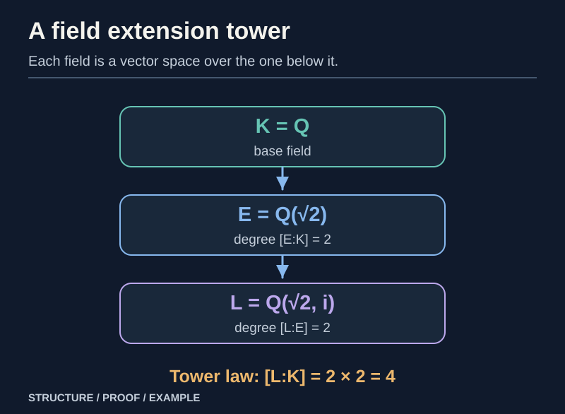
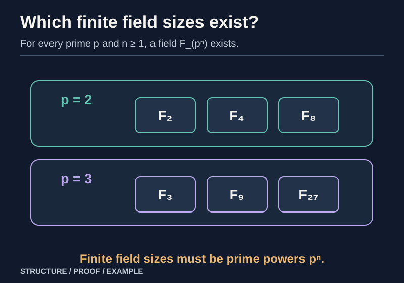
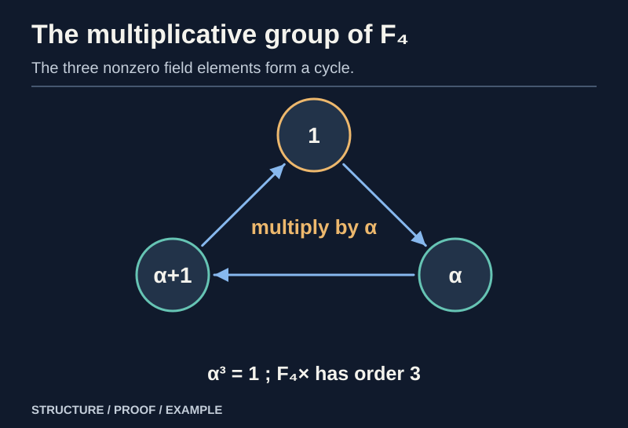
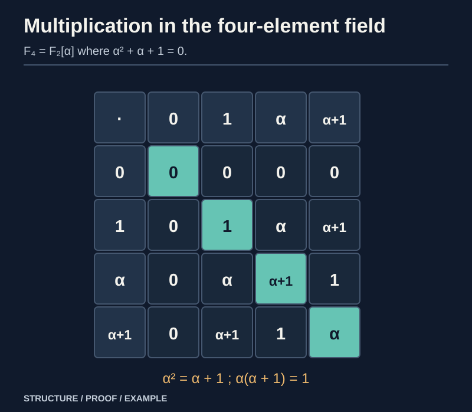

> [!abstract] Prerequisites & where this leads
> **Builds on:** [Ring Theory Foundations](./ring-theory-foundations) (domains, polynomial degree and division) · [Ideals, Quotient Rings & Homomorphisms](./ring-ideals-quotients) (maximal ideals and irreducible polynomials) · [Group Theory](./group-theory-foundations) (Lagrange and cyclic groups)
> **Leads to:** [Construction of the Complex Numbers](./construction-of-the-complex-numbers) (quotient description and algebraic closure) · [Algebraic Geometry](./algebraic-geometry) (polynomial equations over fields) · [Number Theory](./number-theory) (finite fields)

A ring lets us add, subtract, and multiply. A **field** is a commutative ring in which every nonzero element can also be divided by. The field axioms explain familiar arithmetic, but their real power is constructive: they tell us when to **adjoin a missing root**, why the resulting extension is a vector space, and how to build fields with exactly $p^n$ elements.

We develop these claims rather than assuming that every polynomial already has a root. The distinction between **an existing field**, **a field extension**, and **an algebraic closure** is essential throughout.

## Fields, prime subfields and characteristic

> [!definition] Field
> A **field** $K$ is a nonzero commutative ring with $1$ such that every $a\ne0$ admits $a^{-1}$ with $aa^{-1}=1$. Equivalently, $(K,+)$ and $(K\setminus\{0\},\cdot)$ are abelian groups related by distributivity.

Every field is an integral domain. If $ab=0$ and $a\ne0$, multiply by $a^{-1}$ to get $b=0$. Therefore the characteristic of a field is either $0$ or a **prime** $p$, as proved in [Ring Theory Foundations](./ring-theory-foundations).

> [!theorem] The smallest subfield
> Every field of characteristic $0$ contains a copy of $\mathbb Q$; every field of characteristic $p>0$ contains a copy of $\mathbb F_p=\mathbb Z/p\mathbb Z$.

**Proof.** Map $\mathbb Z$ to $K$ by sending $n$ to $n\cdot1$. In characteristic $p$, the kernel is $p\mathbb Z$, so the induced map embeds $\mathbb F_p$ into $K$. In characteristic $0$, the map embeds $\mathbb Z$. Any nonzero integer image has an inverse in $K$, so the formula $a/b\mapsto (a\cdot1)(b\cdot1)^{-1}$ embeds $\mathbb Q$. Both images are subfields. $\square$

A field need not be ordered: $\mathbb C$ and finite fields have no compatible ordering like the usual order on $\mathbb R$.

## Fractions of an arbitrary integral domain

The [construction of the rationals](./construction-of-the-rationals) is an instance of a much more general theorem.

> [!theorem] Field of fractions of a domain
> Every integral domain $D$ embeds in a field $\operatorname{Frac}(D)$ whose elements are equivalence classes of pairs $(a,b)$ with $a\in D$, $b\in D\setminus\{0\}$. The resulting field is unique up to an isomorphism respecting the embedded copy of $D$.

**Construction.** Declare $(a,b)\sim(c,d)$ if $ad=bc$.

- Reflexivity and symmetry follow from commutative multiplication.
- For transitivity, suppose $ad=bc$ and $cf=de$. Multiplying the first equation by $f$ and the second by $b$ gives $adf=bcf=bde$. Thus $d(af-be)=0$; since $d\ne0$ and $D$ is a domain, $af=be$.

Define addition and multiplication of classes by

$$
[(a,b)]+[(c,d)]=[(ad+bc,bd)],
\qquad
[(a,b)]\,[(c,d)]=[(ac,bd)].
$$

**Denominators remain nonzero**, because $D$ has no zero divisors.

**Representative independence.** Suppose $ab'=a'b$ and $cd'=c'd$. For addition, expand the cross-product difference:

$$
(ad+bc)b'd'-(a'd'+b'c')bd
=dd'(ab'-a'b)+bb'(cd'-c'd)=0.
$$

For multiplication, $acb'd'=ab'cd'=a'bc'd=a'c'bd$. Thus equivalent representatives yield equivalent output pairs.

The classes of $(0,1)$ and $(1,1)$ are the additive and multiplicative identities; the negative of $[(a,b)]$ is $[(-a,b)]$. Any nonzero class has $a\ne0$, so its inverse is $[(b,a)]$. We must also establish **all field laws**, rather than assume familiar fraction arithmetic. Additive and multiplicative commutativity follow from commutativity in $D$. Multiplicative associativity gives both parenthesizations of three fractions as $[(ace,bdf)]$. Additive associativity yields the same class

$
[(adf+bcf+bde,\ bdf)]
$

from either parenthesization of $[(a,b)]+[(c,d)]+[(e,f)]$; the additive identity and inverses are $[(0,1)]$ and $[(-a,b)]$.

For distributivity, calculate the left side directly:

$
[(a,b)]\bigl([(c,d)]+[(e,f)]\bigr)
=[(a(cf+de),bdf)].
$

The right side, after adding the two products, is

$
[(ac,bd)]+[(ae,bf)]
=[(acbf+aebd,b^2df)]
=[(ab(cf+de),b^2df)].
$

These classes are equivalent because cross multiplication gives the same expression $ab^2df(cf+de)$, and $b\ne0$. This proves distributivity rather than importing it from a familiar formula.

Finally $d\mapsto[(d,1)]$ preserves the operations and is injective, since $(d,1)\sim(e,1)$ forces $d=e$. So we have constructed a field containing $D$. $\square$

### The universal property

If $j:D\to L$ is an **injective unital** homomorphism into a field $L$, define

$$
\widetilde j\big([(a,b)]\big)=j(a)j(b)^{-1}.
$$

This is well-defined: $ad=bc$ implies $j(a)j(d)=j(b)j(c)$, so multiply by inverses of $j(b)j(d)$. It is a field homomorphism extending $j$. It is **unique** because every fraction is the product of $[(a,1)]$ and the inverse of $[(b,1)]$. This proves the stated uniqueness up to the appropriate isomorphism.

> [!counterexample] Why zero divisors are forbidden
> In $\mathbb Z/6\mathbb Z$, the nonzero classes $2$ and $3$ multiply to $0$. Treating both as admissible denominators would create a zero denominator after multiplication, and cancellation would falsely force nonzero elements to vanish. The ordinary fraction construction requires a **domain**.

## Field extensions and their degree

*Figure: The tower law multiplies degrees, not the number of written radical symbols.*

> [!definition] Field extension
> A field extension $L/K$ consists of a field $L$ containing an identified copy of a field $K$. The operations of $K$ agree with those inherited from $L$.

Because scalars in $K$ multiply elements of $L$, the extension is a **vector space over $K$**. If this vector space has finite dimension, write

$$
[L:K]=\dim_K L.
$$

For example, the complex numbers form a two-dimensional vector space over the reals with basis $\{1,i\}$:

$$
[\mathbb C:\mathbb R]=2.
$$

The real numbers do **not** form a finite-dimensional vector space over $\mathbb Q$: otherwise every real would be algebraic over $\mathbb Q$, while transcendental reals exist.

> [!theorem] Tower law
> For finite extensions $K\subseteq E\subseteq L$,
>
> $$
> [L:K]=[L:E]\,[E:K].
> $$

**Proof.** Choose a $K$-basis $u_1,\ldots,u_r$ of $E$ and an $E$-basis $v_1,\ldots,v_s$ of $L$. Every $w\in L$ equals $\sum_j e_jv_j$, and each $e_j\in E$ equals $\sum_i c_{ij}u_i$ with $c_{ij}\in K$. Hence the $rs$ products $u_iv_j$ **span** $L$ over $K$.

For independence, suppose $\sum_{j=1}^s(\sum_{i=1}^r c_{ij}u_i)v_j=0$ with $c_{ij}\in K$. Independence of the $v_j$ over $E$ forces every $\sum_i c_{ij}u_i=0$. Independence of the $u_i$ over $K$ then makes all $c_{ij}=0$. Thus the products are a basis and the dimensions multiply. $\square$

### Worked tower: $\mathbb Q\subseteq\mathbb Q(\sqrt2)\subseteq\mathbb Q(\sqrt2,i)$

The polynomial $x^2-2$ is irreducible over $\mathbb Q$, since no rational number has square $2$ (a lowest-terms fraction would have both numerator and denominator even). Therefore $E=\mathbb Q(\sqrt2)$ has degree $2$ over $\mathbb Q$.

Every element of $E$ is real. The polynomial $x^2+1$ consequently has **no root in $E$**, so this degree-two polynomial is irreducible over $E$. Adjoining its root $i$ produces $L=E(i)$ with $[L:E]=2$. By the tower law,

$
[L:\mathbb Q]=[L:E][E:\mathbb Q]=2\cdot2=4.
$

The example shows exactly why extension degree **multiplies**: $\{1,\sqrt2\}$ is a basis of $E$ over $\mathbb Q$, $\{1,i\}$ is a basis of $L$ over $E$, and their products $\{1,\sqrt2,i,i\sqrt2\}$ form a $\mathbb Q$-basis of $L$.

## Algebraic elements and minimal polynomials

> [!definition] Algebraic versus transcendental
> An element $\alpha\in L$ is **algebraic over $K$** if some nonzero polynomial $f\in K[x]$ satisfies $f(\alpha)=0$. Otherwise it is **transcendental** over $K$.

For algebraic $\alpha$, consider evaluation

$$
\operatorname{ev}_\alpha:K[x]\longrightarrow L,\qquad f\longmapsto f(\alpha).
$$

It is a ring homomorphism, and its kernel contains a nonzero polynomial by algebraicity.

> [!theorem] Minimal polynomial theorem
> There is a **unique monic irreducible** polynomial $m_\alpha\in K[x]$ of least positive degree with $m_\alpha(\alpha)=0$, and every polynomial vanishing at $\alpha$ is divisible by $m_\alpha$.

**Proof.** Choose a nonzero polynomial of **least degree** in the evaluation kernel, and multiply by the inverse of its leading coefficient to make it monic; call it $m$. For any $f$ in the kernel, polynomial division gives $f=qm+r$ with $\deg r<\deg m$. Evaluating at $\alpha$ gives $r(\alpha)=0$; minimality forces $r=0$. So the kernel is $(m)$.

If $m=gh$ with both factors of positive degree, then $g(\alpha)h(\alpha)=0$ in the **field** $L$. Hence $g(\alpha)=0$ or $h(\alpha)=0$, contradicting the minimum degree of $m$. Thus $m$ is irreducible.

If $m'$ is another monic polynomial of minimal degree vanishing at $\alpha$, divisibility by $m$ and equality of degrees force $m'=m$. $\square$

The image of evaluation is $K[\alpha]$, all polynomial expressions in $\alpha$. By the ring First Isomorphism Theorem,

$$
K[\alpha]\cong K[x]/(m_\alpha).
$$

Because an irreducible polynomial generates a **maximal ideal** in $K[x]$, this quotient is a field. Therefore $K[\alpha]$ already contains the inverses of its nonzero elements and equals the smallest field containing $K$ and $\alpha$, denoted $K(\alpha)$.

As a vector space it has basis $1,\alpha,\ldots,\alpha^{d-1}$ where $d=\deg m_\alpha$; division by $m_\alpha$ shows these span, and minimality shows independence. Thus

$$
[K(\alpha):K]=\deg m_\alpha.
$$

> [!theorem] Finite extensions are algebraic
> If $[L:K]=n<\infty$, then every $\alpha\in L$ is algebraic over $K$.

**Proof.** The $n+1$ elements $1,\alpha,\ldots,\alpha^n$ of the $n$-dimensional $K$-vector space $L$ are linearly dependent. Their nontrivial linear relation is a nonzero polynomial over $K$ vanishing at $\alpha$. $\square$

An algebraic extension need not have *finite overall degree*; the theorem only asserts one direction.

## Adjoining a root without assuming it exists

![Polynomial ring K[x] quotiented by an irreducible polynomial f; the class of x becomes a root in a field.](./media/ft-adjoin-polynomial-root.svg)

*Figure: A root is constructed by a quotient rather than being assumed to exist in the original field.*

Let $f\in K[x]$ be a **nonconstant irreducible polynomial**.

> [!theorem] Irreducible polynomial quotient constructs a field with a root
> $L=K[x]/(f)$ is a field, and the class $\alpha=x+(f)$ satisfies $f(\alpha)=0$. The natural map $K\hookrightarrow L$ is injective.

**Proof.** [Ideals, Quotient Rings & Homomorphisms](./ring-ideals-quotients) proves $(f)$ is maximal for irreducible $f$, hence its quotient is a field. Evaluation of the polynomial expression at the coset $\alpha$ is just taking its residue modulo $(f)$. In particular $f(\alpha)=f(x)+(f)=0$. A nonzero constant polynomial cannot be divisible by the positive-degree polynomial $f$, so the map on constants is injective. $\square$

### Worked extension: $\mathbb Q(\sqrt2)$

The polynomial $x^2-2$ is irreducible over $\mathbb Q$: a rational root $a/b$ in lowest terms would satisfy $a^2=2b^2$, making both $a$ and $b$ even, a contradiction. Define

$$
L=\mathbb Q[x]/(x^2-2),\qquad\alpha=x+(x^2-2).
$$

Then $\alpha^2=2$ and every element has a unique form $a+b\alpha$, $a,b\in\mathbb Q$. We compute with the relation $\alpha^2=2$:

$$
(a+b\alpha)(c+d\alpha)=(ac+2bd)+(ad+bc)\alpha.
$$

For a nonzero $a+b\alpha$,

$$
(a+b\alpha)^{-1}=\frac{a-b\alpha}{a^2-2b^2}.
$$

The denominator cannot vanish unless $a=b=0$: if $b\ne0$, $a^2=2b^2$ would give the forbidden rational root $a/b$ of $x^2-2$; if $b=0$, then $a=0$. So the formula indeed supplies an inverse.

The extension has basis $\{1,\alpha\}$ over $\mathbb Q$, and its degree is $2$.

> [!example] Complex numbers by quotient
> Since $x^2+1$ has no real root and degree two, it is irreducible over $\mathbb R$. Therefore $\mathbb R[x]/(x^2+1)$ is a field. Its element $\alpha=x+(x^2+1)$ satisfies $\alpha^2=-1$, reproducing the [pair construction of $\mathbb C$](./construction-of-the-complex-numbers).

The construction shows how to adjoin **one** algebraic root. It does not automatically make **all** polynomials split.

## Splitting fields exist

> [!definition] Splitting field
> A **splitting field** of $f\in K[x]$ is a field extension $L/K$ in which $f$ factors into linear terms, and which is generated over $K$ by those roots.

> [!theorem] Every nonconstant polynomial has a finite splitting extension
> For every field $K$ and nonconstant $f\in K[x]$, there is a finite-degree field extension in which $f$ splits into linear factors.

**Proof.** Factor $f$ into irreducibles in $K[x]$ (the polynomial division algorithm supports induction on degree). Choose one irreducible factor $g$. The quotient $K_1=K[x]/(g)$ is a field containing a root $\alpha_1$ of $g$, hence of $f$. Divide $f$ by $x-\alpha_1$ in $K_1[x]$, obtaining a polynomial $f_1$ of degree one less.

If $f_1$ has positive degree, repeat the same process over $K_1$, adjoining a root of an irreducible factor of $f_1$ to obtain $K_2$, and continue. The polynomial degree drops at every step, so after at most $\deg f$ steps $f$ splits. Each step has finite degree, and the tower law makes the total extension finite. The subfield generated by the roots inside this extension is the desired splitting field. $\square$

Splitting fields of a fixed polynomial over a field are **unique up to $K$-isomorphism**; that further uniqueness theorem is not needed for the existence proof and is not derived here. In the finite-field construction below we prove the particular uniqueness result needed.

## Finite fields have prime-power size

> [!theorem] Cardinality of a finite field
> Every finite field has size $p^n$ for some prime $p$ and positive integer $n$.

**Proof.** A finite field has positive prime characteristic $p$, so contains the prime subfield $\mathbb F_p$. Regard it as an $\mathbb F_p$-vector space of some finite dimension $n$. Choosing a basis identifies each element with exactly one $n$-tuple of scalars from $\mathbb F_p$. There are $p^n$ such tuples. $\square$

The converse—**every** prime power occurs—is also true, but needs construction.

### Existence of a field of size $p^n$

*Figure: Finite fields exist precisely at prime-power cardinalities.*

> [!theorem] Existence of finite fields of every prime-power order
> For each prime $p$ and $n\ge1$ there exists a field with exactly $q=p^n$ elements.

**Proof.** Work over $\mathbb F_p$ and take a splitting field $L$ of

$$
F(x)=x^q-x.
$$

Its formal derivative is $F'(x)=qx^{q-1}-1=-1$ in characteristic $p$, because $p$ divides $q$. So $F$ shares no root with its derivative: the polynomial has **$q$ distinct roots** in its splitting field.

Let $S=\{a\in L:a^q=a\}$. It contains $0$ and $1$. By the Frobenius identity in characteristic $p$,

$$
(a+b)^q=a^q+b^q,\qquad (-a)^q=-a^q,
$$

since $q$ is a power of $p$. Thus $a,b\in S$ imply $a+b,-a\in S$. Also $(ab)^q=a^qb^q=ab$. For $a\ne0$ in $S$, $(a^{-1})^q=(a^q)^{-1}=a^{-1}$. Hence $S$ is a **field**. It consists of exactly the $q$ distinct roots of $F$, proving existence. $\square$

### The multiplicative group of a finite field is cyclic

*Figure: The field's nonzero elements form a cyclic multiplicative group.*

> [!theorem] Finite subgroup of a field's units is cyclic
> Every finite subgroup $G\subseteq K^\times$ is cyclic. In particular, the nonzero elements of a field of $q$ elements form a cyclic group of order $q-1$.

**Proof.** Let $m$ be the least common multiple of the orders of elements of $G$. Since every element order divides $|G|$ by Lagrange's theorem, $m$ divides $|G|$.

For each prime power $\ell^e$ dividing $m$ exactly, the definition of the least common multiple ensures **some** element of $G$ has order divisible by $\ell^e$. A suitable power of that element has order **exactly** $\ell^e$. The field's multiplication is commutative, so multiplying these chosen elements of pairwise coprime orders produces an element $g$ of order $m$ (prove the coprime-order product rule by raising to powers and using Bézout).

Every $a\in G$ satisfies $a^m=1$. Thus all $|G|$ distinct elements of $G$ are roots of $x^m-1$. A nonzero polynomial of degree $m$ over a field has **at most $m$ roots**, by repeatedly factoring out $(x-a)$ whenever $a$ is a root. Hence $|G|\le m$. But $m\mid |G|$, so $m\le|G|$. Therefore $m=|G|$, and $g$ generates $G$. $\square$

### Uniqueness of the finite field of order $p^n$

> [!theorem] Uniqueness up to isomorphism
> Any two fields of $q=p^n$ elements are isomorphic over their common prime field $\mathbb F_p$.

**Proof.** In a field $E$ of $q$ elements, every nonzero element has multiplicative order dividing $q-1$. Therefore $a^{q-1}=1$ for $a\ne0$, and also $0^q=0$: **every element is a root of $x^q-x$**.

Consequently $E$ is a splitting field of $x^q-x$ over $\mathbb F_p$. For completeness, to compare two such splitting fields $E,E'$, map the first root adjoined to a root of the same irreducible factor in the other field; the quotient construction extends the embedding because each factor's polynomial relation remains true. Repeat over successive intermediate fields until all roots have been matched. This gives an $\mathbb F_p$-embedding $E\to E'$. Since both have exactly $q$ elements, the embedding is a bijection. $\square$

The field is conventionally written $\mathbb F_{p^n}$ or $\mathrm{GF}(p^n)$. Unlike $\mathbb Z/n\mathbb Z$, there **is** a field of order $4$, $8$, $9$, and every other prime power—but its arithmetic generally is **not** ordinary integer arithmetic modulo $p^n$.

### Worked example: the four-element field

*Figure: The table verifies that alpha squared is alpha plus one and every nonzero element has an inverse.*

Over $\mathbb F_2$, the polynomial $f(x)=x^2+x+1$ has no roots: $f(0)=1$ and $f(1)=1$ modulo $2$. Being quadratic, it is **irreducible**. Set

$$
\mathbb F_4=\mathbb F_2[x]/(x^2+x+1),\qquad
\alpha=x+(f).
$$

Here $\alpha^2+\alpha+1=0$. Because characteristic is $2$, subtraction equals addition, so

$$
\alpha^2=\alpha+1,\qquad \alpha(\alpha+1)=\alpha^2+\alpha=1.
$$

The four distinct elements are $0,1,\alpha,\alpha+1$. The nonzero units are $1,\alpha,\alpha+1$, and $\alpha^3=1$, so they form a cyclic group of order $3$.

| Element | Its multiplicative inverse |
| --- | --- |
| $1$ | $1$ |
| $\alpha$ | $\alpha+1$ |
| $\alpha+1$ | $\alpha$ |

Compare with $\mathbb Z/4\mathbb Z$: there the nonzero classes of $2$ multiply to zero, whereas the newly constructed $\mathbb F_4$ has no zero divisors.

## Algebraic closure: what is and is not proved here

A field $\overline K$ is an **algebraic closure** of $K$ if every element of $\overline K$ is algebraic over $K$ and **every nonconstant polynomial over $\overline K$ has a root there**.

We proved that a **particular polynomial** has a finite splitting extension, not that one finite extension splits **every** polynomial. Existence and uniqueness (up to $K$-isomorphism) of an algebraic closure require a further construction, which is not proved on this page.

The [Fundamental Theorem of Algebra](./construction-of-the-complex-numbers) says that $\mathbb C$ is algebraically closed, while $\mathbb R$ is not because $x^2+1$ has no real root. Finite fields are **not** algebraically closed either: a finite field admits irreducible polynomials of degrees greater than one.

## Dependency audit

| Result | Earlier fact used |
| --- | --- |
| Prime subfield | characteristic and integer homomorphism |
| Field of fractions | domain cancellation and well-defined equivalence operations |
| Tower law | basis spanning and independence |
| Minimal polynomial | evaluation kernel, polynomial division, no zero divisors |
| $K[x]/(f)$ a field | irreducible polynomial generates maximal ideal |
| Splitting-field existence | adjoining one root and induction on remaining degree |
| Finite field size $p^n$ | characteristic $p$ and finite vector-space dimension |
| Finite-field existence | splitting fields, Frobenius, no repeated roots |
| Finite units cyclic | Lagrange, coprime orders, polynomial root bound |
| Finite-field uniqueness | root relations and embeddings of successive root extensions |

The field/ideal machinery feeds directly into polynomial geometry and statistical model geometry, but neither field theory nor algebraic closure alone proves the analytic results required in [Singular Learning Theory](./singular-learning-theory).
