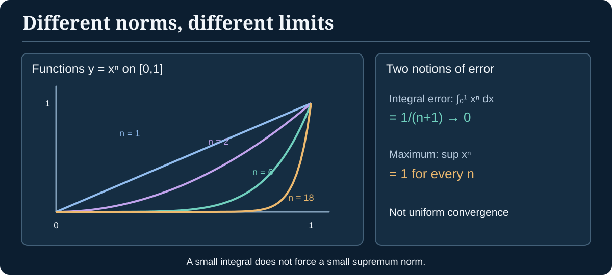

> [!abstract] Foundations & destination
> **Builds on:** [Vector spaces](./linear-algebra-foundations#vector-spaces-and-subspaces), [Cauchy sequences and completeness](./real-analysis#cauchy-sequences), [integration and Lp spaces](./measure-theory#lp-spaces).
> **Leads to:** infinite-dimensional optimization, operator equations, spectral theory and the analytical background of statistical learning. The [Path Through Analysis](./path-through-analysis) gives the surrounding route.

For a cross-subject picture of where Banach, inner-product, Hilbert and general topological vector spaces fit, see the [Atlas of Mathematical Spaces](./atlas-of-mathematical-spaces).

Linear algebra studies vectors and linear maps. Analysis studies limits. **Functional analysis asks what survives when vectors themselves are functions or infinite sequences**, and whether limiting processes are compatible with linear operations. The central words are *norm*, *complete*, *bounded operator*, and *Hilbert space*. Each imposes a mathematically distinct requirement.

## Why an infinite-dimensional vector needs more structure

A vector space alone defines addition and scalar multiplication but does not say when a sequence of vectors converges. A **norm** supplies size, and hence distance:

> [!definition] Normed vector space
> A norm on a real or complex vector space $V$ assigns $\|x\|\geq0$ satisfying, for all scalars $\alpha$ and vectors $x,y$:
>
> 1. $\|x\|=0$ exactly when $x=0$.
> 2. $\|\alpha x\|=|\alpha|\,\|x\|$.
> 3. $\|x+y\|\leq\|x\|+\|y\|$ (triangle inequality).
>
> The induced distance is $d(x,y)=\|x-y\|$.

For $x=(x_1,\ldots,x_n)\in\mathbb R^n$, the Euclidean norm is $\|x\|_2=\sqrt{\sum_i x_i^2}$. More strikingly, on continuous functions $f:[0,1]\to\mathbb R$, the **supremum norm** is $\|f\|_\infty=\max_{t\in[0,1]}|f(t)|$. The maximum exists because a continuous function on a compact interval attains it.

The sup norm measures the **worst error anywhere**. Compare it with an integral norm that measures aggregate error. Two functions can be close in one norm and far apart in another.

### Worked example: convergence depends on the chosen norm

Define $f_n(t)=t^n$ on $[0,1]$. At every fixed $t<1$, $f_n(t)\to0$, but at $t=1$ the value remains $1$. Thus the pointwise limit is discontinuous.

In the sup norm, $\|f_n\|_\infty=1$ for all $n$: the functions do **not** converge uniformly to zero. By contrast,

$$
\|f_n\|_1=\int_0^1t^n\,dt=\frac1{n+1}\longrightarrow0.
$$

The same sequence therefore converges to zero in an integral norm but not in the supremum norm. This is the first important lesson of functional analysis: **the space and the notion of convergence are part of the problem**.

*Figure: Small total area does not imply small maximum error. The norm changes the meaning of approximation.*

## Banach spaces: no missing limits

> [!definition] Banach space
> A **Banach space** is a normed vector space in which every Cauchy sequence (with respect to the norm metric) converges to a point **inside that space**.

Every finite-dimensional normed space over $\mathbb R$ or $\mathbb C$ is Banach. Infinite dimension makes the completion requirement substantive.

> [!theorem] The space of continuous functions is complete in sup norm
> $C([0,1])$, equipped with $\|\cdot\|_\infty$, is a Banach space.

> [!proof] Uniform Cauchy sequences have continuous limits
> Let $(f_n)$ be Cauchy in sup norm. For each $t\in[0,1]$, $|f_n(t)-f_m(t)|\leq\|f_n-f_m\|_\infty$, so $(f_n(t))$ is Cauchy in $\mathbb R$ and converges to some $f(t)$.
>
> Given $\varepsilon>0$, choose $N$ so $\|f_n-f_m\|_\infty<\varepsilon$ for all $n,m\geq N$. Fix $n\geq N$ and pass to the limit $m\to\infty$ at each $t$, giving $|f_n(t)-f(t)|\leq\varepsilon$ for every $t$. Therefore $f_n\to f$ **uniformly**. A uniform limit of continuous functions is continuous, so $f\in C([0,1])$. The space contains the norm-limit of every Cauchy sequence.

> [!counterexample] A normed space that is not complete
> Let $P$ be the vector space of real polynomials on $[0,1]$ with the sup norm. Polynomials can uniformly approximate the continuous function $|t-\tfrac12|$ by the Weierstrass approximation theorem, so a sequence of polynomials can be Cauchy in sup norm while converging to this **non-polynomial** function. Thus $P$ is not complete.

## Inner products and Hilbert spaces

An inner product $\langle x,y\rangle$ measures angles and gives a norm $\|x\|=\sqrt{\langle x,x\rangle}$. Over $\mathbb C$, the inner product is conjugate symmetric and conjugate linear in one slot (our convention: linear in the **first** slot).

> [!definition] Hilbert space
> A **Hilbert space** is an inner-product space complete in the metric of its induced norm. Every Hilbert space is Banach, but not every Banach-space norm comes from an inner product.

The sequence space

$$
\ell^2=\left\{x=(x_1,x_2,\ldots):\sum_{n=1}^\infty|x_n|^2<\infty\right\}
$$

is a Hilbert space under $\langle x,y\rangle=\sum_n x_n\overline{y_n}$. The sum is finite by **Cauchy–Schwarz**, which in this setting says

$$
|\langle x,y\rangle|\leq\|x\|_2\|y\|_2.
$$

*Why Cauchy–Schwarz?* For $y\neq0$ and $\alpha=\langle x,y\rangle/\|y\|^2$, positivity of $\|x-\alpha y\|^2$ gives $0\leq\|x\|^2-|\langle x,y\rangle|^2/\|y\|^2$, which rearranges to the inequality.

### An explicit orthogonal projection

In the Hilbert space $\mathbb R^2$, let $M$ be the horizontal axis and let $x=(3,4)$. For any point $y=(a,0)\in M$,

$$
\|x-y\|^2=(3-a)^2+4^2\geq16,
$$

with equality **only** when $a=3$. Thus $(3,0)$ is the unique closest point of $M$ to $x$ and the error $(0,4)$ is orthogonal to $M$.

This becomes the **projection theorem** in a Hilbert space: every nonempty **closed convex** subset has a unique nearest point. For a closed linear subspace, the error is orthogonal to that subspace. Closedness matters: the open interval $(0,1)$ has no closest point to $2$ even though the infimum distance is $1$.

## Bounded linear operators

A linear function $T:X\to Y$ between normed spaces is **bounded** if some $M\geq0$ satisfies $\|Tx\|_Y\leq M\|x\|_X$ for every $x$. Its operator norm is

$$
\|T\|=\sup_{\|x\|\leq1}\|Tx\|.
$$

> [!theorem] Bounded is equivalent to continuous
> A linear map between normed spaces is bounded **if and only if** it is continuous.

> [!proof] Show both implications
> If $\|Tx\|\leq M\|x\|$, then $\|Tx-Ty\|=\|T(x-y)\|\leq M\|x-y\|$, so $T$ is Lipschitz and continuous.
>
> Conversely, assume $T$ is continuous at $0$. Choose $\delta>0$ so $\|z\|<\delta$ implies $\|Tz\|<1$. For $x\neq0$ set $z=\frac{\delta}{2\|x\|}x$. Then $\|z\|=\delta/2<\delta$, hence $\|Tx\|<2\|x\|/\delta$. Thus $T$ is bounded. Continuity anywhere is equivalent to continuity at zero for a linear map.

**Worked example: evaluation.** On $C([0,1])$ with sup norm, $E(f)=f(0)$ is linear and $|E(f)|\leq\|f\|_\infty$, so $\|E\|\leq1$. The constant function $f(t)=1$ gives equality: $\|E\|=1$.

> [!counterexample] Same functional, different norm
> On $C([0,1])$ equipped with $\|f\|_1=\int_0^1|f(t)|dt$, evaluation $E(f)=f(0)$ is **not bounded**. Set $f_n(t)=\max(1-nt,0)$. Then $E(f_n)=1$, but $\|f_n\|_1=1/(2n)\to0$. No universal $M$ can satisfy $|E(f)|\leq M\|f\|_1$.

This is why the phrase *continuous linear functional* requires both a vector space **and its topology/norm**.

## Riesz representation and the dual

For a normed space $X$, the **continuous dual** $X^*$ consists of bounded linear functionals $X\to\mathbb R$ or $\mathbb C$.

> [!theorem] Riesz representation for Hilbert spaces
> If $H$ is a Hilbert space (with inner product linear in its first slot), every bounded linear functional $L:H\to\mathbb C$ has a **unique** representing vector $y\in H$ such that
> $$
> L(x)=\langle x,y\rangle,\qquad \|L\|=\|y\|.
> $$

**Finite-dimensional illustration.** If $H=\mathbb R^2$ and $L(x_1,x_2)=2x_1-3x_2$, take $y=(2,-3)$. Then $L(x)=x\cdot y$ and Cauchy–Schwarz gives $\|L\|\leq\sqrt{13}$. Equality at $x=y/\|y\|$ yields $\|L\|=\sqrt{13}$.

The full infinite-dimensional theorem additionally requires completeness and a closed-subspace projection argument. The finite-dimensional calculation demonstrates its *meaning*, not a substitute for that proof.

## What changes in infinite dimension?

Three particularly useful distinctions connect this chapter to later work:

- **Norm convergence** controls $\|x_n-x\|$. **Weak convergence** instead asks whether every continuous linear functional satisfies $L(x_n)\to L(x)$. Weak convergence need not imply norm convergence: the standard unit vectors $e_n$ in $\ell^2$ satisfy $\langle e_n,y\rangle=y_n\to0$ for every $y\in\ell^2$, while $\|e_n\|=1$.
- **Compactness** behaves differently. The unit ball is compact in a finite-dimensional normed space, but not in an infinite-dimensional normed space in norm topology. The vectors $e_n$ are pairwise distance $\sqrt2$, so the unit ball of $\ell^2$ has no convergent subsequence. The [metric sequential-compactness theorem](./general-topology-compactness#metric-compactness-and-convergent-subsequences) now makes the argument rigorous, and the same chapter proves [Heine–Borel](./general-topology-compactness#step-1-closed-real-intervals-are-compact).
- **Operators** have spectra, not merely finite lists of eigenvalues. The bounded unilateral right shift on $\ell^2$ sends $(x_1,x_2,\ldots)$ to $(0,x_1,x_2,\ldots)$ and has no nonzero eigenvector, although its operator theory is far from trivial.

> [!distinction] What is proved versus introduced
> This chapter proves completeness of $C([0,1])$ and boundedness/continuity equivalence, and works out projection and duality in finite dimensions. The general Hilbert projection and Riesz theorems and full spectral theory are **stated**, not falsely represented as derived from these examples. A full graduate functional-analysis treatment would additionally prove the Hahn–Banach, uniform boundedness, open mapping and closed graph theorems.

## Connections to the rest of the site

The [Analysis Learning Map](./path-through-analysis) tracks the transition from metric and integral convergence to function-space convergence. [Measure Theory](./measure-theory#lp-spaces) develops the $L^p$ norms; [Optimization](./optimization) uses gradients and projections; [Statistical Learning](./statistical-learning) benefits from the distinction between function space, parameter space, and convergence. This chapter supplies the language needed to say **which topology and which theorem** make those manipulations legal.
