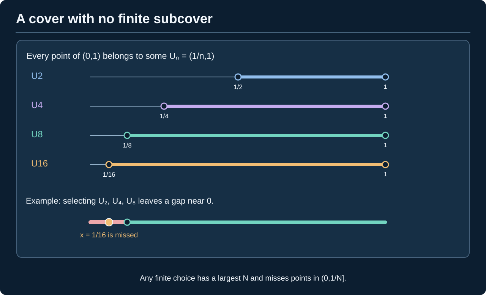
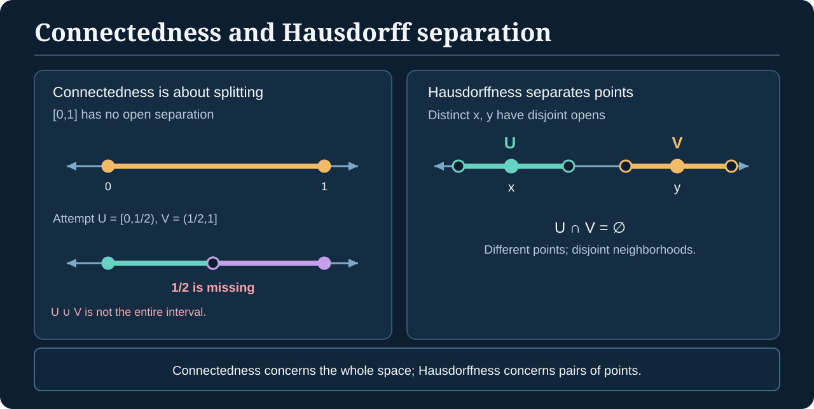
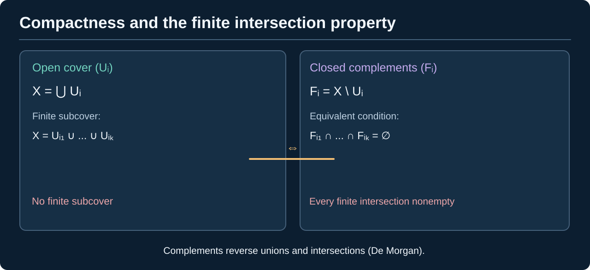

> [!abstract] Prerequisites & where this leads
> **Builds on:** [Topological Spaces](./general-topology-foundations) and [Subspaces, Products and Quotients](./general-topology-constructions). **Recommended for real-interval examples:** [Real Analysis](./real-analysis) (completeness and compact intervals). See the [Path Through Topology](./path-to-topology).
> **Leads to:** continuity and convergence arguments in [Measure Theory](./measure-theory), [Algebraic Geometry](./algebraic-geometry), and later functional analysis or geometry.

What survives under continuous maps when distances are no longer available? Three topological properties answer different versions of that question:

- **Compactness** makes potentially infinite open-cover problems finite.
- **Connectedness** prevents a space from splitting into two disjoint nonempty relatively open pieces.
- **Separation axioms** specify whether points and closed sets can be distinguished by neighborhoods.

These properties are independent enough that confusing them produces common false arguments. The abstract definitions and preservation proofs need no metric, but the proofs about *real intervals* later in this chapter use real-analysis results such as completeness and compactness of $[a,b]$. Readers taking the abstract route can learn the definitions first and consult those results when the examples require them.

## Compactness: every open cover admits a finite subcover

### First intuition: nothing gets left behind by an open cover

Imagine covering every point of a space with open patches. You might use hundreds, infinitely many, or an oddly overlapping collection. Compactness suggests a strong kind of **finite control**: however those open patches are chosen, as long as they cover the whole space, **some finite selection of the original patches** still covers it.

**What this gets right:** compactness converts an *arbitrary* open-covering problem into a finite one. A closed interval $[0,1]$ has this property, even though it has infinitely many points. The selected patches do not have to be the same for different covers.

**Where the picture breaks:** compactness does **not** mean the space contains finitely many points, nor does it simply mean "not too big" or "bounded." The interval $(0,1)$ is bounded but **not compact**: some of its open covers inevitably leave points uncovered whenever only finitely many members are chosen. And topology needs no distance at all, so numerical boundedness cannot serve as the general definition.

Now we can state the precise condition, including the crucial **for every cover / there exists a finite selection** order of quantifiers.

> [!definition] Compact topological space
> A space $X$ is **compact** if for every family of open sets $(U_i)_{i\in I}$ with $X=\bigcup_{i\in I}U_i$, there are finitely many indices $i_1,\ldots,i_n$ such that
>
> $$
> X=U_{i_1}\cup\cdots\cup U_{i_n}.
> $$

The cover may be **infinite**. A finite subcover may depend on that cover; the definition does not say $X$ contains finitely many points.

**Example of an infinite cover that succeeds.** On $[0,1]$, take all intervals $U_n=(-1/n,1-1/n)$ for $n\ge2$, together with $V=(1/2,2)$. This is an **infinite** open cover, and just the **two original sets** $U_4=(-1/4,3/4)$ and $V=(1/2,2)$ cover $[0,1]$. Compare this with the infinite cover of $(0,1)$ below, from which no finite selection works.

*Figure: The closed interval is covered by five open intervals. U₁, U₂ and U₃ belong to the given cover and already suffice to cover the interval, including both endpoints.*

*Figure: The lower intervals have **identical endpoints to the upper U₁, U₂, U₃**. A subcover selects **the same original sets**, rather than adding new sets.*

> [!distinction] Do not confuse the picture with the definition
> The claim is "**for every** open cover, **there exists** a finite subcover." An illustration displays only one cover, not a proof of that universal property. An infinite cover can also have a finite subcover; what matters is that every open cover does.

### Worked example: every finite space is compact

Let $X=\{x_1,\ldots,x_n\}$ with **any** topology. Given an open cover, choose one covering open set for each $x_j$. There are at most $n$ selected sets, and their union contains every point. Thus $X$ is compact.

> [!counterexample] The open interval (0,1) is not compact
> In the subspace topology on $(0,1)$, the sets $U_n=(1/n,1)$ for $n\ge2$ are open and cover $(0,1)$: every $x>0$ eventually exceeds $1/n$. But any **finite** selection has a largest index $N$; its union is $(1/N,1)$, which misses points near zero. No finite subcover exists.

*Figure: This **infinite** open cover of $(0,1)$ has no finite subcover. Only four members are drawn; the argument works for every finite selection.*

For any finite choice $U_{n_1},\ldots,U_{n_k}$, let $N=\max(n_1,\ldots,n_k)$. These sets are nested, so their union is exactly $(1/N,1)$. The point $1/(2N)$ lies in $(0,1)$ but remains **uncovered**.

## Continuous images preserve compactness

> [!theorem] A continuous image of a compact space is compact
> If $f:X\to Y$ is continuous and $X$ compact, then $f(X)$ is compact with its subspace topology.

**Proof.** Suppose open sets $V_i$ of $Y$ cover $f(X)$ (a subspace open cover can always be represented by ambient opens). The sets $f^{-1}(V_i)$ are open in $X$ and cover $X$. Choose finitely many whose union is $X$. Their images show the corresponding $V_i$ already cover $f(X)$. $\square$

This theorem is the main reason compactness plays so well with quotient maps: the **quotient of a compact space is compact**, because the quotient map is continuous and surjective.

### Closed-subspace inheritance

> [!theorem] A closed subset of a compact space is compact
> If $F\subseteq X$ is closed and $X$ compact, then $F$ is compact.

**Proof.** An open cover of $F$ by relative-open sets can be written as $F\cap U_i$, with each $U_i$ open in $X$. Add the open set $X\setminus F$ to cover all of $X$. Compactness yields a finite subcover of $X$, and deleting $X\setminus F$ if present leaves a finite cover of $F$. $\square$

## Hausdorff separation

> [!definition] Hausdorff (T₂) space
> A topological space $X$ is **Hausdorff** if for every pair of **distinct** points $x,y$, there are **disjoint open neighborhoods** $U\ni x$, $V\ni y$.

*Figure: Hausdorffness requires enough open sets to separate any two different points.*

Every metric space is Hausdorff: if $d(x,y)=r>0$, balls of radius $r/3$ centered at $x,y$ are disjoint by the triangle inequality.

> [!theorem] Compact subsets of Hausdorff spaces are closed
> If $K\subseteq X$ is compact and $X$ Hausdorff, then $X\setminus K$ is open.

**Proof.** Fix $x\notin K$. For each $y\in K$, choose disjoint open neighborhoods $U_y\ni x$ and $V_y\ni y$. The $V_y$ cover $K$; compactness gives $y_1,\ldots,y_n$ whose $V_{y_j}$ cover $K$. Let $U=\bigcap_{j=1}^n U_{y_j}$. It is an **open neighborhood of $x$** because the intersection is finite, and it is disjoint from every $V_{y_j}$, hence from all of $K$. Thus every $x\notin K$ has an open neighborhood in the complement; the complement is open. $\square$

*Figure: Compactness reduces separation from infinitely many points of $K$ to **finitely many** pairs of Hausdorff neighborhoods. Their corresponding $U$-neighborhoods have a **finite open intersection**; an arbitrary infinite intersection would not generally be open.*

### The compact–Hausdorff homeomorphism theorem

> [!theorem] Continuous bijection from compact to Hausdorff is a homeomorphism
> If $f:X\to Y$ is continuous and bijective, $X$ is **compact**, and $Y$ is **Hausdorff**, then $f^{-1}:Y\to X$ is continuous.

**Proof.** For any closed $F\subseteq X$, the closed-subspace theorem makes $F$ compact. Continuous-image compactness makes $f(F)$ compact in $Y$. Hausdorffness makes $f(F)$ **closed** in $Y$. Hence $f$ is a **closed map**. Since $f$ is a bijection, for every closed $F\subseteq X$, $(f^{-1})^{-1}(F)=f(F)$ is closed. Thus $f^{-1}$ is continuous. $\square$

This is the missing step promised in the [interval-to-circle quotient construction](./general-topology-constructions), followed step by step in the [Topology Learning Map](./path-to-topology). The quotient of $[0,1]$ with endpoints identified is compact; its induced continuous bijection to the Hausdorff circle is therefore a homeomorphism.

> [!distinction] Compact alone does not imply closed
> Closedness of compact subsets used the **Hausdorff** hypothesis. On a non-Hausdorff space it can fail: in an infinite set with the **indiscrete topology**, every singleton is compact (finite) but not closed.

## T₀, T₁ and Hausdorff are different strengths

> [!definition] Separation axioms
> - **T₀:** for any distinct points, an open set contains one but not the other.
> - **T₁:** for any distinct points, each has an open neighborhood excluding the other; equivalently each singleton is **closed**.
> - **Hausdorff (T₂):** distinct points have **disjoint** open neighborhoods.

Every Hausdorff space is T₁; every T₁ space is T₀. The converses fail.

### Counterexamples that distinguish them

- The **Sierpiński space** $X=\{0,1\}$ with topology $\{\varnothing,\{1\},X\}$ is T₀ but not T₁: the open set $\{1\}$ distinguishes the points, but no open set contains $0$ without also containing $1$.
- An infinite set with the **cofinite topology** is T₁ because each singleton has an open complement. It is **not Hausdorff**: any two nonempty open sets are cofinite, so their intersection is nonempty.

The cofinite example shows why merely knowing that all points are closed does not guarantee disjoint neighborhoods.

## Connectedness: no nontrivial separation

> [!definition] Connected space
> $X$ is **connected** if it cannot be written as $X=U\cup V$ for **two disjoint nonempty open sets** $U,V$. Equivalently, its only **clopen** subsets are $\varnothing$ and $X$.

*Figure: A connected space cannot be split into two nonempty relatively open components.*

*Figure: Connectedness forbids a separation **of the whole space**. Hausdorffness only requires disjoint neighborhoods **around each pair of distinct points**.*

> [!theorem] Continuous images preserve connectedness
> If $X$ is connected and $f:X\to Y$ continuous, then $f(X)$ is connected.

**Proof.** Suppose $f(X)$ had a separation into disjoint nonempty relatively open subsets $U,V$. There are ambient opens $U',V'\subseteq Y$ restricting to these sets. Then $f^{-1}(U')$ and $f^{-1}(V')$ are **disjoint nonempty open subsets** of $X$ whose union is $X$. This contradicts connectedness. $\square$

### Why real intervals are connected

> [!theorem] Every real interval is connected
> An interval $I\subseteq\mathbb R$ with its usual subspace topology is connected.

**Proof.** Assume a separation $I=U\cup V$ into disjoint nonempty relatively open sets. Pick $u\in U$, $v\in V$, exchanging names if necessary to have $u<v$. Consider $A=U\cap[u,v]$ and $s=\sup A$, which exists because $u\in A$ and $A$ is bounded above. Since $s\in I$ and $I=U\cup V$, either $s\in U$ or $s\in V$.

If $s\in U$, relative openness gives points of $I$ immediately to the **right** of $s$ still in $U$, unless $s=v$. But $s=v\in V$, so $s\ne v$; this contradicts $s$ being an upper bound. If $s\in V$, relative openness gives an interval around $s$ disjoint from $U$, contradicting that members of $A$ approach its supremum from below (or $u=s$, which would put $u\in V$). Both cases are impossible. $\square$

This proof reveals the role of **least-upper-bound completeness** in the topology of the real line.

### Intermediate Value Theorem from connectedness

Let $f:[a,b]\to\mathbb R$ be continuous. The interval is connected, so its image is connected. Every connected subset of $\mathbb R$ is an interval: if it contained $r<t$ but omitted $s$ between them, intersections with $(-\infty,s)$ and $(s,\infty)$ would disconnect it. Therefore $f([a,b])$ contains every value between $f(a)$ and $f(b)$. This is the **Intermediate Value Theorem** derived from a general topological fact.

## Compactness versus connectedness: a comparison

| Example | Compact? | Connected? | Hausdorff? |
| --- | --- | --- | --- |
| $[0,1]$ in $\mathbb R$ | Yes (Heine–Borel) | Yes | Yes |
| $(0,1)$ in $\mathbb R$ | No | Yes | Yes |
| $\{0\}\cup\{1\}$ with real subspace topology | Yes | No | Yes |
| An infinite set with indiscrete topology | Yes | Yes | No |
| $\mathbb R$ | No | Yes | Yes |

For the infinite **indiscrete** example, every open cover contains the whole space as a member, hence compactness; the only opens are $\varnothing$ and $X$, hence connectedness. Failure of Hausdorffness is immediate.

> [!theorem] Heine–Borel theorem
> For $K\subseteq\mathbb R^n$ with $n\geq1$, **open-cover compactness** is equivalent to being **closed and bounded** in the Euclidean metric.

This is **not the definition of compactness** and does **not** hold in arbitrary metric spaces. We can derive it from completeness of the real numbers and the elementary topology already developed.

### Step 1: closed real intervals are compact

> [!theorem] The finite-subcover property of a closed interval
> Every open cover of $[a,b]\subseteq\mathbb R$, with $a\leq b$, admits a finite subcover.

> [!proof] The supremum of finitely coverable endpoints
> Let $\mathcal U$ be **any** open cover of $[a,b]$. If the sets are only relatively open in $[a,b]$, represent each as the intersection with an ambient real open set; this changes none of the covering choices.
>
> Define
> $
> S=\{t\in[a,b]:[a,t]\text{ can be covered by finitely many members of }\mathcal U\}.
> $
> **Start:** $a\in S$, because at least one set of the cover contains $a$, and that one set covers $[a,a]$. So $S$ is nonempty and bounded above by $b$.
>
> **Boundary:** by the least-upper-bound property of $\mathbb R$, $s=\sup S$ exists in $[a,b]$. Some member $U$ of the cover contains $s$. By relative openness, for some $\varepsilon>0$,
> $
> (s-\varepsilon,s+\varepsilon)\cap[a,b]\subseteq U.
> $
> Because $s=\sup S$, choose $t\in S$ with $t>s-\varepsilon/2$ (when $s=a$, take $t=a$). Finitely many sets from $\mathcal U$ already cover $[a,t]$. Add **one** further member, $U$. Together they cover
> $
> [a,\min(b,s+\varepsilon/2)].
> $
> There is no gap: $t>s-\varepsilon/2>s-\varepsilon$, and $U$ covers every interval point between $t$ and $\min(b,s+\varepsilon/2)$.
>
> **Finish:** if $s<b$, the new right endpoint exceeds $s$, producing a member of $S$ larger than its supremum. Thus $s=b$. The same construction at $s=b$ covers all of $[a,b]$ by finitely many original sets. $\square$

The proof does not select from a fixed *example* cover. It works for an **arbitrary** cover and uses real-number completeness to rule out an inaccessible last point.

### Step 2: finite products of compact spaces are compact

> [!theorem] Two-factor product compactness
> If $X$ and $Y$ are compact, then $X\times Y$ with the **product topology** is compact.

> [!proof] Cover vertical slices and then cover their horizontal neighborhoods
> Empty factors are trivial. Let $\mathcal U$ be an arbitrary open cover of $X\times Y$. For each $(x,y)$ choose a covering member $U_{x,y}\in\mathcal U$. Since **open rectangles form a basis** in the product topology, choose open neighborhoods $A_{x,y}\ni x$ and $B_{x,y}\ni y$ satisfying
> $
> A_{x,y}\times B_{x,y}\subseteq U_{x,y}.
> $
> Fix $x\in X$. The sets $B_{x,y}$ cover $Y$. Compactness of $Y$ gives finitely many $y_1,\ldots,y_m$ whose $B_{x,y_j}$ cover all of $Y$. The intersection
> $
> A_x=\bigcap_{j=1}^{m}A_{x,y_j}
> $
> is **open** and contains $x$. Moreover, the whole strip $A_x\times Y$ is covered by the **finite** collection $(U_{x,y_j})$: every second coordinate lies in at least one selected $B_{x,y_j}$.
>
> Now the open sets $A_x$ cover $X$. Compactness of $X$ gives finitely many of them, say $A_{x_1},\ldots,A_{x_k}$. For each selected $x_i$ we already obtained finitely many original $U$-sets covering $A_{x_i}\times Y$. Combining these finite selections covers $X\times Y$. $\square$

Inductively, finite products of compact spaces are compact. Hence every Euclidean cube $[-M,M]^n$ is compact, because each factor is a compact interval.

> [!distinction] Finite products are not the whole story
> This argument proves **finite** product compactness. The compactness of arbitrary products in the product topology is **Tychonoff's theorem**, a deeper result with set-theoretic choice principles. We have not proved that theorem here.

### Step 3: closed and bounded implies compact

> [!proof] Put the set inside a compact cube
> If $K\subseteq\mathbb R^n$ is bounded, it lies in a cube $[-M,M]^n$ for some $M>0$. Step 2 proves this cube is compact. If $K$ is also closed in $\mathbb R^n$, then $K$ is **closed within that compact cube**. By the [closed-subspace compactness theorem](#closed-subspace-inheritance) proved earlier, $K$ is compact.

### Step 4: compact implies closed and bounded

> [!proof] Use Hausdorffness and an explicit open cover
> Euclidean space is Hausdorff, so the [compact-subsets-are-closed theorem](#hausdorff-separation) proved earlier makes $K$ closed.
>
> The open balls $B(0,1),B(0,2),B(0,3),\ldots$ cover $\mathbb R^n$. By compactness, finitely many already cover $K$. Taking the ball with the **largest radius** among this finite choice shows $K\subseteq B(0,N)$ for some integer $N$. Hence $K$ is bounded. The empty set also satisfies both conclusions.

We have now proved **both directions** of Heine–Borel. In outline,

$
\text{real completeness}
\Longrightarrow [a,b]\text{ compact}
\Longrightarrow [-M,M]^n\text{ compact}
\Longrightarrow \text{closed bounded subsets compact}.
$

The reverse direction uses the Hausdorff property and a very specific increasing open cover. The proof is about **Euclidean space**, not every space with a notion of distance.

## Metric compactness and convergent subsequences

Open-cover compactness makes sense in any topological space. In **metric spaces**, we can characterize the same property by what happens to *every sequence*.

> [!definition] Sequential compactness
> A space is **sequentially compact** if every sequence $(x_n)$ has a subsequence $(x_{n_k})$ converging to a limit **inside the space**.

> [!theorem] Compactness and sequential compactness agree in metric spaces
> A metric space $(X,d)$ is compact if and only if every sequence in $X$ has a subsequence converging in $X$.

> [!proof] Compact $\Rightarrow$ sequentially compact
> Given a sequence $(x_n)$, for each $N\geq1$ let $F_N$ be the **closure in $X$** of its tail $\{x_n:n\geq N\}$. These sets are nonempty, closed, and nested: $F_{N+1}\subseteq F_N$. Every finite intersection is therefore nonempty.
>
> By the [finite intersection property](#a-useful-compactness-reformulation), some $x\in X$ belongs to **every** $F_N$. For each positive integer $k$, the open ball $B(x,1/k)$ therefore meets every sufficiently late tail. We can choose indices $n_1<n_2<\cdots$ with $d(x_{n_k},x)<1/k$. Hence $x_{n_k}\to x$.

> [!proof] Sequentially compact $\Rightarrow$ compact
> The empty space is immediate, so assume $X$ nonempty. We establish two claims.
>
> **1. Every fixed radius admits a finite ball cover.** Given $\varepsilon>0$, suppose no finite family of $\varepsilon$-balls covers $X$. Choose $x_1$, then $x_2$ outside $B(x_1,\varepsilon)$, then $x_3$ outside the balls around both earlier choices, and continue. The resulting points satisfy $d(x_i,x_j)\geq\varepsilon$ whenever $i\ne j$. No subsequence can be Cauchy, hence none converges. Contradiction. This property is called **total boundedness**.
>
> **2. Every open cover admits one sufficiently small ball radius.** Let $\mathcal U$ be an arbitrary open cover of $X$. If no $\delta>0$ worked, then for every $n$ we could choose $x_n\in X$ whose ball $B(x_n,1/n)$ fits inside **no** member of $\mathcal U$.
>
> Sequential compactness gives a subsequence $x_{n_k}\to x$. Choose $U\in\mathcal U$ containing $x$ and then $r>0$ so $B(x,2r)\subseteq U$. For sufficiently large $k$, both $d(x_{n_k},x)<r$ and $1/n_k<r$. By the triangle inequality,
> $
> B(x_{n_k},1/n_k)\subseteq B(x,2r)\subseteq U,
> $
> contradicting our choice. Therefore some $\delta>0$ has the property that **every** ball $B(x,\delta)$ is contained in a member of the cover. This is the **Lebesgue-number property** for metric open covers.
>
> Now use Claim 1 to cover $X$ by finitely many balls $B(c_1,\delta/2),\ldots,B(c_m,\delta/2)$. Claim 2 lets us select, for each $c_j$, an original cover-member $U_j\in\mathcal U$ containing $B(c_j,\delta)$. These finitely many $U_j$ cover $X$. Because $\mathcal U$ was arbitrary, $X$ is compact. $\square$

> [!distinction] Metric assumption required
> Sequences need not characterize compactness in **arbitrary nonmetric topological spaces**. Nets and filters provide convergence notions suited to general topology. Conversely, in Euclidean spaces and all metric spaces, the two definitions are equivalent by the theorem just proved.

### Why the infinite-dimensional unit ball is not compact

> [!counterexample] Closed and bounded is not sufficient in $\ell^2$
> In the Hilbert space $\ell^2$ from [Functional Analysis](./functional-analysis), take its closed unit ball
> $
> B=\{x\in\ell^2:\|x\|_2\leq1\}.
> $
> This is closed and bounded, but it contains the standard unit vectors $e_1,e_2,\ldots$. For every $m\ne n$,
> $
> \|e_m-e_n\|_2=\sqrt2.
> $
> No subsequence of $(e_n)$ can be Cauchy, so no subsequence converges in norm. By the metric theorem above, $B$ is **not compact**. This pinpoints why the "closed and bounded" test is specific to finite-dimensional Euclidean spaces.

### A payoff: continuous functions attain maxima and minima

> [!theorem] Extreme-value theorem from compactness
> A continuous function $f:X\to\mathbb R$ on a **nonempty compact** space $X$ attains a maximum and a minimum.

> [!proof] A compact image in the real line contains its bounds
> Continuity makes $f(X)$ compact, and it is nonempty. Heine–Borel makes $f(X)$ **closed and bounded** in $\mathbb R$. Its supremum $M$ and infimum $m$ exist and belong to $f(X)$ because $f(X)$ is closed. Thus some $x_M,x_m\in X$ satisfy $f(x_M)=M$ and $f(x_m)=m$.

This explains an important role of compactness in optimization: on nonempty compact feasible sets, a continuous objective has **actual optimizers**, not merely an infimum or supremum that might be approached but never attained.

## A useful compactness reformulation

> [!theorem] Finite intersection property
> A space $X$ is compact **if and only if** every family of closed subsets with the property that every finite subfamily has nonempty intersection also has **nonempty total intersection**.

**Proof.** Suppose $X$ compact and $(F_i)$ has the finite intersection property, but $\bigcap_i F_i=\varnothing$. Then $(X\setminus F_i)$ is an **open cover**. A finite subcover would force the corresponding finite closed intersection to be empty, contradiction.

Conversely, if $X$ were not compact, some open cover would have no finite subcover. Take complements of all sets in that cover. Every finite intersection is nonempty, but the total intersection is empty. This contradicts the proposed property. $\square$

*Figure: Open covers and intersections of their closed complements are equivalent through **De Morgan's laws**. Finite selection on one side corresponds to finite intersection on the other.*

## Why topology matters to abstract mathematics

In a topological group, multiplication and inversion must be **continuous** as well as algebraically valid. In functional analysis, convergence of functions or operators is captured by topologies chosen on their function spaces. In algebraic geometry, Zariski-open sets form a topology whose behavior differs dramatically from Euclidean open sets.

The category-theory connection is precise: **Top** has products and coproducts as proved in the previous chapter, while topology contributes additional restrictions on the morphisms (continuity) and properties of spaces (compact, connected, Hausdorff).

## Dependency audit

| Result | Key assumption |
| --- | --- |
| Continuous image of compact is compact | continuity and finite subcovers |
| Closed subset of compact is compact | closedness of the subset |
| Compact subset closed | ambient **Hausdorff** condition |
| Compact-to-Hausdorff bijection is homeomorphism | continuity, bijection, compact source, Hausdorff target |
| Continuous image connected | preimages of a separation would separate source |
| Interval connected | supremum completeness of reals |
| IVT | continuous images of connected intervals |
| Closed-set intersection property | complements and De Morgan's laws |
| Heine–Borel in Euclidean space | least-upper-bound completeness, finite products, closed subsets, Hausdorffness |
| Metric compactness $\Leftrightarrow$ sequential compactness | total boundedness and an open-cover Lebesgue-number argument |
| Extreme-value theorem | continuous image of compact, Heine–Borel in $\mathbb R$ |

**External reference:** [Homeomorphisms](https://encyclopediaofmath.org/wiki/Homeomorphism) (Encyclopedia of Mathematics). These results complete the core compactness branch; arbitrary product compactness (Tychonoff), nets, filters, and compactness in weaker topologies are important further topics.
