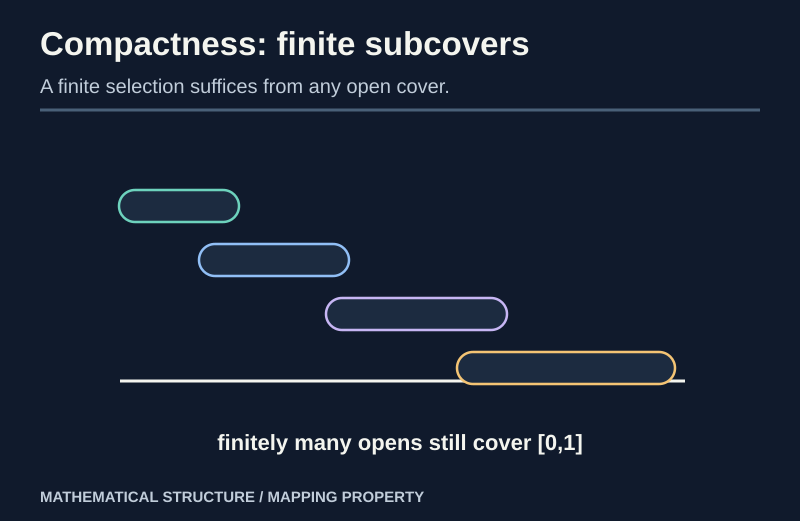
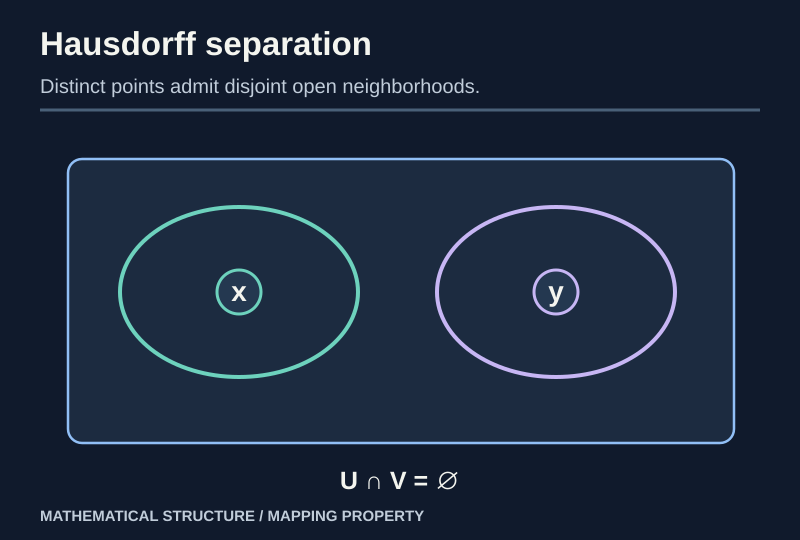
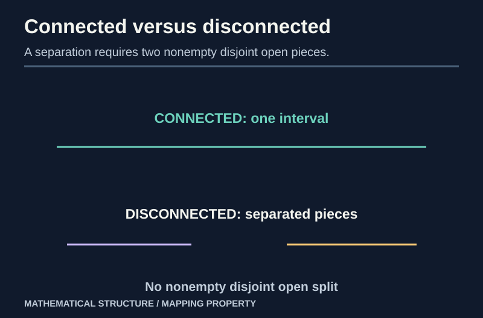

> [!abstract] Prerequisites & where this leads
> **Builds on:** [Topological Spaces](./general-topology-foundations) and [Subspaces, Products and Quotients](./general-topology-constructions). **Recommended for real-interval examples:** [Real Analysis](./real-analysis) (completeness and compact intervals). See the [Path Through Topology](./path-to-topology).
> **Leads to:** continuity and convergence arguments in [Measure Theory](./measure-theory), [Algebraic Geometry](./algebraic-geometry), and later functional analysis or geometry.

What survives under continuous maps when distances are no longer available? Three topological properties answer different versions of that question:

- **Compactness** makes potentially infinite open-cover problems finite.
- **Connectedness** prevents a space from splitting into two disjoint nonempty relatively open pieces.
- **Separation axioms** specify whether points and closed sets can be distinguished by neighborhoods.

These properties are independent enough that confusing them produces common false arguments. The abstract definitions and preservation proofs need no metric, but the proofs about *real intervals* later in this chapter use real-analysis results such as completeness and compactness of $[a,b]$. Readers taking the abstract route can learn the definitions first and consult those results when the examples require them.

## Compactness: every open cover admits a finite subcover

> [!definition] Compact topological space
> A space $X$ is **compact** if for every family of open sets $(U_i)_{i\in I}$ with $X=\bigcup_{i\in I}U_i$, there are finitely many indices $i_1,\ldots,i_n$ such that
>
> $$
> X=U_{i_1}\cup\cdots\cup U_{i_n}.
> $$

The cover may be **infinite**. A finite subcover may depend on that cover; the definition does not say $X$ contains finitely many points.

*Figure: Compactness turns an arbitrary open covering requirement into a finite selection.*

### Worked example: every finite space is compact

Let $X=\{x_1,\ldots,x_n\}$ with **any** topology. Given an open cover, choose one covering open set for each $x_j$. There are at most $n$ selected sets, and their union contains every point. Thus $X$ is compact.

> [!counterexample] The open interval (0,1) is not compact
> In the subspace topology on $(0,1)$, the sets $U_n=(1/n,1)$ for $n\ge2$ are open and cover $(0,1)$: every $x>0$ eventually exceeds $1/n$. But any **finite** selection has a largest index $N$; its union is $(1/N,1)$, which misses points near zero. No finite subcover exists.

## Continuous images preserve compactness

> [!theorem] A continuous image of a compact space is compact
> If $f:X\to Y$ is continuous and $X$ compact, then $f(X)$ is compact with its subspace topology.

**Proof.** Suppose open sets $V_i$ of $Y$ cover $f(X)$ (a subspace open cover can always be represented by ambient opens). The sets $f^{-1}(V_i)$ are open in $X$ and cover $X$. Choose finitely many whose union is $X$. Their images show the corresponding $V_i$ already cover $f(X)$. $\square$

This theorem is the main reason compactness plays so well with quotient maps: the **quotient of a compact space is compact**, because the quotient map is continuous and surjective.

### Closed-subspace inheritance

> [!theorem] A closed subset of a compact space is compact
> If $F\subseteq X$ is closed and $X$ compact, then $F$ is compact.

**Proof.** An open cover of $F$ by relative-open sets can be written as $F\cap U_i$, with each $U_i$ open in $X$. Add the open set $X\setminus F$ to cover all of $X$. Compactness yields a finite subcover of $X$, and deleting $X\setminus F$ if present leaves a finite cover of $F$. $\square$

## Hausdorff separation

> [!definition] Hausdorff (T₂) space
> A topological space $X$ is **Hausdorff** if for every pair of **distinct** points $x,y$, there are **disjoint open neighborhoods** $U\ni x$, $V\ni y$.

*Figure: Hausdorffness requires enough open sets to separate any two different points.*

Every metric space is Hausdorff: if $d(x,y)=r>0$, balls of radius $r/3$ centered at $x,y$ are disjoint by the triangle inequality.

> [!theorem] Compact subsets of Hausdorff spaces are closed
> If $K\subseteq X$ is compact and $X$ Hausdorff, then $X\setminus K$ is open.

**Proof.** Fix $x\notin K$. For each $y\in K$, choose disjoint open neighborhoods $U_y\ni x$ and $V_y\ni y$. The $V_y$ cover $K$; compactness gives $y_1,\ldots,y_n$ whose $V_{y_j}$ cover $K$. Let $U=\bigcap_{j=1}^n U_{y_j}$. It is an **open neighborhood of $x$** because the intersection is finite, and it is disjoint from every $V_{y_j}$, hence from all of $K$. Thus every $x\notin K$ has an open neighborhood in the complement; the complement is open. $\square$

### The compact–Hausdorff homeomorphism theorem

> [!theorem] Continuous bijection from compact to Hausdorff is a homeomorphism
> If $f:X\to Y$ is continuous and bijective, $X$ is **compact**, and $Y$ is **Hausdorff**, then $f^{-1}:Y\to X$ is continuous.

**Proof.** For any closed $F\subseteq X$, the closed-subspace theorem makes $F$ compact. Continuous-image compactness makes $f(F)$ compact in $Y$. Hausdorffness makes $f(F)$ **closed** in $Y$. Hence $f$ is a **closed map**. Since $f$ is a bijection, for every closed $F\subseteq X$, $(f^{-1})^{-1}(F)=f(F)$ is closed. Thus $f^{-1}$ is continuous. $\square$

This is the missing step promised in the [interval-to-circle quotient construction](./general-topology-constructions), followed step by step in the [Topology Learning Map](./path-to-topology). The quotient of $[0,1]$ with endpoints identified is compact; its induced continuous bijection to the Hausdorff circle is therefore a homeomorphism.

> [!distinction] Compact alone does not imply closed
> Closedness of compact subsets used the **Hausdorff** hypothesis. On a non-Hausdorff space it can fail: in an infinite set with the **indiscrete topology**, every singleton is compact (finite) but not closed.

## T₀, T₁ and Hausdorff are different strengths

> [!definition] Separation axioms
> - **T₀:** for any distinct points, an open set contains one but not the other.
> - **T₁:** for any distinct points, each has an open neighborhood excluding the other; equivalently each singleton is **closed**.
> - **Hausdorff (T₂):** distinct points have **disjoint** open neighborhoods.

Every Hausdorff space is T₁; every T₁ space is T₀. The converses fail.

### Counterexamples that distinguish them

- The **Sierpiński space** $X=\{0,1\}$ with topology $\{\varnothing,\{1\},X\}$ is T₀ but not T₁: the open set $\{1\}$ distinguishes the points, but no open set contains $0$ without also containing $1$.
- An infinite set with the **cofinite topology** is T₁ because each singleton has an open complement. It is **not Hausdorff**: any two nonempty open sets are cofinite, so their intersection is nonempty.

The cofinite example shows why merely knowing that all points are closed does not guarantee disjoint neighborhoods.

## Connectedness: no nontrivial separation

> [!definition] Connected space
> $X$ is **connected** if it cannot be written as $X=U\cup V$ for **two disjoint nonempty open sets** $U,V$. Equivalently, its only **clopen** subsets are $\varnothing$ and $X$.

*Figure: A connected space cannot be split into two nonempty relatively open components.*

> [!theorem] Continuous images preserve connectedness
> If $X$ is connected and $f:X\to Y$ continuous, then $f(X)$ is connected.

**Proof.** Suppose $f(X)$ had a separation into disjoint nonempty relatively open subsets $U,V$. There are ambient opens $U',V'\subseteq Y$ restricting to these sets. Then $f^{-1}(U')$ and $f^{-1}(V')$ are **disjoint nonempty open subsets** of $X$ whose union is $X$. This contradicts connectedness. $\square$

### Why real intervals are connected

> [!theorem] Every real interval is connected
> An interval $I\subseteq\mathbb R$ with its usual subspace topology is connected.

**Proof.** Assume a separation $I=U\cup V$ into disjoint nonempty relatively open sets. Pick $u\in U$, $v\in V$, exchanging names if necessary to have $u<v$. Consider $A=U\cap[u,v]$ and $s=\sup A$, which exists because $u\in A$ and $A$ is bounded above. Since $s\in I$ and $I=U\cup V$, either $s\in U$ or $s\in V$.

If $s\in U$, relative openness gives points of $I$ immediately to the **right** of $s$ still in $U$, unless $s=v$. But $s=v\in V$, so $s\ne v$; this contradicts $s$ being an upper bound. If $s\in V$, relative openness gives an interval around $s$ disjoint from $U$, contradicting that members of $A$ approach its supremum from below (or $u=s$, which would put $u\in V$). Both cases are impossible. $\square$

This proof reveals the role of **least-upper-bound completeness** in the topology of the real line.

### Intermediate Value Theorem from connectedness

Let $f:[a,b]\to\mathbb R$ be continuous. The interval is connected, so its image is connected. Every connected subset of $\mathbb R$ is an interval: if it contained $r<t$ but omitted $s$ between them, intersections with $(-\infty,s)$ and $(s,\infty)$ would disconnect it. Therefore $f([a,b])$ contains every value between $f(a)$ and $f(b)$. This is the **Intermediate Value Theorem** derived from a general topological fact.

## Compactness versus connectedness: a comparison

| Example | Compact? | Connected? | Hausdorff? |
| --- | --- | --- | --- |
| $[0,1]$ in $\mathbb R$ | Yes (Heine–Borel) | Yes | Yes |
| $(0,1)$ in $\mathbb R$ | No | Yes | Yes |
| $\{0\}\cup\{1\}$ with real subspace topology | Yes | No | Yes |
| An infinite set with indiscrete topology | Yes | Yes | No |
| $\mathbb R$ | No | Yes | Yes |

For the infinite **indiscrete** example, every open cover contains the whole space as a member, hence compactness; the only opens are $\varnothing$ and $X$, hence connectedness. Failure of Hausdorffness is immediate.

> [!theorem] Heine–Borel (specialized statement)
> In Euclidean $\mathbb R^n$, a set is compact exactly when it is **closed and bounded**.

This is a special fact about finite-dimensional Euclidean spaces, not the definition of compactness. We use it to establish compactness of $[0,1]$ and finite-dimensional closed bounded examples. The full proof in $\mathbb R^n$ proceeds through coordinatewise boundedness, a convergent-subsequence theorem, and equivalence of open-cover and sequential compactness for metric spaces; it is developed more deeply in [Real Analysis](./real-analysis).

## A useful compactness reformulation

> [!theorem] Finite intersection property
> A space $X$ is compact **if and only if** every family of closed subsets with the property that every finite subfamily has nonempty intersection also has **nonempty total intersection**.

**Proof.** Suppose $X$ compact and $(F_i)$ has the finite intersection property, but $\bigcap_i F_i=\varnothing$. Then $(X\setminus F_i)$ is an **open cover**. A finite subcover would force the corresponding finite closed intersection to be empty, contradiction.

Conversely, if $X$ were not compact, some open cover would have no finite subcover. Take complements of all sets in that cover. Every finite intersection is nonempty, but the total intersection is empty. This contradicts the proposed property. $\square$

## Why topology matters to abstract mathematics

In a topological group, multiplication and inversion must be **continuous** as well as algebraically valid. In functional analysis, convergence of functions or operators is captured by topologies chosen on their function spaces. In algebraic geometry, Zariski-open sets form a topology whose behavior differs dramatically from Euclidean open sets.

The category-theory connection is precise: **Top** has products and coproducts as proved in the previous chapter, while topology contributes additional restrictions on the morphisms (continuity) and properties of spaces (compact, connected, Hausdorff).

## Dependency audit

| Result | Key assumption |
| --- | --- |
| Continuous image of compact is compact | continuity and finite subcovers |
| Closed subset of compact is compact | closedness of the subset |
| Compact subset closed | ambient **Hausdorff** condition |
| Compact-to-Hausdorff bijection is homeomorphism | continuity, bijection, compact source, Hausdorff target |
| Continuous image connected | preimages of a separation would separate source |
| Interval connected | supremum completeness of reals |
| IVT | continuous images of connected intervals |
| Closed-set intersection property | complements and De Morgan's laws |

**External reference:** [Homeomorphisms](https://encyclopediaofmath.org/wiki/Homeomorphism) (Encyclopedia of Mathematics). This completes the introductory general-topology branch.
