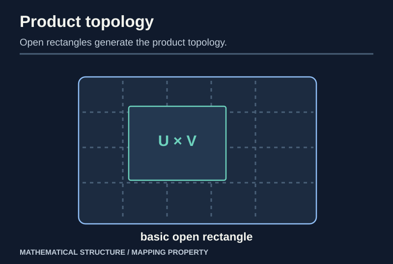
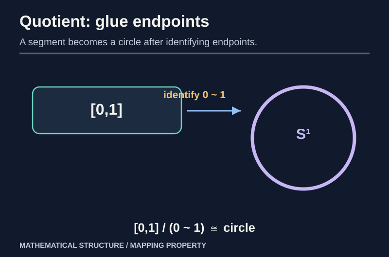

> [!abstract] Prerequisites & where this leads
> **Builds on:** [General Topology Foundations](./general-topology-foundations) (open sets and continuity). **Optional deeper viewpoint:** [Limits and Colimits](./category-limits-colimits) (universal properties). Follow the [Path Through Topology](./path-to-topology) for a concrete route.
> **Leads to:** [Compactness, Connectedness and Separation](./general-topology-compactness) and applications in [Algebraic Geometry](./algebraic-geometry).

Three familiar questions generate three canonical topologies. What should count as open in a **subset**? In a **product**? In a **quotient** where certain points are identified? Each answer is chosen so the relevant maps are continuous in precisely the desired way. You can understand and prove these facts using only sets, inverse images, and the definition of continuity. **Category theory is not required.**

> [!distinction] What a universal property means here
> When a construction has a "universal property," this chapter means a **concrete if-and-only-if test for continuity** of maps into or out of the new space. We prove each test directly. If you later study [category theory](./category-limits-colimits), you can recognize these same tests as universal mapping properties.

## The subspace topology: restrict a space

> [!definition] Subspace topology
> If $A\subseteq X$ and $X$ has topology $\tau$, declare a set $U\subseteq A$ open in $A$ precisely when
>
> $$
> U=A\cap V\quad\text{for some open }V\subseteq X.
> $$

It is a topology: $A=A\cap X$, $\varnothing=A\cap\varnothing$, and intersections and unions distribute through $A\cap(-)$. The inclusion $i:A\hookrightarrow X$ is continuous because $i^{-1}(V)=A\cap V$.

> [!theorem] Universal property of the subspace topology
> For any topological space $Z$, a map $f:Z\to A$ is continuous **if and only if** $i\circ f:Z\to X$ is continuous.

**Proof.** If $f$ and $i$ are continuous, so is their composite. Conversely, assume $i\circ f$ is continuous. Every open $U\subseteq A$ has the form $A\cap V$ with $V$ open in $X$. Thus

$$
f^{-1}(U)=(i\circ f)^{-1}(V)
$$

is open in $Z$. Hence $f$ is continuous. $\square$

> [!example] Intervals inherit openness relatively
> In $A=[0,1]\subset\mathbb R$, the set $[0,\tfrac12)$ is **open in $A$**, since it equals $A\cap(-1,\tfrac12)$. It is **not open in $\mathbb R$**. Always name the ambient topology.

## The product topology: coordinate maps decide openness

For topological spaces $X,Y$, start with the set $X\times Y$. Make all rectangles $U\times V$, with $U\subseteq X$ and $V\subseteq Y$ open, a **basis**. This defines the product topology.

> [!theorem] Universal product property in Top
> A map $h:Z\to X\times Y$ is continuous exactly when both coordinate maps $p_X\circ h$ and $p_Y\circ h$ are continuous.

**Proof.** If $h$ is continuous, each projection is continuous because the preimage of an open $U\subseteq X$ under $p_X$ is $U\times Y$, a basic open rectangle. Conversely, if both coordinates are continuous, for any basic open rectangle,

$$
h^{-1}(U\times V)=(p_Xh)^{-1}(U)\cap(p_Yh)^{-1}(V),
$$

a **finite intersection** of open sets. Every open set is a union of such rectangles, and preimages respect unions, so $h$ is continuous. $\square$

*Figure: The product topology is exactly what makes coordinatewise continuity equivalent to continuity of the paired map.*

### Infinite products and the box-topology trap

For a family $(X_i)_{i\in I}$, the **product topology** has a basis of boxes $\prod_i U_i$ with $U_i=X_i$ for **all but finitely many** indices. The box topology allows arbitrary choices of open $U_i$ with no finite-support restriction.

> [!counterexample] The box topology can be strictly finer
> On $\mathbb R^{\mathbb N}$, the box $\prod_{n=1}^\infty(-1/n,1/n)$ is open in the **box topology** but not the **product topology**: a basic product-neighborhood of the zero sequence restricts only finitely many coordinates, leaving some later coordinate unrestricted, so it cannot fit inside that box.

The finite-support rule gives the universal property: a map into the product is continuous exactly when **every coordinate map** is continuous.

## Quotient topology: identify points

Let $q:X\twoheadrightarrow Q$ be a surjective set map, usually sending each point to its equivalence class.

> [!definition] Quotient topology
> Declare $U\subseteq Q$ open **if and only if** $q^{-1}(U)$ is open in $X$.

This is a topology since inverse images preserve $\varnothing$, whole sets, arbitrary unions and finite intersections. The map $q$ is continuous by construction. This is the **finest** topology on $Q$ making the given surjection continuous.

> [!theorem] Universal property of the quotient map
> A function $h:Q\to Z$ is continuous if and only if $h\circ q:X\to Z$ is continuous.

**Proof.** Forward direction: composition of continuous maps. Conversely, if $h\circ q$ is continuous, then for every open $W\subseteq Z$,

$$
q^{-1}(h^{-1}(W))=(h\circ q)^{-1}(W)
$$

is open in $X$. By definition of the quotient topology, $h^{-1}(W)$ is open in $Q$. Hence $h$ is continuous. $\square$

*Figure: The quotient of $[0,1]$ identifying its two endpoints is topologically a circle.*

### Worked construction: gluing an interval into a circle

This is the recurring example in the [Path Through Topology](./path-to-topology): subspace openness comes first, endpoint classes and quotient continuity next, and a compact–Hausdorff argument finishes the proof that the resulting space is a circle.

Let $X=[0,1]$, identify $0\sim1$ and no other distinct points, and let $Q=X/{\sim}$ with its quotient topology.

Define $p:[0,1]\to S^1$ by $p(t)=(\cos 2\pi t,\sin2\pi t)$. It is continuous, surjective, and satisfies $p(0)=p(1)$, so it factors as $\bar p:Q\to S^1$. It is a **bijection**, because points with equal angles in $[0,1]$ differ only at the endpoints.

To prove $\bar p$ is a **homeomorphism**, we need one further fact: a continuous bijection from a **compact** space to a **Hausdorff** space is a homeomorphism. We prove that theorem in the [next chapter](./general-topology-compactness). $Q$ is compact as a continuous image of $[0,1]$, and $S^1$ is Hausdorff as a subspace of $\mathbb R^2$. This finishes the claim once those theorems are established.

> [!distinction] Surjective and continuous does not automatically mean quotient
> A surjective continuous map may fail the quotient equivalence: openness of $q^{-1}(U)$ need not force openness of $U$. The quotient condition is an **additional assertion**, not mere surjectivity plus continuity.

## Disjoint unions: an open topology on each component

For spaces $X,Y$, their disjoint union $X\amalg Y$ consists of tagged elements of both spaces. A set $W$ is open when $W\cap X$ is open in $X$ and $W\cap Y$ is open in $Y$ (using the tags).

> [!theorem] Coproduct property in Top
> A map $h:X\amalg Y\to Z$ is continuous **if and only if** its restrictions to both summands are continuous.

**Proof.** An open $V\subseteq Z$ has preimage whose intersection with each summand is exactly the preimage of $V$ under the corresponding restriction. By definition of the disjoint-union topology, the whole preimage is open precisely when both intersections are open. $\square$

## Optional extension: topological pushouts and gluing interfaces

Given continuous $f:A\to X$ and $g:A\to Y$, first take the disjoint union $X\amalg Y$. Then identify $f(a)$ with $g(a)$ for every $a\in A$, using the **smallest equivalence relation** generated by those pairs. Give the quotient its quotient topology.

A continuous map from this glued space to $Z$ is equivalent to a pair of continuous maps $u:X\to Z$, $v:Y\to Z$ satisfying $u f=v g$: the disjoint-union property combines $u,v$ into one map, and the quotient property makes that map factor uniquely. This verifies the **pushout** universal property in Top.

> [!example] Gluing interval endpoints
> The circle quotient is a pushout-style identification. Other gluing constructions build surfaces, graphs and cell complexes by matching shared boundaries or attachment maps.

## A compact comparison of the four constructions

| Construction | Its governing test |
| --- | --- |
| Subspace $A\subseteq X$ | $f:Z\to A$ continuous iff inclusion $\circ f$ continuous |
| Product $\prod X_i$ | $f:Z\to\prod X_i$ continuous iff each coordinate continuous |
| Quotient $q:X\twoheadrightarrow Q$ | $h:Q\to Z$ continuous iff $hq$ continuous |
| Disjoint union $\amalg X_i$ | $h:\amalg X_i\to Z$ continuous iff each restriction continuous |

**Optional category-theory connection:** The arrow directions match [universal properties](./category-limits-colimits): products receive maps, coproducts send maps; subspaces and quotients transfer continuous mapping conditions through an inclusion or surjection. None of the earlier proofs requires this abstract interpretation.

## Dependency audit

| Result | Mechanism |
| --- | --- |
| Subspace topology | intersections with ambient opens |
| Product topology | preimages of basic rectangles |
| Infinite product | finitely supported basic boxes |
| Quotient topology | open iff full preimage open |
| Interval-to-circle quotient | universal factorization plus compact-Hausdorff theorem |
| Disjoint-union coproduct | continuity on both restrictions |
| Topological pushout | disjoint union followed by quotient |

Next: [Compactness, Connectedness and Separation](./general-topology-compactness).
