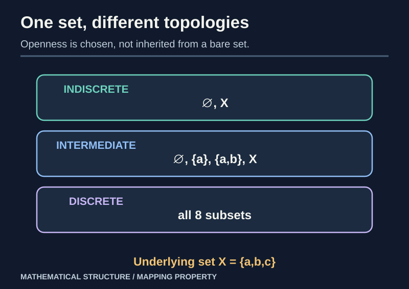
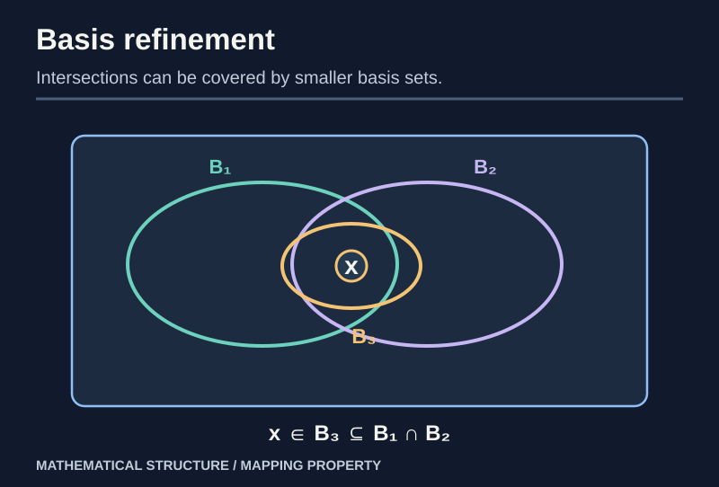
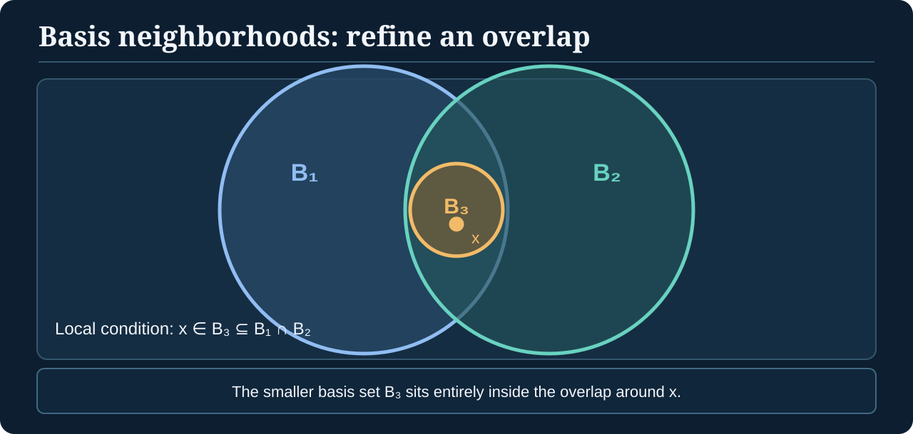
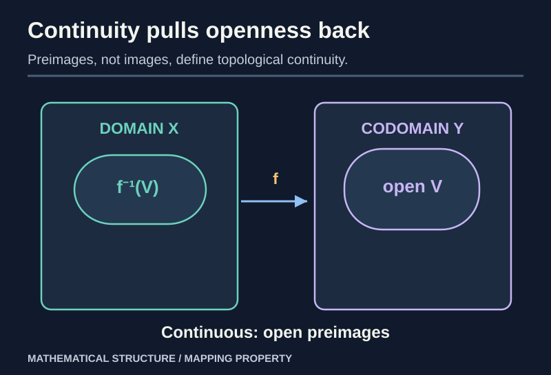

> [!abstract] Prerequisites & where this leads
> **Builds on:** [Set Theory](./set-theory) and [Functions & Relations](./functions-relations). **Recommended, not required:** [Real Analysis](./real-analysis#metric-spaces) for the metric-space route. Start with the [Path Through Topology](./path-to-topology) for either entry route.
> **Leads to:** [Topological Constructions](./general-topology-constructions) and [Compactness, Connectedness and Separation](./general-topology-compactness).

In calculus, continuity describes what happens when numbers move close together. In metric spaces, closeness comes from distance. **General topology removes distance from the definition**, keeping only the collections of open subsets that make continuity meaningful.

This makes continuity, connectedness and compactness available for function spaces, geometric quotients, and abstract mathematical structures that may have no natural metric. One especially surprising consequence is that **open sets of any space can be recognized by continuous maps to the same two-point Sierpiński space**; see the [worked proof](./atlas-of-mathematical-spaces#a-remarkable-two-point-space-open-sets-are-continuous-maps) after the definitions below. For **uniform continuity and Cauchy behavior without numerical distance**, the [uniform-spaces introduction](./atlas-of-mathematical-spaces#uniform-spaces-cauchy-behavior-without-numbers-for-distance) in the atlas explains the extra structure required.

> [!distinction] Two ways into topology
> **Metric route:** start with distance, open balls and limits in [Real Analysis](./real-analysis#metric-spaces), then show that the resulting open sets satisfy the topology axioms. **Abstract route:** start right here from sets and the three open-set axioms, without assuming any metric. Both routes lead to the same definitions. The [topology learning map](./path-to-topology) compares them.

## Open sets as the primitives

### First intuition: geometry without a coordinate grid

Imagine trying to describe a surface without first drawing an $x$–$y$ grid on it. You still want to talk about **small regions around points**, whether a function moves points continuously, and whether the space holds together. Perhaps we can keep the idea of neighborhoods while discarding coordinates, distances, and angles.

**What this gets right:** topology does let us talk about neighborhoods and continuity without choosing a Euclidean grid or assigning numerical distances. On a sphere or torus, we can study the pattern of overlapping neighborhoods without treating any one coordinate system as fundamental.

**Where the picture breaks:** a topology **does not put points onto a surface** or prescribe where they sit. We begin with a set $X$ that may consist of numbers, functions, or even three named objects. Then we **specify which subsets are open**; those choices determine the available open neighborhoods. They are not arbitrary in the sense of unrestricted: their collection must obey three rules.

**From a set to a space:** The underlying set $X$ answers "which elements exist?" A topology $\tau$ answers "which subsets of $X$ count as open?" **Together**, $(X,\tau)$ is a *topological space*. The same $X$ can support different choices of $\tau$, so the topology is extra structure, not an inherent shape or arrangement of the points. For the basic distinction, see [From Sets to Mathematical Spaces](./set-theory#from-sets-to-mathematical-spaces); for an **optional** comparison with metrics, orders, vector spaces, and other structures, consult the [Atlas of Mathematical Spaces](./atlas-of-mathematical-spaces). Neither is needed to understand the axioms below.

The formal definition says exactly which choices are permitted.

> [!definition] Topological space
> A **topology** $\tau$ on a set $X$ is a collection of subsets (called **open sets**) satisfying:
> 1. $\varnothing,X\in\tau$;
> 2. the union of **any collection** of members of $\tau$ belongs to $\tau$;
> 3. the intersection of **finitely many** members of $\tau$ belongs to $\tau$.
>
> A **topological space** is a pair $(X,\tau)$.

These conditions are axioms. They do not say what a set *looks* like in a drawing. There is no default topology on an abstract set.

*Figure: The underlying set stays fixed, but different choices of open subsets create different spaces.*

### A worked three-point example

Let $X=\{a,b,c\}$ and

$$
\tau=\{\varnothing,\{a\},\{a,b\},X\}.
$$

**Check the axioms.** Both $\varnothing$ and $X$ occur. The displayed sets are **nested**, so any union is the largest selected set (or $\varnothing$ if none is selected); it belongs to $\tau$. Any finite intersection is the smallest selected set; it too belongs to $\tau$. Therefore this is a topology.

> [!counterexample] Arbitrary union is required, not just finite union
> A proposed family closed under finite unions but not arbitrary ones may fail to be a topology. For example, on an infinite set, the collection of **finite subsets plus the whole space** is closed under finite unions, but an infinite union of finite sets may be infinite and proper, and thus not open.

### Neighborhoods: what does "around a point" mean?

> [!definition] Neighborhood and open neighborhood
> In a topological space $(X,\tau)$, a set $N\subseteq X$ is a **neighborhood of $x$** if some open set $U\in\tau$ satisfies
>
> $$
> x\in U\subseteq N.
> $$
>
> An **open neighborhood** of $x$ is simply an open set containing $x$.

A neighborhood need not itself be open: it merely needs to **contain an open set around the point**.

For the three-point topology above, $\{a,c\}$ is a **neighborhood of $a$** because it contains the open set $\{a\}$. Nevertheless $\{a,c\}$ is **not open**. The only open neighborhood of $c$ is $X$.

In the usual topology on $\mathbb R$, the closed interval $[-1,1]$ is a neighborhood of $0$ because it contains the open interval $(-1,1)$.

**What to retain:** the topology specifies what counts as locally around a point, without supplying distances or shapes.

### Discrete, indiscrete, and cofinite examples

- The **discrete topology** $\mathcal P(X)$ declares every subset open.
- The **indiscrete topology** $\{\varnothing,X\}$ declares only the empty set and whole set open.
- The **cofinite topology** makes $\varnothing$ and every set with **finite complement** open.

For cofinite topology, arbitrary unions are open because the complement of a nonempty union is an intersection of finite complements (hence finite); a finite intersection of cofinite sets is cofinite because its complement is a finite union of finite sets.

A topology $\tau_2$ is **finer** than $\tau_1$ when $\tau_1\subseteq\tau_2$: $\tau_2$ declares **at least as many** subsets open. Equivalently, $\tau_1$ is **coarser** than $\tau_2$. If the inclusion is strict, say *strictly finer* or *strictly coarser*. The underlying set remains unchanged.

## Recovering metric spaces

If $(X,d)$ is a metric space, declare $U\subseteq X$ open if every $x\in U$ has some $\varepsilon>0$ with

$$
B_\varepsilon(x)=\{y\in X:d(x,y)<\varepsilon\}\subseteq U.
$$

> [!theorem] Open metric sets form a topology
> This collection satisfies all three topology axioms.

**Proof.** $\varnothing$ is vacuously open and $X$ contains every ball about each of its points. For any union $\bigcup_i U_i$, a point belongs to some $U_j$ and therefore possesses a ball contained in $U_j$, hence in the union. For finitely many $U_1,\ldots,U_n$, pick at each common point $x$ radii $\varepsilon_i$ with $B_{\varepsilon_i}(x)\subseteq U_i$. Their **positive minimum** $\varepsilon$ yields a ball contained in every $U_i$. So the finite intersection is open. $\square$

The topology forgets numerical distances while retaining information about continuity and convergence. Different metrics can generate **the same topology**.

> [!distinction] Open relative to which space?
> A subset may be open **relative to a subspace** without being open in its ambient space. For example, $[0,1)$ is **not** open in $\mathbb R$, but it **is** open in $[0,2]$ with its subspace topology, because
>
> $$
> [0,1)=(-1,1)\cap[0,2].
> $$
>
> In general, for $A\subseteq X$, the subspace topology on $A$ consists of sets $U\cap A$ for $U$ open in $X$. See [Topological Constructions](./general-topology-constructions) for the full development.

The labels *open* and *closed* are always relative to the specified topological space, not just to the picture or whether numerical endpoints are included.

## Bases: a small collection generating all opens

> [!definition] Basis
> A collection $\mathcal B\subseteq\mathcal P(X)$ is a **basis** if:
> - every $x\in X$ lies in some $B\in\mathcal B$;
> - whenever $x\in B_1\cap B_2$ for $B_1,B_2\in\mathcal B$, some $B_3\in\mathcal B$ satisfies $x\in B_3\subseteq B_1\cap B_2$.
>
> The generated topology consists of **arbitrary unions of basis elements**.

**Why this works.** Empty and whole sets arise as the empty union and union of the covering basis. Arbitrary unions of unions are unions. For finite intersections, distribute the intersection of two unions into intersections of basis elements, and use the second basis axiom to cover each point of each intersection by another basis element. Thus the intersection is a union of basis elements and is open. This proves that the construction produces a topology.

> [!example] Rational-endpoint intervals generate the usual topology on R
> Let $\mathcal B=\{(p,q):p,q\in\mathbb Q,\ p<q\}$. It is countable, covers $\mathbb R$, and for any $x$ in the intersection of two such intervals one can find rational $p',q'$ with $x\in(p',q')$ inside that intersection. Therefore it is a basis for the usual Euclidean topology, showing that $\mathbb R$ is **second countable**.

A space is **second countable** when it has a **countable basis**. This does not mean the space itself is countable: $\mathbb R$ is uncountable but second countable.

> [!definition] Local basis (neighborhood basis)
> A **local basis at $x$** is a family $\mathcal B_x$ of open neighborhoods of $x$ such that every open neighborhood $U$ of $x$ contains at least one member $B\in\mathcal B_x$:
>
> $$
> x\in B\subseteq U.
> $$
>
> It is enough to work with these smaller basic neighborhoods when testing a property stated for **every** open neighborhood.

For example, $\{(x-1/n,x+1/n):n=1,2,\ldots\}$ is a countable local basis at $x\in\mathbb R$. A space with a countable local basis at **every** point is **first countable**; second countability implies first countability, but not conversely.

*Figure: The basis-intersection axiom says every common point has an even smaller basis neighborhood.*

*Figure: An explicit local refinement: $x\in B_3\subseteq B_1\cap B_2$. This is the overlap condition for a basis, not a claim that all overlaps are themselves single basis elements.*

## Closed sets, interiors, closures and boundaries

> [!definition] Closed set
> $F\subseteq X$ is **closed** when its complement $X\setminus F$ is open. A set can be both open and closed (**clopen**), or neither.

By De Morgan's laws, arbitrary **intersections** of closed sets are closed and finite **unions** of closed sets are closed.

The **interior** $\operatorname{int}(A)$ is the union of all open subsets of $A$; it is the largest open set contained in $A$. The **closure** $\overline A$ is the intersection of all closed supersets of $A$; it is the smallest closed set containing $A$.

> [!theorem] Neighborhood test for closure
> $x\in\overline A$ if and only if **every open neighborhood** of $x$ intersects $A$.

**Proof.** If some open $U$ contains $x$ and is disjoint from $A$, then $X\setminus U$ is a closed superset of $A$ omitting $x$; hence $x\notin\overline A$. Conversely, if $x\notin\overline A$, the open set $X\setminus\overline A$ is a neighborhood of $x$ disjoint from $A$. The two implications are contrapositives. $\square$

The **boundary** is $\partial A=\overline A\setminus\operatorname{int}(A)$: the points in the closure but not in the interior. In $\mathbb R$, for example, the boundary of $(0,1)$ is $\{0,1\}$, but boundaries in arbitrary spaces need not look like interval endpoints.

> [!definition] Limit point, isolated point, and dense subset
> A point $x$ is a **limit point** (or **accumulation point**) of $A\subseteq X$ if every open neighborhood $U$ of $x$ intersects $A\setminus\{x\}$. Unlike the closure test, this excludes the point itself.
>
> A point $x\in A$ is **isolated in $A$** if some open neighborhood $U$ of $x$ satisfies $U\cap A=\{x\}$.
>
> A subset $A$ is **dense in $X$** when $\overline A=X$, equivalently when every nonempty open subset of $X$ intersects $A$.

Every point of $\overline A$ either belongs to $A$ or is a limit point of $A$. These notions are distinct: the singleton $\{0\}\subseteq\mathbb R$ is closed, but $0$ is isolated in it; by contrast, $0$ is a limit point of $\{1/n:n=1,2,\ldots\}$ without belonging to that set.

> [!example] Rational numbers are dense in the real line
> In the usual topology of $\mathbb R$, each nonempty open interval contains a rational; thus every neighborhood of every real meets $\mathbb Q$. Hence $\overline{\mathbb Q}=\mathbb R$ while $\operatorname{int}(\mathbb Q)=\varnothing$. Dense need not mean "mostly all points."

## Continuous functions from inverse images

> [!definition] Topological continuity
> A map $f:(X,\tau_X)\to(Y,\tau_Y)$ is **continuous** if $f^{-1}(V)$ is open in $X$ for **every open** $V\subseteq Y$.

*Figure: Continuity pulls open sets backward; it does not require images of open sets to be open.*

> [!theorem] Continuous maps compose
> If $f:X\to Y$ and $g:Y\to Z$ are continuous, then $g\circ f$ is continuous.

**Proof.** For any open $W\subseteq Z$,

$$
(g\circ f)^{-1}(W)=f^{-1}(g^{-1}(W)).
$$

First $g^{-1}(W)$ is open in $Y$, then its preimage under $f$ is open in $X$. Thus the composite is continuous. The identity map is plainly continuous. These facts establish the category $\mathbf{Top}$. $\square$

> [!distinction] Continuity does not imply an open mapping
> The constant function $\mathbb R\to\mathbb R$ is continuous, but it sends a nonempty open interval to a **singleton**, which is not open in the usual real topology.

### Topological continuity agrees with metric continuity

Let $X,Y$ be metric spaces with their induced topologies. Suppose $f$ is $\varepsilon$-$\delta$ continuous at every point. For an open $V\subseteq Y$ and any $x\in f^{-1}(V)$, choose $\varepsilon$ whose ball around $f(x)$ lies in $V$, then $\delta$ forcing $d_Y(f(x'),f(x))<\varepsilon$ whenever $d_X(x',x)<\delta$. The $\delta$-ball lies in $f^{-1}(V)$, so the preimage is open.

Conversely, suppose every open preimage is open. For $x$ and $\varepsilon>0$, the set $f^{-1}(B_\varepsilon(f(x)))$ is an open neighborhood of $x$, so it contains a $\delta$-ball about $x$. This is the $\varepsilon$-$\delta$ condition. Thus the definitions agree.

> [!connection] When quotients cross disciplines
> An equivalence relation forms a set of classes, but specifying a **topological quotient** also requires a topology on those classes. See the [worked equivalence-to-kernel bridge](./cross-disciplinary-bridges#bridge-1-equivalence-classes-become-kernels-and-quotient-spaces) for the common construction and the distinct proof obligations; [Topological Constructions](./general-topology-constructions) supplies the quotient topology itself.

## Homeomorphisms and topological invariants

> [!definition] Homeomorphism
> A homeomorphism is a **bijective continuous** map whose **inverse is also continuous**. It is exactly an isomorphism in $\mathbf{Top}$.

A homeomorphism preserves openness, closedness, connectedness and compactness because those properties are defined solely through topology and continuous maps.

> [!counterexample] Continuous bijection with discontinuous inverse
> Give $X=\{0,1\}$ the **discrete** topology and $Y=\{0,1\}$ the **indiscrete** topology. The identity set-map $X\to Y$ is a continuous bijection (every preimage of an open set of $Y$ is open in $X$), but the inverse $Y\to X$ is not continuous since $\{0\}$ is open in $X$ but not in $Y$.

This is why a bijective continuous map is **not automatically** a homeomorphism.

## Convergence from neighborhoods, without a distance

> [!definition] Convergence of a sequence
> A sequence $(x_n)$ **converges to $x$** if, for every open neighborhood $U$ of $x$, there is an index $n_0$ such that
>
> $$
> n\geq n_0\quad\Longrightarrow\quad x_n\in U.
> $$
>
> In words: eventually every term stays inside any prescribed open neighborhood of the proposed limit.

In $\mathbb R$ with its usual topology this agrees with ordinary metric sequence convergence. No numerical distance is needed for the general definition.

> [!counterexample] A sequence can have more than one limit
> In our earlier three-point topology $X=\{a,b,c\}$, $\tau=\{\varnothing,\{a\},\{a,b\},X\}$, the constant sequence $x_n=a$ converges to **all three points**: every nonempty open set contains $a$. Sequence limits are unique in a **Hausdorff** space; see [Separation Axioms](./general-topology-compactness#hausdorff-separation).

In metric spaces, sequences also suffice to characterize closure. **In arbitrary topological spaces they do not**: a point may be in $\overline A$ without being the limit of any sequence from $A$. **Nets** and **filters** extend convergence to arbitrary topological spaces. A full development of those ideas is beyond this introductory chapter.

## Dependency audit

| Concept | Proof mechanism |
| --- | --- |
| Topology | arbitrary unions and finite intersections |
| Metric topology | balls and the minimum of finitely many radii |
| Basis | covering and local refinement of overlaps |
| Closure | closed supersets, equivalently neighborhood intersection |
| Continuity | inverse images of opens |
| Category Top | inverse image of a composite |
| Homeomorphism | continuity in both directions |

Next: [Subspaces, Products and Quotients](./general-topology-constructions), where topologies are **constructed by mapping requirements**.
