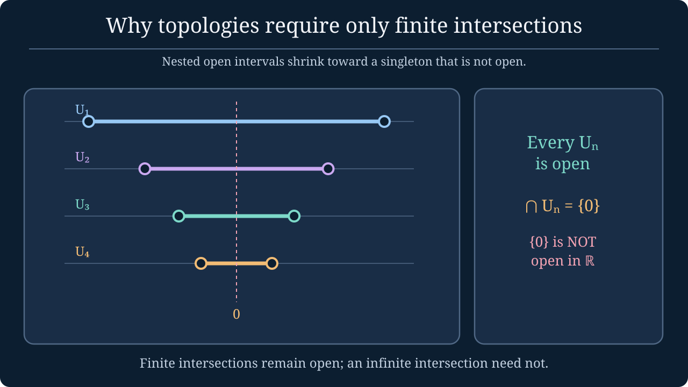
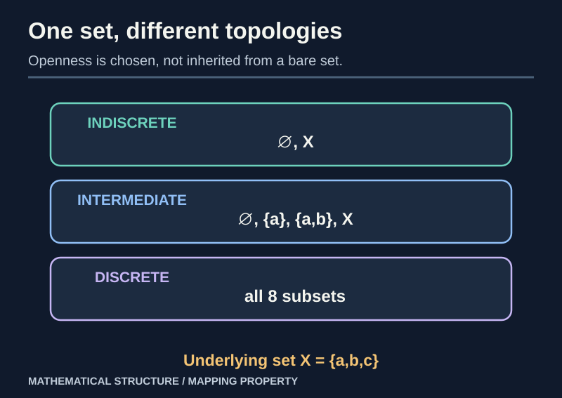
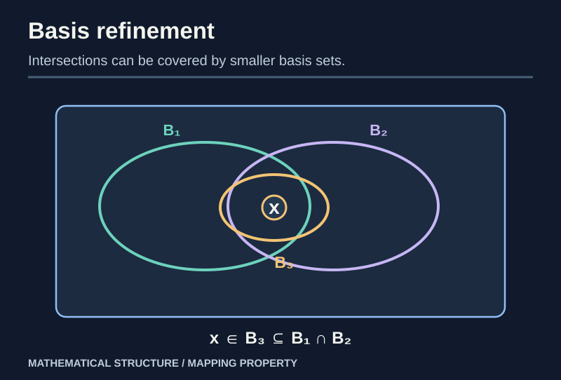
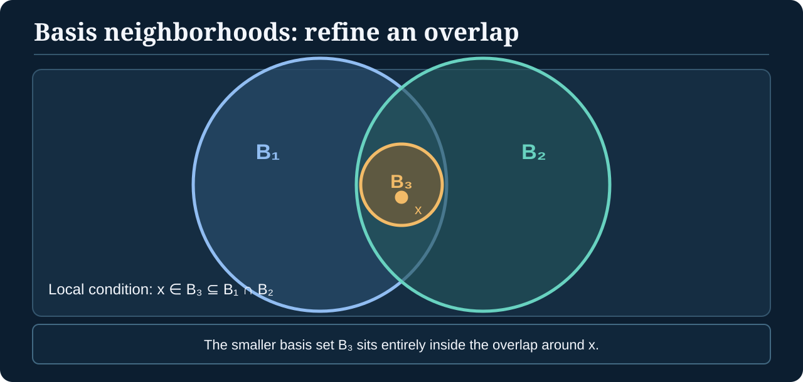
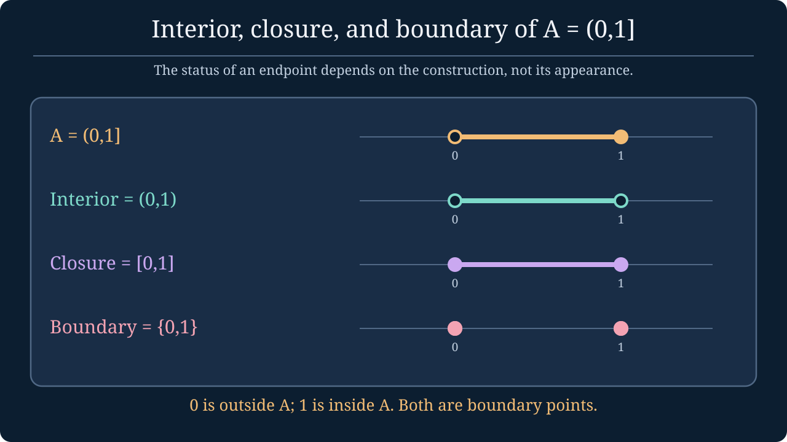
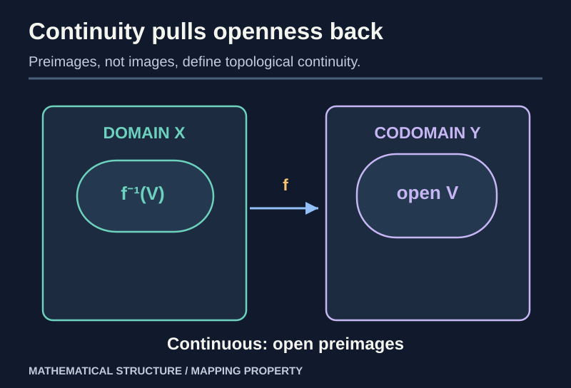
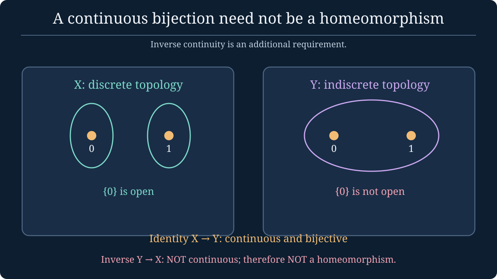
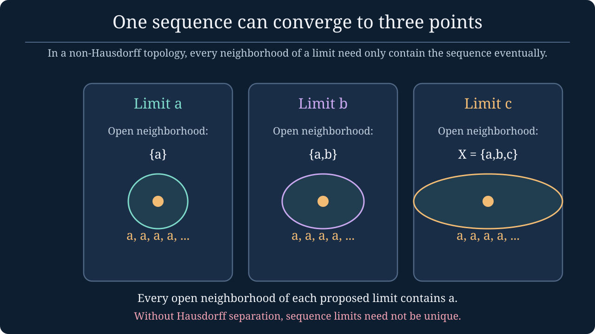

> [!abstract] Prerequisites & where this leads
> **Builds on:** [Set Theory](./set-theory) and [Functions & Relations](./functions-relations). **Recommended, not required:** [Real Analysis](./real-analysis#metric-spaces) for the metric-space route. Start with the [Path Through Topology](./path-to-topology) for either entry route.
> **Leads to:** [Topological Constructions](./general-topology-constructions) and [Compactness, Connectedness and Separation](./general-topology-compactness).

In calculus, continuity describes what happens when numbers move close together. In metric spaces, closeness comes from distance. **General topology removes distance from the definition**, keeping only the collections of open subsets that make continuity meaningful.

This makes continuity, connectedness and compactness available for function spaces, geometric quotients, and abstract mathematical structures that may have no natural metric. One especially surprising consequence is that **open sets of any space can be recognized by continuous maps to the same two-point Sierpiński space**; see the [worked proof](./atlas-of-mathematical-spaces#a-remarkable-two-point-space-open-sets-are-continuous-maps) after the definitions below. For **uniform continuity and Cauchy behavior without numerical distance**, the [uniform-spaces introduction](./atlas-of-mathematical-spaces#uniform-spaces-cauchy-behavior-without-numbers-for-distance) in the atlas explains the extra structure required.

> [!distinction] Two ways into topology
> **Metric route:** start with distance, open balls and limits in [Real Analysis](./real-analysis#metric-spaces), then show that the resulting open sets satisfy the topology axioms. **Abstract route:** start right here from sets and the three open-set axioms, without assuming any metric. Both routes lead to the same definitions. The [topology learning map](./path-to-topology) compares them.

**For review:** See the [Chapter Reference](#chapter-reference) for definitions, key concepts, and theorem statements in tables.

## Open sets as the primitives

### First intuition: geometry without a coordinate grid

Imagine trying to describe a surface without first drawing an $x$–$y$ grid on it. You still want to talk about **small regions around points**, whether a function moves points continuously, and whether the space holds together. Perhaps we can keep the idea of neighborhoods while discarding coordinates, distances, and angles.

**What this gets right:** topology does let us talk about neighborhoods and continuity without choosing a Euclidean grid or assigning numerical distances. On a sphere or torus, we can study the pattern of overlapping neighborhoods without treating any one coordinate system as fundamental.

**Where the picture breaks:** a topology **does not put points onto a surface** or prescribe where they sit. We begin with a set $X$ that may consist of numbers, functions, or even three named objects. Then we **specify which subsets are open**; those choices determine the available open neighborhoods. They are not arbitrary in the sense of unrestricted: their collection must obey three rules.

**From a set to a space:** The underlying set $X$ answers "which elements exist?" A topology $\tau$ answers "which subsets of $X$ count as open?" **Together**, $(X,\tau)$ is a *topological space*. The same $X$ can support different choices of $\tau$, so the topology is extra structure, not an inherent shape or arrangement of the points. For the basic distinction, see [From Sets to Mathematical Spaces](./set-theory#from-sets-to-mathematical-spaces); for an **optional** comparison with metrics, orders, vector spaces, and other structures, consult the [Atlas of Mathematical Spaces](./atlas-of-mathematical-spaces). Neither is needed to understand the axioms below.

### Why the open-set rules have this shape

Before naming the axioms, consider what should happen when we combine regions we already regard as open. If a point lies in **any one** of several open regions, their union should still describe an open region. If a point lies in **both** of two open regions, their overlap should still leave an open region around that point.

There is an important asymmetry: combining **any number** of open regions by union is safe, but combining **infinitely many** by intersection need not be. The rules keep precisely the combinations that preserve openness. They also include the empty set and the entire space as the simplest cases.

### The formal definition

> [!definition] Topological space
> A **topology** $\tau$ on a set $X$ is a collection of subsets (called **open sets**) satisfying:
> 1. $\varnothing,X\in\tau$;
> 2. the union of **any collection** of members of $\tau$ belongs to $\tau$;
> 3. the intersection of **finitely many** members of $\tau$ belongs to $\tau$.
>
> A **topological space** is a pair $(X,\tau)$.

Read the notation carefully: $U\in\tau$ means **the subset $U$ is one of the sets declared open**. It does not mean that $U$ is a point of $X$. The symbol $\tau$ names a *collection of subsets of $X$*. The first rule includes $\varnothing$ and $X$; the second allows unions of any size, including infinitely many; the third guarantees intersections of finitely many open sets. An empty intersection is understood to be $X$.

**Why not require arbitrary intersections?** On the real number line with its familiar open intervals, let

$$
U_n:=\left(-\frac1n,\frac1n\right),\qquad n=1,2,\ldots.
$$

*Figure: Every interval $U_n$ is open, and each finite intersection is an open interval. Their intersection over all positive integers is the non-open singleton $\{0\}$.*

Every $U_n$ is open. Yet

$$
\bigcap_{n=1}^{\infty} U_n=\{0\}.
$$

Only $0$ remains in **every** interval: any nonzero number eventually lies outside one of them. But $\{0\}$ is **not open** in the usual topology on $\mathbb R$, since no open interval around $0$ fits inside the singleton. Finite intersections preserve openness; an infinite intersection may squeeze an open region down to a non-open set. The metric-space section below formalizes why intervals are open.

These conditions are axioms. They do not say what a set *looks* like in a drawing. There is no default topology on an abstract set.

*Figure: The underlying set stays fixed, but different choices of open subsets create different spaces.*

### A worked three-point example

Let $X:=\{a,b,c\}$ and

$$
\tau:=\{\varnothing,\{a\},\{a,b\},X\}.
$$

**Check the axioms.** Both $\varnothing$ and $X$ occur. The displayed sets are **nested**, so any union is the largest selected set (or $\varnothing$ if none is selected); it belongs to $\tau$. Any finite intersection is the smallest selected set; it too belongs to $\tau$. Therefore this is a topology.

This example also shows what a topology **does not** do. The set $\{b\}$ is a **subset** of $X$ but **not a member** of $\tau$, so it is **not open** in this space. A topology declares certain subsets open; it does not declare every subset open automatically.

> [!counterexample] Arbitrary union is required, not just finite union
> A proposed family closed under **finite** unions may still fail the second axiom. Take $X=\mathbb N$ and declare just the **finite subsets plus $X$** open. Finite unions stay in the family. But the union of the singleton sets $\{2\},\{4\},\{6\},\ldots$ is the set of all positive even numbers: it is infinite and is not all of $\mathbb N$. That union is missing from the proposed family, so this is **not** a topology.

### Neighborhoods: what does "around a point" mean?

In the three-point example, the topology tells us which sets are open, but we also need a way to say that a (possibly larger) set **contains some open room around a particular point**. That is the purpose of a neighborhood: it must contain an open set that contains the point. The neighborhood itself need not be open.

> [!definition] Neighborhood and open neighborhood
> In a topological space $(X,\tau)$, a set $N\subseteq X$ is a **neighborhood of $x$** if some open set $U\in\tau$ satisfies
>
> $$
> x\in U\subseteq N.
> $$
>
> An **open neighborhood** of $x$ is simply an open set containing $x$.

A neighborhood need not itself be open: it merely needs to **contain an open set around the point**.

For the three-point topology above, $\{a,c\}$ is a **neighborhood of $a$** because it contains the open set $\{a\}$. Nevertheless $\{a,c\}$ is **not open**. The only open neighborhood of $c$ is $X$.

In the usual topology on $\mathbb R$, the closed interval $[-1,1]$ is a neighborhood of $0$ because it contains the open interval $(-1,1)$.

**What to retain:** the topology specifies what counts as locally around a point, without supplying distances or shapes.

### Discrete, indiscrete, and cofinite examples

- The **discrete topology** $\mathcal P(X)$ declares every subset open.
- The **indiscrete topology** $\{\varnothing,X\}$ declares only the empty set and whole set open.
- The **cofinite topology** makes $\varnothing$ and every set with **finite complement** open.

For cofinite topology, arbitrary unions are open because the complement of a nonempty union is an intersection of finite complements (hence finite); a finite intersection of cofinite sets is cofinite because its complement is a finite union of finite sets.

A topology $\tau_2$ is **finer** than $\tau_1$ when $\tau_1\subseteq\tau_2$: $\tau_2$ declares **at least as many** subsets open. Equivalently, $\tau_1$ is **coarser** than $\tau_2$. If the inclusion is strict, say *strictly finer* or *strictly coarser*. The underlying set remains unchanged.

## Recovering metric spaces

This section is the **optional metric route**. If you are learning topology directly from sets, you can continue to [Bases](#bases-a-small-collection-generating-all-opens) and return here later.

A **metric space** $(X,d)$ is a set $X$ equipped with a distance function $d$. The number $d(x,y)$ measures the distance between points $x$ and $y$. A metric is nonnegative, equals zero exactly when $x=y$, is symmetric, and obeys the triangle inequality. Unlike abstract topology, it gives a numerical way to say that points are close.

For a point $x$ and a **positive radius** $\varepsilon$, its *open ball* is the set of points whose distance from $x$ is **strictly less** than $\varepsilon$. On the ordinary real line this is the interval $(x-\varepsilon,x+\varepsilon)$.

We now declare a subset open when **every one of its points has some entire ball inside that subset**. This means no point of the subset is forced right up against its outside edge:

$$
B_\varepsilon(x):=\{y\in X:d(x,y)<\varepsilon\}\subseteq U
\qquad\text{for some }\varepsilon>0\text{ for each }x\in U.
$$

Here $B_\varepsilon(x)$ names the ball, $y$ ranges over points of $X$, and $\varepsilon$ is permitted to depend on $x$. A set can be open without there being **one fixed radius** that works at every point.

> [!theorem] Open metric sets form a topology
> This collection satisfies all three topology axioms.

**Proof.** $\varnothing$ is vacuously open and $X$ contains every ball about each of its points. For any union $\bigcup_i U_i$, a point belongs to some $U_j$ and therefore possesses a ball contained in $U_j$, hence in the union. For finitely many $U_1,\ldots,U_n$, pick at each common point $x$ radii $\varepsilon_i$ with $B_{\varepsilon_i}(x)\subseteq U_i$. Their **positive minimum** $\varepsilon$ yields a ball contained in every $U_i$. So the finite intersection is open. $\square$

The topology forgets numerical distances while retaining information about continuity and convergence. Different metrics can generate **the same topology**.

> [!distinction] Open relative to which space?
> A subset may be open **relative to a subspace** without being open in its ambient space. For example, $[0,1)$ is **not** open in $\mathbb R$, but it **is** open in $[0,2]$ with its subspace topology, because
>
> $$
> [0,1)=(-1,1)\cap[0,2].
> $$
>
> In general, for $A\subseteq X$, the subspace topology on $A$ consists of sets $U\cap A$ for $U$ open in $X$. See [Topological Constructions](./general-topology-constructions) for the full development.

The labels *open* and *closed* are always relative to the specified topological space, not just to the picture or whether numerical endpoints are included.

## Bases: a small collection generating all opens

A topology can contain an enormous number of open sets. Rather than listing them all, we would like a smaller collection of **building blocks** from which every open set can be made by taking unions. That collection is a *basis*.

Think of the usual real line: open intervals $(a,b)$ serve as building blocks. Any open set can be assembled from such intervals. But we must also make sure overlapping building blocks behave properly. If two intervals both contain a point $x$, we can fit a **smaller interval around $x$ inside their overlap**. This guarantees that intersections of the sets we build are still made from the same kinds of blocks.

These two ideas—**cover every point** and **refine every overlap locally**—are precisely the basis conditions:

> [!definition] Basis
> A collection $\mathcal B\subseteq\mathcal P(X)$ is a **basis** if:
> - every $x\in X$ lies in some $B\in\mathcal B$;
> - whenever $x\in B_1\cap B_2$ for $B_1,B_2\in\mathcal B$, some $B_3\in\mathcal B$ satisfies $x\in B_3\subseteq B_1\cap B_2$.
>
> The generated topology consists of **arbitrary unions of basis elements**.

**Why this works.** Empty and whole sets arise as the empty union and union of the covering basis. Arbitrary unions of unions are unions. For finite intersections, distribute the intersection of two unions into intersections of basis elements, and use the second basis axiom to cover each point of each intersection by another basis element. Thus the intersection is a union of basis elements and is open. This proves that the construction produces a topology.

**Return to the three-point space.** For $X=\{a,b,c\}$, take $\mathcal B=\{\{a\},\{a,b\},X\}$. These sets cover $X$, and because they are nested, the overlap of any two is itself one of the listed sets. Their possible unions (including the empty union) are exactly

$$
\{\varnothing,\{a\},\{a,b\},X\}=\tau.
$$

So the basis rules are not merely symbolic: they let us **generate** the topology already checked above. On the real line, choosing open intervals as basis elements accomplishes the same thing on a much larger scale.

> [!example] Rational-endpoint intervals generate the usual topology on R
> Let $\mathcal B=\{(p,q):p,q\in\mathbb Q,\ p<q\}$. It is countable, covers $\mathbb R$, and for any $x$ in the intersection of two such intervals one can find rational $p',q'$ with $x\in(p',q')$ inside that intersection. Therefore it is a basis for the usual Euclidean topology, showing that $\mathbb R$ is **second countable**.

A space is **second countable** when it has a **countable basis**. This does not mean the space itself is countable: $\mathbb R$ is uncountable but second countable.

A **basis for the whole space** must help build open sets everywhere. Sometimes we care only about neighborhoods of **one particular point** $x$. Then a *local basis* records progressively small open neighborhoods of that point. To check a condition involving *every* open neighborhood of $x$, it is enough to check these smaller representatives.

> [!definition] Local basis (neighborhood basis)
> A **local basis at $x$** is a family $\mathcal B_x$ of open neighborhoods of $x$ such that every open neighborhood $U$ of $x$ contains at least one member $B\in\mathcal B_x$:
>
> $$
> x\in B\subseteq U.
> $$
>
> It is enough to work with these smaller basic neighborhoods when testing a property stated for **every** open neighborhood.

For example, $\{(x-1/n,x+1/n):n=1,2,\ldots\}$ is a countable local basis at $x\in\mathbb R$. A space with a countable local basis at **every** point is **first countable**; second countability implies first countability, but not conversely.

*Figure: The basis-intersection axiom says every common point has an even smaller basis neighborhood.*

*Figure: An explicit local refinement: $x\in B_3\subseteq B_1\cap B_2$. This is the overlap condition for a basis, not a claim that all overlaps are themselves single basis elements.*

## Closed sets, interiors, closures and boundaries

Once we know which sets are open, we can study a subset $A$ from several directions: which points are safely **inside** it, which points it comes **arbitrarily close** to, and which points lie on its **edge**. These lead to *interior*, *closure*, and *boundary*. First, a set is called closed when everything **outside** it forms an open set; the word does not simply mean "contains its endpoints" in every topological space.

> [!definition] Closed set
> $F\subseteq X$ is **closed** when its complement $X\setminus F$ is open. A set can be both open and closed (**clopen**), or neither.

By De Morgan's laws, arbitrary **intersections** of closed sets are closed and finite **unions** of closed sets are closed.

The **interior** $\operatorname{int}(A)$ is the union of all open subsets of $A$; it is the largest open set contained in $A$. The **closure** $\overline A$ is the intersection of all closed supersets of $A$; it is the smallest closed set containing $A$.

*Figure: The interior excludes both endpoints, the closure includes both, and the boundary consists of the endpoints—even though only one endpoint is in the original set.*

**One running example.** In $\mathbb R$ with its usual topology, take $A=(0,1]$. Its interior is $(0,1)$: around each point strictly between $0$ and $1$ there is an open interval inside $A$, but no such interval around $1$. Its closure is $[0,1]$: every open interval around $0$ meets $A$, even though $0\notin A$. Meanwhile a point like $2$ has an open interval that misses $A$ entirely, so it does not belong to the closure.

This suggests a practical alternative to taking an intersection of *all* closed supersets: **a point is in the closure exactly when no open neighborhood can avoid the set**. The following theorem makes that precise.

> [!theorem] Neighborhood test for closure
> $x\in\overline A$ if and only if **every open neighborhood** of $x$ intersects $A$.

**Proof.** If some open $U$ contains $x$ and is disjoint from $A$, then $X\setminus U$ is a closed superset of $A$ omitting $x$; hence $x\notin\overline A$. Conversely, if $x\notin\overline A$, the open set $X\setminus\overline A$ is a neighborhood of $x$ disjoint from $A$. The two implications are contrapositives. $\square$

The **boundary** is $\partial A=\overline A\setminus\operatorname{int}(A)$: the points in the closure but not in the interior. In our running example $A=(0,1]$,

$$
\operatorname{int}(A)=(0,1),\qquad
\overline A=[0,1],\qquad
\partial A=\{0,1\}.
$$

Notice the important distinction: **$0$ is outside $A$ and $1$ is inside $A$, yet both are boundary points.** A boundary point need not belong to the set. In arbitrary topological spaces, boundaries need not look like interval endpoints at all.

Being in the closure is **not** the same as being approached by *other* points of the set. An isolated member of $A$ belongs to $\overline A$ simply because it is in $A$; that does not make it a limit point. The distinction is whether we allow a neighborhood to meet $A$ **only at the point itself**.

> [!definition] Limit point, isolated point, and dense subset
> A point $x$ is a **limit point** (or **accumulation point**) of $A\subseteq X$ if every open neighborhood $U$ of $x$ intersects $A\setminus\{x\}$. Unlike the closure test, this excludes the point itself.
>
> A point $x\in A$ is **isolated in $A$** if some open neighborhood $U$ of $x$ satisfies $U\cap A=\{x\}$.
>
> A subset $A$ is **dense in $X$** when $\overline A=X$, equivalently when every nonempty open subset of $X$ intersects $A$.

Every point of $\overline A$ either belongs to $A$ or is a limit point of $A$. These notions are distinct: the singleton $\{0\}\subseteq\mathbb R$ is closed, but $0$ is isolated in it; by contrast, $0$ is a limit point of $\{1/n:n=1,2,\ldots\}$ without belonging to that set.

> [!example] Rational numbers are dense in the real line
> In the usual topology of $\mathbb R$, each nonempty open interval contains a rational; thus every neighborhood of every real meets $\mathbb Q$. Hence $\overline{\mathbb Q}=\mathbb R$ while $\operatorname{int}(\mathbb Q)=\varnothing$. Dense need not mean "mostly all points."

## Continuous functions from inverse images

In calculus, continuity says that sufficiently small changes in the input cannot cause an abrupt change in output. In a topological space we may have **no numerical distance** with which to express "small." Instead we ask a structural question: whenever we designate an **open region of allowed outputs**, do the inputs that land in that region also form an open set?

The inputs corresponding to an output set $V\subseteq Y$ form its **inverse image** (or *preimage*):

$$
f^{-1}(V):=\{x\in X:f(x)\in V\}.
$$

This is a **set of inputs**, not necessarily the value of an inverse function. It makes sense even when $f$ has no inverse. For example, if $f:\mathbb R\to\mathbb R$ sends $x$ to $x^2$ and we choose the open output interval $V=(1,4)$, then

$$
f^{-1}((1,4))=(-2,-1)\cup(1,2).
$$

The set of inputs is open as well. This is **one instance** of the test; continuity requires it for **every** open set of outputs. Pulling open regions **backward** is the right operation; sending an open region forward need not yield an open region.

> [!definition] Topological continuity
> A map $f:(X,\tau_X)\to(Y,\tau_Y)$ is **continuous** if $f^{-1}(V)$ is open in $X$ for **every open** $V\subseteq Y$.

*Figure: Continuity pulls open sets backward; it does not require images of open sets to be open.*

> [!theorem] Continuous maps compose
> If $f:X\to Y$ and $g:Y\to Z$ are continuous, then $g\circ f$ is continuous.

**Proof.** For any open $W\subseteq Z$,

$$
(g\circ f)^{-1}(W)=f^{-1}(g^{-1}(W)).
$$

First $g^{-1}(W)$ is open in $Y$, then its preimage under $f$ is open in $X$. Thus the composite is continuous. The identity map is plainly continuous. $\square$

**Optional language from category theory:** topological spaces as objects and continuous maps as arrows form a category called $\mathbf{Top}$. Nothing later in this chapter requires category theory.

> [!distinction] Continuity does not imply an open mapping
> The constant function $\mathbb R\to\mathbb R$ is continuous, but it sends a nonempty open interval to a **singleton**, which is not open in the usual real topology.

### Topological continuity agrees with metric continuity

Let $X,Y$ be metric spaces with their induced topologies. Suppose $f$ is $\varepsilon$-$\delta$ continuous at every point. For an open $V\subseteq Y$ and any $x\in f^{-1}(V)$, choose $\varepsilon$ whose ball around $f(x)$ lies in $V$, then $\delta$ forcing $d_Y(f(x'),f(x))<\varepsilon$ whenever $d_X(x',x)<\delta$. The $\delta$-ball lies in $f^{-1}(V)$, so the preimage is open.

Conversely, suppose every open preimage is open. For $x$ and $\varepsilon>0$, the set $f^{-1}(B_\varepsilon(f(x)))$ is an open neighborhood of $x$, so it contains a $\delta$-ball about $x$. This is the $\varepsilon$-$\delta$ condition. Thus the definitions agree.

> [!bridge] When quotients cross disciplines
> An equivalence relation forms a set of classes, but specifying a **topological quotient** also requires a topology on those classes. See the [worked equivalence-to-kernel bridge](./cross-disciplinary-bridges#bridge-1-equivalence-classes-become-kernels-and-quotient-spaces) for the common construction and the distinct proof obligations; [Topological Constructions](./general-topology-constructions) supplies the quotient topology itself.

## Homeomorphisms and topological invariants

Two topological spaces may use different underlying sets or descriptions while having **the same open-set structure**. A *homeomorphism* is a reversible change of description that preserves continuity **in both directions**. For example, on the ordinary real line, $f(x)=x+3$ shifts every point but does not change which regions are open; its inverse $f^{-1}(y)=y-3$ is also continuous.

> [!definition] Homeomorphism
> A homeomorphism is a **bijective continuous** map whose **inverse is also continuous**. It is exactly an isomorphism in $\mathbf{Top}$.

Why insist on continuity of the inverse? A continuous bijection alone can lose information about which sets are open when we map back. A homeomorphism preserves open and closed sets in both directions, along with topological properties such as **connectedness** and **compactness** (developed in [Compactness, Connectedness and Separation](./general-topology-compactness)).

> [!counterexample] Continuous bijection with discontinuous inverse
> Give $X:=\{0,1\}$ the **discrete** topology and $Y:=\{0,1\}$ the **indiscrete** topology. The identity set-map $X\to Y$ is a continuous bijection (every preimage of an open set of $Y$ is open in $X$), but the inverse $Y\to X$ is not continuous since $\{0\}$ is open in $X$ but not in $Y$.

*Figure: Both spaces contain the same points, but differ in which subsets are open. The identity $X\to Y$ is continuous and bijective; its inverse is not continuous.*

This is why a bijective continuous map is **not automatically** a homeomorphism.

## Convergence from neighborhoods, without a distance

On the real line, the sequence $1,\frac12,\frac13,\ldots$ gets closer to $0$. What part of that statement survives if a space has **no distance function**? We can still say: choose **any open neighborhood of $0$**; from some point onward, **every term** of the sequence lies inside it. This captures the idea of eventually staying as close as the topology allows.

The same rule works for any proposed limit $x$ in any topological space. The index $n_0$ marks when the sequence has entered the chosen neighborhood for good; it may be different for different neighborhoods.

> [!definition] Convergence of a sequence
> A sequence $(x_n)$ **converges to $x$** if, for every open neighborhood $U$ of $x$, there is an index $n_0$ such that
>
> $$
> n\geq n_0\quad\Longrightarrow\quad x_n\in U.
> $$
>
> In words: eventually every term stays inside any prescribed open neighborhood of the proposed limit.

**Check the real-line example.** Given any $\varepsilon>0$, all terms $x_n=1/n$ with $n>1/\varepsilon$ lie in the open interval $(-\varepsilon,\varepsilon)$ around $0$. Every open neighborhood of $0$ contains some such interval, so the sequence converges to $0$ by the topological definition.

In $\mathbb R$ with its usual topology this agrees with ordinary metric sequence convergence. No numerical distance is needed for the general definition.

> [!counterexample] A sequence can have more than one limit
> In our earlier three-point topology $X=\{a,b,c\}$, $\tau=\{\varnothing,\{a\},\{a,b\},X\}$, the constant sequence $x_n=a$ converges to **all three points**: every nonempty open set contains $a$. Sequence limits are unique in a **Hausdorff** space; see [Separation Axioms](./general-topology-compactness#hausdorff-separation).

*Figure: In the three-point topology $\tau=\{\varnothing,\{a\},\{a,b\},X\}$, the constant sequence $a,a,a,\ldots$ converges to $a$, $b$, and $c$. Hausdorffness is what guarantees uniqueness of limits.*

In metric spaces, sequences also suffice to characterize closure. **In arbitrary topological spaces they do not**: a point may be in $\overline A$ without being the limit of any sequence from $A$. **Nets** and **filters** extend convergence to arbitrary topological spaces. A full development of those ideas is beyond this introductory chapter.

## Dependency audit

| Concept | Proof mechanism |
| --- | --- |
| Topology | arbitrary unions and finite intersections |
| Metric topology | balls and the minimum of finitely many radii |
| Basis | covering and local refinement of overlaps |
| Closure | closed supersets, equivalently neighborhood intersection |
| Continuity | inverse images of opens |
| Category Top | inverse image of a composite |
| Homeomorphism | continuity in both directions |

Next: [Subspaces, Products and Quotients](./general-topology-constructions), where topologies are **constructed by mapping requirements**.

---

## Chapter Reference

A quick reference to the chapter's definitions and results, with links to their original treatment. This table does not replace the full explanations, hypotheses, diagrams, or proofs.

### Definitions

| Definition | Statement / meaning |
| :--- | :--- |
| **[Topological space](#the-formal-definition)** | A topology $\tau$ on a set $X$ is a collection of subsets (called open sets) satisfying: 1. $\varnothing,X\in\tau$; 2. the union of any collection of members of $\tau$ belongs to $\tau$; |
| **[Neighborhood and open neighborhood](#neighborhoods-what-does-around-a-point-mean)** | In a topological space $(X,\tau)$, a set $N\subseteq X$ is a neighborhood of $x$ if some open set $U\in\tau$ satisfies An open neighborhood of $x$ is simply an open set containing $x$. |
| **[Basis](#bases-a-small-collection-generating-all-opens)** | A collection $\mathcal B\subseteq\mathcal P(X)$ is a basis if: every $x\in X$ lies in some $B\in\mathcal B$; whenever $x\in B_1\cap B_2$ for $B_1,B_2\in\mathcal B$, some $B_3\in\mathcal B$ satisfies $x\in B_3\subseteq B_1\cap B_2$. |
| **[Local basis (neighborhood basis)](#bases-a-small-collection-generating-all-opens)** | A local basis at $x$ is a family $\mathcal B_x$ of open neighborhoods of $x$ such that every open neighborhood $U$ of $x$ contains at least one member $B\in\mathcal B_x$: It is enough to work with these smaller basic neighborhoods when testing a property stated for every open neighborhood. |
| **[Closed set](#closed-sets-interiors-closures-and-boundaries)** | $F\subseteq X$ is closed when its complement $X\setminus F$ is open. A set can be both open and closed (clopen), or neither. |
| **[Limit point, isolated point, and dense subset](#closed-sets-interiors-closures-and-boundaries)** | A point $x$ is a limit point (or accumulation point) of $A\subseteq X$ if every open neighborhood $U$ of $x$ intersects $A\setminus\{x\}$. Unlike the closure test, this excludes the point itself. A point $x\in A$ is isolated in $A$ if some open neighborhood $U$ of $x$ satisfies $U\cap A=\{x\}$. |
| **[Topological continuity](#continuous-functions-from-inverse-images)** | A map $f:(X,\tau_X)\to(Y,\tau_Y)$ is continuous if $f^{-1}(V)$ is open in $X$ for every open $V\subseteq Y$. |
| **[Homeomorphism](#homeomorphisms-and-topological-invariants)** | A homeomorphism is a bijective continuous map whose inverse is also continuous. It is exactly an isomorphism in $\mathbf{Top}$. |
| **[Convergence of a sequence](#convergence-from-neighborhoods-without-a-distance)** | A sequence $(x_n)$ converges to $x$ if, for every open neighborhood $U$ of $x$, there is an index $n_0$ such that In words: eventually every term stays inside any prescribed open neighborhood of the proposed limit. |

### Key Concepts

| Concept | Statement / meaning |
| :--- | :--- |
| **[Open sets as the primitives](#open-sets-as-the-primitives)** | See this section for the underlying idea, notation, and worked examples. |
| **[The formal definition](#the-formal-definition)** | Read the notation carefully: $U\in\tau$ means the subset $U$ is one of the sets declared open. It does not mean that $U$ is a point of $X$. The symbol $\tau$ names a *collection of subsets of $X$*. |
| **[Neighborhoods: what does "around a point" mean?](#neighborhoods-what-does-around-a-point-mean)** | In the three-point example, the topology tells us which sets are open, but we also need a way to say that a (possibly larger) set contains some open room around a particular point. |
| **[Discrete, indiscrete, and cofinite examples](#discrete-indiscrete-and-cofinite-examples)** | See this section for the underlying idea, notation, and worked examples. |
| **[Recovering metric spaces](#recovering-metric-spaces)** | This section is the optional metric route. If you are learning topology directly from sets, you can continue to Bases and return here later. |
| **[Bases: a small collection generating all opens](#bases-a-small-collection-generating-all-opens)** | A topology can contain an enormous number of open sets. Rather than listing them all, we would like a smaller collection of building blocks from which every open set can be made by taking unions. That collection is a *basis*. |
| **[Closed sets, interiors, closures and boundaries](#closed-sets-interiors-closures-and-boundaries)** | Once we know which sets are open, we can study a subset $A$ from several directions: which points are safely inside it, which points it comes arbitrarily close to, and which points lie on its edge. |
| **[Continuous functions from inverse images](#continuous-functions-from-inverse-images)** | In calculus, continuity says that sufficiently small changes in the input cannot cause an abrupt change in output. |
| **[Topological continuity agrees with metric continuity](#topological-continuity-agrees-with-metric-continuity)** | Let $X,Y$ be metric spaces with their induced topologies. Suppose $f$ is $\varepsilon$-$\delta$ continuous at every point. |
| **[Homeomorphisms and topological invariants](#homeomorphisms-and-topological-invariants)** | Two topological spaces may use different underlying sets or descriptions while having the same open-set structure. A *homeomorphism* is a reversible change of description that preserves continuity in both directions. |
| **[Convergence from neighborhoods, without a distance](#convergence-from-neighborhoods-without-a-distance)** | See this section for the underlying idea, notation, and worked examples. |

### Theorems and Key Results

Some results have full proofs here; others are introduced and discussed. Check the linked section for each result's assumptions.

| Theorem / result | Statement / meaning |
| :--- | :--- |
| **[Open metric sets form a topology](#recovering-metric-spaces)** | This collection satisfies all three topology axioms. |
| **[Neighborhood test for closure](#closed-sets-interiors-closures-and-boundaries)** | $x\in\overline A$ if and only if every open neighborhood of $x$ intersects $A$. |
| **[Continuous maps compose](#continuous-functions-from-inverse-images)** | If $f:X\to Y$ and $g:Y\to Z$ are continuous, then $g\circ f$ is continuous. |
