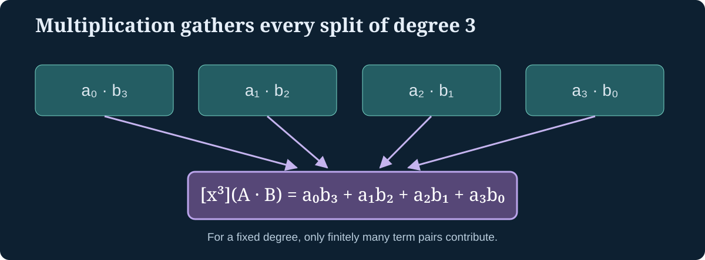

> [!abstract] Prerequisites & where this leads
> **Builds on:** [Combinatorial Reasoning](./combinatorial-reasoning), [Recurrence Relations](./sequences-and-series#recurrence-relations), and [Polynomial Functions](./polynomial-functions).
> **Leads to:** advanced enumeration, recurrence solving, combinatorics of trees, and [Advanced Graph Theory](./advanced-graph-theory).

A generating function turns an **entire sequence** into one algebraic object. Instead of keeping $a_0,a_1,a_2,\ldots$ separately, place them into the coefficients of a power series:

$$
A(x)=\sum_{n\geq0}a_nx^n=a_0+a_1x+a_2x^2+\cdots.
$$

Read "A of x equals the sum, over n from zero upward, of a sub n times x to the n." The central insight is that **algebraic operations on these series express operations on sequences**. Addition combines counts; multiplication counts ways to split an object into two parts.

## What is a formal power series?

Here $x$ is initially a **formal symbol**, not necessarily a real number at which we evaluate a convergent infinite sum. Two formal power series are equal when their corresponding coefficients agree. This distinction lets us do purely algebraic counting without first proving analytic convergence.

Write $[x^n]A(x)$ (read "the coefficient of x to the n in A of x") for the coefficient $a_n$.

For example, if $A(x)=1+3x+5x^2+7x^3+\cdots$, then

$$
[x^2]A(x)=5.
$$

When coefficients are numbers in a field such as $\mathbb Q$, formal power series form an algebraic ring. Multiplying series is well-defined because a fixed coefficient $[x^n]$ depends on only **finitely many** pairs of terms.

> [!definition] Product is convolution
> If $A(x)=\sum_{n\geq0}a_nx^n$ and $B(x)=\sum_{n\geq0}b_nx^n$, then
> $$
> [x^n](A(x)B(x))=\sum_{k=0}^na_kb_{n-k}.
> $$
> The right side is a **convolution** (read "con-vo-LOO-shun"): sum over all ways to split total size $n$ into a first size $k$ and remaining size $n-k$.

*Figure: Product coefficients sum all decompositions of a target degree. The degree-three coefficient has four contributing pairs.*

### Worked coefficient calculation

Take $A(x)=1+2x+3x^2+\cdots$ and $B(x)=1+x+x^2+\cdots$. To calculate the $x^2$ coefficient, list every pair of degrees summing to two:

$$
[x^2](AB)=a_0b_2+a_1b_1+a_2b_0
=(1)(1)+(2)(1)+(3)(1)=6.
$$

This is the algebraic version of a product-rule counting argument: select a first component and a second component, then add over every possible split of the size.

## The geometric-series identity as a formal identity

Let $G(x)=1+x+x^2+\cdots$. Multiplying formally,

$$
(1-x)G(x)=1,
$$

because every positive-degree term cancels. Hence

$$
\frac1{1-x}=\sum_{n\geq0}x^n.
$$

No analytic limit is needed. In the formal series ring, a series with nonzero constant term (such as $1-x$) has a unique multiplicative inverse.

Multiply two copies:

$$
\frac1{(1-x)^2}=\left(\sum_{i\geq0}x^i\right)
\left(\sum_{j\geq0}x^j\right).
$$

The coefficient of $x^n$ counts pairs of nonnegative integers $(i,j)$ with $i+j=n$. There are $n+1$ pairs: $(0,n),(1,n-1),\ldots,(n,0)$. Therefore

$$
\frac1{(1-x)^2}=\sum_{n\geq0}(n+1)x^n.
$$

This is a proof of a generating-function identity by **counting coefficients**.

## Worked example: making change with coins

Suppose we can use any number of one-unit coins and two-unit coins. How many combinations make total value $n$ if coin order does not matter?

Choosing $i\geq0$ one-unit coins contributes $x^i$. Choosing $j\geq0$ two-unit coins contributes $x^{2j}$. We multiply to combine independent choices:

$$
C(x)=(1+x+x^2+\cdots)(1+x^2+x^4+\cdots)
=\frac1{(1-x)(1-x^2)}.
$$

The coefficient of $x^n$ counts nonnegative solutions of $i+2j=n$. For each $j=0,1,\ldots,\lfloor n/2\rfloor$, there is **exactly one** value $i=n-2j$. Thus

$$
[x^n]C(x)=\left\lfloor\frac n2\right\rfloor+1.
$$

For $n=4$, the possibilities are $(i,j)=(4,0),(2,1),(0,2)$: **three combinations**. The generating function encodes the whole family of answers at once.

> [!distinction] Ordinary vs exponential generating functions
> We are using an **ordinary generating function** (OGF): coefficients are $a_n$. An **exponential generating function** (EGF) instead uses $a_n/n!$. EGFs are often convenient when objects carry **distinct labels**. Confusing these conventions changes the coefficient interpretation.

## Solving a recurrence using a generating function

Let $F_0=0$, $F_1=1$, and $F_n=F_{n-1}+F_{n-2}$ for $n\geq2$. Define

$$
F(x)=\sum_{n\geq0}F_nx^n.
$$

Multiply by $x$ and $x^2$:

$$
\begin{aligned}
xF(x)&=\sum_{n\geq1}F_{n-1}x^n,\\
x^2F(x)&=\sum_{n\geq2}F_{n-2}x^n.
\end{aligned}
$$

When we subtract, coefficients of $x^n$ for $n\geq2$ vanish by the recurrence. The constant coefficient is $0$, and the coefficient of $x$ is $F_1-F_0=1$. Therefore

$$
(1-x-x^2)F(x)=x,\qquad
\boxed{F(x)=\frac{x}{1-x-x^2}}.
$$

**Reading it back.** Starting with constant coefficient $F_0=0$, the equation says the coefficient of $x$ is $1$, and each later coefficient is the sum of the preceding two:

$$
F(x)=x+x^2+2x^3+3x^4+5x^5+8x^6+\cdots.
$$

The rational function is not a claim that this series converges for every real $x$. It is a formal identity that encodes precisely the recurrence and initial conditions.

## Recursive structures become functional equations

In [Combinatorial Reasoning](./combinatorial-reasoning#catalan-numbers-recursive-objects-determine-a-recurrence), the Catalan numbers obey

$$
C_0=1,\qquad C_n=\sum_{k=0}^{n-1}C_kC_{n-1-k}\quad(n\geq1).
$$

Set $C(x)=\sum_{n\geq0}C_nx^n$. The convolution identity converts the recurrence into

$$
C(x)=1+xC(x)^2.
$$

Read: "a Catalan object is either the empty object or a pair of smaller Catalan objects joined by a new outer constructor." This is the algebraic shadow of the unique decomposition $(A)B$.

Solving the quadratic equation gives two algebraic branches,

$$
C(x)=\frac{1\pm\sqrt{1-4x}}{2x}.
$$

Only the **minus** branch has a well-defined formal power-series expansion with constant coefficient one: the numerator of the plus branch has nonzero constant term, so dividing by $x$ would introduce a negative power. Thus

$$
C(x)=\frac{1-\sqrt{1-4x}}{2x}
=1+x+2x^2+5x^3+14x^4+\cdots.
$$

For the formula, $\sqrt{1-4x}$ means the unique formal series with constant term $1$ whose square is $1-4x$. The coefficients of that square root can be determined recursively.

A closed form follows:

$$
C_n=\frac1{n+1}\binom{2n}{n}.
$$

This last identity requires extracting coefficients from the square-root series (for instance by the generalized binomial theorem); the recurrence and generating-function equation are already proved without relying on that extraction.

## A short gallery of algebra-to-counting translations

| Combinatorial construction | Generating-function operation |
|---|---|
| Choose from disjoint alternative families | Add their series |
| Form an ordered pair with sizes adding | Multiply their series |
| Choose any number of copies of one size-$d$ object | Multiply by $1/(1-x^d)$ |
| Choose one of $n$ labeled binary yes/no decisions | Expand $(1+x)^n$ |
| Recursively construct an object | Solve a functional equation |

> [!example] Recover binomial coefficients
> Each of $n$ distinct elements contributes either $1$ (excluded) or $x$ (included). The product is $(1+x)^n$, and its coefficient of $x^k$ counts $k$-element subsets. Hence
> $$
> [x^k](1+x)^n=\binom nk.
> $$

## What generating functions do not automatically solve

Generating functions package recurrences but do not guarantee a simple **closed form**. Some give algebraic series, others transcendental series, and some equations are difficult even when their combinatorial meaning is clear. Analytical tools such as singularity analysis require actual convergence assumptions; formal coefficient identities alone do not justify treating a formal series as a convergent real function.

The practical method is: **define what a coefficient counts, translate how objects are constructed into series operations, then check the resulting coefficients against small examples.**
