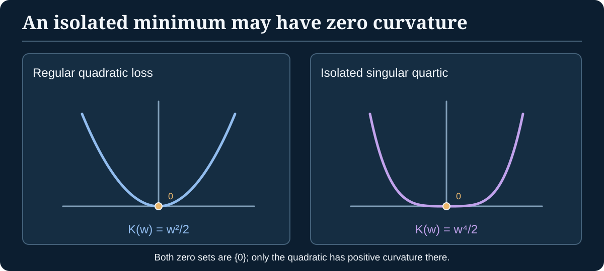

> [!abstract] Prerequisites & destination
> **Builds on:** [Probability](./probability), [KL divergence](./information-theory#kl-divergence-relative-entropy), [linear algebra](./linear-algebra-foundations) and [derivatives/Jacobians](./multivariable-calculus).
> **Leads to:** Bayesian asymptotics, [Algebraic Geometry](./algebraic-geometry), and [Singular Learning Theory](./singular-learning-theory). Read the [Path Through Analysis](./path-through-analysis) for the broader analytical bridge.

A statistical model is a family of probability distributions $p(x\mid\theta)$ indexed by parameters $\theta$. The **parameter coordinates** are not the probabilities themselves. Information geometry asks: *How much do the model's predictions change when we nudge the parameter?* KL divergence measures a discrepancy between distributions, and Fisher information captures its local quadratic behavior under precise smoothness assumptions.

## Distributions, parameters, and identifiability

A statistical model defines a map

$$
\theta\longmapsto p(\,\cdot\mid\theta)
$$

from parameter space to a space of distributions. The map is **identifiable** when different admissible parameters never give the same distribution. This is a *global* property; the existence of a nondegenerate local derivative is a different question.

For example, if $p(x\mid w)=\mathcal N(w^2,1)$, then $w$ and $-w$ always generate the same normal distribution. The model is globally nonidentifiable. Nevertheless, the derivative of the predicted mean is $2w$, nonzero for $w\neq0$: most representatives are locally distinguishable.

> [!distinction] Separate three statements
> 1. **Global identifiability:** Is the parameter-to-distribution map injective on its whole domain?
> 2. **Local nondegeneracy:** Does the Fisher information distinguish small parameter changes near a specified point?
> 3. **Zero-set geometry:** What is the shape and dimension of parameters minimizing the true loss?
>
> None of these is interchangeable with the other two without additional hypotheses.

## KL divergence: a directional discrepancy

For distributions $q$ and $p$ with suitable common dominating measure,

$$
D_{\mathrm{KL}}(q\|p)
=\int q(x)\log\frac{q(x)}{p(x)}\,dx.
$$

The integrand is integrated where $q>0$, with the usual extended-value conventions. KL is nonnegative and vanishes precisely when $p=q$ almost everywhere; it is **not** symmetric and does not satisfy the triangle inequality.

When $q=p(\cdot\mid\theta)$ and we compare a nearby distribution $p(\cdot\mid\theta+\delta)$, a smooth regular model has the local expansion

$$
D_{\mathrm{KL}}(p_\theta\|p_{\theta+\delta})
=\frac12\,\delta^\top I(\theta)\delta+o(\|\delta\|^2).
$$

This is where the **Fisher information matrix** enters. The expansion requires the familiar differentiation-under-the-integral and support-regularity assumptions; it is not automatic for every parameterized distribution family.

## Fisher information as local curvature

Define the **score** $s_\theta(x)=\nabla_\theta\log p(x\mid\theta)$ and the Fisher information

$$
I(\theta)=\mathbb E_{X\sim p_\theta}[s_\theta(X)s_\theta(X)^\top].
$$

Under regularity conditions, $\mathbb E_\theta[s_\theta]=0$ and

$$
I(\theta)=-\mathbb E_\theta[\nabla_\theta^2\log p(X\mid\theta)].
$$

> [!proof] Why expected score is zero
> Because $\int p(x\mid\theta)\,dx=1$ for every $\theta$, differentiating under the integral gives
> $$
> 0=\nabla_\theta\int p(x\mid\theta)\,dx
> =\int p(x\mid\theta)\nabla_\theta\log p(x\mid\theta)\,dx
> =\mathbb E_\theta[s_\theta].
> $$
> Differentiating this identity again and using the product rule yields the displayed Hessian identity, provided interchange of differentiation and integration is justified.

For any vector $v$,

$$
v^\top I(\theta)v
=\mathbb E_\theta[(v^\top s_\theta(X))^2]\geq0.
$$

Thus Fisher information is **positive semidefinite**, but not necessarily positive definite. A zero direction has zero score variation to first order in the given model and coordinate representation.

### Worked example: Bernoulli probability as a coordinate

Let $X\sim\operatorname{Bernoulli}(p)$ with $0<p<1$. The log likelihood of one observation $x\in\{0,1\}$ is

$$
\ell(p;x)=x\log p+(1-x)\log(1-p).
$$

Differentiating,

$$
\frac{\partial\ell}{\partial p}
=\frac{x}{p}-\frac{1-x}{1-p}
=\frac{x-p}{p(1-p)}.
$$

Because $\mathbb E[X]=p$ and $\operatorname{Var}(X)=p(1-p)$,

$$
I(p)=\mathbb E\!\left[\left(\frac{X-p}{p(1-p)}\right)^2\right]
=\frac{p(1-p)}{p^2(1-p)^2}
=\boxed{\frac1{p(1-p)}}.
$$

So near $p$, a small $\delta$ changes the distribution by approximately

$$
D_{\mathrm{KL}}(\operatorname{Bern}(p)\|\operatorname{Bern}(p+\delta))
\approx\frac{\delta^2}{2p(1-p)}.
$$

The coefficient increases near zero or one in the interior-limit sense: a fixed small absolute parameter change can have a larger KL effect near a boundary. The approximation is **local**, and $\delta$ must keep $p+\delta$ within $(0,1)$.

*Figure: Different curvature does not necessarily mean a different number of minimizers. The quartic example below has an isolated zero.*

## An explicit singular statistical model with one true parameter

Consider the model

$$
X\mid w\sim\mathcal N(w^2,1),\qquad w\in\mathbb R,
$$

and suppose the true distribution is $q=\mathcal N(0,1)$. The model's mean is $\mu(w)=w^2$.

### Step 1: calculate the KL loss exactly

Normal distributions with the **same variance one** have KL divergence $(\mu_1-\mu_2)^2/2$. Substituting gives

$$
K(w)=D_{\mathrm{KL}}(\mathcal N(0,1)\|\mathcal N(w^2,1))
=\frac{w^4}{2}.
$$

The zero set is exactly

$$
W_0=\{w:K(w)=0\}=\{0\}.
$$

This is **one isolated true parameter**, not a line or other positive-dimensional set.

### Step 2: calculate Fisher information

Ignoring the additive normalizing constant, the log likelihood is

$$
\ell(w;x)=-\frac12(x-w^2)^2+\text{constant},
$$

so the score is

$$
s_w(x)=\frac{\partial\ell}{\partial w}=2w(x-w^2).
$$

Under $X\sim\mathcal N(w^2,1)$, the variance of $X-w^2$ is one. Hence

$$
I(w)=\mathbb E_w[s_w(X)^2]
=4w^2\mathbb E_w[(X-w^2)^2]
=\boxed{4w^2}.
$$

At the true parameter $w=0$, $I(0)=0$: the Fisher information is **singular**, despite $W_0$ being an **isolated point**.

### Step 3: compare the rate to a regular model

Near zero, the population-loss Laplace integral with a smooth positive prior satisfies

$$
\int e^{-nK(w)}\varphi(w)\,dw
\asymp n^{-1/4},
$$

where $\asymp$ means bounded above and below by positive constant multiples for sufficiently large $n$ (assuming integration over a neighborhood of zero and suitable prior support). Substitute $u=n^{1/4}w$ in $e^{-nw^4/2}$ to see the $n^{-1/4}$ factor. The **local RLCT is $1/4$**. For the regular mean model $X\sim\mathcal N(w,1)$, $K(w)=w^2/2$, the corresponding exponent is $1/2$.

This concrete example disproves the misconception that a **degenerate Fisher matrix forces a positive-dimensional zero set**. It also demonstrates that local asymptotic complexity is controlled by **the order of vanishing**, not solely the dimension of the zero set.

## Coordinates change; information geometry should not

If $\theta=\theta(\eta)$ is a smooth invertible reparameterization with Jacobian $J=\partial\theta/\partial\eta$, then the score transforms by the chain rule, $s_\eta=J^\top s_\theta$, and therefore

$$
I_\eta=J^\top I_\theta J.
$$

This is a **metric tensor transformation law**, not an ordinary scalar equality. Where Fisher information is positive definite, it defines a local Riemannian metric on the model's smooth parameter manifold (or on an identifiable local quotient).

An ordinary gradient depends on coordinates. A **natural gradient** adjusts by local Fisher geometry:

$$
\widetilde\nabla_\theta L=I(\theta)^{-1}\nabla_\theta L,
$$

when $I$ is invertible. It transforms appropriately under smooth coordinate changes. At a singular point such as $w=0$ above, the inverse does not exist; using a pseudoinverse or damping creates an **additional modeling choice**, not a theorem that all singularities disappear.

### Quantum geometry as a nearby, but different, application

The [Mathematical Foundations of Quantum Mechanics](./mathematical-foundations-of-quantum-mechanics#10-quantum-states-as-an-optimization-problem) chapter develops another way to make gradient updates geometry-aware. **Classical natural gradient** uses the Fisher metric of a parameterized probability model. **Quantum natural gradient** can use the Fubini–Study metric, induced by the quantum geometric tensor on a family of pure quantum states.

The mathematical pattern is similar: instead of treating each parameter coordinate as equally meaningful, use a metric that reflects changes in the **represented object**. But a measurement-dependent classical Fisher matrix and the intrinsic quantum-state metric are not automatically equal. Their relationship requires specifying the quantum state family, measurement model, and metric convention. This is a conceptual bridge, **not** a claim that classical machine-learning training requires quantum mechanics.

## Cramér–Rao and the meaning of information

In a regular scalar parameter family, for an unbiased estimator $\hat\theta$ from $n$ i.i.d. observations under appropriate differentiability and variance conditions, the **Cramér–Rao inequality** is

$$
\operatorname{Var}_\theta(\hat\theta)\geq\frac1{nI(\theta)}.
$$

One derivation applies Cauchy–Schwarz to the estimator and total score, using the identity $\operatorname{Cov}(\hat\theta,S_n)=1$ under the interchange assumptions and $\operatorname{Var}(S_n)=nI(\theta)$. This proof **requires** $I(\theta)>0$ and an unbiasedness/regularity condition; the expression $1/(nI(0))$ cannot simply be used when $I(0)=0$.

## Connection to singular learning theory

[Fisher information](./information-geometry#fisher-information-as-local-curvature) describes a local second-order approximation when the model is regular. The **real log canonical threshold** in [Algebraic Geometry](./algebraic-geometry#the-real-log-canonical-threshold-rlct) captures a different asymptotic invariant of a vanishing contrast, including higher-order behavior such as $w^4$. The [SLT capstone](./singular-learning-theory) combines this geometric information with Bayesian integrals under explicit assumptions.

This chapter proves the score and Fisher calculations and constructs a concrete isolated singular model. The full information-geometric theory of dual affine connections, exponential families as manifolds, and nonregular statistical asymptotics remains beyond this introductory bridge.
