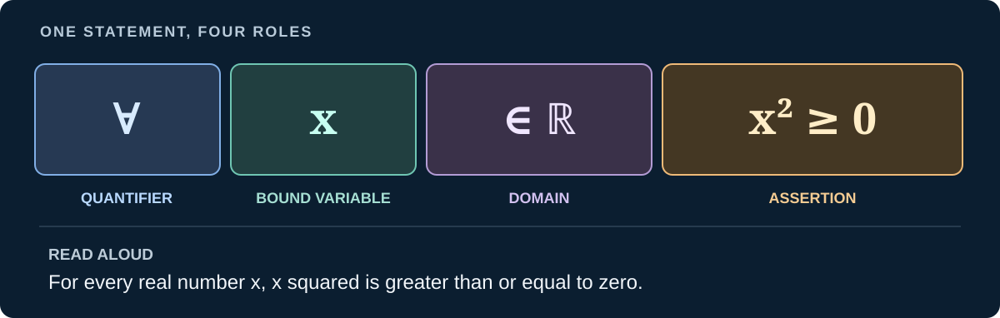
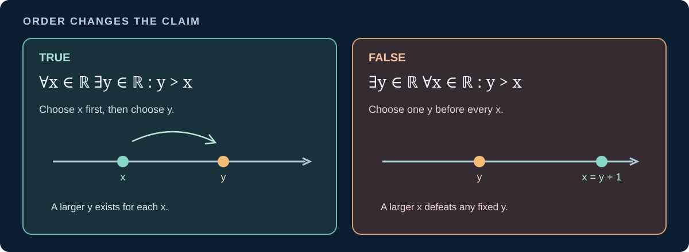

> [!abstract] Prerequisites & where this leads <!-- slt-nav -->
> **Builds on:** nothing earlier. This is a starting point.
> **Leads to:** [Set Theory](./set-theory) · [Real Analysis](./real-analysis)

  
THE LANGUAGE OF MATHEMATICS / START HERE

  
A formula is a sentence you can learn to read.

  
Mathematical notation compresses ideas. The goal is not to memorize every symbol before proceeding, but to recognize what each part does, how those parts fit together, and exactly what the complete statement claims.

This chapter has **two uses**. Read the first sections in order if you are learning mathematical language. Return to the [symbol reference](#equivalence-and-equality-symbols) when you encounter an unfamiliar mark elsewhere. Every reference entry gives a pronunciation and meaning, and many link to the full chapter where the idea is derived.

The most important habit is to read an entire expression, not translate one symbol at a time and stop. A symbol gets its meaning from its **position**, its **scope**, and its **context**.

## First, read a complete statement

Consider a sentence written almost entirely in symbols:

$$
\forall x\in\mathbb R,\qquad x^2\geq 0.
$$

Read it aloud: **"For every real number x, x squared is greater than or equal to zero."** This is a complete claim about all real numbers, not a recipe for a calculation with one particular value of $x$.

*Figure: The symbols play different roles. Read from the quantifier through the domain to the assertion.*

Here is the full interpretation, with no silent steps:

1. **$\forall$** (read "for all" or "for every") introduces a claim about every permitted choice.
2. **$x$** (read "x") names the changing object. The quantifier binds this occurrence of $x$ and the occurrences in its scope.
3. **$\in\mathbb R$** (read "is in the real numbers") restricts which values of $x$ we are discussing.
4. **$x^2\geq 0$** (read "x squared is greater than or equal to zero") states the property each such $x$ must satisfy.

The notation $\forall x\in\mathbb R,\ P(x)$ is conventional shorthand for $\forall x\,(x\in\mathbb R\to P(x))$. We have not defined formal logic yet; for now, the distinction is between **who is being discussed** and **what is being claimed about them**.

> [!distinction] Reading is not the same as proving
> We have translated the claim, but not established its truth merely by reading it. Its proof uses the order properties of real numbers: if $x\geq 0$, then $x^2\geq 0$; if $x<0$, then $-x>0$ and $x^2=(-x)^2\geq 0$. A later chapter develops those facts rigorously.

### Explore the parts of an expression

Choose an expression, then select its highlighted parts. For each part, the reader gives its role, pronunciation, and contribution to the whole. The examples move from quantified statements to sets, functions, and sums.

<iframe src="./static/interactive/notation-expression-reader.html" title="Interactive reader for mathematical expressions, showing symbols, their pronunciation, and their role" width="100%" height="590" style="border:none;"></iframe>

## The grammar behind the symbols

Mathematical writing has structure much like ordinary language. A **name** refers to an object; an **expression** denotes a value or object; a **relation** compares objects; a **statement** makes an assertion. These are different jobs even when they use the same letters.

| Written form | What it is | How to read it |
|---|---|---|
| $x$ | Variable or name | "x" |
| $x+1$ | Expression | "x plus one"; its value depends on $x$ |
| $x+1>2$ | Open formula or condition | "x plus one is greater than two"; not yet a closed true-or-false claim until $x$ is fixed or quantified |
| $\forall x\in\mathbb R,\ x+1>x$ | Closed statement | "For every real x, x plus one is greater than x" |

> [!definition] Free and bound variables
> A variable is **free** when its value is still an input to the expression or condition. A quantifier such as $\forall x$ (for every x) or $\exists x$ (there exists an x) **binds** the occurrences of $x$ in its scope. A formula with no free variables is called a **sentence** in formal logic, and has a truth value under an interpretation.

**Example: same letters, different jobs.** In $x^2+1$, the symbol $x$ is an input. In $x^2+1=5$, we have a condition on that input. In $\exists x\in\mathbb R\,(x^2+1=5)$, pronounced "there exists a real x such that x squared plus one equals five," the quantified formula asserts that at least one such value exists.

Do not interpret every mathematical line as a proposition. $2+3$ denotes a number, $f:A\to B$ specifies a function's domain and codomain, and $a:=b$ introduces a definition. The page on [propositional logic](./propositional-logic-zeroth-order-logic) makes the distinction between syntax, interpretation, and truth more formal.

## Scope, grouping, and reading order

Small marks can completely change what a formula says. Parentheses are not decoration: they specify which operation or condition is inside another.

Compare $-(x+1)$ ("the negative of x plus one") with $-x+1$ ("negative x, then plus one"). For $x=2$ the expressions give $-3$ and $-1$, respectively. The same symbols appear, but their grouping changes the result.

### Superscripts and subscripts

- $x^2$ is "x squared," whereas $x_2$ is "x sub two," usually a labeled component, not a square.
- $a_{n+1}$ is "a sub n plus one," with the whole $n+1$ in the subscript. It need not mean $a_n+1$.
- $f(x)$ is "f of x," the value of a function at the input $x$. It is not generally a product $f\cdot x$.
- $f^{-1}(y)$ can be the value of an inverse function **when such a function exists**. In set notation, $f^{-1}(S)$ can instead mean the **preimage of a set**, even when $f$ has no inverse function.

### A quantifier changes the scope of the claim

These two sentences contain the same words and symbols, but their order changes the claim:

$$
\underbrace{\forall x\in\mathbb R\ \exists y\in\mathbb R\ (y>x)}_{\text{true: y may depend on x}}
$$

Read: **"For every real x, there exists a real y greater than x."** Given any $x$, choose $y=x+1$.

$$
\underbrace{\exists y\in\mathbb R\ \forall x\in\mathbb R\ (y>x)}_{\text{false: one y must work for all x}}
$$

Read: **"There exists a real y greater than every real x."** For any proposed $y$, choosing $x=y+1$ defeats the claim.

*Figure: In the first statement, y can be chosen after x. In the second, y must be fixed before considering all x.*

> [!distinction] Moving a quantifier changes its promise
> $\forall x\,\exists y$ permits **a different y for each x**. $\exists y\,\forall x$ demands **one y that works for every x**. Never swap them merely because the same symbols are present. The detailed rules are developed in [Predicate Logic](./predicate-logic-first-order-logic).

## Context decides what a symbol means

Many symbols are **overloaded**: their meaning depends on the type of objects around them and the subject being discussed. A reference is a dictionary, not a universal promise that every printed mark has only one meaning.

| Mark | In one context | In another |
|---|---|---|
| $|x|$ | Absolute value of a real number | $|A|$ is a set's cardinality |
| $a\mid b$ | "a divides b" in number theory | $\mathbb P(A\mid B)$ reads "probability of A given B" |
| $\to$ | $A\to B$ may describe a function's domain and codomain | $x\to a$ means x approaches a in a limit |
| $\sim$ | $X\sim\mathcal N(0,1)$ denotes a distribution | $a\sim b$ may be an equivalence relation |
| $\oplus$ | Exclusive or in logic | Direct sum in linear algebra |
| $\approx$ | Approximately equal in numerical contexts | Some authors use it for an isomorphism or other equivalence |

A useful reading procedure is: **identify the objects first**, then the operation or relation connecting them, then any quantifiers or conditions governing the whole statement. In an unfamiliar subject, check the author's definitions before assuming a familiar symbol keeps its old meaning.

## Definitions, equalities, and proof claims

The signs $=$, $:=$, $\leftrightarrow$, $\iff$, and $\equiv$ can look interchangeable when skimmed. They are not.

| Form | Read aloud | What the writing is doing |
|---|---|---|
| $a=b$ | "a equals b" | Claims that two expressions denote the same object |
| $a:=b$ | "a is defined to be b" | Introduces a name or notation by definition |
| $P\leftrightarrow Q$ | "P if and only if Q" | A biconditional formula in propositional logic |
| $P\iff Q$ | "P if and only if Q" | Often used to assert an equivalence between statements in a derivation |
| $a\equiv b\pmod n$ | "a is congruent to b modulo n" | A relation in modular arithmetic; meaning depends on context |

For example, if $A$ and $B$ are sets, then

$$
A\subseteq B\quad\iff\quad \forall x\,(x\in A\to x\in B).
$$

Read: **"A is a subset of B if and only if, for every x, membership in A implies membership in B."** We have written the criterion for one set to be a subset of another. The biconditional here connects two ways of expressing that fact; it does not say $A$ and $B$ are equal.

A proof adds one more distinction: a **hypothesis** is something temporarily assumed, a **conclusion** is what we aim to establish, and a **definition** licenses a substitution because we have stipulated a term's meaning. Later we distinguish a formula's **provability** ($\vdash$, pronounced "proves") from its **semantic consequence** ($\vDash$, pronounced "entails"). The [logic chapters](./propositional-logic-zeroth-order-logic) develop both ideas.

## Worked reading: from a formula back to plain language

Here is an expression that combines several conventions:

$$
S:=\{n\in\mathbb Z\mid -2\leq n\leq 2\}.
$$

Read aloud: **"S is defined to be the set of integers n such that n is at least negative two and at most two."**

1. $S:=$ introduces the name $S$, not an equation awaiting a solution.
2. Curly braces $\{\ldots\}$ indicate a set. The variable $n$ describes a possible member.
3. $n\in\mathbb Z$ restricts the candidates to integers ("n is in Z," meaning the integers).
4. The bar $\mid$ is pronounced "such that" *here*. It is not divisibility or conditional probability.
5. $-2\leq n\leq 2$ abbreviates **two** conditions: $-2\leq n$ **and** $n\leq 2$.

Consequently, $S=\{-2,-1,0,1,2\}$. The endpoint values are included because the inequalities are non-strict. This final roster is a way of **checking the interpretation**, not an alternate definition of what the bar or the braces mean.

> [!example] What would change the set?
> Replacing $\leq$ by $<$ on both sides excludes the endpoints. Replacing $\mathbb Z$ by $\mathbb R$ includes non-integer real numbers between the same endpoints. Both edits are small; neither is a mere typographical difference.

The rest of this chapter is the comprehensive **symbol reference**. Read it by topic rather than in order, and follow the links for the mathematics behind each definition.

## Equivalence and Equality Symbols

> [!distinction] The same symbol can mean different things
> Equality $=$, biconditional $\leftrightarrow$, meta-level equivalence $\iff$, congruence $\equiv$, and definitional equality $:=$ are **not interchangeable**. Their role depends on whether we are naming objects, asserting a formula, talking about logical equivalence, or introducing a definition.

### Equality ( = )

> [!definition] Equality
> $a=b$ asserts that $a$ and $b$ denote the **same object**, within the relevant mathematical structure. It is stronger than saying two different objects satisfy similar properties.

**Type:** Object-level symbol.

**Read aloud:** "equals" / "is equal to".

**Meaning:** Two mathematical objects are the same (same number, same set, same function).

### Biconditional / Equivalence ( ⟺ , ↔ )

> [!distinction] Biconditional versus meta-level equivalence
> Inside propositional syntax, $P\leftrightarrow Q$ is a **formula**. In a mathematical proof, "$P$ if and only if $Q$" is often a **claim about two statements**. Both usages are legitimate, but the surrounding context determines which is intended.

**Type:** Both object-level and meta-level, depending on context (see below).

**Read aloud:** "if and only if" (often shortened to "iff"); also read "is equivalent to".

**Meaning:** The two sides have the same truth value.

Both meanings coexist:

- As an **object-level** connective inside a formula, $P \leftrightarrow Q$ (or $P \iff Q$) is the biconditional, a truth-functional connective true exactly when $P$ and $Q$ share a truth value. This is genuine logical syntax.
- As a **meta-level** shorthand in derivations, "$\phi \iff \psi$" asserts that two statements are equivalent or that one holds by definition exactly when the other does.

By convention $\leftrightarrow$ (or $\Leftrightarrow$) is often reserved for the object-level connective and $\iff$ for the meta-level claim, but usage varies between authors.

### Congruence / Identity ( ≡ )

> [!example] Context determines the meaning of $\equiv$
> In number theory, $7\equiv1\pmod3$ says $3$ divides $7-1$. In propositional logic, $\neg\neg P\equiv P$ asserts equal truth values under all valuations. This notation alone does not tell the reader which interpretation is in force.

**Type:** Varies by context.

**Read aloud:** "is equivalent to" (logic), "is congruent to ... modulo $n$" (number theory), or "is identically equal to" (analysis).

**Meaning:**

- In logic: **logical equivalence** of two propositions (they have the same truth value under every valuation), e.g. $\neg\neg P \equiv P$.
- In number theory: **congruence modulo $n$**, e.g. $a \equiv b \pmod{n}$.
- In analysis: sometimes "identically equal", e.g. a function that is $\equiv 0$ everywhere.

### Definition ( := )

> [!definition] Definitional equality
> $a:=b$ **introduces** $a$ as a name or expression defined by $b$. It should not be read as an empirical discovery or as an additional theorem needing proof.

**Type:** Meta-level notation.

**Read aloud:** "is defined to be" / "is defined as".

**Meaning:** The left side is introduced as a name for the right side, e.g. $(a, b) := \{\{a\}, \{a, b\}\}$. Also written $\stackrel{\text{def}}{=}$ or $\equiv$.

## Set-Theory Notation

> [!distinction] Subset symbols vary across sources
> These notes use $\subseteq$ when equality is allowed and $\subsetneq$ when containment must be strict. Some authors use $\subset$ for **either** convention; check their notation before using it in a proof.

| Symbol | Read aloud | Meaning |
|--------|------------|---------|
| [$\in$](./set-theory#set) | "is an element of" / "is in" | $a \in A$ means $a$ belongs to set $A$ |
| [$\notin$](./set-theory#set) | "is not an element of" / "is not in" | $a \notin A$ |
| [$\subseteq$](./set-theory#subset) | "is a subset of" | every element of the left set is in the right set |
| [$\subsetneq$](./set-theory#subset) | "is a proper subset of" | subset but not equal |
| [$\subset$](./set-theory#subset) | "is a (proper) subset of" | proper subset in these notes, but context-dependent: many authors use $\subset$ for *any* subset (what we write $\subseteq$). Check each source's convention |
| [$\cup$](./set-theory#set-union) | "union" (or "cup") | elements in either set (or both) |
| [$\cap$](./set-theory#set-intersection) | "intersection" (or "cap") | elements in both sets |
| [$\setminus$](./set-theory#set-difference) | "minus" / "set-minus" / "without" | set difference: elements in the left set but not the right |
| [$\triangle$](./set-theory#symmetric-difference) | "symmetric difference" | elements in exactly one of the two sets |
| [$A'$](./set-theory#set-complement) , [$A^c$](./set-theory#set-complement) | "$A$ complement" / "$A$ prime" | complement: elements of the universe not in $A$ |
| [$\varnothing$](./set-theory#empty-set) , [$\emptyset$](./set-theory#empty-set) , [$\{\}$](./set-theory#empty-set) | "the empty set" | the set with no elements |
| [$\mathcal{P}(A)$](./set-theory#power-set) , [$2^A$](./set-theory#power-set) | "the power set of $A$" | the set of all subsets of $A$ |
| [$\times$](./set-theory#cartesian-product) | "cross" | Cartesian product: the set of ordered pairs $(a, b)$ |
| [$\{x \mid P(x)\}$](./set-theory#set-builder-notation) | "the set of all $x$ such that $P$ of $x$" | set-builder: the set of all $x$ satisfying property $P$ |
| [$\lvert A \rvert$](./set-theory#cardinality) | "the cardinality of $A$" / "the size of $A$" | the number of elements in $A$ |
| [$\bigcup_{i \in I}$](./set-theory#indexed-families-of-sets) , [$\bigcap_{i \in I}$](./set-theory#indexed-families-of-sets) | "the union / intersection over $i$ in $I$" | union or intersection over an indexed family of sets |
| [$\supseteq$](./set-theory#subset) , [$\supset$](./set-theory#subset) | "is a superset of" / "is a proper superset of" | reverse of $\subseteq$ / $\subset$: the left set contains the right |
| [$\ni$](./set-theory#set) | "contains" (as an element) | $A \ni a$ is $a \in A$ written the other way round |
| [$\aleph_0$](./set-theory#hierarchy-of-infinities) | "aleph-null" / "aleph-naught" | the cardinality of $\mathbb{N}$, the smallest infinity (countable) |

## Order and Relations

| Symbol | Read aloud | Meaning |
|--------|------------|---------|
| [$<$](./inequalities#properties-of-inequalities) , [$>$](./inequalities#properties-of-inequalities) | "is less than" / "is greater than" | strict order |
| [$\leq$](./inequalities#properties-of-inequalities) , [$\geq$](./inequalities#properties-of-inequalities) | "is less than or equal to" / "is greater than or equal to" | non-strict order |
| $\neq$ | "is not equal to" | the two sides differ |
| $\ll$ , $\gg$ | "is much less than" / "is much greater than" | informal order-of-magnitude comparison |
| [$\prec$](./functions-relations#partial-order) , [$\succ$](./functions-relations#partial-order) | "precedes" / "succeeds" | a general (partial) order relation |

## Logic Notation

> [!distinction] Proof and semantic consequence use different symbols
> $\Gamma\vdash\phi$ says $\phi$ is **derivable by specified proof rules**. $\Gamma\vDash\phi$ says **every interpretation satisfying $\Gamma$ also satisfies $\phi$**. Soundness and completeness relate these notions under explicit hypotheses; they are not identical by definition.

| Symbol | Read aloud | Meaning |
|--------|------------|---------|
| [$\neg$](./propositional-logic-zeroth-order-logic#negation) | "not" | negation |
| [$\land$](./propositional-logic-zeroth-order-logic#conjunction) | "and" | conjunction, true when both operands are true |
| [$\lor$](./propositional-logic-zeroth-order-logic#disjunction) | "or" | disjunction, true when at least one operand is true |
| [$\oplus$](./propositional-logic-zeroth-order-logic#exclusive-disjunction--exclusive-or) | "exclusive or" / "x-or" | XOR, true when exactly one operand is true |
| [$\to$](./propositional-logic-zeroth-order-logic#conditional-statement--material-condition--material-implication--hypothetical-proposition) , $\Rightarrow$ | "implies" / "if ... then ..." | implication |
| [$\leftrightarrow$](./propositional-logic-zeroth-order-logic#conditional-equivalences) , $\Leftrightarrow$ | "if and only if" / "iff" | biconditional |
| [$\forall$](./predicate-logic-first-order-logic#universal-quantifier-) | "for all" / "for every" | universal quantifier |
| [$\exists$](./predicate-logic-first-order-logic#existential-quantifier-) | "there exists" / "for some" | existential quantifier |
| [$\exists!$](./predicate-logic-first-order-logic#unique-existential-quantifier-) | "there exists a unique" | there is exactly one |
| [$\vDash$](./predicate-logic-first-order-logic#structures-and-interpretations-models) | "models" / "entails" / "satisfies" | semantic entailment |
| [$\vdash$](./propositional-logic-zeroth-order-logic#syntax-and-semantics) | "proves" / "derives" | syntactic derivability (provable via inference rules) |
| [$\top$](./propositional-logic-zeroth-order-logic#tautology) | "top" / "true" | verum: a constant that is always true |
| [$\bot$](./propositional-logic-zeroth-order-logic#contradiction) | "bottom" / "false" | falsum: a constant that is always false |
| [$\therefore$](./propositional-logic-zeroth-order-logic#rules-of-inference) | "therefore" | introduces a conclusion |

## Number Sets (Blackboard Bold)

| Symbol | Read aloud | Meaning |
|--------|------------|---------|
| [$\mathbb{N}$](./set-theory#countable-vs-uncountable-sets) | "the naturals" / "N" | natural numbers: $0, 1, 2, 3, \ldots$ (some authors start at $1$) |
| [$\mathbb{Z}$](./set-theory#countable-vs-uncountable-sets) | "the integers" / "Z" (from German *Zahlen*) | $\ldots, -2, -1, 0, 1, 2, \ldots$ |
| [$\mathbb{Q}$](./set-theory#countable-vs-uncountable-sets) | "the rationals" / "Q" (for *quotient*) | fractions $p/q$ with $p, q \in \mathbb{Z}$, $q \neq 0$ |
| [$\mathbb{R}$](./real-analysis#the-real-numbers) | "the reals" / "R" | real numbers: all points on the number line |
| [$\mathbb{C}$](./complex-numbers#from-real-to-imaginary-to-complex) | "the complexes" / "C" | complex numbers: $a + bi$ with $a, b \in \mathbb{R}$ |

## Greek Letters

Greek letters are used constantly as variable names; often the hard part is just saying them. Common letters and their typical roles in these notes:

| Letter | Read aloud | Common uses |
|--------|------------|-------------|
| $\alpha$ | "alpha" | significance level, learning rate, an angle |
| $\beta$ | "beta" | regression coefficients, Type II error rate, momentum |
| $\gamma$ , $\Gamma$ | "gamma" / "capital gamma" | discount factor or angle; $\Gamma(z)$ is the gamma function, while capital $\Gamma$ is also used for contexts or sets of premises |
| $\delta$ , $\Delta$ | "delta" | a small quantity; $\Delta$ a change or a discriminant |
| $\epsilon$ , $\varepsilon$ | "epsilon" | an arbitrarily small positive number, an error term |
| $\zeta$ | "zeta" (say "zay-ta") | the Riemann zeta function |
| $\eta$ | "eta" (say "ay-ta") | a learning rate (step size) |
| $\theta$ , $\Theta$ | "theta" | an angle or a model parameter; $\Theta$ is big-theta |
| $\kappa$ | "kappa" | condition number, curvature |
| $\lambda$ , $\Lambda$ | "lambda" | eigenvalue, regularization strength, a rate, the RLCT |
| $\mu$ | "mu" (say "mew") | a mean, or a measure |
| $\nu$ | "nu" (say "new") | degrees of freedom |
| $\xi$ | "xi" (say "ksee" or "zai") | a dummy or random variable |
| $\pi$ , $\Pi$ | "pi" | the constant $3.14159\ldots$; $\Pi$ is the product operator |
| $\rho$ | "rho" (say "roe") | correlation, density, spectral radius |
| $\sigma$ , $\Sigma$ | "sigma" | standard deviation; $\Sigma$ is the sum operator or a covariance matrix |
| $\tau$ | "tau" (say "taw" or "tow") | a time constant, Kendall's tau |
| $\phi$ , $\varphi$ , $\Phi$ | "phi" (say "fie" or "fee") | golden ratio, Euler's totient, an angle; $\Phi$ the normal CDF |
| $\chi$ | "chi" (say "kai") | the chi-squared statistic $\chi^2$ |
| $\psi$ | "psi" (say "sy" or "psy") | the digamma function, a wavefunction |
| $\omega$ , $\Omega$ | "omega" | angular frequency, little-omega; $\Omega$ a sample space or big-omega |

## Number Theory

| Symbol | Read aloud | Meaning |
|--------|------------|---------|
| [$\mid$](./number-theory#divisibility) | "divides" | $a \mid b$ means $a$ divides $b$ (some integer $k$ has $b = ak$) |
| [$\nmid$](./number-theory#divisibility) | "does not divide" | $a \nmid b$: no such integer exists |
| [$\gcd(a,b)$](./number-theory#greatest-common-divisor-gcd) | "the gcd of $a$ and $b$" | greatest common divisor: largest integer dividing both |
| [$\operatorname{lcm}(a,b)$](./number-theory#least-common-multiple-lcm) | "the lcm of $a$ and $b$" | least common multiple: smallest positive integer both divide |
| [$a \bmod n$](./number-theory#modular-arithmetic) | "$a$ mod $n$" | the remainder when $a$ is divided by $n$ |
| [$a \equiv b \pmod{n}$](./number-theory#congruence) | "$a$ is congruent to $b$ mod $n$" | $n$ divides $a - b$ |
| [$\varphi(n)$](./number-theory#eulers-totient-function) | "phi of $n$" / "Euler's totient of $n$" | count of integers in $1, \ldots, n$ that are coprime to $n$ |

## Functions and Mappings

| Symbol | Read aloud | Meaning |
|--------|------------|---------|
| [$f: A \to B$](./functions-relations#function) | "$f$ from $A$ to $B$" / "$f$ maps $A$ to $B$" | $f$ is a function from domain $A$ to codomain $B$ |
| [$\mapsto$](./functions-relations#function) | "maps to" | describes where an element goes, e.g. $x \mapsto x^2$ |
| [$\circ$](./functions-relations#composition-of-functions) | "composed with" / "after" / "ring" | function composition: $(g \circ f)(x) = g(f(x))$ |
| [$f^{-1}$](./functions-relations#inverse-functions) | "$f$ inverse" | inverse function when it exists; $f^{-1}(S)$ can also mean a set preimage without invertibility |
| [$\hookrightarrow$](./functions-relations#injection-one-to-one) | "injects into" / "embeds into" | an injection (one-to-one map), or an inclusion/embedding |
| [$\twoheadrightarrow$](./functions-relations#bijection-injective-and-surjective) | "surjects onto" | a surjection (onto map) |
| [$\cong$](./functions-relations#bijection-injective-and-surjective) | "is isomorphic to" / "is congruent to" | isomorphism (a structure-preserving bijection); also geometric congruence, e.g. $\triangle ABC \cong \triangle DEF$ |
| [$\sim$](./functions-relations#one-to-one-correspondence) , $\approx$ | "is related to" / "is equinumerous with" in set-cardinality contexts | for cardinality of plain sets, $A \sim B$ (or $\lvert A \rvert = \lvert B \rvert$) means a bijection exists. (The same $\approx$ also denotes "approximately equal" in the [Analysis](#analysis-and-calculus) table below, a context-dependent use.) |

## Linear Algebra

| Symbol | Read aloud | Meaning |
|--------|------------|---------|
| [$\mathbf{v}$](./linear-algebra-foundations#vector-space) , $\vec{v}$ | "vector v" | a vector (written bold, or with an arrow) |
| [$A^{T}$](./linear-algebra-foundations#transpose-flipping-between-them) | "A transpose" | flips the rows and columns of $A$ |
| [$A^{-1}$](./matrices) | "A inverse" | inverse of a square matrix $A$, satisfying $AA^{-1}=A^{-1}A=I$ when it exists; equivalent to $\det A\ne0$ for square matrices over a field |
| [$\det(A)$](./linear-algebra-foundations#determinants) | "the determinant of A" | scalar measuring how $A$ scales volume; $0$ iff $A$ is singular |
| [$\operatorname{rank}(A)$](./linear-algebra-foundations#rank) | "the rank of A" | number of linearly independent columns (or rows) |
| $\operatorname{tr}(A)$ | "the trace of A" | sum of the diagonal entries (equals the sum of eigenvalues) |
| [$u \cdot v$](./vector#dot-product-scalar-product) , $\langle u, v\rangle$ | "u dot v" / "the inner product of u and v" | $\sum_i u_i v_i$; measures alignment |
| [$u \times v$](./vector#cross-product-vector-product) | "u cross v" | cross product: a vector perpendicular to both (in 3D) |
| [$\hat{v}$](./vector#unit-vector) | "v hat" | often the unit vector in the direction of $v$, but a hat can mark an estimate or other designated quantity in a different subject |
| [$\dim(V)$](./linear-algebra-foundations#dimension) | "the dimension of V" | number of vectors in a basis of $V$ |
| [$\lambda$](./linear-algebra-foundations#eigenvalues-and-eigenvectors) | "lambda" | an eigenvalue: $A v = \lambda v$ for some nonzero $v$ |
| $I$ , $I_n$ | "the identity matrix" | $1$s on the diagonal, $0$s elsewhere; $I v = v$ |
| $\otimes$ | "tensor" / "Kronecker product" | $A \otimes B$, the tensor / Kronecker product |
| $\oplus$ | "direct sum" | $U \oplus V$ of subspaces (distinct from XOR, which shares the symbol) |

## Analysis and Calculus

| Symbol | Read aloud | Meaning |
|--------|------------|---------|
| [$\lim$](./calculus#limits) | "the limit of" / "limit as ... approaches ..." | limit, e.g. $\lim_{x \to a} f(x)$; one-sided limits $\lim_{x \to a^-}$, $\lim_{x \to a^+}$ |
| [$\to$](./calculus#limit-notation) | "tends to" / "approaches" | as in $x \to a$ or $a_n \to L$; also the function-arrow and implication elsewhere |
| [$\frac{d}{dx}$](./calculus#the-limit-definition-of-the-derivative) , $f'$ | "$d$ by $d x$" / "$f$ prime" | derivative with respect to $x$ |
| [$\partial$](./multivariable-calculus#partial-derivatives) | "partial" | partial derivative; $\frac{\partial f}{\partial x}$ read "partial $f$ by partial $x$" |
| [$\nabla$](./multivariable-calculus#the-gradient-vector) | "del" / "nabla" | gradient (vector of partial derivatives); also divergence/curl |
| [$\int$](./calculus#the-definite-integral) , $\iint$ , $\oint$ | "the integral of" / "double integral" / "contour integral" | $\int f\,dx$ read "the integral of $f$, $dx$" |
| [$\sum$](./sequences-and-series#formal-definition-of-series-convergence) , $\prod$ | "the sum of" / "the product of" (Greek sigma, pi) | summation and product over an index range |
| [$\lVert x \rVert$](./linear-algebra-computation#norms-measuring-size) | "the norm of $x$" | norm (length) of a vector; $\lvert x \rvert$ ("the absolute value of $x$" / "mod $x$") is absolute value or modulus |
| $\approx$ | "is approximately equal to" | approximately equal |
| [$\propto$](./bayesian-inference#posterior-computation) | "is proportional to" | e.g. posterior $\propto$ likelihood $\times$ prior |
| [$\rightrightarrows$](./real-analysis#uniform-convergence-the-fix) | "converges uniformly to" | uniform convergence (versus $\to$ for pointwise convergence) |
| [$O$](./asymptotic-notation#big-o-notation-upper-bound) , [$\Theta$](./asymptotic-notation#big-theta-notation-tight-bound) , [$\Omega$](./asymptotic-notation#big-omega-notation-lower-bound) , [$o$](./asymptotic-notation#little-o-and-little-omega) , $\omega$ | "big-O", "big-theta", "big-omega", "little-o", "little-omega" | asymptotic growth rates (see [Asymptotic Notation](./asymptotic-notation)) |
| [$\infty$](./calculus#limits-at-infinity) | "infinity" | an unbounded quantity or limit, not a real number |
| [$\sup$](./real-analysis#supremum-and-infimum) , [$\inf$](./real-analysis#supremum-and-infimum) | "the supremum / infimum of" (say "soop" / "inf") | least upper bound and greatest lower bound |
| [$\max$](./real-analysis#supremum-and-infimum) , [$\min$](./real-analysis#supremum-and-infimum) | "the max / min of" | largest and smallest attained value |
| [$\limsup$](./real-analysis#supremum-and-infimum) , [$\liminf$](./real-analysis#supremum-and-infimum) | "lim sup" / "lim inf" | limit superior and limit inferior |
| [$\arg\max$](./optimization#convex-optimization-problems) , [$\arg\min$](./optimization#convex-optimization-problems) | "arg max" / "arg min" | the input at which a function attains its max / min |
| [$\nabla^2$](./multivariable-calculus#the-hessian-matrix) | "del squared" / "nabla squared" | the Hessian $\nabla^2 f$ (matrix of second partials); also the Laplacian |

## Probability and Statistics

| Symbol | Read aloud | Meaning |
|--------|------------|---------|
| [$\mathbb{P}(A)$](./probability#axioms-of-probability-kolmogorov) , $P(A)$ | "the probability of $A$" | probability of event $A$ |
| [$\mathbb{E}[X]$](./probability#expected-value) | "the expectation of $X$" / "$E$ of $X$" | expected value (mean) of random variable $X$ |
| [$\operatorname{Var}(X)$](./probability#variance-and-standard-deviation) , [$\operatorname{Cov}(X,Y)$](./probability#covariance) | "the variance of $X$" / "the covariance of $X$ and $Y$" | variance and covariance |
| [$X \sim \mathcal{D}$](./probability#normal-gaussian-distribution) | "$X$ is distributed as $\mathcal{D}$" / "$X$ follows $\mathcal{D}$" | e.g. $X \sim \mathcal{N}(\mu, \sigma^2)$ |
| [$\mid$](./probability#conditional-probability) | "given" (probability) / "divides" (number theory) | $P(A \mid B)$ is "probability of $A$ given $B$"; $a \mid b$ is "$a$ divides $b$" |
| [$\xrightarrow{d}$](./probability#central-limit-theorem) , $\xrightarrow{p}$ | "converges in distribution / in probability to" | modes of convergence |
| [$\hat{\theta}$](./inferential-statistics#point-estimation) | "theta hat" | an estimator or estimate of parameter $\theta$ |
| [$\binom{n}{k}$](./combination) | "$n$ choose $k$" | binomial coefficient |
| [$!$](./permutation) | "factorial" | $n!$ ("$n$ factorial") $= n \cdot (n-1) \cdots 2 \cdot 1$ |
| [$X \perp\!\!\!\perp Y$](./probability#independence) | "X is independent of Y" | independence of random variables |
| $\mathbf{1}[\cdot]$ | "the indicator of" | $\mathbf{1}[A]$ is $1$ when $A$ holds, else $0$ |
| [$\Gamma(z)$](./probability#gamma-distribution) | "gamma of z" | the gamma function; $\Gamma(n) = (n-1)!$ for positive integers |

## Information Theory

| Symbol | Read aloud | Meaning |
|--------|------------|---------|
| [$H(X)$](./information-theory#entropy) | "the entropy of X" | expected information content (uncertainty) of $X$ |
| [$H(X, Y)$](./information-theory#joint-entropy) | "the joint entropy of X and Y" | uncertainty of the pair $(X, Y)$ |
| [$H(X \mid Y)$](./information-theory#conditional-entropy) | "the conditional entropy of X given Y" | uncertainty remaining in $X$ once $Y$ is known |
| [$D_{KL}(P \parallel Q)$](./information-theory#kl-divergence-relative-entropy) | "the KL divergence of P from Q" | how far $P$ is from $Q$; $\geq 0$, and $0$ iff $P = Q$ |
| [$H(P, Q)$](./information-theory#cross-entropy) | "the cross-entropy of P and Q" | $H(P) + D_{KL}(P \parallel Q)$; the usual classification loss |
| [$I(X; Y)$](./information-theory#mutual-information) | "the mutual information of X and Y" | information shared between $X$ and $Y$ |

## Miscellaneous Symbols

| Symbol | Read aloud | Meaning |
|--------|------------|---------|
| [$\lceil x \rceil$](./functions-relations#floor-and-ceiling-functions) | "the ceiling of $x$" | the smallest integer $\geq x$ |
| [$\lfloor x \rfloor$](./functions-relations#floor-and-ceiling-functions) | "the floor of $x$" | the largest integer $\leq x$ |
| $\pm$ | "plus or minus" | both the $+$ and $-$ cases, e.g. $x = \frac{-b \pm \sqrt{b^2 - 4ac}}{2a}$ |
| $\cdot$ , $\times$ | "times" | multiplication (the $\times$ symbol also denotes the Cartesian product of sets) |
| [$\therefore$](./propositional-logic-zeroth-order-logic#rules-of-inference) , $\because$ | "therefore" / "because" | introduces a conclusion or a reason |
| [$\blacksquare$](./propositional-logic-zeroth-order-logic#proof-techniques) , $\square$ , QED | "Q.E.D." / "end of proof" | marks the end of a proof |
