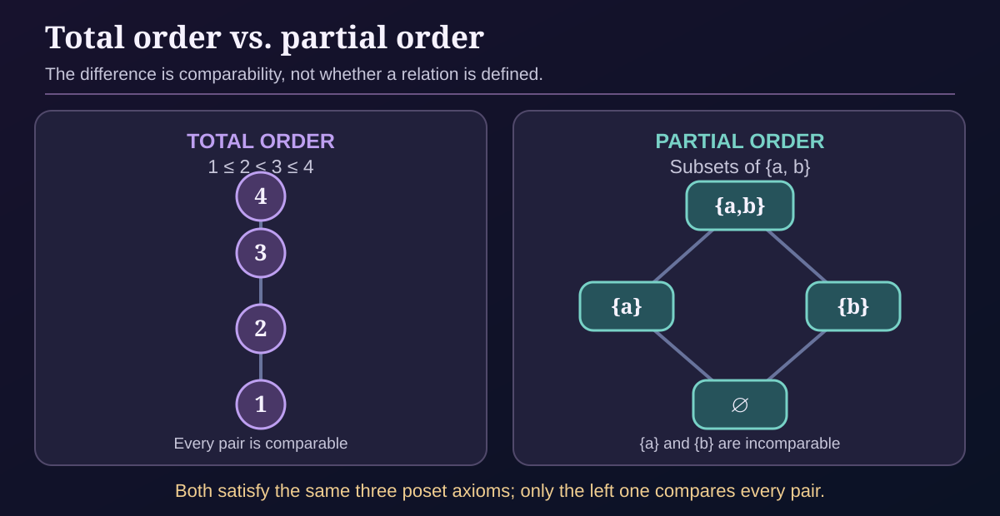
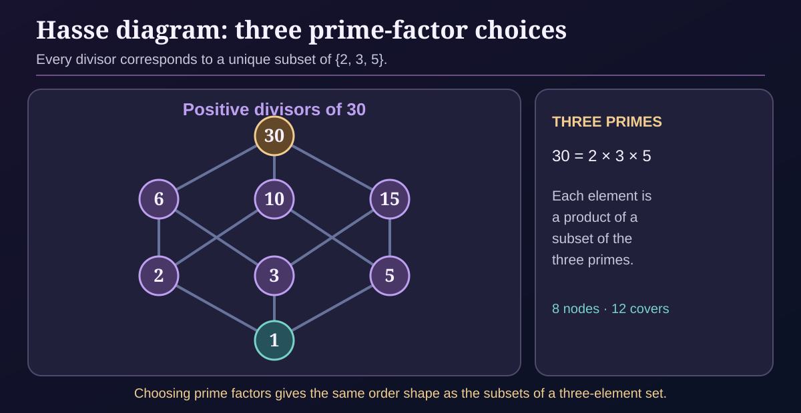
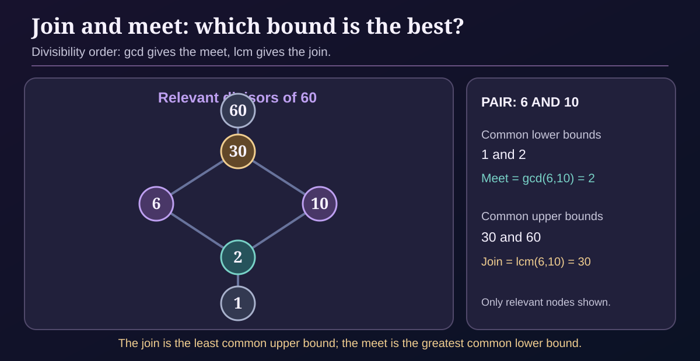
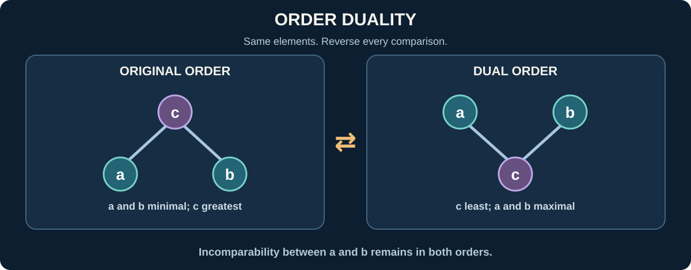

> [!abstract] Prerequisites & where this leads
> **Builds on:** [sets](./set-theory), [binary relations](./functions-relations#relation), and [equivalence classes](./equivalence-relations).
> **Leads to:** [real-number bounds](./real-analysis#supremum-and-infimum), [set-theoretic well-ordering](./set-theory#ordinals-and-well-ordering), and [posets as categories](./category-theory-foundations#a-partial-order-is-a-category).

## Why study order theory?

**The point of order theory is to reason about what depends on, contains, or carries more information than something else, even when not everything can be ranked on a single line.** Ordinary numerical order compares every pair of numbers. Dependencies, permissions, and sets often do not work that way.

Consider two permission sets: one grants **read and write**, while the other grants **read and share**. Neither set contains the other. There is no honest answer to "Which one is greater?" if *greater* means *contains all the permissions of the other*. But we can still identify their **common permissions** (read) and the **smallest set containing both** (read, write, and share). Order theory makes these questions precise. The shared part is an example of a *meet*; the smallest common upper set is a *join*.

Now change the objects from **permission sets** to **named roles**. The roles `Viewer` and `Auditor` might be distinct records with exactly the same effective permissions. Each is no more powerful than the other, although they are not the same role. This leads naturally to a **preorder**: a comparison that is consistent and transitive, but does not pretend that mutual comparability makes two identities equal.

The same structure appears when independent tasks can run concurrently, when a compiler gradually discovers facts about a program, and when distributed replicas combine compatible state. It also underlies bounds and fixed-point theorems: under suitable assumptions, we can reason about whether repeatedly adding information reaches a stable result. **Order theory is not just about sorting. It is about comparison, dependence, combination, and what can be concluded when comparisons are incomplete.**

### The organizing idea: different comparisons, the same axioms

> [!intuition] An order is not necessarily a ranking of numbers
> An **order relation** tells us when one object is below, before, contained in, or less informative than another. The objects can be numbers, sets, tasks, permissions, or points in a graph. What matters is **how the comparisons behave**, not what the objects happen to be.
>
> **Different relationships can satisfy the same structural axioms.** That is why one theory can study all of them: a proof using only those axioms can apply in every setting where they hold.

Throughout this chapter, let $P$ be a set equipped with a relation $\preceq$ (read "precedes or is equal to"). The expression $a\preceq b$ is a **placeholder for a comparison we must specify**, not necessarily a statement that $a$ is numerically smaller than $b$.

| Objects being compared | What the comparison means | Concrete example |
| --- | --- | --- |
| Real numbers | $a\leq b$: $a$ is no greater than $b$ | $2\leq 6$ |
| Sets | $A\subseteq B$: every member of $A$ is in $B$ | $\{r\}\subseteq\{r,w\}$ |
| Positive integers | $a\mid b$ (read "a divides b"): $b$ is an integer multiple of $a$ | $2\mid6$ |
| Vertices in a directed graph | $u\leadsto v$: a directed path goes from $u$ to $v$, possibly of length zero | $u\leadsto v$ along a path |

These are **not the same relation**. For example, $2\leq3$, but $2\nmid3$ (read "two does not divide three"). Yet they all obey two rules: every object compares with itself (**reflexivity**), and comparisons can be chained (**transitivity**). For instance, $2\mid6$ and $6\mid30$ imply $2\mid30$, just as $A\subseteq B$ and $B\subseteq C$ imply $A\subseteq C$.

The similarities do not erase the differences. Numerical $\leq$ compares every pair; subset inclusion and positive-integer divisibility can leave some pairs **incomparable**; directed reachability can compare distinct vertices in **both directions** when a cycle exists. The next section turns these differences into precise definitions: **preorder, partial order, and total order**.

**Why this is powerful:** instead of proving separate, unrelated facts about numbers, sets, divisibility, and reachability, we can identify which properties a proof actually needs and reuse the argument across all four. That is the abstraction behind order theory.

## From relations to preorders and partial orders

*Figure: The three ordering structures are nested by their axioms. In the worked role example, Editor and Author are different names with identical capabilities. The preorder compares them in both directions; its quotient identifies their equivalence class. A total ordering of the **original names** requires a separate tie-break and is not automatically induced by the quotient.*

> [!definition] Preorder
> A relation $\preceq$ on $P$ is a **preorder** when it is:
> - **Reflexive:** $a\preceq a$ for every $a\in P$.
> - **Transitive:** if $a\preceq b$ and $b\preceq c$, then $a\preceq c$.

A preorder need not be antisymmetric. Two different objects may each precede the other. That is **not a defect**: the comparison may be about what objects *can do*, *imply*, or *reach*, rather than whether they are literally identical.

### Why not require antisymmetry immediately?

Suppose two software components are different implementations of the same externally observable behavior. We may be able to say "implementation A provides at least the capabilities of B" and also the reverse. That does not make their source code, ownership, or identities equal. Insisting on antisymmetry would force us either to identify distinct objects too early or to abandon the useful comparison.

A preorder keeps both facts: the **original objects remain distinct**, and the comparison recognizes when they are **equivalent for the purpose being studied**. Later, if only that purpose matters, we can merge mutually comparable objects into equivalence classes and obtain a partial order. This is the reason preorders appear before posets.

### Three places preorders arise naturally

#### 1. Roles and permission systems: compare capabilities, not identities

Let $R$ be a set of **named roles**, and let $A(r)$ be the set of actions permitted to role $r$. Define

$$
r\preceq s\quad\Longleftrightarrow\quad A(r)\subseteq A(s).
$$

Read $r\preceq s$ as "role r grants no more actions than role s." This relation is **reflexive** because every set is a subset of itself, and **transitive** because subset inclusion is transitive. But the roles are not themselves permission sets, so antisymmetry can fail:

| Role | Allowed actions |
| --- | --- |
| Viewer | read |
| Auditor | read |
| Editor | read, write |
| Publisher | read, publish |

Here $\text{Viewer}\preceq\text{Auditor}$ **and** $\text{Auditor}\preceq\text{Viewer}$, yet the roles have different names and identities. Both are below Editor and Publisher, while Editor and Publisher are incomparable because each grants an action the other lacks.

**Why useful?** An access-control audit can group roles with identical effective privileges, identify roles that are strictly more permissive, and distinguish incomparable privileges. The system can still keep the original role names for assignments and audit logs. This is a simplified action-set model; contextual or conditional authorization policies require a richer description of allowed behavior.

#### 2. Logical implication: different statements can mean the same thing

Let $P$ and $Q$ be predicates about a real input $x$, and define

$$
P\preceq Q\quad\Longleftrightarrow\quad
\text{for every }x\in\mathbb R,\ P(x)\Rightarrow Q(x).
$$

The arrow $\Rightarrow$ is read "implies." The statement $P\preceq Q$ means **every case satisfying P also satisfies Q**: P is at least as restrictive as Q. Implication is reflexive ($P\Rightarrow P$) and transitive, so it defines a preorder on predicates.

Take $P(x):\iff x>10$, $Q(x):\iff x>0$, and $T(x):\iff (x\ge0\ \text{and}\ x\ne0)$. Then $P\preceq Q$, and $Q\preceq T$ **and** $T\preceq Q$. The expressions $Q$ and $T$ are different formulas, even though they have exactly the same truth value for every real input.

**Why useful?** Query optimizers, theorem provers, validation rules, and type-refinement systems compare predicates by implication. They can recognize equivalent conditions without requiring identical syntax, and distinguish a stronger condition from a weaker one. The relevant notion of equivalence is **logical equivalence in the chosen domain**, not literal textual equality.

#### 3. Directed reachability: cycles are comparisons, not mistakes

In a directed graph, define $u\preceq v$ when a directed path runs from vertex $u$ to vertex $v$, including a path of length zero. A vertex reaches itself, and paths compose, so this is a preorder.

Consider a service-call graph with calls from Scheduler to Worker, Worker back to Scheduler, and Worker to Storage. Scheduler and Worker can reach each other, so both comparisons hold even though they are different services. Both can reach Storage, but Storage has no path back to either.

**Why useful?** Reachability answers which services can be contacted along a chain of calls. The equivalence classes under **mutual reachability** are the strongly connected components. Collapsing them gives an acyclic summary graph and a partial order between the components, without claiming that the services inside a component are identical. This is developed algorithmically in [Advanced Graph Theory](./advanced-graph-theory#directed-reachability-and-strongly-connected-components).

### A general recipe: order what we observe

The role and predicate examples share one construction. Suppose a set $X$ contains objects with an **observation map** $f:X\to Y$, where $Y$ is a poset. We compare objects by their observations:

$$
x\preceq_f y\quad\Longleftrightarrow\quad f(x)\leq_Y f(y).
$$

For roles, $f(r)$ is the allowed-action set. For predicates, $f(P)$ is the set of inputs on which $P$ is true. In both cases, $Y$ is a set of subsets ordered by inclusion.

> [!theorem] Comparing through observations always gives a preorder
> If $\leq_Y$ is a partial order, then $\preceq_f$ is reflexive and transitive. In fact, $\preceq_f$ is antisymmetric **if and only if** $f$ is injective. Thus distinct objects with identical observations are exactly the obstruction.

> [!proof] The properties are inherited from the observed order
> **Reflexivity:** $f(x)\leq_Y f(x)$ implies $x\preceq_f x$.
>
> **Transitivity:** from $f(x)\leq_Y f(y)$ and $f(y)\leq_Y f(z)$, transitivity in $Y$ gives $f(x)\leq_Y f(z)$.
>
> **Why antisymmetry can fail:** if $x\ne y$ but $f(x)=f(y)$, then $x\preceq_f y$ and $y\preceq_f x$. The observations agree, but the objects do not. Conversely, if $f$ is injective and both $x\preceq_f y$ and $y\preceq_f x$, antisymmetry of $\leq_Y$ gives $f(x)=f(y)$ and injectivity gives $x=y$. This proves the claimed equivalence.

**The payoff:** a preorder is often the correct first model whenever we compare things by *meaning*, *behavior*, or *capabilities*. A poset is what we get once mutually equivalent observations are treated as one object. This provides a recurring link between [equivalence classes](./equivalence-relations), [graph components](./advanced-graph-theory#directed-reachability-and-strongly-connected-components), and order theory.

> [!definition] Partial order and poset
> A **partial order** is a reflexive, transitive, **antisymmetric** relation, where antisymmetry requires
> $$
> a\preceq b\ \text{and}\ b\preceq a\quad\Longrightarrow\quad a=b.
> $$
> A set equipped with its specified partial order, $(P,\preceq)$, is a **partially ordered set** or **poset** (read "POH-set").

> [!tip] Important: “partial” does not mean “partially defined”
> **The relation is defined for every pair.** The word *partial* means only that **not every pair must be comparable**: sometimes neither element is below the other.
>
> $$
> a\npreceq b\qquad\text{and}\qquad b\npreceq a.
> $$
>
> This is called **incomparability**, not an undefined comparison.
>
> **Concrete example:** Under subset inclusion, take $A:=\{\text{read}\}$ and $B:=\{\text{write}\}$. Neither contains the other, so $A$ and $B$ are incomparable. In contrast, $\{\text{read}\}\subseteq\{\text{read},\text{write}\}$ *is* a comparison that holds.
>
> **Do not confuse this with antisymmetry:** if $A\subseteq B$ **and** $B\subseteq A$, then $A=B$. Antisymmetry concerns comparisons that hold in both directions; incomparability concerns pairs for which neither direction holds.

### Worked example: a power set is a poset

Start with $A:=\{a,b\}$. Its **power set** is the set of all its subsets:

$$
\mathcal P(A)=\{\varnothing,\{a\},\{b\},\{a,b\}\}.
$$

A power set alone is just a set. To obtain a **poset**, specify an order on its elements: here, **subset inclusion** $\subseteq$. We claim that $(\mathcal P(A),\subseteq)$ satisfies all three partial-order axioms.

1. **Reflexivity:** every subset contains itself: $X\subseteq X$. For example, $\{a\}\subseteq\{a\}$.
2. **Antisymmetry:** if $X\subseteq Y$ and $Y\subseteq X$, the two subsets have exactly the same elements, so $X=Y$. For example, $\{a\}\subseteq\{a,b\}$, but the reverse inclusion fails.
3. **Transitivity:** if $X\subseteq Y$ and $Y\subseteq Z$, then $X\subseteq Z$. For example, $\varnothing\subseteq\{a\}\subseteq\{a,b\}$ implies $\varnothing\subseteq\{a,b\}$.

**Why is the order partial?** The two middle elements, $\{a\}$ and $\{b\}$, are **incomparable**:

$$
\{a\}\nsubseteq\{b\}\qquad\text{and}\qquad\{b\}\nsubseteq\{a\}.
$$

Neither comparison holds, but the order is still well-defined. The power set is therefore a **poset, not a totally ordered set**.

*Figure: The power set ordered by inclusion is a poset. Its two singleton sets are incomparable, so the order is partial rather than total. We will see later why this diamond is also a lattice.*

*Figure: Both diagrams satisfy the partial-order axioms. The chain is also total; the subset diamond is not because neither singleton contains the other.*

*Looking ahead:* this particular poset is also a **complete lattice**. Unions give least upper bounds and intersections give greatest lower bounds; we will make those terms precise in [Joins, meets, and lattices](#joins-meets-and-lattices).

| Relation | Reflexive | Antisymmetric | Transitive | Every pair comparable |
| --- | --- | --- | --- | --- |
| $\leq$ on $\mathbb R$ | Yes | Yes | Yes | Yes |
| $\subseteq$ on $\mathcal P(\{a,b\})$ | Yes | Yes | Yes | No |
| Divides on positive integers | Yes | Yes | Yes | No |
| Directed reachability with cycles | Yes | Not necessarily | Yes | Not necessarily |
| Congruence modulo three | Yes | No | Yes | No |

> [!distinction] Symmetry versus antisymmetry
> Equivalence relations require symmetry: $a\sim b$ implies $b\sim a$. Partial orders require antisymmetry: if $a\preceq b$ and $b\preceq a$, then $a=b$. The two properties are not logical negations. Equality itself is both symmetric and antisymmetric.

**Examples of each:** “has the same remainder modulo $3$” is symmetric but not antisymmetric ($1$ and $4$ relate both ways, yet differ). Subset containment is antisymmetric but not symmetric ($\{a\}\subseteq\{a,b\}$, not conversely). Equality satisfies both.

### Turning a preorder into a poset

Even if two distinct elements in a preorder may precede each other, we can identify such elements using an equivalence relation:

$$
a\sim b\quad\Longleftrightarrow\quad a\preceq b\ \text{and}\ b\preceq a.
$$

Read: "a is equivalent to b if and only if each precedes the other."

> [!theorem] Preorder quotient theorem
> The relation $\sim$ is an equivalence relation. On its equivalence classes, define
> $$
> [a]\leq[b]\quad\Longleftrightarrow\quad a\preceq b.
> $$
> This is **well-defined** and turns $P/{\sim}$ into a poset.

> [!proof] Equivalence, representative independence, and order axioms
> **Equivalence:** reflexivity follows from $a\preceq a$. Symmetry follows because the defining condition is mutual comparison. If $a\sim b$ and $b\sim c$, then $a\preceq b\preceq c$ and $c\preceq b\preceq a$, so $a\sim c$ by transitivity.
>
> **Representative independence:** suppose $a'\sim a$, $b\sim b'$, and $a\preceq b$. We have $a'\preceq a\preceq b\preceq b'$, hence $a'\preceq b'$. The converse implication follows by reversing the roles of the representatives. Therefore the relation on classes is independent of which names we choose.
>
> **Poset axioms:** reflexivity and transitivity descend from the preorder. If $[a]\leq[b]$ and $[b]\leq[a]$, then $a\sim b$, so $[a]=[b]$. This is antisymmetry.

*Figure: Mutual reachability defines equivalence classes. Collapsing the classes removes two-way order between distinct nodes.*

**Follow the four vertices in the figure.** Vertices $a$ and $b$ reach each other, as do $c$ and $d$; there is a path from the first pair to the second, but no path back. The quotient has just two distinct points, $[a]=[b]$ and $[c]=[d]$, with $[a]\leq[c]$ but not $[c]\leq[a]$. Mutual reachability has become equality *of classes*, which is precisely what antisymmetry requires.

For graph reachability, the classes are the **strongly connected components**. Their condensation graph is acyclic, and reachability on its vertices is a partial order.

## Worked proof: divisibility is a poset

Let $a,b$ be **positive** integers. Write $a\mid b$ (read "a divides b") when $b=ak$ for some positive integer $k$.

> [!proof] Verify the three order axioms
> **Reflexive:** $a=a\cdot1$, so $a\mid a$.
>
> **Antisymmetric:** assume $a\mid b$ and $b\mid a$, so $b=ak$ and $a=bm$ for positive integers $k,m$. Then $a=a(km)$. Canceling the nonzero integer $a$ yields $km=1$, forcing $k=m=1$, so $a=b$.
>
> **Transitive:** if $b=ak$ and $c=bm$, then $c=a(km)$ and $a\mid c$.

The restriction to **positive** integers is essential. On all integers, $2\mid -2$ and $-2\mid2$, but $2\neq-2$, so antisymmetry fails.

This poset is **not total**: neither $2\mid3$ nor $3\mid2$. Those numbers are incomparable.

## Strict and non-strict order

From a partial order define its strict part by

$$
a\prec b\quad\Longleftrightarrow\quad a\preceq b\ \text{and}\ a\neq b.
$$

Read "a is strictly below b."

> [!theorem] Strict and non-strict descriptions correspond
> The strict part $\prec$ of a partial order is **irreflexive** and **transitive**. Conversely, an irreflexive and transitive relation $\prec$ gives a partial order by defining $a\preceq b$ when $a=b$ or $a\prec b$.

> [!proof] Show both constructions satisfy their axioms
> **Forward:** $a\prec a$ would require $a\neq a$, impossible. If $a\prec b$ and $b\prec c$, transitivity of $\preceq$ gives $a\preceq c$. If $a=c$, then $a\preceq b\preceq a$ forces $a=b$ by antisymmetry, contradicting strictness. Hence $a\prec c$.
>
> **Backward:** equality makes the new relation reflexive. If $a\preceq b$ and $b\preceq a$ with $a\neq b$, then $a\prec b$ and $b\prec a$, so transitivity gives $a\prec a$, contradicting irreflexivity. Thus it is antisymmetric. Its transitivity follows from the transitivity of $\prec$, together with the cases in which either comparison is equality.

Every transitive irreflexive relation is also **asymmetric**: $a\prec b$ prevents $b\prec a$.

**Strict versus non-strict, concretely:** in positive integers ordered by divisibility, $2\preceq4$ and $2\prec4$ because $2\mid4$ and $2\ne4$. We also have $2\preceq2$, but **not** $2\prec2$. Conversely, start with strict inclusion $A\subsetneq B$: it is irreflexive and transitive, and allowing equality gives ordinary inclusion $A\subseteq B$. Asymmetry means that $2\prec4$ rules out $4\prec2$; it is stronger than merely saying $2\prec2$ never happens.

## Total orders, chains, and antichains

> [!definition] Total or linear order
> A partial order is **total** (also called **linear**) if, for every $a,b$, either $a\preceq b$ or $b\preceq a$.

The real numbers under $\leq$ are totally ordered. The subsets of $\{a,b\}$ under $\subseteq$ are partially ordered but **not** totally ordered, because $\{a\}$ and $\{b\}$ are incomparable.

A **chain** is a subset of a poset whose elements are pairwise comparable. An **antichain** has no two **distinct** comparable members. In the divisors of thirty, $\{1,2,6,30\}$ is a chain while $\{2,3,5\}$ is an antichain.

A chain is *not* necessarily a contiguous path of immediate cover relations. It may skip intermediate elements.

**Check both types of subset:** among the divisors of $30$, $1\mid6\mid30$ makes $\{1,6,30\}$ a chain even though $1$ and $30$ are not joined by a single cover edge. Meanwhile $2,3,5$ are pairwise incomparable under divisibility, so $\{2,3,5\}$ is an antichain. A **total order** is a poset whose *entire underlying set* is a chain; the usual order on $\{1,2,3,4\}$ is an example.

*Figure: Preorders require reflexivity and transitivity. Antisymmetry makes a partial order; symmetry makes an equivalence relation. Equality satisfies both. A poset is a set equipped with a partial order, and chains and antichains are subsets of that poset, illustrated by the inclusion order on the subsets of $\{a,b\}$.*

## Hasse diagrams: reconstructing the finite order

A **Hasse diagram** draws the **cover relations** of a finite poset. We say $b$ covers $a$ when $a\prec b$ but there is no $c$ with $a\prec c\prec b$. Larger elements appear higher. Reflexive loops and transitively implied links are omitted.

*Figure: In a finite divisibility poset, an upward chain of cover links proves that the bottom element divides the top.*

**Which links are covers?** In the divisors of $12$, $2$ covers $1$, and $4$ covers $2$. Yet $4$ does **not** cover $1$: $1\prec2\prec4$ supplies an intermediate element, so the diagram omits a direct $1$–$4$ edge. It also omits loops such as $2\preceq2$.

To decide whether $a\preceq b$, find an **upward path** from $a$ to $b$ (or check $a=b$). An **undirected path** is not enough. The numbers $4$ and $6$ are incomparable, even though both share neighbors elsewhere in the graph.

The [power-set diamond](#worked-example-a-power-set-is-a-poset) above is also a Hasse diagram. Its middle elements are incomparable, but they still have a **least upper bound** ($\{a,b\}$) and a **greatest lower bound** ($\varnothing$). This makes the poset a **lattice**, a concept developed below.

*Figure: Divisors of thirty have the same order shape as the subsets of a three-element set.*

> [!distinction] Finite Hasse diagrams versus dense infinite orders
> A Hasse diagram makes cover relations visible in a **finite** poset. In a dense order such as the rationals, there is always another rational between two distinct ordered values, so **no** distinct pair is a cover. A picture of cover edges alone cannot reconstruct that infinite order.

## Bounds and extrema: maximal is not greatest

For $S\subseteq P$, an element $u\in P$ is an **upper bound** if $s\preceq u$ for every $s\in S$. A **lower bound** reverses the comparison.

**Find all bounds:** work in the positive divisors of $12$, ordered by divisibility, with $S:=\{2,3\}$. Its upper bounds *in this poset* are $6$ and $12$, because both $2$ and $3$ divide them. Its only lower bound is $1$, which divides both. Bounds belong to the surrounding poset $P$; they do **not** have to belong to $S$.

> [!definition] Four different extrema
> An element $m\in S$ is **maximal in S** if no $s\in S$ satisfies $m\prec s$. It is **greatest in S** if $s\preceq m$ for *every* $s\in S$. **Minimal** and **least** reverse the order.

Every greatest element is maximal; a maximal element might be incomparable with other elements. There can be multiple maximal elements, or none.

**Apply all four names to $S=\{2,3\}$** inside the divisibility poset above. Each is **maximal** (nothing else in $S$ lies above it) and **minimal** (nothing else in $S$ lies below it), but $S$ has **no greatest** and **no least** element, because $2$ and $3$ are incomparable. By contrast, the full divisor set of $12$ has least element $1$ and greatest element $12$.

> [!counterexample] Two maximal elements but no greatest element
> On $P=\{a,b\}$ with only reflexive comparisons, both $a$ and $b$ are maximal and minimal. Neither is greatest or least because neither compares with the other.

*Figure: In the left poset, a and b are minimal but neither least; in the middle, b and c are maximal but neither greatest. In the right-hand chain, 0 is least and 2 is greatest.*

> [!counterexample] No maximal element at all
> In $(\mathbb N,\leq)$, every $n$ has a greater number $n+1$. There is no maximal element, even though every finite nonempty subset has a greatest element.

> [!theorem] In a finite poset, a unique maximal element is greatest
> A finite nonempty poset with exactly one maximal element $m$ satisfies $a\preceq m$ for every $a$.

> [!proof] Follow a finite ascending chain
> Starting at $a$, if it is not maximal, choose something strictly above it. Repeat. An ascending strict chain cannot continue forever in a finite set, so it ends at some maximal element. The only such element is $m$. By transitivity, $a\preceq m$.

**Why finiteness matters.** Take a disjoint union of the infinite chain $0<1<2<\cdots$ and one isolated element $m$. That $m$ is the **unique** maximal element, yet is incomparable with every integer and hence is **not** greatest.

**Finite check:** in the divisors of $12$, only $12$ is maximal: every other divisor has a strictly larger multiple in the same set. Finiteness guarantees that every upward path eventually reaches $12$, so it is also greatest. The isolated-$m$ example shows exactly what fails without finiteness.

## Joins, meets, and lattices

A **least upper bound**, or **supremum** (read "SOO-premum"), is an upper bound below all other upper bounds. A **greatest lower bound**, or **infimum** (read "in-FEE-mum"), is above all other lower bounds. Each, when it exists, is unique by antisymmetry.

**Bounds need not be members of the set.** In $(\mathbb R,\leq)$, take $S:=(0,1)$. Every $u\geq1$ is an upper bound, with **supremum** $\sup S=1$; every $\ell\leq0$ is a lower bound, with **infimum** $\inf S=0$. Neither $0$ nor $1$ belongs to $S$, so $S$ has neither a least nor a greatest element. This is why *supremum* is not just another word for *maximum*.

For a pair $a,b$, the least upper bound is the **join** $a\vee b$ (read "a join b"), and the greatest lower bound is the **meet** $a\wedge b$ (read "a meet b").

> [!definition] Lattice, bounded lattice, complete lattice
> A **lattice** is a poset in which every **pair** has a join and meet. It is **bounded** if there are a greatest element $\top$ and a least element $\bot$. It is **complete** if **every subset** has a join and meet, including the empty subset.

> [!example] One small example of all three notions
> Let $X:=\{\text{read},\text{write}\}$ and order $\mathcal P(X)$ by inclusion. Its two incomparable middle elements are $A:=\{\text{read}\}$ and $B:=\{\text{write}\}$. Their join is $A\vee B=X$ and their meet is $A\wedge B=\varnothing$. Every pair has both, so this is a **lattice**. Its least element is $\bot=\varnothing$ and greatest element is $\top=X$, so it is **bounded**. Every subset of this four-element poset also has a join and meet, so it is **complete**. In particular, the *empty family of elements* has join $\bot$ and meet $\top$.

**Power-set worked example.** In $(\mathcal P(X),\subseteq)$ (read "the power set of X ordered by inclusion"),

$$
A\vee B=A\cup B,\qquad A\wedge B=A\cap B.
$$

To justify the first formula: $A\cup B$ contains $A$ and $B$, so it is an upper bound. Every other upper bound contains both $A$ and $B$, so also contains their union. Thus the union is the **least** upper bound. Dually, the intersection is the greatest lower bound. For arbitrary families, the union and intersection give joins and meets, so $\mathcal P(X)$ is complete; the empty join is $\varnothing$, and the empty meet is $X$.

**Divisibility lattice.** On positive divisors of a fixed integer $n$, the join is $\operatorname{lcm}(a,b)$ (read "least common multiple"), and the meet is $\gcd(a,b)$ (read "greatest common divisor"). Both remain divisors of $n$.

**One pair, all of its bounds.** Work in the positive divisors of $60$, ordered by divisibility, and compare $6$ with $10$. Their **common lower bounds** are $1$ and $2$, because both $6$ and $10$ are divisible by those numbers. The greatest is $2$, so $6\wedge10=2$. Their **common upper bounds** *within this poset* are $30$ and $60$, since each is divisible by both $6$ and $10$. The least is $30$, so $6\vee10=30$.

*Figure: The diagram shows just the six relevant divisors, not every divisor of 60. It separates **being an upper bound** from being the **least** upper bound, and likewise for lower bounds.*

### An explicit poset that is not a lattice

Let $P:=\{a,b,c,d\}$. Require $a\prec c$, $a\prec d$, $b\prec c$, and $b\prec d$, with no other strict comparisons. Both $c$ and $d$ are upper bounds of $\{a,b\}$. Neither is below the other, so **no least upper bound exists**. Hence $a\vee b$ does not exist.

*Figure: This bow-tie is not a lattice. The **diamond** in the previous Hasse example is a lattice, so the two shapes must not be confused.*

### Lattice laws and Boolean algebra

Every lattice satisfies commutativity, associativity, idempotence, and absorption for join and meet:

$$
\begin{aligned}
a\vee b&=b\vee a,&a\wedge b&=b\wedge a,\\
(a\vee b)\vee c&=a\vee(b\vee c),&(a\wedge b)\wedge c&=a\wedge(b\wedge c),\\
a\vee a&=a,&a\wedge a&=a,\\
a\vee(a\wedge b)&=a,&a\wedge(a\vee b)&=a.
\end{aligned}
$$

These laws can be derived by the uniqueness of least upper and greatest lower bounds. For example, $a\wedge b\preceq a$, so joining $a$ with $a\wedge b$ gives $a$.

**Check the laws with sets.** With $A=\{r\}$ and $B=\{w\}$, commutativity gives $A\cup B=B\cup A=\{r,w\}$; idempotence gives $A\cup A=A$; and absorption gives $A\cup(A\cap B)=\{r\}\cup\varnothing=A$. For associativity, $(A\cup B)\cup C=A\cup(B\cup C)$ for any third set $C$: either grouping collects precisely the elements appearing in at least one of the three sets. Intersections give the corresponding meet examples.

A **distributive lattice** additionally satisfies $a\wedge(b\vee c)=(a\wedge b)\vee(a\wedge c)$ and its dual. Power sets are distributive because intersection distributes over union and vice versa. Not all lattices are distributive: the five-element lattice $M_3$, with three incomparable elements between bottom and top, is a counterexample.

**See both outcomes:** for $A:=\{r\}$, $B:=\{w\}$, and $C:=\{r,w\}$, the left side $A\cap(B\cup C)$ is $\{r\}$; the right side $(A\cap B)\cup(A\cap C)$ is $\varnothing\cup\{r\}=\{r\}$. In $M_3$, instead choose three distinct middle elements $p,q,r$. Since $q\vee r=\top$, we have $p\wedge(q\vee r)=p$, while $(p\wedge q)\vee(p\wedge r)=\bot\vee\bot=\bot$. The two sides differ, so distributivity is **not** a law of every lattice.

In the Boolean algebra of subsets, **AND** behaves like intersection (meet), **OR** behaves like union (join), and **NOT** behaves like complement. This is the structural link to [Propositional Logic](./propositional-logic-zeroth-order-logic). Inclusive OR is Boolean join, not ordinary integer addition.

**One Boolean-algebra calculation:** for $X:=\{\text{read},\text{write}\}$ and $A:=\{\text{read}\}$, its complement (NOT) relative to $X$ is $A^c=\{\text{write}\}$. Then $A\cap A^c=\varnothing$ (AND: nothing belongs to both), while $A\cup A^c=X$ (inclusive OR: everything belongs to at least one). The complement depends on the chosen universe $X$.

> [!distinction] Real-number completeness versus complete lattices
> $(\mathbb R,\leq)$ is a lattice because every pair has a maximum and minimum, but it is **not a complete lattice**: all of $\mathbb R$ lacks a supremum inside $\mathbb R$. The real-number completeness axiom applies only to **nonempty, bounded-above subsets**.

## Order duality: reverse the comparisons, reuse the theorem

An order relation tells us which way is *up*. Often a theorem about elements above something has an equally important counterpart about elements below it. Instead of proving the second result from scratch, reverse every comparison.

> [!definition] The dual (opposite) poset
> Given a poset $(P,\preceq)$, its **dual**, written $P^{\mathrm{op}}$ (read "P opposite"), has the same elements and the reversed order:
>
> $$
> a\preceq_{\mathrm{op}} b\quad\Longleftrightarrow\quad b\preceq a.
> $$

**Check the axioms.** Reflexivity is unchanged. If $a\preceq_{\mathrm{op}}b$ and $b\preceq_{\mathrm{op}}c$, then $c\preceq b\preceq a$, so $a\preceq_{\mathrm{op}}c$. Antisymmetry also survives: two-way comparisons in the dual are two-way comparisons in the original order.

*Figure: Reversing a Hasse diagram trades "above" for "below" while preserving incomparability. The two structures use the same elements, not the same order.*

**Worked example.** Let $P:=\{a,b,c\}$ with strict relations $a\prec c$ and $b\prec c$, and no comparison between $a$ and $b$. In $P$, $c$ is **greatest** and $a,b$ are **minimal**. In $P^{\mathrm{op}}$, $c$ is **least** and $a,b$ are **maximal**. The dual does not suddenly make $a$ and $b$ comparable.

| In $P$ | In $P^{\mathrm{op}}$ |
| --- | --- |
| Upper bound | Lower bound |
| Greatest, maximal | Least, minimal |
| Join $a\vee b$ | Meet $a\wedge b$ |
| Complete lattice | Complete lattice |
| Chain, antichain | Chain, antichain |

> [!theorem] Order-duality principle
> A theorem derived solely from the poset axioms remains valid when all comparisons and their associated dual notions are reversed.

**Proof.** The dual structure satisfies the same poset axioms, as shown above. Apply the theorem to $P^{\mathrm{op}}$ and translate its conclusion back into $P$. For example, the theorem "a unique maximal element in a finite nonempty poset is greatest" immediately yields: **a unique minimal element in a finite nonempty poset is least**. $\square$

**An explicit order-reversing map.** For subsets of a fixed set $X$, complementation satisfies

$$
A\subseteq B\quad\Longleftrightarrow\quad X\setminus B\subseteq X\setminus A.
$$

Thus $A\mapsto X\setminus A$ reverses order bijectively; [De Morgan's laws](./set-theory#set-operation-properties) exchange union and intersection. A lattice's join/meet duality has a concrete manifestation in ordinary set operations.

> [!distinction] Duality is not total ordering
> Reverse a partial order and incomparable elements remain incomparable. Changing direction is not the same as adding comparisons.

## Well-foundedness and well-ordering

> [!definition] Well-founded order and well-order
> A strict partial order is **well-founded** if every nonempty subset has a **minimal** element. A total order is a **well-order** if every nonempty subset has a **least** element.

Every finite poset is well-founded, because an infinite strict descending chain cannot exist inside a finite set. The natural numbers in their usual order are well-ordered. The integers are not: $\mathbb Z$ has no least element. The usual order on $\mathbb R$ is not a well-order: $(0,1)$ has no least member.

A two-element **antichain** is well-founded because every nonempty subset has minimal elements, but is not well-ordered because it is not total. The distinction between "minimal" and "least" matters.

**Compare three sets:** every nonempty subset of $(\mathbb N,\leq)$ has a *least* number (for example, the positive multiples of $3$ have least element $3$). The two-point antichain $\{a,b\}$ has minimal points but no least point, so it is well-founded but not well-ordered. The positive real interval $(0,1)$ has **no minimal element** in its usual order, since for every $x$ in it, $x/2$ is a smaller member. Thus the usual strict order on the real numbers is not well-founded.

Well-founded relations support **induction on predecessors**: assume a property holds for all strict predecessors of $a$, then prove it for $a$. Ordinary induction on $\mathbb N$ is an instance. [Set Theory](./set-theory#ordinals-and-well-ordering) develops ordinals, transfinite induction, and the well-ordering theorem.

**Induction in action:** to prove $0+1+\cdots+n=n(n+1)/2$ for all $n\in\mathbb N$, establish it at $n=0$, where both sides are $0$. For $n>0$, assume the result at the strict predecessor $n-1$; adding $n$ gives $(n-1)n/2+n=n(n+1)/2$. More general well-founded induction allows an element to depend on **all** of its strict predecessors rather than just the immediately previous natural number.

## Order-preserving maps and order isomorphisms

Let $f:P\to Q$ map one poset $(P,\preceq_P)$ to another $(Q,\preceq_Q)$.

> [!definition] Monotone map, embedding, isomorphism
> - **Order-preserving / monotone:** $a\preceq_P b\Rightarrow f(a)\preceq_Q f(b)$.
> - **Order embedding:** $a\preceq_P b\Longleftrightarrow f(a)\preceq_Q f(b)$, so the order can also be recovered from the images.
> - **Order isomorphism:** a bijective order embedding.

An embedding also preserves **incomparability**. An injective monotone map need not be an embedding: map two incomparable points to $0$ and $1$ in the chain $0<1$. The map is monotone vacuously and injective, but it creates a comparison that did not exist in its domain.

**Three maps to distinguish the concepts:**
- **Monotone, not an embedding:** $f:\mathbb R\to\mathbb Z$ given by $f(x):=\lfloor x\rfloor$ preserves $x\leq y$, but $f(1.8)\leq f(1.2)$ even though $1.8\nleq1.2$; it does not reflect order.
- **Embedding, not an isomorphism onto the stated codomain:** $g:\mathbb N\to\mathbb N$ given by $g(n):=2n$ preserves and reflects $\leq$, but odd naturals are not in its image.
- **Isomorphism:** $h:\mathbb Z\to\mathbb Z$ given by $h(n):=n+1$ preserves and reflects the usual order and is bijective; its inverse is $h^{-1}(n)=n-1$.

The next example shows an order isomorphism between objects that do not even look alike: divisors and subsets.

### Worked order isomorphism: divisors of thirty and a power set

Let $D:=\{1,2,3,5,6,10,15,30\}$, ordered by divisibility. Define

$$
F(d)=\{p\in\{2,3,5\}:p\mid d\}.
$$

Read: "F of d is the set of primes among two, three, five that divide d." Thus

$$
F(1)=\varnothing,\quad F(6)=\{2,3\},\quad F(30)=\{2,3,5\}.
$$

> [!proof] Verify bijectivity and both directions of order
> **Bijection:** Every divisor of $30=2\cdot3\cdot5$ is the product of a unique subset of these three distinct primes. Therefore each subset occurs exactly once.
>
> **Forward:** if $a\mid b$, each prime dividing $a$ also divides $b$, so $F(a)\subseteq F(b)$.
>
> **Backward:** if $F(a)\subseteq F(b)$, all the prime factors of the square-free divisor $a$ also occur in $b$. Hence $a\mid b$.
>
> Thus $a\mid b\Longleftrightarrow F(a)\subseteq F(b)$: this is an order isomorphism.

The eight-element divisibility cube and the power-set cube have the same **order structure**, even though their elements are different kinds of mathematical objects. Isomorphisms preserve comparisons, extrema, bounds, joins, meets, chains, and antichains.

## Fixed points: when adding information reaches a stable result

An order-preserving function can describe an information update: dependency resolution adds requirements, program analysis adds discovered facts, or a workflow repeatedly propagates consequences. We want to know whether there is a state that remains unchanged.

> [!definition] Fixed, pre-fixed and post-fixed points
> For $F:P\to P$, a **fixed point** satisfies $F(x)=x$. A **pre-fixed point** satisfies $F(x)\preceq x$ and a **post-fixed point** satisfies $x\preceq F(x)$. A one-sided inequality is **not** the same as equality.

The lattice completeness needed below is the completeness defined in [Joins, meets, and lattices](#joins-meets-and-lattices): every subset has a join and meet, including the empty subset. It is stronger than the real-number least-upper-bound axiom, which only concerns nonempty sets bounded above.

### Knaster-Tarski: fixed points without continuity

> [!theorem] Knaster-Tarski fixed-point theorem
> Let $L$ be a **complete lattice** and $F:L\to L$ be **monotone**. Then the fixed points of $F$, ordered as in $L$, form a complete lattice. In particular, the least and greatest fixed points exist and are
>
> $$
> \operatorname{lfp}(F)=\bigwedge\{x:F(x)\preceq x\},
> \qquad
> \operatorname{gfp}(F)=\bigvee\{x:x\preceq F(x)\}.
> $$

Here $\bigwedge$ means "meet over the set," $\bigvee$ means "join over the set," and $\operatorname{lfp}$ and $\operatorname{gfp}$ mean "least fixed point" and "greatest fixed point." **No metric, differentiability, or continuity hypothesis is involved.**

> [!proof] Construct the least fixed point
> Define $U:=\{x\in L:F(x)\preceq x\}$. This set is nonempty: $\top\in U$ because every lattice element, including $F(\top)$, lies below $\top$.
>
> Let $u:=\bigwedge U$. For each $x\in U$, we have $u\preceq x$ and therefore, by monotonicity, $F(u)\preceq F(x)\preceq x$. Thus $F(u)$ lies below **every** member of $U$, so $F(u)\preceq u$.
>
> Applying monotonicity gives $F(F(u))\preceq F(u)$. That means $F(u)$ itself belongs to $U$, so $u\preceq F(u)$ because $u$ is its meet.
>
> Hence $F(u)=u$ by antisymmetry. Every fixed point lies in $U$, so $u$ is below every fixed point. It is the least fixed point. $\square$

> [!proof] Why *all* fixed points form a complete lattice
> Let $S$ be **any subset of fixed points**, including the empty subset. Define
>
> $$
> U_S:=\{x\in L:F(x)\preceq x\text{ and }s\preceq x\text{ for all }s\in S\}.
> $$
>
> This set contains $\top$. Put $u_S:=\bigwedge U_S$. Exactly as before, monotonicity implies $F(u_S)\preceq u_S$.
>
> For each $s\in S$, since every member of $U_S$ is above $s$, their meet $u_S$ is also above $s$. Thus $s=F(s)\preceq F(u_S)$ by monotonicity. Applying monotonicity again to $F(u_S)\preceq u_S$ gives $F(F(u_S))\preceq F(u_S)$. So $F(u_S)$ belongs to $U_S$.
>
> By the definition of a meet, $u_S\preceq F(u_S)$, hence $F(u_S)=u_S$. This element is the **least fixed upper bound** of $S$. In the **dual lattice**, the same construction gives the greatest fixed lower bound of every $S$. Therefore the entire fixed-point set is a complete lattice. $\square$

**Subtlety:** the join of fixed points taken *inside the fixed-point lattice* need not equal their join taken in the ambient lattice $L$. The theorem constructs the **least fixed upper bound**.

### Worked example: closing a dependency graph

Let $X:=\{\text{read},\text{write},\text{deploy},\text{monitor}\}$. A subset $A\subseteq X$ records enabled capabilities. Suppose deployment requires writing, writing requires reading, and monitoring is optional. We require the final state to include deployment. Define a monotone update $F:\mathcal P(X)\to\mathcal P(X)$:

$$
F(A):=\{\text{deploy}\}\cup A
\cup\begin{cases}\{\text{write}\},&\text{if deploy}\in A,\\\varnothing,&\text{otherwise},\end{cases}
\cup\begin{cases}\{\text{read}\},&\text{if write}\in A,\\\varnothing,&\text{otherwise}.\end{cases}
$$

**Check monotonicity:** if $A\subseteq B$, every membership condition true in $A$ is also true in $B$, so $F(A)\subseteq F(B)$. Because $\mathcal P(X)$ is a complete lattice, the theorem applies.

Start from the least element $\varnothing$:

$$
\begin{aligned}
A_0&:=\varnothing,\\
A_1:=F(A_0)&=\{\text{deploy}\},\\
A_2:=F(A_1)&=\{\text{deploy},\text{write}\},\\
A_3:=F(A_2)&=\{\text{deploy},\text{write},\text{read}\},\\
A_4:=F(A_3)&=A_3.
\end{aligned}
$$

The least fixed point is $A_3$, which contains exactly the mandatory capabilities. The greatest fixed point is $X$, which additionally includes optional monitoring.

> [!theorem] Bottom-up iteration on a finite complete lattice
> If $L$ is **finite**, $F:L\to L$ is monotone, and $x_0:=\bot$, $x_{n+1}:=F(x_n)$, then the sequence reaches the least fixed point after finitely many steps.

**Proof.** Since $\bot\preceq F(\bot)$, monotonicity inductively gives $x_n\preceq x_{n+1}$. There cannot be infinitely many strict increases in a finite poset, so eventually consecutive terms agree, producing a fixed point. For any fixed point $z$, start with $\bot\preceq z$ and induct: $x_n\preceq z$ implies $F(x_n)\preceq F(z)=z$. Hence the reached fixed point lies below all others and is the least. $\square$

**Why infinite iteration needs another hypothesis.** The Knaster-Tarski theorem does *not* say that the supremum of the first countably many iterations is fixed. On the complete lattice $[0,1]$, define

$$
F(x):=
\begin{cases}
(x+1/2)/2,&0\le x<1/2,\\
1,&1/2\le x\le1.
\end{cases}
$$

This $F$ is monotone. Iterating from $x_0=0$ gives $x_n=\tfrac12(1-2^{-n})\to1/2$, yet $F(1/2)=1$, not $1/2$. The least fixed point is $1$. The missing property is an appropriate continuity or preservation-of-directed-joins assumption, not monotonicity. Contrast with metric contraction arguments in [Differential Equations](./differential-equations), which use a distance and contraction factor instead of just the order.

## Galois connections: compare through two representations

Suppose an application stores **named objects** but also assigns each object an **observable tier**. Moving from names to tiers forgets which particular name was used. Moving from tiers back to names must therefore recover *all* names compatible with a tier, not just the one originally chosen.

A **Galois connection** captures this loss of distinction using an exact two-way comparison. It is an order-theoretic case of an [adjunction](./category-adjunctions-monads#an-adjunction-is-a-natural-family-of-bijections) in category theory.

> [!definition] Galois connection (monotone convention)
> Let $P,Q$ be posets. Functions $f:P\to Q$ and $g:Q\to P$ form a **Galois connection**, written $f\dashv g$ (read "f is left adjoint to g"), if for **every** $p\in P$, $q\in Q$,
>
> $$
> f(p)\preceq_Q q\quad\Longleftrightarrow\quad p\preceq_P g(q).
> $$
>
> This is the **monotone** or **adjoint** convention. Some authors also use the name Galois connection for *antitone* maps; when reading another source, check which convention it uses.

The relationship says: "the image of $p$ lies below $q$" exactly when "the original $p$ lies below the reverse image of $q$." It is much stronger than saying that the maps happen to be monotone.

### Worked example: named roles and their permission tier

Let $X:=\{\text{Editor},\text{Author},\text{Admin}\}$ be different role identities, and let $Y:=\{\text{basic},\text{privileged}\}$. Define an observation $h:X\to Y$ by

$$
h(\text{Editor})=h(\text{Author})=\text{basic},
\qquad
h(\text{Admin})=\text{privileged}.
$$

On **sets** of roles and tiers, define

$$
f:\mathcal P(X)\to\mathcal P(Y),\quad f(A):=h[A],
\qquad
g:\mathcal P(Y)\to\mathcal P(X),\quad g(B):=h^{-1}[B].
$$

Here $h[A]$ is the **direct image** (all tiers represented by roles in $A$). The expression $h^{-1}[B]$ is the **inverse image** (all roles whose tiers belong to $B$), and **does not** require $h$ to have an inverse function.

> [!theorem] Direct image is left adjoint to inverse image
> For **every** $A\subseteq X$ and $B\subseteq Y$,
>
> $$
> h[A]\subseteq B\quad\Longleftrightarrow\quad A\subseteq h^{-1}[B].
> $$

**Proof.** If $h[A]\subseteq B$ and $x\in A$, then $h(x)\in B$ and hence $x\in h^{-1}[B]$. Thus $A\subseteq h^{-1}[B]$. Conversely, if $A\subseteq h^{-1}[B]$, then every $x\in A$ has $h(x)\in B$. Every member of $h[A]$ lies in $B$, proving the other implication. $\square$

*Figure: Forward then backward through the observation map does not recover a unique role identity. It recovers the **entire equivalence class** of identities sharing an observable tier.*

For $A:=\{\text{Editor}\}$, we calculate

$$
f(A)=\{\text{basic}\},
\qquad
(g\circ f)(A)=\{\text{Editor},\text{Author}\}.
$$

Going forward and back **again** returns the same two-role set. The operation fills in everything indistinguishable under the chosen observations.

### The unit, counit, and closure operator

> [!theorem] A Galois connection produces closure and interior
> If $f\dashv g$, then $f$ and $g$ are monotone. The composite $c:=g\circ f:P\to P$ is a **closure operator**:
>
> - **Extensive:** $p\preceq c(p)$.
> - **Monotone:** $p\preceq p'$ implies $c(p)\preceq c(p')$.
> - **Idempotent:** $c(c(p))=c(p)$.
>
> Dually, $i:=f\circ g:Q\to Q$ is an **interior operator**: $i(q)\preceq q$, it is monotone, and $i(i(q))=i(q)$.

> [!proof] Derive all three closure laws
> Substitute the reflexive comparisons $f(p)\preceq f(p)$ and $g(q)\preceq g(q)$ into the adjunction. We obtain
>
> $$
> p\preceq g(f(p))\quad\text{(unit)},\qquad
> f(g(q))\preceq q\quad\text{(counit)}.
> $$
>
> **Monotonicity of $f$:** if $p\preceq p'$, then the unit at $p'$ gives $p\preceq p'\preceq g(f(p'))$. Apply the adjunction to conclude $f(p)\preceq f(p')$.
>
> **Monotonicity of $g$:** if $q\preceq q'$, counit gives $f(g(q))\preceq q\preceq q'$. By adjunction, $g(q)\preceq g(q')$.
>
> **Extensive:** the unit is exactly $p\preceq c(p)$. **Monotone:** $c$ is a composite of monotone maps.
>
> **Idempotent:** apply $g$ to the counit at $q=f(p)$, obtaining $g(f(g(f(p))))\preceq g(f(p))$, or $c(c(p))\preceq c(p)$. The unit at $c(p)$ gives $c(p)\preceq c(c(p))$. Antisymmetry implies equality.
>
> **Interior laws:** counit gives $i(q)\preceq q$, and the maps' monotonicity makes $i$ monotone. Applying $f$ to the unit at $p=g(q)$ gives $i(q)\preceq i(i(q))$; applying counit at $i(q)$ gives the reverse inequality. Thus $i(i(q))=i(q)$. $\square$

> [!definition] Closed elements
> A point $p$ is **closed under $c$** if $c(p)=p$. In the role example, a set is closed when it contains **all roles associated with every tier it already contains**.

**Why closure is the best stable enlargement.** For *any* closure operator on a poset, $c(p)$ is the **least closed element above $p$**. Extensiveness gives $p\preceq c(p)$; idempotence makes $c(p)$ closed. If $z$ is any closed element with $p\preceq z$, monotonicity gives $c(p)\preceq c(z)=z$. This is an existence-and-minimality statement, not simply a new name for a round trip.

**The fixed-point connection.** Closed elements are exactly the fixed points of $c$. On a complete lattice, Knaster-Tarski tells us that these form a complete lattice. When working with closed subsets of a set, their meet is intersection; their join is **closure of the union**, which can be larger than the union.

**Where this appears:** abstract interpretation translates between concrete and approximate program states; permission audits group roles by observable capabilities; formal concept analysis uses object–attribute relations to construct lattices of concepts. The same inequalities govern each application, but the underlying observations differ.

> [!distinction] Monotone is not automatically adjoint
> Many maps preserve order but have no adjoint on the stated posets. The **for-every-pair equivalence** in the definition is what produces the unit, counit, and closure laws. Do not infer them from monotonicity alone.

## Why order theory appears everywhere

The preorder examples above show a pattern that recurs in software and mathematics: **comparison by behavior is not always comparison by identity**. We can compare roles by permissions, predicates by logical strength, and vertices by reachability without pretending that equivalent observations make the underlying objects literally equal. When we need an antisymmetric order, we pass to equivalence classes; when identity matters, we retain the original preorder.

- **Dependencies:** reachability in an acyclic directed graph yields a partial order (choosing arrow direction consistently). Cycles give a preorder, whose quotient by mutual reachability is a poset.
- **Permissions and information:** "contains no more permission or information than" can define partial orders, but only becomes a lattice when appropriate joins and meets exist.
- **Distributed state:** a **join-semilattice** requires a join for every pair, but not a meet. For example, the **nonempty** subsets of $\{a,b\}$ under inclusion form a join-semilattice: unions stay nonempty and give joins. Yet $\{a\}$ and $\{b\}$ have no meet *inside this poset* because their intersection $\varnothing$ was excluded. This distinction matters when replicas merge state but need no general intersection operation.
- **Categories:** a poset can be interpreted as a category with one arrow $a\to b$ whenever $a\preceq b$. For instance, $\varnothing\subseteq\{a\}\subseteq\{a,b\}$ gives arrows $\varnothing\to\{a\}$ and $\{a\}\to\{a,b\}$; composing them yields the arrow $\varnothing\to\{a,b\}$. Reflexivity supplies identity arrows. See [Category Theory Foundations](./category-theory-foundations#a-partial-order-is-a-category).

**What we can now do:** duality reuses proofs by reversing comparisons. Knaster-Tarski guarantees stable states for monotone updates on complete lattices. Galois connections translate between representations and produce closure operators that compute the least stable enlargement of a state. Each conclusion follows from the definitions above.

The governing habit is to verify **which axioms the relation has**, rather than assuming every ordering behaves like the real number line.
