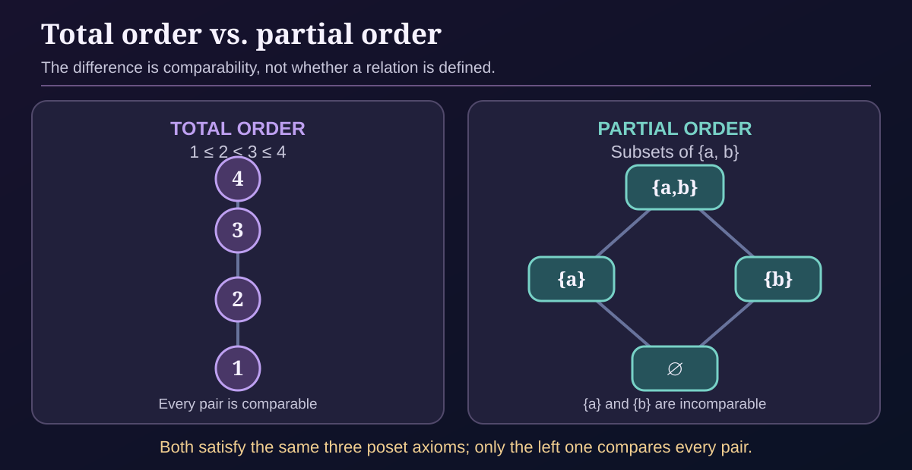
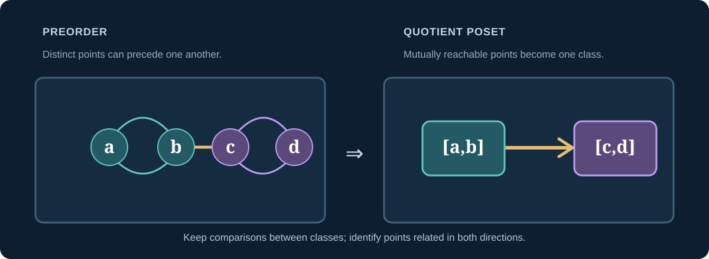
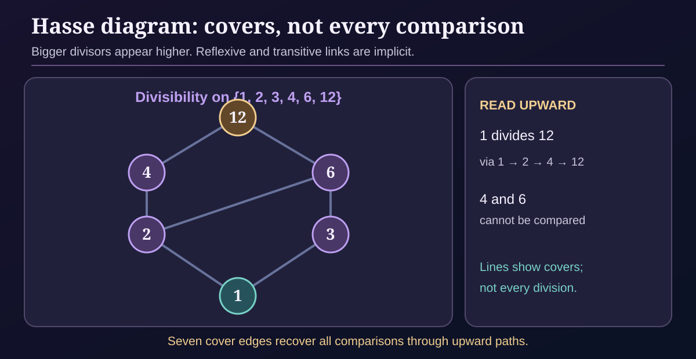
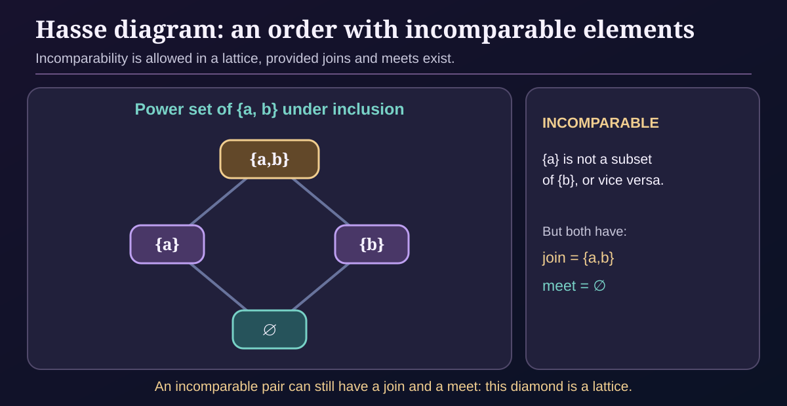
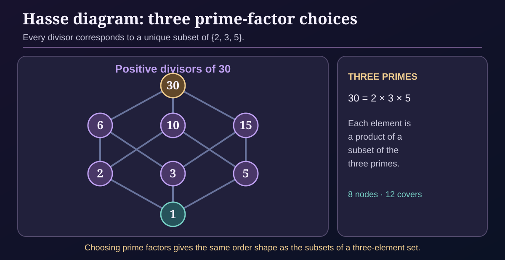
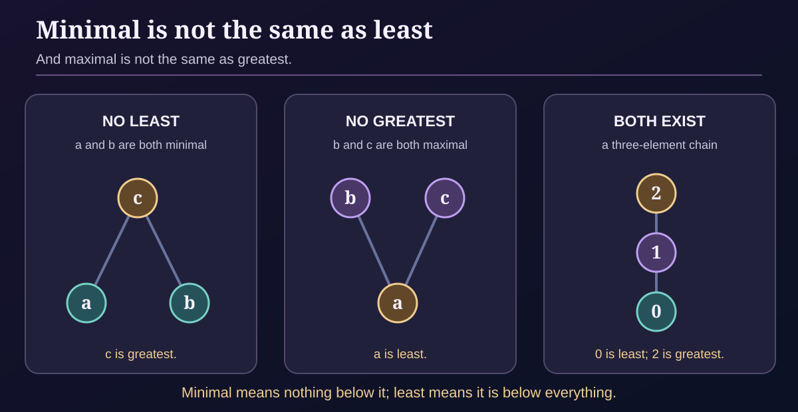
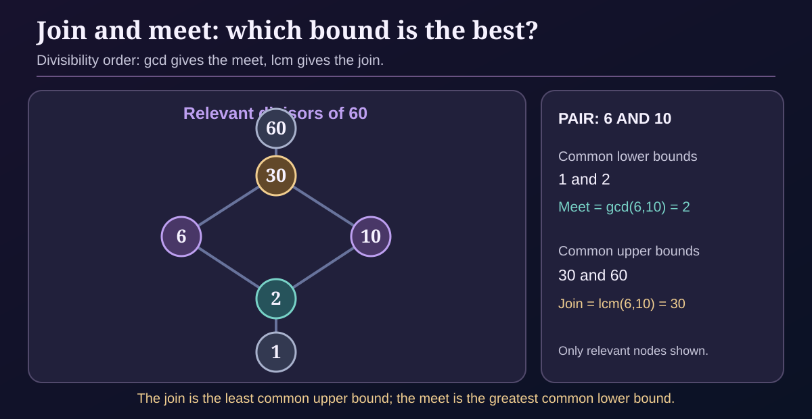
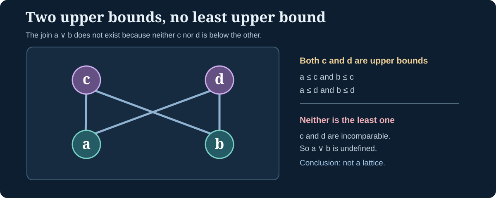

> [!abstract] Prerequisites & where this leads
> **Builds on:** [sets](./set-theory), [binary relations](./functions-relations#relation), and [equivalence classes](./equivalence-relations).
> **Leads to:** [real-number bounds](./real-analysis#supremum-and-infimum), [set-theoretic well-ordering](./set-theory#ordinals-and-well-ordering), and [posets as categories](./category-theory-foundations#a-partial-order-is-a-category).

## Why study order theory?

**The point of order theory is to reason about what depends on, contains, or carries more information than something else, even when not everything can be ranked on a single line.** Ordinary numerical order compares every pair of numbers. Dependencies, permissions, and sets often do not work that way.

Consider two permission sets: one grants **read and write**, while the other grants **read and share**. Neither set contains the other. There is no honest answer to "Which one is greater?" if *greater* means *contains all the permissions of the other*. But we can still identify their **common permissions** (read) and the **smallest set containing both** (read, write, and share). Order theory makes these questions precise. The shared part is an example of a *meet*; the smallest common upper set is a *join*.

The same structure appears when independent tasks can run concurrently, when a compiler gradually discovers facts about a program, and when distributed replicas combine compatible state. It also underlies bounds and fixed-point theorems: under suitable assumptions, we can reason about whether repeatedly adding information reaches a stable result. **Order theory is not just about sorting. It is about comparison, dependence, combination, and what can be concluded when comparisons are incomplete.**

An **order relation** tells us when one object is below, before, contained in, or less informative than another. Throughout, let $P$ be a set with a relation $\preceq$ (read "precedes or is equal to"). We use $\leq$ for numerical order, $\subseteq$ for subset containment, and $\mid$ (read "divides") for divisibility. These different relationships can satisfy the *same structural axioms*, which is why one theory can study them together.

## From relations to preorders and partial orders

> [!definition] Preorder
> A relation $\preceq$ on $P$ is a **preorder** when it is:
> - **Reflexive:** $a\preceq a$ for every $a\in P$.
> - **Transitive:** if $a\preceq b$ and $b\preceq c$, then $a\preceq c$.

A preorder need not be antisymmetric. Two different objects may each precede the other.

**Concrete example:** In a directed graph, define $u\preceq v$ when there is a directed path from $u$ to $v$, allowing a path of length zero. This is reflexive, since each vertex reaches itself in zero steps, and transitive, since paths concatenate. Two different vertices on a directed cycle reach one another, so antisymmetry can fail.

> [!definition] Partial order and poset
> A **partial order** is a reflexive, transitive, **antisymmetric** relation, where antisymmetry requires
> $$
> a\preceq b\ \text{and}\ b\preceq a\quad\Longrightarrow\quad a=b.
> $$
> A set equipped with its specified partial order, $(P,\preceq)$, is a **partially ordered set** or **poset** (read "POH-set").

> [!tip] Important: “partial” does not mean “partially defined”
> **The relation is defined for every pair.** The word *partial* means only that **not every pair must be comparable**: sometimes neither element is below the other.
>
> $
> a\npreceq b\qquad\text{and}\qquad b\npreceq a.
> $
>
> This is called **incomparability**, not an undefined comparison.
>
> **Concrete example:** Under subset inclusion, take $A:=\{\text{read}\}$ and $B:=\{\text{write}\}$. Neither contains the other, so $A$ and $B$ are incomparable. In contrast, $\{\text{read}\}\subseteq\{\text{read},\text{write}\}$ *is* a comparison that holds.
>
> **Do not confuse this with antisymmetry:** if $A\subseteq B$ **and** $B\subseteq A$, then $A=B$. Antisymmetry concerns comparisons that hold in both directions; incomparability concerns pairs for which neither direction holds.

### Worked example: a power set is a poset

Start with $A:=\{a,b\}$. Its **power set** is the set of all its subsets:

$
\mathcal P(A)=\{\varnothing,\{a\},\{b\},\{a,b\}\}.
$

A power set alone is just a set. To obtain a **poset**, specify an order on its elements: here, **subset inclusion** $\subseteq$. We claim that $(\mathcal P(A),\subseteq)$ satisfies all three partial-order axioms.

1. **Reflexivity:** every subset contains itself: $X\subseteq X$. For example, $\{a\}\subseteq\{a\}$.
2. **Antisymmetry:** if $X\subseteq Y$ and $Y\subseteq X$, the two subsets have exactly the same elements, so $X=Y$. For example, $\{a\}\subseteq\{a,b\}$, but the reverse inclusion fails.
3. **Transitivity:** if $X\subseteq Y$ and $Y\subseteq Z$, then $X\subseteq Z$. For example, $\varnothing\subseteq\{a\}\subseteq\{a,b\}$ implies $\varnothing\subseteq\{a,b\}$.

**Why is the order partial?** The two middle elements, $\{a\}$ and $\{b\}$, are **incomparable**:

$
\{a\}\nsubseteq\{b\}\qquad\text{and}\qquad\{b\}\nsubseteq\{a\}.
$

Neither comparison holds, but the order is still well-defined. The power set is therefore a **poset, not a totally ordered set**.

*Figure: Both diagrams satisfy the partial-order axioms. The chain is also total; the subset diamond is not because neither singleton contains the other.*

*Looking ahead:* this particular poset is also a **complete lattice**. Unions give least upper bounds and intersections give greatest lower bounds; we will make those terms precise in [Joins, meets, and lattices](#joins-meets-and-lattices).

| Relation | Reflexive | Antisymmetric | Transitive | Every pair comparable |
| --- | --- | --- | --- | --- |
| $\leq$ on $\mathbb R$ | Yes | Yes | Yes | Yes |
| $\subseteq$ on $\mathcal P(\{a,b\})$ | Yes | Yes | Yes | No |
| Divides on positive integers | Yes | Yes | Yes | No |
| Directed reachability with cycles | Yes | Not necessarily | Yes | Not necessarily |
| Congruence modulo three | Yes | No | Yes | No |

> [!distinction] Symmetry versus antisymmetry
> Equivalence relations require symmetry: $a\sim b$ implies $b\sim a$. Partial orders require antisymmetry: if $a\preceq b$ and $b\preceq a$, then $a=b$. The two properties are not logical negations. Equality itself is both symmetric and antisymmetric.

**Examples of each:** “has the same remainder modulo $3$” is symmetric but not antisymmetric ($1$ and $4$ relate both ways, yet differ). Subset containment is antisymmetric but not symmetric ($\{a\}\subseteq\{a,b\}$, not conversely). Equality satisfies both.

### Turning a preorder into a poset

Even if two distinct elements in a preorder may precede each other, we can identify such elements using an equivalence relation:

$$
a\sim b\quad\Longleftrightarrow\quad a\preceq b\ \text{and}\ b\preceq a.
$$

Read: "a is equivalent to b if and only if each precedes the other."

> [!theorem] Preorder quotient theorem
> The relation $\sim$ is an equivalence relation. On its equivalence classes, define
> $$
> [a]\leq[b]\quad\Longleftrightarrow\quad a\preceq b.
> $$
> This is **well-defined** and turns $P/{\sim}$ into a poset.

> [!proof] Equivalence, representative independence, and order axioms
> **Equivalence:** reflexivity follows from $a\preceq a$. Symmetry follows because the defining condition is mutual comparison. If $a\sim b$ and $b\sim c$, then $a\preceq b\preceq c$ and $c\preceq b\preceq a$, so $a\sim c$ by transitivity.
>
> **Representative independence:** suppose $a'\sim a$, $b\sim b'$, and $a\preceq b$. We have $a'\preceq a\preceq b\preceq b'$, hence $a'\preceq b'$. The converse implication follows by reversing the roles of the representatives. Therefore the relation on classes is independent of which names we choose.
>
> **Poset axioms:** reflexivity and transitivity descend from the preorder. If $[a]\leq[b]$ and $[b]\leq[a]$, then $a\sim b$, so $[a]=[b]$. This is antisymmetry.

*Figure: Mutual reachability defines equivalence classes. Collapsing the classes removes two-way order between distinct nodes.*

**Follow the four vertices in the figure.** Vertices $a$ and $b$ reach each other, as do $c$ and $d$; there is a path from the first pair to the second, but no path back. The quotient has just two distinct points, $[a]=[b]$ and $[c]=[d]$, with $[a]\leq[c]$ but not $[c]\leq[a]$. Mutual reachability has become equality *of classes*, which is precisely what antisymmetry requires.

For graph reachability, the classes are the **strongly connected components**. Their condensation graph is acyclic, and reachability on its vertices is a partial order.

## Worked proof: divisibility is a poset

Let $a,b$ be **positive** integers. Write $a\mid b$ (read "a divides b") when $b=ak$ for some positive integer $k$.

> [!proof] Verify the three order axioms
> **Reflexive:** $a=a\cdot1$, so $a\mid a$.
>
> **Antisymmetric:** assume $a\mid b$ and $b\mid a$, so $b=ak$ and $a=bm$ for positive integers $k,m$. Then $a=a(km)$. Canceling the nonzero integer $a$ yields $km=1$, forcing $k=m=1$, so $a=b$.
>
> **Transitive:** if $b=ak$ and $c=bm$, then $c=a(km)$ and $a\mid c$.

The restriction to **positive** integers is essential. On all integers, $2\mid -2$ and $-2\mid2$, but $2\neq-2$, so antisymmetry fails.

This poset is **not total**: neither $2\mid3$ nor $3\mid2$. Those numbers are incomparable.

## Strict and non-strict order

From a partial order define its strict part by

$$
a\prec b\quad\Longleftrightarrow\quad a\preceq b\ \text{and}\ a\neq b.
$$

Read "a is strictly below b."

> [!theorem] Strict and non-strict descriptions correspond
> The strict part $\prec$ of a partial order is **irreflexive** and **transitive**. Conversely, an irreflexive and transitive relation $\prec$ gives a partial order by defining $a\preceq b$ when $a=b$ or $a\prec b$.

> [!proof] Show both constructions satisfy their axioms
> **Forward:** $a\prec a$ would require $a\neq a$, impossible. If $a\prec b$ and $b\prec c$, transitivity of $\preceq$ gives $a\preceq c$. If $a=c$, then $a\preceq b\preceq a$ forces $a=b$ by antisymmetry, contradicting strictness. Hence $a\prec c$.
>
> **Backward:** equality makes the new relation reflexive. If $a\preceq b$ and $b\preceq a$ with $a\neq b$, then $a\prec b$ and $b\prec a$, so transitivity gives $a\prec a$, contradicting irreflexivity. Thus it is antisymmetric. Its transitivity follows from the transitivity of $\prec$, together with the cases in which either comparison is equality.

Every transitive irreflexive relation is also **asymmetric**: $a\prec b$ prevents $b\prec a$.

**Strict versus non-strict, concretely:** in positive integers ordered by divisibility, $2\preceq4$ and $2\prec4$ because $2\mid4$ and $2\ne4$. We also have $2\preceq2$, but **not** $2\prec2$. Conversely, start with strict inclusion $A\subsetneq B$: it is irreflexive and transitive, and allowing equality gives ordinary inclusion $A\subseteq B$. Asymmetry means that $2\prec4$ rules out $4\prec2$; it is stronger than merely saying $2\prec2$ never happens.

## Total orders, chains, and antichains

> [!definition] Total or linear order
> A partial order is **total** (also called **linear**) if, for every $a,b$, either $a\preceq b$ or $b\preceq a$.

The real numbers under $\leq$ are totally ordered. The subsets of $\{a,b\}$ under $\subseteq$ are partially ordered but **not** totally ordered, because $\{a\}$ and $\{b\}$ are incomparable.

A **chain** is a subset of a poset whose elements are pairwise comparable. An **antichain** has no two **distinct** comparable members. In the divisors of thirty, $\{1,2,6,30\}$ is a chain while $\{2,3,5\}$ is an antichain.

A chain is *not* necessarily a contiguous path of immediate cover relations. It may skip intermediate elements.

**Check both types of subset:** among the divisors of $30$, $1\mid6\mid30$ makes $\{1,6,30\}$ a chain even though $1$ and $30$ are not joined by a single cover edge. Meanwhile $2,3,5$ are pairwise incomparable under divisibility, so $\{2,3,5\}$ is an antichain. A **total order** is a poset whose *entire underlying set* is a chain; the usual order on $\{1,2,3,4\}$ is an example.

*Figure: Preorders require reflexivity and transitivity. Antisymmetry makes a partial order; symmetry makes an equivalence relation. Equality satisfies both. A poset is a set equipped with a partial order, and chains and antichains are subsets of that poset, illustrated by the inclusion order on the subsets of $\{a,b\}$.*

## Hasse diagrams: reconstructing the finite order

A **Hasse diagram** draws the **cover relations** of a finite poset. We say $b$ covers $a$ when $a\prec b$ but there is no $c$ with $a\prec c\prec b$. Larger elements appear higher. Reflexive loops and transitively implied links are omitted.

*Figure: In a finite divisibility poset, an upward chain of cover links proves that the bottom element divides the top.*

**Which links are covers?** In the divisors of $12$, $2$ covers $1$, and $4$ covers $2$. Yet $4$ does **not** cover $1$: $1\prec2\prec4$ supplies an intermediate element, so the diagram omits a direct $1$–$4$ edge. It also omits loops such as $2\preceq2$.

To decide whether $a\preceq b$, find an **upward path** from $a$ to $b$ (or check $a=b$). An **undirected path** is not enough. The numbers $4$ and $6$ are incomparable, even though both share neighbors elsewhere in the graph.

*Figure: This four-element diamond **is a lattice**. The incomparable middle sets still have a least upper bound and greatest lower bound.*

*Figure: Divisors of thirty have the same order shape as the subsets of a three-element set.*

> [!distinction] Finite Hasse diagrams versus dense infinite orders
> A Hasse diagram makes cover relations visible in a **finite** poset. In a dense order such as the rationals, there is always another rational between two distinct ordered values, so **no** distinct pair is a cover. A picture of cover edges alone cannot reconstruct that infinite order.

## Bounds and extrema: maximal is not greatest

For $S\subseteq P$, an element $u\in P$ is an **upper bound** if $s\preceq u$ for every $s\in S$. A **lower bound** reverses the comparison.

**Find all bounds:** work in the positive divisors of $12$, ordered by divisibility, with $S:=\{2,3\}$. Its upper bounds *in this poset* are $6$ and $12$, because both $2$ and $3$ divide them. Its only lower bound is $1$, which divides both. Bounds belong to the surrounding poset $P$; they do **not** have to belong to $S$.

> [!definition] Four different extrema
> An element $m\in S$ is **maximal in S** if no $s\in S$ satisfies $m\prec s$. It is **greatest in S** if $s\preceq m$ for *every* $s\in S$. **Minimal** and **least** reverse the order.

Every greatest element is maximal; a maximal element might be incomparable with other elements. There can be multiple maximal elements, or none.

**Apply all four names to $S=\{2,3\}$** inside the divisibility poset above. Each is **maximal** (nothing else in $S$ lies above it) and **minimal** (nothing else in $S$ lies below it), but $S$ has **no greatest** and **no least** element, because $2$ and $3$ are incomparable. By contrast, the full divisor set of $12$ has least element $1$ and greatest element $12$.

> [!counterexample] Two maximal elements but no greatest element
> On $P=\{a,b\}$ with only reflexive comparisons, both $a$ and $b$ are maximal and minimal. Neither is greatest or least because neither compares with the other.

*Figure: In the left poset, a and b are minimal but neither least; in the middle, b and c are maximal but neither greatest. In the right-hand chain, 0 is least and 2 is greatest.*

> [!counterexample] No maximal element at all
> In $(\mathbb N,\leq)$, every $n$ has a greater number $n+1$. There is no maximal element, even though every finite nonempty subset has a greatest element.

> [!theorem] In a finite poset, a unique maximal element is greatest
> A finite nonempty poset with exactly one maximal element $m$ satisfies $a\preceq m$ for every $a$.

> [!proof] Follow a finite ascending chain
> Starting at $a$, if it is not maximal, choose something strictly above it. Repeat. An ascending strict chain cannot continue forever in a finite set, so it ends at some maximal element. The only such element is $m$. By transitivity, $a\preceq m$.

**Why finiteness matters.** Take a disjoint union of the infinite chain $0<1<2<\cdots$ and one isolated element $m$. That $m$ is the **unique** maximal element, yet is incomparable with every integer and hence is **not** greatest.

**Finite check:** in the divisors of $12$, only $12$ is maximal: every other divisor has a strictly larger multiple in the same set. Finiteness guarantees that every upward path eventually reaches $12$, so it is also greatest. The isolated-$m$ example shows exactly what fails without finiteness.

## Joins, meets, and lattices

A **least upper bound**, or **supremum** (read "SOO-premum"), is an upper bound below all other upper bounds. A **greatest lower bound**, or **infimum** (read "in-FEE-mum"), is above all other lower bounds. Each, when it exists, is unique by antisymmetry.

**Bounds need not be members of the set.** In $(\mathbb R,\leq)$, take $S:=(0,1)$. Every $u\geq1$ is an upper bound, with **supremum** $\sup S=1$; every $\ell\leq0$ is a lower bound, with **infimum** $\inf S=0$. Neither $0$ nor $1$ belongs to $S$, so $S$ has neither a least nor a greatest element. This is why *supremum* is not just another word for *maximum*.

For a pair $a,b$, the least upper bound is the **join** $a\vee b$ (read "a join b"), and the greatest lower bound is the **meet** $a\wedge b$ (read "a meet b").

> [!definition] Lattice, bounded lattice, complete lattice
> A **lattice** is a poset in which every **pair** has a join and meet. It is **bounded** if there are a greatest element $\top$ and a least element $\bot$. It is **complete** if **every subset** has a join and meet, including the empty subset.

> [!example] One small example of all three notions
> Let $X:=\{\text{read},\text{write}\}$ and order $\mathcal P(X)$ by inclusion. Its two incomparable middle elements are $A:=\{\text{read}\}$ and $B:=\{\text{write}\}$. Their join is $A\vee B=X$ and their meet is $A\wedge B=\varnothing$. Every pair has both, so this is a **lattice**. Its least element is $\bot=\varnothing$ and greatest element is $\top=X$, so it is **bounded**. Every subset of this four-element poset also has a join and meet, so it is **complete**. In particular, the *empty family of elements* has join $\bot$ and meet $\top$.

**Power-set worked example.** In $(\mathcal P(X),\subseteq)$ (read "the power set of X ordered by inclusion"),

$$
A\vee B=A\cup B,\qquad A\wedge B=A\cap B.
$$

To justify the first formula: $A\cup B$ contains $A$ and $B$, so it is an upper bound. Every other upper bound contains both $A$ and $B$, so also contains their union. Thus the union is the **least** upper bound. Dually, the intersection is the greatest lower bound. For arbitrary families, the union and intersection give joins and meets, so $\mathcal P(X)$ is complete; the empty join is $\varnothing$, and the empty meet is $X$.

**Divisibility lattice.** On positive divisors of a fixed integer $n$, the join is $\operatorname{lcm}(a,b)$ (read "least common multiple"), and the meet is $\gcd(a,b)$ (read "greatest common divisor"). Both remain divisors of $n$.

**One pair, all of its bounds.** Work in the positive divisors of $60$, ordered by divisibility, and compare $6$ with $10$. Their **common lower bounds** are $1$ and $2$, because both $6$ and $10$ are divisible by those numbers. The greatest is $2$, so $6\wedge10=2$. Their **common upper bounds** *within this poset* are $30$ and $60$, since each is divisible by both $6$ and $10$. The least is $30$, so $6\vee10=30$.

*Figure: The diagram shows just the six relevant divisors, not every divisor of 60. It separates **being an upper bound** from being the **least** upper bound, and likewise for lower bounds.*

### An explicit poset that is not a lattice

Let $P:=\{a,b,c,d\}$. Require $a\prec c$, $a\prec d$, $b\prec c$, and $b\prec d$, with no other strict comparisons. Both $c$ and $d$ are upper bounds of $\{a,b\}$. Neither is below the other, so **no least upper bound exists**. Hence $a\vee b$ does not exist.

*Figure: This bow-tie is not a lattice. The **diamond** in the previous Hasse example is a lattice, so the two shapes must not be confused.*

### Lattice laws and Boolean algebra

Every lattice satisfies commutativity, associativity, idempotence, and absorption for join and meet:

$$
\begin{aligned}
a\vee b&=b\vee a,&a\wedge b&=b\wedge a,\\
(a\vee b)\vee c&=a\vee(b\vee c),&(a\wedge b)\wedge c&=a\wedge(b\wedge c),\\
a\vee a&=a,&a\wedge a&=a,\\
a\vee(a\wedge b)&=a,&a\wedge(a\vee b)&=a.
\end{aligned}
$$

These laws can be derived by the uniqueness of least upper and greatest lower bounds. For example, $a\wedge b\preceq a$, so joining $a$ with $a\wedge b$ gives $a$.

**Check the laws with sets.** With $A=\{r\}$ and $B=\{w\}$, commutativity gives $A\cup B=B\cup A=\{r,w\}$; idempotence gives $A\cup A=A$; and absorption gives $A\cup(A\cap B)=\{r\}\cup\varnothing=A$. For associativity, $(A\cup B)\cup C=A\cup(B\cup C)$ for any third set $C$: either grouping collects precisely the elements appearing in at least one of the three sets. Intersections give the corresponding meet examples.

A **distributive lattice** additionally satisfies $a\wedge(b\vee c)=(a\wedge b)\vee(a\wedge c)$ and its dual. Power sets are distributive because intersection distributes over union and vice versa. Not all lattices are distributive: the five-element lattice $M_3$, with three incomparable elements between bottom and top, is a counterexample.

**See both outcomes:** for $A:=\{r\}$, $B:=\{w\}$, and $C:=\{r,w\}$, the left side $A\cap(B\cup C)$ is $\{r\}$; the right side $(A\cap B)\cup(A\cap C)$ is $\varnothing\cup\{r\}=\{r\}$. In $M_3$, instead choose three distinct middle elements $p,q,r$. Since $q\vee r=\top$, we have $p\wedge(q\vee r)=p$, while $(p\wedge q)\vee(p\wedge r)=\bot\vee\bot=\bot$. The two sides differ, so distributivity is **not** a law of every lattice.

In the Boolean algebra of subsets, **AND** behaves like intersection (meet), **OR** behaves like union (join), and **NOT** behaves like complement. This is the structural link to [Propositional Logic](./propositional-logic-zeroth-order-logic). Inclusive OR is Boolean join, not ordinary integer addition.

**One Boolean-algebra calculation:** for $X:=\{\text{read},\text{write}\}$ and $A:=\{\text{read}\}$, its complement (NOT) relative to $X$ is $A^c=\{\text{write}\}$. Then $A\cap A^c=\varnothing$ (AND: nothing belongs to both), while $A\cup A^c=X$ (inclusive OR: everything belongs to at least one). The complement depends on the chosen universe $X$.

> [!distinction] Real-number completeness versus complete lattices
> $(\mathbb R,\leq)$ is a lattice because every pair has a maximum and minimum, but it is **not a complete lattice**: all of $\mathbb R$ lacks a supremum inside $\mathbb R$. The real-number completeness axiom applies only to **nonempty, bounded-above subsets**.

## Well-foundedness and well-ordering

> [!definition] Well-founded order and well-order
> A strict partial order is **well-founded** if every nonempty subset has a **minimal** element. A total order is a **well-order** if every nonempty subset has a **least** element.

Every finite poset is well-founded, because an infinite strict descending chain cannot exist inside a finite set. The natural numbers in their usual order are well-ordered. The integers are not: $\mathbb Z$ has no least element. The usual order on $\mathbb R$ is not a well-order: $(0,1)$ has no least member.

A two-element **antichain** is well-founded because every nonempty subset has minimal elements, but is not well-ordered because it is not total. The distinction between "minimal" and "least" matters.

**Compare three sets:** every nonempty subset of $(\mathbb N,\leq)$ has a *least* number (for example, the positive multiples of $3$ have least element $3$). The two-point antichain $\{a,b\}$ has minimal points but no least point, so it is well-founded but not well-ordered. The positive real interval $(0,1)$ has **no minimal element** in its usual order, since for every $x$ in it, $x/2$ is a smaller member. Thus the usual strict order on the real numbers is not well-founded.

Well-founded relations support **induction on predecessors**: assume a property holds for all strict predecessors of $a$, then prove it for $a$. Ordinary induction on $\mathbb N$ is an instance. [Set Theory](./set-theory#ordinals-and-well-ordering) develops ordinals, transfinite induction, and the well-ordering theorem.

**Induction in action:** to prove $0+1+\cdots+n=n(n+1)/2$ for all $n\in\mathbb N$, establish it at $n=0$, where both sides are $0$. For $n>0$, assume the result at the strict predecessor $n-1$; adding $n$ gives $(n-1)n/2+n=n(n+1)/2$. More general well-founded induction allows an element to depend on **all** of its strict predecessors rather than just the immediately previous natural number.

## Order-preserving maps and order isomorphisms

Let $f:P\to Q$ map one poset $(P,\preceq_P)$ to another $(Q,\preceq_Q)$.

> [!definition] Monotone map, embedding, isomorphism
> - **Order-preserving / monotone:** $a\preceq_P b\Rightarrow f(a)\preceq_Q f(b)$.
> - **Order embedding:** $a\preceq_P b\Longleftrightarrow f(a)\preceq_Q f(b)$, so the order can also be recovered from the images.
> - **Order isomorphism:** a bijective order embedding.

An embedding also preserves **incomparability**. An injective monotone map need not be an embedding: map two incomparable points to $0$ and $1$ in the chain $0<1$. The map is monotone vacuously and injective, but it creates a comparison that did not exist in its domain.

**Three maps to distinguish the concepts:**
- **Monotone, not an embedding:** $f:\mathbb R\to\mathbb Z$ given by $f(x):=\lfloor x\rfloor$ preserves $x\leq y$, but $f(1.8)\leq f(1.2)$ even though $1.8\nleq1.2$; it does not reflect order.
- **Embedding, not an isomorphism onto the stated codomain:** $g:\mathbb N\to\mathbb N$ given by $g(n):=2n$ preserves and reflects $\leq$, but odd naturals are not in its image.
- **Isomorphism:** $h:\mathbb Z\to\mathbb Z$ given by $h(n):=n+1$ preserves and reflects the usual order and is bijective; its inverse is $h^{-1}(n)=n-1$.

The next example shows an order isomorphism between objects that do not even look alike: divisors and subsets.

### Worked order isomorphism: divisors of thirty and a power set

Let $D:=\{1,2,3,5,6,10,15,30\}$, ordered by divisibility. Define

$$
F(d)=\{p\in\{2,3,5\}:p\mid d\}.
$$

Read: "F of d is the set of primes among two, three, five that divide d." Thus

$$
F(1)=\varnothing,\quad F(6)=\{2,3\},\quad F(30)=\{2,3,5\}.
$$

> [!proof] Verify bijectivity and both directions of order
> **Bijection:** Every divisor of $30=2\cdot3\cdot5$ is the product of a unique subset of these three distinct primes. Therefore each subset occurs exactly once.
>
> **Forward:** if $a\mid b$, each prime dividing $a$ also divides $b$, so $F(a)\subseteq F(b)$.
>
> **Backward:** if $F(a)\subseteq F(b)$, all the prime factors of the square-free divisor $a$ also occur in $b$. Hence $a\mid b$.
>
> Thus $a\mid b\Longleftrightarrow F(a)\subseteq F(b)$: this is an order isomorphism.

The eight-element divisibility cube and the power-set cube have the same **order structure**, even though their elements are different kinds of mathematical objects. Isomorphisms preserve comparisons, extrema, bounds, joins, meets, chains, and antichains.

## Why order theory appears everywhere

- **Dependencies:** reachability in an acyclic directed graph yields a partial order (choosing arrow direction consistently). Cycles give a preorder, whose quotient by mutual reachability is a poset.
- **Permissions and information:** "contains no more permission or information than" can define partial orders, but only becomes a lattice when appropriate joins and meets exist.
- **Distributed state:** a **join-semilattice** requires a join for every pair, but not a meet. For example, the **nonempty** subsets of $\{a,b\}$ under inclusion form a join-semilattice: unions stay nonempty and give joins. Yet $\{a\}$ and $\{b\}$ have no meet *inside this poset* because their intersection $\varnothing$ was excluded. This distinction matters when replicas merge state but need no general intersection operation.
- **Categories:** a poset can be interpreted as a category with one arrow $a\to b$ whenever $a\preceq b$. For instance, $\varnothing\subseteq\{a\}\subseteq\{a,b\}$ gives arrows $\varnothing\to\{a\}$ and $\{a\}\to\{a,b\}$; composing them yields the arrow $\varnothing\to\{a,b\}$. Reflexivity supplies identity arrows. See [Category Theory Foundations](./category-theory-foundations#a-partial-order-is-a-category).

The governing habit is to verify **which axioms the relation has**, rather than assuming every ordering behaves like the real number line.
