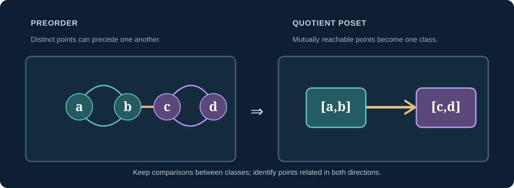
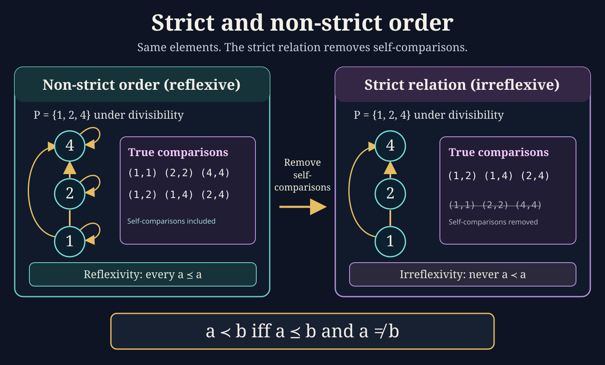

> [!abstract] Prerequisites & where this leads
> **Builds on:** [sets](./set-theory), [binary relations](./functions-relations#relation), and [equivalence classes](./equivalence-relations).
> **Leads to:** [real-number bounds](./real-analysis#supremum-and-infimum), [set-theoretic well-ordering](./set-theory#ordinals-and-well-ordering), and [posets as categories](./category-theory-foundations#a-partial-order-is-a-category).

## Why study order theory?

**Suppose one permission set allows read and write, while another allows read and share. Which is more permissive?**

Neither contains the other: each grants an action the other lacks. But we can still identify what they share (**read**) and the permissions needed to include both (**read, write, share**). The comparison is useful even without a winner.

**Order theory studies relationships like this.** Instead of requiring every pair of objects to be ranked, it asks what follows when one object is **contained in**, **depends on**, or **can reach** another. The objects might be sets, tasks, programs, or states of a system. What matters is the structure of their comparisons.

Now compare **named roles** rather than permission sets. `Editor` and `Author` might grant exactly the same actions while remaining distinct roles. Each is no more permissive than the other. This motivates a **preorder**: a comparison can treat different objects as equivalent *for a particular purpose* without declaring them identical.

Once we understand these relationships, we can ask deeper questions. What do two states have in common? What is the smallest state that includes both? When can repeated updates reach a stable result? The chapter builds the tools for answering such questions, progressing from preorders and partial orders to lattices, order duality, fixed points, and connections between different representations.

### The organizing idea: different comparisons, the same axioms

> [!intuition] An order is not necessarily a ranking of numbers
> An **order relation** tells us when one object is **below, before, contained in, or less informative** than another. These are only examples: **the objects can be anything we choose to study**—numbers, sets, tasks, programs, propositions, graph vertices, or abstract elements. What matters is whether **the comparison we define** satisfies the relevant axioms, not what kinds of objects we compare.
>
> **Different relationships can satisfy the same structural axioms.** That is why one theory can study all of them: a proof using only those axioms can apply in every setting where they hold.

In [Functions & Relations](./functions-relations#from-binary-relations-to-preorders), we began with an arbitrary relation $R\subseteq P\times P$ and wrote $aRb$ whenever $(a,b)\in R$. Order theory asks which of those relations satisfy additional axioms. Changing the symbol alone cannot supply those properties.

This is another instance of the [common set–structure–axioms pattern](./set-theory#the-common-thread-set-structure-axioms): **the set supplies the objects; the chosen relation supplies the comparison; the axioms determine whether we have a preorder, partial order, or total order.** The same collection can support different orders, or a relation that is not an order at all.

Throughout this chapter, $P$ stands for **whichever set of objects we are studying**, and $\preceq$ (read "precedes or is equal to," or "is below in this order") is our **generic name for an order-like comparison on that set**. It is not another kind of numerical less-than. Its meaning is specified **when we choose the objects and their relation**.

> [!distinction] The general symbol is not an extra comparison
> We use $\preceq$ when stating a definition or theorem that should work for many kinds of order. When we choose a concrete setting, we can replace it with that setting's familiar symbol:
> - **Numbers:** $\preceq$ can mean $\leq$ ("less than or equal to").
> - **Sets:** $\preceq$ can mean $\subseteq$ ("is a subset of").
> - **Positive integers under divisibility:** $\preceq$ can mean $\mid$ ("divides").
> - **Vertices of a directed graph:** $\preceq$ can mean $\leadsto$ ("can reach by a directed path").
>
> These are **different relations**, not four names for one universal comparison. The symbol $\preceq$ is simply the common notation we use to reason about whichever relation has been chosen.

The table uses each relation's **conventional concrete symbol** rather than repeating $\preceq$ in every row:

| Objects being compared | What the comparison means | Concrete example |
| --- | --- | --- |
| Real numbers | $a\leq b$: $a$ is no greater than $b$ | $2\leq 6$ |
| Sets | $A\subseteq B$: every member of $A$ is in $B$ | $\{r\}\subseteq\{r,w\}$ |
| Positive integers | $a\mid b$ (read "a divides b"): $b$ is an integer multiple of $a$ | $2\mid6$ |
| Vertices in a directed graph | $u\leadsto v$: a directed path goes from $u$ to $v$, possibly of length zero | $u\leadsto v$ along a path |

**Watch the notation become concrete.** Choose $P:=\mathcal P(\{r,w\})$, the set of all subsets of $\{r,w\}$, and **define** the comparison by

$$
A\preceq B\quad\Longleftrightarrow\quad A\subseteq B.
$$

With this choice, $\{r\}\preceq\{r,w\}$ and $\{r\}\subseteq\{r,w\}$ say **exactly the same thing**. We have not introduced two relationships. We have given the general symbol a particular meaning.

Now consider the abstract rule of **transitivity**:

$$
a\preceq b,\quad b\preceq c
\quad\Longrightarrow\quad a\preceq c.
$$

For sets with the chosen interpretation, this says that $A\subseteq B$ and $B\subseteq C$ imply $A\subseteq C$. If instead we choose $P:=\mathbb Z_{>0}$ (positive integers) and declare $a\preceq b$ to mean $a\mid b$, the **same abstract rule** says that $a\mid b$ and $b\mid c$ imply $a\mid c$. That ability to reuse one argument is why we introduce generic notation.

**The symbol alone does not determine truth.** For example, $2\leq3$ is true, but $2\nmid3$ (read "two does not divide three"). So $2\preceq3$ has no definite meaning until we specify which relation $\preceq$ denotes.

> [!distinction] Similar shapes do not guarantee the same meaning
> The curved $\preceq$ is a conventional choice for a general **non-strict** comparison, including a preorder that may relate two distinct objects in both directions. The straighter $\leq$ is conventional for numbers, although mathematicians sometimes use it for abstract orders too. The symbols $\subseteq$, $\mid$, and $\leadsto$ tell you which **specific** comparison is intended. Later, $\prec$ denotes a **strict** comparison, which is different from $\preceq$. In a preorder, even $a\preceq b$ and $b\preceq a$ need not imply that $a=b$.

The similarities do not erase the differences. Numerical $\leq$ compares every pair; subset inclusion and positive-integer divisibility can leave some pairs **incomparable**; directed reachability can compare distinct vertices in **both directions** when a cycle exists. The next section turns these differences into precise definitions: **preorder, partial order, and total order**.

**Why this is powerful:** instead of proving separate, unrelated facts about numbers, sets, divisibility, and reachability, we can identify which properties a proof actually needs and reuse the argument across all four. That is the abstraction behind order theory.

## From relations to preorders and partial orders

In the illustration, we compare **named roles by allowed actions**: $r\preceq s$ means every action allowed to $r$ is also allowed to $s$. This comparison tells us about permissions, **not whether the role identities are equal**.

*Figure: The hierarchy classifies relations by the axioms they satisfy; it does **not** turn a relation that fails antisymmetry into one that satisfies it merely by adding a label. Editor and Author compare both ways because their **permission sets agree**, not because transitivity demands it. To obtain a poset from this preorder, we instead compare **equivalence classes** of roles. A total order of the original role names requires a separate tie-break.*

> [!definition] Preorder
> A relation $\preceq$ on $P$ is a **preorder** when it is:
> - **Reflexive:** $a\preceq a$ for every $a\in P$.
> - **Transitive:** if $a\preceq b$ and $b\preceq c$, then $a\preceq c$.

A preorder need not be antisymmetric. Two different objects may each precede the other. That is **not a defect**: the comparison may be about what objects *can do*, *imply*, or *reach*, rather than whether they are literally identical.

> [!distinction] Transitivity does not cause two-way comparison
> **Reflexivity** only requires $a\preceq a$. **Transitivity** only requires that $a\preceq b$ and $b\preceq c$ imply $a\preceq c$. Neither rule **requires** two distinct objects to compare in both directions, and neither **forbids** it.
>
> In the diagram, Editor and Author compare both ways **because they grant the same actions**. From $\text{Editor}\preceq\text{Author}$ and $\text{Author}\preceq\text{Editor}$, transitivity gives $\text{Editor}\preceq\text{Editor}$ and $\text{Author}\preceq\text{Author}$—facts reflexivity already guarantees. It **does not** give $\text{Editor}=\text{Author}$.
>
> The additional rule **antisymmetry** *would* force equality whenever both directions hold. A partial order requires that rule; a preorder does not. To construct a poset from **this particular preorder**, we must instead compare classes of permission-equivalent roles, not pretend the original roles have become identical.

### Why not require antisymmetry immediately?

Suppose two software components are different implementations of the same externally observable behavior. We may be able to say "implementation A provides at least the capabilities of B" and also the reverse. That does not make their source code, ownership, or identities equal. Insisting on antisymmetry would force us either to identify distinct objects too early or to abandon the useful comparison.

A preorder can recognize two different objects as **equivalent for the purpose of one comparison** without claiming that the objects themselves are identical. This is the reason preorders appear before posets.

> [!distinction] Equivalent under a comparison does not mean the same object
> Imagine two separately named roles, **Viewer** and **Auditor**, each granting only **read** permission. Compare roles by the permissions they grant. Then both comparisons hold:
>
> $$
> \text{Viewer}\preceq\text{Auditor}
> \qquad\text{and}\qquad
> \text{Auditor}\preceq\text{Viewer}.
> $$
>
> But **Viewer and Auditor are still two distinct roles**: they may have different identities, users, or purposes. Mutual comparison tells us only that **this particular test cannot distinguish them**.
>
> If we care only about permissions, we can construct a **new poset whose elements are groups of equivalent roles**, such as the class $\{\text{Viewer},\text{Auditor}\}$. We have **not deleted, renamed, or merged the original roles in the application**. We have changed what counts as one element in our mathematical model.
>
> **Preorder:** keep the separate roles, even when they compare both ways. **Quotient poset:** treat each mutually equivalent group as a single element **in the new structure**.

That distinction is the point of [passing from a preorder to its quotient poset](#turning-a-preorder-into-a-poset): *equivalent for this comparison* is weaker than *literally equal*.

### Three places preorders arise naturally

#### 1. Roles and permissions: why capability comparisons can form a preorder

Let $R$ be a set of **named roles**, and let $A(r)$ be the set of actions permitted to role $r$. Define

$$
r\preceq s\quad\Longleftrightarrow\quad A(r)\subseteq A(s).
$$

Read $r\preceq s$ as "role r grants no more actions than role s." This relation is **reflexive** because every permission set is a subset of itself, and **transitive** because subset inclusion is transitive. But the elements being compared are **named roles**, not permission sets, so antisymmetry can fail. A partial order can compare capabilities too; what matters is whether two-way comparison forces equality of the *elements being ordered*:

| Role | Allowed actions |
| --- | --- |
| Viewer | read |
| Auditor | read |
| Editor | read, write |
| Publisher | read, publish |

Here $\text{Viewer}\preceq\text{Auditor}$ **and** $\text{Auditor}\preceq\text{Viewer}$, yet the roles have different names and identities. Both are below Editor and Publisher, while Editor and Publisher are incomparable because each grants an action the other lacks. **The original roles are not merged:** a later quotient creates a separate mathematical object, the equivalence class containing Viewer and Auditor.

**Why useful?** An access-control audit can group roles with identical effective privileges, identify roles that are strictly more permissive, and distinguish incomparable privileges. The system can still keep the original role names for assignments and audit logs. This is a simplified action-set model; contextual or conditional authorization policies require a richer description of allowed behavior.

#### 2. Logical implication: different statements can mean the same thing

Let $P$ and $Q$ be predicates about a real input $x$, and define

$$
P\preceq Q\quad\Longleftrightarrow\quad
\text{for every }x\in\mathbb R,\ P(x)\Rightarrow Q(x).
$$

The arrow $\Rightarrow$ is read "implies." The statement $P\preceq Q$ means **every case satisfying P also satisfies Q**: P is at least as restrictive as Q. Why does that give us a preorder? We can **derive both required properties from the meaning of implication**.

> [!proof] Why implication is reflexive and transitive
> **What implication means:** $A\Rightarrow B$ is false only if $A$ is true and $B$ is false. When $A$ is false, the implication is true: it does not claim that $A$ must hold.
>
> **Reflexivity:** Choose any real input $x$. If $P(x)$ is true, then $P(x)$ is true. If $P(x)$ is false, $P(x)\Rightarrow P(x)$ is still true because its premise is false. Either way, $P(x)\Rightarrow P(x)$ holds. Since this works for **every** $x$, the definition gives $P\preceq P$.
>
> **Transitivity:** Assume $P\preceq Q$ and $Q\preceq T$. Choose any real input $x$ and suppose $P(x)$ holds. The first comparison gives $Q(x)$; the second gives $T(x)$. Therefore $P(x)\Rightarrow T(x)$ holds for every $x$, so $P\preceq T$.
>
> **Concrete chain:** $x>10$ implies $x>5$, and $x>5$ implies $x>0$. So $x>10$ implies $x>0$.
>
> We have proved both preorder axioms. Neither proof requires two mutually implying predicates to be literally the same expression.

Take $P(x):\iff x>10$, $Q(x):\iff x>0$, and $T(x):\iff (x\ge0\ \text{and}\ x\ne0)$. Then $P\preceq Q$, and $Q\preceq T$ **and** $T\preceq Q$. The expressions $Q$ and $T$ are different formulas, even though they have exactly the same truth value for every real input.

**Why useful?** Query optimizers, theorem provers, validation rules, and type-refinement systems compare predicates by implication. They can recognize equivalent conditions without requiring identical syntax, and distinguish a stronger condition from a weaker one. The relevant notion of equivalence is **logical equivalence in the chosen domain**, not literal textual equality.

#### 3. Directed reachability: cycles are comparisons, not mistakes

Before asking whether one vertex can **reach** another, we need to define the structure we're moving through.

> [!definition] Directed graph, vertex, edge, and path
> A **directed graph** $G=(V,E)$ consists of a set $V$ of **vertices** (the objects, drawn as points) and a set $E\subseteq V\times V$ of **directed edges** (arrows connecting vertices).
>
> An edge $(u,v)\in E$, drawn $u\to v$, allows us to travel **from $u$ to $v$**. It does not automatically allow travel back from $v$ to $u$: that would require another directed edge or path.
>
> A **directed path** from $u$ to $v$ follows a finite sequence of arrows **in their indicated direction**, beginning at $u$ and ending at $v$. Its **length** is the number of edges followed. A path of **length zero** uses no edges and stays at the same vertex. Here paths may revisit vertices; some graph-theory texts call these *walks*, but the reachability relation is the same under either convention.

*Figure: Arrows specify the allowed direction of travel. The **reflexivity** and **transitivity** of reachability make it a preorder; a cycle between distinct vertices can violate **antisymmetry**.*

Now choose **reachability** as our comparison. Define $u\preceq v$ to mean that a directed path runs from vertex $u$ to vertex $v$. Read this as **"$u$ can reach $v$,"** not as a numerical less-than statement.

**Check the preorder properties:**

- **Reflexivity:** every vertex reaches itself by a path of length zero, so $u\preceq u$.
- **Transitivity:** if $u$ can reach $v$ and $v$ can reach $w$, following those paths in sequence shows $u$ can reach $w$.

A **directed cycle** follows one or more arrows and returns to its starting vertex. In the diagram, the two distinct vertices $b$ and $c$ lie on a cycle: both $b\preceq c$ and $c\preceq b$ hold, even though $b\neq c$. This violates **antisymmetry**, so reachability need not be a partial order. The cycle isn't an error; it is exactly what the chosen relation records.

Consider a service-call graph with calls from Scheduler to Worker, Worker back to Scheduler, and Worker to Storage. Scheduler and Worker can reach each other, so both comparisons hold even though they are different services. Both can reach Storage, but Storage has no path back to either.

**Why useful?** Reachability answers which services can be contacted along a chain of calls. The equivalence classes under **mutual reachability** are the strongly connected components. Collapsing them gives an acyclic summary graph and a partial order between the components, without claiming that the services inside a component are identical. This is developed algorithmically in [Advanced Graph Theory](./advanced-graph-theory#directed-reachability-and-strongly-connected-components).

### A general recipe: order what we observe

The role and predicate examples share one construction. Suppose a set $X$ contains objects with an **observation map** $f:X\to Y$, where $Y$ is a poset. We compare objects by their observations:

$$
x\preceq_f y\quad\Longleftrightarrow\quad f(x)\leq_Y f(y).
$$

For roles, $f(r)$ is the allowed-action set. For predicates, $f(P)$ is the set of inputs on which $P$ is true. In both cases, $Y$ is a set of subsets ordered by inclusion.

> [!theorem] Comparing through observations always gives a preorder
> If $\leq_Y$ is a partial order, then $\preceq_f$ is reflexive and transitive. In fact, $\preceq_f$ is antisymmetric **if and only if** $f$ is injective. Thus distinct objects with identical observations are exactly the obstruction.

> [!proof] The properties are inherited from the observed order
> **Reflexivity:** $f(x)\leq_Y f(x)$ implies $x\preceq_f x$.
>
> **Transitivity:** from $f(x)\leq_Y f(y)$ and $f(y)\leq_Y f(z)$, transitivity in $Y$ gives $f(x)\leq_Y f(z)$.
>
> **Why antisymmetry can fail:** if $x\ne y$ but $f(x)=f(y)$, then $x\preceq_f y$ and $y\preceq_f x$. The observations agree, but the objects do not. Conversely, if $f$ is injective and both $x\preceq_f y$ and $y\preceq_f x$, antisymmetry of $\leq_Y$ gives $f(x)=f(y)$ and injectivity gives $x=y$. This proves the claimed equivalence.

**The payoff:** a preorder is often the correct first model whenever we compare things by *meaning*, *behavior*, or *capabilities*. A poset is what we get once mutually equivalent observations are treated as one object. This provides a recurring link between [equivalence classes](./equivalence-relations), [graph components](./advanced-graph-theory#directed-reachability-and-strongly-connected-components), and order theory.

> [!definition] Partial order and poset
> A **partial order** is a reflexive, transitive, **antisymmetric** relation, where antisymmetry requires
> $$
> a\preceq b\ \text{and}\ b\preceq a\quad\Longrightarrow\quad a=b.
> $$
> A set equipped with its specified partial order, $(P,\preceq)$, is a **partially ordered set** or **poset** (read "POH-set").

> [!tip] Important: “partial” does not mean “partially defined”
> **The relation is defined for every pair.** The word *partial* means only that **not every pair must be comparable**: sometimes neither element is below the other.
>
> $$
> a\npreceq b\qquad\text{and}\qquad b\npreceq a.
> $$
>
> This is called **incomparability**, not an undefined comparison.
>
> **Concrete example:** Under subset inclusion, take $A:=\{\text{read}\}$ and $B:=\{\text{write}\}$. Neither contains the other, so $A$ and $B$ are incomparable. In contrast, $\{\text{read}\}\subseteq\{\text{read},\text{write}\}$ *is* a comparison that holds.
>
> **Do not confuse this with antisymmetry:** if $A\subseteq B$ **and** $B\subseteq A$, then $A=B$. Antisymmetry concerns comparisons that hold in both directions; incomparability concerns pairs for which neither direction holds.

### Worked example: a power set is a poset

Start with $A:=\{a,b\}$. Its **power set** is the set of all its subsets:

$$
\mathcal P(A)=\{\varnothing,\{a\},\{b\},\{a,b\}\}.
$$

A power set alone is just a set. To obtain a **poset**, specify an order on its elements: here, **subset inclusion** $\subseteq$. We claim that $(\mathcal P(A),\subseteq)$ satisfies all three partial-order axioms.

1. **Reflexivity:** every subset contains itself: $X\subseteq X$. For example, $\{a\}\subseteq\{a\}$.
2. **Antisymmetry:** if $X\subseteq Y$ and $Y\subseteq X$, the two subsets have exactly the same elements, so $X=Y$. For example, $\{a\}\subseteq\{a,b\}$, but the reverse inclusion fails.
3. **Transitivity:** if $X\subseteq Y$ and $Y\subseteq Z$, then $X\subseteq Z$. For example, $\varnothing\subseteq\{a\}\subseteq\{a,b\}$ implies $\varnothing\subseteq\{a,b\}$.

**Why is the order partial?** The two middle elements, $\{a\}$ and $\{b\}$, are **incomparable**:

$$
\{a\}\nsubseteq\{b\}\qquad\text{and}\qquad\{b\}\nsubseteq\{a\}.
$$

Neither comparison holds, but the order is still well-defined. The power set is therefore a **poset, not a totally ordered set**.

*Figure: The power set ordered by inclusion is a poset. Its two singleton sets are incomparable, so the order is partial rather than total. This is an early example of a **Hasse diagram**—we will [define and construct such diagrams step by step](#hasse-diagrams-constructing-and-reading-a-finite-order) after introducing strict comparisons and chains. We will also see why this diamond is a lattice.*

*Figure: Both diagrams satisfy the partial-order axioms. The chain is also total; the subset diamond is not because neither singleton contains the other.*

*Looking ahead:* this particular poset is also a **complete lattice**. Unions give least upper bounds and intersections give greatest lower bounds; we will make those terms precise in [Joins, meets, and lattices](#joins-meets-and-lattices).

| Relation | Reflexive | Antisymmetric | Transitive | Every pair comparable |
| --- | --- | --- | --- | --- |
| $\leq$ on $\mathbb R$ | Yes | Yes | Yes | Yes |
| $\subseteq$ on $\mathcal P(\{a,b\})$ | Yes | Yes | Yes | No |
| Divides on positive integers | Yes | Yes | Yes | No |
| Directed reachability with cycles | Yes | Not necessarily | Yes | Not necessarily |
| Congruence modulo three | Yes | No | Yes | No |

> [!distinction] Symmetry versus antisymmetry
> Equivalence relations require symmetry: $a\sim b$ implies $b\sim a$. Partial orders require antisymmetry: if $a\preceq b$ and $b\preceq a$, then $a=b$. The two properties are not logical negations. Equality itself is both symmetric and antisymmetric.

**Examples of each:** “has the same remainder modulo $3$” is symmetric but not antisymmetric ($1$ and $4$ relate both ways, yet differ). Subset containment is antisymmetric but not symmetric ($\{a\}\subseteq\{a,b\}$, not conversely). Equality satisfies both.

### Turning a preorder into a poset

Even if two distinct elements in a preorder may precede each other, we can identify such elements using an equivalence relation:

$$
a\sim b\quad\Longleftrightarrow\quad a\preceq b\ \text{and}\ b\preceq a.
$$

Read: "a is equivalent to b if and only if each precedes the other." This **does not assert $a=b$**: it asserts that the chosen comparison treats them as mutually equivalent. The notation $[a]$ in the theorem below denotes an **equivalence class**, a set of original elements, not a replacement identity assigned to $a$.

> [!theorem] Preorder quotient theorem
> The relation $\sim$ is an equivalence relation. On its equivalence classes, define
> $$
> [a]\leq[b]\quad\Longleftrightarrow\quad a\preceq b.
> $$
> This is **well-defined** and turns $P/{\sim}$ into a poset.

> [!proof] Equivalence, representative independence, and order axioms
> **Equivalence:** reflexivity follows from $a\preceq a$. Symmetry follows because the defining condition is mutual comparison. If $a\sim b$ and $b\sim c$, then $a\preceq b\preceq c$ and $c\preceq b\preceq a$, so $a\sim c$ by transitivity.
>
> **Representative independence:** suppose $a'\sim a$, $b\sim b'$, and $a\preceq b$. We have $a'\preceq a\preceq b\preceq b'$, hence $a'\preceq b'$. The converse implication follows by reversing the roles of the representatives. Therefore the relation on classes is independent of which names we choose.
>
> **Poset axioms:** reflexivity and transitivity descend from the preorder. If $[a]\leq[b]$ and $[b]\leq[a]$, then $a\sim b$, so $[a]=[b]$. This is antisymmetry.

*Figure: Mutual reachability defines equivalence classes. Collapsing the classes removes two-way order between distinct nodes.*

**Follow the four vertices in the figure.** Vertices $a$ and $b$ reach each other, as do $c$ and $d$; there is a path from the first pair to the second, but no path back. The quotient has just two distinct points, $[a]=[b]$ and $[c]=[d]$, with $[a]\leq[c]$ but not $[c]\leq[a]$. Mutual reachability has become equality *of classes*, which is precisely what antisymmetry requires.

For graph reachability, the classes are the **strongly connected components**. Their condensation graph is acyclic, and reachability on its vertices is a partial order.

## Worked proof: divisibility is a poset

Let $a,b$ be **positive** integers. Write $a\mid b$ (read "a divides b") when $b=ak$ for some positive integer $k$.

> [!proof] Verify the three order axioms
> **Reflexive:** $a=a\cdot1$, so $a\mid a$.
>
> **Antisymmetric:** assume $a\mid b$ and $b\mid a$, so $b=ak$ and $a=bm$ for positive integers $k,m$. Then $a=a(km)$. Canceling the nonzero integer $a$ yields $km=1$, forcing $k=m=1$, so $a=b$.
>
> **Transitive:** if $b=ak$ and $c=bm$, then $c=a(km)$ and $a\mid c$.

The restriction to **positive** integers is essential. On all integers, $2\mid -2$ and $-2\mid2$, but $2\neq-2$, so antisymmetry fails.

This poset is **not total**: neither $2\mid3$ nor $3\mid2$. Those numbers are incomparable.

## Strict and non-strict order

### Start with something familiar: comparing ordinary numbers

For ordinary numbers, we already use **two ways to describe the same ordering**:

- $2\leq2$ is true, but $2<2$ is false.
- $2\leq4$ is true, **and** $2<4$ is true.
- $4\leq2$ and $4<2$ are both false.

> [!distinction] Reflexivity versus irreflexivity
> **The property behind this distinction is reflexivity.** A relation $R$ is **reflexive** if $aRa$ holds for *every* element $a$. It is **irreflexive** if $aRa$ holds for *no* element.
>
> Numerical $\leq$ is **reflexive** because $a\leq a$ always holds; numerical $<$ is **irreflexive** because $a<a$ never holds. But $a\leq b$ does **not** assert that $a=b$: it allows equality *or* a comparison between distinct elements. Reflexivity only guarantees **self-comparisons**, not comparisons between distinct elements.

**The symbols do not choose an order for us.** Earlier, $\preceq$ was introduced as a **placeholder** for whichever partial-order relation we have specified: for numbers it could mean $\leq$, for sets $\subseteq$, and for positive integers it could mean divisibility ($\mid$). Only after choosing that relation do we define a *second, derived relation*, written $\prec$: it keeps a comparison $a\preceq b$ **only if $a\neq b$**. We will construct it with an example before writing the general formula.

**Keep the axioms separate:** **reflexivity** requires $a\preceq a$ for every element, but it does **not** require $a\preceq b$ for two different elements. Whether those distinct elements compare is determined by the chosen order; removing self-comparisons does not change that.

### See exactly what changes in a poset

Return to **divisibility**, the partial order we just proved valid. This time, consider only the three positive integers

$$
P:=\{1,2,4\}.
$$

In this poset, saying "$a$ is below $b$" is **shorthand for "$a$ divides $b$."** It is not a new numerical comparison. For example, $1$ is below $4$ because $1\mid4$.

Let's write down **every true comparison**. Remember that a comparison is a statement about a *pair* of elements, not a new element in the poset.

| Using the existing (non-strict) order | Keeping only comparisons between *different* elements |
| --- | --- |
| $(1,1)$, $(2,2)$, $(4,4)$ | ~~$(1,1)$, $(2,2)$, $(4,4)$~~ |
| $(1,2)$, $(1,4)$, $(2,4)$ | $(1,2)$, $(1,4)$, $(2,4)$ |

Each pair $(a,b)$ means **"the comparison from $a$ to $b$ holds"**. For example, $(2,4)$ is present because $2$ divides $4$. The left column includes comparisons of elements **with themselves**; the right column drops exactly those three self-comparisons.

**We have now derived a new relation from the original partial order.** The original relation is unchanged; the derived relation keeps exactly those comparisons that involve **different elements**. Both relations use the same set $P$. The word *strict* describes the new relation, not a separate component or group of elements inside the poset.

Now we can give those two versions names:

- **Non-strict divisibility:** $2\preceq2$ and $2\preceq4$ both hold.
- **Strict divisibility:** $2\prec4$ holds, but $2\prec2$ does **not**.

Here $\prec$ means **"is a proper divisor of"**, not ordinary numerical $<$. This matters: numerically $3<4$, but $3$ does not divide $4$, so $3\nprec4$ **in the divisibility order**.

The same pattern appears with sets: $A\subseteq A$ is true, whereas $A\subsetneq A$ is false. But $\{a\}\subsetneq\{a,b\}$ is true. Thus **$\subseteq$ is to $\subsetneq$ as $\leq$ is to $<$**.

*Figure: Deriving the strict relation removes only self-comparisons. **Reflexivity** requires them in the original partial order; **irreflexivity** excludes them from the derived relation. The elements and comparisons between distinct elements do not change.*

### How this relates to the partial-order axioms

Name the properties explicitly when switching between the relations:

- **Reflexivity** of the original non-strict partial order requires $a\preceq a$ for every $a$. That's why its list includes $(1,1)$, $(2,2)$, and $(4,4)$.
- **Irreflexivity** of the derived strict relation means $a\prec a$ is false for every $a$. That's why its list excludes those self-comparisons.
- **Antisymmetry** of the original partial order says that if $a\preceq b$ **and** $b\preceq a$, then $a=b$. Thus **different elements cannot compare in both directions**.

Antisymmetry does **not** define equality: $a=b$ already means they are the same element. It tells us that **two-way comparison is possible only in that case**. When we remove self-comparisons, no pair can be related in both directions.

> [!distinction] Strict does not mean the reverse, and does not mean immediately next
> If $a\prec b$ is false, it does **not** follow that $b\prec a$ is true. Under divisibility, neither $2\prec3$ nor $3\prec2$ holds: those elements are **incomparable**.
>
> And "strictly below" does **not** mean there is nothing between the two elements. We have $1\prec4$, even though $1\prec2\prec4$. The stronger idea of *immediately below* is introduced through [cover relations in Hasse diagrams](#hasse-diagrams-reconstructing-the-finite-order).

### Only now: the general rule

Let $(P,\preceq)$ be **any** poset. Its strict version is the relation $\prec$ on the **same set** $P$ defined by

$$
a\prec b\quad\Longleftrightarrow\quad a\preceq b\ \text{and}\ a\neq b.
$$

Read: "$a$ is strictly below $b$." In plain English: **the chosen comparison holds, and the elements are different**.

Conversely, we can recover the original non-strict order by adding self-comparisons back:

$$
a\preceq b\quad\Longleftrightarrow\quad a\prec b\ \text{or}\ a=b.
$$

This is why **strict and non-strict are two descriptions of the same order**, not two independent structures. The same comparisons can be recorded either with equality allowed or with equality handled separately.

> [!theorem] Strict and non-strict descriptions correspond
> Starting from a partial order, its strict version is **irreflexive** (nothing is strictly below itself) and **transitive** (if $a\prec b$ and $b\prec c$, then $a\prec c$).
>
> Conversely, start with any **irreflexive and transitive** relation $\prec$. Allow equality as above, and the result is a partial order. So either version determines the other.

**Why is this a theorem rather than just notation?** We have to verify that removing the equality comparisons really leaves a transitive relation—and that adding them back produces reflexivity, antisymmetry, and transitivity. The proof checks both directions.

> [!proof] Show both constructions satisfy their axioms
> **Forward:** $a\prec a$ would require $a\neq a$, impossible. If $a\prec b$ and $b\prec c$, transitivity of $\preceq$ gives $a\preceq c$. If $a=c$, then $a\preceq b\preceq a$ forces $a=b$ by antisymmetry, contradicting strictness. Hence $a\prec c$.
>
> **Backward:** equality makes the new relation reflexive. If $a\preceq b$ and $b\preceq a$ with $a\neq b$, then $a\prec b$ and $b\prec a$, so transitivity gives $a\prec a$, contradicting irreflexivity. Thus it is antisymmetric. Its transitivity follows from the transitivity of $\prec$, together with the cases in which either comparison is equality.

Every transitive irreflexive relation is also **asymmetric**: $a\prec b$ prevents $b\prec a$.

**Where we'll use this:** later, "maximal" means **no different element is strictly above it**. We cannot say "nothing is at or above it," because reflexivity guarantees that the element is always at or above itself. [Hasse diagrams](#hasse-diagrams-reconstructing-the-finite-order) narrow strict comparisons further to *immediate* comparisons (cover relations).

## Total orders, chains, and antichains

> [!definition] Total or linear order
> A partial order is **total** (also called **linear**) if, for every $a,b$, either $a\preceq b$ or $b\preceq a$.

The real numbers under $\leq$ are totally ordered. The subsets of $\{a,b\}$ under $\subseteq$ are partially ordered but **not** totally ordered, because $\{a\}$ and $\{b\}$ are incomparable.

A **chain** is a subset of a poset whose elements are pairwise comparable. An **antichain** has no two **distinct** comparable members. In the divisors of thirty, $\{1,2,6,30\}$ is a chain while $\{2,3,5\}$ is an antichain.

A chain is *not* necessarily a contiguous path of immediate cover relations. It may skip intermediate elements.

**Check both types of subset:** among the divisors of $30$, $1\mid6\mid30$ makes $\{1,6,30\}$ a chain even though $1$ and $30$ are not joined by a single cover edge. Meanwhile $2,3,5$ are pairwise incomparable under divisibility, so $\{2,3,5\}$ is an antichain. A **total order** is a poset whose *entire underlying set* is a chain; the usual order on $\{1,2,3,4\}$ is an example.

*Figure: Preorders require reflexivity and transitivity. Antisymmetry makes a partial order; symmetry makes an equivalence relation. Equality satisfies both. A poset is a set equipped with a partial order, and chains and antichains are subsets of that poset, illustrated by the inclusion order on the subsets of $\{a,b\}$.*

## Hasse diagrams: constructing and reading a finite order

We have defined a **partial order** by its comparisons, but a list of all those comparisons quickly becomes difficult to read. A **Hasse diagram** is a way to **draw a finite poset without drawing every comparison**. Its points represent elements of the poset, and its lines show which elements are *immediately* above others in the chosen order.

A Hasse diagram is not a new ordering rule. **We must first specify the set and its partial order; then we construct the diagram from that information.** The diagram is a compact representation of the order, not a substitute for defining it.

### First define what an edge means

Suppose $(P,\preceq)$ is a **finite poset**, and recall that $a\prec b$ means $a\preceq b$ **and** $a\ne b$.

> [!definition] Cover relation and Hasse diagram
> An element $b$ **covers** an element $a$ if $a$ is strictly below $b$ **with no element of $P$ strictly between them**:
>
> $$
> a\lessdot b
> \quad\Longleftrightarrow\quad
> a\prec b\ \text{and there is no }c\in P
> \text{ with }a\prec c\prec b.
> $$
>
> A **Hasse diagram** of a finite poset is constructed by drawing:
> - **One point for each element** of $P$.
> - **One line segment between $a$ and $b$** exactly when $a\lessdot b$ (that is, when $b$ covers $a$).
> - **Higher elements above lower elements**: if $a\lessdot b$, place $b$ higher than $a$.
>
> We omit arrowheads because the direction is understood to be **upward**. We also omit **self-loops** (which merely express reflexivity) and **direct lines for non-cover comparisons** (which can be recovered from transitivity).

The symbol $\lessdot$ is read **“is covered by.”** It is stronger than $\prec$: every cover is a strict comparison, but not every strict comparison is a cover.

### Construct one from scratch: divisors of twelve

**Step 1 — Choose the elements and specify the order.**

Let

$$
P:=\{1,2,3,4,6,12\},
\qquad
a\preceq b\ \Longleftrightarrow\ a\mid b.
$$

The notation $a\mid b$ means that **$a$ divides $b$ without a remainder**. We use **divisibility**, not numerical size, to decide which elements compare. Divisibility is reflexive, transitive, and antisymmetric on these positive integers, so this is a poset.

**Step 2 — Find the strict comparisons.**

For each $a$, list all *different* elements $b$ for which $a\mid b$. For example, $1\prec2$, $1\prec4$, and $1\prec12$ all hold. **Do not draw all these connections yet**: first decide which are covers.

**Step 3 — Remove comparisons that have an intermediate element.**

The table carries out the complete check. The last column gives precisely the pairs for which there is **no element in between**.

| Element $a$ | Different elements strictly above $a$ | Elements that cover $a$ |
| --- | --- | --- |
| $1$ | $2,3,4,6,12$ | $2,3$ |
| $2$ | $4,6,12$ | $4,6$ |
| $3$ | $6,12$ | $6$ |
| $4$ | $12$ | $12$ |
| $6$ | $12$ | $12$ |
| $12$ | None | None |

Why isn't there a line directly from $1$ to $4$? Because $1\prec2\prec4$: **$2$ lies between them in the chosen order**. Likewise, there is no direct $2$–$12$ line because $2\prec4\prec12$ (also $2\prec6\prec12$).

The **seven cover relations** are therefore

$$
\begin{aligned}
1&\lessdot2,&1&\lessdot3,\\
2&\lessdot4,&2&\lessdot6,\\
3&\lessdot6,&4&\lessdot12,&6&\lessdot12.
\end{aligned}
$$

**Step 4 — Draw one point per element and connect only covers.**

Put $1$ below $2$ and $3$; put $4$ and $6$ above their respective lower neighbors; and put $12$ above $4$ and $6$. Draw exactly the seven cover lines listed above, with **no loops and no arrows**.

*Figure: The finished Hasse diagram. Its lines are **cover relations**, not every true divisibility comparison. Higher means greater **under divisibility**, not necessarily greater under some other relation.*

**Step 5 — Read the full order back from the picture.**

To determine whether $a\preceq b$:

- If **$a=b$**, the comparison holds by reflexivity, even though no loop is drawn.
- If **$a\ne b$**, look for an **upward path** of cover lines from $a$ to $b$. If one exists, $a\preceq b$.
- If there is **no upward path in either direction**, the two elements are **incomparable**.

For example, the path $1\to2\to4\to12$ tells us that $1\mid12$, even without a direct $1$–$12$ line. But $4$ and $6$ are incomparable: neither is on an upward path from the other. Merely finding an **undirected** route through other points does *not* establish comparability.

### Why does drawing only covers preserve the order?

> [!theorem] Reading a finite poset from its Hasse diagram
> For any elements $a,b$ of a **finite poset**, $a\preceq b$ holds **if and only if** $a=b$ or the Hasse diagram has an upward path from $a$ to $b$.

> [!proof] Covers recover all comparisons
> **From paths to comparisons:** every upward line represents a true cover comparison. Following several such lines gives a true comparison by **transitivity**.
>
> **From comparisons to paths:** suppose $a\prec b$. If $b$ covers $a$, their line is already drawn. Otherwise there must be an intermediate $c$ with $a\prec c\prec b$. We can keep breaking a non-cover comparison into smaller comparisons in this way. Because the poset is **finite**, this cannot continue indefinitely; eventually we obtain a sequence of cover relations from $a$ up to $b$.
>
> Equality is recovered separately by **reflexivity**. Thus the cover lines, together with reflexivity and transitivity, determine the original order. $\square$

This process is called the **transitive reduction** of the strict order: remove a direct edge whenever a longer upward path already explains that comparison. For a finite poset, the remaining edges are exactly its cover relations.

### What the drawing does—and does not—mean

A Hasse diagram has an **upward reading direction**, unlike an ordinary directed graph in which arrows explicitly show direction. Its lines do not need arrowheads because we agree that *higher* means *greater under the specified relation*. A crossing of lines without a labeled vertex is not an extra element or an extra comparison.

**The heights are a drawing convention, not numerical values or intrinsic levels.** Comparable distinct elements must appear at different heights, but incomparable elements need not share a horizontal level. The same poset can have several valid layouts; the **cover relations**, not the precise coordinates, determine its structure.

The earlier [power-set diamond](#worked-example-a-power-set-is-a-poset) is another Hasse diagram. The two singleton sets are incomparable, yet they have a **least upper bound** ($\{a,b\}$) and **greatest lower bound** ($\varnothing$). That structure is a **lattice**, which we develop below.

*Figure: The divisors of thirty have the same order shape as the subsets of a three-element set. To reconstruct any omitted comparison, follow a path upward.*

> [!distinction] Finite Hasse diagrams versus dense infinite orders
> The construction above assumes a **finite** poset. In a dense infinite order such as $(\mathbb Q,\leq)$, between any two distinct comparable rational numbers there is always another rational number, so **no two distinct rational numbers form a cover**. A diagram containing only cover edges could not reconstruct that order. This is why the finite assumption matters.

## Bounds and extrema: maximal is not greatest

For $S\subseteq P$, an element $u\in P$ is an **upper bound** if $s\preceq u$ for every $s\in S$. A **lower bound** reverses the comparison.

**Find all bounds:** work in the positive divisors of $12$, ordered by divisibility, with $S:=\{2,3\}$. Its upper bounds *in this poset* are $6$ and $12$, because both $2$ and $3$ divide them. Its only lower bound is $1$, which divides both. Bounds belong to the surrounding poset $P$; they do **not** have to belong to $S$.

> [!definition] Four different extrema
> An element $m\in S$ is **maximal in S** if no $s\in S$ satisfies $m\prec s$. It is **greatest in S** if $s\preceq m$ for *every* $s\in S$. **Minimal** and **least** reverse the order.

Every greatest element is maximal; a maximal element might be incomparable with other elements. There can be multiple maximal elements, or none.

**Apply all four names to $S=\{2,3\}$** inside the divisibility poset above. Each is **maximal** (nothing else in $S$ lies above it) and **minimal** (nothing else in $S$ lies below it), but $S$ has **no greatest** and **no least** element, because $2$ and $3$ are incomparable. By contrast, the full divisor set of $12$ has least element $1$ and greatest element $12$.

> [!counterexample] Two maximal elements but no greatest element
> On $P=\{a,b\}$ with only reflexive comparisons, both $a$ and $b$ are maximal and minimal. Neither is greatest or least because neither compares with the other.

*Figure: In the left poset, a and b are minimal but neither least; in the middle, b and c are maximal but neither greatest. In the right-hand chain, 0 is least and 2 is greatest.*

> [!counterexample] No maximal element at all
> In $(\mathbb N,\leq)$, every $n$ has a greater number $n+1$. There is no maximal element, even though every finite nonempty subset has a greatest element.

> [!theorem] In a finite poset, a unique maximal element is greatest
> A finite nonempty poset with exactly one maximal element $m$ satisfies $a\preceq m$ for every $a$.

> [!proof] Follow a finite ascending chain
> Starting at $a$, if it is not maximal, choose something strictly above it. Repeat. An ascending strict chain cannot continue forever in a finite set, so it ends at some maximal element. The only such element is $m$. By transitivity, $a\preceq m$.

**Why finiteness matters.** Take a disjoint union of the infinite chain $0<1<2<\cdots$ and one isolated element $m$. That $m$ is the **unique** maximal element, yet is incomparable with every integer and hence is **not** greatest.

**Finite check:** in the divisors of $12$, only $12$ is maximal: every other divisor has a strictly larger multiple in the same set. Finiteness guarantees that every upward path eventually reaches $12$, so it is also greatest. The isolated-$m$ example shows exactly what fails without finiteness.

## Joins, meets, and lattices

A **least upper bound**, or **supremum** (read "SOO-premum"), is an upper bound below all other upper bounds. A **greatest lower bound**, or **infimum** (read "in-FEE-mum"), is above all other lower bounds. Each, when it exists, is unique by antisymmetry.

**Bounds need not be members of the set.** In $(\mathbb R,\leq)$, take $S:=(0,1)$. Every $u\geq1$ is an upper bound, with **supremum** $\sup S=1$; every $\ell\leq0$ is a lower bound, with **infimum** $\inf S=0$. Neither $0$ nor $1$ belongs to $S$, so $S$ has neither a least nor a greatest element. This is why *supremum* is not just another word for *maximum*.

For a pair $a,b$, the least upper bound is the **join** $a\vee b$ (read "a join b"), and the greatest lower bound is the **meet** $a\wedge b$ (read "a meet b").

> [!definition] Lattice, bounded lattice, complete lattice
> A **lattice** is a poset in which every **pair** has a join and meet. It is **bounded** if there are a greatest element $\top$ and a least element $\bot$. It is **complete** if **every subset** has a join and meet, including the empty subset.

> [!example] One small example of all three notions
> Let $X:=\{\text{read},\text{write}\}$ and order $\mathcal P(X)$ by inclusion. Its two incomparable middle elements are $A:=\{\text{read}\}$ and $B:=\{\text{write}\}$. Their join is $A\vee B=X$ and their meet is $A\wedge B=\varnothing$. Every pair has both, so this is a **lattice**. Its least element is $\bot=\varnothing$ and greatest element is $\top=X$, so it is **bounded**. Every subset of this four-element poset also has a join and meet, so it is **complete**. In particular, the *empty family of elements* has join $\bot$ and meet $\top$.

**Power-set worked example.** In $(\mathcal P(X),\subseteq)$ (read "the power set of X ordered by inclusion"),

$$
A\vee B=A\cup B,\qquad A\wedge B=A\cap B.
$$

To justify the first formula: $A\cup B$ contains $A$ and $B$, so it is an upper bound. Every other upper bound contains both $A$ and $B$, so also contains their union. Thus the union is the **least** upper bound. Dually, the intersection is the greatest lower bound. For arbitrary families, the union and intersection give joins and meets, so $\mathcal P(X)$ is complete; the empty join is $\varnothing$, and the empty meet is $X$.

**Divisibility lattice.** On positive divisors of a fixed integer $n$, the join is $\operatorname{lcm}(a,b)$ (read "least common multiple"), and the meet is $\gcd(a,b)$ (read "greatest common divisor"). Both remain divisors of $n$.

**One pair, all of its bounds.** Work in the positive divisors of $60$, ordered by divisibility, and compare $6$ with $10$. Their **common lower bounds** are $1$ and $2$, because both $6$ and $10$ are divisible by those numbers. The greatest is $2$, so $6\wedge10=2$. Their **common upper bounds** *within this poset* are $30$ and $60$, since each is divisible by both $6$ and $10$. The least is $30$, so $6\vee10=30$.

*Figure: The diagram shows just the six relevant divisors, not every divisor of 60. It separates **being an upper bound** from being the **least** upper bound, and likewise for lower bounds.*

### An explicit poset that is not a lattice

Let $P:=\{a,b,c,d\}$. Require $a\prec c$, $a\prec d$, $b\prec c$, and $b\prec d$, with no other strict comparisons. Both $c$ and $d$ are upper bounds of $\{a,b\}$. Neither is below the other, so **no least upper bound exists**. Hence $a\vee b$ does not exist.

*Figure: This bow-tie is not a lattice. The **diamond** in the previous Hasse example is a lattice, so the two shapes must not be confused.*

### Lattice laws and Boolean algebra

Every lattice satisfies commutativity, associativity, idempotence, and absorption for join and meet:

$$
\begin{aligned}
a\vee b&=b\vee a,&a\wedge b&=b\wedge a,\\
(a\vee b)\vee c&=a\vee(b\vee c),&(a\wedge b)\wedge c&=a\wedge(b\wedge c),\\
a\vee a&=a,&a\wedge a&=a,\\
a\vee(a\wedge b)&=a,&a\wedge(a\vee b)&=a.
\end{aligned}
$$

These laws can be derived by the uniqueness of least upper and greatest lower bounds. For example, $a\wedge b\preceq a$, so joining $a$ with $a\wedge b$ gives $a$.

**Check the laws with sets.** With $A=\{r\}$ and $B=\{w\}$, commutativity gives $A\cup B=B\cup A=\{r,w\}$; idempotence gives $A\cup A=A$; and absorption gives $A\cup(A\cap B)=\{r\}\cup\varnothing=A$. For associativity, $(A\cup B)\cup C=A\cup(B\cup C)$ for any third set $C$: either grouping collects precisely the elements appearing in at least one of the three sets. Intersections give the corresponding meet examples.

### Why a lattice can be defined by equations alone

So far, a **lattice** has meant a poset with a join and meet for every pair. But suppose we started with **two binary operations** on a set, without specifying an order. Could the operations themselves tell us which elements are below others?

> [!theorem] Order-theoretic and algebraic lattices are equivalent
> Let $L$ be a nonempty set with operations $\vee$ ("join") and $\wedge$ ("meet"). The following describe the same kind of structure:
>
> - **Order definition:** $(L,\preceq)$ is a poset in which every pair has a least upper bound $a\vee b$ and a greatest lower bound $a\wedge b$.
> - **Algebraic definition:** both operations are **commutative**, **associative**, and **idempotent**, and satisfy the two **absorption laws**
>
> $$
> a\vee(a\wedge b)=a,\qquad a\wedge(a\vee b)=a.
> $$
>
> Starting from the algebraic definition, the order is uniquely recovered by
>
> $$
> a\preceq b\quad\Longleftrightarrow\quad a\vee b=b
> \quad\Longleftrightarrow\quad a\wedge b=a.
> $$

> [!proof] First recover the equations from the order
> **Commutativity:** the least upper bound of $\{a,b\}$ does not depend on the order in which its members are named, so $a\vee b=b\vee a$; likewise for meets.
>
> **Idempotence:** $a$ is both the least upper bound and greatest lower bound of $\{a,a\}$, so $a\vee a=a\wedge a=a$.
>
> **Associativity:** $(a\vee b)\vee c$ and $a\vee(b\vee c)$ are each the least upper bound of the three elements $a,b,c$; uniqueness makes them equal. The meet argument is dual.
>
> **Absorption:** $a\wedge b\preceq a$, so $a$ itself is the least upper bound of $a$ and $a\wedge b$. Hence $a\vee(a\wedge b)=a$. Reverse the order for the other law. $\square$

> [!proof] Now recover the order from the equations
> Define $a\preceq b$ precisely when $a\vee b=b$.
>
> **Reflexivity:** idempotence gives $a\vee a=a$.
>
> **Antisymmetry:** if $a\vee b=b$ and $b\vee a=a$, commutativity makes the left sides equal, so $a=b$.
>
> **Transitivity:** if $a\vee b=b$ and $b\vee c=c$, then associativity yields
>
> $$
> a\vee c=a\vee(b\vee c)=(a\vee b)\vee c=b\vee c=c.
> $$
>
> The meet criterion agrees: if $a\vee b=b$, then $a\wedge b=a\wedge(a\vee b)=a$ by absorption. Conversely, $a\wedge b=a$ implies $a\vee b=(a\wedge b)\vee b=b$ by commutativity and absorption.
>
> **The operations really are bounds:** $a\vee(a\vee b)=(a\vee a)\vee b=a\vee b$, so $a\preceq a\vee b$; similarly $b\preceq a\vee b$. If $a\preceq u$ and $b\preceq u$, then
>
> $$
> (a\vee b)\vee u=a\vee(b\vee u)=a\vee u=u.
> $$
>
> Thus $a\vee b$ is the **least upper bound**. The dual argument using $\wedge$ shows that $a\wedge b$ is the greatest lower bound. $\square$

**Why this equivalence matters.** In a Hasse diagram, joins and meets are defined by *position*. In algebra and software, we can often specify them as *operations* and verify four families of laws. Both approaches produce the same ordered structure, so we can transfer results between diagrams, equations, and algorithms.

**Worked check:** for subsets of $X$, $\vee$ is union and $\wedge$ is intersection. The equation $A\vee B=B$ means $A\cup B=B$, which is equivalent to $A\subseteq B$. The order was hiding inside the ordinary set operations.

A **distributive lattice** additionally satisfiesA **distributive lattice** additionally satisfies $a\wedge(b\vee c)=(a\wedge b)\vee(a\wedge c)$ and its dual. Power sets are distributive because intersection distributes over union and vice versa. Not all lattices are distributive: the five-element lattice $M_3$, with three incomparable elements between bottom and top, is a counterexample.

**See both outcomes:** for $A:=\{r\}$, $B:=\{w\}$, and $C:=\{r,w\}$, the left side $A\cap(B\cup C)$ is $\{r\}$; the right side $(A\cap B)\cup(A\cap C)$ is $\varnothing\cup\{r\}=\{r\}$. In $M_3$, instead choose three distinct middle elements $p,q,r$. Since $q\vee r=\top$, we have $p\wedge(q\vee r)=p$, while $(p\wedge q)\vee(p\wedge r)=\bot\vee\bot=\bot$. The two sides differ, so distributivity is **not** a law of every lattice.

In the Boolean algebra of subsets, **AND** behaves like intersection (meet), **OR** behaves like union (join), and **NOT** behaves like complement. This is the structural link to [Propositional Logic](./propositional-logic-zeroth-order-logic). Inclusive OR is Boolean join, not ordinary integer addition.

**One Boolean-algebra calculation:** for $X:=\{\text{read},\text{write}\}$ and $A:=\{\text{read}\}$, its complement (NOT) relative to $X$ is $A^c=\{\text{write}\}$. Then $A\cap A^c=\varnothing$ (AND: nothing belongs to both), while $A\cup A^c=X$ (inclusive OR: everything belongs to at least one). The complement depends on the chosen universe $X$.

### The same join, several different constructions

A join is **the least upper bound in the specified poset**. It need not be the literal union of two sets. Compare these four inclusion-ordered structures:

| Elements of the poset | Join of $A,B$ | Meet of $A,B$ |
| --- | --- | --- |
| All subsets of $X$ | $A\cup B$ | $A\cap B$ |
| Subgroups of a group $G$ | $\langle A\cup B\rangle$, the subgroup **generated** by their union | $A\cap B$ |
| Linear subspaces of a vector space $V$ | $A+B=\{a+b:a\in A,\ b\in B\}$, the **subspace sum** | $A\cap B$ |
| Open subsets of a topological space | $A\cup B$ | $A\cap B$ for two sets; for an arbitrary family, the meet is the **interior of its intersection** |

Read $\langle A\cup B\rangle$ as "the subgroup generated by the union of A and B." For a family of subspaces, their join is the span of the union. For a family of subgroups, it is the subgroup generated by their union. Both are the *smallest allowed object* containing every member of the family.

**A concrete failure of plain union:** in $(\mathbb Z,+)$, let $A:=2\mathbb Z$ (the even integers) and $B:=3\mathbb Z$ (the multiples of three). Their intersection is $6\mathbb Z$, but their union is **not** a subgroup: $2\in A$, $3\in B$, and $2+3=5\notin A\cup B$. The smallest subgroup containing both is all of $\mathbb Z$, because $3-2=1$. Thus

$$
A\wedge B=6\mathbb Z,\qquad A\vee B=\mathbb Z\ne A\cup B.
$$

**Likewise with vectors:** in $\mathbb R^2$, the $x$-axis and $y$-axis intersect only at the zero vector. Their **union** is not a subspace, since $(1,0)+(0,1)=(1,1)$ lies on neither axis. Their **join** is their sum, all of $\mathbb R^2$.

**Why topological opens are different again:** arbitrary unions of open sets are open, while arbitrary intersections need not be. In the inclusion order of open sets, the meet of an arbitrary family $(U_i)$ is therefore $\operatorname{int}(\bigcap_i U_i)$, the **largest open set contained in the intersection**. This is an important example of a complete lattice whose meet may not equal the set-theoretic intersection.

**Check an infinite family:** in the real line, let $U_n:=(-1/n,1/n)$ for $n\ge1$. Every $U_n$ is open, but their intersection is the singleton $\{0\}$, which is not open. The meet in the poset of open sets is $\operatorname{int}(\{0\})=\varnothing$, because no nonempty open set is contained in $\{0\}$.

The point is not to memorize four formulas. It is to ask: **What objects are allowed in this poset, and which allowed object is the least upper bound?** See [Group Theory](./group-theory-foundations), [Linear Algebra](./linear-algebra-foundations), and [General Topology](./general-topology-foundations) for the underlying constructions.

> [!distinction] Real-number completeness versus complete lattices> [!distinction] Real-number completeness versus complete lattices
> $(\mathbb R,\leq)$ is a lattice because every pair has a maximum and minimum, but it is **not a complete lattice**: all of $\mathbb R$ lacks a supremum inside $\mathbb R$. The real-number completeness axiom applies only to **nonempty, bounded-above subsets**.

## Order ideals and filters: keeping lower or upper information together

A **subset of a poset** can inherit a useful order-theoretic shape. Ideals collect elements together with everything below them; filters do the reverse. The extra requirement that the subset can combine any two of its elements prevents these concepts from being merely "sets pointing downward or upward."

> [!definition] Down-sets, up-sets, ideals, and filters
> A subset $D\subseteq P$ is a **down-set** if $x\in D$ and $y\preceq x$ imply $y\in D$. An **up-set** reverses this implication.
>
> A **nonempty order ideal** $I\subseteq P$ is a down-set that is **upward directed**: for every $a,b\in I$ there is some $c\in I$ with $a\preceq c$ and $b\preceq c$.
>
> Dually, a **nonempty order filter** $F\subseteq P$ is an up-set that is **downward directed**: every $a,b\in F$ have some $c\in F$ with $c\preceq a$ and $c\preceq b$.
>
> The **principal ideal** generated by $p$ is $\downarrow p:=\{x\in P:x\preceq p\}$ (read "down-arrow p"). The **principal filter** is $\uparrow p:=\{x\in P:p\preceq x\}$ (read "up-arrow p").

**A simple permissions example.** Work in the four-element power set $\mathcal P(\{r,w\})$ ordered by inclusion, where $r$ means read and $w$ means write.

- The principal ideal $\downarrow\{r\}=\{\varnothing,\{r\}\}$ contains every permission set **no more powerful than read**.
- The principal filter $\uparrow\{r\}=\{\{r\},\{r,w\}\}$ contains every permission set that **includes read**.

Both sets contain their generator. The first points downward; the second points upward. In either case, the direction refers to the **specified order**, not a picture's orientation.

### Why downward closure alone is insufficient

Consider $D:=\{\varnothing,\{r\},\{w\}\}$. This is a **down-set**: every subset of any of its members is again in $D$. But it is **not an ideal**, because $\{r\}$ and $\{w\}$ have no common upper bound **inside $D$**. Their smallest common upper bound in the full power set, $\{r,w\}$, was excluded.

> [!theorem] Ideals in lattices are exactly nonempty down-sets closed under joins
> If $L$ is a lattice, a nonempty subset $I\subseteq L$ is an order ideal exactly when it is downward closed and $a\vee b\in I$ for every $a,b\in I$. Dually, a nonempty subset is a filter exactly when it is upward closed and closed under pairwise meets.

**Proof.** Suppose $I$ is an ideal. Given $a,b\in I$, directedness produces $c\in I$ above both. Because $a\vee b$ is their **least** upper bound, $a\vee b\preceq c$. Downward closure gives $a\vee b\in I$.

Conversely, if $I$ is a nonempty down-set closed under joins, then for any $a,b\in I$, their join $a\vee b$ lies in $I$ and is an upper bound of both. Hence $I$ is upward directed. The filter statement follows by [order duality](#order-duality-reverse-the-comparisons-reuse-the-theorem). $\square$

**Why this is useful:** ideals describe collections stable under **weakening and combining information**. Filters describe collections stable under **strengthening and taking common lower information**. They occur in logic, lattice theory, topology, and domain-theoretic models of computation. The mathematical term *order ideal* should not automatically be confused with a ring ideal, which has additional algebraic requirements.

> [!distinction] Proper and principal are different qualifiers
> An ideal or filter is **proper** if it is not the whole poset; **principal** means it is generated by one element. A principal ideal may equal the entire poset (for example $\downarrow\top=P$). Our definitions require nonempty ideals and filters, so the empty set is neither. Some authors use a convention that permits the empty ideal.

## Order duality: reverse the comparisons, reuse the theorem## Order duality: reverse the comparisons, reuse the theorem

An order relation tells us which way is *up*. Often a theorem about elements above something has an equally important counterpart about elements below it. Instead of proving the second result from scratch, reverse every comparison.

> [!definition] The dual (opposite) poset
> Given a poset $(P,\preceq)$, its **dual**, written $P^{\mathrm{op}}$ (read "P opposite"), has the same elements and the reversed order:
>
> $$
> a\preceq_{\mathrm{op}} b\quad\Longleftrightarrow\quad b\preceq a.
> $$

**Check the axioms.** Reflexivity is unchanged. If $a\preceq_{\mathrm{op}}b$ and $b\preceq_{\mathrm{op}}c$, then $c\preceq b\preceq a$, so $a\preceq_{\mathrm{op}}c$. Antisymmetry also survives: two-way comparisons in the dual are two-way comparisons in the original order.

*Figure: Reversing a Hasse diagram trades "above" for "below" while preserving incomparability. The two structures use the same elements, not the same order.*

**Worked example.** Let $P:=\{a,b,c\}$ with strict relations $a\prec c$ and $b\prec c$, and no comparison between $a$ and $b$. In $P$, $c$ is **greatest** and $a,b$ are **minimal**. In $P^{\mathrm{op}}$, $c$ is **least** and $a,b$ are **maximal**. The dual does not suddenly make $a$ and $b$ comparable.

| In $P$ | In $P^{\mathrm{op}}$ |
| --- | --- |
| Upper bound | Lower bound |
| Greatest, maximal | Least, minimal |
| Join $a\vee b$ | Meet $a\wedge b$ |
| Complete lattice | Complete lattice |
| Chain, antichain | Chain, antichain |

> [!theorem] Order-duality principle
> A theorem derived solely from the poset axioms remains valid when all comparisons and their associated dual notions are reversed.

**Proof.** The dual structure satisfies the same poset axioms, as shown above. Apply the theorem to $P^{\mathrm{op}}$ and translate its conclusion back into $P$. For example, the theorem "a unique maximal element in a finite nonempty poset is greatest" immediately yields: **a unique minimal element in a finite nonempty poset is least**. $\square$

**An explicit order-reversing map.** For subsets of a fixed set $X$, complementation satisfies

$$
A\subseteq B\quad\Longleftrightarrow\quad X\setminus B\subseteq X\setminus A.
$$

Thus $A\mapsto X\setminus A$ reverses order bijectively; [De Morgan's laws](./set-theory#set-operation-properties) exchange union and intersection. A lattice's join/meet duality has a concrete manifestation in ordinary set operations.

> [!distinction] Duality is not total ordering
> Reverse a partial order and incomparable elements remain incomparable. Changing direction is not the same as adding comparisons.

## Well-foundedness and well-ordering

> [!definition] Well-founded order and well-order
> A strict partial order is **well-founded** if every nonempty subset has a **minimal** element. A total order is a **well-order** if every nonempty subset has a **least** element.

Every finite poset is well-founded, because an infinite strict descending chain cannot exist inside a finite set. The natural numbers in their usual order are well-ordered. The integers are not: $\mathbb Z$ has no least element. The usual order on $\mathbb R$ is not a well-order: $(0,1)$ has no least member.

A two-element **antichain** is well-founded because every nonempty subset has minimal elements, but is not well-ordered because it is not total. The distinction between "minimal" and "least" matters.

**Compare three sets:** every nonempty subset of $(\mathbb N,\leq)$ has a *least* number (for example, the positive multiples of $3$ have least element $3$). The two-point antichain $\{a,b\}$ has minimal points but no least point, so it is well-founded but not well-ordered. The positive real interval $(0,1)$ has **no minimal element** in its usual order, since for every $x$ in it, $x/2$ is a smaller member. Thus the usual strict order on the real numbers is not well-founded.

Well-founded relations support **induction on predecessors**: assume a property holds for all strict predecessors of $a$, then prove it for $a$. Ordinary induction on $\mathbb N$ is an instance. [Set Theory](./set-theory#ordinals-and-well-ordering) develops ordinals, transfinite induction, and the well-ordering theorem.

**Induction in action:** to prove $0+1+\cdots+n=n(n+1)/2$ for all $n\in\mathbb N$, establish it at $n=0$, where both sides are $0$. For $n>0$, assume the result at the strict predecessor $n-1$; adding $n$ gives $(n-1)n/2+n=n(n+1)/2$. More general well-founded induction allows an element to depend on **all** of its strict predecessors rather than just the immediately previous natural number.

## Order-preserving maps and order isomorphisms

Let $f:P\to Q$ map one poset $(P,\preceq_P)$ to another $(Q,\preceq_Q)$.

> [!definition] Monotone map, embedding, isomorphism
> - **Order-preserving / monotone:** $a\preceq_P b\Rightarrow f(a)\preceq_Q f(b)$.
> - **Order embedding:** $a\preceq_P b\Longleftrightarrow f(a)\preceq_Q f(b)$, so the order can also be recovered from the images.
> - **Order isomorphism:** a bijective order embedding.

An embedding also preserves **incomparability**. An injective monotone map need not be an embedding: map two incomparable points to $0$ and $1$ in the chain $0<1$. The map is monotone vacuously and injective, but it creates a comparison that did not exist in its domain.

**Three maps to distinguish the concepts:**
- **Monotone, not an embedding:** $f:\mathbb R\to\mathbb Z$ given by $f(x):=\lfloor x\rfloor$ preserves $x\leq y$, but $f(1.8)\leq f(1.2)$ even though $1.8\nleq1.2$; it does not reflect order.
- **Embedding, not an isomorphism onto the stated codomain:** $g:\mathbb N\to\mathbb N$ given by $g(n):=2n$ preserves and reflects $\leq$, but odd naturals are not in its image.
- **Isomorphism:** $h:\mathbb Z\to\mathbb Z$ given by $h(n):=n+1$ preserves and reflects the usual order and is bijective; its inverse is $h^{-1}(n)=n-1$.

The next example shows an order isomorphism between objects that do not even look alike: divisors and subsets.

### Worked order isomorphism: divisors of thirty and a power set

Let $D:=\{1,2,3,5,6,10,15,30\}$, ordered by divisibility. Define

$$
F(d)=\{p\in\{2,3,5\}:p\mid d\}.
$$

Read: "F of d is the set of primes among two, three, five that divide d." Thus

$$
F(1)=\varnothing,\quad F(6)=\{2,3\},\quad F(30)=\{2,3,5\}.
$$

> [!proof] Verify bijectivity and both directions of order
> **Bijection:** Every divisor of $30=2\cdot3\cdot5$ is the product of a unique subset of these three distinct primes. Therefore each subset occurs exactly once.
>
> **Forward:** if $a\mid b$, each prime dividing $a$ also divides $b$, so $F(a)\subseteq F(b)$.
>
> **Backward:** if $F(a)\subseteq F(b)$, all the prime factors of the square-free divisor $a$ also occur in $b$. Hence $a\mid b$.
>
> Thus $a\mid b\Longleftrightarrow F(a)\subseteq F(b)$: this is an order isomorphism.

The eight-element divisibility cube and the power-set cube have the same **order structure**, even though their elements are different kinds of mathematical objects. Isomorphisms preserve comparisons, extrema, bounds, joins, meets, chains, and antichains.

## Fixed points: when adding information reaches a stable result

An order-preserving function can describe an information update: dependency resolution adds requirements, program analysis adds discovered facts, or a workflow repeatedly propagates consequences. We want to know whether there is a state that remains unchanged.

> [!definition] Fixed, pre-fixed and post-fixed points
> For $F:P\to P$, a **fixed point** satisfies $F(x)=x$. A **pre-fixed point** satisfies $F(x)\preceq x$ and a **post-fixed point** satisfies $x\preceq F(x)$. A one-sided inequality is **not** the same as equality.

The lattice completeness needed below is the completeness defined in [Joins, meets, and lattices](#joins-meets-and-lattices): every subset has a join and meet, including the empty subset. It is stronger than the real-number least-upper-bound axiom, which only concerns nonempty sets bounded above.

### Knaster-Tarski: fixed points without continuity

> [!theorem] Knaster-Tarski fixed-point theorem
> Let $L$ be a **complete lattice** and $F:L\to L$ be **monotone**. Then the fixed points of $F$, ordered as in $L$, form a complete lattice. In particular, the least and greatest fixed points exist and are
>
> $$
> \operatorname{lfp}(F)=\bigwedge\{x:F(x)\preceq x\},
> \qquad
> \operatorname{gfp}(F)=\bigvee\{x:x\preceq F(x)\}.
> $$

Here $\bigwedge$ means "meet over the set," $\bigvee$ means "join over the set," and $\operatorname{lfp}$ and $\operatorname{gfp}$ mean "least fixed point" and "greatest fixed point." **No metric, differentiability, or continuity hypothesis is involved.**

> [!proof] Construct the least fixed point
> Define $U:=\{x\in L:F(x)\preceq x\}$. This set is nonempty: $\top\in U$ because every lattice element, including $F(\top)$, lies below $\top$.
>
> Let $u:=\bigwedge U$. For each $x\in U$, we have $u\preceq x$ and therefore, by monotonicity, $F(u)\preceq F(x)\preceq x$. Thus $F(u)$ lies below **every** member of $U$, so $F(u)\preceq u$.
>
> Applying monotonicity gives $F(F(u))\preceq F(u)$. That means $F(u)$ itself belongs to $U$, so $u\preceq F(u)$ because $u$ is its meet.
>
> Hence $F(u)=u$ by antisymmetry. Every fixed point lies in $U$, so $u$ is below every fixed point. It is the least fixed point. $\square$

> [!proof] Why *all* fixed points form a complete lattice
> Let $S$ be **any subset of fixed points**, including the empty subset. Define
>
> $$
> U_S:=\{x\in L:F(x)\preceq x\text{ and }s\preceq x\text{ for all }s\in S\}.
> $$
>
> This set contains $\top$. Put $u_S:=\bigwedge U_S$. Exactly as before, monotonicity implies $F(u_S)\preceq u_S$.
>
> For each $s\in S$, since every member of $U_S$ is above $s$, their meet $u_S$ is also above $s$. Thus $s=F(s)\preceq F(u_S)$ by monotonicity. Applying monotonicity again to $F(u_S)\preceq u_S$ gives $F(F(u_S))\preceq F(u_S)$. So $F(u_S)$ belongs to $U_S$.
>
> By the definition of a meet, $u_S\preceq F(u_S)$, hence $F(u_S)=u_S$. This element is the **least fixed upper bound** of $S$. In the **dual lattice**, the same construction gives the greatest fixed lower bound of every $S$. Therefore the entire fixed-point set is a complete lattice. $\square$

**Subtlety:** the join of fixed points taken *inside the fixed-point lattice* need not equal their join taken in the ambient lattice $L$. The theorem constructs the **least fixed upper bound**.

### Worked example: closing a dependency graph

Let $X:=\{\text{read},\text{write},\text{deploy},\text{monitor}\}$. A subset $A\subseteq X$ records enabled capabilities. Suppose deployment requires writing, writing requires reading, and monitoring is optional. We require the final state to include deployment. Define a monotone update $F:\mathcal P(X)\to\mathcal P(X)$:

$$
F(A):=\{\text{deploy}\}\cup A
\cup\begin{cases}\{\text{write}\},&\text{if deploy}\in A,\\\varnothing,&\text{otherwise},\end{cases}
\cup\begin{cases}\{\text{read}\},&\text{if write}\in A,\\\varnothing,&\text{otherwise}.\end{cases}
$$

**Check monotonicity:** if $A\subseteq B$, every membership condition true in $A$ is also true in $B$, so $F(A)\subseteq F(B)$. Because $\mathcal P(X)$ is a complete lattice, the theorem applies.

Start from the least element $\varnothing$:

$$
\begin{aligned}
A_0&:=\varnothing,\\
A_1:=F(A_0)&=\{\text{deploy}\},\\
A_2:=F(A_1)&=\{\text{deploy},\text{write}\},\\
A_3:=F(A_2)&=\{\text{deploy},\text{write},\text{read}\},\\
A_4:=F(A_3)&=A_3.
\end{aligned}
$$

The least fixed point is $A_3$, which contains exactly the mandatory capabilities. The greatest fixed point is $X$, which additionally includes optional monitoring.

> [!theorem] Bottom-up iteration on a finite complete lattice
> If $L$ is **finite**, $F:L\to L$ is monotone, and $x_0:=\bot$, $x_{n+1}:=F(x_n)$, then the sequence reaches the least fixed point after finitely many steps.

**Proof.** Since $\bot\preceq F(\bot)$, monotonicity inductively gives $x_n\preceq x_{n+1}$. There cannot be infinitely many strict increases in a finite poset, so eventually consecutive terms agree, producing a fixed point. For any fixed point $z$, start with $\bot\preceq z$ and induct: $x_n\preceq z$ implies $F(x_n)\preceq F(z)=z$. Hence the reached fixed point lies below all others and is the least. $\square$

**Why infinite iteration needs another hypothesis.** The Knaster-Tarski theorem does *not* say that the supremum of the first countably many iterations is fixed. On the complete lattice $[0,1]$, define

$$
F(x):=
\begin{cases}
(x+1/2)/2,&0\le x<1/2,\\
1,&1/2\le x\le1.
\end{cases}
$$

This $F$ is monotone. Iterating from $x_0=0$ gives $x_n=\tfrac12(1-2^{-n})\to1/2$, yet $F(1/2)=1$, not $1/2$. The least fixed point is $1$. The missing property is an appropriate continuity or preservation-of-directed-joins assumption, not monotonicity. Contrast with metric contraction arguments in [Differential Equations](./differential-equations), which use a distance and contraction factor instead of just the order.

## Galois connections: compare through two representations

Suppose an application stores **named objects** but also assigns each object an **observable tier**. Moving from names to tiers forgets which particular name was used. Moving from tiers back to names must therefore recover *all* names compatible with a tier, not just the one originally chosen.

A **Galois connection** captures this loss of distinction using an exact two-way comparison. It is an order-theoretic case of an [adjunction](./category-adjunctions-monads#an-adjunction-is-a-natural-family-of-bijections) in category theory.

> [!definition] Galois connection (monotone convention)
> Let $P,Q$ be posets. Functions $f:P\to Q$ and $g:Q\to P$ form a **Galois connection**, written $f\dashv g$ (read "f is left adjoint to g"), if for **every** $p\in P$, $q\in Q$,
>
> $$
> f(p)\preceq_Q q\quad\Longleftrightarrow\quad p\preceq_P g(q).
> $$
>
> This is the **monotone** or **adjoint** convention. Some authors also use the name Galois connection for *antitone* maps; when reading another source, check which convention it uses.

The relationship says: "the image of $p$ lies below $q$" exactly when "the original $p$ lies below the reverse image of $q$." It is much stronger than saying that the maps happen to be monotone.

### Worked example: named roles and their permission tier

Let $X:=\{\text{Editor},\text{Author},\text{Admin}\}$ be different role identities, and let $Y:=\{\text{basic},\text{privileged}\}$. Define an observation $h:X\to Y$ by

$$
h(\text{Editor})=h(\text{Author})=\text{basic},
\qquad
h(\text{Admin})=\text{privileged}.
$$

On **sets** of roles and tiers, define

$$
f:\mathcal P(X)\to\mathcal P(Y),\quad f(A):=h[A],
\qquad
g:\mathcal P(Y)\to\mathcal P(X),\quad g(B):=h^{-1}[B].
$$

Here $h[A]$ is the **direct image** (all tiers represented by roles in $A$). The expression $h^{-1}[B]$ is the **inverse image** (all roles whose tiers belong to $B$), and **does not** require $h$ to have an inverse function.

> [!theorem] Direct image is left adjoint to inverse image
> For **every** $A\subseteq X$ and $B\subseteq Y$,
>
> $$
> h[A]\subseteq B\quad\Longleftrightarrow\quad A\subseteq h^{-1}[B].
> $$

**Proof.** If $h[A]\subseteq B$ and $x\in A$, then $h(x)\in B$ and hence $x\in h^{-1}[B]$. Thus $A\subseteq h^{-1}[B]$. Conversely, if $A\subseteq h^{-1}[B]$, then every $x\in A$ has $h(x)\in B$. Every member of $h[A]$ lies in $B$, proving the other implication. $\square$

*Figure: Forward then backward through the observation map does not recover a unique role identity. It recovers the **entire equivalence class** of identities sharing an observable tier.*

For $A:=\{\text{Editor}\}$, we calculate

$$
f(A)=\{\text{basic}\},
\qquad
(g\circ f)(A)=\{\text{Editor},\text{Author}\}.
$$

Going forward and back **again** returns the same two-role set. The operation fills in everything indistinguishable under the chosen observations.

### The unit, counit, and closure operator

> [!theorem] A Galois connection produces closure and interior
> If $f\dashv g$, then $f$ and $g$ are monotone. The composite $c:=g\circ f:P\to P$ is a **closure operator**:
>
> - **Extensive:** $p\preceq c(p)$.
> - **Monotone:** $p\preceq p'$ implies $c(p)\preceq c(p')$.
> - **Idempotent:** $c(c(p))=c(p)$.
>
> Dually, $i:=f\circ g:Q\to Q$ is an **interior operator**: $i(q)\preceq q$, it is monotone, and $i(i(q))=i(q)$.

> [!proof] Derive all three closure laws
> Substitute the reflexive comparisons $f(p)\preceq f(p)$ and $g(q)\preceq g(q)$ into the adjunction. We obtain
>
> $$
> p\preceq g(f(p))\quad\text{(unit)},\qquad
> f(g(q))\preceq q\quad\text{(counit)}.
> $$
>
> **Monotonicity of $f$:** if $p\preceq p'$, then the unit at $p'$ gives $p\preceq p'\preceq g(f(p'))$. Apply the adjunction to conclude $f(p)\preceq f(p')$.
>
> **Monotonicity of $g$:** if $q\preceq q'$, counit gives $f(g(q))\preceq q\preceq q'$. By adjunction, $g(q)\preceq g(q')$.
>
> **Extensive:** the unit is exactly $p\preceq c(p)$. **Monotone:** $c$ is a composite of monotone maps.
>
> **Idempotent:** apply $g$ to the counit at $q=f(p)$, obtaining $g(f(g(f(p))))\preceq g(f(p))$, or $c(c(p))\preceq c(p)$. The unit at $c(p)$ gives $c(p)\preceq c(c(p))$. Antisymmetry implies equality.
>
> **Interior laws:** counit gives $i(q)\preceq q$, and the maps' monotonicity makes $i$ monotone. Applying $f$ to the unit at $p=g(q)$ gives $i(q)\preceq i(i(q))$; applying counit at $i(q)$ gives the reverse inequality. Thus $i(i(q))=i(q)$. $\square$

> [!definition] Closed elements
> A point $p$ is **closed under $c$** if $c(p)=p$. In the role example, a set is closed when it contains **all roles associated with every tier it already contains**.

**Why closure is the best stable enlargement.** For *any* closure operator on a poset, $c(p)$ is the **least closed element above $p$**. Extensiveness gives $p\preceq c(p)$; idempotence makes $c(p)$ closed. If $z$ is any closed element with $p\preceq z$, monotonicity gives $c(p)\preceq c(z)=z$. This is an existence-and-minimality statement, not simply a new name for a round trip.

**The fixed-point connection.** Closed elements are exactly the fixed points of $c$. On a complete lattice, Knaster-Tarski tells us that these form a complete lattice. When working with closed subsets of a set, their meet is intersection; their join is **closure of the union**, which can be larger than the union for general closure operators. In our particular role-tier example, unions of already saturated role sets remain saturated, so their closure adds nothing. The more general formula remains useful in settings such as topological closure and logical consequence.

**Where this appears:** abstract interpretation translates between concrete and approximate program states; permission audits group roles by observable capabilities; formal concept analysis uses object–attribute relations to construct lattices of concepts. The same inequalities govern each application, but the underlying observations differ.

### Closure systems: which families of sets come from a closure operator?

We proved that a Galois connection produces a **closure operator**. We can go further: on a power set, the family of all *closed* subsets determines the closure operator, and **every suitably intersection-closed family** arises this way.

> [!definition] Closure system (Moore family)
> Fix a set $X$. A **closure system** $\mathcal C\subseteq\mathcal P(X)$ is a family containing $X$ that is closed under **arbitrary intersections**:
>
> $$
> (C_i)_{i\in J}\subseteq\mathcal C
> \quad\Longrightarrow\quad
> \bigcap_{i\in J}C_i\in\mathcal C.
> $$
>
> For the empty family, $\bigcap_{i\in\varnothing}C_i:=X$. Including that case is why $X$ must belong to $\mathcal C$.

> [!theorem] Closure operators and closure systems correspond exactly
> On the power set $\mathcal P(X)$ ordered by inclusion:
>
> 1. The fixed sets $\mathcal C_c:=\{C\subseteq X:c(C)=C\}$ of an **extensive, monotone, idempotent** operator $c$ form a closure system.
> 2. Conversely, every closure system $\mathcal C$ defines an operator
>
> $$
> c_{\mathcal C}(A):=
> \bigcap\{C\in\mathcal C:A\subseteq C\}.
> $$
>
> This is the **smallest closed set containing $A$**. It is extensive, monotone and idempotent, and its fixed sets are **exactly** $\mathcal C$. The two constructions are inverse to each other.

> [!proof] From a closure operator to a family of closed sets
> First, extensiveness gives $X\subseteq c(X)$; since $c(X)\subseteq X$ by its codomain, $c(X)=X$.
>
> Let $(C_i)_{i\in J}$ be any family of fixed sets and write $D:=\bigcap_i C_i$. For each $i$, $D\subseteq C_i$. Monotonicity gives $c(D)\subseteq c(C_i)=C_i$. Therefore $c(D)\subseteq D$. Extensiveness gives $D\subseteq c(D)$; hence $c(D)=D$. This includes the empty-family case just checked. Thus the fixed sets form a closure system. $\square$

> [!proof] From a closure system back to its unique operator
> The family of closed supersets of $A$ is **nonempty** because it contains $X$. Its intersection $c_{\mathcal C}(A)$ is therefore a member of $\mathcal C$ and contains $A$. This proves **extensiveness**.
>
> If $A\subseteq B$, every closed superset of $B$ is also a closed superset of $A$, so intersecting the larger collection of supersets gives $c_{\mathcal C}(A)\subseteq c_{\mathcal C}(B)$. This is **monotonicity**.
>
> Because $c_{\mathcal C}(A)$ is itself closed, it is already the smallest closed superset of itself. Thus $c_{\mathcal C}(c_{\mathcal C}(A))=c_{\mathcal C}(A)$: **idempotence**.
>
> For any $C\in\mathcal C$, the smallest closed superset of $C$ is $C$ itself, so $c_{\mathcal C}(C)=C$. Conversely, if $c_{\mathcal C}(A)=A$, then $A$ lies in $\mathcal C$ because the defining intersection lies there. So the fixed sets are exactly $\mathcal C$.
>
> Finally, if we begin with an arbitrary closure operator $c$, its smallest closed superset of $A$ must be $c(A)$ by the **least stable enlargement** argument already proved. Thus reconstructing from its fixed sets returns the original operator. $\square$

### Worked example: two facts jointly imply a third

Take $X:=\{a,b,c\}$. Interpret $a$ and $b$ as two known facts and $c$ as a consequence that must be included whenever **both** are present. Define

$$
c_*(A):=
\begin{cases}
A\cup\{c\},&\text{if }\{a,b\}\subseteq A,\\
A,&\text{otherwise}.
\end{cases}
$$

The name $c_*$ (read "c-star") denotes the closure operation; the element $c$ is a separate symbol for the third fact. Adding the consequence never removes an existing fact, cannot break monotonicity, and needs to happen only once, so this is a closure operator.

Its closed sets are **all subsets except $\{a,b\}$**:

$$
\mathcal C_*=
\{\varnothing,\{a\},\{b\},\{c\},
\{a,c\},\{b,c\},\{a,b,c\}\}.
$$

Both $\{a\}$ and $\{b\}$ are closed, but their union $\{a,b\}$ is **not**. Therefore the join in the **lattice of closed sets** is

$$
\{a\}\vee_{\mathcal C_*}\{b\}
=c_*(\{a\}\cup\{b\})=\{a,b,c\}.
$$

Their meet is their ordinary intersection $\varnothing$. This example shows **why a join in a lattice of closed sets need not be plain union**, even though the ambient power set uses union as its join.

**Connection back to Galois:** let $j:\mathcal C_*\hookrightarrow\mathcal P(X)$ be inclusion, and view $c_*:\mathcal P(X)\to\mathcal C_*$ as a function whose outputs are closed. Then

$$
c_*(A)\subseteq C\quad\Longleftrightarrow\quad A\subseteq j(C)
\qquad(C\in\mathcal C_*).
$$

The forward implication follows from $A\subseteq c_*(A)$; the backward implication follows from monotonicity and $c_*(C)=C$. Thus $c_*\dashv j$ is a Galois connection. **Closed sets, least stable enlargements, and adjunctions are three descriptions of one structure.**

> [!distinction] A closure system is not automatically a topology
> The word "closed" here refers to **fixed points of an abstract closure operator**. Topological closure additionally satisfies laws such as $c(\varnothing)=\varnothing$ and $c(A\cup B)=c(A)\cup c(B)$. Our worked example fails the latter, so it is a valid closure system but **not** the closed-set family of a topology on $X$. See [General Topology](./general-topology-foundations) for the extra topological structure.

> [!distinction] Monotone is not automatically adjoint
> Many maps preserve order but have no adjoint on the stated posets. The **for-every-pair equivalence** in the definition is what produces the unit, counit, and closure laws. Do not infer them from monotonicity alone.

## Why order theory appears everywhere

The preorder examples above show a pattern that recurs in software and mathematics: **comparison by behavior is not always comparison by identity**. We can compare roles by permissions, predicates by logical strength, and vertices by reachability without pretending that equivalent observations make the underlying objects literally equal. When we need an antisymmetric order, we pass to equivalence classes; when identity matters, we retain the original preorder.

- **Dependencies:** reachability in an acyclic directed graph yields a partial order (choosing arrow direction consistently). Cycles give a preorder, whose quotient by mutual reachability is a poset.
- **Permissions and information:** "contains no more permission or information than" can define partial orders, but only becomes a lattice when appropriate joins and meets exist.
- **Distributed state:** a **join-semilattice** requires a join for every pair, but not a meet. For example, the **nonempty** subsets of $\{a,b\}$ under inclusion form a join-semilattice: unions stay nonempty and give joins. Yet $\{a\}$ and $\{b\}$ have no meet *inside this poset* because their intersection $\varnothing$ was excluded. This distinction matters when replicas merge state but need no general intersection operation.
- **Categories:** a poset can be interpreted as a category with one arrow $a\to b$ whenever $a\preceq b$. For instance, $\varnothing\subseteq\{a\}\subseteq\{a,b\}$ gives arrows $\varnothing\to\{a\}$ and $\{a\}\to\{a,b\}$; composing them yields the arrow $\varnothing\to\{a,b\}$. Reflexivity supplies identity arrows. See [Category Theory Foundations](./category-theory-foundations#a-partial-order-is-a-category).

**What we can now do:** order duality reuses proofs by reversing comparisons; ideals and filters select coherent lower and upper regions; lattice operations can be defined by equations; Knaster-Tarski guarantees stable states; and Galois connections construct closure operators whose fixed sets form complete lattices. The same abstract join can be a union, a subgroup generated by a union, a span, or a closure. Each conclusion follows from the specified order and its axioms.

**Further reading:** [Bare Minimum: Order Theory](https://assumptionsofphysics.org/autogen/bareminima/OrderTheory.pdf) gives a concise taxonomy of related structures. The constructions and proofs in this chapter are developed independently and should be checked against their stated hypotheses.

The governing habit is to verify **which axioms the relation has**, rather than assuming every ordering behaves like the real number line.
