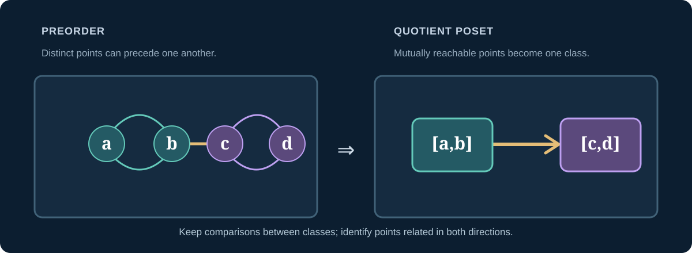
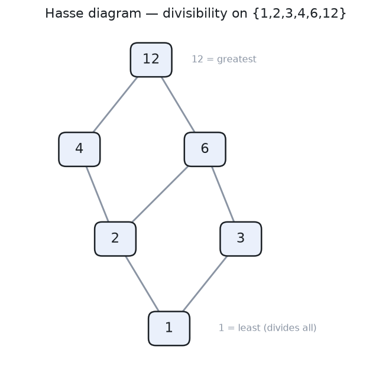
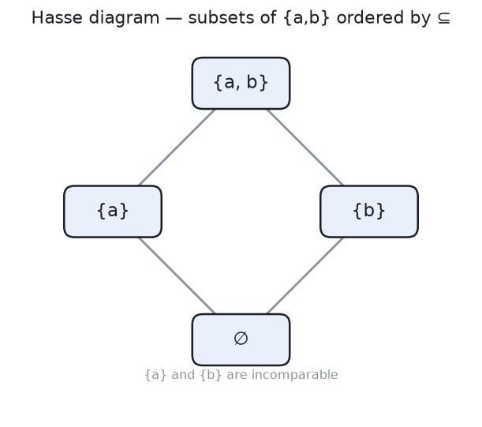
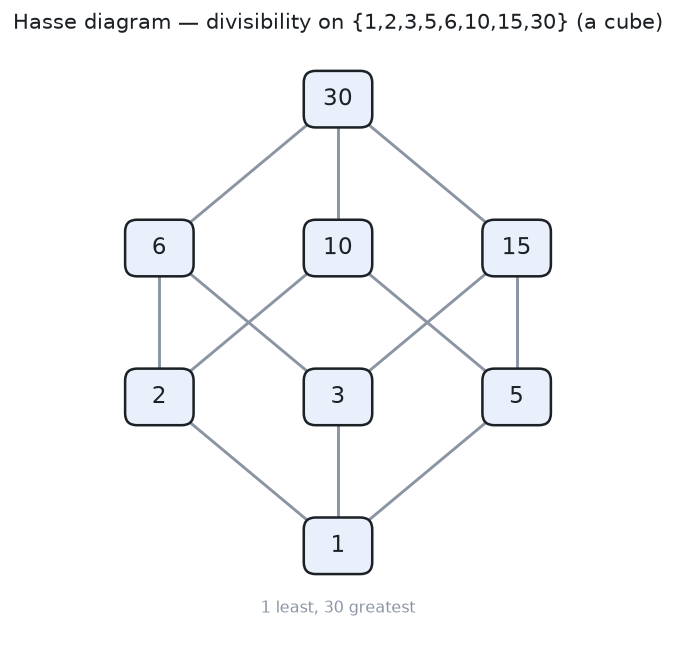
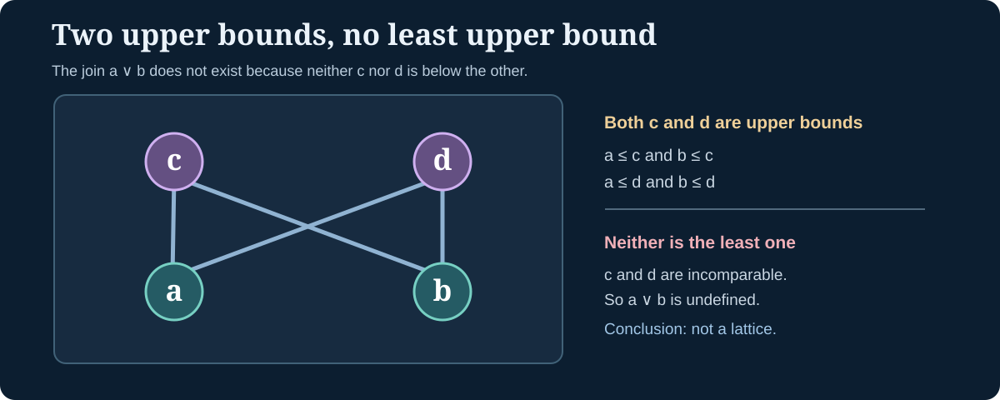

> [!abstract] Prerequisites & where this leads
> **Builds on:** [sets](./set-theory), [binary relations](./functions-relations#relation), and [equivalence classes](./equivalence-relations).
> **Leads to:** [real-number bounds](./real-analysis#supremum-and-infimum), [set-theoretic well-ordering](./set-theory#ordinals-and-well-ordering), and [posets as categories](./category-theory-foundations#a-partial-order-is-a-category).

An order tells us when one object is **below, before, contained in, or less informative than** another. For real numbers, every pair can be compared. For subsets, two objects may be unrelated by containment. Order theory treats these as different forms of a single idea rather than assuming every order must look like a line.

Throughout, let $P$ be a set with a relation $\preceq$ (read "precedes or is equal to"). We use $\leq$ for numerical order, $\subseteq$ for subset containment, and $\mid$ (read "divides") for divisibility. Different symbols may satisfy the *same structural axioms*.

## From relations to preorders and partial orders

> [!definition] Preorder
> A relation $\preceq$ on $P$ is a **preorder** when it is:
> - **Reflexive:** $a\preceq a$ for every $a\in P$.
> - **Transitive:** if $a\preceq b$ and $b\preceq c$, then $a\preceq c$.

A preorder need not be antisymmetric. Two different objects may each precede the other.

**Concrete example:** In a directed graph, define $u\preceq v$ when there is a directed path from $u$ to $v$, allowing a path of length zero. This is reflexive, since each vertex reaches itself in zero steps, and transitive, since paths concatenate. Two different vertices on a directed cycle reach one another, so antisymmetry can fail.

> [!definition] Partial order and poset
> A **partial order** is a reflexive, transitive, **antisymmetric** relation, where antisymmetry requires
> $$
> a\preceq b\ \text{and}\ b\preceq a\quad\Longrightarrow\quad a=b.
> $$
> A set equipped with its specified partial order, $(P,\preceq)$, is a **partially ordered set** or **poset** (read "POH-set").

The word *partial* does **not** mean the relation is undefined for some pairs. It means some objects can be **incomparable**: neither $a\preceq b$ nor $b\preceq a$ holds.

| Relation | Reflexive | Antisymmetric | Transitive | Every pair comparable |
| --- | --- | --- | --- | --- |
| $\leq$ on $\mathbb R$ | Yes | Yes | Yes | Yes |
| $\subseteq$ on $\mathcal P(\{a,b\})$ | Yes | Yes | Yes | No |
| Divides on positive integers | Yes | Yes | Yes | No |
| Directed reachability with cycles | Yes | Not necessarily | Yes | Not necessarily |
| Congruence modulo three | Yes | No | Yes | No |

> [!distinction] Symmetry versus antisymmetry
> Equivalence relations require symmetry: $a\sim b$ implies $b\sim a$. Partial orders require antisymmetry: if $a\preceq b$ and $b\preceq a$, then $a=b$. The two properties are not logical negations. Equality itself is both symmetric and antisymmetric.

### Turning a preorder into a poset

Even if two distinct elements in a preorder may precede each other, we can identify such elements using an equivalence relation:

$$
a\sim b\quad\Longleftrightarrow\quad a\preceq b\ \text{and}\ b\preceq a.
$$

Read: "a is equivalent to b if and only if each precedes the other."

> [!theorem] Preorder quotient theorem
> The relation $\sim$ is an equivalence relation. On its equivalence classes, define
> $$
> [a]\leq[b]\quad\Longleftrightarrow\quad a\preceq b.
> $$
> This is **well-defined** and turns $P/{\sim}$ into a poset.

> [!proof] Equivalence, representative independence, and order axioms
> **Equivalence:** reflexivity follows from $a\preceq a$. Symmetry follows because the defining condition is mutual comparison. If $a\sim b$ and $b\sim c$, then $a\preceq b\preceq c$ and $c\preceq b\preceq a$, so $a\sim c$ by transitivity.
>
> **Representative independence:** suppose $a'\sim a$, $b\sim b'$, and $a\preceq b$. We have $a'\preceq a\preceq b\preceq b'$, hence $a'\preceq b'$. The converse implication follows by reversing the roles of the representatives. Therefore the relation on classes is independent of which names we choose.
>
> **Poset axioms:** reflexivity and transitivity descend from the preorder. If $[a]\leq[b]$ and $[b]\leq[a]$, then $a\sim b$, so $[a]=[b]$. This is antisymmetry.

*Figure: Mutual reachability defines equivalence classes. Collapsing the classes removes two-way order between distinct nodes.*

For graph reachability, the classes are the **strongly connected components**. Their condensation graph is acyclic, and reachability on its vertices is a partial order.

## Worked proof: divisibility is a poset

Let $a,b$ be **positive** integers. Write $a\mid b$ (read "a divides b") when $b=ak$ for some positive integer $k$.

> [!proof] Verify the three order axioms
> **Reflexive:** $a=a\cdot1$, so $a\mid a$.
>
> **Antisymmetric:** assume $a\mid b$ and $b\mid a$, so $b=ak$ and $a=bm$ for positive integers $k,m$. Then $a=a(km)$. Canceling the nonzero integer $a$ yields $km=1$, forcing $k=m=1$, so $a=b$.
>
> **Transitive:** if $b=ak$ and $c=bm$, then $c=a(km)$ and $a\mid c$.

The restriction to **positive** integers is essential. On all integers, $2\mid -2$ and $-2\mid2$, but $2\neq-2$, so antisymmetry fails.

This poset is **not total**: neither $2\mid3$ nor $3\mid2$. Those numbers are incomparable.

## Strict and non-strict order

From a partial order define its strict part by

$$
a\prec b\quad\Longleftrightarrow\quad a\preceq b\ \text{and}\ a\neq b.
$$

Read "a is strictly below b."

> [!theorem] Strict and non-strict descriptions correspond
> The strict part $\prec$ of a partial order is **irreflexive** and **transitive**. Conversely, an irreflexive and transitive relation $\prec$ gives a partial order by defining $a\preceq b$ when $a=b$ or $a\prec b$.

> [!proof] Show both constructions satisfy their axioms
> **Forward:** $a\prec a$ would require $a\neq a$, impossible. If $a\prec b$ and $b\prec c$, transitivity of $\preceq$ gives $a\preceq c$. If $a=c$, then $a\preceq b\preceq a$ forces $a=b$ by antisymmetry, contradicting strictness. Hence $a\prec c$.
>
> **Backward:** equality makes the new relation reflexive. If $a\preceq b$ and $b\preceq a$ with $a\neq b$, then $a\prec b$ and $b\prec a$, so transitivity gives $a\prec a$, contradicting irreflexivity. Thus it is antisymmetric. Its transitivity follows from the transitivity of $\prec$, together with the cases in which either comparison is equality.

Every transitive irreflexive relation is also **asymmetric**: $a\prec b$ prevents $b\prec a$.

## Total orders, chains, and antichains

> [!definition] Total or linear order
> A partial order is **total** (also called **linear**) if, for every $a,b$, either $a\preceq b$ or $b\preceq a$.

The real numbers under $\leq$ are totally ordered. The subsets of $\{a,b\}$ under $\subseteq$ are partially ordered but **not** totally ordered, because $\{a\}$ and $\{b\}$ are incomparable.

A **chain** is a subset of a poset whose elements are pairwise comparable. An **antichain** has no two **distinct** comparable members. In the divisors of thirty, $\{1,2,6,30\}$ is a chain while $\{2,3,5\}$ is an antichain.

A chain is *not* necessarily a contiguous path of immediate cover relations. It may skip intermediate elements.

## Hasse diagrams: reconstructing the finite order

A **Hasse diagram** draws the **cover relations** of a finite poset. We say $b$ covers $a$ when $a\prec b$ but there is no $c$ with $a\prec c\prec b$. Larger elements appear higher. Reflexive loops and transitively implied links are omitted.

*Figure: In a finite divisibility poset, an upward chain of cover links proves that the bottom element divides the top.*

To decide whether $a\preceq b$, find an **upward path** from $a$ to $b$ (or check $a=b$). An **undirected path** is not enough. The numbers $4$ and $6$ are incomparable, even though both share neighbors elsewhere in the graph.

*Figure: This four-element diamond **is a lattice**. The incomparable middle sets still have a least upper bound and greatest lower bound.*

*Figure: Divisors of thirty have the same order shape as the subsets of a three-element set.*

> [!distinction] Finite Hasse diagrams versus dense infinite orders
> A Hasse diagram makes cover relations visible in a **finite** poset. In a dense order such as the rationals, there is always another rational between two distinct ordered values, so **no** distinct pair is a cover. A picture of cover edges alone cannot reconstruct that infinite order.

## Bounds and extrema: maximal is not greatest

For $S\subseteq P$, an element $u\in P$ is an **upper bound** if $s\preceq u$ for every $s\in S$. A **lower bound** reverses the comparison.

> [!definition] Four different extrema
> An element $m\in S$ is **maximal in S** if no $s\in S$ satisfies $m\prec s$. It is **greatest in S** if $s\preceq m$ for *every* $s\in S$. **Minimal** and **least** reverse the order.

Every greatest element is maximal; a maximal element might be incomparable with other elements. There can be multiple maximal elements, or none.

> [!counterexample] Two maximal elements but no greatest element
> On $P=\{a,b\}$ with only reflexive comparisons, both $a$ and $b$ are maximal and minimal. Neither is greatest or least because neither compares with the other.

> [!counterexample] No maximal element at all
> In $(\mathbb N,\leq)$, every $n$ has a greater number $n+1$. There is no maximal element, even though every finite nonempty subset has a greatest element.

> [!theorem] In a finite poset, a unique maximal element is greatest
> A finite nonempty poset with exactly one maximal element $m$ satisfies $a\preceq m$ for every $a$.

> [!proof] Follow a finite ascending chain
> Starting at $a$, if it is not maximal, choose something strictly above it. Repeat. An ascending strict chain cannot continue forever in a finite set, so it ends at some maximal element. The only such element is $m$. By transitivity, $a\preceq m$.

**Why finiteness matters.** Take a disjoint union of the infinite chain $0<1<2<\cdots$ and one isolated element $m$. That $m$ is the **unique** maximal element, yet is incomparable with every integer and hence is **not** greatest.

## Joins, meets, and lattices

A **least upper bound**, or **supremum** (read "SOO-premum"), is an upper bound below all other upper bounds. A **greatest lower bound**, or **infimum** (read "in-FEE-mum"), is above all other lower bounds. Each, when it exists, is unique by antisymmetry.

For a pair $a,b$, the least upper bound is the **join** $a\vee b$ (read "a join b"), and the greatest lower bound is the **meet** $a\wedge b$ (read "a meet b").

> [!definition] Lattice, bounded lattice, complete lattice
> A **lattice** is a poset in which every **pair** has a join and meet. It is **bounded** if there are a greatest element $\top$ and a least element $\bot$. It is **complete** if **every subset** has a join and meet, including the empty subset.

**Power-set worked example.** In $(\mathcal P(X),\subseteq)$ (read "the power set of X ordered by inclusion"),

$$
A\vee B=A\cup B,\qquad A\wedge B=A\cap B.
$$

To justify the first formula: $A\cup B$ contains $A$ and $B$, so it is an upper bound. Every other upper bound contains both $A$ and $B$, so also contains their union. Thus the union is the **least** upper bound. Dually, the intersection is the greatest lower bound. For arbitrary families, the union and intersection give joins and meets, so $\mathcal P(X)$ is complete; the empty join is $\varnothing$, and the empty meet is $X$.

**Divisibility lattice.** On positive divisors of a fixed integer $n$, the join is $\operatorname{lcm}(a,b)$ (read "least common multiple"), and the meet is $\gcd(a,b)$ (read "greatest common divisor"). Both remain divisors of $n$.

### An explicit poset that is not a lattice

Let $P=\{a,b,c,d\}$. Require $a\prec c$, $a\prec d$, $b\prec c$, and $b\prec d$, with no other strict comparisons. Both $c$ and $d$ are upper bounds of $\{a,b\}$. Neither is below the other, so **no least upper bound exists**. Hence $a\vee b$ does not exist.

*Figure: This bow-tie is not a lattice. The **diamond** in the previous Hasse example is a lattice, so the two shapes must not be confused.*

### Lattice laws and Boolean algebra

Every lattice satisfies commutativity, associativity, idempotence, and absorption for join and meet:

$$
\begin{aligned}
a\vee b&=b\vee a,&a\wedge b&=b\wedge a,\\
a\vee a&=a,&a\wedge a&=a,\\
a\vee(a\wedge b)&=a,&a\wedge(a\vee b)&=a.
\end{aligned}
$$

These laws can be derived by the uniqueness of least upper and greatest lower bounds. For example, $a\wedge b\preceq a$, so joining $a$ with $a\wedge b$ gives $a$.

A **distributive lattice** additionally satisfies $a\wedge(b\vee c)=(a\wedge b)\vee(a\wedge c)$ and its dual. Power sets are distributive because intersection distributes over union and vice versa. Not all lattices are distributive: the five-element lattice $M_3$, with three incomparable elements between bottom and top, is a counterexample.

In the Boolean algebra of subsets, **AND** behaves like intersection (meet), **OR** behaves like union (join), and **NOT** behaves like complement. This is the structural link to [Propositional Logic](./propositional-logic-zeroth-order-logic). Inclusive OR is Boolean join, not ordinary integer addition.

> [!distinction] Real-number completeness versus complete lattices
> $(\mathbb R,\leq)$ is a lattice because every pair has a maximum and minimum, but it is **not a complete lattice**: all of $\mathbb R$ lacks a supremum inside $\mathbb R$. The real-number completeness axiom applies only to **nonempty, bounded-above subsets**.

## Well-foundedness and well-ordering

> [!definition] Well-founded order and well-order
> A strict partial order is **well-founded** if every nonempty subset has a **minimal** element. A total order is a **well-order** if every nonempty subset has a **least** element.

Every finite poset is well-founded, because an infinite strict descending chain cannot exist inside a finite set. The natural numbers in their usual order are well-ordered. The integers are not: $\mathbb Z$ has no least element. The usual order on $\mathbb R$ is not a well-order: $(0,1)$ has no least member.

A two-element **antichain** is well-founded because every nonempty subset has minimal elements, but is not well-ordered because it is not total. The distinction between "minimal" and "least" matters.

Well-founded relations support **induction on predecessors**: assume a property holds for all strict predecessors of $a$, then prove it for $a$. Ordinary induction on $\mathbb N$ is an instance. [Set Theory](./set-theory#ordinals-and-well-ordering) develops ordinals, transfinite induction, and the well-ordering theorem.

## Order-preserving maps and order isomorphisms

Let $f:P\to Q$ map one poset $(P,\preceq_P)$ to another $(Q,\preceq_Q)$.

> [!definition] Monotone map, embedding, isomorphism
> - **Order-preserving / monotone:** $a\preceq_P b\Rightarrow f(a)\preceq_Q f(b)$.
> - **Order embedding:** $a\preceq_P b\Longleftrightarrow f(a)\preceq_Q f(b)$, so the order can also be recovered from the images.
> - **Order isomorphism:** a bijective order embedding.

An embedding also preserves **incomparability**. An injective monotone map need not be an embedding: map two incomparable points to $0$ and $1$ in the chain $0<1$. The map is monotone vacuously and injective, but it creates a comparison that did not exist in its domain.

### Worked order isomorphism: divisors of thirty and a power set

Let $D=\{1,2,3,5,6,10,15,30\}$, ordered by divisibility. Define

$$
F(d)=\{p\in\{2,3,5\}:p\mid d\}.
$$

Read: "F of d is the set of primes among two, three, five that divide d." Thus

$$
F(1)=\varnothing,\quad F(6)=\{2,3\},\quad F(30)=\{2,3,5\}.
$$

> [!proof] Verify bijectivity and both directions of order
> **Bijection:** Every divisor of $30=2\cdot3\cdot5$ is the product of a unique subset of these three distinct primes. Therefore each subset occurs exactly once.
>
> **Forward:** if $a\mid b$, each prime dividing $a$ also divides $b$, so $F(a)\subseteq F(b)$.
>
> **Backward:** if $F(a)\subseteq F(b)$, all the prime factors of the square-free divisor $a$ also occur in $b$. Hence $a\mid b$.
>
> Thus $a\mid b\Longleftrightarrow F(a)\subseteq F(b)$: this is an order isomorphism.

The eight-element divisibility cube and the power-set cube have the same **order structure**, even though their elements are different kinds of mathematical objects. Isomorphisms preserve comparisons, extrema, bounds, joins, meets, chains, and antichains.

## Why order theory appears everywhere

- **Dependencies:** reachability in an acyclic directed graph yields a partial order (choosing arrow direction consistently). Cycles give a preorder, whose quotient by mutual reachability is a poset.
- **Permissions and information:** "contains no more permission or information than" can define partial orders, but only becomes a lattice when appropriate joins and meets exist.
- **Distributed state:** a join-semilattice supports joining pairs of states without requiring meets, a weaker condition than being a complete lattice.
- **Categories:** a poset can be interpreted as a category with one arrow $a\to b$ whenever $a\preceq b$. See [Category Theory Foundations](./category-theory-foundations#a-partial-order-is-a-category).

The governing habit is to verify **which axioms the relation has**, rather than assuming every ordering behaves like the real number line.
