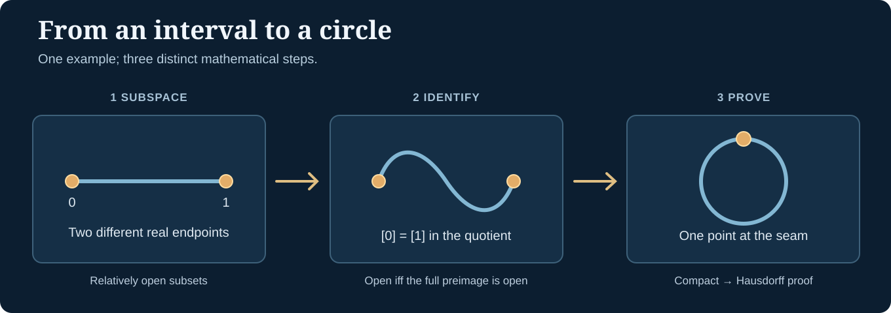

> [!abstract] Reading map, not a theorem about prerequisites
> **Builds on:** [Set Theory](./set-theory) and [Functions & Relations](./functions-relations).
> **Leads to:** [General Topology Foundations](./general-topology-foundations), [Topological Constructions](./general-topology-constructions), and [Compactness, Connectedness and Separation](./general-topology-compactness).
> **Optional intuition:** [Metric Spaces in Real Analysis](./real-analysis#metric-spaces). **Optional abstract viewpoint:** [Limits and Colimits in Category Theory](./category-limits-colimits).

Topology begins with a deceptively simple question: **what does it mean for points to be close without measuring distance?** On the real line, calculus talks about nearby points using intervals and numerical distances. Topology keeps the **open-set structure** that makes continuity meaningful, while dispensing with a distance function.

This is a **guided path across existing chapters**, not an extra general topology textbook. It distinguishes a helpful way to *learn* an idea from a formally required assumption in a proof. You can begin with geometric intuition or directly with the axioms.

To see how topologies compare with order, vector, measure, metric, Banach and manifold structure, consult the [Atlas of Mathematical Spaces](./atlas-of-mathematical-spaces).

## Two entrances to the same subject

### Route A: start with distance and let it go

If you have seen limits, intervals, or calculus, begin with [Metric Spaces](./real-analysis#metric-spaces) and its discussion of [open and closed sets](./real-analysis#open-and-closed-sets). A metric is a function $d(x,y)$ measuring distance. It supplies **open balls**:

$$
B_\varepsilon(x)=\{y\in X:d(x,y)<\varepsilon\}.
$$

Read "B epsilon of x is the set of y whose distance from x is less than epsilon." An open set contains a sufficiently small ball around each of its points.

Then read [Recovering metric spaces](./general-topology-foundations): the metric-open sets satisfy the three topology axioms, and their collection keeps enough information to express continuity.

**Checkpoint:** A numerical distance is **one way** to generate a topology, but two different metrics may generate the **same** open sets. A topological space does not need a metric at all.

> [!distinction] Don't confuse the topology with the metric
> A topology forgets particular distances, not every geometric fact. Statements about arbitrary open neighborhoods survive. Numerical lengths, specific distances, and conditions such as "Lipschitz with constant 2" need more than a topology.

### Route B: begin directly with the axioms

If you prefer to begin from [sets](./set-theory) and [functions](./functions-relations), go straight to [General Topology Foundations](./general-topology-foundations). On a set $X$, a **topology** $\tau$ is a family of subsets satisfying:

1. $\varnothing$ and $X$ are open.
2. The union of **any** family of open sets is open.
3. The intersection of **finitely many** open sets is open.

The pair $(X,\tau)$ is a **topological space**. Start with the chapter's three-point example, where the same set admits different topologies. There is nothing to measure; openness is what we have **declared** through the axioms.

**Checkpoint:** You can verify a topology by its closure rules, rather than guessing what "looks open" in a drawing.

Both routes meet at the same core concepts. **Real Analysis is valuable intuition, not a formal prerequisite for defining a topology.** You will return to real-number facts when a proof about intervals genuinely needs them.

## The central route: what to read and why

| Step | Chapter or section | The result you should be able to explain |
| --- | --- | --- |
| 1. Establish the language | [Sets](./set-theory), [Functions and Relations](./functions-relations) | How membership, inverse images, and a relation identifying points work |
| 2. Choose your entry | [Metric spaces](./real-analysis#metric-spaces) *or* [open-set axioms](./general-topology-foundations) | Why a topology is an abstract collection of open subsets |
| 3. Develop the foundation | [General Topology Foundations](./general-topology-foundations) | Bases, closure, interior, continuity by inverse images, homeomorphisms |
| 4. Make new spaces | [Topological Constructions](./general-topology-constructions) | Subspaces, products, quotients, disjoint unions, identifying points |
| 5. Prove global behavior | [Compactness, Connectedness and Separation](./general-topology-compactness) | Finite subcovers, connected images, Hausdorffness, compact-to-Hausdorff homeomorphisms |
| 6. Go further if useful | [Category Theory](./category-limits-colimits), [Analysis](./real-analysis), [Geometry](./algebraic-geometry) | Universal properties and applications in more structured spaces |

The sequence is intentional: **what opens are** → **what continuous maps preserve** → **how topologies can be constructed** → **which global properties follow**.

## One example followed through the entire path: an interval becomes a circle

Keep the interval $[0,1]$ in mind as you read. We will treat it in three ways: as a subspace of the real line, as a set with two endpoints that can be identified, and as a quotient space that is actually homeomorphic to a circle.

*Figure: The points of the interval are not moved by fiat. We form equivalence classes, place a quotient topology on them, then establish that the result is a circle as a topological space.*

### First: put the interval inside the real line

The set $[0,1]$ receives its **subspace topology** from $\mathbb R$. A subset $U\subseteq[0,1]$ is open in the interval when

$$
U=V\cap[0,1]
$$

for some open set $V$ of real numbers. For example, $[0,\tfrac12)$ is **open relative to the interval** even though it is not open in $\mathbb R$: it equals $(-1,\tfrac12)\cap[0,1]$.

This is your first lesson in topology: **always specify the ambient space**.

### Next: identify the two endpoints

Define an equivalence relation on $[0,1]$ that makes $0\sim1$ and leaves every other point equivalent only to itself. It is an [equivalence relation](./equivalence-relations), so its classes are legitimate quotient elements.

Write

$$
Q=[0,1]/{\sim},\qquad q:[0,1]\to Q,\quad q(t)=[t].
$$

Read "$Q$ is the interval modulo this equivalence relation, and $q$ maps a point to its class." The points $0$ and $1$ are still **different real numbers**; only their classes coincide: $[0]=[1]$.

The **quotient topology** declares $U\subseteq Q$ open exactly when $q^{-1}(U)$ is open in the interval. This matters near the glued endpoint. A small open neighborhood of that one quotient point pulls back to *two* pieces near the two original ends, for instance

$$
[0,\varepsilon)\ \cup\ (1-\varepsilon,1]
$$

for $0<\varepsilon<\tfrac12$. Both pieces are relatively open in $[0,1]$, and together they describe one neighborhood around the seam.

**Checkpoint:** Gluing is not just a picture of bent rubber. It is an **equivalence relation plus a specified topology**.

### Finally: show the quotient really is a circle

Let $S^1=\{(x,y)\in\mathbb R^2:x^2+y^2=1\}$ (read "S one," the unit circle) and define

$$
p(t)=(\cos(2\pi t),\sin(2\pi t)).
$$

The map $p:[0,1]\to S^1$ is continuous and wraps once around the circle. It sends $0$ and $1$ to the same point and sends no other distinct pair in the interval to the same point. Thus it factors uniquely through a **bijection**

$$
\bar p:Q\longrightarrow S^1,\qquad\bar p([t])=p(t).
$$

The quotient-topology rule makes $\bar p$ continuous because $p=\bar p\circ q$ is continuous. But **continuous bijection** does not automatically mean **homeomorphism**: we still need continuity of the inverse.

Here the next chapter completes the argument. $[0,1]$ is compact in its usual topology (now proved directly from completeness in [Heine–Borel's first step](./general-topology-compactness#step-1-closed-real-intervals-are-compact)), hence $Q$, its continuous image under $q$, is compact. The unit circle is Hausdorff, since it is a metric subspace of $\mathbb R^2$. The [compact-to-Hausdorff homeomorphism theorem](./general-topology-compactness) now guarantees that the inverse of $\bar p$ is continuous. Therefore

$$
\boxed{[0,1]/{(0\sim1)}\ \cong\ S^1}
$$

where $\cong$ here means **homeomorphic**, not equal as sets.

The point of revisiting the example is that *each chapter supplies a genuinely new justification*: subspace openness, quotient continuity, and finally the compact–Hausdorff argument.

## Understand the three principal constructions

In [Topological Constructions](./general-topology-constructions), use this comparison as your reading guide:

| Construction | What changes? | What forces the topology? |
| --- | --- | --- |
| **Subspace** | Keep only points of $A\subseteq X$ | Opens look like $A\cap V$, for ambient open $V$ |
| **Product** | Combine coordinates from several spaces | Coordinate projections should be continuous |
| **Quotient** | Identify points under an equivalence relation | A set of classes is open when its full preimage is open |

Disjoint unions and gluing along an interface extend these ideas. The chapter proves the mapping properties directly from inverse images. You **do not need category theory** to follow those proofs.

> [!note] Optional category-theoretic lens
> If you already know about [universal properties, limits and colimits](./category-limits-colimits), the same constructions can be seen as products, coproducts, quotients, and pushouts in the category of topological spaces. This viewpoint is powerful, but **not required to define the topologies or verify continuity**. You can return to it later.

## What you should retain about global properties

In [Compactness, Connectedness and Separation](./general-topology-compactness), do not memorize these as three synonyms for "nice space." They answer separate questions:

- **Compactness:** Does every open cover contain a **finite** subcover? A continuous image of a compact space is compact. The chapter proves [Heine–Borel](./general-topology-compactness#step-1-closed-real-intervals-are-compact), the [metric sequential criterion](./general-topology-compactness#metric-compactness-and-convergent-subsequences), and a counterexample in Hilbert space.
- **Connectedness:** Can the space be split into two disjoint nonempty relatively open subsets? Continuous images of connected spaces are connected.
- **Hausdorff separation:** Can two distinct points be separated by disjoint open neighborhoods? In a Hausdorff space, every compact subset is closed.

The compact–Hausdorff homeomorphism theorem brings these distinctions together to finish the circle example. **Real-number results** such as the compactness and connectedness of closed intervals use properties of $\mathbb R$; the general definitions and abstract preservation proofs do not.

### What this path does not yet cover

These notes **do cover** the open-set foundations, main constructions, and core compactness/connectedness/separation proofs. They do **not yet offer full standalone treatments** of nets and filters, paracompactness, covering-space theory, homotopy and fundamental groups, or homology. Those would belong to deeper point-set or algebraic topology branches, not be implied by this map.

## A compact mental model

**Sets** tell you which objects exist. **Topologies** tell you which subsets count as open. **Continuous maps** preserve the open-set structure by taking **inverse images of opens to opens**. **Constructions** make new spaces while specifying which maps should remain continuous. **Global properties** explain what can or cannot happen under those maps.

That is the reusable thread through topology. If you can explain the interval-to-circle proof, you have connected the core definitions to a substantial topological result without treating a diagram as a proof.
