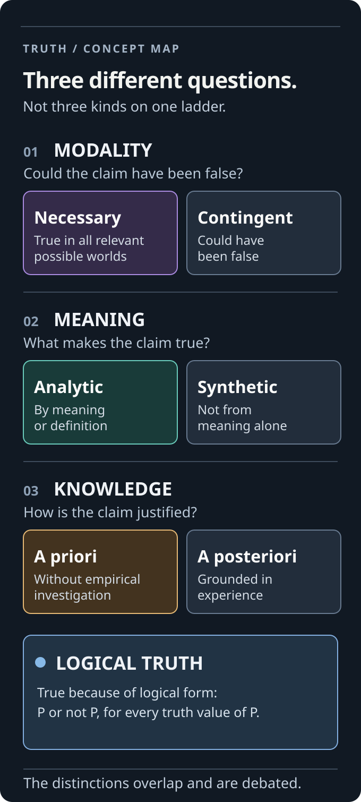
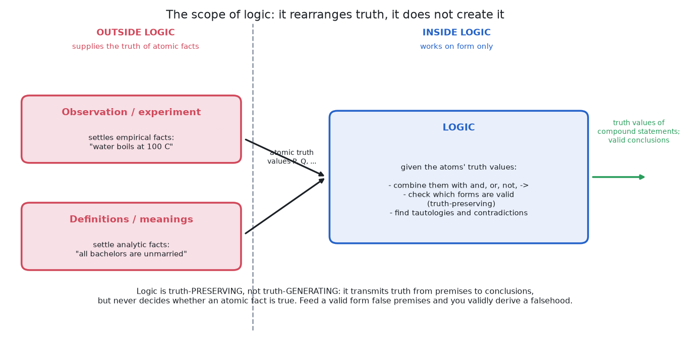
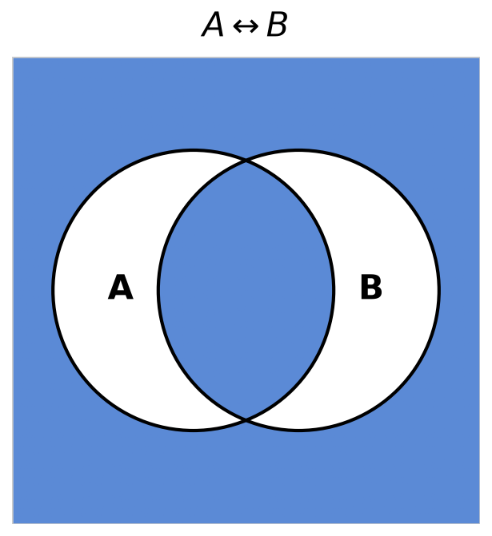
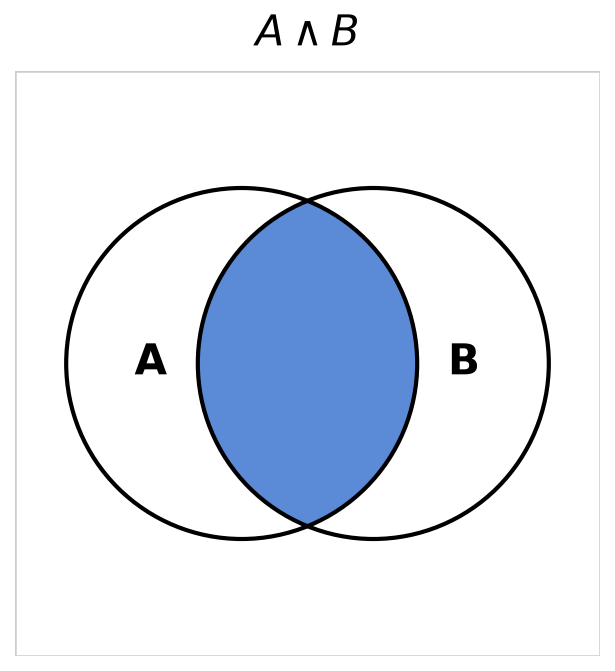
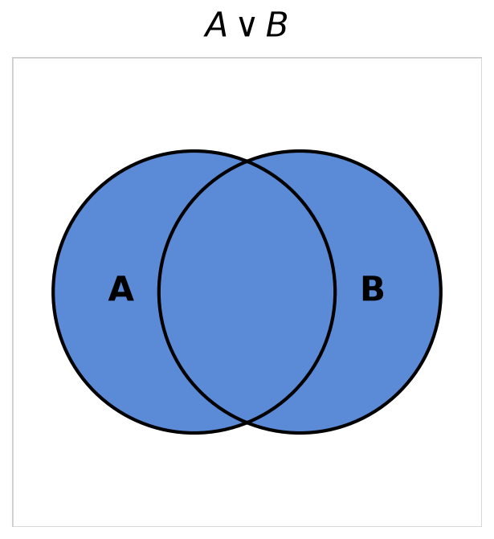
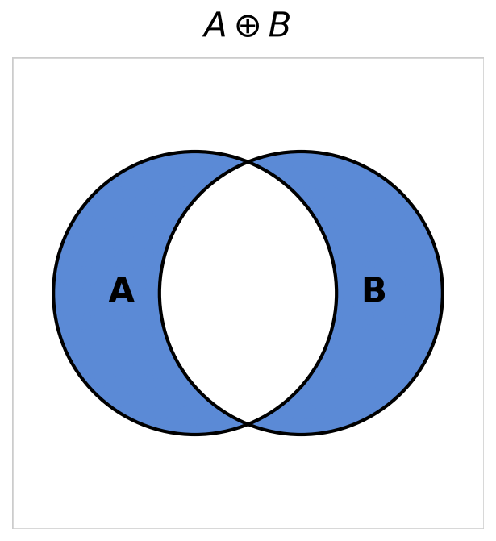
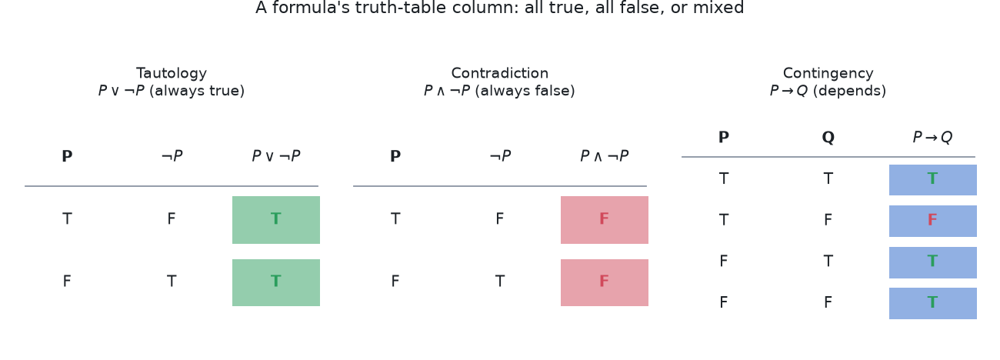
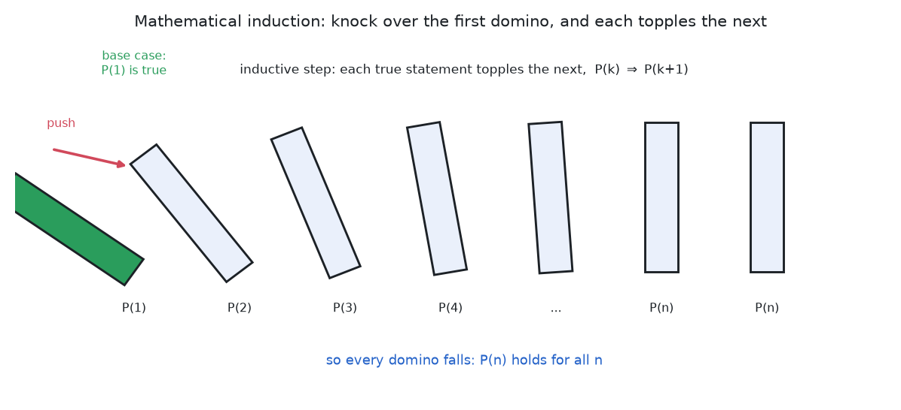

Logic is the study of valid reasoning: given certain facts, what can you conclude? Propositional logic is the simplest form of formal logic. It works with statements (propositions) that are either true or false, and studies how to combine them using connectives like "and," "or," and "not." Propositional logic is the foundation of mathematical proofs, digital circuit design, programming constructs like if/else, and database queries.

> [!abstract] Prerequisites & where this leads
> **Builds on:** [Set Theory](./set-theory)
> **Leads to:** [Predicate Logic (First-Order Logic)](./predicate-logic-first-order-logic)

**Propositional Logic:** Propositional Logic, is a formal system in
logic that deals with statements or propositions as whole, indivisible
units. In this system, each proposition is considered atomic, meaning it
does not analyze the internal structure or content of the proposition
itself.

The primary focus of 0th-order logic is on how these propositions relate
to one another through logical connectives such as AND (∧), OR (∨), NOT
(¬), and IMPLIES (→). It is a foundational form of logic, where the
truth or falsity of complex statements is determined by the truth values
of their constituent propositions.

Unlike first-order logic, propositional logic does not deal with
non-logical objects, predicates about them, or quantifiers. However, all
the machinery of propositional logic is included in first-order logic
and higher-order logics. In this sense, propositional logic is the
foundation of first-order logic and higher-order logic.

The most thoroughly researched branch of propositional logic is
classical truth-functional propositional logic

## Truth


<div class="truth-lede">
  <div class="truth-lede__eyebrow">CONCEPT MAP / LOGIC AND EPISTEMOLOGY</div>
  <p class="truth-lede__headline">Truth is not a ladder of categories.</p>
  <p>Different descriptions of truth answer different questions. A claim can be <strong>necessary</strong>, <strong>synthetic</strong>, and <strong>known a posteriori</strong> at the same time. The distinctions overlap; they are not a ranking from better to worse truths.</p>
</div>




*Figure. Three different questions about a claim. Colors identify the question being asked; the labels carry the meaning without color.*

The map separates three axes:

- **Modality:** <span class="ed-term ed-term--modal">necessary</span> versus <span class="ed-term ed-term--modal">contingent</span>. **Could the claim have been false?**
- **Meaning:** <span class="ed-term ed-term--meaning">analytic</span> versus <span class="ed-term ed-term--meaning">synthetic</span>. **Does its truth follow from the meanings of the terms?**
- **Justification:** <span class="ed-term ed-term--knowledge">a priori</span> versus <span class="ed-term ed-term--knowledge">a posteriori</span>. **Could someone justify it without empirical investigation?**

<span class="ed-term ed-term--logic">Logical truth</span> is a more specific notion: a statement true in virtue of its **logical form**, not the worldly truth values of its atomic components. It is not the name of a fourth pair and is not interchangeable with "a priori."

<div class="truth-examples" aria-label="Examples of overlapping truth classifications">
  <div class="truth-example">
    <div class="truth-example__eyebrow">ACTUAL-WORLD CLAIM</div>
    <div class="truth-example__claim">The Eiffel Tower is in Paris.</div>
    <div class="truth-example__tags">
      <span class="truth-example__tag truth-example__tag--modal">Contingent</span>
      <span class="truth-example__tag truth-example__tag--meaning">Synthetic</span>
      <span class="truth-example__tag truth-example__tag--knowledge">A posteriori</span>
    </div>
    <p>Location is settled by evidence and could have been different.</p>
  </div>
  <div class="truth-example">
    <div class="truth-example__eyebrow">DEFINITION-BOUND CLAIM</div>
    <div class="truth-example__claim">All bachelors are unmarried.</div>
    <div class="truth-example__tags">
      <span class="truth-example__tag truth-example__tag--modal">Necessary*</span>
      <span class="truth-example__tag truth-example__tag--meaning">Analytic</span>
      <span class="truth-example__tag truth-example__tag--knowledge">A priori</span>
    </div>
    <p>Its truth follows from the conventional meanings of the terms.</p>
  </div>
</div>

<small class="truth-example-note">*These classifications assume conventional meanings and a familiar account of possible worlds. Whether necessity, analyticity, and a priori knowledge coincide is disputed. The diagram is an orientation, not a complete theory of truth.</small>

### Logical Truth

> [!definition] Logical truth
> A formula is a **logical truth** if it is true under every admissible interpretation of its nonlogical symbols (or, in classical propositional logic, under **every truth assignment** to its atomic letters). What makes it true is its logical structure.

For a propositional example, $P\lor\neg P$ (read "P or not P") has the same truth value regardless of whether $P$ is true or false:

| $P$ | $\neg P$ | $P\lor\neg P$ |
| --- | --- | --- |
| True | False | **True** |
| False | True | **True** |

This is a <span class="ed-term ed-term--logic">tautology</span>. It holds for *both* rows, so no observation about what $P$ describes is needed.

A statement like "All bachelors are unmarried" is not a tautology in **bare propositional logic**: its truth relies on the meaning of "bachelor." It may be analytic without being true solely from the truth-functional structure of an unanalysed atomic sentence.

> [!distinction] Logical, necessary, and a priori are not synonyms
> In classical modal settings, logical truths are necessary. The converse fails: a claim can be necessary due to identity or meaning rather than the logical form alone. **A priori** describes the grounds of justification, not a special truth-table result.

#### The Limit of Logic: It Cannot Tell You Which Atomic Facts Are True

Propositional logic treats an **atomic proposition** such as $P=$ "it is raining" as an input with a truth value. The rules of propositional logic can determine the values of compound formulas **given** that input, but they do not establish whether it is raining.

The division of labor is visible in a truth table: we calculate the formula's result for **all** possible assignments precisely because the form alone does not identify which assignment describes the actual world.



A **valid argument** preserves truth: if its premises are true, its conclusion must be true. It does not guarantee that its premises are true. By contrast a **sound argument** has valid form *and* true premises, as derived in [Validity vs. Soundness](#validity-vs-soundness). Some logical truths follow from form with no contingent premises at all. It is therefore more precise to say that inference rules **preserve truth** than to claim logic can never establish any truth.

### Necessary Truth

> [!definition] Necessary truth
> A proposition is **necessary** relative to a specified modal interpretation if it is true in **every relevant possible world**. It could not have been false under that interpretation.

A logical tautology is a familiar case. The statement "$2+2=4$" is generally treated as necessary when standard arithmetic is intended, although its justification involves mathematical definitions and axioms rather than a mere truth table.

The phrase "all possible worlds" depends on a theory of possibility. One should not automatically conclude that **necessary**, **analytic**, and **a priori** are equivalent.

#### Analytic Necessary Truths

"All bachelors are unmarried" is a conventional example. If **bachelor** means an unmarried adult man, the predicate follows from the stipulated meaning. Under stable meanings, the statement is treated as analytically necessary. It is not necessary because we surveyed everyone.

#### Synthetic Necessary Truths

The well-known philosophical example is "Water is H₂O." Under Kripkean assumptions about **rigid designation** and identity, the underlying substance is necessarily identical with itself even though discovering that identity required chemistry. This is discussed as <span class="ed-term ed-term--modal">necessary</span>, <span class="ed-term ed-term--meaning">synthetic</span>, and <span class="ed-term ed-term--knowledge">a posteriori</span>.

That analysis is **philosophically contested**, and ordinary usage of the word "water" introduces complications. We present it as an influential interpretation, **not as a result proved by propositional logic**.

### Analytic Truth

> [!definition] Analytic truth
> On a traditional account, an **analytic** claim is true by virtue of the meanings or definitions involved. The term concerns a **source of truth**, not simply how someone personally discovered the claim.

A definition-dependent analytic statement need not be a propositional tautology. When "bachelor" is treated as one indivisible propositional letter, a truth table has no access to its meaning.

The analytic/synthetic boundary is itself controversial. For example, Quine challenged whether a sharp, unrestricted analytic/synthetic distinction can be sustained. We can still use the terms to understand familiar philosophical arguments while marking that dispute explicitly.

### Synthetic Truth

> [!definition] Synthetic truth
> A **synthetic** claim is **not guaranteed by meanings alone**. Its truth depends on further facts or, on some accounts, substantive nondefinitional relations.

"The cat is on the mat" is synthetic: understanding the words does not establish whether that configuration obtains. Synthetic truths are often contingent and established empirically, but synthetic is **not defined as** contingent. The synthetic-necessary category discussed above is exactly why those axes must remain separate.

### Empirical Truth

An **empirical** claim is one whose justification rests on <span class="ed-term ed-term--knowledge">observation, experience, or experiment</span>. "There is rain outside this window" is empirical because inspecting the weather can provide evidence.

Strictly speaking, **a posteriori** characterizes how a claim is **known or justified**, not an intrinsic logical type of truth. Empirical conclusions may be revised when better evidence arrives; the underlying claim is not made true simply by our confidence in it.

> [!example] What each axis contributes
> Suppose "The Eiffel Tower is in Paris" is true. It is **synthetic** because its location is not determined by the meaning of "tower"; **contingent** because its location could have differed; and **a posteriori** because we establish its location by evidence. These three answers do not contradict one another: they answer different questions.

### Contingent Truth

> [!definition] Contingent truth
> A claim is **contingently true** when it is true in the actual world but false in at least one relevant possible world. Its truth could have been otherwise.

A claim like "Humans exist" is ordinarily contingent: human existence is a fact about this world, not something forced merely by logical form.

**Do not confuse this philosophical sense with propositional contingency.** In a truth table, a **contingent formula** is simply true under *some* assignments and false under *others*. The formula $P\land Q$ is contingent in that precise formal sense. Whether an **actual-world claim** is contingent in modal philosophy is a related but different question.

The rest of this chapter concentrates on propositional **form**: how to compute truth values, establish tautologies or contradictions, and prove which inferences preserve truth.


## Proposition

> [!definition] Proposition
> In classical propositional logic, a **proposition** is a declarative content treated as having a determinate truth value, **true** or **false**. The formal system studies how those values combine, without inspecting the internal structure of each atomic proposition.


**Proposition: Propositions** are declarative statements that have a
truth value, which can either be true or false, but not both.

Propositions in propositional logic respect the **bi-valence principle** and the **principle of the excluded middle**. This is why their truth value can assume only 2 values and why each proposition can be assigned only a single value (not both or neither).

Declarative statements make assertions or declare some fact about the
state of affairs of something.

Examples:

-   "The sky is blue."

-   "She is a doctor."

-   "Paris is the capital of France."

-   "The meeting starts at 10 AM."

Propositions are the fundamental units of reasoning and logical
analysis.

They assert facts about the world that could either be true or false.

Propositions can be represented symbolically using letters:

-   "The sky is blue." : **B**

-   "She is a doctor." : **D**

-   "Paris is the capital of France." : **F**

-   "The meeting starts at 10 AM." : **M**

Propositions are sometimes called statements.

Propositions or statements can either be:

-   **Atomic:** Atomic propositions are the simplest form of
    propositions. They do not contain any logical connectives and cannot
    be broken down into simpler propositions. Each atomic proposition is
    a declarative statement that is either true or false.

-   **Compound:** Compound propositions are formed by combining two or
    more atomic propositions using logical connectives. The truth value
    of a compound proposition depends on the truth values of its
    component propositions and the specific logical connectives used.

**Propositional logic is concerned with the *form and structure of
propositions* rather than their content or the actual truth
of their components in the real world.**

### Validity

**Validity:** When we talk about a single proposition being valid, we
usually mean that it is a **tautology**, a statement that is true in
all possible circumstances. This means the proposition cannot be false,
regardless of the truth values of any variables it might contain**.**

### Unsatisfiable

**Unsatisfiable:** If a proposition is unsatisfiable, it means that
there is no possible scenario or interpretation under which the
proposition can be true. In other words, the proposition is false in
every possible situation, regardless of the truth values assigned to its
components.

Unsatisfiability is a key concept in logic and relates to the idea of a
**contradiction**.

### Contingent

**Contingent:** Contingency refers to the status of a proposition that
is neither necessarily true nor necessarily false. A contingent
proposition is one that could be true in some circumstances and false in
others, depending on the particular state of the world or the specific
assignment of truth values to its components.

In a truth table, a contingent proposition will have at least one row
where it is true and at least one row where it is false.

Most statements we encounter in everyday life are contingent. We often
make decisions based on contingent truths, which are context-dependent
and require us to consider the specific conditions at hand.

## Truth Function

> [!definition] Truth function
> A **truth function** maps a tuple of input truth values to an output truth value. Its output depends only on those inputs, not on which real-world statements the letters happen to describe.


**Truth Function**: In logic, a truth function is a function that accepts truth values as input and produces a truth value as output. They play a crucial role in propositional logic by defining how compound statements (or propositions) are constructed from atomic ones.

**Formal Definition:** A truth function $f$ is a function $f: \{T, F\}^n \to \{T, F\}$

Where $n$ is the number of input propositions (arity).

**Examples:**

**Unary Truth Function (n=1):**

| P | ¬P |
|---|-----|
| T | F |
| F | T |

The negation function $f(P) = \neg P$ maps:
- $f(T) = F$
- $f(F) = T$

**Binary Truth Functions (n=2):**

| P | Q | P∧Q | P∨Q | P→Q | P↔Q | P⊕Q |
|---|---|-----|-----|-----|-----|-----|
| T | T | T | T | T | T | F |
| T | F | F | T | F | F | T |
| F | T | F | T | T | F | T |
| F | F | F | F | T | T | F |

Each column defines a different binary truth function.

**Total Number of Truth Functions:**

For $n$ inputs, there are $2^{2^n}$ possible truth functions:
- $n=1$: $2^{2^1} = 4$ unary functions
- $n=2$: $2^{2^2} = 16$ binary functions
- $n=3$: $2^{2^3} = 256$ ternary functions

**Common Binary Functions:**
1. Conjunction (AND): T only when both inputs are T
2. Disjunction (OR): F only when both inputs are F
3. Implication: F only when antecedent is T and consequent is F
4. Biconditional: T when both inputs have same truth value
5. XOR: T when inputs have different truth values
6. NAND: Opposite of AND
7. NOR: Opposite of OR

**Functionally Complete Sets:**

A set of connectives is functionally complete if every truth function can be expressed using only those connectives:
- $\{\neg, \wedge\}$ is functionally complete
- $\{\neg, \vee\}$ is functionally complete
- $\{\to, F\}$ is functionally complete
- $\{\text{NAND}\}$ alone is functionally complete
- $\{\text{NOR}\}$ alone is functionally complete

## Logical / Propositional Constants

Logical / Propositional Constants: In the context of propositional
logic, **contradiction** and **tautology** are often referred to as
logical constants or propositional constants because their truth values
are fixed, regardless of the truth values of any propositions they are
combined with.

### Contradiction

**Contradiction:** A contradiction (also known as a logical falsehood)
is a proposition that is always false.

It is denoted by symbols such as **⊥**(falsum/up-tack) or false (read $\bot$ as "bottom" or "false").

Example: The statement

$P \wedge \neg P$ (It is raining and it is not raining) is a contradiction because
it can never be true.

### Tautology

**Tautology**: A tautology (also known as a logical truth) is a
proposition that is always true. It is denoted by symbols such as
**⊤(verum / down-tack**) or true (read $\top$ as "top" or "true").

Example: The statement

$P \vee \neg P$ (It is raining or it is not raining) is a tautology because it is
always true.

#### Proving that a proposition is a Tautology

There are 2 methods that can be used:

-   Truth table method

-   Simplification / Manipulation of Logical Equivalences

##### Truth table method of proving a Tautology:

To prove a tautology using a truth table, it is required to demonstrate
that the formula is true for every possible combination of assignments
of truth values to the constituent parts of the formula.

For a formula containing n number of variables, it will require a truth
table having $2^{n}$ rows.

If a formula has 3 variables, it will require a truth table with 8 rows.

For example, consider the formula $((A \wedge B) \to C) \leftrightarrow (A \to (B \to C))$. There are 8 valuations of $A, B, C$ (the first three columns); the remaining columns build up the subformulas, ending in the full formula, which is **true in every row**, so the formula is a tautology.

| $A$ | $B$ | $C$ | $A \wedge B$ | $(A \wedge B) \to C$ | $B \to C$ | $A \to (B \to C)$ | full formula |
|:---:|:---:|:---:|:---:|:---:|:---:|:---:|:---:|
| T | T | T | T | T | T | T | **T** |
| T | T | F | T | F | F | F | **T** |
| T | F | T | F | T | T | T | **T** |
| T | F | F | F | T | T | T | **T** |
| F | T | T | F | T | T | T | **T** |
| F | T | F | F | T | F | T | **T** |
| F | F | T | F | T | T | T | **T** |
| F | F | F | F | T | T | T | **T** |

You can build the truth table of any formula yourself below. Type a proposition (using `~ & | ^ -> <->`) and the generator enumerates every valuation and reports whether it is a tautology, contradiction, or contingency.

<iframe src="/static/interactive/truth-table-generator.html" width="100%" height="620" style="border:none;"></iframe>

### Limitation: the $2^n$ explosion, and why symbolic methods exist

A truth table is completely mechanical and never wrong, but its size is its undoing: $n$ variables force $2^n$ rows, and that growth is brutal rather than gradual.

| variables $n$ | rows $2^n$ |
|:---:|:---:|
| 3 | 8 |
| 5 | 32 |
| 10 | 1,024 |
| 20 | 1,048,576 |
| 30 | over one billion |
| 64 | more rows than a machine checking a billion per second could finish in 500 years |

So beyond three, four, or five variables a truth table is already unwieldy, and past a few dozen it is physically impossible to write down. This is exactly why the rest of this page develops **symbolic methods** that reason about a formula *without* enumerating its rows: the [logical equivalence laws](#logical-equivalences) (De Morgan, distribution, absorption) that simplify it algebraically, the [normal forms](#normal-forms) that put it in a canonical shape, and the [rules of inference](#rules-of-inference) that derive conclusions by pure symbol-pushing. A three-line algebraic simplification can settle what a truth table would need a million rows to confirm.

The wall is deeper than mere inconvenience. Deciding whether a formula can be made true, the **satisfiability (SAT)** problem, was the very first problem proved **NP-complete** (the Cook–Levin theorem); its mirror image, deciding whether a formula is a *tautology* (true in every row), is the **co-NP-complete** counterpart, believed just as hard. Either way, *no known method* escapes worst-case exponential effort, truth tables included. What symbolic reasoning and modern **SAT solvers** buy is enormous *practical* speed (clever search that prunes almost all of the $2^n$ space), not an escape from the theoretical ceiling. That gap between "always correct but $2^n$" and "usually fast" is precisely why, once the variables pile up, the right move is a symbolic solution rather than a bigger table.

## Compound Proposition / Statement

**Compound Proposition / Statement:** A compound proposition (or
compound statement) is a proposition that is formed by combining one or
more simpler propositions, called atomic propositions, using logical
connectives. The truth value of a compound proposition is determined by
the truth values of its component propositions and the specific logical
connectives used.

## Propositional / Logical Connectives / Operators

**Logical Connectives:** Logical connectives, also known as logical
operators, are symbols or words used to connect propositions (or
statements) to form compound propositions.

They determine the truth value of the compound proposition based on the
truth values of the individual propositions

The same connective is often written with several different symbols. The common notations:

| Connective | Common notations |
|---|---|
| AND (conjunction) | $A \wedge B,\quad A \cdot B,\quad AB,\quad A\,\&\,B$ |
| OR (disjunction) | $A \vee B,\quad A + B,\quad A \parallel B$ |
| NOT (negation) | $\neg A,\quad {\sim} A,\quad \overline{A},\quad -A$ |
| NAND | $A \barwedge B,\quad A \uparrow B,\quad A \mid B,\quad \overline{A \cdot B}$ |
| NOR | $A \barvee B,\quad A \downarrow B,\quad \overline{A + B}$ |
| XOR (exclusive or) | $A \oplus B,\quad A \veebar B,\quad A \not\equiv B$ |
| XNOR | $A \odot B,\quad \overline{A \oplus B}$ |
| implies (conditional) | $A \to B,\quad A \Rightarrow B,\quad A \supset B$ |
| equivalent (biconditional) | $A \leftrightarrow B,\quad A \Leftrightarrow B,\quad A \equiv B$ |
| converse | $A \leftarrow B,\quad A \Leftarrow B$ |

### Unary Logical Connectives / Unary Operators

**Unary Logical Connectives / Unary Operators:** A unary logical
connective (or unary operator) is a logical operator that operates on a
single proposition (or statement) to produce a new
proposition.

In classical logic, the most common unary logical connective is
**negation**.

#### Negation

**Negation:** Negation is a fundamental unary logical connective that
inverts the truth value of a proposition.

In ordinary language, negation is referred to as *'NOT'*.

Symbolically, we express negation with: ¬

Example: If 𝑃 is a proposition, ¬𝑃 denotes its **negation** (read $\neg P$ as "not P").

| $P$ | $\neg P$ |
|:---:|:---:|
| T | F |
| F | T |

Properties of Negation:

**Double Negation:** Within a system of classical logic, double
negation, that is, the negation of the negation of a proposition 𝑃, is
logically equivalent to 𝑃.

Expressed in symbolic terms: $\neg\neg P \equiv P$

**Distributivity:** De Morgan's laws provide a way of distributing
negation over conjunction and disjunction.

$$
\neg(P \wedge Q) \equiv (\neg P \vee \neg Q)
$$

$$
\neg(P \vee Q) \equiv (\neg P \wedge \neg Q)
$$

**Negation of Quantifiers:** In first-order logic, there are two
quantifiers, one is the universal quantifier

**∀** (means "for all") and the other is the existential quantifier
**∃** (means "there exists").

The negation of one quantifier is the other quantifier ($\neg\forall x\, P(x) \equiv \exists x\, \neg P(x)$ and $\neg\exists x\, P(x) \equiv \forall x\, \neg P(x)$).

### Properties of Binary Operations

**Properties of Binary Operations**

#### Biconditional / Logical Equivalence

The biconditional $P \leftrightarrow Q$ (written $P \equiv Q$ when we are asserting that the two statements are logically equivalent) is true exactly when $P$ and $Q$ have the **same** truth value: either both true or both false. (Associativity, the grouping property, is a separate idea covered under the [Associative Laws](#logical-equivalences) below.)

| $P$ | $Q$ | $P \equiv Q$ |
|:---:|:---:|:---:|
| T | T | T |
| T | F | F |
| F | T | F |
| F | F | T |

**Logical equivalence tells you whether two statements are always true
or always false together. If they are, they are logically equivalent.**

-   **Proposition 𝑃: "Light A is on."**

-   **Proposition 𝑄: "Light B is on."**

If both lights are on (𝑃 is true and 𝑄 is true), then 𝑃 ≡ 𝑄 is true.

If both lights are off (𝑃 is false and 𝑄 is false), then 𝑃 ≡ 𝑄 is true.



The Venn diagram of $A \equiv B$ (shaded region = where the equivalence is true): $A$ and $B$ match either inside the overlap (both true) or outside both circles (both false).

#### Conjunction

**Conjunction**: In logic and mathematics ∧ is the truth-functional
operator of conjunction or logical conjunction.

This is also known as 'AND' (read $P \land Q$ as "P and Q").

A logical conjunction is a binary operation, typically the values of two
propositions, that produces a value of true if and only if both of its
operands are true.

| $P$ | $Q$ | $P \wedge Q$ |
|:---:|:---:|:---:|
| T | T | T |
| T | F | F |
| F | T | F |
| F | F | F |



#### Disjunction

**Disjunction:** In logic, disjunction, also known as **logical
disjunction** or **logical or** or **logical addition** or **inclusive
disjunction**, is a logical connective typically notated as ∨ and read
aloud as "or".

In classical logic, disjunction is given a truth functional semantics
according to which a formula 𝜙 ∨ 𝜓 is true unless both are false.

| $P$ | $Q$ | $P \vee Q$ |
|:---:|:---:|:---:|
| T | T | T |
| T | F | T |
| F | T | T |
| F | F | F |



#### Exclusive Disjunction / Exclusive OR

**Exclusive OR:**

Exclusive disjunction essentially means 'either one, but not both nor
none'. In other words, the statement is true if and only if one is true
and the other is false.

It gains the name "exclusive or" because the meaning of "or" is
ambiguous when both operands are true.

***XOR** excludes that case*. Some informal ways of
describing **XOR** are "one or the other but not both", "either one
or the other", and "A or B, but not A and B".

Symbolically, XOR is expressed as: $\oplus$ (read $P \oplus Q$ as "P x-or Q" or "P exclusive-or Q"; also written $\not\equiv$).

| $P$ | $Q$ | $P \oplus Q$ |
|:---:|:---:|:---:|
| T | T | F |
| T | F | T |
| F | T | T |
| F | F | F |



#### Conditional Statement / Material Condition / Material Implication / Hypothetical Proposition

**Conditional Statement / Material condition / Material Implication:**

A conditional statement, also known as an implication, is a fundamental
concept in logic that expresses a relationship between two propositions.
It is often written in the form "if 𝑃, then 𝑄" and is denoted by the
symbol → (read $P \to Q$ as "P implies Q" or "if P, then Q").

The term material implication / material condition is particularly
important because it differentiates the usage of the conditional
statement in logic from how it is normally understood in normal
language.

In a conditional formula A → B

-   The sub formula **A** is referred to as the **antecedent**

-   **B** is called the consequent of the **conditional**.

| $P$ | $Q$ | $P \to Q$ |
|:---:|:---:|:---:|
| T | T | T |
| T | F | F |
| F | T | T |
| F | F | T |

The logical cases where the antecedent A is false and A → B is true, are
called "vacuous truths". Examples are ...

-   ... with **B** false: "If Marie Curie is a sister of Galileo
    Galilei, then Galileo Galilei is a brother of Marie Curie",

-   ... with **B** true: "If Marie Curie is a sister of Galileo
    Galilei, then Marie Curie has a sibling.".

| $P$ | $Q$ | $P \to Q$ | Reading |
|:---:|:---:|:---:|---|
| T | T | T | True antecedent, true consequent |
| T | F | F | True antecedent, false consequent (the **only** false case) |
| F | T | T | False antecedent (vacuously true) |
| F | F | T | False antecedent (vacuously true) |

##### Vacuous Truth

**Vacuous Truth:** Vacuous truth refers to a conditional statement
(implication) that is considered true solely because its antecedent (the
"if" part) is false, regardless of the truth value of the consequent
(the "then" part).

A vacuous truth is a conditional or universal statement (a universal
statement that can be converted to a conditional statement) that is
*true because the antecedent cannot be satisfied*.

Examples common to everyday speech include conditional phrases used as
*idioms of improbability* like "when hell freezes over
..." and "when pigs can fly ...", indicating that not before the
given (impossible) condition is met will the speaker accept some
respective (typically false or absurd) proposition.

##### Inverse

**Inverse:** Negate the antecedent and the consequent without switching their positions. Given $P \to Q$, the inverse is $\neg P \to \neg Q$ (read "if not P, then not Q"). The inverse is not generally a logical consequence of the original conditional.

For example, substituting propositions in natural language for logical
variables, the inverse of the following conditional proposition

"If it's raining, then Sam will meet Jack at the movies."

would be

"If it's not raining, then Sam will not meet Jack at the movies."

##### Converse

The converse of a categorical or implicational statement is the result
of reversing its two constituent statements.

For the implication $P \to Q$, the converse is $Q \to P$.

##### Contrapositive

**Contrapositive:** Reverse the antecedent and consequent **and negate both**. Unlike the converse or inverse, the contrapositive is logically equivalent to the original conditional.

Conditional statement $P \to Q$

In formulas: the contrapositive of $P \to Q$ is $\neg Q \to \neg P$


> [!distinction] Four forms, two logical-equivalence pairs
> Starting from $P\to Q$ (read "if P, then Q"), the **converse** $Q\to P$ reverses the clauses, the **inverse** $\neg P\to\neg Q$ negates them, and the **contrapositive** $\neg Q\to\neg P$ does both. **A conditional is always equivalent to its contrapositive; the converse is always equivalent to the inverse.** The other pairings are not logically equivalent in general.


*Figure: Exactly two equivalence pairs. Reversing and negating can change the truth of a universal claim, but contraposition preserves it.*

**Worked example.** Let the universe be the integers. Let $P(n)$ mean "$n$ is divisible by $4$" and $Q(n)$ mean "$n$ is even." Then:

1. **Implication:** For every integer $n$, if $4\mid n$, then $2\mid n$. **True:** if $n=4k$, then $n=2(2k)$.
2. **Converse:** For every integer $n$, if $2\mid n$, then $4\mid n$. **False:** $n=2$ is even but not divisible by $4$.
3. **Inverse:** For every integer $n$, if $4\nmid n$, then $2\nmid n$. **False:** the same $n=2$ is not divisible by $4$ but is even.
4. **Contrapositive:** For every integer $n$, if $2\nmid n$, then $4\nmid n$. **True:** its logical equivalence to the implication guarantees this, and any multiple of $4$ would necessarily be even.

A single example cannot prove a universal statement. Here $n=2$ is a **counterexample** to both false universal claims; the short divisibility argument proves the original implication, and logical equivalence proves its contrapositive.

| $P$ | $Q$ | $P \to Q$ | $Q \to P$ | $\neg P \to \neg Q$ | $\neg Q \to \neg P$ |
|:---:|:---:|:---:|:---:|:---:|:---:|
| T | T | T | T | T | T |
| T | F | F | T | T | F |
| F | T | T | F | F | T |
| F | F | T | T | T | T |

The truth-table columns match in two pairs: $P \to Q \equiv \neg Q \to \neg P$ and $Q \to P \equiv \neg P \to \neg Q$. These equivalences hold for **every** truth assignment, not just for the divisibility example. Neither the inverse nor the converse follows from the original conditional without extra assumptions.

### Connective Precedence

Just like in mathematics, parentheses can be used in compound
expressions to indicate the order in which the operators are to be
evaluated. In the absence of parentheses, the order of evaluation is
determined by precedence rules.

| Operator | Precedence |
|:---:|:---:|
| $\neg$ | 1 (binds tightest) |
| $\wedge$ | 2 |
| $\vee$ | 3 |
| $\to$ | 4 |
| $\leftrightarrow$ | 5 (binds loosest) |

So $\neg P \vee Q \to R$ means $(((\neg P) \vee Q) \to R)$. As with arithmetic, use parentheses whenever the intended grouping is not obvious.

## Logical Equivalences

**Logical Equivalence:** Two propositions $P$ and $Q$ are logically equivalent if they have the same truth value in all possible cases.

**Notation:** $P \equiv Q$ or $P \iff Q$ (read $P \iff Q$ as "P if and only if Q", often shortened to "P iff Q")

### Fundamental Laws

**Identity Laws:**
- $P \wedge T \equiv P$
- $P \vee F \equiv P$

**Domination Laws:**
- $P \vee T \equiv T$
- $P \wedge F \equiv F$

**Idempotent Laws:**
- $P \vee P \equiv P$
- $P \wedge P \equiv P$

**Double Negation:**
- $\neg(\neg P) \equiv P$

**Commutative Laws:**
- $P \vee Q \equiv Q \vee P$
- $P \wedge Q \equiv Q \wedge P$

**Associative Laws:**
- $(P \vee Q) \vee R \equiv P \vee (Q \vee R)$
- $(P \wedge Q) \wedge R \equiv P \wedge (Q \wedge R)$

**Distributive Laws:**
- $P \vee (Q \wedge R) \equiv (P \vee Q) \wedge (P \vee R)$
- $P \wedge (Q \vee R) \equiv (P \wedge Q) \vee (P \wedge R)$

**De Morgan's Laws:**
- $\neg(P \wedge Q) \equiv \neg P \vee \neg Q$
- $\neg(P \vee Q) \equiv \neg P \wedge \neg Q$

**Absorption Laws:**
- $P \vee (P \wedge Q) \equiv P$
- $P \wedge (P \vee Q) \equiv P$

**Negation Laws:**
- $P \vee \neg P \equiv T$ (Law of excluded middle)
- $P \wedge \neg P \equiv F$ (Law of contradiction)

### Conditional Equivalences


**Conditional as Disjunction:**
- $P \to Q \equiv \neg P \vee Q$

**Contrapositive:**
- $P \to Q \equiv \neg Q \to \neg P$

**Conditional in terms of Conjunction:**
- $P \to Q \equiv \neg(P \wedge \neg Q)$ (a conditional is equivalent to negating "P and not Q")

**Conditional from Conjunction:**
- $\neg(P \to Q) \equiv P \wedge \neg Q$ (negation of conditional gives conjunction)

**Biconditional:** (read $P \leftrightarrow Q$ as "P if and only if Q", or "P iff Q")
- $P \leftrightarrow Q \equiv (P \to Q) \wedge (Q \to P)$
- $P \leftrightarrow Q \equiv (P \wedge Q) \vee (\neg P \wedge \neg Q)$
- $P \leftrightarrow Q \equiv \neg(P \oplus Q)$ (biconditional is negation of XOR)

**Example - Proving equivalence:**

Show that $\neg(P \to Q) \equiv P \wedge \neg Q$

$$
\neg(P \to Q) \equiv \neg(\neg P \vee Q) \quad \text{(conditional as disjunction)}
$$

$$
\equiv \neg(\neg P) \wedge \neg Q \quad \text{(De Morgan's law)}
$$

$$
\equiv P \wedge \neg Q \quad \text{(double negation)}
$$

## Tautologies, Contradictions, and Contingencies



**Tautology:** A proposition that is always true, regardless of the truth values of its components.

**Examples:**
- $P \vee \neg P$ (law of excluded middle)
- $(P \to Q) \vee (Q \to P)$
- $P \to P$ (self-implication)

**Contradiction:** A proposition that is always false.

**Examples:**
- $P \wedge \neg P$ (law of contradiction)
- $(P \wedge Q) \wedge \neg P$
- $(P \leftrightarrow Q) \wedge (P \wedge \neg Q)$

**Contingency:** A proposition that is neither a tautology nor a contradiction (sometimes true, sometimes false).

**Examples:**
- $P \wedge Q$
- $P \to Q$
- $(P \vee Q) \wedge R$

**Testing with Truth Tables:**

To determine if a proposition is a tautology, contradiction, or contingency:
1. Construct complete truth table
2. Check final column:
   - All T → Tautology
   - All F → Contradiction
   - Mixed → Contingency

## Normal Forms

### Disjunctive Normal Form (DNF)

**Disjunctive Normal Form:** A proposition is in DNF if it is a disjunction (OR) of conjunctions (AND).

**Form:** $(P_1 \wedge P_2 \wedge \ldots) \vee (Q_1 \wedge Q_2 \wedge \ldots) \vee \ldots$

**Example:**
- $(P \wedge Q) \vee (\neg P \wedge R)$
- $(P \wedge Q \wedge R) \vee (P \wedge \neg Q \wedge \neg R) \vee (\neg P \wedge Q \wedge R)$

**Construction from Truth Table:**

1. Find all rows where the formula is TRUE
2. For each TRUE row, create a conjunction of all variables (negated if FALSE in that row)
3. Take the disjunction of all these conjunctions

**Example:** Convert truth table to DNF for formula F:

| P | Q | F |
|---|---|---|
| T | T | T |
| T | F | F |
| F | T | T |
| F | F | F |

DNF:
- Row 1: $P \wedge Q$
- Row 3: $\neg P \wedge Q$
- Result: $F \equiv (P \wedge Q) \vee (\neg P \wedge Q)$

### Conjunctive Normal Form (CNF)

**Conjunctive Normal Form:** A proposition is in CNF if it is a conjunction (AND) of disjunctions (OR).

**Form:** $(P_1 \vee P_2 \vee \ldots) \wedge (Q_1 \vee Q_2 \vee \ldots) \wedge \ldots$

**Example:**
- $(P \vee Q) \wedge (\neg P \vee R)$
- $(P \vee Q \vee R) \wedge (P \vee \neg Q \vee \neg R) \wedge (\neg P \vee Q \vee R)$

**Construction from Truth Table:**

1. Find all rows where the formula is FALSE
2. For each FALSE row, create a disjunction of all variables (negated if TRUE in that row)
3. Take the conjunction of all these disjunctions

**Example:** Convert same truth table to CNF:

| P | Q | F |
|---|---|---|
| T | T | T |
| T | F | F |
| F | T | T |
| F | F | F |

CNF:
- Row 2: $\neg P \vee Q$ (negate: $P$ and $\neg Q$, so we need $\neg P \vee Q$)
- Row 4: $P \vee Q$ (negate: $\neg P$ and $\neg Q$, so we need $P \vee Q$)
- Result: $F \equiv (\neg P \vee Q) \wedge (P \vee Q)$

**Relationship:** Every proposition can be expressed in both DNF and CNF (though they may look different).

## Functional Completeness and Adequate Connectives

The normal-form results above hide a remarkable fact: they show that *every* truth function can be written using only negation, conjunction, and disjunction, because the DNF construction reproduces any truth table you like. This raises a foundational question. How many connectives do we actually *need*, and could a single one suffice?

### The Sixteen Binary Connectives


A binary connective is completely determined by the output column of its truth table, which has $2^2 = 4$ rows. Each of those 4 outputs is independently $T$ or $F$, so there are $2^4 = 16$ possible binary truth functions. Every binary connective you could ever invent is one of these sixteen. Listing them by their output on the rows $(P,Q) = (T,T),(T,F),(F,T),(F,F)$:

| $TT$ | $TF$ | $FT$ | $FF$ | Name / symbol |
|:---:|:---:|:---:|:---:|---|
| F | F | F | F | Contradiction, $\bot$ (always false) |
| F | F | F | T | NOR, $P \downarrow Q$ |
| F | F | T | F | $\neg P \wedge Q$ |
| F | F | T | T | $\neg P$ (ignores $Q$) |
| F | T | F | F | $P \wedge \neg Q$ |
| F | T | F | T | $\neg Q$ (ignores $P$) |
| F | T | T | F | XOR, $P \oplus Q$ |
| F | T | T | T | NAND, $P \uparrow Q$ |
| T | F | F | F | AND, $P \wedge Q$ |
| T | F | F | T | XNOR / biconditional, $P \leftrightarrow Q$ |
| T | F | T | F | $Q$ (ignores $P$) |
| T | F | T | T | Implication, $P \to Q$ |
| T | T | F | F | $P$ (ignores $Q$) |
| T | T | F | T | Converse implication, $Q \to P$ |
| T | T | T | F | OR, $P \vee Q$ |
| T | T | T | T | Tautology, $\top$ (always true) |

### Functional Completeness

A set of connectives is **functionally complete** (or **adequate**) if every truth function, of any number of variables, can be expressed using only connectives from that set. Functional completeness is what lets a finite handful of symbols capture *all* possible logical behavior.

- $\{\neg, \wedge, \vee\}$ is functionally complete. The DNF construction is the proof: build one conjunction per row where the function is true, then join them with $\vee$.
- $\{\neg, \wedge\}$ is complete: De Morgan recovers disjunction, $P \vee Q \equiv \neg(\neg P \wedge \neg Q)$.
- $\{\neg, \vee\}$ is complete: symmetrically, $P \wedge Q \equiv \neg(\neg P \vee \neg Q)$.
- $\{\neg, \to\}$ is complete: $P \vee Q \equiv \neg P \to Q$, and conjunction follows.
- $\{\to, \bot\}$ is complete: the false constant $\bot$ manufactures negation, $\neg P \equiv P \to \bot$, and then $P \vee Q \equiv (P \to \bot) \to Q$ gives the rest. (Note that $\{\to\}$ *alone* is **not** complete: every formula built from $\to$ only is true when all its variables are true, so it can never express $\neg P$; the constant $\bot$ is exactly what breaks that ceiling.)
- $\{\wedge, \vee\}$ is **not** complete: without negation every expression is *monotone* (making an input true can never make the output false), so you can never build $\neg P$. Negation, or a connective hiding it, is indispensable.

### One Connective Is Enough: NAND and NOR


Two of the sixteen are each, on their own, functionally complete. They are the only single binary connectives with this property, and they are the reason digital hardware can be built from one repeated gate.

**NAND** (the **Sheffer stroke**, $P \uparrow Q$, read "P nand Q", meaning $\neg(P \wedge Q)$) generates everything:

$$
\neg P \equiv P \uparrow P, \qquad
P \wedge Q \equiv (P \uparrow Q) \uparrow (P \uparrow Q), \qquad
P \vee Q \equiv (P \uparrow P) \uparrow (Q \uparrow Q).
$$

**NOR** (the **Peirce arrow**, $P \downarrow Q$, read "P nor Q", meaning $\neg(P \vee Q)$) does the same:

$$
\neg P \equiv P \downarrow P, \qquad
P \vee Q \equiv (P \downarrow Q) \downarrow (P \downarrow Q), \qquad
P \wedge Q \equiv (P \downarrow P) \downarrow (Q \downarrow Q).
$$

Once you have $\neg$, $\wedge$, and $\vee$ from a single gate, the DNF construction gives you every other truth function. This is not a curiosity, it is how digital hardware is actually built. In **CMOS**, the technology behind essentially every modern chip, NAND and NOR are the *natural* gates: they are inverting, so they fall straight out of a single complementary pair of transistor networks, using fewer transistors than AND or OR (which need an extra inverter stage). Functional completeness then means a fabricator can synthesize an entire logic library, and in the limit a whole processor, from copies of **one** universal cell, which is cheaper to design, verify, and manufacture than many gate types. The **NAND flash** memory in every phone and SSD is named for exactly this gate. So the abstract theorem "one connective suffices" cashes out as a concrete engineering principle: the universal gate is the atom of real circuits.

### The Duality Principle

Notice the mirror symmetry running through the equivalence laws: swap every $\wedge$ with $\vee$ and every $\top$ with $\bot$, and identities turn into other identities. The **dual** of a formula built from $\wedge, \vee, \neg, \top, \bot$ is obtained by making exactly that swap (variables and $\neg$ stay put). The **duality principle** states: if $\varphi \equiv \psi$, then their duals satisfy $\varphi^* \equiv \psi^*$. In particular, the dual of a tautology is a contradiction. For example, the dual of the excluded middle $P \vee \neg P \equiv \top$ is the non-contradiction law $P \wedge \neg P \equiv \bot$. Duality lets you get two theorems for the price of one.

### Connection to Boolean Algebra

All of this is one instance of a larger algebraic structure. The equivalence laws (commutativity, associativity, distributivity, identity, and complement) are exactly the axioms of a **Boolean algebra**, developed on the [algebraic structures](./algebraic-structures) page. Propositional logic *is* the two-element Boolean algebra: identify $F$ with $0$ and $T$ with $1$, and then $\wedge$ is the meet (like $\min$ or multiplication), $\vee$ is the join (like $\max$), and $\neg$ is complementation $1 - x$. This is the same algebra that governs digital circuits and bitwise operations, so the laws you use to simplify a logical formula are the same ones an engineer uses to minimize a circuit.

## Syntax and Semantics

> [!distinction] Derivability versus truth in interpretations
> $\Gamma\vdash\phi$ means $\phi$ can be derived by specified **formal inference rules**. $\Gamma\vDash\phi$ means **every valuation** satisfying the premises also satisfies $\phi$. Soundness and completeness connect them; they are not the same concept by definition.


So far we have written formulas and reasoned about when they are true. It is worth separating two questions that are easy to blur together: which strings even *count* as formulas (**syntax**), and what it *means* for a formula to be true (**semantics**). Keeping them apart is what lets us later state precisely how symbolic proof relates to truth.

**Well-formed formula (wff):** A well-formed formula is a string that is grammatically legal in the language of propositional logic. The formation rules are:

1. Every atomic proposition (a propositional variable such as $P$, $Q$, $R$) is a wff.
2. If $\phi$ is a wff, then $\neg\phi$ is a wff.
3. If $\phi$ and $\psi$ are wffs, then $(\phi \wedge \psi)$, $(\phi \vee \psi)$, $(\phi \to \psi)$, and $(\phi \leftrightarrow \psi)$ are wffs.
4. Nothing else is a wff.

So $(P \to (Q \vee \neg R))$ is a wff, while a string like $P \to \wedge Q$ is not. Syntax is purely about shape; it says nothing about truth.

**Valuation (interpretation):** Semantics enters when we assign truth values. A **truth valuation** (or **interpretation**) is a function $v$ that assigns each atomic proposition a value in $\{T, F\}$. Given a valuation, the truth value of any compound wff is computed from its parts using the truth tables of the connectives. A truth table is just the display of a wff's value under every possible valuation.

**Semantic entailment ( ⊨ ):** We write

$$
\Gamma \vDash \phi
$$

to mean that $\phi$ is a **semantic consequence** of the set of premises $\Gamma$ (read $\Gamma \vDash \phi$ as "$\Gamma$ models $\phi$", or "$\Gamma$ entails $\phi$"): every valuation that makes all of $\Gamma$ true also makes $\phi$ true. This is a statement about *truth in all interpretations*. When $\Gamma$ is empty, $\vDash \phi$ says $\phi$ is true under every valuation, that is, $\phi$ is a tautology.

**Syntactic derivability ( ⊢ ):** We write

$$
\Gamma \vdash \phi
$$

to mean that $\phi$ can be **derived** from $\Gamma$ by a finite sequence of steps using the rules of inference (introduced below), without ever consulting truth values (read $\Gamma \vdash \phi$ as "$\Gamma$ proves $\phi$", or "$\Gamma$ derives $\phi$"). This is a purely *syntactic*, symbol-pushing notion: it is about what can be written down according to the rules, not about what is true.

**How the two connect (soundness and completeness):** The turnstiles $\vDash$ and $\vdash$ come from opposite directions, one semantic and one syntactic, yet for propositional logic they pick out exactly the same pairs $(\Gamma, \phi)$. Two metatheorems make this precise:

- **Soundness:** if $\Gamma \vdash \phi$, then $\Gamma \vDash \phi$. Anything we can *prove* is genuinely *true* in every model, so the rules never derive a falsehood.
- **Completeness:** if $\Gamma \vDash \phi$, then $\Gamma \vdash \phi$. Anything that is *true* in every model can in fact be *proved*, so the rules are strong enough to capture all valid reasoning.

Together they give $\Gamma \vdash \phi$ if and only if $\Gamma \vDash \phi$, which is why we can move freely between proving arguments and checking them with truth tables. The sections below use $\vdash$ for arguments and rules of inference; this equivalence is what justifies also testing those arguments semantically with truth tables.

## Logical Arguments

**Logical Argument:** A set of propositions consisting of premises and a conclusion.

**Structure:**
```
Premise 1
Premise 2
...
Premise n
―――――――――
Conclusion
```

**Notation:** $P_1, P_2, \ldots, P_n \vdash Q$ (the conclusion $Q$ is derivable from the premises). By soundness and completeness (see Syntax and Semantics above), this holds exactly when $P_1, \ldots, P_n \vDash Q$, that is, when every valuation making all premises true also makes $Q$ true.

### Validity vs Soundness

> [!distinction] A valid argument need not have true premises
> **Validity** says it is impossible for all the premises to be true and the conclusion false. **Soundness** adds the requirement that the premises actually are true. A valid argument with a false premise is not thereby sound.


**Valid Argument:** An argument where IF all premises are true, THEN the conclusion must be true.

**Validity concerns the logical structure, not whether premises are actually true.**

**Example - Valid argument:**
```
Premise 1: All humans are mortal
Premise 2: Socrates is a human
―――――――――――――――――――――――――――――
Conclusion: Socrates is mortal
```

**Example - Invalid argument:**
```
Premise 1: All dogs are animals
Premise 2: All cats are animals
―――――――――――――――――――――――――
Conclusion: All dogs are cats
```

**Sound Argument:** An argument that is:
1. Valid (correct logical structure)
2. All premises are actually true

**Example - Sound argument:** (same as valid example above, since premises are true)

**Example - Valid but unsound:**
```
Premise 1: All birds can fly
Premise 2: Penguins are birds
―――――――――――――――――――――――――
Conclusion: Penguins can fly
```

Valid structure, but Premise 1 is false (penguins, ostriches cannot fly).

**Testing Validity:**

An argument is valid if and only if: $(P_1 \wedge P_2 \wedge \ldots \wedge P_n) \to Q$ is a tautology

## Rules of Inference


**Rules of Inference:** Valid argument forms that allow us to derive conclusions from premises.

### Modus Ponens (Affirming the Antecedent)

**Form:**
```
P → Q
P
―――――
Q
```

**Example:**
```
If it rains, the ground is wet
It is raining
―――――――――――――――――――――――――
The ground is wet
```

### Modus Tollens (Denying the Consequent)

**Form:**
```
P → Q
¬Q
―――――
¬P
```

**Example:**
```
If it rains, the ground is wet
The ground is not wet
―――――――――――――――――――――――――
It is not raining
```

### Hypothetical Syllogism (Chain Rule)

**Form:**
```
P → Q
Q → R
―――――
P → R
```

**Example:**
```
If I study, I pass the exam
If I pass the exam, I graduate
―――――――――――――――――――――――――――
If I study, I graduate
```

### Disjunctive Syllogism

**Form:**
```
P ∨ Q
¬P
―――――
Q
```

**Example:**
```
Either it's raining or it's sunny
It's not raining
―――――――――――――――――――――――――
It's sunny
```

### Addition

**Form:**
```
P
―――――
P ∨ Q
```

**Example:**
```
It's raining
―――――――――――――――――――
It's raining or it's sunny
```

### Simplification

**Form:**
```
P ∧ Q
―――――
P
```

**Example:**
```
It's raining and it's cold
―――――――――――――――――――――――
It's raining
```

### Conjunction

**Form:**
```
P
Q
―――――
P ∧ Q
```

**Example:**
```
It's raining
It's cold
―――――――――――
It's raining and it's cold
```

### Resolution

**Form:**
```
P ∨ Q
¬P ∨ R
――――――
Q ∨ R
```

**Example:**
```
P ∨ Q: Either I study or I fail
¬P ∨ R: Either I don't study or I'm stressed
―――――――――――――――――――――――――――――――――――――
Q ∨ R: Either I fail or I'm stressed
```

### Constructive Dilemma

**Form:**
```
P → Q
R → S
P ∨ R
―――――
Q ∨ S
```

**Example:**
```
If it rains, I take an umbrella
If it snows, I wear a coat
It's raining or snowing
―――――――――――――――――――――――――
I take an umbrella or wear a coat
```

### Destructive Dilemma

**Form:**
```
P → Q
R → S
¬Q ∨ ¬S
――――――
¬P ∨ ¬R
```

## Fallacies (Invalid Arguments)

**Fallacy:** An invalid argument form that appears to be valid.

### Affirming the Consequent (Invalid)

**Form:**
```
P → Q
Q
―――――
P
```

**Why invalid:** Q could be true for other reasons.

**Example:**
```
If it rains, the ground is wet
The ground is wet
―――――――――――――――――――――――
It's raining
```

Invalid: Ground could be wet from sprinklers.

### Denying the Antecedent (Invalid)

**Form:**
```
P → Q
¬P
―――――
¬Q
```

**Why invalid:** Q could still be true even if P is false.

**Example:**
```
If it rains, the ground is wet
It's not raining
―――――――――――――――――――――――
The ground is not wet
```

Invalid: Ground could be wet from other sources.

### Chaining Rules: a Worked Derivation

The rules above are individual moves; a real argument strings several together. Here is a multi-step derivation that combines them, with every line justified by the rule it uses and the earlier lines it consumes.

**Argument.** From the four premises
```
(1)  P → Q
(2)  Q → R
(3)  P
(4)  R → S
```
derive the conclusion **S**. (One reading: (1) if I study then I understand, (2) if I understand then I pass, (3) I study, (4) if I pass then I graduate; conclusion: I graduate.)

**Derivation.** Each new line names its rule and the line numbers it draws on:
```
(5)  P → R    Hypothetical Syllogism on (1), (2)
(6)  R        Modus Ponens on (5), (3)
(7)  S        Modus Ponens on (4), (6)     ∎
```
Line (5) chains the two conditionals; line (6) fires the first conditional now that its antecedent $P$ is in hand; line (7) fires the last. This establishes $\{(1),(2),(3),(4)\} \vdash S$: the conclusion is *derived* by pure symbol-pushing, never consulting truth values.

**Checking the same argument semantically.** Because $\vdash$ and $\vDash$ agree (the soundness and completeness noted earlier), we can confirm validity a second way, with truth values: the argument is valid exactly when
$$[(P \to Q) \wedge (Q \to R) \wedge P \wedge (R \to S)] \to S$$
is a tautology. Instead of writing all $2^4 = 16$ rows, work *backward* from the only way the conclusion could fail. Suppose $S = F$. Then premise (4) $R \to S$ forces $R = F$; then premise (2) $Q \to R$ forces $Q = F$; then premise (1) $P \to Q$ forces $P = F$; but premise (3) asserts $P = T$, a contradiction. So no valuation makes all four premises true while $S$ is false: there is no counterexample row, the implication is a tautology, and the argument is valid. The syntactic derivation and the semantic check agree, exactly as soundness and completeness promise.

## Valid but Not Sound: the Limits of Logical Form

Everything above sorts argument *forms* into valid and invalid. It is tempting to treat "valid" as the finish line, but validity is a far weaker prize than it looks, and mistaking one for the other is probably the most common way logic gets misused outside mathematics.

**Validity hands you a conditional, never a categorical.** To call an argument valid is only to say: *if* every premise is true, *then* the conclusion must be true. That "if" is load-bearing and never goes away. Validity is a promise about the *link* between premises and conclusion, checked across every possible assignment of truth values (a form is valid exactly when no valuation makes all premises true and the conclusion false). It says nothing whatever about whether the premises are *actually* true in the world. This is the sense in which logic is **truth-preserving, not truth-generating**, the boundary the scope-of-logic diagram at the top of the page draws: it will faithfully carry truth from true premises through to the conclusion when you supply it, but it makes no matching promise running the other way. A *false* premise can still yield a *true* conclusion (Example 2 below is exactly this), so validity does not propagate falsehood forward at all. The only guarantee on the false side runs *backward*, and we return to it at the end.

**Soundness is the property that actually matters.** An argument is **sound** when it is *both* valid *and* has all-true premises. Only a sound argument licenses belief in its conclusion *on the strength of the argument itself* (the conclusion might of course be believable for independent reasons; soundness is what makes *this* argument a reason). Validity is settled *inside* logic; the truth of the premises must be certified from *outside* it, by whatever field owns them, observation and experiment for empirical claims, prior theorems and axioms for mathematical ones, measurement or definition for the rest. Logic never manufactures a premise; it only routes the ones you feed it.

**Worked example: valid, false premise, false conclusion.**
```
(1)  All fish can fly.        <- FALSE (a claim about the world; simply wrong)
(2)  A salmon is a fish.      <- true
―――――――――――――――――――――――――――――――
     A salmon can fly.        <- false
```
The *form* is impeccable ("all F are G; x is an F; therefore x is G" is valid). The argument is nonetheless worthless, because premise (1) is false. Valid form carried a false premise straight through to a false conclusion, with no objection from logic. Garbage in, garbage out.

**The subtle trap: valid, true conclusion, still unsound.**
```
(1)  All prime numbers are odd.   <- FALSE (2 is prime and even)
(2)  3 is a prime number.         <- true
―――――――――――――――――――――――――――――――――――
     3 is odd.                    <- TRUE
```
Here the conclusion is actually *true*, and yet the argument still establishes nothing, because it rests on a false premise. A valid argument with a true conclusion can be entirely without merit: the conclusion's truth is a coincidence the argument did not earn. This is the sharpest form of the warning, **a correct conclusion does not certify the argument, and a valid argument does not certify the conclusion.** They are independent questions, and only a *sound* argument joins them.

**How this gets abused.** Three recurring moves, all trading on the confusion of *valid* with *sound*:

- **Laundering a premise.** Wrap a shaky assumption in a crisp valid form, and the rigor of the *structure* rubs off onto the *assumption* in the audience's mind. The syllogism is doing public relations for a premise nobody checked.
- **Counterfeit validity by equivocation.** Validity requires each term to keep *one* fixed meaning throughout. Ordinary language lets a word quietly shift sense between premises, so the argument only *looks* valid; pin the meanings down and the form falls apart. A great deal of "you can't argue with the logic" is this optical illusion.
- **"You can't refute my logic."** Granting that a form is valid concedes nothing about its conclusion. Validity was never the thing to contest; the premises were. The response to a valid argument you distrust is not to attack the form but to name the premise you deny and go check it in the appropriate court.

**The honest use of the very same form.** Validity is not useless once you stop mistaking it for truth; it simply works best *in reverse*. Because a valid argument can never carry true premises to a false conclusion, its contrapositive is a gift: *if the conclusion is false, at least one premise must be false.* So when you are independently certain a conclusion is wrong, a valid argument becomes a **detector**: it proves a falsehood is hiding somewhere in the premises, and tells you exactly which set to audit. Run forward from unverified premises, valid form proves nothing about the world; run backward from a known-false conclusion (modus tollens on your own argument), it is one of the surest ways to expose a bad assumption. Same airtight form, opposite direction, honest either way.

The one-sentence version: **logic guarantees the wiring, never the current.** A flawless derivation from unconfirmed premises is a flawless derivation and nothing more; the conclusion earns belief only when the premises have been independently earned, in the court of whatever subject they belong to.

### Case Study: Arguments for the Existence of God

The longest-running laboratory for the valid-versus-sound distinction is the attempt to prove that God exists by logic alone. It repays walking through *as logic*, neutrally: the analysis here is about argument *structure*, not theology, and its upshot is not "God does not exist" but the narrower "logical form by itself cannot settle the question either way." Believers and non-believers can agree on that much, and the most careful thinkers on both sides do.

**The ontological argument: existence from a definition.** This is the purest case, because it uses no empirical premise at all. Anselm defines God as "that than which nothing greater can be conceived," adds that a being existing in reality is greater than one existing only in the mind, and concludes that God must exist, since otherwise a greater being (that same one, but real) could be conceived, contradicting the definition. The entire weight rests on a definition: existence is being read straight off the *shape* of a concept.

**Why it fails as a proof: existence is not a predicate.** Kant's classic objection targets the hidden premise. Ordinary predicates ("omnipotent," "wise") add content to a concept; "exists" does not. To say a thing exists is not to describe it further, it is to assert that something answers to the description, which is exactly the point in question. Building existence into a definition and reading it back out is **begging the question**: the conclusion was loaded into a premise, and the valid form merely hands it back. It is the *laundering* move named above in its most refined dress, the air of a priori necessity doing public relations for the one premise that was the whole matter of dispute.

**The modern twist that proves the point.** Kurt Gödel left a formal **modal ontological argument** built from axioms about "positive properties." In 2013 Christoph Benzmüller and Bruno Woltzenlogel Paleo ran it through automated theorem provers, and the result is even sharper than a clean confirmation would have been. Gödel's *original* 1970 axioms turned out to be **inconsistent** (the prover derived a contradiction from them, and an inconsistent premise set proves *everything*, so its "validity" is worthless). It was **Dana Scott's** corrected variant whose derivation of God's existence was machine-verified as both consistent and formally **valid**. Even repaired, it persuades almost no one, for precisely the reasons this section predicts: its axioms about "positive properties" are the contested metaphysics, no more evident than the conclusion, and the argument entails **modal collapse** (every truth becomes a *necessary* truth, erasing all contingency, Sobel's result), widely read as a reductio of those axioms. A computer-certified valid argument for God whose original axioms were silently inconsistent, and which convinces no one even after repair, is this section's whole thesis made concrete: validity was never the difficulty; the premises are the entire matter.

**Cosmological arguments: the honest location of the dispute.** The cosmological family (the Kalam argument, Aquinas's first ways, Leibniz from sufficient reason) is more candid, because it wears a substantive premise on its sleeve: "whatever begins to exist has a cause," "an infinite regress of causes is impossible," or "everything has a sufficient reason." These arguments are typically valid, and the entire live debate is over whether those premises are *true*: whether causation as we experience it applies to the cosmos as a whole, whether an actual infinite regress is genuinely impossible, whether the Principle of Sufficient Reason holds. That debate belongs to metaphysics and physics, out where premises must be earned. The logic was never where the action was.

**The general diagnostic.** Recall that deduction is non-ampliative: a conclusion can hold no more than its premises already contain. So a short, airtight argument that appears to *manufacture* the existence of something momentous out of modest-looking definitions should make you *more* suspicious of its premises, not less. The tighter the valid form wrapped around so heavy a conclusion, the more certain it is that some premise is doing illegitimate work, and the modus-tollens detector says plainly: go find it. This is why "you must grant God on pain of contradiction" never lands with a careful listener. No valid form, for any conclusion whatever, has ever compelled assent independently of its premises, and a claim that something *exists* is exactly the kind of content logic cannot supply on its own.

None of this decides the theological question; it *relocates* it. Strip away the arguments that lean on form, and what remains is the honest register the strongest thinkers on both sides actually use: treating such considerations as **abductive** or **cumulative-case** reasoning ("God is, or is not, the best explanation of contingency, fine-tuning, consciousness, moral facts...") rather than as deductive coercions. That is reasoning from evidence in the appropriate court, which is exactly what soundness requires and what pure logical form can never stand in for.

### Case Study: When Premises Acquire Power

The valid-versus-sound distinction can look academic until an argument stops being a debate and becomes a *law*. A premise that merely fails to persuade you in conversation is harmless; the same premise, once written into a criminal code, is enforced on people who never accepted it. This is where the epistemology grows teeth, and the principle deserves stating as cleanly as the logical one it extends. (This case study, like the last, is structural, about how reasons work in public, not a partisan claim about any particular creed.)

**Validity binds only those who grant the premises.** An argument moves a listener only insofar as that listener accepts its premises; a valid form gives someone who rejects a premise no reason whatever to accept the conclusion. Modus ponens ($P \to C,\ P \vdash C$) compels nobody who denies $P$. In private that is merely disagreement, and it costs nothing. But **law is coercive**: it applies to the governed whether or not they share its premises.

**So the political analogue of soundness is public justification.** For a *coercive* rule, validity of form is not enough and neither is one faction's certainty; the rule must rest on reasons accessible to, and contestable by, the people it binds. "My scripture commands it," "it is self-evident to me," "my ideology decrees it" are premises that cannot be audited from outside the faction, so a law resting on one of them is *valid within the faction and unjustified to everyone else*. This requirement, that coercion answer to reasons the coerced can actually weigh, is the core of **public reason** (associated with Rawls): the same move from validity to soundness we made above, scaled up from an argument to a state. A related but distinct liberal constraint, Mill's **harm principle**, limits not the *kind* of reason offered but its *aim*, permitting coercion only to prevent harm to others; the two work together, one policing which reasons count, the other how far they may reach.

**Why unfalsifiable premises are attractive to power.** A premise immune to evidence has the one feature coercion prizes: it ends debate. It cannot be refuted, only obeyed, which makes it an ideal warrant for whatever those in power already wanted. This is the *laundering* move again at civilizational scale, a will-to-control dressed in an un-challengeable premise precisely so no one is permitted to inspect it. The sharpest danger is often not the sincere private believer but the instrumental use of an unauditable premise to place a policy beyond question.

**The defect is not specific to religion.** It is tempting to read this as a critique of faith, but the flaw is structural, and thoroughly secular ideologies commit it too. Lysenko's biology, held immune to the evidence of genetics, was written into Soviet agricultural policy, crippled Soviet crop science, and, exported to Mao's China, helped produce a famine that killed tens of millions; the governing frame was a wholly secular one (Marxist-Leninist dialectical materialism, which branded genetics "bourgeois" pseudoscience), not a religious premise, and the failure was identical. The real defect is *coercion resting on premises that cannot answer to evidence or to the governed*, whatever their content. Religion is the oldest and most common vehicle, not the disease itself.

**Aim it precisely.** Most law is not like this. Prohibitions on murder and theft rest on harms anyone can verify and would be law in any society; that they also appear in scripture is incidental, since they stand on their own public reasons. The failure is the narrow case: a rule whose *only* support is a premise unavailable to those it binds, with no harm-based or publicly shareable justification behind it. Aimed there, the objection is one a thoughtful believer can share, because it asks merely that coercion be justifiable to the coerced.

**The remedy is procedural, not metaphysical.** You do not have to *refute* the premise, which (as the previous section showed) may be impossible. You require instead that coercive law justify itself in public, contestable, evidence-answerable terms. That is the whole content of the separation between the metaphysical and the legal, and it is the burden-of-proof principle applied to power: the positive, coercive claim carries the burden, and neither the validity of its form nor the fervor of its conviction ever discharges it. One can leave every metaphysical question permanently open and still insist, with perfect consistency, that no premise gets to hold a gun until it can answer to the people it is aimed at.

## Proof Techniques

> [!distinction] Proof method versus established result
> A proof strategy (direct, contrapositive, contradiction, cases, or induction) is a **method**. To prove a particular theorem, every inference still needs a justified premise, definition, or prior result. A proof strategy alone is not a proof.


Mathematical proofs are the foundation of rigorous reasoning in mathematics. A proof is a logical argument that establishes the truth of a statement beyond doubt, using previously established facts, definitions, and logical rules.

**Why proofs matter:** In mathematics, we don't just want to believe something is true—we need to know WHY it's true and be certain it's always true. Proofs provide this certainty and reveal the underlying structure of mathematical relationships.

### What is a Proof?

**Proof:** A finite sequence of logical statements, each following from previous statements or known facts, that establishes the truth of a mathematical statement.

**Key components:**
- **Given/Assumptions:** What we know to be true at the start
- **Goal/Conclusion:** What we want to prove
- **Logical steps:** Each statement follows from previous ones using valid inference rules
- **Justification:** Each step is justified by a definition, axiom, theorem, or logical rule

**What makes a proof valid:**
1. Every step follows logically from previous steps
2. All assumptions are clearly stated
3. No logical gaps or unjustified leaps
4. The conclusion is clearly reached

### Direct Proof

**Direct Proof:** Assume the hypothesis P is true, then use definitions, axioms, and previously proven theorems to logically derive the conclusion Q.

**Structure:**
1. Assume P (the hypothesis)
2. Apply definitions to unpack what P means
3. Use logical steps, algebra, known facts
4. Arrive at Q (the conclusion)

**When to use:** When there's a clear path from hypothesis to conclusion. Most straightforward when P and Q have natural definitions you can work with.

**Template:**
```
Theorem: If P, then Q.
Proof: Assume P.
[Apply definition of P]
[Logical step 1]
[Logical step 2]
...
Therefore Q. ∎
```

**Example: Prove that if n is even, then n² is even.**

Proof:
- Assume n is even (hypothesis)
- By definition of even, n = 2k for some integer k
- Then n² = (2k)² = 4k² = 2(2k²)
- Since 2k² is an integer, n² has the form 2m where m = 2k²
- By definition of even, n² is even (conclusion) ∎

**Why this works:** We unpacked the definition of "even" (n = 2k), performed algebra, and showed the result matches the definition of "even" again.

**Common pitfall:** Students often skip the "by definition" steps and jump to conclusions. Always explicitly state when you're using a definition.

### Proof by Contrapositive

**Contrapositive:** To prove P → Q, instead prove ¬Q → ¬P (the contrapositive).

**Why this works:** P → Q and ¬Q → ¬P are logically equivalent. If one is true, the other must be true.

**When to use:** When the contrapositive is easier to prove than the direct statement. This often happens when:
- Q involves a negative statement ("not divisible", "irrational", "no solution")
- It's easier to reason about what makes Q false than what makes P true

**Template:**
```
Theorem: If P, then Q.
Proof: We prove the contrapositive: If ¬Q, then ¬P.
Assume ¬Q.
[Logical steps]
Therefore ¬P. ∎
```

**Example: Prove that if n² is even, then n is even.**

Direct proof is tricky here. Let's use contrapositive:

Prove instead: If n is not even (i.e., n is odd), then n² is not even (i.e., n² is odd).

Proof:
- Assume n is odd
- By definition, n = 2k + 1 for some integer k
- Then n² = (2k + 1)² = 4k² + 4k + 1 = 2(2k² + 2k) + 1
- Since 2k² + 2k is an integer, n² has the form 2m + 1
- By definition, n² is odd ∎

This fact is worth recording as a reusable **lemma**, because the irrationality proof below leans on it twice:

> **Lemma.** For every integer $n$: if $n^2$ is even, then $n$ is even.

We just proved it. Its contrapositive, "$n$ odd $\Rightarrow n^2$ odd," is exactly the computation above, and a statement is equivalent to its contrapositive.

**Why contrapositive helps:** It's much easier to work with "n is odd" (clear definition: n = 2k + 1) than to work with "n² is even" in the forward direction.

### Proof by Contradiction

**Contradiction:** Assume the opposite of what you want to prove, then show this leads to a logical impossibility (contradiction).

**Structure:**
1. Assume ¬(statement to prove)
2. Use logical steps to derive a contradiction
3. Since the assumption led to impossibility, the assumption must be false
4. Therefore, the original statement is true

**When to use:** When direct proof and contrapositive are unclear. Especially useful for:
- Existence proofs ("there exists no...")
- Proving something is impossible
- Proving irrationality, infinitude, uniqueness

**Template:**
```
Theorem: Statement S.
Proof: Assume for contradiction that ¬S.
[Logical steps]
This contradicts [known fact].
Therefore our assumption was wrong, so S is true. ∎
```

**Example: Prove that √2 is irrational.**

Proof by contradiction:
- Assume √2 is rational (negation of what we want to prove)
- Then √2 = a/b where a, b are integers with no common factors (reduced form)
- Squaring: 2 = a²/b², so a² = 2b²
- Since a² = 2b², the number a² is even (it is twice the integer b²). By the **Lemma** above (if n² is even then n is even), a itself must be even. **This is the crux.** The jump from "a² even" to "a even" is not automatic and is precisely what the Lemma supplies: the analogous step for other divisors can fail (for instance a² divisible by 4 does *not* force a divisible by 4, as a = 2 shows), so this link genuinely has to be proved, not assumed.
- Write a = 2k for some integer k
- Then (2k)² = 2b², so 4k² = 2b², so b² = 2k²
- Since b² = 2k², the number b² is even (twice the integer k²). By the **Lemma** again, b must be even.
- But if both a and b are even, they have a common factor of 2
- This contradicts our assumption that a/b is in reduced form
- Therefore √2 cannot be rational, so √2 is irrational ∎

**Why contradiction works:** We showed the assumption "√2 is rational" inevitably leads to a false statement, so the assumption itself must be false.

**Common pitfall:** Make sure you actually reach a contradiction (two opposing statements), not just something that "seems weird."

### Proof by Cases

**Proof by Cases:** Break the problem into exhaustive cases, prove the statement for each case separately.

**When to use:** When the domain naturally splits into distinct categories, and it's easier to handle each category separately.

**Structure:**
1. Identify exhaustive cases (they must cover all possibilities)
2. Prove the statement for Case 1
3. Prove the statement for Case 2
4. ... (continue for all cases)
5. Since all cases are covered, the statement is true

**Template:**
```
Theorem: Statement S for all x in domain D.
Proof: We consider cases.
Case 1: [condition]. [Proof for case 1]
Case 2: [condition]. [Proof for case 2]
...
Since all cases cover D, S is true. ∎
```

**Example: Prove that n² - n is even for all integers n.**

Proof by cases:
- Case 1: n is even. Then n = 2k, so n² - n = (2k)² - 2k = 4k² - 2k = 2(2k² - k). Since 2k² - k is an integer, n² - n is even.
- Case 2: n is odd. Then n = 2k + 1, so n² - n = (2k+1)² - (2k+1) = 4k² + 4k + 1 - 2k - 1 = 4k² + 2k = 2(2k² + k). Since 2k² + k is an integer, n² - n is even.
- Since every integer is either even or odd, we've covered all cases. Therefore n² - n is even for all integers n. ∎

**Why cases work:** We've covered all possibilities (even and odd are exhaustive for integers) and proved the statement for each.

### Mathematical Induction



**Mathematical Induction:** A proof technique for statements about natural numbers (or any well-ordered set).

**Principle:** If you can prove:
1. **Base case:** P(1) is true (or P(0), depending on starting point)
2. **Inductive step:** For any k, if P(k) is true, then P(k+1) is true

Then P(n) is true for all n ≥ 1.

**Why induction works - The Domino Analogy:**

Imagine an infinite line of dominos:
- Base case: You knock over the first domino
- Inductive step: You prove that if domino k falls, it knocks over domino k+1
- Conclusion: All dominos will fall

The inductive step shows a domino "chain reaction" - each step follows from the previous.

**Structure:**
1. State what you're proving (P(n) for all n ≥ n₀)
2. **Base case:** Prove P(n₀)
3. **Inductive hypothesis:** Assume P(k) is true for arbitrary k ≥ n₀
4. **Inductive step:** Prove P(k+1) using the assumption P(k)
5. **Conclusion:** By induction, P(n) is true for all n ≥ n₀

**Template:**
```
Theorem: P(n) for all n ≥ 1.
Proof by induction:

Base case: [Verify P(1)]

Inductive step: Assume P(k) for some k ≥ 1 (inductive hypothesis).
We must prove P(k+1).
[Use P(k) to derive P(k+1)]

By mathematical induction, P(n) is true for all n ≥ 1. ∎
```

**Example: Prove that 1 + 2 + 3 + ... + n = n(n+1)/2 for all n ≥ 1.**

Proof by induction:

Base case (n = 1): Left side = 1. Right side = 1(1+1)/2 = 1. Equal. ✓

Inductive step: Assume 1 + 2 + ... + k = k(k+1)/2 for some k ≥ 1.

We must prove: 1 + 2 + ... + k + (k+1) = (k+1)(k+2)/2

Starting from the left side:
1 + 2 + ... + k + (k+1)
= [1 + 2 + ... + k] + (k+1)
= k(k+1)/2 + (k+1)    [by inductive hypothesis - THIS IS CRUCIAL]
= k(k+1)/2 + 2(k+1)/2
= [k(k+1) + 2(k+1)]/2
= [(k+1)(k + 2)]/2
= (k+1)(k+2)/2 ✓

This is exactly what we wanted to show.

**Separating the logic from the algebra.** Exactly *one* line in that chain is a logical move; every other line is bookkeeping. The logical move is the substitution
$$\underbrace{[1 + 2 + \cdots + k]}_{\text{the assumed thing}} \;=\; \frac{k(k+1)}{2},$$
which we are entitled to make *only* because the inductive hypothesis asserts that equality. Nothing about $k$ is computed there; we simply trade the sum for its assumed closed form. That single swap is the entire contribution of induction to the step. Everything after it, rewriting $(k+1)$ as $\tfrac{2(k+1)}{2}$, combining the two fractions, factoring out the common $(k+1)$, and landing on $\tfrac{(k+1)(k+2)}{2}$, is pure algebra that would be valid whether or not we were doing induction; it just reshapes the result into the form $P(k+1)$ demands. So the anatomy of an inductive step is always the same: **one permitted substitution handed to you by the hypothesis, then ordinary algebra to tidy it into the target shape.** If you ever complete an inductive step without that one substitution, you did not use $P(k)$, and it was not really induction.

By mathematical induction, the formula holds for all n ≥ 1. ∎

**Why induction works here:** We proved it's true for n=1, then showed "if true for k, then true for k+1." This creates an infinite chain: true for 1 → true for 2 → true for 3 → ...

**Critical insight:** The inductive step MUST use the inductive hypothesis (the assumption that P(k) is true). If your proof doesn't use P(k), you're not doing induction—you're just proving P(k+1) directly.

**Common pitfall #1:** Forgetting to use the inductive hypothesis. You must explicitly invoke "by inductive hypothesis, P(k) is true" in your proof.

**Common pitfall #2:** Proving the base case but skipping the inductive step, or vice versa. Both are required.

**Common pitfall #3:** Assuming what you want to prove. The inductive hypothesis assumes P(k), not P(k+1). You must derive P(k+1) from P(k).

### Strong Induction

**Strong Induction:** A variant where the inductive step assumes P(j) is true for ALL j ≤ k (not just j = k).

**When to use:** When proving P(k+1) requires knowing P is true for multiple previous values, not just P(k).

**Structure:**
1. **Base case(s):** Prove P(1), possibly P(2), P(3), etc. as needed
2. **Inductive hypothesis:** Assume P(j) is true for all j with 1 ≤ j ≤ k
3. **Inductive step:** Prove P(k+1) using any or all of P(1), P(2), ..., P(k)
4. **Conclusion:** By strong induction, P(n) holds for all n ≥ 1

**Example: Prove every integer n ≥ 2 can be written as a product of primes.**

Proof by strong induction:

Base case (n = 2): 2 is prime, so it's a product of primes (itself). ✓

Inductive hypothesis: Assume for all integers j with 2 ≤ j ≤ k, j can be written as a product of primes.

Inductive step: Consider k+1.
- Case 1: k+1 is prime. Then k+1 is a product of primes (itself).
- Case 2: k+1 is composite. Then k+1 = ab where 2 ≤ a, b ≤ k.
  By inductive hypothesis, both a and b are products of primes.
  Therefore k+1 = ab is a product of primes. ✓

By strong induction, every integer n ≥ 2 is a product of primes. ∎

**Why strong induction was needed:** When k+1 is composite, we need to use the fact that the statement holds for BOTH a and b (which could be any values ≤ k), not just for k itself.

### Proof Strategy: Choosing the Right Technique

**Decision tree for choosing proof technique:**

1. **Is it about all natural numbers or a recursive structure?**
   → Try induction (regular or strong)

2. **Does the conclusion involve "not" or negation?**
   → Try contrapositive

3. **Is the statement about non-existence or impossibility?**
   → Try contradiction

4. **Does the domain naturally split into categories?**
   → Try proof by cases

5. **Is there a direct path from hypothesis to conclusion?**
   → Try direct proof

**General advice:**
- Start with direct proof if the path seems clear
- If you get stuck, try contrapositive (often easier with negations)
- Contradiction is powerful but can be messy—save it for when others fail
- Induction is specifically for statements parameterized by n ∈ ℕ

### Common Proof Patterns

**Pattern 1: Proving Set Equality (A = B)**

Prove A ⊆ B and B ⊆ A:
1. Let x ∈ A. [Show x ∈ B]
2. Let x ∈ B. [Show x ∈ A]

**Pattern 2: Proving Divisibility**

To prove a | b (a divides b):
- Show b = ka for some integer k

**Pattern 3: Proving Uniqueness**

To prove "there exists a unique x such that P(x)":
1. Existence: Show at least one x exists with P(x)
2. Uniqueness: Assume x₁ and x₂ both satisfy P, show x₁ = x₂

**Pattern 4: Proving Biconditionals (P ↔ Q)**

Prove both directions:
1. P → Q (forward direction)
2. Q → P (backward direction)

### Tips for Writing Proofs

**Do:**
- State definitions explicitly ("By definition of even...")
- Show all steps, don't skip
- Use "Let", "Assume", "Suppose" to introduce variables
- End with ∎ or QED to signal completion
- State which technique you're using ("Proof by contrapositive:", "Proof by induction:")

**Don't:**
- Use vague language ("clearly", "obviously") - prove it instead
- Work backwards from conclusion (except in scratch work)
- Assume what you're trying to prove
- Skip justifications ("by magic", "it's clear that")

**Scratch work vs. Final proof:**
- Scratch work: Explore, make mistakes, work backwards, try different approaches
- Final proof: Clean, forward-moving, every step justified

Remember: A proof should convince a skeptical reader. If there's a gap in logic, the proof is incomplete.

