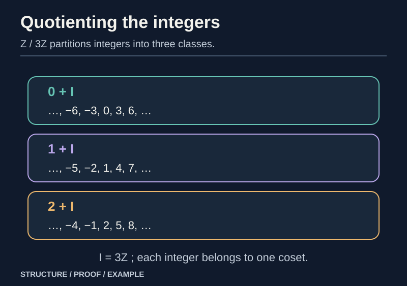
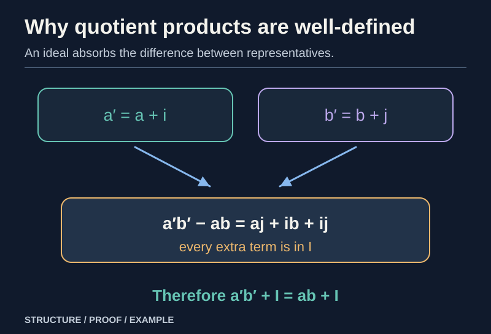
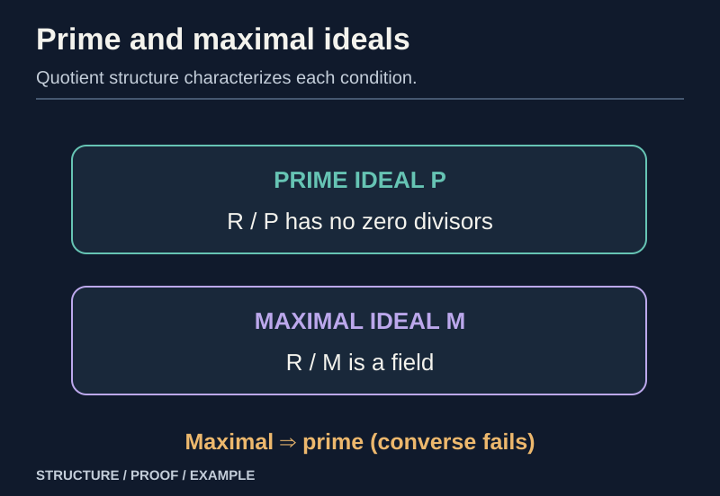
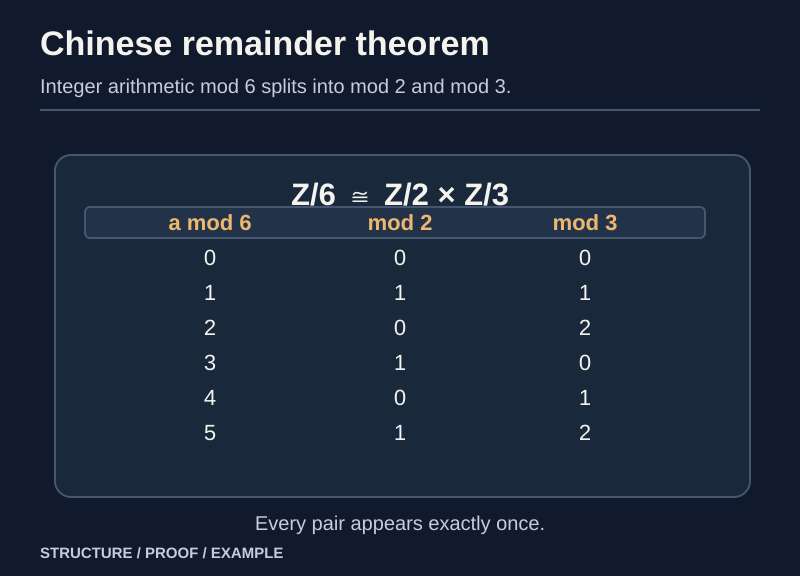

> [!abstract] Prerequisites & where this leads
> **Builds on:** [Ring Theory Foundations](./ring-theory-foundations) (ring axioms, domains, polynomial division) · [Homomorphisms and Quotient Groups](./group-homomorphisms-quotients) (kernels, additive cosets, quotient reasoning)
> **Leads to:** [Field Theory Foundations](./field-theory-foundations) (irreducible polynomial quotients) · [Commutative Algebra](./commutative-algebra) (localization) · [Algebraic Geometry](./algebraic-geometry) (polynomial ideals and zero sets)

Group quotients collapse a normal subgroup while preserving multiplication. A ring has *two* operations: quotienting its additive group is easy, but we also need the product of two cosets to be independent of their representatives. **Ideals are exactly the additive subgroups that make this work.**

We develop this from definitions, prove the main quotient and isomorphism theorems, and show why **prime** and **maximal** ideals correspond to two different strengths of quotient structure.

## Ideals: an additive subgroup that absorbs products

> [!definition] Two-sided ideal
> A subset $I\subseteq R$ is a **two-sided ideal** when it is an additive subgroup and whenever $i\in I$ and $r\in R$, both $ri\in I$ and $ir\in I$. In a commutative ring the two conditions coincide.

A left ideal need only absorb $ri$; a right ideal need only absorb $ir$. We will use **ideal** to mean two-sided ideal unless explicitly stated otherwise.

The additive subgroup condition can be tested by checking $0\in I$ and closure under subtraction. Absorption then guarantees that multiplying any element of the ideal by an ambient element stays inside the ideal.

> [!example] Even integers and an ideal generated by a polynomial
> $2\mathbb Z$ is an ideal in $\mathbb Z$: it is closed under differences, and the product of an even integer by any integer remains even. In $\mathbb Q[x]$, the set $(x^2-2)=\{(x^2-2)h(x):h\in\mathbb Q[x]\}$ is an ideal.

For a commutative ring and $a\in R$, the **principal ideal** $(a)=\{ra:r\in R\}$. More generally,

$$
(a_1,\ldots,a_k)=\left\{\sum_{j=1}^k r_j a_j:r_j\in R\right\}.
$$

This is the smallest ideal containing the named generators: the displayed set is an ideal, and any ideal containing the $a_j$ must contain every displayed combination.

**Worked example.** In $\mathbb Z$, $(6,10)=2\mathbb Z$: each integer combination of $6$ and $10$ is even, while $2=2\cdot6-1\cdot10$ belongs to the generated ideal. Multiplying the witness for $2$ by any integer yields every even number.

## Kernels of ring homomorphisms are ideals

> [!definition] Unital ring homomorphism
> A map $f:R\to S$ preserves $+$ and $\cdot$ and satisfies $f(1_R)=1_S$. We use **unital homomorphisms** throughout; the target may be the zero ring only where explicitly allowed.

The addition law makes $f$ an additive-group homomorphism. In particular it preserves zero and negatives. Its **kernel** is

$$
\ker f=\{r\in R:f(r)=0_S\}.
$$

> [!theorem] Kernel-ideal theorem
> The kernel of a ring homomorphism is a two-sided ideal. Its image is a subring (with the target's identity for a unital map).

**Proof.** If $a,b$ are in the kernel, $f(a-b)=f(a)-f(b)=0$, so the kernel is an additive subgroup. For $r\in R$ and $a\in\ker f$,

$$
f(ra)=f(r)f(a)=0,\qquad f(ar)=f(a)f(r)=0.
$$

Hence $ra$ and $ar$ lie in the kernel. The image is closed under sums, negatives and products; the unit $f(1_R)=1_S$ is in the image. $\square$

The **converse construction** is the important part: every two-sided ideal is a kernel of a canonical quotient map.

## Constructing the quotient ring and proving well-definedness

*Figure: A quotient collects elements into equivalence classes; its operations must not depend on the representative.*

Let $I$ be a two-sided ideal. Because $(R,+)$ is abelian, the additive cosets

$$
a+I=\{a+i:i\in I\}
$$

partition $R$, with $a+I=b+I$ exactly when $a-b\in I$. Denote their set by $R/I$.

Propose two operations on these classes:

$$
(a+I)+(b+I)=(a+b)+I,\qquad
(a+I)(b+I)=ab+I.
$$

The first comes from the additive quotient group. The second needs proof.

> [!theorem] Ideal absorption makes quotient multiplication well-defined
> If $a'=a+i$ and $b'=b+j$ with $i,j\in I$, then $a'b'-ab\in I$. Consequently the product $(a+I)(b+I)$ is independent of representatives.

**Proof.** Distribute without commuting factors:

$$
(a+i)(b+j)-ab=aj+ib+ij.
$$

The term $aj$ lies in $I$ because $I$ absorbs multiplication from the left; $ib$ lies in $I$ because it absorbs from the right; $ij\in I$ by either property. Closure under addition shows their sum belongs to $I$. Thus $a'b'+I=ab+I$. $\square$

Associativity and distributivity in $R/I$ follow by computing with representatives and using the same laws in $R$. The additive inverse of $a+I$ is $-a+I$, and the multiplicative identity is $1+I$.

> [!theorem] Quotient-ring theorem
> The additive cosets of a two-sided ideal form a ring $R/I$, and the map $\pi:R\to R/I$, $\pi(a)=a+I$, is a surjective unital ring homomorphism with $\ker\pi=I$.

**Proof.** The prior representative calculation establishes multiplication; the remaining ring axioms follow from $R$. The formulas for $\pi$ show preservation of both operations and $1$, and every class has a representative. Finally,

$$
\pi(a)=0+I\quad\Longleftrightarrow\quad a\in I.
$$

This proves all assertions. $\square$

If $I=R$, $R/I$ is the **zero ring** ($0=1$). Under the standing convention in [Ring Theory Foundations](./ring-theory-foundations) that ordinary rings have $1\ne0$, the quotient is a nonzero ring only for **proper** ideals $I\ne R$.

### Why the ideal condition is necessary

*Figure: Two-sided ideal absorption is exactly what licenses multiplying equivalence classes.*

Suppose $A$ is an additive subgroup and we try to use the formula $(a+A)(b+A)=ab+A$. Since $i+A=0+A$ for each $i\in A$, well-definedness forces

$$
(i+A)(r+A)=(0+A)(r+A),
$$

hence $ir\in A$. Reversing the factors gives $ri\in A$. So **any additive subgroup admitting this representative-based quotient multiplication must be a two-sided ideal**.

> [!counterexample] Multiplication on arbitrary additive cosets fails
> In $R=\mathbb Z[x]$, the additive subgroup consisting of constant integer polynomials is **not** an ideal. The representatives $0$ and $1$ determine the same additive coset, but multiplying them by $x$ gives $0$ and $x$, whose difference is not a constant polynomial. The coset product is therefore ambiguous.

## The First Isomorphism Theorem for rings

> [!theorem] First Isomorphism Theorem
> For a unital ring homomorphism $f:R\to S$,
>
> $$
> R/\ker f\ \cong\ \operatorname{im}f.
> $$

**Proof.** Define $\bar f(a+\ker f)=f(a)$. If $a+\ker f=b+\ker f$, then $a-b\in\ker f$, so $f(a)=f(b)$; thus the definition is **well-defined**. Additivity and multiplicativity follow by substituting representatives, and $\bar f(1+\ker f)=1_S$.

Every image element is some $f(a)$, so $\bar f$ is surjective onto the image. If $\bar f(a+\ker f)=0$, then $a\in\ker f$, meaning the coset is zero; thus the map is injective. It is a bijective ring homomorphism. $\square$

### Worked example: integer residues

Consider $\rho:\mathbb Z\to\mathbb Z/6\mathbb Z$, $\rho(n)=n\bmod6$. Its kernel is $6\mathbb Z$. The theorem gives

$$
\mathbb Z/(6\mathbb Z)\cong\mathbb Z/6\mathbb Z.
$$

This is not merely similar notation: it asserts the abstract ring obtained by quotienting is exactly the familiar arithmetic of residue classes.

### Worked example: evaluation at a point

Let $K$ be a field and choose $c\in K$. The evaluation map

$$
\operatorname{ev}_c:K[x]\longrightarrow K,\qquad f(x)\longmapsto f(c)
$$

is a surjective ring homomorphism: constants already give every output. By polynomial division, $f(x)=(x-c)q(x)+r$ for some **constant** remainder $r$. Evaluating at $c$ gives $r=f(c)$, so $f(c)=0$ exactly when $x-c$ divides $f$. Hence

$$
\ker(\operatorname{ev}_c)=(x-c),\qquad K[x]/(x-c)\cong K.
$$

## Ideals in a quotient: the Correspondence Theorem

> [!theorem] Correspondence Theorem for ideals
> For a two-sided ideal $I$ of $R$, ideals of $R/I$ correspond bijectively to ideals $J$ of $R$ containing $I$, via $J\mapsto J/I$.

**Proof.** Let $\pi:R\to R/I$ be the quotient map. The preimage $\pi^{-1}(B)$ of an ideal $B\subseteq R/I$ is an ideal: it is closed under additive differences, and multiplication by any $r\in R$ stays in the preimage because $B$ absorbs $\pi(r)$. Every such preimage contains $\ker\pi=I$.

Conversely, if $J$ is an ideal with $I\subseteq J$, its image $J/I$ is an ideal of $R/I$: any product by a coset $r+I$ is $rj+I$ or $jr+I$, still in $J/I$. Surjectivity of $\pi$ now shows that taking images and preimages in succession recovers the original ideal. $\square$

### Second and Third Isomorphism Theorems

> [!theorem] Second Isomorphism Theorem
> If $A\subseteq R$ is a unital subring and $I$ a two-sided ideal, then
>
> $$
> A/(A\cap I)\ \cong\ (A+I)/I.
> $$

**Proof.** Restrict the quotient map to $A$: $a\mapsto a+I$. Its kernel is $A\cap I$, and its image consists of cosets with representatives in $A$, exactly $(A+I)/I$. The sum $A+I$ is a unital subring: closure under multiplication follows from $aa'+ai'+ia'+ii'\in A+I$. Apply the First Isomorphism Theorem. $\square$

> [!theorem] Third Isomorphism Theorem
> If $I\subseteq J$ are two-sided ideals of $R$, then
>
> $$
> (R/I)/(J/I)\ \cong\ R/J.
> $$

**Proof.** The map $R/I\to R/J$ defined by $r+I\mapsto r+J$ is well-defined because $I\subseteq J$. It is surjective, preserves the operations, and its kernel is the set of classes $r+I$ with $r\in J$, namely $J/I$. Apply the First Isomorphism Theorem. $\square$

These results are the ring counterparts of the [group isomorphism theorems](./group-homomorphisms-quotients). The main extra burden was showing multiplication descends to the quotient.

## Prime and maximal ideals: two kinds of quotient

*Figure: The stronger maximal-ideal condition guarantees multiplicative inverses in the quotient.*

From here onward let $R$ be a **commutative ring with $1\ne0$**. All ideals called prime or maximal below are **proper**.

> [!definition] Prime ideal
> A proper ideal $P$ is **prime** if $ab\in P$ implies $a\in P$ or $b\in P$.

> [!definition] Maximal ideal
> A proper ideal $M$ is **maximal** if no ideal lies strictly between $M$ and $R$.

> [!theorem] Prime quotient criterion
> $P$ is prime **if and only if** $R/P$ is an integral domain.

**Proof.** In $R/P$, the equation $(a+P)(b+P)=0+P$ holds exactly when $ab\in P$. Primality says this forces $a+P=0$ or $b+P=0$, precisely the no-zero-divisors condition. Properness ensures $1+P\ne0+P$. All other domain axioms are inherited from the quotient. $\square$

> [!theorem] Maximal quotient criterion
> $M$ is maximal **if and only if** $R/M$ is a field.

**Forward proof.** Let $a+M\ne0+M$. Then $a\notin M$. The ideal $M+(a)$ properly contains $M$, so maximality forces $M+(a)=R$. Hence $1=m+ra$ for some $m\in M$ and $r\in R$. Passing to the quotient yields $(r+M)(a+M)=1+M$: every nonzero class is invertible.

**Reverse proof.** Suppose $R/M$ is a field and $J$ is an ideal with $M\subsetneq J\subseteq R$. By correspondence, $J/M$ is a nonzero ideal of the field $R/M$. A nonzero ideal in a field contains a unit, hence contains $1$ and is the whole field. Therefore $J=R$. $\square$

Every maximal ideal is therefore prime, because **every field is a domain**. The converse fails.

> [!counterexample] Prime does not mean maximal
> In $\mathbb Z$, $(0)$ is prime because $\mathbb Z$ has no zero divisors, but it is not maximal because $(0)\subsetneq(2)\subsetneq\mathbb Z$.

### Prime and maximal ideals in integer and polynomial rings

In $\mathbb Z$, the ideal $(n)$ is maximal exactly when $|n|$ is prime, because $\mathbb Z/(n)$ is a field exactly for prime modulus.

In $K[x]$ for a field $K$, each nonzero ideal is principal. To prove this, choose a nonzero element $g$ of **smallest degree** in an ideal $I$ and divide any $f\in I$ by $g$. The remainder $r=f-qg$ remains in $I$ and has smaller degree, so minimality forces $r=0$. Thus $I=(g)$.

A nonconstant $g\in K[x]$ generates a maximal ideal **exactly when it is irreducible**. If $g=uv$ with both degrees positive, the proper intermediate ideal $(g)\subsetneq(u)\subsetneq K[x]$ obstructs maximality. Conversely, if $g$ is irreducible and $(g)\subsetneq(h)$, then $h$ divides $g$, forcing $h$ to be a unit and $(h)=K[x]$.

That argument also proves $K[x]/(g)$ is a field for irreducible $g$; it is the algebraic tool for [adjoining polynomial roots](./field-theory-foundations).

> [!counterexample] Not every polynomial ring is a principal ideal ring
> The ideal $(2,x)$ in $\mathbb Z[x]$ is proper (reduce coefficients modulo $2$ and evaluate at $x=0$; both generators map to zero, while $1$ does not). If it were $(d)$, then $d$ would divide both $2$ and $x$. By the degree theorem, $d$ must be a constant divisor of $2$, so up to sign $d$ is $1$ or $2$. The first would make the ideal all of $\mathbb Z[x]$, while $2$ cannot divide the polynomial $x$ with integer coefficients. Contradiction.

## Chinese remainder theorem for comaximal ideals

*Figure: The product-ring representation separates arithmetic into two coprime moduli.*

Two ideals $I,J$ are **comaximal** if $I+J=R$, meaning there exist $i\in I$, $j\in J$ with $i+j=1$.

> [!theorem] Chinese Remainder Theorem (two ideals)
> For **commutative** $R$ and comaximal ideals $I,J$,
>
> $$
> R/(I\cap J)\cong R/I\times R/J.
> $$
>
> Moreover, $I\cap J=IJ$, the ideal generated by products $ij$.

**Proof.** Define $\phi:R\to R/I\times R/J$ by $\phi(r)=(r+I,r+J)$. This is a unital ring homomorphism with kernel $I\cap J$. To show surjectivity, choose $i\in I,j\in J$ with $i+j=1$. For any desired cosets $a+I$ and $b+J$, set $r=aj+bi$. Modulo $I$, $j\equiv1$, $i\equiv0$, so $r\equiv a$. Modulo $J$, the roles reverse and $r\equiv b$. Thus $\phi$ is surjective, and the First Isomorphism Theorem gives the isomorphism.

Every product $ij$ lies in $I\cap J$, so $IJ\subseteq I\cap J$. Conversely, if $x\in I\cap J$, write $x=x(i+j)=xi+xj$. Since $x\in J$ and $i\in I$, $xi\in IJ$; similarly $xj\in IJ$. Thus $x\in IJ$. $\square$

> [!example] Chinese remainders modulo six
> Since $(2)+(3)=\mathbb Z$, the theorem yields $\mathbb Z/6\mathbb Z\cong\mathbb Z/2\mathbb Z\times\mathbb Z/3\mathbb Z$. The class of $5$ maps to $(1,2)$. The six possible pairs correspond exactly to the six residue classes modulo $6$.

## Dependency audit

| Claim | Proof source |
| --- | --- |
| Ideal kernels | homomorphism laws and additive subgroup closure |
| Quotient multiplication | two-sided absorption; explicit representative calculation |
| First, second, third isomorphism theorems | quotient map, well-defined induced maps, kernels and images |
| Prime iff quotient domain | translate zero products to ideal membership |
| Maximal iff quotient field | ideal correspondence and explicit inverse from $1=m+ra$ |
| Every ideal of $K[x]$ is principal | polynomial division and minimum-degree argument |
| Irreducible polynomial quotient is a field | principal ideals and maximal quotient criterion |
| Chinese remainder theorem | comaximal witness and first isomorphism theorem |

Next, [Field Theory Foundations](./field-theory-foundations) uses the irreducible-polynomial quotient to construct fields containing roots that did not exist in the original field.
