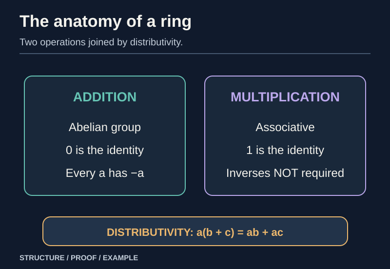
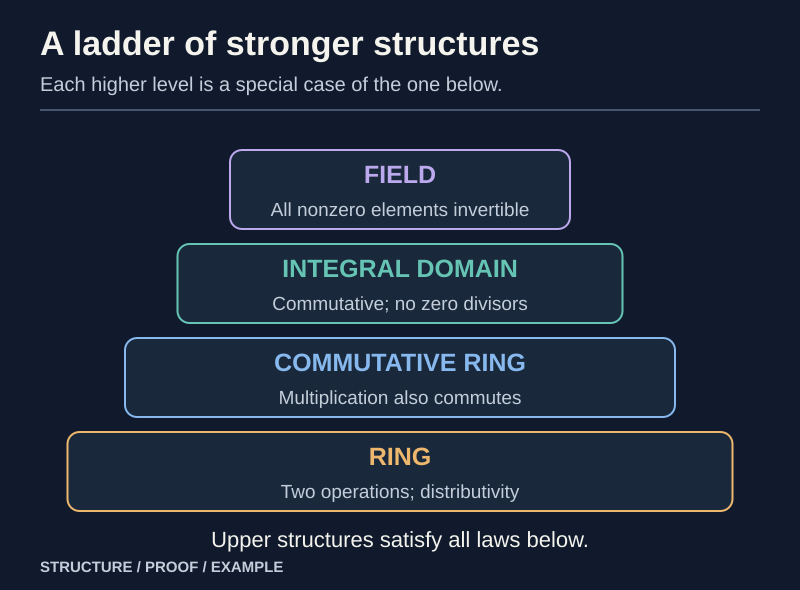
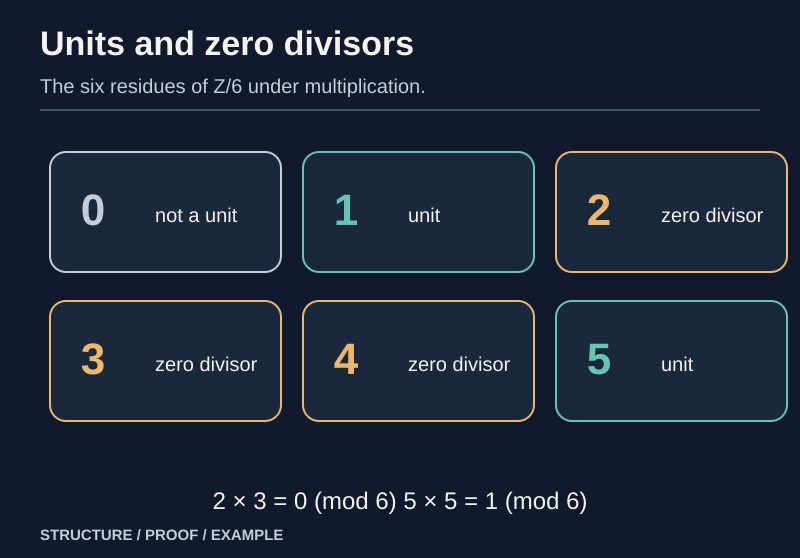
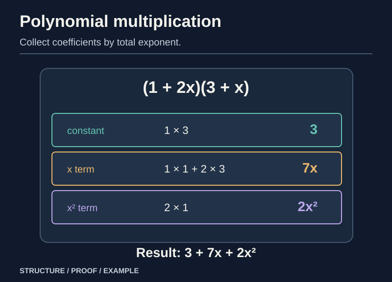

> [!abstract] Prerequisites & where this leads
> **Builds on:** [Group Theory Foundations](./group-theory-foundations) (groups, inverses, cancellation) · [Algebraic Structures](./algebraic-structures) (operations and distributivity) · [Construction of the Integers](./construction-of-the-integers) (integer ring as an example)
> **Leads to:** [Ideals, Quotient Rings & Homomorphisms](./ring-ideals-quotients) · [Field Theory Foundations](./field-theory-foundations) · [Algebraic Geometry](./algebraic-geometry)

A group describes one associative, reversible operation. A **ring** makes two operations interact: addition has inverses, multiplication need not, and distributivity ties them together. Integers, polynomial expressions, matrices, and clock arithmetic share these laws without being interchangeable.

This chapter develops the ring axioms and **derives** their consequences. It also isolates precisely which extra property lets cancellation work and which property lets every nonzero element be divided by.

## The conventions and axioms

*Figure: Unlike in a field, multiplicative inverses and commutativity need not hold.*

> [!definition] Associative ring with identity
> A **ring** $(R,+,\cdot)$ has an abelian group $(R,+)$, an associative multiplication, a two-sided multiplicative identity $1$, and both distributive laws
> $a(b+c)=ab+ac$ and $(a+b)c=ac+bc$.
> Unless explicitly stated otherwise, this chapter assumes **$1\ne0$**. Multiplication need **not commute**.

Closure is built into the operations $+:R\times R\to R$ and $\cdot:R\times R\to R$. The additive identity is $0$, and $-a$ is the additive inverse of $a$. A **commutative ring** additionally satisfies $ab=ba$ for every pair. Some books do not require a multiplicative identity; here that is part of the word *ring*.

We will occasionally mention the **zero ring**, where $0=1$ and there is only one element, because the quotient by the whole ring produces it. That exceptional quotient does not satisfy our standing $1\ne0$ convention.

### First ring proofs: zero and signs

> [!theorem] Zero annihilates multiplication
> For every $a$ in a ring, $a0=0a=0$.

**Proof.** Since $0+0=0$, distributivity gives

$$
a0=a(0+0)=a0+a0.
$$

Add the additive inverse of $a0$ to both sides. The result is $a0=0$. The other distributive law gives $0a=0$ in exactly the same way. $\square$

> [!theorem] Negatives interact with multiplication
> For all $a,b\in R$, $(-a)b=-(ab)=a(-b)$ and $(-a)(-b)=ab$.

**Proof.** Using the previous theorem,

$$
ab+(-a)b=(a+(-a))b=0b=0.
$$

Thus $(-a)b$ is the additive inverse of $ab$. Similarly $ab+a(-b)=a(b-b)=0$. Applying the same fact twice yields $(-a)(-b)=-[a(-b)]=ab$. No commutativity of multiplication was used. $\square$

**Why this matters.** These formulas are *theorems*, not extra rules you are allowed to assume when defining a new ring.

## Four examples that behave differently

*Figure: Each more restrictive structure satisfies every axiom of those below it.*

| Ring | Multiplication commutative? | Is every nonzero element invertible? | Zero divisors? |
| --- | --- | --- | --- |
| $\mathbb Z$ | Yes | No; only $\pm1$ are units | No |
| $\mathbb Z/6\mathbb Z$ | Yes | No | Yes: $2\cdot3=0$ |
| $\mathbb Q[x]$ | Yes | No; $x$ has no polynomial inverse | No |
| $M_2(\mathbb R)$ | No | No; singular matrices fail | Yes |

The operations in $\mathbb Z/6\mathbb Z$ are performed modulo $6$. In $M_2(\mathbb R)$ they are matrix addition and multiplication. None of those differences is visible from the ring axioms alone; the definitions merely specify the common baseline.

A nonzero singular matrix can also be a zero divisor. For example,

$$
\begin{pmatrix}1&0\\0&0\end{pmatrix}
\begin{pmatrix}0&0\\0&1\end{pmatrix}
=\begin{pmatrix}0&0\\0&0\end{pmatrix}.
$$

These two matrices are each nonzero. This proves that the ring of $2\times2$ real matrices has zero divisors even though $\mathbb R$ itself does not.

## Units and multiplicative inverses

*Figure: Residue arithmetic gives both a reversible example and an obstruction to cancellation.*

> [!definition] Unit
> An element $u\in R$ is a **unit** if there is $v\in R$ with $uv=vu=1$. This $v$ is denoted $u^{-1}$. Requiring both products matters when multiplication is noncommutative.

**Uniqueness of inverse.** If $uv=vu=1$ and $uw=wu=1$, then

$$
v=v(uw)=(vu)w=w.
$$

**Product of units.** If $u,v$ are units, $(uv)^{-1}=v^{-1}u^{-1}$, since

$$
(uv)(v^{-1}u^{-1})=u(vv^{-1})u^{-1}=1
$$

and the reverse product is also $1$. Thus the set of units $R^\times$ forms a **group** under multiplication, even when $R$ is noncommutative.

> [!example] Units modulo six
> In $\mathbb Z/6\mathbb Z$, the units are $1$ and $5$ because $1\cdot1\equiv1$ and $5\cdot5\equiv1\pmod6$. The other nonzero residues do not have multiplicative inverses.

To test the latter claim, observe $2\cdot3=0$. If $2$ had an inverse, multiplying this equality by it would force $3=0$, a contradiction. The same reasoning handles $3$ and $4$, while $0$ cannot be a unit in a nonzero ring.

## Zero divisors, cancellation and integral domains

> [!definition] Zero divisor
> A **nonzero** element $a$ is a left zero divisor if $ab=0$ for some nonzero $b$, and a right zero divisor if $ba=0$ for some nonzero $b$. These notions coincide in a commutative ring.

> [!definition] Integral domain
> A **domain** here means a nonzero **commutative** ring with $1$ and **no zero divisors**. Some texts also call this an integral domain.

> [!theorem] Cancellation in a domain
> In a domain, $ab=ac$ and $a\ne0$ imply $b=c$.

**Proof.** Subtract to get $a(b-c)=0$. As the domain has no zero divisors and $a\ne0$, we must have $b-c=0$. Thus $b=c$. $\square$

The converse is instructive: if **every nonzero** $a$ admits left cancellation, then $ab=0=a0$ forces $b=0$, so there are no zero divisors. Hence cancellation and absence of zero divisors are equivalent in a commutative nonzero ring.

> [!counterexample] Cancellation fails modulo six
> $2\cdot1\equiv2\cdot4\pmod6$, yet $1\not\equiv4\pmod6$. Cancelling $2$ would be invalid because it is a zero divisor.

### Why a finite domain is a field

> [!theorem] Every finite integral domain is a field
> In a **finite** domain $R$, each nonzero $a$ has a multiplicative inverse.

**Proof.** Fix $a\ne0$. The map $m_a:R\to R$, $x\mapsto ax$, is injective: $ax=ay$ implies $x=y$ by cancellation. An injective map from a finite set to itself is surjective, so there exists $b$ with $ab=1$. As the domain is commutative, $ba=1$ also. Therefore every nonzero element is a unit. $\square$

In particular $\mathbb Z/p\mathbb Z$ is a field whenever $p$ is prime: if $ab\equiv0\pmod p$, primality implies $p\mid a$ or $p\mid b$. Conversely, for composite $n=rs$ with $1<r,s<n$, the nonzero residue classes of $r,s$ have zero product modulo $n$; hence $\mathbb Z/n\mathbb Z$ cannot be a field.

## Characteristic: when repeated ones return to zero

> [!definition] Characteristic
> The **characteristic** of a nonzero ring is the smallest positive integer $n$ with $n\cdot1=0$, if one exists; otherwise it is $0$. Here $n\cdot1$ is a repeated **sum**.

The map $\eta:\mathbb Z\to R$ defined by $\eta(n)=n\cdot1$ respects addition and multiplication. For multiplication, distributivity proves $(m\cdot1)(n\cdot1)=(mn)\cdot1$ for positive integers, and the sign theorem extends it to all integers.

The kernel of $\eta$ is an additive subgroup of $\mathbb Z$, so it has the form $n\mathbb Z$ for a unique $n\ge0$. The number $n$ is precisely the characteristic.

> [!theorem] A domain has characteristic zero or a prime
> If an integral domain has a positive characteristic $n$, then $n$ is prime.

**Proof.** If $n=rs$ were composite with $1<r,s<n$, we would have

$$
(r\cdot1)(s\cdot1)=(rs)\cdot1=n\cdot1=0.
$$

Minimality of $n$ says neither $r\cdot1$ nor $s\cdot1$ is zero. That contradicts the absence of zero divisors. Hence $n$ is prime. $\square$

The ring $\mathbb Z/6\mathbb Z$ has characteristic $6$, so a ring's characteristic need **not** always be prime. Fields, however, are domains: their positive characteristic must be prime.

## Subrings and the importance of the identity

> [!definition] Unital subring
> A **unital subring** $S\subseteq R$ contains $0,1_R$, is closed under addition, additive inverses and multiplication, and inherits the operations from $R$.

Some authors permit subrings with a different identity or without a multiplicative identity; our convention deliberately requires the **same $1$**. For example, $2\mathbb Z$ is closed under integer addition, negation and multiplication, but is **not a unital subring** of $\mathbb Z$ because it lacks $1$.

The scalar matrices $\{aI:a\in\mathbb R\}$ form a commutative unital subring of $M_2(\mathbb R)$. The full matrix ring is not commutative.

## Polynomial rings and degree

*Figure: Each output coefficient collects input pairs whose powers sum to that exponent.*

For a commutative ring $R$, define $R[x]$ as the set of finite coefficient sequences written

$$
f(x)=a_0+a_1x+\cdots+a_nx^n.
$$

Coefficients add termwise; multiplication is defined by **convolution**:

$$
\left(\sum_i a_i x^i\right)\left(\sum_j b_jx^j\right)
=\sum_k\left(\sum_{i+j=k}a_ib_j\right)x^k.
$$

Only finitely many coefficients are nonzero, so the operation is well-defined. Associativity and distributivity follow coefficient by coefficient from the ring laws in $R$; the constant polynomial $1$ is the identity. This constructs the polynomial ring without treating the symbol $x$ as an actual number.

> [!theorem] Degree of a product over a domain
> For nonzero $f,g\in R[x]$ over an integral domain, $\deg(fg)=\deg(f)+\deg(g)$.

**Proof.** Let $\deg f=m$, $\deg g=n$ with leading coefficients $a_m,b_n\ne0$. The coefficient of $x^{m+n}$ in the product is $a_mb_n\ne0$ by the absence of zero divisors. All higher coefficients vanish, proving the formula. $\square$

This proof explains why $\mathbb Z[x]$ is a domain and why a nonconstant polynomial cannot be a unit there. If $fg=1$, the degree identity forces $\deg f=\deg g=0$, so the units of $\mathbb Z[x]$ are exactly the constant polynomials $1,-1$.

### Polynomial division needs field coefficients

> [!theorem] Division algorithm for $K[x]$
> If $K$ is a field, $f,g\in K[x]$, and $g\ne0$, there are **unique** $q,r\in K[x]$ such that $f=qg+r$ and either $r=0$ or $\deg r<\deg g$.

**Existence proof.** Start with remainder $r=f$ and quotient $q=0$. If $\deg r\ge\deg g$, let $a x^m$ and $b x^n$ be their leading terms. Since $b\ne0$ is invertible in $K$, subtract $(a/b)x^{m-n}g$ from $r$ and add that monomial to $q$. The leading term cancels and the remainder's degree strictly decreases. Nonnegative integer degrees cannot decrease indefinitely, so the process stops with the required remainder.

**Uniqueness proof.** If $f=qg+r=q'g+r'$ with both remainders below $\deg g$, then $(q-q')g=r'-r$. A nonzero left side has degree at least $\deg g$ by the product-degree theorem; the right side has smaller degree or is zero. Hence both sides are zero, and domain cancellation yields $q=q'$ and $r=r'$. $\square$

> [!counterexample] Why arbitrary integer coefficients are not enough
> Dividing the constant polynomial $1$ by the constant polynomial $2$ in $\mathbb Z[x]$ cannot yield a quotient and remainder with remainder degree below $0$: that would require an integer polynomial $q$ with $1=2q$.

This division algorithm becomes the engine of the ideal structure of $K[x]$, irreducible polynomials, and field extensions.

## The bridge: from additive subgroups to ideals

A subgroup of $(R,+)$ need not support quotient **multiplication**. To multiply additive cosets without ambiguity, the subgroup must absorb multiplication by arbitrary ring elements on the appropriate sides.

That extra property defines an **ideal**, the central subject of [Ideals, Quotient Rings & Homomorphisms](./ring-ideals-quotients). Afterward, [Field Theory Foundations](./field-theory-foundations) will show how quotients by irreducible polynomials construct new fields.

## Dependency audit

| Result | What licensed the proof |
| --- | --- |
| $a0=0a=0$, sign rules | additive inverses and distributivity |
| Units form a group | associativity and two-sided inverses |
| Cancellation | no zero divisors |
| Finite domain is a field | finite injective maps are surjective |
| Domain characteristic is prime or zero | minimal repeated sum of $1$ and no zero divisors |
| $\deg(fg)=\deg f+\deg g$ | product of nonzero leading coefficients remains nonzero |
| Polynomial division | inverses of nonzero leading coefficients in a field |
