> [!abstract] Prerequisites & where this leads <!-- slt-nav -->
> **Builds on:** [Mathematical Notations](./mathematical-notations)
> **Leads to:** [Functions & Relations](./functions-relations) · [Peano Arithmetic](./peano-arithmetic) · [Measure Theory](./measure-theory)


**Want the bigger picture?** The optional [Atlas of Mathematical Spaces](./atlas-of-mathematical-spaces) shows how the same underlying set can support different structures. You do **not** need to read the atlas to follow the definitions below.

**Three structural discoveries in this chapter:** [A power set is a space of yes/no functions](#a-power-set-is-a-space-of-yesno-functions); [infinity does not determine boundedness or discreteness](#infinity-does-not-mean-unbounded-or-infinitely-subdividable); and [the cumulative hierarchy builds sets through transfinite stages](#the-cumulative-hierarchy-how-sets-are-built-in-stages). These reveal why set theory connects to logic, topology, and mathematical foundations—not merely how to perform set operations.

Sets are the most fundamental building block in all of mathematics: a **set** is simply a collection of distinct objects. We need formal set theory because mathematics requires a precise language for talking about collections, membership, and relationships between groups of objects. Nearly everything else in math, including numbers, functions, sequences, and probability, is built on the concept of a set. Understanding sets first makes every other topic easier to reason about.

**Set Theory:** Set theory is the branch of mathematical logic that
studies Sets, which can be informally described as collections of
objects.

There are 2 primary branches of set theory:

-   **Naïve Set Theory**: Naive set theory is an informal approach to
    set theory that was developed in the late 19th century before the
    formalization of set theory by mathematicians such as Ernst
    **Zermelo** and **Abraham Fraenkel**. The term "naive"
    distinguishes it from more rigorous, formalized versions of set
    theory, like **Zermelo-Fraenkel** set theory (ZF), which are used to
    avoid certain paradoxes that arise in naive set theory.

-   **Axiomatic Set Theory**: To resolve the issues of naive set theory,
    mathematicians developed more rigorous frameworks for set theory.
    The most widely accepted is **Zermelo-Fraenkel** set theory (ZF),
    often extended with the **Axiom of Choice (ZFC).** These systems use
    axioms to carefully define the properties of sets and restrict the
    kinds of sets that can be formed, thereby avoiding the paradoxes
    inherent in naive set theory.

## Set

> [!definition] Sets and membership
> A **set** is determined by which objects belong to it. Writing $x\in A$ means $x$ is a member of $A$. Order and repetition in a finite roster do not change its members.


**Set:** A set is a collection of "*things*." These ***things*** are
called elements of the set.

Elements are normally written with lower case letters and sets are
normally written with upper case letters.

We write $a \in A$ for "a is an element of a set A" (read "a is an element of A" or "a is in A"), and $a \notin A$ for "a is not an element of a set A" (read "a is not an element of A").

$\emptyset$ or $\{\}$ (read "the empty set") denotes the empty set, which contains no element.

For example, if $A = \{1, 2, 3\}$, then $1 \in A$ but $0 \notin A$.

**Set elements are unique.** An element is either in the set or not in
the set. It makes no sense to say that an element is in the set
multiple times. It may be listed multiple times, but this is
extraneous.

So $\{1, 1, 2\}$ and $\{1, 2\}$ denote the *same* set: repetition and order carry no information about membership.

## From sets to mathematical spaces

A **set** tells us which elements belong to a collection, but membership alone does not specify which elements are near one another, how they are ordered, or what operations we can perform on them. In many branches of mathematics, a **space** is an underlying set together with specified **additional structure**. This is a useful pattern, not a universal formal definition of the word *space*.

Take the same set $X=\{a,b,c\}$. We can equip it with different structures:

| What we specify in addition to $X$ | Structured mathematical object | New questions we can ask |
| --- | --- | --- |
| An order $a<b<c$ | **Ordered set** $(X,\leq)$ | Which elements come before others? |
| A family $\tau=\{\varnothing,\{a\},\{a,b\},X\}$ of open subsets | **Topological space** $(X,\tau)$ | Which subsets are open, and which maps are continuous? |
| A distance $d$ with $d(x,y)=0$ if $x=y$ and $1$ otherwise | **Metric space** $(X,d)$ | How far apart are two elements? |

All three have the **same underlying set**. They are different mathematical objects because the extra structure is different; it must also satisfy the axioms for that kind of space.

> [!distinction] Structure is not the same as a property
> A topology, order, or metric is **data that we specify**. *Compactness*, for example, is a **property** that a topology may or may not satisfy, not an additional collection of data by itself. Neither property nor structure is determined solely by the elements of an arbitrary set.

**The progression:** [Sets](#set) provide elements; [functions and relations](./functions-relations) describe mappings and comparisons; [topology](./general-topology-foundations) adds open subsets. The [Atlas of Mathematical Spaces](./atlas-of-mathematical-spaces) compares many more structures and shows which can be derived from others. For a worked example of how equivalence on a set becomes a linear-algebra quotient, visit [Cross-Disciplinary Bridges](./cross-disciplinary-bridges#bridge-1-equivalence-classes-become-kernels-and-quotient-spaces).

## Roster Notation

Roster notation (also known as **enumeration notation**) involves
explicitly listing out all the elements of the set within curly braces.

For example, the set of vowels is $\{a, e, i, o, u\}$, and the first five natural numbers form $\{0, 1, 2, 3, 4\}$.

## Set-Builder Notation

> [!distinction] A property does not automatically define a set
> The notation $\{x\in A:P(x)\}$ names a **subset of an existing set** $A$ using a property. In ZF/ZFC, unrestricted $\{x:P(x)\}$ is **not** legitimate without a previously justified ambient set: [Russell's paradox](#russells-paradox) shows why.


**Set-Builder Notation:** Set-builder notation describes the elements of a set by specifying a
property or condition that the elements of the set satisfy, rather than
listing them out.

**General Form:** $\{x \mid P(x)\}$ or $\{x : P(x)\}$

Read as "the set of all x such that P(x) is true"

**Examples:**

- $\{x \mid x > 0\}$ = the set of all positive numbers
- $\{x \in \mathbb{Z} \mid x \text{ is even}\}$ = the set of all even integers
- $\{x^2 \mid x \in \mathbb{N}\}$ = {0, 1, 4, 9, 16, 25, ...} (perfect squares)
- $\{x \in \mathbb{R} \mid x^2 < 4\}$ = $(-2, 2)$ (interval notation)

## Empty Set

The empty set, denoted $\emptyset$ or $\{\}$, is a set
with no members at all.

Although the empty set has no members, it can be a member of other sets.
Thus $\emptyset \neq \{\emptyset\}$

## Subset

> [!definition] Subset
> $A\subseteq B$ means **every** element of $A$ is an element of $B$. Equality of the sets is allowed. This is a universal membership claim, not a comparison of their sizes.


**Subset:** A is a subset of B, (denoted $A \subseteq B$, read "A is a subset of B"), if every element of A is also an element of B.

**Formal Definition:** $A \subseteq B \iff \forall x\, (x \in A \to x \in B)$

If A is not a subset of B, we write $A \not\subseteq B$.

**Examples:**

- $\{1, 2\} \subseteq \{1, 2, 3, 4\}$ (every element of $\{1, 2\}$ is in $\{1, 2, 3, 4\}$)
- $\{a, b\} \subseteq \{a, b, c\}$
- $\emptyset \subseteq A$ for any set $A$ (the empty set is a subset of every set)
- $A \subseteq A$ for any set $A$ (every set is a subset of itself)
- $\{1, 2, 3\} \not\subseteq \{1, 2\}$ (3 is in the first set but not the second)

**Key Property:** Every set is a subset of itself (reflexive property).

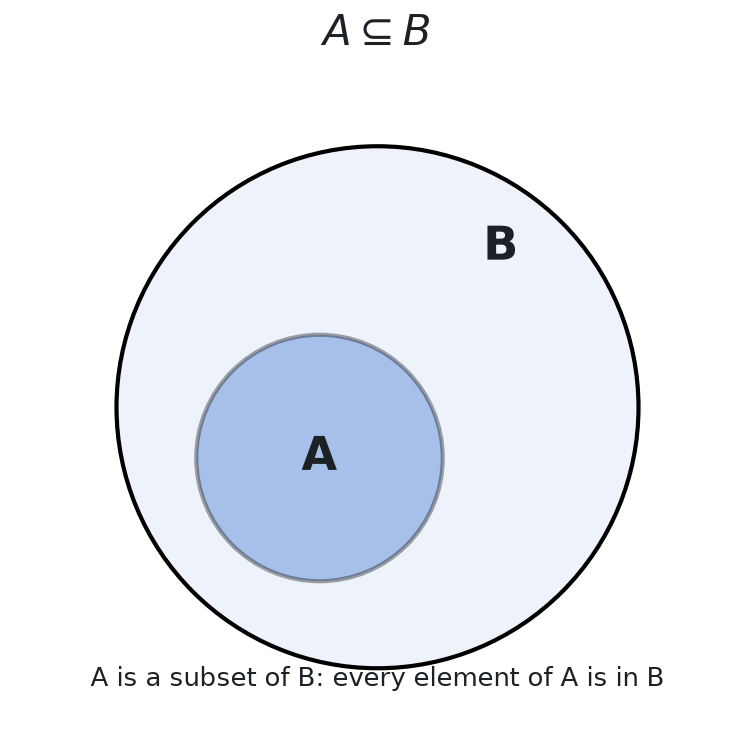

## Proper Subset

> [!distinction] Subset versus proper subset
> $A\subseteq B$ permits $A=B$; $A\subsetneq B$ requires $A\ne B$ as well. A set is always a subset of itself, but never a **proper** subset of itself.


**Proper Subset:** A is a **proper subset** of B (denoted $A \subsetneq B$, read "A is a proper subset of B") if $A \subseteq B$ **and** $A \neq B$: every element of A is in B, but B contains at least one element that is not in A. The containment is *strict*.

$$
A \subsetneq B \iff (A \subseteq B) \ \wedge \ (A \neq B)
$$


**Notation warning.** The symbol $\subset$ is ambiguous: some authors use it for *any* subset (identical to $\subseteq$), others reserve it for *proper* subsets only. To stay unambiguous, this page writes $\subseteq$ for "subset (equality allowed)" and $\subsetneq$ for "proper subset (strictly smaller)."

**Examples:**

- $\{1, 2\} \subsetneq \{1, 2, 3\}$ (proper: $3$ is in the larger set but not the smaller).
- $\{1, 2, 3\} \subseteq \{1, 2, 3\}$ but $\{1, 2, 3\} \not\subsetneq \{1, 2, 3\}$ (a set is a subset of itself, but never a *proper* subset of itself).
- $\emptyset \subsetneq A$ for every nonempty set $A$.

**Counting.** A set with $n$ elements has $2^n$ subsets in all, of which exactly $2^n - 1$ are proper (every subset except the whole set itself). For example, $\{a, b, c\}$ has $2^3 = 8$ subsets and $7$ proper subsets. (See [Power Set](#power-set).)

### Subset as an Order: the Analogy with $\leq$ and $<$

The pair $\subseteq$ / $\subsetneq$ behaves exactly like $\leq$ / $<$ on numbers. Both are **order relations** (see [partial and total orders](./order-theory)), and lining them up makes each easier to remember:

| Numbers | Sets | Property |
|---|---|---|
| $a \leq a$ | $A \subseteq A$ | reflexive |
| $a \leq b$ and $b \leq a \Rightarrow a = b$ | $A \subseteq B$ and $B \subseteq A \Rightarrow A = B$ | antisymmetric |
| $a \leq b$ and $b \leq c \Rightarrow a \leq c$ | $A \subseteq B$ and $B \subseteq C \Rightarrow A \subseteq C$ | transitive |
| $a < b \iff a \leq b \text{ and } a \neq b$ | $A \subsetneq B \iff A \subseteq B \text{ and } A \neq B$ | strict version |

The quickest way to remember the last row: **a proper subset is "$\subseteq$ but not equal," exactly as $<$ is "$\leq$ but not equal."** Read $A \subsetneq B$ as "$A$ is *strictly contained* in $B$," not necessarily "has fewer elements." Infinite sets can be bijective with proper subsets: $\mathbb N\subsetneq\mathbb Z$ yet $|\mathbb N|=|\mathbb Z|$. The analogy with $<$ is about **order of inclusion**, not always **cardinal size**.

The antisymmetry row is more than an analogy: showing $A \subseteq B$ **and** $B \subseteq A$ is *the* standard way to prove two sets equal, the double-inclusion method used in [Set Equality](#set-equality) just below.

**One crucial difference.** The relation $\leq$ on numbers is a **total order**: any two numbers are comparable, either $a \leq b$ or $b \leq a$. The subset relation $\subseteq$ is only a **partial order**: two sets can be *incomparable*, with neither a subset of the other. For instance $\{1, 2\}$ and $\{2, 3\}$ satisfy $\{1,2\} \not\subseteq \{2,3\}$ (since $1 \notin \{2,3\}$) and $\{2,3\} \not\subseteq \{1,2\}$ (since $3 \notin \{1,2\}$). On a number line everything lies in a single row; the subsets of a set instead branch into a lattice (the [power set](#power-set)) in which side-by-side elements are incomparable.

This difference changes what "$\neq$" buys you. For numbers, $a \neq b$ *already* pins down a direction: since any two numbers compare, non-equal numbers must have one strictly less, so $a \neq b$ forces $a < b$ **or** $b < a$. For sets, $A \neq B$ does **not** force $A \subsetneq B$ or $B \subsetneq A$, precisely because the two sets might be incomparable ($\{1,2\}$ and $\{2,3\}$ again). So the "and not equal" clause only upgrades $\subseteq$ to $\subsetneq$ *once you already know $A \subseteq B$*: the proper-subset relation acts just like $<$ **along a chain of containment**, but inequality alone never tells you a direction the way it does for numbers.


## Set Equality

> [!axiom] Extensionality
> Sets are equal precisely when their **members agree**: $A=B$ if and only if $\forall x\,(x\in A\leftrightarrow x\in B)$. A set's display order and repeated listing do not matter.


Two sets are **equal** iff they have the **same members**. Formally
**(Axiom of Extensionality):**

$$
A = B  \Longleftrightarrow  \forall x (x \in A  \Longleftrightarrow  x \in B)
$$

Equivalently (very handy in proofs):

$A = B \iff (A \subseteq B) \land (B \subseteq A)$

**Examples:**

- $\{1, 2, 3\} = \{3, 2, 1\}$ (order doesn't matter)
- $\{1, 2, 2, 3\} = \{1, 2, 3\}$ (duplicates don't matter)
- $\{a, b\} = \{b, a\}$
- $\{1, 2, 3\} \neq \{1, 2\}$ (different elements)
- $\{1, 2\} \neq \{1, 2, 3\}$ (one has an extra element)
- $\emptyset = \{\}$ (two notations for the same empty set)

**Key Properties:**
- Sets with the same elements are equal, regardless of order
- Repetition of elements doesn't affect equality
- For equality, every element of A must be in B, and every element of B must be in A


**How to prove sets** $\mathbf{A = B}\mathbf{ }$**in practice:**

1.  **Show** $A \subseteq B$**:** take an arbitrary $x \in A$, prove
    $x \in B$.

2.  **Show** $B \subseteq A$**:** take an arbitrary $x \in B$, prove
    $x \in A$.\
    Done: by double containment.

**Common proof pattern (template)**

To show $A = B$: let $x$ be arbitrary

-   If $x \in A$, then ... hence $x \in B$

-   If $x \in B$, then ... hence $x \in A$

> Therefore $A = B$


**Example Proof:**

Prove $\{x \in \mathbb{Z} \mid x \text{ is even}\} = \{2n \mid n \in \mathbb{Z}\}$

Let $A = \{x \in \mathbb{Z} \mid x \text{ is even}\}$ and $B = \{2n \mid n \in \mathbb{Z}\}$

**Show $A \subseteq B$:** Let $x \in A$. Then $x$ is even, so $x = 2k$ for some $k \in \mathbb{Z}$. Therefore $x \in B$.

**Show $B \subseteq A$:** Let $x \in B$. Then $x = 2n$ for some $n \in \mathbb{Z}$. By definition, $x$ is even, so $x \in A$.

Therefore A = B.

### Proof Techniques for Sets

> [!proof-sketch] Standard double-inclusion strategy
> To prove $A=B$, establish $A\subseteq B$ and $B\subseteq A$ separately. The element-chasing calculation below carries out both directions; the strategy alone is not a proof of a particular identity.


The double-containment method above is the most common way to prove set equalities, but there are several standard proof patterns worth knowing.

**Proving $A \subseteq B$:** Take an arbitrary element $x \in A$ and show, using definitions and logical steps, that $x \in B$.

**Proving $A = B$:** Show both $A \subseteq B$ and $B \subseteq A$ (double containment). This is the standard approach for set equalities.

**Proving $A \cap B = C$:** Use double containment. Show every element of $A \cap B$ is in $C$, and every element of $C$ is in $A \cap B$.

**Two styles of proof for set identities:**

1. **Element-chasing:** Start with an arbitrary element of one side, and show it belongs to the other side. This is the most rigorous method.
2. **Algebraic laws:** Use known set identities (commutative, associative, distributive, De Morgan's, etc.) to transform one side into the other. This is shorter but relies on previously established identities.

**Worked Example (Element-Chasing):**

Prove that $A \cap (B \cup C) = (A \cap B) \cup (A \cap C)$ (distributive law).

**Show $A \cap (B \cup C) \subseteq (A \cap B) \cup (A \cap C)$:**

Let $x \in A \cap (B \cup C)$. Then $x \in A$ and $x \in B \cup C$.

Since $x \in B \cup C$, either $x \in B$ or $x \in C$ (or both).

- If $x \in B$: then $x \in A$ and $x \in B$, so $x \in A \cap B$, hence $x \in (A \cap B) \cup (A \cap C)$.
- If $x \in C$: then $x \in A$ and $x \in C$, so $x \in A \cap C$, hence $x \in (A \cap B) \cup (A \cap C)$.

In either case, $x \in (A \cap B) \cup (A \cap C)$. $\checkmark$

**Show $(A \cap B) \cup (A \cap C) \subseteq A \cap (B \cup C)$:**

Let $x \in (A \cap B) \cup (A \cap C)$. Then $x \in A \cap B$ or $x \in A \cap C$.

- If $x \in A \cap B$: then $x \in A$ and $x \in B$. Since $x \in B$, we have $x \in B \cup C$. So $x \in A \cap (B \cup C)$.
- If $x \in A \cap C$: then $x \in A$ and $x \in C$. Since $x \in C$, we have $x \in B \cup C$. So $x \in A \cap (B \cup C)$.

In either case, $x \in A \cap (B \cup C)$. $\checkmark$

By double containment, $A \cap (B \cup C) = (A \cap B) \cup (A \cap C)$. $\blacksquare$

## Pigeonhole Principle (PHP)

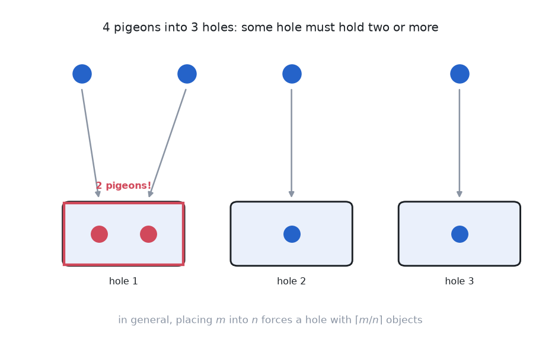

If $m$ objects (pigeons) are placed into $n$ containers (holes) with
$m > n$, then at least one container holds **two or more** objects.

**Proof (counting).**\
Assume every container holds at most one object. Then there are at most
$n$ objects total. But $m > n$.

Contradiction. ∎

**Theorem (Generalized PHP).**

Placing $m$ objects into $n$ containers (with $n \geq 1$) guarantees some container has
at least:

$$
\lceil\frac{m}{n}\rceil
$$

objects.

*Average view.* The average load is $m/n$. Some load is $\geq$the
average, thus $\geq \lceil m/n\rceil$.

**Worked example (both forms).** Put $m = 5$ balls into $n = 3$ boxes.

- *Basic form.* Since $5 > 3$, at least one box must hold two or more balls. Why: if every box held at most one, the boxes could hold at most $3 \times 1 = 3$ balls in total, but we have $5$. Contradiction, so some box is doubled up.
- *Generalized form.* More precisely, some box holds at least $\left\lceil \frac{5}{3} \right\rceil = \lceil 1.67 \rceil = 2$ balls. Pushing the counts: with $m = 7$ balls in $n = 3$ boxes, some box holds at least $\left\lceil \frac{7}{3} \right\rceil = 3$, because if every box held at most $2$ the total would be at most $3 \times 2 = 6 < 7$.
- *A familiar instance.* Among any $13$ people, two share a birth month: the people are the $m = 13$ objects and the $n = 12$ months are the boxes, and $13 > 12$ forces a collision. The principle guarantees *that* two people share a month, without telling us *which* month.

## Cardinality

**Cardinality:** Let A be a set. then the number of elements in the set
A is called **cardinality** of the set A, and is denoted by **\|A\|** (read "the cardinality of A" or "the size of A")

For instance, $|\varnothing| = 0$, but $|\{\varnothing\}| = 1$: the set *containing* the empty set has one element (namely $\varnothing$), so it is not itself empty. This distinction matters, and underlies the von Neumann encoding of numbers.

### Finite vs. Infinite Sets

**Core definitions**

**Set equality (Extensionality):**

$$
A = B  \Longleftrightarrow  \forall x\,(x \in A \leftrightarrow x \in B)
$$

**Subset:**

$A \subseteq B  \Longleftrightarrow  \forall x\text{ }(x \in A \Rightarrow x \in B)$.

**Proper subset**:

$$
A \subsetneq B
$$

(read "A is a proper subset of B")

**Functions and size (cardinality)**

**Injection (one-to-one):**

$f:A \rightarrow B$ with $x \neq y \Rightarrow f(x) \neq f(y)$

**Surjection (onto):**

$$
\forall b \in B,\, \exists a \in A: f(a) = b
$$

**Bijection:**

both injective & surjective; write $A \cong B$ or
$\mid A \mid = \mid B \mid$

**Worked example (checking a map).** Let $f : \{1, 2\} \to \{a, b, c\}$ be given by $f(1) = a$, $f(2) = b$.

- *Injective?* **Yes.** The two inputs go to different outputs ($a \neq b$), so distinct inputs never collide — exactly the injection condition $x \neq y \Rightarrow f(x) \neq f(y)$.
- *Surjective?* **No.** The codomain element $c$ is never an output; no input maps to it, so $f$ is not onto.

Since an injection $\{1,2\} \to \{a,b,c\}$ exists, $|\{1,2\}| \leq |\{a,b,c\}|$ (indeed $2 \leq 3$). And no function $\{1,2\} \to \{a,b,c\}$ can be *surjective*: two inputs cannot cover three targets, so at least one target is always missed — which is the pigeonhole principle again, and it confirms $2 \neq 3$ so the two sets are not the same size. (Deciding injectivity/surjectivity of general functions is worked in full on [Functions & Relations](./functions-relations#injection-one-to-one).)

**Size comparisons (all sets):**

**Cardinality Ordering:**

- $|A| \leq |B|$ iff there exists an **injection** $A \rightarrow B$
  - Intuition: A is "no larger than" B if we can inject A into B without collisions
  - Example: $|\{1, 2\}| \leq |\{a, b, c\}|$ (we can map $1 \mapsto a$, $2 \mapsto b$)

- $|A| \geq |B|$ iff there exists an **injection** $B \rightarrow A$
  - Intuition: A is "at least as large as" B
  - **Choice caveat:** When $B$ is nonempty, an injection $B\to A$ gives a surjection $A\to B$: map points outside the injection's image to one fixed $b_0\in B$. The reverse implication—arbitrary surjections $A\to B$ yield injections $B\to A$—requires a choice principle and is not generally a theorem of bare ZF. For $B=\varnothing$, a surjection $A\to B$ exists only when $A=\varnothing$, so that edge case must be handled separately.

- $|A| = |B|$ iff there exists a **bijection** $A \cong B$
  - Intuition: A and B have the same size (one-to-one correspondence)
  - Notation: $A \cong B$ or $|A| = |B|$

**Worked example (why "same size" ignores what the elements are).** A bowl of three distinct apples, $\{a_1, a_2, a_3\}$, and the number set $\{1, 2, 3\}$ have the same cardinality. To prove it, exhibit a bijection — which is *literally* just a set of input-output pairs:

$$
f = \{\,(1, a_1),\ (2, a_2),\ (3, a_3)\,\}.
$$


Check the three conditions in turn: $f$ is a **function** (each of $1, 2, 3$ has exactly one partner, so exactly one arrow leaves each number), it is **injective** (different numbers go to different apples, so no two arrows share a target), and it is **surjective** (every apple is hit by some arrow). So $f$ is a bijection, and therefore $|\{a_1, a_2, a_3\}| = |\{1, 2, 3\}| = 3$.

Two things this makes concrete:

- **A function need not be a formula.** No arithmetic turns the number $1$ into an apple; $f$ is given simply by *listing* its pairs, which for a finite set is all a function ever needs to be. The domain and codomain may hold *any* objects — numbers, apples, sets, even other functions.
- **Cardinality keeps only the count, and forgets the elements' identity.** The apples being apples is irrelevant. What "$3$" records is the whole class of sets that pair up one-to-one with $\{1, 2, 3\}$. The pairing is not even unique — there are $3! = 6$ different bijections between these two sets — but cardinality asks only whether *at least one* exists.

This is exactly what counting *is*: reciting "one, two, three" while pointing at the apples builds the bijection $f$ on the fly. The finite case is easy because a pairing is obvious; the very same move — exhibit one bijection — is how the harder facts such as $|\mathbb{N}| = |\mathbb{Z}|$ get proved, where a pairing is far from obvious.

**Schröder-Bernstein Theorem:**

If injections exist both ways ($A \hookrightarrow B$ and $B \hookrightarrow A$), then a bijection exists ($A \cong B$).

**Formal Statement:** If $|A| \leq |B|$ and $|B| \leq |A|$, then $|A| = |B|$.

**Why It's Important:** This theorem allows proving two sets have the same cardinality without explicitly constructing a bijection. You only need to find injections in both directions.

**Example:**

Show that $[0, 1]$ and $[0, 2]$ have the same cardinality.

- Injection $f: [0, 1] \rightarrow [0, 2]$ via $f(x) = 2x$ ✓
- Injection $g: [0, 2] \rightarrow [0, 1]$ via $g(x) = x/2$ ✓
- By Schröder-Bernstein, $|[0, 1]| = |[0, 2]|$

(The explicit bijection is $f(x) = 2x$, but Schröder-Bernstein proves existence without requiring we find it.)

**Comparability of cardinals (a subtlety worth knowing).** The three relations above make $\leq$ behave like an order on sizes: it is *reflexive* ($|A| \leq |A|$ via the identity map), *transitive* (compose two injections), and *antisymmetric* — and that last property is exactly Schröder-Bernstein. So $\leq$ is a **partial order** on cardinalities.

Notice carefully what this does and does not assume. Deciding whether $|A| = |B|$ never requires ranking sizes on a common scale: it is the self-contained question "is there a bijection?", and $\cong$ is an equivalence relation needing no extra axioms. But is the order **total** — given *any* two sets, must at least one inject into the other, so that $|A| \leq |B|$ **or** $|B| \leq |A|$? Remarkably, this **cardinal comparability is equivalent to the [Axiom of Choice](#axiom-of-choice-and-zorns-lemma)**. Without Choice there can exist two sets that are genuinely *incomparable*: no injection runs either way. For such a pair the question "which is bigger?" has no answer, yet "are they the same size?" still does — **no**, since no bijection exists.

This is the same partial-versus-total distinction seen earlier for $\subseteq$ against $\leq$, now one level up, on the sizes of sets themselves: the cardinal order is only *partial* in plain ZF, and the Axiom of Choice is precisely the extra assumption that makes it *total*. (Equivalently, Choice is what lets every set be [well-ordered](#ordinals-and-well-ordering), which is what allows attaching an actual cardinal *number* to each set; the size *relation* needs no such thing.)

#### Finite Set

**Definition (cardinal):**

A set $S$ is **finite** if $S \cong \{ 0,1,\ldots,n - 1\}$ for some
$n \in \mathbb{N}$; ($\cong$ is bijection symbol)

$\mid S \mid = n$.

#### Infinite Set

**Definition:**

A set $S$ is **infinite** if it is not finite. That is, there is no natural number $n$ such that $S$ can be bijected with $\{0, 1, \ldots, n-1\}$.

A set that can be put in bijection with a **proper subset of itself** is called **Dedekind-infinite**. Every Dedekind-infinite set is infinite. The converse—every infinite set is Dedekind-infinite—holds with the **Axiom of Choice**, but it cannot be proved in bare ZF. Thus the definition "not finite" is the more general one.

**Examples:**

- $\mathbb{N}$ (natural numbers) is infinite
- $\mathbb{Z}$ (integers) is infinite
- $\mathbb{Q}$ (rational numbers) is infinite
- $\mathbb{R}$ (real numbers) is infinite
- $(0, 1)$ (open interval) is infinite

**Countably Infinite:** An infinite set that can be put in one-to-one correspondence with the natural numbers $\mathbb{N}$.

Examples: $\mathbb{N}$, $\mathbb{Z}$, $\mathbb{Q}$

**Uncountably Infinite:** An infinite set that cannot be put in one-to-one correspondence with the natural numbers.

Example: $\mathbb{R}$ (proven by Cantor's diagonal argument)

These sizes form a strict hierarchy, $|\mathbb{N}| < |\mathbb{R}| < |\mathcal{P}(\mathbb{R})| < \cdots$, developed in full under [Countable vs Uncountable Sets](#hierarchy-of-infinities) below.

### Infinity does not mean unbounded or infinitely subdividable

> [!distinction] Cardinality, order, metric, and topology ask different questions
> **Infinite** is a property of a set's *cardinality*. **Unbounded** requires a specified way to measure size or distance (for example, a metric, or an order for order-boundedness). **Densely ordered** means there is an element strictly between every two distinct ordered elements. **Topologically discrete** means every singleton is open. None of those structures comes for free from knowing that a set is infinite.

Using the **usual numerical order and absolute-distance metric** on these familiar number systems:

| Set | Cardinality | Dense numerical order? | Isolated points in its usual subspace topology? | Bounded in its usual metric? |
| --- | --- | --- | --- | --- |
| $\mathbb Z$ | Countably infinite | No: nothing lies strictly between $1$ and $2$ | Every integer is isolated | No |
| $\mathbb Q$ | Countably infinite | Yes: between any $a<b$ lies $(a+b)/2$ | None | No |
| $\mathbb R$ | Uncountably infinite | Yes | None | No |

These facts show that **$\mathbb Z$ and $\mathbb Q$ have the same cardinality but very different order and topological behavior**. Even a bounded interval such as $(1,2)$ contains uncountably many real numbers. Boundedness does not bound the number of points.

For a stronger counterexample, let

$
X=\left\{1,\frac12,\frac13,\ldots\right\}\subset(0,1].
$

With the metric inherited from $\mathbb R$, $X$ is **infinite, bounded, and topologically discrete**: every $1/n$ has a neighborhood in $X$ containing only that point. The points accumulate at $0$ in the *surrounding* real line, but $0\notin X$. Discrete does **not** mean that one uniform positive distance separates *all* distinct points.

Conversely, put the **discrete metric** on the integers:

$
d(m,n)=\begin{cases}0&m=n,\\1&m\ne n.\end{cases}
$

This gives the same discrete topology as the usual metric $|m-n|$ on $\mathbb Z$, yet the space is now **bounded**. Thus *metric boundedness is not determined by topology alone*. See [Metric Spaces](./real-analysis#metric-spaces), [General Topology](./general-topology-foundations#discrete-indiscrete-and-cofinite-examples), and the [Atlas of Mathematical Spaces](./atlas-of-mathematical-spaces#metric-spaces-a-number-for-the-separation).

## Universal Set

The universal set is a fundamental concept in set theory, which refers
to the set that contains all the objects or elements under consideration
for a particular discussion or problem. In other words, the universal
set is the "superset" of all the sets involved in a specific context.

The universal set, often denoted by 𝑈, is the set that includes every
element that is being considered in a given discussion or problem
domain. All other sets in that context are subsets of the universal set.

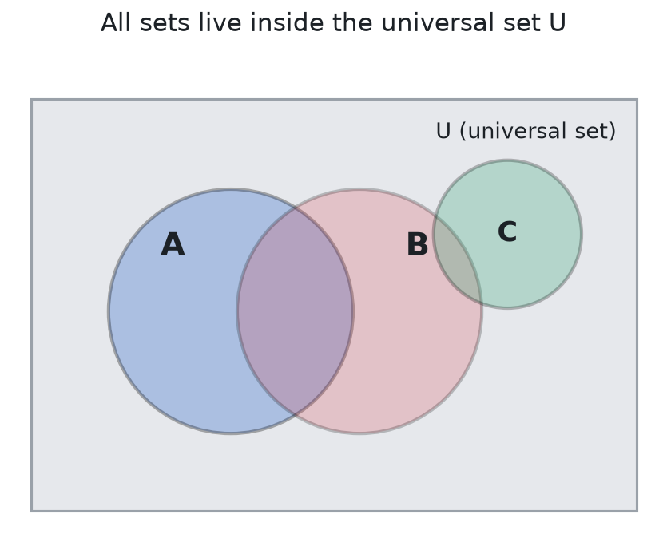

**Special Considerations:**

The Concept of an **Absolute Universal Set**:

In some discussions, the idea of an "absolute" universal
set (containing all possible sets) leads to paradoxes, such as
Russell's Paradox. To avoid these issues, most modern set theories,
like Zermelo-Fraenkel set theory, do not include an absolute universal
set.

**Instead, the universal set is always defined relative to a particular
context or domain of discourse.**

## Set Operations

Sets combine through a handful of operations, each defined by a membership condition. Explore them all below: pick an operation to light up its region of the Venn diagram, edit which elements lie in $A$ and $B$, and watch the resulting set (and its size) update live.

<iframe src="/static/interactive/set-operation-explorer.html" width="100%" height="640" style="border:none;"></iframe>

### Set Union

**Set Union:** The union of two sets A and B, denoted $A \cup B$ (read "A union B"), is the set of elements
which are in **A** or **B** (or both).

$\forall x\, (x \in (A \cup B) \leftrightarrow (x \in A \lor x \in B))$

**Example:** If $A = \{1, 2, 3\}$ and $B = \{3, 4, 5\}$, then $A \cup B = \{1, 2, 3, 4, 5\}$

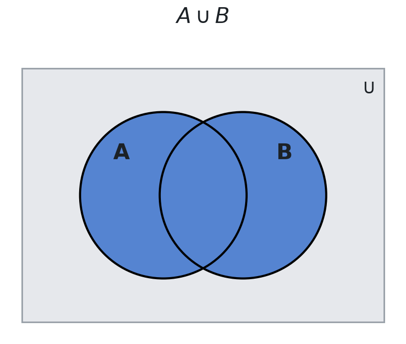

### Set Intersection

**Set Intersection:** The intersection of two sets A and B, denoted $A \cap B$ (read "A intersect B"), is the set of elements which are in both **A** and **B**.

$\forall x\, (x \in (A \cap B) \leftrightarrow (x \in A \land x \in B))$

**Example:** If $A = \{1, 2, 3\}$ and $B = \{3, 4, 5\}$, then $A \cap B = \{3\}$

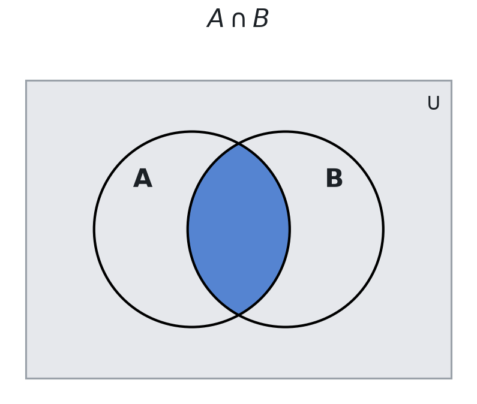

### Set Complement

#### Absolute Complement

**Absolute Complement:** The complement of a set is the set of all
elements from the domain of discourse which are NOT in A.

$\forall x\, (x \in A' \leftrightarrow (x \in U \land x \notin A))$

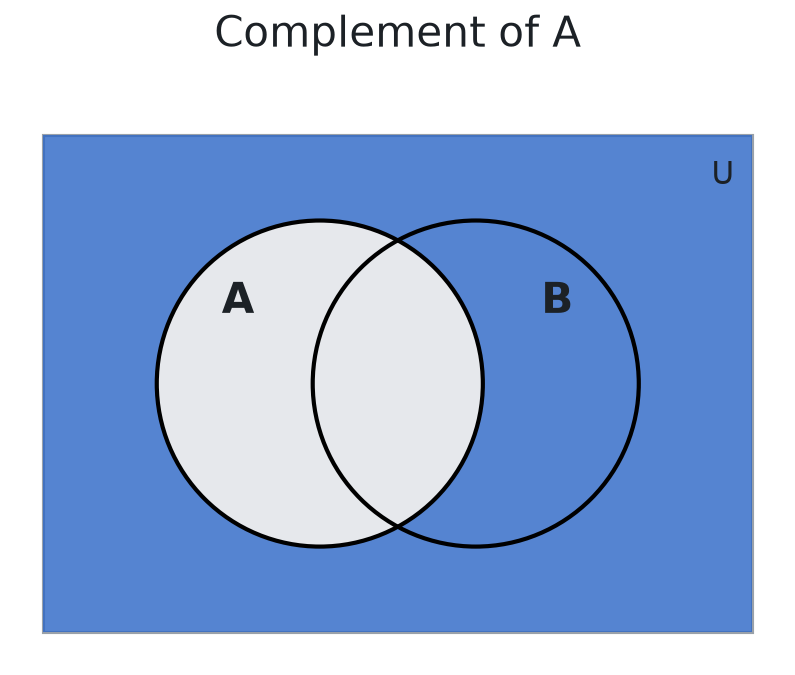

### Symmetric Difference

**Symmetric Difference:** The symmetric difference of sets $A$ and $B$, denoted $A \triangle B$ (read "A triangle B" or "A symmetric-difference B") or $A \oplus B$, is the set of elements in either $A$ or $B$ but not in both.

**Definition:** $A \triangle B = (A \cup B) \setminus (A \cap B) = (A \setminus B) \cup (B \setminus A)$

Here $\setminus$ is read "set minus" or "without", so $A \setminus B$ is read "A set minus B" or "A without B".

**Logical form:** $\forall x\, (x \in (A \triangle B) \leftrightarrow (x \in A \oplus x \in B))$

Where $\oplus$ is exclusive OR (XOR).

**Example:** If $A = \{1, 2, 3\}$ and $B = \{3, 4, 5\}$, then:
- $A \triangle B = \{1, 2, 4, 5\}$

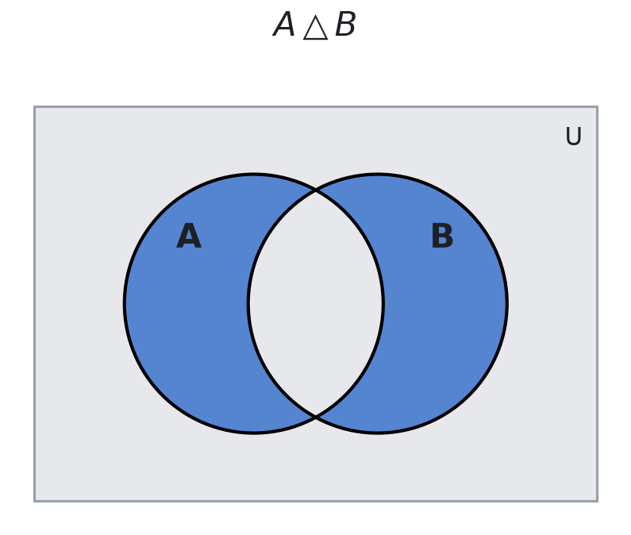

**Properties:**
- **Commutative:** $A \triangle B = B \triangle A$
- **Associative:** $(A \triangle B) \triangle C = A \triangle (B \triangle C)$
- **Identity:** $A \triangle \emptyset = A$
- **Self-inverse:** $A \triangle A = \emptyset$
- **Distributive over intersection:** $A \cap (B \triangle C) = (A \cap B) \triangle (A \cap C)$

**Application:** XOR operation in computer science, symmetric encryption

### Set Difference

**Set Difference:** The set difference of $A$ and $B$, written $A \setminus B$ (also written $A - B$), is the set of all elements that belong to $A$ but not to $B$.

$$
A \setminus B = \{x : x \in A \text{ and } x \notin B\}
$$

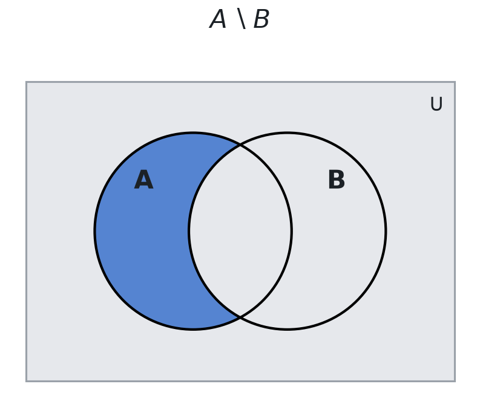

The set difference is not the same as the complement unless $B$ is the universal set. In general, $A \setminus B$ only removes elements of $B$ from $A$, whereas the complement $A'$ (or $A^c$) removes all elements of $A$ from the entire universal set.

**Relationship to complement and intersection:**

$$
A \setminus B = A \cap B^c
$$

This identity says: the elements in $A$ but not in $B$ are exactly the elements in $A$ that also belong to the complement of $B$.

**Properties:**

- $A \setminus A = \emptyset$
- $A \setminus \emptyset = A$
- $\emptyset \setminus A = \emptyset$
- $A \setminus B \neq B \setminus A$ in general (set difference is not commutative)
- $A \setminus (B \cup C) = (A \setminus B) \cap (A \setminus C)$
- $A \setminus (B \cap C) = (A \setminus B) \cup (A \setminus C)$

**Worked Example:**

Let $A = \{1, 2, 3, 4, 5\}$ and $B = \{3, 4, 5, 6, 7\}$.

$$
A \setminus B = \{1, 2\}
$$

$$
B \setminus A = \{6, 7\}
$$

Notice that $A \setminus B \neq B \setminus A$. Also observe that $A \triangle B = (A \setminus B) \cup (B \setminus A) = \{1, 2, 6, 7\}$.

## Russell's Paradox

> [!counterexample] Unrestricted comprehension is inconsistent
> If **every property** defined a set, the object $R=\{x:x\notin x\}$ would satisfy $R\in R$ if and only if $R\notin R$. Restricting comprehension to subsets of a **previously existing** set prevents this contradictory object from being formed.


**Russell's Paradox:** A fundamental paradox in naive set theory discovered by Bertrand Russell in 1901. It demonstrates that unrestricted set comprehension (forming sets from any property) leads to contradiction.

**The Paradox:**

Consider the set R defined as:

$R = \{x \mid x \text{ is a set and } x \notin x\}$

In words: "R is the set of all sets that do not contain themselves as members."

**The Question:** Does R contain itself? Is $R \in R$?

**Case 1:** Suppose $R \in R$ (R contains itself)
- By definition of R, if $R \in R$, then R must satisfy the condition "$x \notin x$"
- This means $R \notin R$ (R does not contain itself)
- **Contradiction:** R both contains and doesn't contain itself

**Case 2:** Suppose $R \notin R$ (R does not contain itself)
- Then R satisfies the condition for membership in R (being a set that doesn't contain itself)
- Therefore $R \in R$ (R must be in R by definition)
- **Contradiction:** R both doesn't contain and does contain itself

**Either way, we get a contradiction.**

**Why It Matters:**

Russell's Paradox exposed a fatal flaw in naive set theory, which allowed forming sets from any property. The paradox shows that not every property defines a valid set.

**Example - The Barber Paradox (Informal Version):**

A barber in a village shaves all and only those men who do not shave themselves. Does the barber shave himself?

- If he shaves himself, then he's someone who shaves himself, so he shouldn't shave himself
- If he doesn't shave himself, then he's someone who doesn't shave himself, so he should shave himself

**Modern Resolution:**

Modern axiomatic set theories (like Zermelo-Fraenkel set theory) avoid Russell's Paradox by:

1. **Restricting set formation:** Not every property defines a set
2. **Axiom of Separation:** You can only form subsets of existing sets, not arbitrary collections
3. **No universal set:** There is no "set of all sets"

**Historical Impact:**

- Led to the development of axiomatic set theory
- Showed that mathematical foundations needed rigorous axiomatization
- Influenced the formalist movement in mathematics

## Power Set


**Power Set:** The power set of a set **A**, denoted $\mathcal{P}(A)$ (read "the power set of A") or $2^A$, is the set of all subsets of **A**, including the empty set and **A** itself.

**Definition:** $\mathcal{P}(A) = \{S \mid S \subseteq A\}$

**Example 1:** If A = {1, 2}, then:

$\mathcal{P}(A) = \{\varnothing, \{1\}, \{2\}, \{1, 2\}\}$

**Example 2:** If A = {a, b, c}, then:

$\mathcal{P}(A) = \{\varnothing, \{a\}, \{b\}, \{c\}, \{a,b\}, \{a,c\}, \{b,c\}, \{a,b,c\}\}$

**Cardinality:** If $|A| = n$, then $|\mathcal{P}(A)| = 2^n$

This is why the power set is sometimes written as $2^A$.

**Examples:**
- $|\mathcal{P}(\varnothing)| = 2^0 = 1$ (only the empty set itself)
- $|\mathcal{P}(\{a\})| = 2^1 = 2$ (empty set and {a})
- $|\mathcal{P}(\{a, b\})| = 2^2 = 4$
- $|\mathcal{P}(\{a, b, c\})| = 2^3 = 8$

## A power set is a space of yes/no functions

> [!bridge] Subsets are functions in disguise
> Choosing a subset $S\subseteq A$ is exactly the same information as assigning **yes or no** to each element of $A$. This connects power sets to [functions](./functions-relations#function), [Boolean logic](./propositional-logic-zeroth-order-logic), and, later, [indicator functions in measure theory](./measure-theory).

For each subset $S\subseteq A$, define its **characteristic function** (also called its *indicator function*):

$
\chi_S:A\longrightarrow\{0,1\},
\qquad
\chi_S(x)=
\begin{cases}
1 & \text{if }x\in S,\\
0 & \text{if }x\notin S.
\end{cases}
$

**One worked example.** Let $A=\{a,b,c\}$ and $S=\{a,c\}$. The function $\chi_S$ records

| Input $x$ | $a$ | $b$ | $c$ |
| --- | --- | --- | --- |
| Is $x$ in $S$? | Yes | No | Yes |
| $\chi_S(x)$ | $1$ | $0$ | $1$ |

Conversely, given *any* function $f:A\to\{0,1\}$, recover its subset as

$
S_f=\{x\in A:f(x)=1\}.
$

These two conversions undo one another: $S_{\chi_S}=S$ and $\chi_{S_f}=f$. We therefore have an **explicit bijection**

$
\boxed{\mathcal P(A)\;\cong\;\{0,1\}^A,}
$

where $\{0,1\}^A$ means the **set of all functions** from $A$ to $\{0,1\}$—not division or ordinary numerical exponentiation. For a finite $A$ with $n$ elements, each element has two independent yes/no choices, recovering $|\mathcal P(A)|=2^n$. The bijection itself works for **infinite** sets as well.

Even the operations on subsets translate into operations on their indicator functions, **point by point**. Fix a universe $A$ and let $S,T\subseteq A$:

| Set operation | At an element $x\in A$ | Function operation |
| --- | --- | --- |
| Intersection $S\cap T$ | Both memberships must be true | $\chi_{S\cap T}(x)=\chi_S(x)\chi_T(x)$ |
| Union $S\cup T$ | At least one membership must be true | $\chi_{S\cup T}(x)=\max(\chi_S(x),\chi_T(x))$ |
| Complement $A\setminus S$ | Reverse yes and no | $\chi_{A\setminus S}(x)=1-\chi_S(x)$ |
| Symmetric difference $S\triangle T$ | Exactly one membership must be true | $\chi_{S\triangle T}(x)=\chi_S(x)\oplus\chi_T(x)$ |

Here $\oplus$ is exclusive-or, equivalent to addition modulo $2$ on $\{0,1\}$. **For instance**, if $S=\{a,c\}$ and $T=\{b,c\}$, then

$
\chi_S=(1,0,1),\qquad
\chi_T=(0,1,1),\qquad
\chi_{S\cap T}=(0,0,1).
$

This is not merely a resemblance between set operations and logic. It is an **exact translation**: every statement about membership can be recast as a statement about a $\{0,1\}$-valued function. Later, [measurability](./measure-theory) asks when such indicator functions are measurable, and [probability](./probability) uses their expectations as event probabilities.

## Disjoint Sets

**Disjoint Sets:** Two sets **A** and **B** are disjoint if they have no elements in common.

**Definition:** $A \cap B = \varnothing$

**Example:** {1, 2, 3} and {4, 5, 6} are disjoint.

**Pairwise Disjoint:** A collection of sets $\{A_1, A_2, \ldots, A_n\}$ is pairwise disjoint if every pair of distinct sets in the collection is disjoint.

Formally: $\forall i, j : i \neq j \Rightarrow A_i \cap A_j = \varnothing$

**Example:** {1, 2}, {3, 4}, {5, 6} are pairwise disjoint.

## Partition of a Set

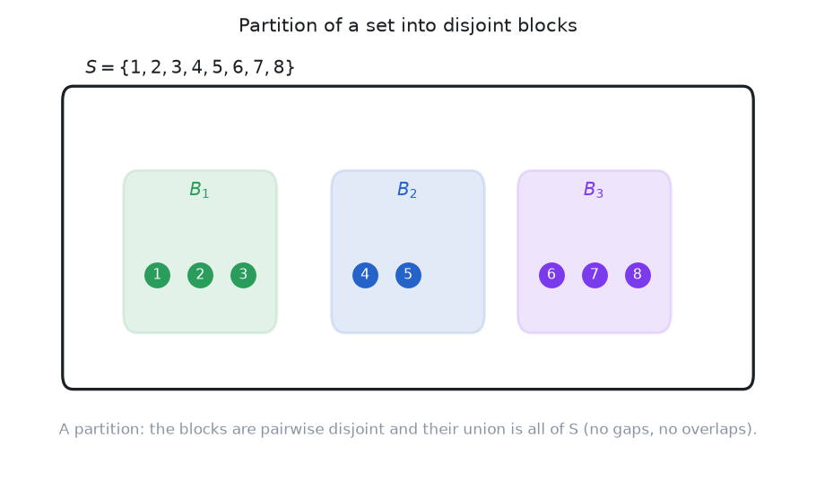

**Partition:** A partition of a set **A** is a collection of non-empty, pairwise disjoint subsets of **A** whose union is **A**.

**Definition:** A collection $\{A_1, A_2, \ldots, A_n\}$ is a partition of **A** if:

1. Each $A_i$ is non-empty: $A_i \neq \varnothing$
2. The sets are pairwise disjoint: $A_i \cap A_j = \varnothing$ for $i \neq j$
3. Their union is **A**: $A_1 \cup A_2 \cup \cdots \cup A_n = A$

**Example:** The sets {1, 2}, {3, 4}, {5, 6} form a partition of {1, 2, 3, 4, 5, 6}.

**Connection to Equivalence Relations:**

Every equivalence relation on a set **A** induces a partition of **A** (its classes), and every partition induces an equivalence relation. See the two complete proofs in [Equivalence Relations and Quotients](./equivalence-relations#equivalence-relations-correspond-to-partitions).

## Countable vs Uncountable Sets

**Countable Set:** A set is countable if its elements can be put in one-to-one correspondence with the natural numbers $\mathbb{N} = \{0, 1, 2, 3, \ldots\}$, or if it is finite.

**Definition (Formal):** A set $S$ is countable if there exists an injection $f:S\to\mathbb N$. For **nonempty** $S$ this is equivalent to a surjection $g:\mathbb N\to S$: given an injection $f:S\to\mathbb N$, send $n$ back to $f^{-1}(n)$ when $n$ is in the image of $f$, and otherwise send it to one fixed $s_0\in S$. The empty set is countable too, but no function from nonempty $\mathbb N$ onto $\varnothing$ exists.

**Two Types of Countable:**

1. **Finite:** Sets with a specific number of elements (can be counted to completion)
2. **Countably Infinite:** Infinite sets that can be put in one-to-one correspondence with $\mathbb{N}$

**Examples of Countably Infinite Sets:**

**Natural Numbers** $\mathbb{N}$: $\{0, 1, 2, 3, \ldots\}$
- Trivially countable (the definition uses $\mathbb{N}$ itself)

**Integers** $\mathbb{Z}$: $\{\ldots, -2, -1, 0, 1, 2, \ldots\}$
- Bijection: $0 \mapsto 0,\; 1 \mapsto -1,\; 2 \mapsto 1,\; 3 \mapsto -2,\; 4 \mapsto 2, \ldots$
- Pattern: $f(2n) = n,\; f(2n+1) = -(n+1)$

**Even Numbers:** $\{0, 2, 4, 6, \ldots\}$
- Bijection: $n \mapsto 2n$

**Rational Numbers** $\mathbb{Q}$: All fractions $p/q$ where $p, q \in \mathbb{Z}$ and $q \neq 0$
- Surprising but true! Can be listed using Cantor's diagonal enumeration
- List all fractions in a grid and traverse diagonally, skipping duplicates

**Algebraic Numbers:** Solutions to polynomial equations with integer coefficients
- Countable because polynomials can be enumerated

**Why $\mathbb{Q}$ is Countable (Cantor's Enumeration):**

List all positive rationals in a grid:

```
1/1  1/2  1/3  1/4  1/5  ...
2/1  2/2  2/3  2/4  2/5  ...
3/1  3/2  3/3  3/4  3/5  ...
4/1  4/2  4/3  4/4  4/5  ...
...
```

Traverse diagonally: 1/1, 2/1, 1/2, 1/3, 2/2, 3/1, 4/1, 3/2, 2/3, 1/4, ...

Skipping duplicates (like 2/2 = 1/1) gives a bijection $\mathbb{N} \to \mathbb{Q}^+$ with the **positive** rationals, so $\mathbb{Q}^+$ is countable. To extend this to all of $\mathbb{Q}$, interleave $0$ and the negatives: list $0$ first, then alternate each positive rational with its negative ($q_1, -q_1, q_2, -q_2, \ldots$). This produces a bijection $\mathbb{N} \to \mathbb{Q}$, proving all of $\mathbb{Q}$ is countable.

**Uncountable Set:** A set that is not countable. It cannot be put in one-to-one correspondence with $\mathbb{N}$.

**Examples of Uncountable Sets:**

**Real Numbers** $\mathbb{R}$: All points on the number line
- Proven uncountable by Cantor's diagonal argument (see below)
- Even the interval (0, 1) is uncountable

**Irrational Numbers:** $\mathbb{R} \setminus \mathbb{Q}$
- Since $\mathbb{R}$ is uncountable and $\mathbb{Q}$ is countable, the irrationals must be uncountable

**Transcendental Numbers:** Real numbers that are not algebraic (like π, e)
- Uncountable (most real numbers are transcendental)

**Power Set of $\mathbb{N}$:** $\mathcal{P}(\mathbb{N})$ = all subsets of $\mathbb{N}$
- Uncountable by Cantor's theorem

**Real Interval [0, 1]:** All real numbers between 0 and 1 inclusive
- Same cardinality as all of $\mathbb{R}$ (bijection exists)

**Cantor's Diagonal Argument (Proof that $\mathbb{R}$ is Uncountable):**

**Theorem:** The real numbers in the interval $(0,1)$ are uncountable.

**Proof (by contradiction):**

1. **Assume a complete list exists.** Suppose every real number in $(0,1)$ appears somewhere in an enumeration $r_1,r_2,r_3,\ldots$. Write each one in its **canonical decimal expansion**: when a number has two expansions (such as $0.5000\ldots=0.4999\ldots$), choose the one **not eventually all 9s**.
2. Arrange the decimal digits $a_{ij}$, where $a_{ij}$ is the $j$th digit of the $i$th listed number:

```
r₁ = 0.a₁₁ a₁₂ a₁₃ a₁₄ ...
r₂ = 0.a₂₁ a₂₂ a₂₃ a₂₄ ...
r₃ = 0.a₃₁ a₃₂ a₃₃ a₃₄ ...
r₄ = 0.a₄₁ a₄₂ a₄₃ a₄₄ ...
...
```

3. **Construct a missing number.** Let $d=0.d_1d_2d_3\ldots$ by choosing

   $$
   d_n=\begin{cases}
   2 & \text{if }a_{nn}=1,\\
   1 & \text{if }a_{nn}\ne1.
   \end{cases}
   $$

   Every digit of $d$ is **1 or 2**. Therefore $d\in(0,1)$ and its decimal expansion never ends in repeating 9s; it is unambiguous.
4. **Show that $d$ is absent.** For each list position $n$, the $n$th digit of $d$ differs from the $n$th digit of $r_n$. Because both are written without an eventually-all-9s expansion, different digits imply different real numbers. So $d\ne r_n$ for **every** $n$.
5. **Contradiction.** $d$ is a real number in $(0,1)$ but not on the supposedly complete list. Therefore no enumeration exists, and $(0,1)$ is uncountable.

> [!distinction] Why choosing only 1 and 2 matters
> Decimal notation is **not unique**: $0.5000\ldots$ and $0.4999\ldots$ are the same real number. A diagonal proof that merely changes one digit without controlling the representation can leave a gap. Restricting the newly chosen digits to $1$ and $2$—and using canonical expansions for the listed numbers—closes it.

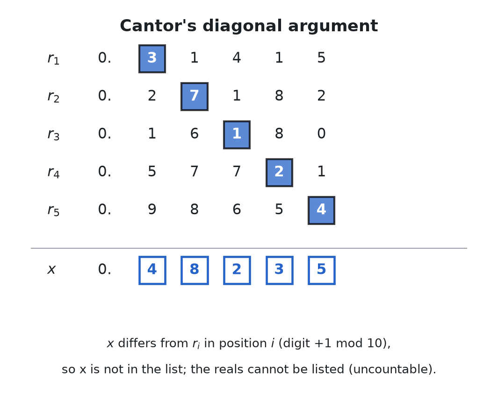

The argument works against *any* proposed list, which is the crux: no enumeration can be complete. Try it yourself below. Edit the digits or regenerate the list; the constructed number always differs from row $i$ in position $i$, so it is never on the list.

<iframe src="/static/interactive/cantor-diagonal.html" width="100%" height="620" style="border:none;"></iframe>

### Hierarchy of Infinities

Not all infinities are equal. There is a strict hierarchy:

$|\mathbb{N}| = |\mathbb{Z}| = |\mathbb{Q}| < |\mathbb{R}| < |\mathcal{P}(\mathbb{R})| < |\mathcal{P}(\mathcal{P}(\mathbb{R}))| < \cdots$

Where:
- $|\mathbb{N}|$ is denoted $\aleph_0$ (read "aleph-null" or "aleph-naught"), the smallest infinite cardinality
- $|\mathbb{R}|$ is denoted $\mathfrak{c}$ (the cardinality of the continuum)
- Each power set has strictly greater cardinality than the original set

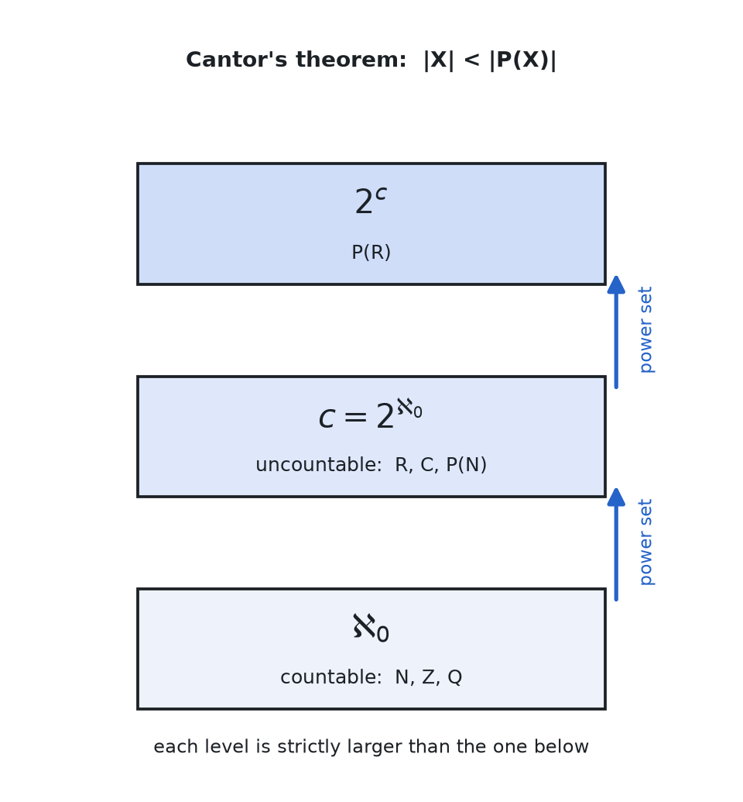

**Key Properties:**

1. **Countable unions (with a choice hypothesis):** In ZFC, a countable union of countable sets is countable. In bare ZF this can fail: choosing enumerations for an arbitrary sequence of countable sets requires some choice. Do not confuse the theorem in ZFC with a theorem requiring no additional assumptions.
2. **Cartesian Product:** $\mathbb{N} \times \mathbb{N}$ is countable (can be enumerated diagonally)
3. **Subsets:** Any subset of a countable set is countable
4. **Complements:** If A is countable and B is uncountable, then B - A is uncountable

**Why This Matters:**

- Shows there are different "sizes" of infinity
- Establishes that most real numbers are transcendental (algebraic numbers are countable, reals are uncountable)
- Foundational for measure theory, probability, and real analysis
- Demonstrates limits of enumeration and computation

### Cardinal Arithmetic and the Continuum Hypothesis

Infinite cardinals can be added and multiplied, but the rules collapse in a way finite numbers never do. For the countable cardinal $\aleph_0$:

- $\aleph_0 + \aleph_0 = \aleph_0$: two countable sets union to a countable set (interleave their enumerations).
- $\aleph_0 \cdot \aleph_0 = \aleph_0$: the grid $\mathbb{N} \times \mathbb{N}$ is countable (enumerate it along diagonals).
- More generally, in ZFC, for any infinite cardinal $\kappa$, $\kappa+\kappa=\kappa\cdot\kappa=\kappa$. If two cardinalities are **nonzero** and at least one is infinite, their cardinal sum and product are the larger cardinal under Choice. This rule need not hold without Choice.

**Power sets always produce strictly larger cardinalities.** By Cantor's theorem, $2^{\aleph_0} = |\mathcal{P}(\mathbb{N})| = |\mathbb{R}| = \mathfrak{c}$, strictly bigger than $\aleph_0$. So the continuum $\mathfrak{c}$ is "two to the countable."

This raises the question Cantor could not settle. Is there any cardinal *strictly between* $\aleph_0$ and $\mathfrak{c} = 2^{\aleph_0}$? Writing $\aleph_1$ for the smallest uncountable cardinal, the question is whether $\aleph_1 = \mathfrak{c}$. The **Continuum Hypothesis (CH)** asserts that it is: no set is larger than $\mathbb{N}$ and smaller than $\mathbb{R}$. Gödel (1940) showed CH cannot be *disproved* from ZFC, and Cohen (1963), inventing the method of *forcing*, showed it cannot be *proved* either. CH is **independent** of the standard axioms: the size of the continuum is genuinely undetermined by them. (The Generalized Continuum Hypothesis extends this to $2^{\aleph_\alpha} = \aleph_{\alpha+1}$ at every level.)

## Cantor's Theorem

> [!theorem] Cantor's theorem
> For every set $A$, $|A|<|\mathcal P(A)|$. The map $a\mapsto\{a\}$ is an injection $A\to\mathcal P(A)$, but no map $f:A\to\mathcal P(A)$ can be **surjective**; the diagonal argument below establishes that latter fact.

> [!proof] Diagonal obstruction to surjectivity
> For an arbitrary $f:A\to\mathcal P(A)$, form $D=\{a\in A:a\notin f(a)\}$. If $D=f(d)$ for some $d\in A$, then $d\in D$ exactly when $d\notin D$, a contradiction. Therefore $D$ is **not in the image** of $f$. Together with the singleton injection, this gives the strict inequality.


**Cantor's Theorem:** For any set $A$, the power set $\mathcal{P}(A)$ has strictly greater cardinality than $A$ itself.

**Statement:** $|A| < |\mathcal{P}(A)|$ for all sets $A$.

**Why It's Fundamental:**

Cantor's theorem proves there is no "largest" infinity. Starting from any infinite set, you can always construct a larger one by taking its power set:

$|\mathbb{N}| < |\mathcal{P}(\mathbb{N})| < |\mathcal{P}(\mathcal{P}(\mathbb{N}))| < |\mathcal{P}(\mathcal{P}(\mathcal{P}(\mathbb{N})))| < \cdots$

This creates an infinite hierarchy of infinities, each strictly larger than the previous.

**Proof (by contradiction):**

We'll prove no bijection $f: A \to \mathcal{P}(A)$ can exist.

**Step 1:** Assume $f: A \to \mathcal{P}(A)$ is a bijection (onto and one-to-one)

**Step 2:** Define the "diagonal" set D:

$D = \{x \in A \mid x \notin f(x)\}$

In words: D contains all elements of A that are not members of their own image under f.

**Step 3:** Since f is onto (surjective), D must be in the range of f. So there exists some $d \in A$ such that $f(d) = D$.

**Step 4:** Ask: Is $d \in D$?

**Case 1:** Suppose $d \in D$
- By definition of D, this means $d \notin f(d)$
- But $f(d) = D$
- So $d \notin D$
- **Contradiction**

**Case 2:** Suppose $d \notin D$
- Then $d$ does not satisfy the condition for membership in D
- So it's not true that $d \notin f(d)$
- Therefore $d \in f(d)$
- But $f(d) = D$
- So $d \in D$
- **Contradiction**

**Step 5:** Either way we get a contradiction. Therefore our assumption that f is a bijection must be false.

**Conclusion:** No bijection $A \to \mathcal{P}(A)$ exists, so $|A| < |\mathcal{P}(A)|$. $\blacksquare$

**Why the Diagonal Method Works:**

The set $D$ is constructed to "diagonalize" against $f$: for every element $a \in A$, $D$ differs from $f(a)$ on the membership of $a$ itself. This ensures $D$ cannot equal $f(a)$ for any $a$.

This is the same technique used in Cantor's diagonal argument for uncountability of $\mathbb{R}$.

**Applications:**

1. **Infinite Hierarchy:** Proves there are infinitely many sizes of infinity
2. **Uncomputability:** Related to the halting problem (diagonalization shows some functions are uncomputable)
3. **Foundations:** Shows naive set theory leads to Russell's paradox (the "set of all sets" would violate Cantor's theorem)

**Example (Finite Case):**

Let A = {1, 2}
- |A| = 2
- $\mathcal{P}(A) = \{\emptyset, \{1\}, \{2\}, \{1,2\}\}$
- $|\mathcal{P}(A)| = 4 = 2^2$

Indeed, $2 < 4$, confirming $|A| < |\mathcal{P}(A)|$.

**General Formula (Finite Sets):**

If $|A| = n$, then $|\mathcal{P}(A)| = 2^n$.

For infinite sets, this generalizes: if $|A| = \kappa$, then $|\mathcal{P}(A)| = 2^\kappa$ (using cardinal exponentiation).

## The ZFC Axioms

[Russell's paradox](#russells-paradox) shows that *naive* set theory, the assumption that any property whatsoever carves out a set, is inconsistent. The standard repair is **Zermelo–Fraenkel set theory (ZF)**: instead of letting every property form a set, a short list of axioms declares exactly which sets exist, carefully avoiding "the set of all sets." Adding the Axiom of Choice gives **ZFC**, the de facto foundation on which essentially all of modern mathematics is built. The axioms:

1. **Extensionality.** Two sets are equal if and only if they have the same elements. A set is completely determined by its membership, nothing else.
2. **Pairing.** For any $a$ and $b$, the set $\{a, b\}$ exists.
3. **Union.** For any set of sets, the union of all of them exists.
4. **Power Set.** For any set $A$, the [power set](#power-set) $\mathcal{P}(A)$ of all its subsets exists.
5. **Infinity.** An infinite set exists: specifically, a set containing $\varnothing$ and closed under $x \mapsto x \cup \{x\}$, which yields the von Neumann natural numbers (see [Number Systems](./number-systems)).
6. **Separation (Specification).** For any set $A$ and any property $\varphi$, the subset $\{x \in A : \varphi(x)\}$ exists. Crucially, you may only carve a subset out of a set *that already exists*. This is the precise fix for Russell's paradox: you cannot form $\{x : x \notin x\}$ from nothing, only $\{x \in A : x \notin x\}$ for a given $A$, and that turns out to be harmless.
7. **Replacement.** The image of a set under a definable function is again a set. (This is what lets constructions run along the ordinals, below.)
8. **Foundation (Regularity).** Every nonempty set has an $\in$-minimal element. Consequently no set is a member of itself, and there are no infinite descending chains $\cdots \in x_2 \in x_1 \in x_0$.
9. **Choice.** From any collection of nonempty sets, one can simultaneously pick an element from each, developed in the next section.

**Technical accuracy:** Separation and Replacement are *axiom schemas*: each allowed first-order formula gives an instance, so "nine axioms" is a useful organizational list, not a literal count of nine individual sentences. The empty set's existence is derivable from the listed ZF axioms. The linchpin is **Separation** replacing unrestricted comprehension: sets are carved *out of* sets that already exist, so the paradoxical "set of all sets that do not contain themselves" never gets off the ground.

### The cumulative hierarchy: how sets are built in stages

The axioms are not just a checklist of permitted operations. They suggest a remarkable **iterative picture of the entire set-theoretic universe**: begin with the empty set, repeatedly form power sets, and at limit stages collect everything built earlier.

The stages are called the **cumulative hierarchy** and written $V_\alpha$, indexed by **ordinals** (introduced below):

$
\boxed{
\begin{aligned}
V_0&=\varnothing,\\
V_{\alpha+1}&=\mathcal P(V_\alpha),\\
V_\lambda&=\bigcup_{\beta<\lambda}V_\beta
&&\text{if }\lambda\text{ is a nonzero limit ordinal}.
\end{aligned}
}
$

At the first few stages:

| Stage | What's available? |
| --- | --- |
| $V_0=\varnothing$ | No sets as elements of the stage |
| $V_1=\{\varnothing\}$ | The empty set |
| $V_2=\{\varnothing,\{\varnothing\}\}$ | The empty set and its singleton |
| $V_3=\mathcal P(V_2)$ | Four sets, formed as subsets of $V_2$ |
| $V_\omega=\bigcup_{n<\omega}V_n$ | All **hereditarily finite sets** |

The set $\omega=\{0,1,2,\ldots\}$, in the [von Neumann encoding](#ordinals-and-well-ordering), is **not in $V_\omega$**: every element of $V_\omega$ is hereditarily finite. It first belongs to $V_{\omega+1}$, because $\omega\subseteq V_\omega$.

**Why this matters:** Under ZF's Foundation and the other axioms, **every set belongs to some $V_\alpha$**. Yet the union over *all* ordinal stages, conventionally written $V$, is not itself a set: it is a **proper class**. We therefore get a picture of *all sets* without contradicting [Russell's paradox](#russells-paradox) or [Cantor's theorem](#cantors-theorem). Think of $V$ as the entire universe being described, not one more set inside it.

> [!distinction] A stage is a set; the entire hierarchy is not
> For each **particular ordinal** $\alpha$, $V_\alpha$ is a set. Writing $V=\bigcup_{\alpha\in\mathrm{Ord}}V_\alpha$ uses **class notation**: $\mathrm{Ord}$ is the proper class of all ordinals, not a set that can serve as an ordinary union's index set in ZF.

### Transfinite induction: ordinary induction without an end

Natural-number induction proves a claim at $0$, then carries it from $n$ to $n+1$. An ordinal can also be a **limit stage**, with no immediate predecessor—for example $\omega$, the first infinite ordinal. So induction through *all* ordinals must handle more than successor steps.

The **transfinite induction principle** is:

> [!theorem] Transfinite induction
> To prove a property $P(\alpha)$ for **every ordinal** $\alpha$, it is enough to establish for an arbitrary ordinal $\alpha$:
>
> $
> \left(\forall\beta<\alpha,\;P(\beta)\right)\Longrightarrow P(\alpha).
> $
>
> This single formulation handles the base case, successor stages, and limit stages: at $\alpha=0$ there are no predecessors; at a successor you may use all earlier cases; at a limit you may use **every** earlier stage.

**Why the proof works:** Suppose some ordinal violates $P$. Among the ordinals violating it, choose the **least** one, say $\alpha$. (To avoid treating this collection as a set, first take one counterexample $\gamma$ and then inspect the *set* of counterexamples below or equal to $\gamma$.) Every $\beta<\alpha$ satisfies $P$, so the displayed implication forces $P(\alpha)$ as well—a contradiction.

**What induction buys us:** The same [well-founded reasoning](./order-theory#well-foundedness-and-well-ordering) that proves facts about natural numbers also proves claims about structures that extend beyond any finite sequence of stages. **Transfinite recursion** uses the same progression to **define** objects stage by stage, with a rule for successor and limit stages—as the construction of $V_\alpha$ itself illustrates. A fully formal recursion theorem requires further work than this introductory construction.

## Axiom of Choice and Zorn's Lemma

**Axiom of Choice (AC):** Given any collection of non-empty sets, there exists a function that selects exactly one element from each set. Formally, if $\{A_i\}_{i \in I}$ is a family of non-empty sets, then there exists a function $f: I \to \bigcup_{i \in I} A_i$ such that $f(i) \in A_i$ for every $i \in I$.

This sounds obvious for finite collections (just pick one from each), but for infinite collections there is no constructive procedure that guarantees a choice. The Axiom of Choice is independent of the other axioms of Zermelo-Fraenkel set theory (ZF): it can be neither proved nor disproved from them. When ZF is combined with AC, the resulting system is called ZFC.

**Why AC is controversial:** It implies the existence of objects that cannot be explicitly constructed. Two notable consequences:

- **Non-measurable sets:** AC suffices to construct sets such as Vitali sets, which are not Lebesgue measurable. Some **weaker choice principles** also suffice; saying that the *full* Axiom of Choice is logically necessary would overstate the result.
- **Banach-Tarski Paradox:** A solid ball in $\mathbb{R}^3$ can be decomposed into finitely many pieces and reassembled (using only rotations and translations) into two balls identical to the original. The "pieces" are non-measurable sets whose existence requires AC.

**Zorn's Lemma:** If every chain (totally ordered subset) in a partially ordered set $P$ has an upper bound in $P$, then $P$ has at least one maximal element.

Zorn's Lemma is equivalent to the Axiom of Choice: assuming either one, you can prove the other. It is often easier to apply in practice than AC itself.

**Where these show up:**

- Every vector space has a basis (requires AC/Zorn's Lemma for infinite-dimensional spaces)
- Every **nonzero commutative ring with unity** has a maximal ideal (Zorn's Lemma)
- Tychonoff's theorem: any product of compact spaces is compact (equivalent to AC)

## Ordinals and Well-Ordering

A **well-ordered** set is a totally ordered set in which *every* nonempty subset has a least element. The naturals $\mathbb{N}$ are well-ordered (any nonempty set of naturals has a smallest member), but $\mathbb{Z}$ and $\mathbb{R}$ are not (there is no least integer, and no least positive real). Well-ordering is exactly the property that makes [induction](./propositional-logic-zeroth-order-logic) work, and it generalizes far beyond the finite.

**Ordinals** are the canonical well-ordered sets, the "order types" that extend counting into the transfinite. Using the same **von Neumann encoding** as the [natural numbers](./number-systems), each ordinal *is* the set of all smaller ordinals:
$$
0 = \varnothing,\quad 1 = \{0\},\quad 2 = \{0,1\},\ \ldots,\quad \omega = \{0, 1, 2, \ldots\} = \mathbb{N},\quad \omega+1 = \omega \cup \{\omega\},\ \ldots
$$
Here $\omega$ (read "omega") is the first **infinite** ordinal, and counting continues past it: $\omega + 1, \omega + 2, \ldots, \omega \cdot 2, \ldots, \omega^2, \ldots, \omega^\omega, \ldots$ The finite ordinals are precisely $\mathbb{N}$, so the von Neumann naturals used elsewhere on the site are just the bottom of this tower.

**Ordinals vs. cardinals.** Ordinals measure *order type* (position in a well-ordering); cardinals measure *size*. These come apart in the infinite: $\omega$, $\omega + 1$, and $\omega \cdot 2$ are all different ordinals but all have the same cardinality $\aleph_0$, because rearranging a countable set changes its order type without changing how many elements it has. The cardinals are the "initial" ordinals, those not in bijection with any smaller ordinal: $\aleph_0 = \omega$, and $\aleph_1$ is the first *uncountable* ordinal.

**The Well-Ordering Theorem** states that *every* set can be well-ordered, even $\mathbb{R}$. This is not obvious (no one can exhibit a well-ordering of the reals), and in fact it is **equivalent to the Axiom of Choice** and to Zorn's Lemma: the three are interchangeable. Well-orderings license **transfinite induction and recursion**, the generalization of ordinary induction that runs along the ordinals and underpins constructions throughout set theory, logic, and analysis.

## Set Operation Properties

### Commutative Laws

$$
A \cup B = B \cup A
$$
$$
A \cap B = B \cap A
$$

### Associative Laws

$$
A \cup (B \cup C) = (A \cup B) \cup C
$$
$$
A \cap (B \cap C) = (A \cap B) \cap C
$$

### Distributive Laws

$$
A \cup (B \cap C) = (A \cup B) \cap (A \cup C)
$$
$$
A \cap (B \cup C) = (A \cap B) \cup (A \cap C)
$$

### Identity Laws

$$
A \cup \varnothing = A
$$
$$
A \cap U = A
$$

Where $U$ is the universal set.

### Complement Laws

$$
A \cup A' = U
$$
$$
A \cap A' = \varnothing
$$
$$
(A')' = A
$$

### De Morgan's Laws

**De Morgan's Laws** relate complements to unions and intersections:

$$
(A \cup B)' = A' \cap B'
$$

The complement of a union is the intersection of the complements.

$$
(A \cap B)' = A' \cup B'
$$

The complement of an intersection is the union of the complements.

**Why the first law holds (proof by element-chasing).** To prove the *sets* $(A \cup B)'$ and $A' \cap B'$ are equal, chase an arbitrary element $x$ through the definitions, keeping every link an "if and only if":

$$
\begin{aligned}
x \in (A \cup B)'
&\iff x \notin A \cup B \\
&\iff \neg\,(x \in A \ \lor\ x \in B) \\
&\iff (x \notin A) \ \land\ (x \notin B) \\
&\iff (x \in A') \ \land\ (x \in B') \\
&\iff x \in A' \cap B'.
\end{aligned}
$$

Reading the steps: line 1 is the definition of complement; line 2 is the definition of union; **line 3 is the whole point** — negating an "or" turns it into an "and" (the confusing step, and the one people skip); lines 4 and 5 re-fold complement and intersection. Because each step is a biconditional, $x$ lies in the left set exactly when it lies in the right set, so the two sets are equal. In fact De Morgan's law for sets is nothing more than [De Morgan's law for logic](./propositional-logic-zeroth-order-logic), $\neg(P \lor Q) \equiv \neg P \land \neg Q$, applied to the statement "$x$ is a member." The second law is proved identically, swapping $\cup \leftrightarrow \cap$ and "or" $\leftrightarrow$ "and."

**Generalized De Morgan's Laws:** For any collection of sets:

$$
\left(\bigcup_{i} A_i\right)' = \bigcap_{i} A_i'
$$

$$
\left(\bigcap_{i} A_i\right)' = \bigcup_{i} A_i'
$$

**Example:** If $A = \{1, 2, 3\}$ and $B = \{3, 4, 5\}$ with universal set $U = \{1, 2, 3, 4, 5, 6\}$:

- $A \cup B = \{1, 2, 3, 4, 5\}$
- $(A \cup B)' = \{6\}$
- $A' = \{4, 5, 6\}$
- $B' = \{1, 2, 6\}$
- $A' \cap B' = \{6\}$ ✓

### Absorption Laws

$$
A \cup (A \cap B) = A
$$
$$
A \cap (A \cup B) = A
$$

### Domination Laws

$$
A \cup U = U
$$
$$
A \cap \varnothing = \varnothing
$$

### Idempotent Laws

$$
A \cup A = A
$$
$$
A \cap A = A
$$

### Summary of the Algebra of Sets

These identities are the axioms of a **Boolean algebra** (the same structure behind [propositional logic](./propositional-logic-zeroth-order-logic), with $\cup, \cap, {}^c$ playing the roles of $\vee, \wedge, \neg$), collected here for reference. $U$ is the universal set and $\varnothing$ the empty set.

| Law | Union form | Intersection form |
|---|---|---|
| Commutative | $A \cup B = B \cup A$ | $A \cap B = B \cap A$ |
| Associative | $(A \cup B) \cup C = A \cup (B \cup C)$ | $(A \cap B) \cap C = A \cap (B \cap C)$ |
| Distributive | $A \cup (B \cap C) = (A \cup B) \cap (A \cup C)$ | $A \cap (B \cup C) = (A \cap B) \cup (A \cap C)$ |
| Identity | $A \cup \varnothing = A$ | $A \cap U = A$ |
| Domination | $A \cup U = U$ | $A \cap \varnothing = \varnothing$ |
| Idempotent | $A \cup A = A$ | $A \cap A = A$ |
| Complement | $A \cup A^c = U$ | $A \cap A^c = \varnothing$ |
| De Morgan | $(A \cup B)^c = A^c \cap B^c$ | $(A \cap B)^c = A^c \cup B^c$ |
| Absorption | $A \cup (A \cap B) = A$ | $A \cap (A \cup B) = A$ |

## Indexed Families of Sets

When working with more than two sets, we often need notation for unions and intersections of many sets at once. An **indexed family** of sets is a collection $\{A_i\}_{i \in I}$, where $I$ is an index set and each $i \in I$ labels a set $A_i$.

For finitely many sets, we write $A_1, A_2, \ldots, A_n$. For infinitely many, we might use $\{A_n\}_{n=1}^{\infty}$ or $\{A_i\}_{i \in I}$ for an arbitrary index set $I$.

**Generalized Union:**

$$
\bigcup_{i \in I} A_i = \{x : x \in A_i \text{ for some } i \in I\}
$$

An element belongs to the generalized union if it belongs to at least one of the sets in the family.

**Generalized Intersection:**

$$
\bigcap_{i \in I} A_i = \{x : x \in A_i \text{ for all } i \in I\}
$$

An element belongs to the generalized intersection if it belongs to every set in the family.

**Example:** Let $A_n = [0, 1/n]$ for $n = 1, 2, 3, \ldots$

- $A_1 = [0, 1]$, $A_2 = [0, 1/2]$, $A_3 = [0, 1/3]$, and so on.
- $\bigcup_{n=1}^{\infty} A_n = [0, 1]$ (the largest interval in the family)
- $\bigcap_{n=1}^{\infty} A_n = \{0\}$ (the only point in every interval, since for any $x > 0$ there exists $n$ large enough that $x > 1/n$)

**Generalized De Morgan's Laws:**

$$
\left(\bigcup_{i \in I} A_i\right)^c = \bigcap_{i \in I} A_i^c
$$

$$
\left(\bigcap_{i \in I} A_i\right)^c = \bigcup_{i \in I} A_i^c
$$

In words: the complement of a union is the intersection of complements, and vice versa. These generalize the two-set De Morgan's laws to arbitrarily many sets.

## Ordered Pairs (Kuratowski's definition)

> [!definition] Ordered pair encoded using sets
> Kuratowski's construction $(a,b):=\{\{a\},\{a,b\}\}$ encodes order so that $(a,b)=(c,d)$ **exactly when** $a=c$ and $b=d$. An unordered set $\{a,b\}$ alone cannot encode which object is first.


**Ordered Pair:** An ordered pair with **first coordinate** *a* and **second coordinate** *b*, usually denoted by **(a, b)**, is a mathematical object where **order matters**.

**Notation:** (a, b) or ⟨a, b⟩

**Key Property:** Two ordered pairs are equal if and only if their corresponding coordinates are equal:

$$
(a, b) = (c, d) \Longleftrightarrow a = c \text{ and } b = d
$$

**Why We Need a Formal Definition:**

Unlike sets, where {a, b} = {b, a} (order doesn't matter), ordered pairs must distinguish (a, b) from (b, a).

The naive approach using sets fails:
- {a, b} = {b, a}, so this doesn't capture order
- We need a set-theoretic construction that preserves order

**Kuratowski's Definition:**

The ordered pair (a, b) is formally defined as the set:

$$
(a, b) := \{\{a\}, \{a, b\}\}
$$

**Why This Definition Works:**

This construction encodes the order by:
1. First coordinate appears in a singleton: {a}
2. Both coordinates appear together: {a, b}
3. The singleton {a} uniquely identifies the first coordinate


**Proof That Kuratowski's Definition Works:**

We need to prove: $\{\{a\}, \{a, b\}\} = \{\{c\}, \{c, d\}\} \Longleftrightarrow a = c \text{ and } b = d$

**Forward direction (⇒):**

Assume $\{\{a\}, \{a, b\}\} = \{\{c\}, \{c, d\}\}$

Since sets are equal, their elements must match. The singleton {a} must equal either {c} or {c, d}.

**Case 1:** If {a} = {c}, then a = c ✓

Now the remaining elements must match: {a, b} = {c, d} = {a, d}, so b = d ✓

**Case 2:** If {a} = {c, d}, then c = d (the set is a singleton), so c = d = a

Then {a, b} must equal {c} = {a}, so b = a. Thus a = b = c = d ✓

In both cases, we get a = c and b = d.

**Backward direction (⇐):**

If a = c and b = d, then $\{\{a\}, \{a, b\}\} = \{\{c\}, \{c, d\}\}$ by direct substitution ✓

**Special Case (a = b):**

When a = b, the ordered pair becomes:
$$
(a, a) = \{\{a\}, \{a, a\}\} = \{\{a\}, \{a\}\} = \{\{a\}\}
$$

The proof still works: if $\{\{a\}\} = \{\{c\}, \{c, d\}\}$, then {c} = {c, d}, so c = d = a.

### Cartesian Product


**Cartesian Product:** The Cartesian product of two sets $A$ and $B$, written $A \times B$ (read "A cross B"), is the set of all ordered pairs where the first element belongs to $A$ and the second belongs to $B$.

$$
A \times B = \{(a, b) : a \in A,\, b \in B\}
$$

A single element of $A \times B$ is an ordered pair $(a, b)$, which records *which* element came from $A$ and *which* came from $B$, in that order.

**Worked Example:**

Let $A = \{1, 2\}$ and $B = \{a, b\}$. Then:

$$
A \times B = \{(1, a),\, (1, b),\, (2, a),\, (2, b)\}
$$

$$
B \times A = \{(a, 1),\, (a, 2),\, (b, 1),\, (b, 2)\}
$$

Notice that $A \times B \neq B \times A$ in general, because the ordered pairs differ. The Cartesian product is not commutative.

**Cardinality:** $|A \times B| = |A| \cdot |B|$

Each element of $A$ can be paired with each element of $B$, giving $|A| \cdot |B|$ ordered pairs total. In the example above, $|A \times B| = 2 \cdot 2 = 4$.

**Properties:**

- $A \times \emptyset = \emptyset$ and $\emptyset \times A = \emptyset$
- $A \times (B \cup C) = (A \times B) \cup (A \times C)$ (distributes over union)
- $A \times (B \cap C) = (A \times B) \cap (A \times C)$ (distributes over intersection)
- $A \times B \neq B \times A$ in general (not commutative)

**Connection to the Cartesian Plane:**

The familiar coordinate plane $\mathbb{R}^2$ is precisely $\mathbb{R} \times \mathbb{R}$: the set of all ordered pairs $(x, y)$ where $x, y \in \mathbb{R}$. More generally, $\mathbb{R}^n = \underbrace{\mathbb{R} \times \mathbb{R} \times \cdots \times \mathbb{R}}_{n \text{ times}}$.

**Connection to Relations and Functions:**

A **relation** from $A$ to $B$ is any subset $R \subseteq A \times B$. A **function** $f: A \to B$ is a special kind of relation where each element of $A$ is paired with exactly one element of $B$. See [Functions & Relations](./functions-relations) for more.

A table can be created by taking the Cartesian product of a set of rows
and a set of columns. If the Cartesian product **rows** $\times$ **columns**
is taken, the cells of the table contain ordered pairs of the form (row
value, column value).

For instance, $\{x, y, z\} \times \{1, 2, 3\}$ fills a $3 \times 3$ grid of ordered pairs:

| $\times$ | $1$ | $2$ | $3$ |
|---|---|---|---|
| $x$ | $(x,1)$ | $(x,2)$ | $(x,3)$ |
| $y$ | $(y,1)$ | $(y,2)$ | $(y,3)$ |
| $z$ | $(z,1)$ | $(z,2)$ | $(z,3)$ |

As a final worked example, $\{1, 2\} \times \{2, 3\} = \{(1,2),\, (1,3),\, (2,2),\, (2,3)\}$, exactly $|\{1,2\}| \cdot |\{2,3\}| = 2 \cdot 2 = 4$ ordered pairs. (Note that $(2,2)$ is a legitimate pair even though its two entries are equal.)

