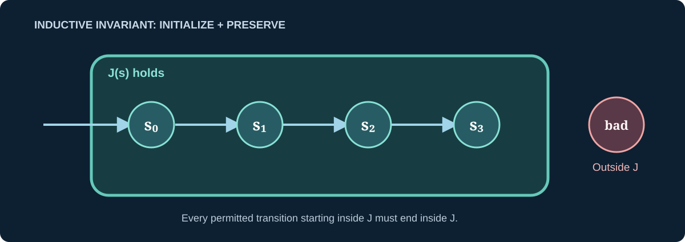

> [!abstract] Prerequisites & where this leads
> **Builds on:** [implication and proof by induction](./propositional-logic-zeroth-order-logic#mathematical-induction), [structural induction](./structural-induction), and [binary relations](./functions-relations#relation).
> **Leads to:** [Graph Algorithms](./graph-theory#graph-algorithms), [Advanced Graph Theory](./advanced-graph-theory), and [Asymptotic Notation](./asymptotic-notation).

Mathematics can describe a **process**, not just a number or a static structure. A state machine describes which situations are possible and which steps can move between them. An **invariant** proves that a desired property survives every step. A **termination argument** proves that a process eventually stops. Together they underpin rigorous reasoning about algorithms and protocols.

## The three ingredients of a state machine

> [!definition] Transition system
> A transition system has:
> - A set $S$ of **states**, each a complete description of the information relevant to the model.
> - A set $I\subseteq S$ of **initial states**.
> - A transition relation $\to\ \subseteq S\times S$ (read "$s$ transitions to $s'$"), identifying legal one-step changes.

A **finite execution** is a sequence $s_0\to s_1\to\cdots\to s_k$ with $s_0\in I$. A state is **reachable** when some such finite execution ends there. An **infinite execution** is an unending sequence of legal transitions.

We do not need to enumerate every possible run to prove a property of all reachable states.

## Safety invariants: proof by induction over transitions

> [!definition] Inductive invariant
> A predicate $J(s)$ is an **inductive invariant** when:
> 1. **Initialization:** $J(s)$ holds for every $s\in I$.
> 2. **Preservation:** for every transition $s\to s'$, $J(s)\Rightarrow J(s')$.

An inductive invariant holds in **every reachable state**, by induction on the number of transitions from an initial state.



*Figure: Invariance is closure of the safe region under every permitted transition, together with an initial state inside that region.*

The converse is subtler: a property may hold in all reachable states but fail to be inductive over **unreachable** states satisfying it. In that case we may strengthen the invariant.

### A small machine: two counters

Let the state be $(a,b)\in\mathbb N^2$, initially $(0,0)$. The only transitions are

$$
(a,b)\to(a+1,b+1).
$$

Claim: every reachable state satisfies $a=b$.

- **Initialization:** at $(0,0)$, the counters are equal.
- **Preservation:** if $a=b$, then $a+1=b+1$.

Consequently $a=b$ is an invariant. This does **not** establish termination: the counters can increase forever while remaining equal.

> [!distinction] Safety versus liveness
> **Safety** says something bad never happens, such as "the balance is never negative." **Liveness** says something good eventually happens, such as "every pending request eventually completes." An invariant generally proves safety, not eventual progress.

## Worked loop proof: summing consecutive integers

Consider this algorithm for a natural number $n$:

```text
s := 0
i := 0
while i < n:
    i := i + 1
    s := s + i
return s
```

We want to prove the result is $n(n+1)/2$ and that the loop terminates.

At every loop boundary we propose the invariant

$$
J(i,s):\qquad 0\leq i\leq n\quad\text{and}\quad s=\frac{i(i+1)}2.
$$

> [!proof] Initialization
> Initially $i=0$ and $s=0$. Clearly $0\leq0\leq n$, and $s=0=0(0+1)/2$.

> [!proof] Preservation
> Suppose the invariant holds and the loop guard $i<n$ is true. The new index is $i'=i+1$, and the new sum is $s'=s+i'$.
>
> Substituting the invariant for $s$:
> $$
> \begin{aligned}
> s'&=\frac{i(i+1)}2+(i+1)\\
> &=\frac{(i+1)(i+2)}2
> =\frac{i'(i'+1)}2.
> \end{aligned}
> $$
> Since $i<n$, the new index satisfies $i'\leq n$. Thus the invariant holds at the next loop boundary.

> [!proof] Termination and postcondition
> While the guard holds, the natural number $n-i$ is nonnegative and decreases by exactly one each iteration. It cannot decrease forever. When the loop stops, the guard is false, so $i\geq n$. Together with $i\leq n$ from the invariant, this forces $i=n$.
>
> Substitute into the invariant: $s=n(n+1)/2$. Both **termination** and **correctness of the returned value** are proved.

The proof has three independent responsibilities: start in the invariant, preserve it, and show that the loop reaches an exit. Checking outputs for $n=3$ or $n=100$ alone would not establish any of these for all $n$.

## Ranking functions: measuring finite progress

> [!definition] Ranking function
> For a loop or transition system, a **ranking function** $\rho:S\to\mathbb N$ maps states to natural numbers, is nonnegative in every state where the loop can execute, and **strictly decreases** on each relevant transition.

Because the natural numbers have no infinite strictly descending sequence, an infinite execution consisting of such transitions is impossible. In the summation loop $\rho(i,s)=n-i$ is a valid ranking function **while the guard is true**.

> [!counterexample] A decreasing real number need not ensure termination
> Consider $x:=x/2$ while $x>0$, starting with $x=1$ in exact real arithmetic. The positive value strictly decreases, but never becomes zero. A ranking into nonnegative real numbers with only strict decrease does **not** suffice. We need a **well-founded** target order or a proof of a fixed positive decrement with a lower bound.

An algorithm's *termination* is different from its *time complexity*: a loop can terminate yet take exponentially many steps. See [Asymptotic Notation](./asymptotic-notation).

> [!bridge] Discrete termination → continuous stability
> A ranking function and a Lyapunov potential both organize trajectories through a decreasing quantity, but they prove **different** properties. [Work through the same progress idea in a finite machine and a differential equation](./cross-disciplinary-bridges#bridge-2-a-ranking-function-is-related-to-but-stronger-than-a-decreasing-potential): one reaches zero in finitely many steps, while the other can approach zero forever.

## A deeper invariant: Euclid's greatest-common-divisor algorithm

For nonnegative integers $a,b$, the Euclidean algorithm repeatedly replaces the pair by

$$
(a,b)\to(b,a\bmod b),\qquad b>0.
$$

Read $a\bmod b$ as "the remainder when a is divided by b." The algorithm stops when $b=0$, returning $a$.

> [!theorem] Euclid's algorithm preserves the greatest common divisor
> For $b>0$, $\gcd(a,b)=\gcd(b,a\bmod b)$.

> [!proof] The sets of common divisors agree
> Division with remainder writes $a=qb+r$, where $r=a\bmod b$ and $0\leq r<b$.
>
> If $d$ divides $a$ and $b$, it divides $a-qb=r$. Conversely, if $d$ divides $b$ and $r$, it divides $qb+r=a$. Thus a number is a common divisor of $(a,b)$ **exactly when** it is a common divisor of $(b,r)$. Their greatest common divisors are equal.

**Worked run:** start at $(48,18)$:

$$
(48,18)\to(18,12)\to(12,6)\to(6,0).
$$

The invariant is $\gcd(a,b)=6$ throughout. The ranking function is the **second component** $b$ while it is positive; the remainder satisfies $0\leq a\bmod b<b$. Hence termination is guaranteed. At $(6,0)$, the returned $a=6$ is the original GCD.

This example is useful because the invariant is **not** a visible numerical constant stored in the algorithm. It is a mathematical fact about the changing state.

## When an invariant is too weak

Suppose a program should maintain $0\leq balance\leq limit$. Proving only $balance\geq0$ is insufficient if a transition can increase the balance beyond the limit. Similarly, a claim "all reachable states satisfy $P$" might be true while $P$ fails the inductive preservation test on unreachable states.

The remedy is to find a **stronger inductive invariant** $J$ such that $J(s)\Rightarrow P(s)$. Inductive invariants are proof devices; they do not have to equal the full set of reachable states.

## Beyond finite computations

In distributed systems, a state can include several machines' local states and messages. A transition can represent one participant sending, receiving, or processing a message. Safety remains "every reachable state has a required property"; liveness needs assumptions such as fairness, because an enabled action need not actually run.

The same language leads to finite-state automata, model checking, temporal logic, protocols, and concurrent algorithms. These are distinct further subjects rather than consequences of invariants alone.

**Next:** [Advanced Graph Theory](./advanced-graph-theory) connects reachable-state graphs with strongly connected components, topological order, and flow networks.
