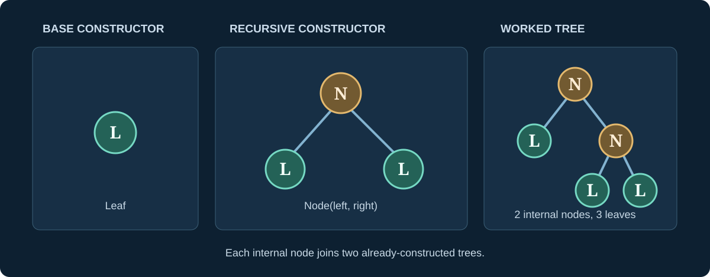

> [!abstract] Prerequisites & where this leads
> **Builds on:** [sets and functions](./functions-relations), [induction on natural numbers](./peano-arithmetic#induction-a-theorem-engine-not-a-repeated-calculation).
> **Leads to:** [State Machines and Invariants](./state-machines-invariants), [Combinatorial Reasoning](./combinatorial-reasoning), and [Recurrences](./sequences-and-series#recurrence-relations).

A recursively defined object is built from **base objects** by repeating specified **construction rules**. Structural induction proves something about *every object that can be built*, even when the objects are trees, formulas, or programs rather than numbers.

The important distinction is between (1) rules saying **which objects exist**, (2) a recursion defining a **function on those objects**, and (3) induction establishing a **property of all such objects**.

## Begin with a recursively constructed tree

Define the set $T$ of **full binary trees** by two rules:

1. **Base constructor:** $\operatorname{Leaf}$ is a tree.
2. **Recursive constructor:** if $L,R\in T$, then $\operatorname{Node}(L,R)\in T$.

No other objects are in $T$. Read $\operatorname{Node}(L,R)$ as "a node with left subtree L and right subtree R." Every internal node has **exactly two children**; this is what *full* means here, not that all leaves are at the same depth.

*Figure: Trees are built by constructors. Induction follows the **construction**, not a numerical ordering of labels.*

A few examples are

$$
\operatorname{Leaf},\quad
\operatorname{Node}(\operatorname{Leaf},\operatorname{Leaf}),\quad
\operatorname{Node}(\operatorname{Leaf},\operatorname{Node}(\operatorname{Leaf},\operatorname{Leaf})).
$$

We can describe arbitrarily large trees with just two rules.

> [!distinction] Finite constructions matter
> These are **finite** trees generated by finitely many constructor applications. The definition does not admit an object that contains itself as a proper subtree. Other mathematical settings study infinite trees or cyclic graphs, but the induction principle here concerns exactly the finite objects built by these rules.

## Recursion defines functions on trees

Let $L(t)$ count leaves and $I(t)$ count internal nodes. Define both **recursively**:

$$
\begin{aligned}
L(\operatorname{Leaf})&=1,& I(\operatorname{Leaf})&=0,\\
L(\operatorname{Node}(a,b))&=L(a)+L(b),&
I(\operatorname{Node}(a,b))&=1+I(a)+I(b).
\end{aligned}
$$

These formulas are definitions, not theorems. They specify the answer for a leaf and how to combine answers for two smaller trees.

**Worked calculation.** Take $t=\operatorname{Node}(\operatorname{Leaf},\operatorname{Node}(\operatorname{Leaf},\operatorname{Leaf}))$. The right subtree has $L=1+1=2$ and $I=1+0+0=1$. Therefore

$$
L(t)=1+2=3,\qquad I(t)=1+0+1=2.
$$

Notice that the two subtrees can have different shapes. The recursion works because their values have already been defined.

## Structural induction: the proof rule

> [!theorem] Structural induction for full binary trees
> To prove a property $P(t)$ for **every** finite tree $t\in T$, it suffices to prove:
> 1. **Base:** $P(\operatorname{Leaf})$.
> 2. **Constructor step:** for arbitrary trees $a,b$, assuming $P(a)$ **and** $P(b)$, prove $P(\operatorname{Node}(a,b))$.

Why is this sufficient? Every tree is a leaf or was constructed from two earlier, smaller trees. By ordinary induction on the **number of constructor applications**, every finite construction satisfies the property. Structural induction packages that argument in the shape of the data.

### Worked proof: leaves equal internal nodes plus one

> [!theorem] Counting a full binary tree
> Every finite full binary tree satisfies
> $$
> L(t)=I(t)+1.
> $$

> [!proof] Follow the constructors
> **Base:** for $t=\operatorname{Leaf}$, $L(t)=1$, $I(t)=0$, hence $L(t)=I(t)+1$.
>
> **Step:** assume $L(a)=I(a)+1$ and $L(b)=I(b)+1$. Then
> $$
> \begin{aligned}
> L(\operatorname{Node}(a,b))
> &=L(a)+L(b)\\
> &=(I(a)+1)+(I(b)+1) &&\text{(induction hypotheses)}\\
> &=I(a)+I(b)+2\\
> &=(1+I(a)+I(b))+1\\
> &=I(\operatorname{Node}(a,b))+1.
> \end{aligned}
> $$
> Both cases hold. Structural induction establishes the theorem for every finite full binary tree.

The proof depends only on constructor laws, so no enumeration of trees or assumptions about balance are needed.

> [!counterexample] Using only one induction hypothesis
> In the constructor step, assuming the statement for *only the left subtree* is insufficient. The right subtree may be arbitrarily large, and $L(b)$ cannot be replaced by $I(b)+1$ without a justification. A recursive constructor with two recursive arguments generally requires an induction hypothesis for **both**.

## Lists are another inductive object

For elements from a set $A$, define lists by

- the empty list $[]$;
- $\operatorname{Cons}(x,xs)$ when $x\in A$ and $xs$ is a list.

Read $\operatorname{Cons}(x,xs)$ as "put x at the front of xs." Every finite list is obtained by finitely many applications of the second rule to the empty list.

Define length and concatenation recursively:

$$
\begin{aligned}
|[]|&=0,& |\operatorname{Cons}(x,xs)|&=1+|xs|,\\
[]\mathbin{+\!\!+}ys&=ys,&
\operatorname{Cons}(x,xs)\mathbin{+\!\!+}ys&=\operatorname{Cons}(x,xs\mathbin{+\!\!+}ys).
\end{aligned}
$$

The symbol $+\!\!+$ is read "list concatenation," *not* numerical addition.

> [!theorem] Length of concatenation
> For all lists $xs,ys$,
> $$
> |xs\mathbin{+\!\!+}ys|=|xs|+|ys|.
> $$

> [!proof] Induct structurally on xs, with ys arbitrary
> **Base:** if $xs=[]$, then $|[]\mathbin{+\!\!+}ys|=|ys|=0+|ys|$.
>
> **Step:** suppose the statement holds for $xs$. For a new head $x$,
> $$
> \begin{aligned}
> |\operatorname{Cons}(x,xs)\mathbin{+\!\!+}ys|
> &=|\operatorname{Cons}(x,xs\mathbin{+\!\!+}ys)|\\
> &=1+|xs\mathbin{+\!\!+}ys|\\
> &=1+(|xs|+|ys|) &&\text{(induction hypothesis)}\\
> &=(1+|xs|)+|ys|\\
> &=|\operatorname{Cons}(x,xs)|+|ys|.
> \end{aligned}
> $$
> This covers every finite first list and every second list.

The choice of what to induct on matters. We induct on $xs$ because **concatenation recurses on its first argument**.

## Syntax trees: proofs about formulas

A tiny Boolean-expression grammar can use constructors

$$
e::=\operatorname{True}\mid\operatorname{False}
\mid\operatorname{Not}(e)
\mid\operatorname{And}(e,e).
$$

The notation $::=$ is read "is defined by the following alternatives." Every expression is a finite syntax tree; evaluation can be defined recursively by evaluating child expressions first.

To show that evaluation always returns a Boolean value, prove the property for the two constants, then show that $\operatorname{Not}$ preserves Boolean values and $\operatorname{And}$ combines two Boolean values into another. **Structural induction matches the grammar.**

This is the mathematical pattern behind proofs about parsers, interpreters, algebraic data types, and compiler transformations.

## Recursion, termination, and well-foundedness

A recursive definition must be **legitimate**: its recursive calls need to lead to previously defined or smaller cases. For finite trees, each subtree contains fewer constructor applications than its parent. For a list, the tail has smaller length.

> [!distinction] Self-reference is not sufficient
> Writing $f(n)=f(n)+1$ is **not** a definition of an ordinary function on natural numbers: it neither reduces to a base case nor has a solution. A valid recursion specifies a base case and a descent that justifies reaching it.

A **well-founded order** is one in which no nonempty subset lacks a minimal element; it supports induction by assuming the property for *all strict predecessors*. This generalizes structural induction and connects to [Order Theory](./order-theory#well-foundedness-and-well-ordering).

## When to use which induction

| Situation | Natural proof method | What is assumed |
|---|---|---|
| A statement for $n=0,1,2,\ldots$ | Ordinary induction | Statement for $n$ |
| A property using several smaller indices | Strong induction | Statements for all smaller indices |
| A recursively defined list | Structural induction | Statement for its tail |
| A binary tree | Structural induction | Statements for both subtrees |
| An algorithm making progress | Invariant plus termination argument | Property preserved by a state transition |

**Next:** [State Machines, Invariants, and Termination](./state-machines-invariants) applies the same base-and-step idea to **processes that evolve over time**, rather than static objects built from constructors.
